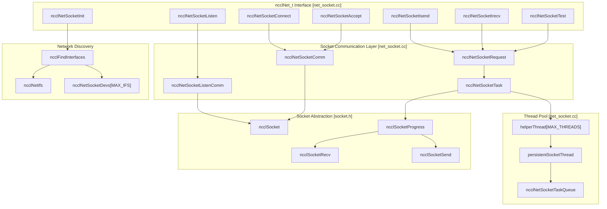
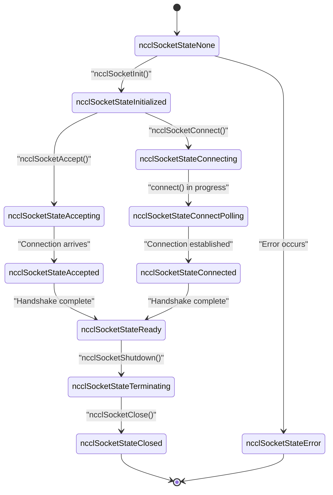
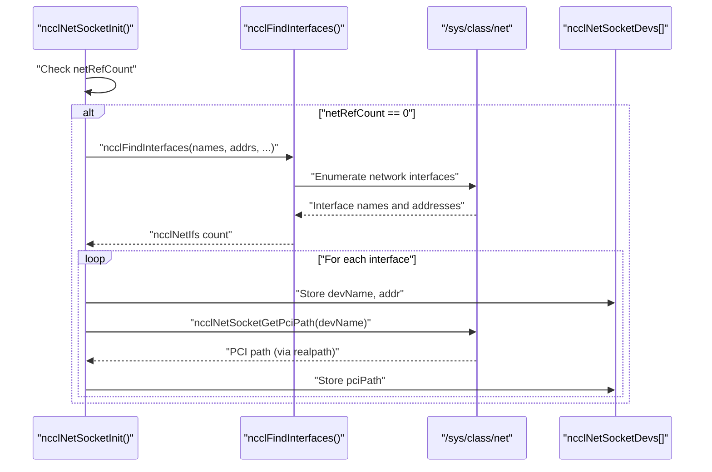
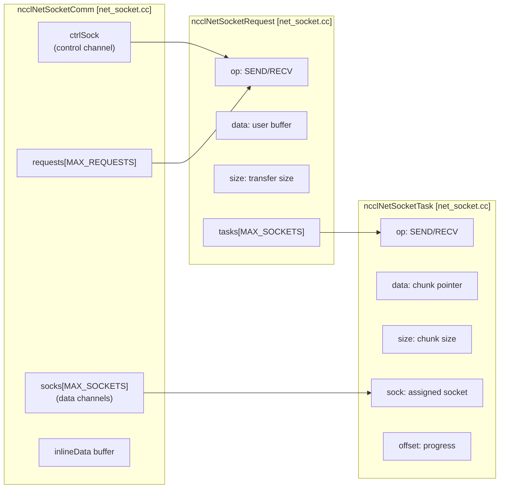
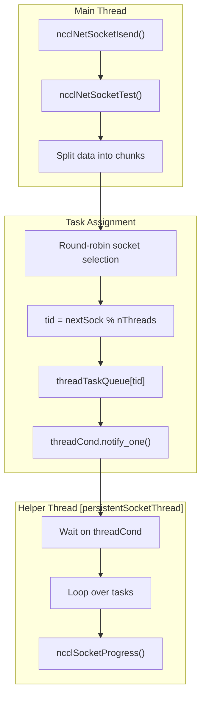

<!-- source: DeepWiki mcp.deepwiki.com · repo NVIDIA/nccl · page 5.4 Socket-Based Transport · fetched 2026-10-28 -->

# Socket-Based Transport

Relevant source files

The following files were used as context for generating this wiki page:

- [src/include/core.h](src/include/core.h)
- [src/include/socket.h](src/include/socket.h)
- [src/misc/socket.cc](src/misc/socket.cc)
- [src/transport/net_socket.cc](src/transport/net_socket.cc)

## Purpose and Scope

The Socket-Based Transport provides TCP/IP socket communication for inter-node NCCL operations. It implements the `ncclNet_t` plugin interface to enable network communication between GPUs on different physical nodes when specialized RDMA hardware (like InfiniBand) is unavailable or disabled. This transport uses standard Berkeley sockets with optimizations including multi-socket parallelism, multi-threading, and inline data transfer for small messages.

For information about other transport mechanisms, see page 5.1 for intra-node GPU-to-GPU transfers, page 5.3 for high-performance inter-node communication, and page 5.8 for the plugin architecture details.

Sources: [src/transport/net_socket.cc:1-745]()

## Architecture Overview

The Socket-Based Transport implements a multi-socket, multi-thread architecture to maximize network bandwidth utilization. The implementation consists of three main layers:

1.  **Socket Abstraction Layer**: Low-level socket operations with state machine management defined in `ncclSocket` [src/include/socket.h:83-100]().
2.  **Network Interface Management**: Device discovery and configuration using `ncclNetSocketDev` [src/transport/net_socket.cc:24-29]().
3.  **Transport Communication Layer**: High-level send/receive operations with parallelism via `ncclNetSocketComm` [src/transport/net_socket.cc:214-231]().

### Component Relationship Diagram

**Diagram: Socket Transport Architecture and Component Relationships**

Sources: [src/transport/net_socket.cc:23-231](), [src/include/socket.h:83-100]()

## Socket Abstraction Layer

The `ncclSocket` structure [src/include/socket.h:83-100]() provides a unified abstraction over Berkeley sockets with built-in state management, async operation support, and error handling. Each socket maintains its own state machine and metadata.

### Socket Structure and State Machine

| Field | Type | Purpose |
| :--- | :--- | :--- |
| `socketDescriptor` | `ncclSocketDescriptor` | The underlying OS socket file descriptor [src/include/socket.h:84]() |
| `acceptSocketDescriptor` | `ncclSocketDescriptor` | Socket descriptor for accepted connections [src/include/socket.h:85]() |
| `state` | `enum ncclSocketState` | Current socket state (e.g., Initialized, Connected, Ready) [src/include/socket.h:90]() |
| `addr` | `union ncclSocketAddress` | Socket address (IPv4/IPv6) [src/include/socket.h:87]() |
| `abortFlag` | `volatile uint32_t*` | Pointer to abort flag for cooperative cancellation [src/include/socket.h:88]() |
| `asyncFlag` | `int` | Whether socket operates in async mode [src/include/socket.h:89]() |
| `type` | `enum ncclSocketType` | Socket purpose (Bootstrap, Proxy, NetSocket, etc.) [src/include/socket.h:93]() |
| `magic` | `uint64_t` | Magic number for validation [src/include/socket.h:92]() |

Sources: [src/include/socket.h:58-100]()

### State Transitions

**Diagram: Socket State Machine Transitions**

The state machine [src/include/socket.h:58-72]() supports both blocking and non-blocking (async) operations. In async mode, operations like `ncclSocketConnect` [src/include/socket.h:126]() and `ncclSocketAccept` [src/include/socket.h:131]() return immediately and must be polled using `ncclSocketReady` [src/include/socket.h:128]() to check completion.

Sources: [src/include/socket.h:58-72](), [src/include/socket.h:119-148]()

## Network Interface Discovery

During initialization, the Socket Transport discovers available network interfaces and their properties. This information is stored globally and shared across all communicators via a reference counting mechanism [src/transport/net_socket.cc:48-57]().

### Discovery Process

The `ncclNetSocketInit` function [src/transport/net_socket.cc:50-89]() performs the discovery. It uses `ncclFindInterfaces` [src/misc/socket.cc:190-244]() to retrieve interface names and addresses, then stores them in the `ncclNetSocketDevs` array.

**Diagram: Network Interface Discovery Sequence**

Sources: [src/transport/net_socket.cc:50-89](), [src/transport/net_socket.cc:33-39](), [src/misc/socket.cc:190-244]()

### Device Properties

Each discovered network device is represented by `ncclNetSocketDev` [src/transport/net_socket.cc:24-28](). Properties exposed via `ncclNetSocketGetProperties` [src/transport/net_socket.cc:173-195]() include:
*   **Speed**: Detected from `/sys/class/net/{dev}/speed` on Linux [src/transport/net_socket.cc:150-169]() or `GetAdaptersAddresses` on Windows [src/transport/net_socket.cc:100-149]().
*   **PCI Path**: Extracted from `/sys/class/net/{dev}/device` [src/transport/net_socket.cc:33-39]().
*   **Pointer Support**: Set to `NCCL_PTR_HOST` only [src/transport/net_socket.cc:177]().

Sources: [src/transport/net_socket.cc:24-28](), [src/transport/net_socket.cc:173-195]()

## Connection Establishment

Socket connections are established using an asynchronous, multi-socket protocol. The connection process creates multiple data sockets plus one control socket per communicator.

### Multi-Socket Configuration

The number of sockets and threads is determined by `ncclNetSocketGetNsockNthread` [src/transport/net_socket.cc:290-344](). It utilizes several `NCCL_PARAM` settings:

| Parameter | Environment Variable | Default | Description |
| :--- | :--- | :--- | :--- |
| `SocketNthreads` | `NCCL_SOCKET_NTHREADS` | Auto-detect | Number of helper threads (max: 16) |
| `SocketNsocksPerThread` | `NCCL_NSOCKS_PERTHREAD` | Auto-detect | Sockets per thread (max total: 64) |

**Auto-Detection Logic [src/transport/net_socket.cc:315-334]():**
*   **AWS devices**: 2 threads × 8 sockets = 16 total.
*   **GCP devices**: 4 threads × 1 socket = 4 total.
*   **Default**: 1 thread × 1 socket.

Sources: [src/transport/net_socket.cc:290-344](), [src/transport/net_socket.cc:199-201]()

### Connection State Machine

The connection process is resumable—if a socket is not ready, the function returns `ncclSuccess` with `*sendComm` or `*recvComm` set to `NULL` [src/transport/net_socket.cc:433, 473](), allowing the caller to retry. The `ncclNetSocketCommStage` structure [src/transport/net_socket.cc:155-160]() maintains the current stage (e.g., `ncclNetSocketCommStageConnect`, `ncclNetSocketCommStageSendIdx`).

Sources: [src/transport/net_socket.cc:375-474](), [src/transport/net_socket.cc:155-160]()

## Data Transfer Mechanism

The Socket Transport implements a two-phase transfer protocol with inline optimization for small messages and work distribution for large transfers.

### Data Flow Entity Diagram

**Diagram: Request and Task Structure Relationships**

Sources: [src/transport/net_socket.cc:170-197](), [src/transport/net_socket.cc:214-231]()

### Transfer Protocol

1.  **Control Exchange**: Both sides exchange a 4-byte size and inline data on the `ctrlSock` [src/transport/net_socket.cc:538-642]().
2.  **Data Transfer**: If the data fits in the inline buffer (≤ `SocketInlineSize`, default 128B [src/transport/net_socket.cc:203]()), transfer is complete. Otherwise, the remaining data is split into `ncclNetSocketTask` objects [src/transport/net_socket.cc:170-178]() across the data `socks[]`.

Sources: [src/transport/net_socket.cc:538-642](), [src/transport/net_socket.cc:203]()

## Multi-Socket and Multi-Thread Architecture

Large transfers are parallelized across multiple sockets and processed by a pool of persistent helper threads.

### Thread Pool Architecture

Each `ncclNetSocketComm` maintains helper threads with `ncclNetSocketThreadResources` [src/transport/net_socket.cc:205-212](), which includes a `ncclNetSocketTaskQueue` [src/transport/net_socket.cc:199-203]().

**Diagram: Task Distribution and Thread Execution Flow**

Sources: [src/transport/net_socket.cc:233-288](), [src/transport/net_socket.cc:496-533]()

### Work Partitioning Strategy

When `ncclNetSocketTest` [src/transport/net_socket.cc:541-645]() is called, it partitions the data into tasks using `SocketMinTaskSize` [src/transport/net_socket.cc:204]() (default 64 KiB). This ensures load balancing across the available data sockets.

Sources: [src/transport/net_socket.cc:587-598]()

## Request and Task Management

### Request Pool Management

Each `ncclNetSocketComm` maintains a fixed pool of `MAX_REQUESTS` [src/transport/net_socket.cc:231](). `ncclNetSocketGetRequest` [src/transport/net_socket.cc:479-494]() scans for an available slot where `r->used == 0`.

| State (`used`) | Meaning |
| :--- | :--- |
| 0 | Available [src/transport/net_socket.cc:482]() |
| 1 | Control exchange in progress [src/transport/net_socket.cc:492]() |
| 2 | Data transfer/task execution in progress [src/transport/net_socket.cc:585]() |

Sources: [src/transport/net_socket.cc:185-197](), [src/transport/net_socket.cc:479-494]()

### Completion Detection

`ncclNetSocketTest` [src/transport/net_socket.cc:541-645]() checks completion:
*   **Multi-socket**: Iterates over `r->tasks`. When all tasks have `offset == size`, it sets `*done = 1` and frees the request [src/transport/net_socket.cc:601-616]().
*   **Single-socket**: Drives progress directly on `r->ctrlSock` until the handshake/inline data is complete [src/transport/net_socket.cc:618-642]().

Sources: [src/transport/net_socket.cc:541-645]()

## Integration with NCCL Transport Layer

The Socket Transport implements the `ncclNet_t` interface [src/transport/net_socket.cc:724-747]().

| `ncclNet_t` slot | Implementation | Notes |
| :--- | :--- | :--- |
| `init` | `ncclNetSocketInit` | Interface discovery [src/transport/net_socket.cc:50]() |
| `getProperties` | `ncclNetSocketGetProperties` | Reports `NCCL_PTR_HOST` [src/transport/net_socket.cc:177]() |
| `listen` | `ncclNetSocketListen` | Creates `ncclNetSocketListenComm` [src/transport/net_socket.cc:346]() |
| `connect` | `ncclNetSocketConnect` | Async connection logic [src/transport/net_socket.cc:375]() |
| `accept` | `ncclNetSocketAccept` | Async acceptance logic [src/transport/net_socket.cc:435]() |
| `isend` / `irecv` | `ncclNetSocketIsend`/`Irecv` | Request allocation [src/transport/net_socket.cc:535, 538]() |
| `test` | `ncclNetSocketTest` | Drives task/control progress [src/transport/net_socket.cc:541]() |

Sources: [src/transport/net_socket.cc:724-747]()

---

