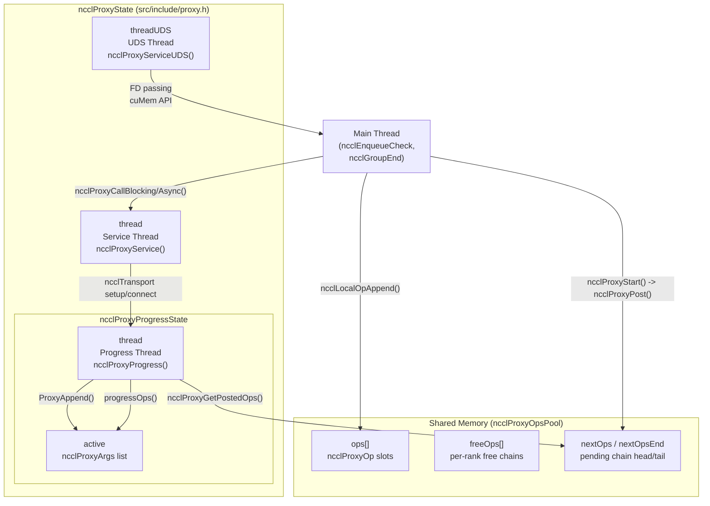
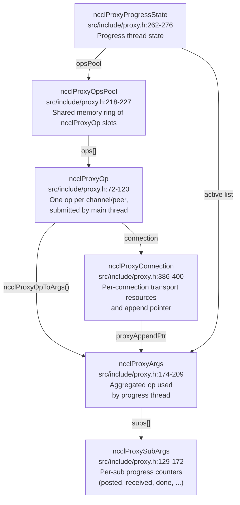
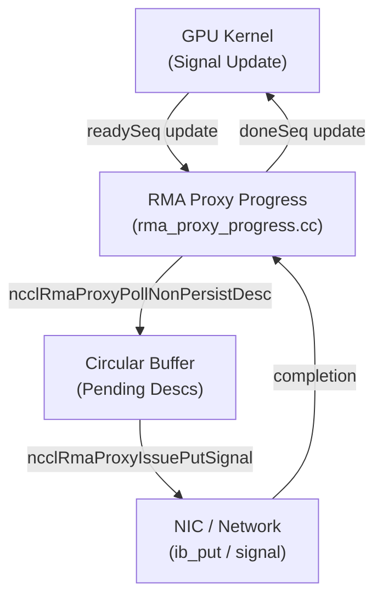
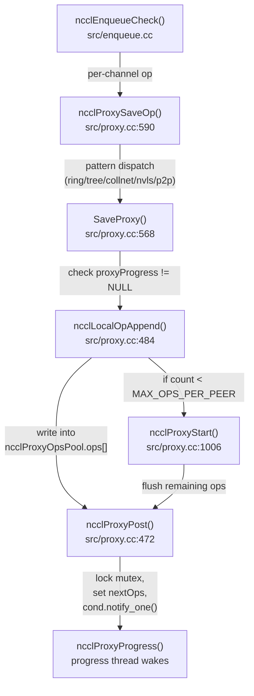
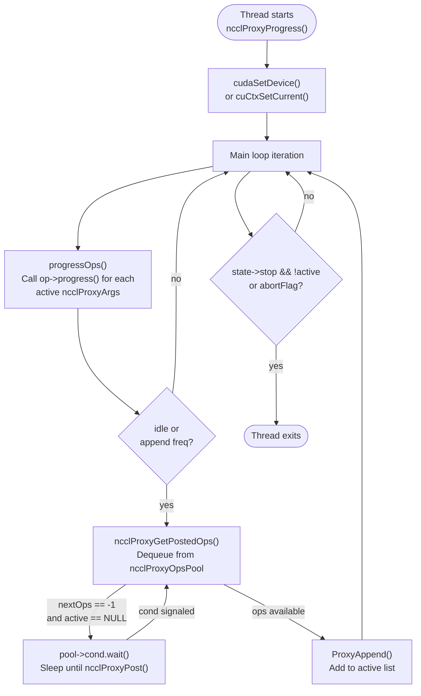
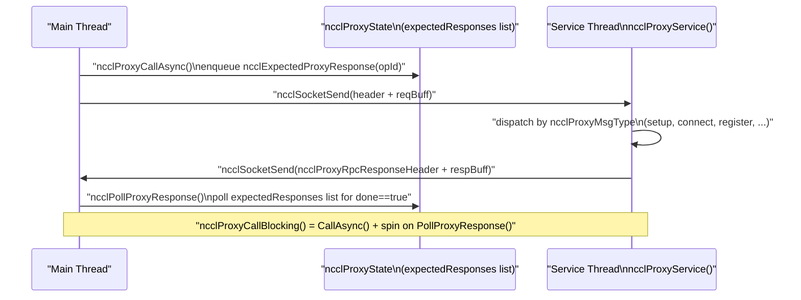

<!-- source: DeepWiki mcp.deepwiki.com · repo NVIDIA/nccl · page 5.6 Proxy Service Architecture · fetched 2026-10-28 -->

# Proxy Service Architecture

<details>
<summary>Relevant source files</summary>

The following files were used as context for generating this wiki page:

- [docs/userguide/source/api/p2p.rst](docs/userguide/source/api/p2p.rst)
- [docs/userguide/source/usage/p2p.rst](docs/userguide/source/usage/p2p.rst)
- [src/bootstrap.cc](src/bootstrap.cc)
- [src/debug.cc](src/debug.cc)
- [src/group.cc](src/group.cc)
- [src/include/comm.h](src/include/comm.h)
- [src/include/enqueue.h](src/include/enqueue.h)
- [src/include/proxy.h](src/include/proxy.h)
- [src/include/rma/rma.h](src/include/rma/rma.h)
- [src/include/rma/rma_proxy.h](src/include/rma/rma_proxy.h)
- [src/include/transport.h](src/include/transport.h)
- [src/init.cc](src/init.cc)
- [src/proxy.cc](src/proxy.cc)
- [src/rma/rma.cc](src/rma/rma.cc)
- [src/rma/rma_proxy.cc](src/rma/rma_proxy.cc)
- [src/rma/rma_proxy_launch.cc](src/rma/rma_proxy_launch.cc)
- [src/rma/rma_proxy_progress.cc](src/rma/rma_proxy_progress.cc)
- [src/transport.cc](src/transport.cc)

</details>


## Purpose and Scope

The proxy service is a CPU-side thread subsystem that drives network transport operations on behalf of GPU kernels. GPU kernels cannot block on CPU-side network APIs (InfiniBand verbs, socket calls, etc.), so a dedicated CPU thread manages the network data path while the GPU executes collective operations. This page covers the proxy thread model, data structures, operation submission pipeline, inter-process communication, and the connection state machine.

For details on which transport types require proxy service, see the Transport Layer overview ([5]()), P2P transport ([5.1]()), and Network transport ([5.3](), [5.4]()). For the enqueue pipeline that submits operations to the proxy, see [4.2]().

---

## Thread Model

The proxy service runs three distinct threads per communicator group.

**Proxy Service Architecture: Thread Roles**



Sources: [src/include/proxy.h:268-286](), [src/proxy.cc:944-1003](), [src/proxy.cc:33]()

| Thread | Field in `ncclProxyState` | Entry Function | Responsibility |
|---|---|---|---|
| Service thread | `thread` | `ncclProxyService()` | Accept peer socket connections; dispatch RPC messages (init, setup, connect, close) |
| UDS thread | `threadUDS` | `ncclProxyServiceUDS()` | Handle Unix Domain Socket messages for file-descriptor passing (cuMem API) |
| Progress thread | `progressState.thread` | `ncclProxyProgress()` | Poll active ops, call transport progress functions, consume the shared ops pool |

---

## Key Data Structures

### Operation Descriptors

**Data Structure Relationships**



Sources: [src/include/proxy.h:72-276](), [src/proxy.cc:363-433]()

#### `ncclProxyOp`
[src/include/proxy.h:72-120]()

Represents a single pending network operation as submitted by the main thread. Key fields:

| Field | Type | Meaning |
|---|---|---|
| `connection` | `ncclProxyConnection*` | Which transport connection to use |
| `pattern` | `uint8_t (ncclPattern_t)` | Communication pattern (ring, tree, collnet, nvls, send, recv) |
| `opCount` | `uint64_t` | Collective operation sequence number |
| `nsteps` | `int` | Number of pipeline steps |
| `nbytes` | `ssize_t` | Total bytes to transfer |
| `channelId` | `uint8_t` | Channel index |
| `enqNext` | `ncclProxyOp*` | Next op in the enqueued list |

#### `ncclProxyArgs`
[src/include/proxy.h:174-209]()

The aggregated form of one or more proxy ops used by the progress thread. A single `ncclProxyArgs` may cover multiple channels (sub-operations) sharing the same operation count and peer.

| Field | Type | Meaning |
|---|---|---|
| `subs[]` | `ncclProxySubArgs[NCCL_PROXY_MAX_SUBS]` | Per-channel sub-operation state |
| `progress` | `proxyProgressFunc_t` | Transport-specific progress callback |
| `state` | `int` | `ncclProxyOpNone`, `ncclProxyOpReady`, `ncclProxyOpProgress` |
| `next` | `ncclProxyArgs*` | Next args in the active list |
| `nextPeer` | `ncclProxyArgs*` | Next args queued behind this for the same peer |
| `proxyAppendPtr` | `ncclProxyArgs**` | Back-pointer used when removing from list |

#### `ncclProxySubArgs`
[src/include/proxy.h:129-172]()

Tracks per-step progress for a single sub-operation (one channel, one peer):

| Counter | Meaning |
|---|---|
| `posted` | Steps posted to the network |
| `received` | Steps where data has arrived |
| `flushed` | Steps flushed to GPU memory |
| `transmitted` | Steps transmitted to the peer |
| `done` | Steps acknowledged complete |

---

### Shared Memory Pool

`ncclProxyOpsPool` is a shared memory region (opened via `ncclShmOpen`) that connects the main thread's `ncclLocalOpAppend()` calls to the progress thread's consumption loop.

[src/include/proxy.h:218-227]()

```
ncclProxyOpsPool layout in /dev/shm/nccl-XXXXXX:
┌────────────────────────────────────────────────────────────┐
│ ops[MAX_OPS_PER_PEER * NCCL_MAX_LOCAL_RANKS]               │  ← ncclProxyOp slots
│ nextOps (volatile int)    — head of pending chain          │
│ nextOpsEnd (volatile int) — tail of pending chain          │
│ freeOps[NCCL_MAX_LOCAL_RANKS] — per-rank free-list heads   │
│ mutex + cond              — for progress thread sleep/wake  │
└────────────────────────────────────────────────────────────┘
```

`MAX_OPS_PER_PEER` is defined to hold two full rounds of operations for all channels. [src/include/proxy.h:216]()

---

### RMA Proxy Service

NCCL also implements a specialized proxy for Remote Memory Access (RMA) operations, typically used with GPU-initiated networking (GIN).

**RMA Proxy State Machine**



Sources: [src/rma/rma_proxy_progress.cc:110-149](), [src/rma/rma_proxy.cc:115-164]()

The RMA proxy uses a lock-free circular buffer for low-latency operation submission [src/rma/rma_proxy.cc:138-157](). It tracks `readySeq` (from GPU) and `doneSeq` (to GPU) to coordinate asynchronous transfers [src/rma/rma_proxy_launch.cc:71-89]().

---

## Operation Submission Pipeline

When a collective or P2P operation is enqueued, the main thread routes proxy operations as follows:

**Operation Submission: ncclProxySaveOp → ncclProxyStart**



Sources: [src/proxy.cc:590-731](), [src/proxy.cc:484-547](), [src/proxy.cc:472-482](), [src/proxy.cc:1006-1020]()

### Pattern Routing in `ncclProxySaveOp`

[src/proxy.cc:590-731]()

`ncclProxySaveOp` dispatches to `SaveProxy` based on `op->pattern`. `SaveProxy` [src/proxy.cc:568-586]() returns early if `connector->proxyConn.proxyProgress == NULL`, meaning the transport handles this operation entirely on the GPU and no CPU proxy is needed.

---

## Progress Thread Loop

`ncclProxyProgress` [src/proxy.cc:944-1003]() is the core of the proxy service:

**Progress Thread State Machine**



Sources: [src/proxy.cc:944-1003](), [src/proxy.cc:791-870](), [src/proxy.cc:765-787]()

---

## RPC Mechanism: Blocking and Async Calls

Transport setup (setup, connect, buffer registration) goes through an RPC protocol over the TCP socket to the service thread.

**RPC Call Patterns**



Sources: [src/include/proxy.h:432-443](), [src/proxy.cc:1186-1300]()

| Function | Behavior |
|---|---|
| `ncclProxyCallAsync()` | Sends request, registers opId in `expectedResponses`, returns immediately [src/proxy.cc:1232-1264]() |
| `ncclPollProxyResponse()` | Checks if the response for `opId` is done [src/proxy.cc:1274-1288]() |
| `ncclProxyCallBlocking()` | Calls `ncclProxyCallAsync` then spins on `ncclPollProxyResponse` [src/proxy.cc:1290-1300]() |

---

## UDS / IPC Mechanism

The UDS (Unix Domain Socket) subsystem enables file descriptor passing for the CUDA `cuMem` API, which requires that memory import handles are passed as open file descriptors across process boundaries rather than as opaque integers.

[src/include/proxy.h:310-318](), [src/proxy.cc:1185-1230]()

`ncclProxyCallBlockingUDS` [src/proxy.cc:1186]():
1. Creates a temporary `ncclIpcSocket` for the response.
2. Fills `ncclIpcHdr` and calls `ncclIpcSocketSendMsg` to the UDS thread, embedding the open FD in the ancillary data.
3. Blocks until `ncclIpcSocketRecvMsg` returns the response FD.

The UDS thread (`proxyState->threadUDS`) accepts such messages and maps or passes the FD to the requesting process [src/proxy.cc:33]().

Sources:
- `src/proxy.cc`
- `src/include/proxy.h`
- `src/rma/rma_proxy.cc`
- `src/rma/rma_proxy_launch.cc`
- `src/rma/rma_proxy_progress.cc`
- `src/init.cc`
- `src/group.cc`

---

