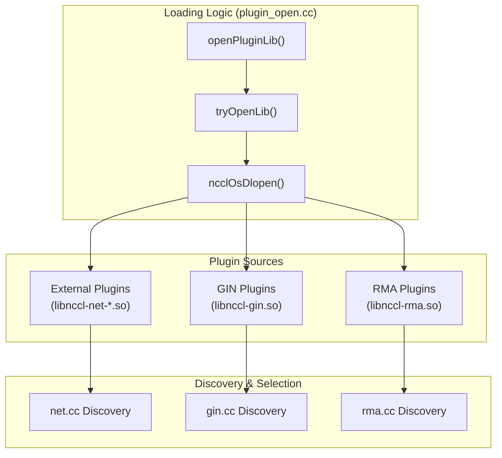
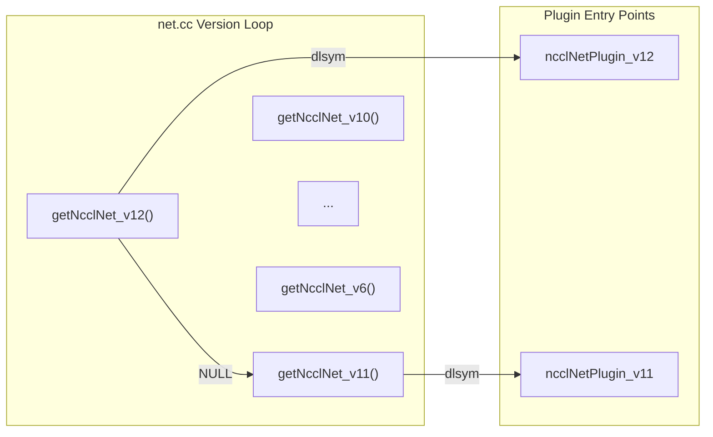

<!-- source: DeepWiki mcp.deepwiki.com · repo NVIDIA/nccl · page 5.8 Network Plugin Interface · fetched 2026-10-28 -->

# Network Plugin Interface

Relevant source files

The following files were used as context for generating this wiki page:

- [plugins/net/example/nccl/gin_v11.h](plugins/net/example/nccl/gin_v11.h)
- [plugins/net/example/nccl/net.h](plugins/net/example/nccl/net.h)
- [plugins/net/example/nccl/net_device.h](plugins/net/example/nccl/net_device.h)
- [src/include/os.h](src/include/os.h)
- [src/include/plugin/nccl_net.h](src/include/plugin/nccl_net.h)
- [src/include/plugin/plugin.h](src/include/plugin/plugin.h)
- [src/os/linux.cc](src/os/linux.cc)
- [src/os/windows.cc](src/os/windows.cc)
- [src/plugin/gin.cc](src/plugin/gin.cc)
- [src/plugin/plugin_open.cc](src/plugin/plugin_open.cc)
- [src/plugin/rma.cc](src/plugin/rma.cc)

## Purpose and Scope

The Network Plugin Interface defines the abstraction layer that allows NCCL to support multiple network backends through a common API. This interface enables NCCL to work with different network technologies (TCP/IP sockets, InfiniBand/RoCE, proprietary networks) without changing the core library code. Plugins implement the `ncclNet_t` interface to provide network communication capabilities.

NCCL supports both built-in plugins (socket and InfiniBand) and external plugins loaded dynamically at runtime via `plugin_open.cc` [src/plugin/plugin_open.cc:79-130](). The plugin system includes version negotiation to ensure API compatibility and allows multiple plugins to coexist, with automatic selection based on network configuration. In addition to standard networking (`ncclNet_t`), the interface supports Collective Networking (`ncclCollNet_t`), GPU-Initiated Networking (`ncclGin_t`), and Remote Memory Access (`ncclRma_t`).

## Plugin Loading and Discovery

### Plugin Types and Sources

NCCL supports several types of plugins managed through a unified loading mechanism in `plugin_open.cc`. These types are defined in `ncclPluginType` [src/include/plugin/plugin.h:13-20]().

**Plugin Loading Architecture**

Sources: [src/plugin/plugin_open.cc:79-130](), [src/plugin/plugin_open.cc:31-57](), [src/include/plugin/plugin.h:13-20]()

The plugin loading process follows these steps:
1.  **Library Resolution**: `openPluginLib` constructs the expected library name based on the `ncclPluginType`. It searches for a specific name provided by environment variables or falls back to standard prefixes like `libnccl-net.so` [src/plugin/plugin_open.cc:85-89]().
2.  **Dynamic Loading**: `tryOpenLib` calls `ncclOsDlopen` to load the shared object into the process address space [src/plugin/plugin_open.cc:41-41](). This utilizes platform-specific implementations in `os/linux.cc` [src/os/linux.cc:51-57]() or `os/windows.cc` [src/os/windows.cc:73-79]().
3.  **Path Resolution**: On Linux, `getLibPath` uses `dlinfo` with `RTLD_DI_LINKMAP` to resolve the absolute path of the loaded plugin for logging [src/plugin/plugin_open.cc:65-69]().
4.  **Handle Storage**: Loaded handles are stored in `libHandles` and their paths in `ncclPluginLibPaths` [src/plugin/plugin_open.cc:19-21]().

Sources: [src/plugin/plugin_open.cc:22-25](), [src/plugin/plugin_open.cc:79-130](), [src/os/linux.cc:51-57](), [src/os/windows.cc:73-79]()

### Version Negotiation

NCCL maintains backward compatibility by negotiating the highest supported API version between the library and the plugin.

**Plugin API Version Negotiation**

Sources: [src/plugin/gin.cc:24-26](), [src/plugin/rma.cc:25-27]()

The version negotiation process:
1.  **NET/CollNet**: The loading logic attempts to resolve symbols via `getNcclNet` and `getNcclCollNet` function pointers across supported versions [src/include/plugin/nccl_net.h:44-50]().
2.  **GIN**: `ncclGinPluginLoad` checks versions 14 and 13 [src/plugin/gin.cc:25-26](). It resolves the `getNcclGin_vX` symbol to populate the `ncclGin_t` structure [src/plugin/gin.cc:79-83]().
3.  **RMA**: `ncclRmaPluginLoad` checks versions 15, 14, and 13 [src/plugin/rma.cc:25-27]().

Sources: [src/plugin/gin.cc:70-104](), [src/plugin/rma.cc:71-102](), [src/include/plugin/nccl_net.h:44-64]()

### Plugin State Management

The lifecycle of network, GIN, and RMA plugins is tracked via state enums (e.g., `ncclGinPluginState_t`, `ncclRmaPluginState_t`).

| State | Value | Description |
| :--- | :--- | :--- |
| `LoadReady` | 0 | Plugin library is ready to be loaded [src/plugin/gin.cc:34](). |
| `InitReady` | 1 | Library loaded; `getNccl*` symbol resolved [src/plugin/gin.cc:35](). |
| `Enabled` | 2 | Plugin `init()` succeeded and devices found [src/plugin/gin.cc:36](). |
| `LoadFailed` | -1 | `dlopen` or symbol resolution failed [src/plugin/gin.cc:33](). |
| `Disabled` | -2 | Internal `init()` or `devices()` call failed [src/plugin/gin.cc:32](). |

Sources: [src/plugin/gin.cc:31-37](), [src/plugin/rma.cc:32-38]()

## Plugin Interface Contracts

### ncclNet_t and ncclCollNet_t
These structures provide the core networking primitives. `ncclNet_t` (currently aliased to v12) handles point-to-point transfers, while `ncclCollNet_t` provides collective offload [src/include/plugin/nccl_net.h:54-55]().

- **Properties**: `getProperties` returns `ncclNetProperties_t`, which includes the `netDeviceType` (Host, Unpack, GIN Proxy, GIN GDAKI) [plugins/net/example/nccl/net_device.h:18-23]().
- **Memory**: `regMr` and `regMrDmaBuf` register memory for RDMA operations [plugins/net/example/nccl/gin_v11.h:31-32]().
- **Communication**: `isend`, `irecv`, `iflush`, and `test` drive the asynchronous state machine.

Sources: [src/include/plugin/nccl_net.h:54-60](), [plugins/net/example/nccl/net_device.h:18-23]()

### ncclGin_t (GPU-Initiated Networking)
GIN plugins allow GPU kernels to initiate network operations directly.
- **Contexts**: `createContext` creates a device-side handle (`ncclNetDeviceHandle_t`) passed to the GPU [plugins/net/example/nccl/gin_v11.h:27-29]().
- **Operations**: `iput` and `iputSignal` allow remote writes with optional signal/completion notifications [plugins/net/example/nccl/gin_v11.h:39-45]().
- **Progress**: `ginProgress` is called by the proxy thread if the device requires host-side assistance [plugins/net/example/nccl/gin_v11.h:50-51]().

Sources: [plugins/net/example/nccl/gin_v11.h:10-58](), [src/plugin/gin.cc:103-129]()

### ncclRma_t (Remote Memory Access)
RMA plugins specialize in remote memory operations, often used as a backend for GIN Proxy modes.
- **Initialization**: `init` sets up the RMA context with a communicator hash and debug logger [src/plugin/rma.cc:108-111]().
- **Assignment**: `ncclRmaPluginAssignToComm` binds the plugin to the communicator's `rmaState` [src/plugin/rma.cc:128-130]().

Sources: [src/plugin/rma.cc:103-135](), [src/plugin/rma.cc:19-27]()

## Plugin Discovery and Selection

### Selection Logic
NCCL discovers network providers during communicator initialization:
1.  **Enumeration**: `initPluginLibsOnceFunc` scans for plugins based on environment variables like `NCCL_NET_PLUGIN`, `NCCL_GIN_PLUGIN`, and `NCCL_RMA_PLUGIN` [src/plugin/rma.cc:155-175]().
2.  **Assignment**: `ncclGinPluginAssignToComm` binds a specific GIN plugin to the `ncclComm` based on compatibility and `netDeviceType` [src/plugin/gin.cc:131-170]().
3.  **Conflict Resolution**: If an external GIN plugin is a proxy type, NCCL may prefer the internal GIN proxy over the RMA backend [src/plugin/gin.cc:164-170]().

Sources: [src/plugin/gin.cc:131-175](), [src/plugin/rma.cc:123-135](), [src/plugin/rma.cc:155-175]()

### Dynamic Unloading
Plugins are reference-counted. When a communicator is destroyed:
1.  The reference count for the assigned plugin is decremented [src/plugin/gin.cc:56-66]().
2.  If the count reaches zero, `ncclGinPluginUnload` (or equivalent) calls `ncclClosePluginLib` [src/plugin/gin.cc:58-58]().
3.  `ncclOsDlclose` is called to release the library handle [src/plugin/plugin_open.cc:178-178]().

Sources: [src/plugin/gin.cc:55-68](), [src/plugin/rma.cc:56-69](), [src/plugin/plugin_open.cc:176-186]()

## Environment Variables

| Variable | Description |
| :--- | :--- |
| `NCCL_NET_PLUGIN` | Comma-separated list of network plugins to attempt loading [src/plugin/plugin_open.cc:22](). |
| `NCCL_GIN_PLUGIN` | Comma-separated list of GIN plugins to attempt loading [src/plugin/gin.cc:183](). |
| `NCCL_RMA_PLUGIN` | Comma-separated list of RMA plugins to attempt loading [src/plugin/rma.cc:164](). |
| `NCCL_GIN_TYPE` | Filters GIN plugins by `netDeviceType` (e.g., PROXY=2, GDAKI=3) [src/plugin/gin.cc:144](). |
| `GIN_PLUGIN_REF_COUNT` | Reference counting control for GIN plugins [src/plugin/gin.cc:23](). |
| `RMA_PLUGIN_REF_COUNT` | Reference counting control for RMA plugins [src/plugin/rma.cc:24](). |

Sources: [src/plugin/plugin_open.cc:22-25](), [src/plugin/gin.cc:23-26](), [src/plugin/gin.cc:140-150](), [src/plugin/rma.cc:164-175]()

---

