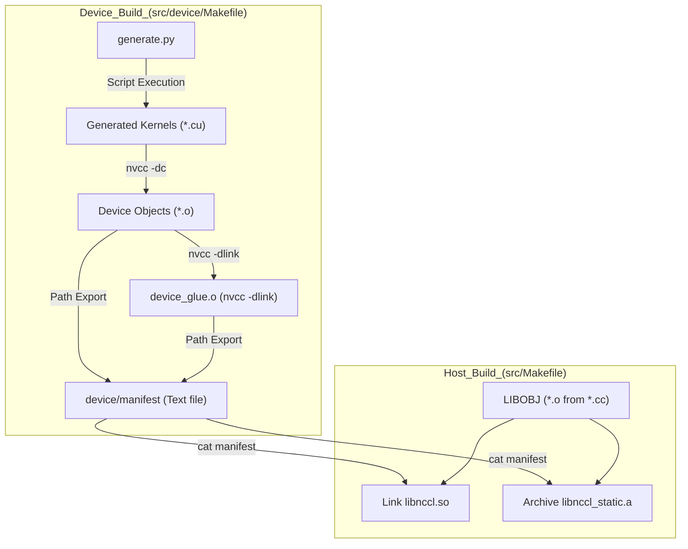
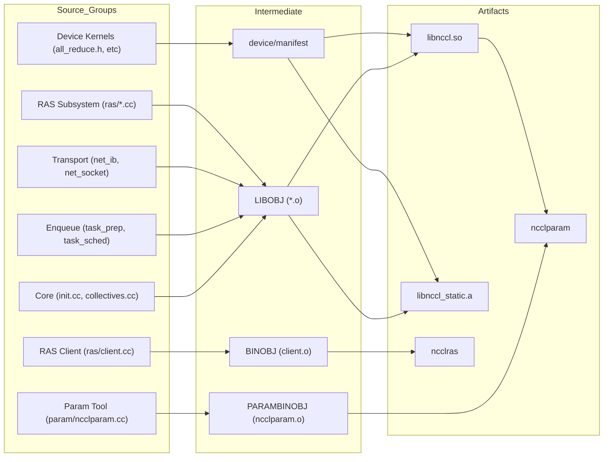

<!-- source: DeepWiki mcp.deepwiki.com · repo NVIDIA/nccl · page 8.2 Source Build System · fetched 2026-10-28 -->

# Source Build System

Relevant source files

The following files were used as context for generating this wiki page:

- [src/CMakeLists.txt](src/CMakeLists.txt)
- [src/Makefile](src/Makefile)
- [src/device/CMakeLists.txt](src/device/CMakeLists.txt)
- [src/device/Makefile](src/device/Makefile)
- [src/device/generate.py](src/device/generate.py)
- [src/include/os/windows.h](src/include/os/windows.h)
- [src/transport/net_efa_gda/CMakeLists.txt](src/transport/net_efa_gda/CMakeLists.txt)
- [src/transport/net_efa_gda/efa-dp-direct/CMakeLists.txt](src/transport/net_efa_gda/efa-dp-direct/CMakeLists.txt)

This document details the source-level build system implemented in `src/Makefile`, including source file organization, compilation workflows, device manifest generation, and library linking. For high-level build orchestration and targets, see [Build Orchestration](). For compiler flags and architecture targeting, see [Build Configuration]().

---

## Overview and Scope

The source build system is responsible for:
- Organizing source files (`.cc` files) into library and binary components.
- Compiling C++ host code into object files.
- Generating a device manifest that references pre-compiled CUDA device code.
- Linking object files and device code into shared and static libraries.
- Generating headers from templates and copying them to the build directory.
- Building the `ncclras` and `ncclparam` binary utilities.

The build process produces:
- `libnccl.so.<version>` - Shared library for dynamic linking. [src/Makefile:65-65](), [src/Makefile:89-90]()
- `libnccl_static.a` - Static library for static linking. [src/Makefile:66-66](), [src/Makefile:91-91]()
- `ncclras` - Runtime analysis server binary. [src/Makefile:68-68]()
- `ncclparam` - Environment variable and parameter inspection tool. [src/Makefile:69-69]()
- Header files in `build/include/`. [src/Makefile:74-74]()
- pkgconfig file in `build/lib/pkgconfig/`. [src/Makefile:77-77]()

**Sources:** [src/Makefile:1-174]()

---

## Source File Organization

### Library Source Files (`LIBSRCFILES`)

The Makefile defines `LIBSRCFILES` which aggregates all source files that compile into the NCCL library. These are organized into several categories:

| Group | Files / Path | Description |
| :--- | :--- | :--- |
| **Core** | `bootstrap.cc`, `channel.cc`, `collectives.cc`, `debug.cc`, `group.cc`, `init.cc`, `proxy.cc`, `transport.cc`, `mnnvl.cc`, `allocator.cc`, `dev_runtime.cc`, `sym_kernels.cc`, `ce_coll.cc`, `mem_manager.cc` | Core communicator, transport, and memory management logic. [src/Makefile:22-23](), [src/CMakeLists.txt:7-24]() |
| **Graph** | `graph/*.cc` | Topology discovery and path search algorithms. [src/Makefile:25-25]() |
| **Enqueue** | `enqueue/*.cc`, `enqueue/task_prep/*.cc`, `enqueue/task_sched/*.cc` | Task preparation and kernel scheduling logic. [src/Makefile:26-28]() |
| **Misc** | `misc/*.cc` | Utility functions, logging, and hashing. [src/Makefile:29-29]() |
| **Transport** | `transport/*.cc`, `transport/net_ib/*.cc`, `transport/net_ib/gdaki/*.cc` | P2P, Socket, InfiniBand, and GDAKI transport implementations. [src/Makefile:30-33]() |
| **Plugins** | `plugin/*.cc`, `plugin/net/*.cc`, `plugin/gin/*.cc`, `plugin/rma/*.cc`, `plugin/tuner/*.cc`, `plugin/profiler/*.cc`, `plugin/env/*.cc` | Plugin loading infrastructure and reference implementations. [src/Makefile:35-41]() |
| **RAS** | `ras/*.cc` (excluding `ras/client.cc`) | Reliability, Availability, and Serviceability subsystem logic. [src/Makefile:50-50]() |
| **Device** | `nccl_device/*.cc` | Host-side support for device execution. [src/Makefile:42-42]() |
| **Other** | `register/*.cc`, `scheduler/*.cc`, `gin/*.cc`, `rma/*.cc`, `devcomm/*.cc`, `tuning/*.cc` | Buffer registration, kernel scheduling, GPU-initiated networking, and performance tuning. [src/Makefile:34-49]() |

**Sources:** [src/Makefile:21-50](), [src/CMakeLists.txt:7-93]()

### Binary Source Files (`BINSRCFILES` & `PARAMBINSRCFILES`)

The Makefile identifies sources for standalone executables:
- `ras/client.cc`: Compiled into the `ncclras` binary for interacting with the RAS subsystem. [src/Makefile:51-51]()
- `param/ncclparam.cc`: Compiled into the `ncclparam` binary for inspecting NCCL environment parameters. [src/Makefile:52-52]()

### Platform and Feature Conditionals

- **OS Specific**: `os/linux.cc` or `os/windows.cc` (and corresponding socket helpers) are added based on the detected operating system. [src/Makefile:54-58]()
- **NVTX**: `init_nvtx.cc` is included if `NVTX` is enabled for profiling. [src/Makefile:60-62]()
- **CUDA Compatibility**: `enhcompat.cc` is added when using `cudart_static` to handle runtime versioning shims. [src/Makefile:84-86]()

---

## Device Code and Manifest Mechanism

NCCL uses a unique "manifest" mechanism to bridge the host-side C++ build and the device-side CUDA build.

### Manifest Generation
The host Makefile triggers the device build in the `src/device/` subdirectory. This sub-build produces the actual GPU kernels and outputs their file paths into a manifest file.
- **Manifest Path**: `$(BUILDDIR)/obj/device/manifest`. [src/Makefile:100-100]()
- **Trigger**: The `$(DEVMANIFEST)` target invokes `$(MAKE) -C ./device`. [src/Makefile:142-143]()
- **Device Link**: In `src/device/Makefile`, all device objects (including `common.cu.o`) are combined into `device_glue.o` via `nvcc -dlink`. [src/device/Makefile:133-134]()
- **Manifest Content**: The manifest file contains the list of all device object files and the glue object. [src/device/Makefile:137-138]()

### Manifest Consumption during Linking
Instead of explicitly listing `.cu.o` files in the main Makefile, the linker reads the manifest content at runtime using shell expansion:
- **Shared Library**: Uses `$$(cat $(DEVMANIFESTS))` in the link command. [src/Makefile:171-171]()
- **Static Library**: Uses `$$(cat $(DEVMANIFESTS))` in the `ar` command. [src/Makefile:178-178]()

**Sources:** [src/Makefile:100-178](), [src/device/Makefile:80-138](), [src/device/generate.py:1-182]()

---

## Linking and Binaries

### libnccl.so and libnccl_static.a
The libraries are linked from the combination of host objects (`LIBOBJ`) and device objects listed in the manifest.
- **Versioning**: The shared library is versioned using `NCCL_MAJOR`, `NCCL_MINOR`, and `NCCL_PATCH` from `version.mk`. [src/Makefile:89-90]()
- **Symbol Control**: Uses `libnccl.map` as a version script to control symbol visibility. [src/Makefile:171-171]()
- **Static Archive**: Built using `ar cr`. [src/Makefile:178-178]()

### Standalone Binaries
- **ncclras**: Built from `ras/client.cc`. It provides a client interface for the RAS subsystem. [src/Makefile:180-183]()
- **ncclparam**: Built from `param/ncclparam.cc`. It links against the generated `libnccl.so` to query internal parameters. [src/Makefile:185-188]()

---

## Data Flow: From Source to Artifact

The following diagram maps the source groups to their final build artifacts.

**Sources:** [src/Makefile:21-69](), [src/Makefile:168-188]()

---

## Specialized Transport Integrations

### DOCA GPUNetIO Integration
- **Sources**: Defined in `DOCA_LIBSRC`. [src/Makefile:120-120]()
- **Objects**: Compiled into `DOCA_LIBOBJ` and merged into the main `LIBOBJ`. [src/Makefile:121-122]()
- **Headers**: Installed into `nccl_device/gin/gdaki/doca_gpunetio`. [src/Makefile:115-119]()
- **Definitions**: Built with `-DDOCA_GPUNETIO_USE_CUDA_WRAPPER` on Linux. [src/device/Makefile:32-32]()

### EFA-DP-Direct Integration
- **Headers**: Gathers device and common headers from `EFA_DP_DIRECT_HOME`. [src/Makefile:125-128](), [src/transport/net_efa_gda/efa-dp-direct/CMakeLists.txt:1-31]()
- **Installation**: Mirrors the DOCA pattern, installing headers into the build directory for device-side inclusion. [src/Makefile:126-129]()

**Sources:** [src/Makefile:113-130](), [src/device/Makefile:30-33](), [src/transport/net_efa_gda/efa-dp-direct/CMakeLists.txt:1-34]()

---

