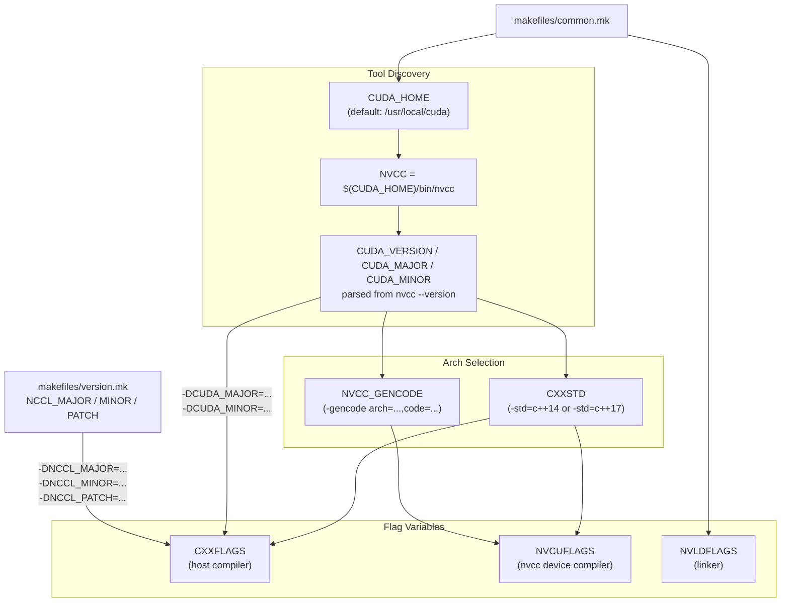
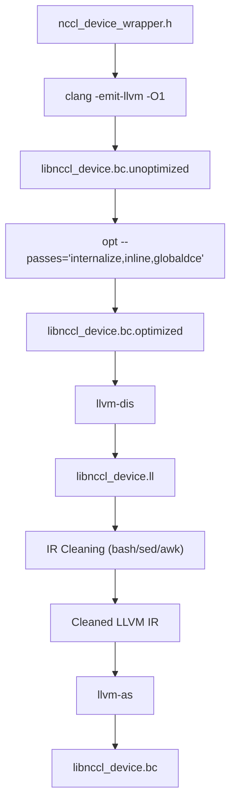

<!-- source: DeepWiki mcp.deepwiki.com · repo NVIDIA/nccl · page 8.3 Build Configuration · fetched 2026-10-28 -->

# Build Configuration

Relevant source files

The following files were used as context for generating this wiki page:

- [CMakeLists.txt](CMakeLists.txt)
- [Makefile](Makefile)
- [bindings/ir/CMakeLists.txt](bindings/ir/CMakeLists.txt)
- [bindings/ir/Makefile](bindings/ir/Makefile)
- [bindings/ir/clang_compat/texture_fetch_functions.h](bindings/ir/clang_compat/texture_fetch_functions.h)
- [makefiles/common.mk](makefiles/common.mk)
- [makefiles/version.mk](makefiles/version.mk)
- [src/graph/paths.cc](src/graph/paths.cc)
- [src/graph/search.cc](src/graph/search.cc)
- [src/graph/topo.cc](src/graph/topo.cc)
- [src/graph/topo.h](src/graph/topo.h)
- [src/include/graph.h](src/include/graph.h)
- [src/include/nccl_device.h](src/include/nccl_device.h)
- [src/transport/coll_net.cc](src/transport/coll_net.cc)
- [src/transport/net.cc](src/transport/net.cc)
- [src/transport/p2p.cc](src/transport/p2p.cc)

## Purpose and Scope

This page describes the build configuration infrastructure for NCCL, primarily centered around `makefiles/version.mk` and `makefiles/common.mk`. These files define versioning, compiler flags, CUDA architecture targets, and feature toggles shared across the repository. It also covers the CMake-based platform detection and the LLVM IR bitcode generation pipeline used for the Device API.

---

## Version Numbers — `makefiles/version.mk`

[makefiles/version.mk:1-13]() defines the authoritative library versioning. These variables are parsed by both the root `Makefile` and `CMakeLists.txt` to inject preprocessor definitions into the build.

| Variable | Value | Purpose |
|---|---|---|
| `NCCL_MAJOR` | `2` | Major version component |
| `NCCL_MINOR` | `31` | Minor version component |
| `NCCL_PATCH` | `2` | Patch version component |
| `NCCL_SUFFIX` | *(empty)* | Optional release suffix, e.g. `-rc1` |
| `PKG_REVISION` | `1` | Package revision used by `.deb` and `.rpm` builds |

In `CMakeLists.txt`, these are converted into `NCCL_VERSION_CODE` using the formula `(MAJOR * 10000) + (MINOR * 100) + PATCH` [CMakeLists.txt:11](). This code is exposed to source files via `add_compile_definitions` [CMakeLists.txt:14-20]().

Sources: [makefiles/version.mk:1-13](), [CMakeLists.txt:5-20]()

---

## Build System Orchestration

NCCL supports both GNU Make and CMake. The Make system relies on `common.mk` for flag propagation, while `CMakeLists.txt` performs equivalent platform and toolchain detection.

### `makefiles/common.mk` Overview

`common.mk` is the central hub for tool discovery and flag construction. It defines `CXXFLAGS` for host code, `NVCUFLAGS` for `nvcc` device code, and `NVLDFLAGS` for linking.

**Diagram: Variables defined in `common.mk` and how they reach the compiler**

Sources: [makefiles/common.mk:8-116](), [makefiles/version.mk:1-13]()

### CMake Platform Detection

`CMakeLists.txt` performs OS and compiler detection to set appropriate flags:
*   **OS Detection**: Sets `NCCL_OS_WINDOWS` or `NCCL_OS_LINUX` based on `CMAKE_SYSTEM_NAME` [CMakeLists.txt:74-84]().
*   **Compiler Detection**: Distinguishes between `MSVC` and `GCC`/`Clang` to apply specific warning suppressions and visibility flags [CMakeLists.txt:87-95]().
*   **CUDA Detection**: Uses `find_package(CUDAToolkit)` and extracts `CUDA_MAJOR`/`CUDA_MINOR` for macro definitions [CMakeLists.txt:105-121]().

Sources: [CMakeLists.txt:73-121]()

---

## CUDA Architecture Targeting

NCCL targets a broad range of NVIDIA GPU architectures. The selection logic ensures that the library contains cubins for supported hardware while providing PTX for forward compatibility.

### Architecture Constants

[makefiles/common.mk:58-72]() defines constants for different CUDA generations. `CMakeLists.txt` implements a similar logic [CMakeLists.txt:138-164]().

| Constant | Cubin Target(s) | PTX Fallback |
|---|---|---|
| `CUDA8_GENCODE` | sm_60, sm_61 | compute_61 |
| `CUDA9_GENCODE` | sm_70 | compute_70 |
| `CUDA10_GENCODE` | sm_75 | — |
| `CUDA11_GENCODE` | sm_80 | compute_80 |
| `CUDA12_GENCODE` | sm_90 | compute_90 |
| `CUDA12_8_GENCODE`| sm_100, sm_120 | — |
| `CUDA13_GENCODE` | sm_110 | — |
| `CUDA13_PTX` | — | compute_120 |

### Default `NVCC_GENCODE` Selection

The selection logic picks the default based on the detected `CUDA_MAJOR` [makefiles/common.mk:74-90]():
*   **CUDA ≥ 13**: Targets sm_75 through sm_120. Architectures prior to sm_75 are deprecated and excluded [makefiles/common.mk:74-76]().
*   **CUDA 12.8+**: Includes Blackwell (sm_100, sm_120) support [makefiles/common.mk:77-79]().
*   **Hopper Support**: Targeted when `CUDA_MAJOR` is 11 and `CUDA_MINOR` ≥ 8, or `CUDA_MAJOR` > 11 [makefiles/common.mk:80-82]().

Sources: [makefiles/common.mk:58-91](), [CMakeLists.txt:138-166]()

---

## LLVM IR Bitcode Generation Pipeline

For the Device API and JIT consumers, NCCL generates optimized LLVM bitcode files. This process uses `clang` to compile CUDA device code directly to bitcode, followed by optimization and "cleaning" steps.

**Diagram: LLVM IR Generation Pipeline**

### The `clang_compat` Shim
Clang's CUDA wrapper includes headers that may have been removed or changed in newer CUDA versions. NCCL provides a compatibility shim in `bindings/ir/clang_compat/` (e.g., `texture_fetch_functions.h`) to ensure the bitcode generation pipeline remains stable across CUDA releases [bindings/ir/clang_compat/texture_fetch_functions.h:1-6]().

### IR Generation Goals
The root `Makefile` defines `ir-emit` as a goal that dispatches to `bindings/ir` [Makefile:7-24](). It supports two types of IR generation:
1.  **llvm_ir**: Standard LLVM bitcode [Makefile:15]().
2.  **ltoir**: Link Time Optimization IR [Makefile:18]().

Sources: [Makefile:7-62](), [bindings/ir/clang_compat/texture_fetch_functions.h:1-6]()

---

## Feature Toggle Variables

These variables control conditional compilation and are exposed in both Make and CMake.

| Variable | Default | Preprocessor / Flag Effect |
|---|---|---|
| `DEBUG` | `0` | `-O0 -g` (Host/Device) vs `-O3` [makefiles/common.mk:130-137]() |
| `ASAN` | `0` | `-fsanitize=address` [makefiles/common.mk:140-144]() |
| `TRACE` | `0` | `-DENABLE_TRACE` [makefiles/common.mk:168-170]() |
| `PROFAPI`| `1` | `-DPROFAPI` [makefiles/common.mk:184-186]() |
| `RDMA_CORE` | `0` | `-DNCCL_BUILD_RDMA_CORE=1 -libverbs` [makefiles/common.mk:188-190]() |
| `EMIT_LLVM_IR` | `0` | Triggers the `ir-emit` target [Makefile:9-24]() |

### Register Constraints
NCCL kernels are sensitive to register pressure. `NVCUFLAGS` includes `-maxrregcount=96` [makefiles/common.mk:107](). This limit is calibrated for a thread block size of 640 threads to ensure occupancy and avoid launch errors [makefiles/common.mk:104-106]().

Sources: [makefiles/common.mk:8-208](), [Makefile:9-62](), [CMakeLists.txt:30-59]()

---

