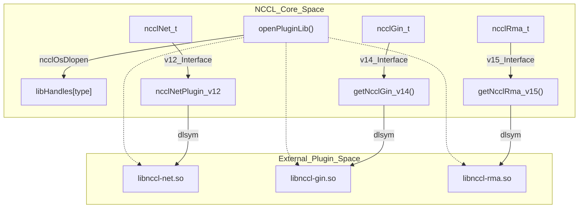
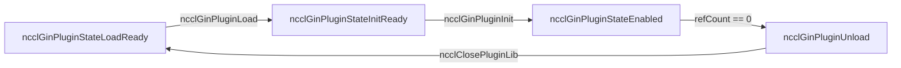

<!-- source: DeepWiki mcp.deepwiki.com · repo NVIDIA/nccl · page 9 Plugin Ecosystem · fetched 2026-10-28 -->

# Plugin Ecosystem

Relevant source files

The following files were used as context for generating this wiki page:

- [src/include/os.h](src/include/os.h)
- [src/include/plugin/nccl_net.h](src/include/plugin/nccl_net.h)
- [src/include/plugin/plugin.h](src/include/plugin/plugin.h)
- [src/os/linux.cc](src/os/linux.cc)
- [src/os/windows.cc](src/os/windows.cc)
- [src/plugin/gin.cc](src/plugin/gin.cc)
- [src/plugin/plugin_open.cc](src/plugin/plugin_open.cc)
- [src/plugin/rma.cc](src/plugin/rma.cc)

The NCCL plugin ecosystem provides a modular framework for extending NCCL's capabilities without modifying the core library. By using a shared-library plugin model, NCCL can interface with proprietary network stacks, custom hardware tuners, and external profiling tools.

## Shared-Library Model

NCCL discovers and loads plugins dynamically at runtime using `dlopen` abstractions. On Linux, this maps to `dlopen(RTLD_NOW | RTLD_LOCAL)` [src/os/linux.cc:51-57](), while on Windows it uses `LoadLibraryA` [src/os/windows.cc:73-79](). The library maintains a versioned contract with these plugins through specific structure definitions (e.g., `ncclNet_t`, `ncclGin_t`, `ncclProfiler_t`). To ensure backward compatibility, NCCL attempts to load the highest supported version of a plugin's interface before falling back to older versions [src/plugin/gin.cc:79-83](), [src/plugin/rma.cc:80-84]().

### Plugin Loading Mechanism

The loading process follows a standardized path for each plugin type defined in `ncclPluginType` [src/include/plugin/plugin.h:13-20]():
1.  **Environment Check**: NCCL checks for specific environment variables (e.g., `NCCL_NET_PLUGIN`, `NCCL_GIN_PLUGIN`, `NCCL_RMA_PLUGIN`) [src/plugin/gin.cc:184](), [src/plugin/rma.cc:164-165]().
2.  **Library Search**: If no environment variable is set, it searches for default shared objects like `libnccl-net.so`, `libnccl-gin.so`, or `libnccl-tuner.so` [src/plugin/plugin_open.cc:23-25]().
3.  **Symbol Resolution**: Once the library is loaded, NCCL calls a version-specific "getter" function (e.g., `getNcclGin_v14`, `getNcclRma_v15`) to retrieve the plugin's function table [src/plugin/gin.cc:26](), [src/plugin/rma.cc:27]().

### Code Entity Mapping: Plugin Loading
The following diagram illustrates how the host-side plugin management code interacts with external shared libraries and internal versioned getters.

Sources: [src/plugin/plugin_open.cc:22-41](), [src/include/plugin/nccl_net.h:62-63](), [src/plugin/gin.cc:24-26](), [src/plugin/rma.cc:25-27]()

## Plugin Types and Environment Variables

NCCL supports several categories of plugins, each controlled by a specific environment variable.

| Plugin Type | Environment Variable | Default Library Name | Interface Struct |
| :--- | :--- | :--- | :--- |
| **Network** | `NCCL_NET_PLUGIN` | `libnccl-net.so` | `ncclNet_t` |
| **GIN (GPU-Initiated)** | `NCCL_GIN_PLUGIN` | `libnccl-gin.so` | `ncclGin_t` |
| **RMA (Remote Memory)** | `NCCL_RMA_PLUGIN` | `libnccl-rma.so` | `ncclRma_t` |
| **Tuner** | `NCCL_TUNER_PLUGIN` | `libnccl-tuner.so` | `ncclTuner_t` |
| **Profiler** | `NCCL_PROFILER_PLUGIN` | `libnccl-profiler.so` | `ncclProfiler_t` |
| **Environment** | `NCCL_ENV_PLUGIN` | `libnccl-env.so` | `ncclEnv_t` |

Sources: [src/plugin/plugin_open.cc:22-25](), [src/plugin/gin.cc:23-26](), [src/plugin/rma.cc:24-27](), [src/include/plugin/plugin.h:13-20]()

## Plugin Lifecycle

The lifecycle of a plugin is managed through state transitions and reference counting to ensure libraries are not unloaded while active communicators still hold references [src/plugin/gin.cc:55-68](), [src/plugin/rma.cc:56-69]().

Sources: [src/plugin/gin.cc:31-37](), [src/plugin/gin.cc:55-68](), [src/plugin/rma.cc:32-38]()

## Plugin APIs

Detailed documentation for each plugin interface can be found in the following sub-pages:

### [Profiler Plugin API](#9.2)
The Profiler plugin provides a mechanism for external tools to capture NCCL internal events. It tracks a hierarchy of events from high-level `GroupApi` calls down to individual `ProxyOp` steps and network transfers. It uses the `ncclProfiler_t` versioned struct.
For details, see [Profiler Plugin API](#9.2).

### [Tuner Plugin API](#9.3)
The Tuner plugin allows users to override NCCL's default algorithm and protocol selection logic. By implementing the `getCollInfo` callback, a tuner can modify cost tables to optimize performance for specific network topologies or message sizes.
For details, see [Tuner Plugin API](#9.3).

### [Environment Plugin API](#9.4)
The Environment plugin provides a hook for custom environment variable resolution via the `getEnv` callback. This is useful for integrating NCCL with cluster-wide configuration files or performing dynamic validation of runtime parameters.
For details, see [Environment Plugin API](#9.4).

### [GIN Plugin Developer Guide](#9.5)
The GIN (GPU-Initiated Networking) plugin enables GPU kernels to directly initiate network transfers. It supports both CPU Proxy and GDAKI (GPU Direct Async Kernel Initiation) paths. Developers implement the `ncclGin_t` interface, including memory registration (`regMrSym`) and context management.
For details, see [GIN Plugin Developer Guide](#9.5).

Sources: [src/plugin/gin.cc:103-129](), [src/plugin/rma.cc:104-121](), [src/plugin/plugin_open.cc:132-154](), [src/include/plugin/nccl_net.h:54-60]()

---

