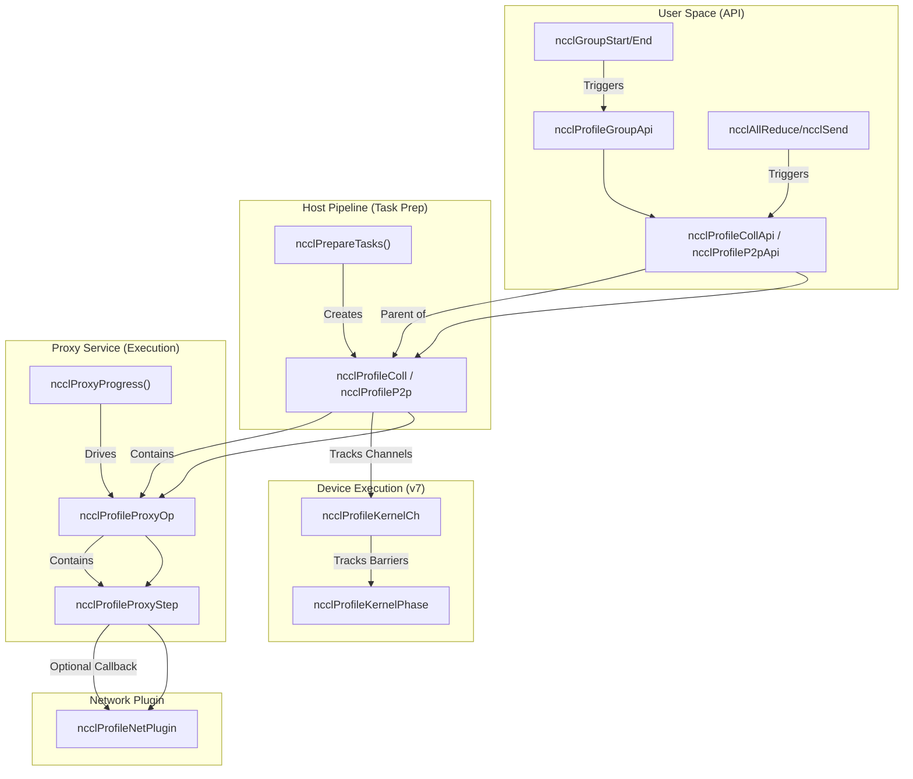
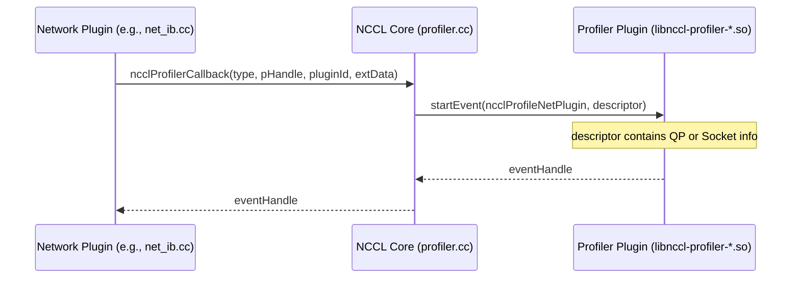

<!-- source: DeepWiki mcp.deepwiki.com · repo NVIDIA/nccl · page 9.2 Profiler Plugin API · fetched 2026-10-28 -->

# Profiler Plugin API

Relevant source files

The following files were used as context for generating this wiki page:

- [plugins/profiler/example/event.h](plugins/profiler/example/event.h)
- [plugins/profiler/example/nccl/profiler.h](plugins/profiler/example/nccl/profiler.h)
- [plugins/profiler/example/nccl/profiler_v7.h](plugins/profiler/example/nccl/profiler_v7.h)
- [plugins/profiler/example/plugin.cc](plugins/profiler/example/plugin.cc)
- [plugins/profiler/example/print_event.cc](plugins/profiler/example/print_event.cc)
- [plugins/profiler/example/profiler_plugin_ce.cc](plugins/profiler/example/profiler_plugin_ce.cc)
- [plugins/profiler/inspector/Makefile](plugins/profiler/inspector/Makefile)
- [plugins/profiler/inspector/README.md](plugins/profiler/inspector/README.md)
- [plugins/profiler/inspector/grafana/README.md](plugins/profiler/inspector/grafana/README.md)
- [plugins/profiler/inspector/grafana/nccl-inspector-job-performance-template.json](plugins/profiler/inspector/grafana/nccl-inspector-job-performance-template.json)
- [plugins/profiler/inspector/inspector.cc](plugins/profiler/inspector/inspector.cc)
- [plugins/profiler/inspector/inspector.h](plugins/profiler/inspector/inspector.h)
- [plugins/profiler/inspector/inspector_otel.cc](plugins/profiler/inspector/inspector_otel.cc)
- [plugins/profiler/inspector/inspector_otel.h](plugins/profiler/inspector/inspector_otel.h)
- [plugins/profiler/inspector/inspector_prom.cc](plugins/profiler/inspector/inspector_prom.cc)
- [src/gin/gin_host.cc](src/gin/gin_host.cc)
- [src/include/gin/gin_host.h](src/include/gin/gin_host.h)
- [src/include/gin/gin_host_win_stub.h](src/include/gin/gin_host_win_stub.h)
- [src/include/plugin/profiler/profiler_v7.h](src/include/plugin/profiler/profiler_v7.h)
- [src/include/profiler.h](src/include/profiler.h)
- [src/os/windows_stubs.cc](src/os/windows_stubs.cc)
- [src/plugin/profiler.cc](src/plugin/profiler.cc)

The NCCL Profiler Plugin API provides a structured interface for external tools to intercept and record internal NCCL events. This telemetry spans the entire execution lifecycle, from high-level user API calls down to low-level network proxy operations and transport-layer transitions. The profiler operates as a versioned plugin (currently supporting up to v7), allowing third-party libraries to register callbacks that NCCL invokes at critical state changes.

## Profiler Architecture and Data Flow

The profiler subsystem is initialized during communicator setup. NCCL searches for a shared library defined by the `NCCL_PROFILER_PLUGIN` environment variable [src/plugin/profiler.cc:108-112](). If found, it dynamically loads the profiler struct and initializes it for the specific communicator instance. The system supports multiple versions of the `ncclProfiler_t` struct, attempting to load from v7 down to v1 [src/plugin/profiler.cc:123-141]().

### System Hierarchy and Entity Mapping

The following diagram illustrates how high-level code entities map to the profiler's event hierarchy.

**Profiler Event Hierarchy and Code Mapping**

Sources: [src/include/profiler.h:24-58](), [plugins/profiler/example/event.h:35-189](), [plugins/profiler/example/nccl/profiler.h:16-35]()

## The `ncclProfiler_t` Contract

The profiler plugin must export a versioned structure that NCCL uses to communicate. NCCL manages an internal `ncclProfilerThread` per communicator to handle asynchronous event processing and backpressure management [src/plugin/profiler.cc:38-69]().

### Versioned Struct (v5/v6/v7)
The primary interface is defined by `ncclProfiler_t`. When a plugin is loaded, NCCL calls the `init` function to establish a context and retrieve an event activation mask.

| Function | Purpose |
| :--- | :--- |
| `init` | Initializes the profiler for a rank; returns a `context` and `eActivationMask` [src/plugin/profiler.cc:96-158](). |
| `startEvent` | Signals the beginning of a profiled event (e.g., a collective launch) [src/include/profiler.h:89-123](). |
| `stopEvent` | Signals the completion of a profiled event [src/include/profiler.h:90-124](). |
| `recordEventState` | Records fine-grained state transitions within an active event [src/include/profiler.h:131-134](). |
| `finalize` | Cleans up the profiler context during communicator destruction [src/plugin/profiler.cc:166-178](). |

Sources: [src/plugin/profiler.cc:123-145](), [src/include/profiler.h:85-134]()

## Event Descriptors and Hierarchy

Every event started via `startEvent` is described by a `ncclProfilerEventDescr_t`. This descriptor contains metadata specific to the event type.

### 1. API Events (`ncclProfileGroupApi`, `ncclProfileCollApi`, `ncclProfileP2pApi`)
These events track the duration of NCCL host-side API calls.
*   **Group API**: Tracks `ncclGroupStart` to `ncclGroupEnd`.
*   **Collective/P2P API**: Tracks individual operations like `ncclAllReduce`.
*   **Metadata**: Includes `func` (collective type), `count`, `datatype`, and whether the call was made during CUDA graph capture (`isGraphCaptured`) [plugins/profiler/example/event.h:191-226]().

### 2. Task Events (`ncclProfileColl`, `ncclProfileP2p`)
These represent the actual execution of a collective or point-to-point task.
*   **Metadata**: Includes `seqNumber`, `algo`, `proto`, and the number of channels used (`nChannels`). In v7, it also includes `kernelVariant` for symmetric collectives [plugins/profiler/example/event.h:148-178]().

### 3. Proxy Operations and Steps
*   **ProxyOp (`ncclProfileProxyOp`)**: Represents host-side orchestration for a specific channel and peer. Tracks `channelId`, `peer`, and `transSize` [plugins/profiler/example/event.h:106-122]().
*   **ProxyStep (`ncclProfileProxyStep`)**: The finest level of granularity, representing a single chunk transfer. Tracks the specific `step` index and whether it is a send or receive [plugins/profiler/example/event.h:93-104]().

### 4. Kernel and Phase Events (v7)
*   **KernelCh (`ncclProfileKernelCh`)**: Tracks the GPU execution time per channel.
*   **KernelPhase (`ncclProfileKernelPhase`)**: Tracks specific sub-phases of a kernel: `initial_sync`, `compute`, and `final_sync` [plugins/profiler/example/event.h:61-83]().

## State Transitions

The `recordEventState` function captures instantaneous state changes, particularly within the Proxy Service and Copy Engine.

### Event States
| State | Subsystem | Description |
| :--- | :--- | :--- |
| `ncclProfilerProxyStepSendGPUWait` | Proxy | Waiting for GPU to signal data is ready [plugins/profiler/example/nccl/profiler.h:49](). |
| `ncclProfilerProxyStepRecvWait` | Proxy | Waiting for data to arrive from network [plugins/profiler/example/nccl/profiler.h:52](). |
| `ncclProfilerCeCollStart/Complete` | Copy Engine | Start/Stop of a CE-based collective [plugins/profiler/example/nccl/profiler.h:75-76](). |
| `ncclProfilerKernelPhaseStop` | Kernel | Completion of a barrier phase [plugins/profiler/example/nccl/profiler.h:83](). |

Sources: [plugins/profiler/example/nccl/profiler.h:37-84](), [src/include/profiler.h:131-134]()

## Implementation: Custom Event Emission

Network plugins and other internal components can emit custom events via the `ncclProfilerCallback_t`.

**Network Plugin Event Data Flow**

The `ncclProfilerCallback` allows network plugins to report low-level details like Queue Pair numbers (`qpNum`), file descriptors (`fd`), or transfer lengths (`length`) directly into the profiling stream [plugins/profiler/example/event.h:35-57](), [src/include/profiler.h:153]().

## Copy Engine (CE) Profiling

The API supports profiling for Copy Engine (CE) based collectives. These events use specialized start/stop wrappers:
*   `ncclProfilerStartCeCollEvent`: Tracks CE-based collective execution [src/include/profiler.h:164]().
*   `ncclProfilerStartCeSyncEvent`: Tracks synchronization overheads [src/include/profiler.h:166]().
*   **Timing Modes**: Supports `CE_TIMING_CPU` and `CE_TIMING_GPU` (using `cudaEventElapsedTime`) [plugins/profiler/example/event.h:21-24, 49-80]().

Sources: [src/include/profiler.h:156-170](), [plugins/profiler/example/event.h:240-265](), [plugins/profiler/example/profiler_plugin_ce.cc:49-195]()

---

