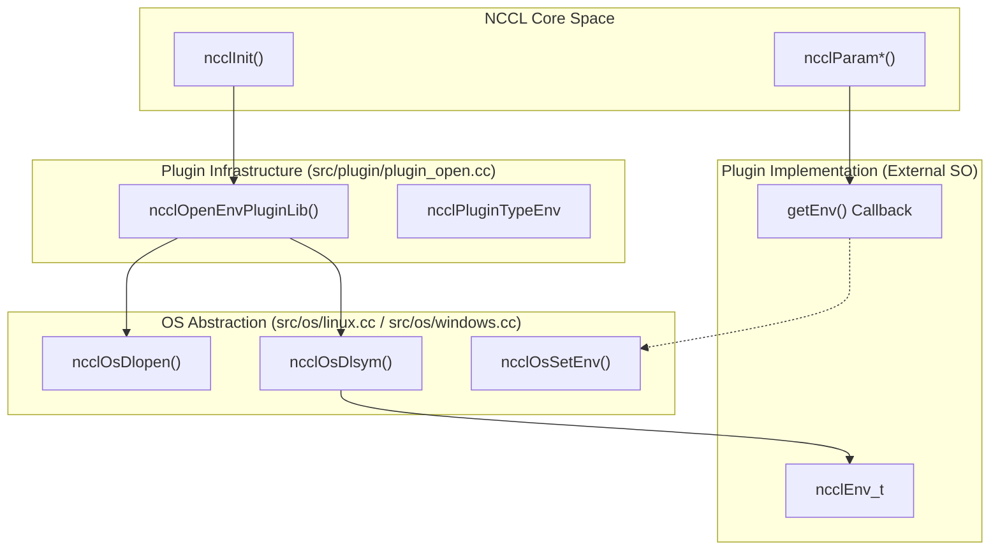
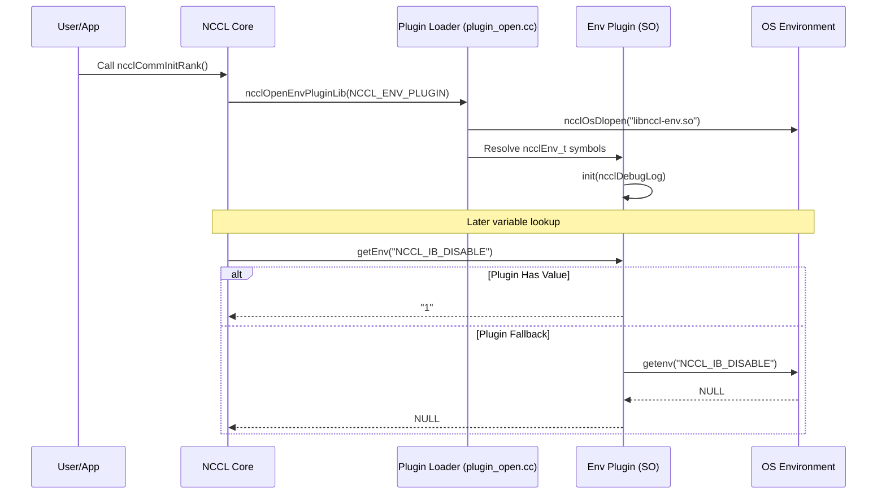

<!-- source: DeepWiki mcp.deepwiki.com · repo NVIDIA/nccl · page 9.4 Environment Plugin API · fetched 2026-10-28 -->

# Environment Plugin API

Relevant source files

The following files were used as context for generating this wiki page:

- [docs/userguide/source/env.rst](docs/userguide/source/env.rst)
- [docs/userguide/source/troubleshooting.rst](docs/userguide/source/troubleshooting.rst)
- [docs/userguide/source/troubleshooting/diagnostics.rst](docs/userguide/source/troubleshooting/diagnostics.rst)
- [docs/userguide/source/troubleshooting/gpu_troubleshooting.rst](docs/userguide/source/troubleshooting/gpu_troubleshooting.rst)
- [docs/userguide/source/troubleshooting/logging.rst](docs/userguide/source/troubleshooting/logging.rst)
- [docs/userguide/source/troubleshooting/networking_troubleshooting.rst](docs/userguide/source/troubleshooting/networking_troubleshooting.rst)
- [docs/userguide/source/troubleshooting/performance_and_tuning.rst](docs/userguide/source/troubleshooting/performance_and_tuning.rst)
- [docs/userguide/source/troubleshooting/runtime_and_mpi_issues.rst](docs/userguide/source/troubleshooting/runtime_and_mpi_issues.rst)
- [src/include/os.h](src/include/os.h)
- [src/include/plugin/plugin.h](src/include/plugin/plugin.h)
- [src/os/linux.cc](src/os/linux.cc)
- [src/os/windows.cc](src/os/windows.cc)
- [src/plugin/gin.cc](src/plugin/gin.cc)
- [src/plugin/plugin_open.cc](src/plugin/plugin_open.cc)
- [src/plugin/rma.cc](src/plugin/rma.cc)

The Environment Plugin API provides a mechanism for external libraries to intercept and provide values for NCCL environment variables. This is particularly useful for integrating NCCL with cluster-wide configuration management systems, implementing custom validation logic, or enabling diagnostics through specialized logging.

## Overview

By default, NCCL resolves configuration parameters by checking the process environment and local configuration files. The Environment Plugin API allows an external shared library to override this behavior by providing a `getEnv` callback. NCCL supports versioned plugin structures to maintain backward compatibility while expanding functionality.

### Use Cases
*   **Config File Integration**: Redirecting environment variable lookups to a centralized configuration service or a custom file format like `/etc/nccl.conf` [docs/userguide/source/env.rst:7-8]().
*   **Validation**: Enforcing site-specific policies on NCCL parameters (e.g., restricting the maximum number of channels or QPs per connection) [docs/userguide/source/troubleshooting/performance_and_tuning.rst:109-112]().
*   **Hot-Reload**: Dynamically changing NCCL behavior at runtime if the plugin implementation supports returning different values over time for non-cached variables.
*   **Diagnostics**: Integrating plugin-specific messages into the NCCL debug stream using versioned logging callbacks.

## The ncclEnv_t Contract

The plugin must export a versioned structure. NCCL uses a dynamic loading mechanism to discover these structures within a shared library specified by the user.

### Data Structures

The core contract is defined by the `ncclEnv_t` structure. The plugin is expected to implement the following lifecycle and functional callbacks:

| Field | Type | Description |
| :--- | :--- | :--- |
| `name` | `const char*` | A string identifying the plugin (e.g., "ncclEnvExample"). |
| `init` | Function Pointer | Initializes the plugin with NCCL version info and a logger callback. |
| `finalize` | Function Pointer | Cleans up plugin resources. |
| `getEnv` | Function Pointer | Callback to retrieve a variable value: `const char* (*getEnv)(const char* name)`. |

### Environment Plugin Architecture
The following diagram illustrates how the environment plugin infrastructure bridges the NCCL internal parameter loading logic with external configuration sources.

**Diagram: Environment Plugin Entity Map**

Sources: [src/plugin/plugin_open.cc:22-28](), [src/plugin/plugin_open.cc:152-154](), [src/os/linux.cc:51-57](), [src/os/windows.cc:73-79]()

## Loading and Lifecycle

NCCL manages the environment plugin lifecycle through the `ncclPluginTypeEnv` registry.

### Plugin Discovery
1.  **Environment Variable**: NCCL checks for the `NCCL_ENV_PLUGIN` environment variable. If set, it attempts to load the specified library [src/plugin/plugin_open.cc:24]().
2.  **Naming Convention**: The loader searches for libraries prefixed with `libnccl-env` [src/plugin/plugin_open.cc:24]().
3.  **Symbol Resolution**: NCCL uses `ncclOsDlsym` to locate the plugin structure and its associated versioning info [src/os/linux.cc:59-65]().

### Lifecycle Flow
The initialization happens during the early stages of NCCL setup to ensure all subsequent parameter lookups are intercepted.

**Diagram: Environment Variable Resolution Data Flow**

Sources: [src/plugin/plugin_open.cc:152-154](), [src/os/linux.cc:51-57](), [src/include/os.h:49-53]()

## Implementation Details

### The Default Behavior
If no external plugin is provided, NCCL relies on its internal `ncclGetEnv` wrapper, which typically resolves to standard OS calls like `getenv` on Linux or `GetEnvironmentVariableA` on Windows [src/os/windows.cc:130-142]().

### OS Compatibility
The Environment Plugin API is supported across platforms:
*   **Linux**: Uses `dlopen`/`dlsym` and `setenv` [src/os/linux.cc:51-65]().
*   **Windows**: Uses `LoadLibraryA`/`GetProcAddress` and `SetEnvironmentVariableA` [src/os/windows.cc:73-87]().

### Summary of Key Entities

| Entity | File | Description |
| :--- | :--- | :--- |
| `ncclOpenEnvPluginLib` | [src/plugin/plugin_open.cc:152]() | The entry point for loading the environment plugin library. |
| `ncclPluginTypeEnv` | [src/include/plugin/plugin.h:19]() | Enum identifier for the environment plugin subsystem. |
| `ncclOsSetEnv` | [src/include/os.h:42]() | OS-agnostic wrapper for setting environment variables. |
| `libnccl-env` | [src/plugin/plugin_open.cc:24]() | The default prefix used for environment plugin library search. |

Sources: [src/plugin/plugin_open.cc:1-190](), [src/include/plugin/plugin.h:1-35](), [src/os/linux.cc:1-223](), [src/os/windows.cc:1-230]()

---

