# Page: Overview

# Overview

<details>
<summary>Relevant source files</summary>

The following files were used as context for generating this wiki page:

- [.github/pull_request_template.md](.github/pull_request_template.md)
- [CONTRIBUTING.md](CONTRIBUTING.md)
- [LICENSE.txt](LICENSE.txt)
- [README.md](README.md)
- [ThirdPartyNotices.txt](ThirdPartyNotices.txt)
- [cmake/NCCLConfig.cmake.in](cmake/NCCLConfig.cmake.in)
- [docs/dev_guide/nccl_coding_style.md](docs/dev_guide/nccl_coding_style.md)
- [docs/userguide/source/api/types.rst](docs/userguide/source/api/types.rst)
- [pkg/python_wheel/Makefile](pkg/python_wheel/Makefile)
- [pkg/python_wheel/build_wheel.sh](pkg/python_wheel/build_wheel.sh)
- [pkg/txz/CMakeLists.txt](pkg/txz/CMakeLists.txt)
- [pkg/txz/Makefile](pkg/txz/Makefile)
- [pkg/txz/create_txz.sh.in](pkg/txz/create_txz.sh.in)
- [src/bootstrap.cc](src/bootstrap.cc)
- [src/cft_dev_runtime.cc](src/cft_dev_runtime.cc)
- [src/debug.cc](src/debug.cc)
- [src/group.cc](src/group.cc)
- [src/include/comm.h](src/include/comm.h)
- [src/include/enqueue.h](src/include/enqueue.h)
- [src/include/proxy.h](src/include/proxy.h)
- [src/include/strongstream.h](src/include/strongstream.h)
- [src/include/transport.h](src/include/transport.h)
- [src/init.cc](src/init.cc)
- [src/misc/strongstream.cc](src/misc/strongstream.cc)
- [src/nccl.h.in](src/nccl.h.in)
- [src/param/c_api.cc](src/param/c_api.cc)
- [src/param/ncclparam.cc](src/param/ncclparam.cc)
- [src/proxy.cc](src/proxy.cc)
- [src/transport.cc](src/transport.cc)

</details>


This page describes what NCCL is, what collective operations it exposes, which hardware interconnects it supports, and how its major subsystems are organized. It is intended as a starting point for navigating the codebase. For details on any individual subsystem, follow the links to the dedicated sub-pages.

---

## What NCCL Is

NCCL (pronounced "Nickel") is a standalone C++ library that provides optimized collective and point-to-point communication primitives for NVIDIA GPUs. It is designed to be used directly by deep learning frameworks and HPC applications that need to move data between GPUs within a single node or across multiple nodes. [README.md:1-7]()

The current version is defined in `nccl.h.in` via the `NCCL_MAJOR`, `NCCL_MINOR`, and `NCCL_PATCH` variables. [src/nccl.h.in:20-22]()

NCCL ships as several build artifacts, including:
- `libnccl.so` — shared library [src/Makefile:58]()
- `libnccl_static.a` — static library [src/Makefile:59]()
- `ncclras` — reliability, availability, and serviceability binary [src/Makefile:61]()

The public C API surface is declared in `src/nccl.h`. All symbols follow the `NCCL_API` macro convention for versioned visibility. [src/init.cc:195-200]()

Sources: [README.md:1-7](), [src/nccl.h.in:20-22](), [src/Makefile:58-61](), [src/init.cc:195-200]()

---

## Collective Operations

NCCL implements the standard set of collective communication operations used in distributed ML workloads. The canonical string names used in log output are defined in `src/init.cc`. [src/init.cc:55-58]()

| Operation | Description |
|---|---|
| `Broadcast` | One rank sends; all ranks receive |
| `Reduce` | All ranks contribute; one rank receives the result |
| `AllGather` | Every rank gathers data from all other ranks |
| `ReduceScatter` | Reduction followed by scatter across ranks |
| `AllReduce` | Reduction result delivered to all ranks |
| `Send` / `Recv` | Point-to-point send and receive |

Group operations (`ncclGroupStart` / `ncclGroupEnd`) allow multiple collectives or point-to-point calls to be batched and submitted together. [src/group.cc:164-182]() For details, see [Communication Pipeline](#4) and [Group Operations and Batching](#4.1).

Sources: [src/init.cc:55-58](), [src/group.cc:164-182]()

---

## Supported Hardware Interconnects

NCCL selects the best available transport for each channel based on the detected topology. [README.md:7]() The available transports are registered in `ncclTransports`. [src/transport.cc:15-20]()

| Interconnect | Transport |
|---|---|
| NVLink / NVSwitch | `p2pTransport` (P2P shared memory) [src/transport.cc:16]() |
| NVLink SHARP (NVLS) | `ncclNvls` (Multicast in-network reduction) [src/include/transport.h:77-102]() |
| PCIe peer-to-peer | `shmTransport` (Shared memory) [src/transport.cc:17]() |
| InfiniBand (RDMA) | `netTransport` (via IB Verbs) [src/transport.cc:18]() |
| TCP/IP sockets | `netTransport` (via Sockets) [src/transport.cc:18]() |
| Collective network (CollNet) | `collNetTransport` (In-network allreduce) [src/transport.cc:19]() |

The transport layer is described in detail on page [Transport Layer](#5).

Sources: [README.md:7](), [src/transport.cc:15-20](), [src/include/transport.h:77-102]()

---

## Major Subsystems

The diagram below maps the main subsystems and their primary dependencies. Node labels use the actual source file and key type or function names.

**Subsystem Map**

```mermaid
graph TD
    [PublicAPI] ["Public API<br/>nccl.h / src/nccl.h.in<br/>ncclAllReduce, ncclSend, etc."]

    subgraph "Core Runtime"
        [Init] ["src/init.cc<br/>ncclInit<br/>ncclGetUniqueId"]
        [Comm] ["src/include/comm.h<br/>struct ncclComm"]
        [Group] ["src/group.cc<br/>ncclGroupStart/End"]
        [Enqueue] ["src/include/enqueue.h<br/>ncclEnqueueCheck"]
    end

    subgraph "Topology Subsystem"
        [TopoCore] ["src/graph/topo.h<br/>ncclTopoSystem"]
        [TopoPaths] ["src/graph/paths.cc<br/>ncclTopoComputePaths"]
        [TopoTuning] ["src/tuning.cc<br/>ncclTopoTuneModel"]
    end

    subgraph "Transport Layer"
        [Transport] ["src/include/transport.h<br/>struct ncclTransport"]
        [P2P] ["src/transport.cc<br/>ncclTransportP2pSetup"]
        [NVLS] ["src/include/transport.h<br/>ncclNvlsInit"]
    end

    subgraph "Proxy Service"
        [Proxy] ["src/proxy.cc<br/>ncclProxyServiceUDS<br/>struct ncclProxyArgs"]
    end

    subgraph "Bootstrap"
        [Bootstrap] ["src/bootstrap.cc<br/>bootstrapNetInit<br/>bootstrapGetUniqueId"]
    end

    subgraph "Infrastructure"
        [Socket] ["src/include/socket.h<br/>ncclSocket"]
        [Utils] ["src/include/utils.h<br/>ncclMemoryPool"]
    end

    [PublicAPI] --> [Init]
    [PublicAPI] --> [Group]
    [Init] --> [Bootstrap]
    [Init] --> [Comm]
    [Comm] --> [TopoCore]
    [TopoCore] --> [TopoPaths]
    [TopoPaths] --> [TopoTuning]
    [Group] --> [Enqueue]
    [Enqueue] --> [Transport]
    [Transport] --> [P2P]
    [Transport] --> [NVLS]
    [Enqueue] --> [Proxy]
    [Bootstrap] --> [Socket]
```

Sources: [src/init.cc:177-206](), [src/include/comm.h:98-280](), [src/proxy.cc:33-53](), [src/include/transport.h:117-142]()

---

## Execution Flow: From API Call to GPU Kernel

The following diagram shows the sequence of major operations from a user-level collective call through to device execution.

**Call Path: ncclAllReduce → GPU kernel**

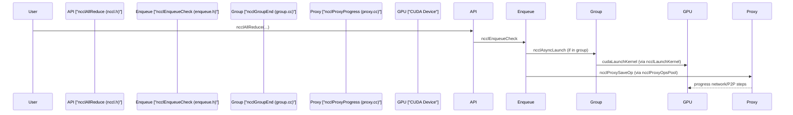

Sources: [src/init.cc:55-58](), [src/group.cc:36-74](), [src/proxy.cc:209-231](), [src/include/proxy.h:218-226]()

---

## Communicator Lifecycle

Every communication operation requires an `ncclComm_t` handle. Creating one involves rank discovery via bootstrap and topology setup. For full details see page [Communicator Management](#2) and page [Initialization and Bootstrap Process](#2.1).

**Phases of ncclCommInitRank**

```mermaid
flowchart LR
    [A] ["bootstrapNetInit()<br/>ncclGetUniqueId()"] --> [B]
    [B] ["ncclTopoComputePaths()<br/>ncclTopoTuneModel()"] --> [C]
    [C] ["ncclTransportP2pSetup()<br/>ncclNvlsSetup()"] --> [D]
    [D] ["ncclProxyServiceUDS()"] --> [E] ["ncclComm ready"]
```

Sources: [src/init.cc:170-193](), [src/transport.cc:125-150](), [src/bootstrap.cc:105-138]()

---

## Repository Structure

| Directory / File | Purpose |
|---|---|
| `src/nccl.h.in` | Template for public API declarations [src/nccl.h.in:1-41]() |
| `src/init.cc` | Communicator creation and initialization [src/init.cc:177-206]() |
| `src/include/comm.h` | `ncclComm` struct and internal state definitions [src/include/comm.h:98-280]() |
| `src/group.cc` | `ncclGroupStart` / `ncclGroupEnd` async launch logic [src/group.cc:36-74]() |
| `src/proxy.cc` | Proxy service thread for network/P2P progress [src/proxy.cc:33-53]() |
| `src/bootstrap.cc` | Out-of-band rank rendezvous network [src/bootstrap.cc:105-138]() |
| `src/transport.cc` | Transport selection and P2P setup [src/transport.cc:23-44]() |
| `src/include/transport.h` | Transport abstraction and NVLS definitions [src/include/transport.h:117-142]() |
| `src/cft_dev_runtime.cc` | Logical Endpoint (CFT) support for device communication [src/cft_dev_runtime.cc:18-35]() |
| `README.md` | Project introduction and build instructions [README.md:1-33]() |

Sources: [src/Makefile:1-61](), [src/init.cc:1-206](), [README.md:1-86]()

---

## Subsystem Index

| Wiki Page | Subsystem | Primary Source Files |
|---|---|---|
| [Communicator Management](#2) | Communicator Management | `src/init.cc`, `src/include/comm.h` |
| [Topology System](#3) | Topology System | `src/tuning.cc`, `src/graph/` |
| [Communication Pipeline](#4) | Communication Pipeline | `src/group.cc`, `src/enqueue.h` |
| [Transport Layer](#5) | Transport Layer | `src/transport.cc`, `src/include/transport.h` |
| [Proxy Service Architecture](#5.6) | Proxy Service | `src/proxy.cc`, `src/include/proxy.h` |
| [Bootstrap Communication](#5.2) | Bootstrap | `src/bootstrap.cc` |
| [Infrastructure and Utilities](#6) | Infrastructure & Utilities | `src/debug.cc`, `src/include/utils.h` |
| [Build System](#8) | Build System | `Makefile`, `src/Makefile` |

---

## Versioning and Licensing

The library version is defined in `nccl.h.in` [src/nccl.h.in:20-22](). At runtime, `ncclGetVersion()` returns `NCCL_VERSION_CODE` [src/init.cc:195-200]().

The codebase is licensed under the **Apache License 2.0**. [LICENSE.txt:1-10]()

For information about contributing to NCCL, see page [Contributing and Community](#1.1).

Sources: [src/nccl.h.in:20-25](), [src/init.cc:195-200](), [LICENSE.txt:1-10]()

---

# Page: Contributing and Community

# Contributing and Community

<details>
<summary>Relevant source files</summary>

The following files were used as context for generating this wiki page:

- [.github/pull_request_template.md](.github/pull_request_template.md)
- [CONTRIBUTING.md](CONTRIBUTING.md)
- [LICENSE.txt](LICENSE.txt)
- [README.md](README.md)
- [ThirdPartyNotices.txt](ThirdPartyNotices.txt)
- [cmake/NCCLConfig.cmake.in](cmake/NCCLConfig.cmake.in)
- [contrib/README.md](contrib/README.md)
- [contrib/custom_algos/README.md](contrib/custom_algos/README.md)
- [contrib/niin/LICENSE.txt](contrib/niin/LICENSE.txt)
- [contrib/niin/README.md](contrib/niin/README.md)
- [contrib/niin/ThirdPartyNotices.txt](contrib/niin/ThirdPartyNotices.txt)
- [docs/contrib/Frameworks/DeepEPv2_Analysis_Part1/DeepEPv2_Analysis_Part1.md](docs/contrib/Frameworks/DeepEPv2_Analysis_Part1/DeepEPv2_Analysis_Part1.md)
- [docs/contrib/README.md](docs/contrib/README.md)
- [docs/contrib/architecture/learning/en/architecture.md](docs/contrib/architecture/learning/en/architecture.md)
- [docs/contrib/architecture/learning/en/collective-execution.md](docs/contrib/architecture/learning/en/collective-execution.md)
- [docs/contrib/architecture/learning/en/index.md](docs/contrib/architecture/learning/en/index.md)
- [docs/contrib/architecture/learning/en/math-and-performance.md](docs/contrib/architecture/learning/en/math-and-performance.md)
- [docs/contrib/architecture/learning/en/quick-start.md](docs/contrib/architecture/learning/en/quick-start.md)
- [docs/contrib/architecture/learning/en/source-code-map.md](docs/contrib/architecture/learning/en/source-code-map.md)
- [docs/contrib/architecture/learning/en/topology-and-tuning.md](docs/contrib/architecture/learning/en/topology-and-tuning.md)
- [docs/contrib/architecture/learning/index.md](docs/contrib/architecture/learning/index.md)
- [docs/contrib/architecture/learning/zh/architecture.md](docs/contrib/architecture/learning/zh/architecture.md)
- [docs/contrib/architecture/learning/zh/collective-execution.md](docs/contrib/architecture/learning/zh/collective-execution.md)
- [docs/dev_guide/nccl_coding_style.md](docs/dev_guide/nccl_coding_style.md)
- [pkg/python_wheel/Makefile](pkg/python_wheel/Makefile)
- [pkg/python_wheel/build_wheel.sh](pkg/python_wheel/build_wheel.sh)
- [pkg/txz/CMakeLists.txt](pkg/txz/CMakeLists.txt)
- [pkg/txz/Makefile](pkg/txz/Makefile)
- [pkg/txz/create_txz.sh.in](pkg/txz/create_txz.sh.in)

</details>


This page describes how to contribute code and report issues to the NCCL project. It covers GitHub issue templates, the pull request process, code style requirements, the `contrib/` directory policy, and the automated build and distribution infrastructure.

---

## Communication Channels

All community interaction happens through GitHub:

| Channel | Purpose |
|---|---|
| GitHub Issues | Bug reports, enhancement requests (RFEs), and general questions |
| GitHub Pull Requests | Code contributions and associated review discussion |

The repository uses structured templates to categorize incoming requests. Reporters are encouraged to check existing issues before opening new ones [CONTRIBUTING.md:9-10]().

Sources: [CONTRIBUTING.md:1-16]()

---

## Reporting Issues

Three templates are provided under `.github/ISSUE_TEMPLATE/` (referenced in [CONTRIBUTING.md:69]()) to guide reporters.

### Issue Template Summary

| Template File | Auto-Label | Use When |
|---|---|---|
| `ISSUE.yaml` | `triage` | Bug, crash, hang, data corruption, or performance regression |
| `RFE.yaml` | `enhancement` | Requesting a new feature or behavioral change |
| `QUESTION.yaml` | `question` | Asking a usage or design question |

### Bug / Issue Template Fields

The bug report template collects technical details necessary for triage:

| Field | Requirement |
|---|---|
| **Impact** | Performance, crash, data corruption, or hang |
| **Debug Logs** | Output from `NCCL_DEBUG=INFO` or `NCCL_TOPO_DUMP_FILE` |
| **Reproduction** | Minimal steps, environment details, and intermittency |
| **NCCL Version** | Found in debug logs or via `strings libnccl.so` |
| **Platform** | GPU architecture, topology, and OS environment |

### RFE and Question Templates

- **RFE**: Prompts for the goal, beneficiaries, target hardware, and priority [CONTRIBUTING.md:69]().
- **Question**: Directs users to existing documentation before asking a usage question.

Sources: [CONTRIBUTING.md:67-75]()

---

## Contribution Workflow

The following diagram maps the contribution process from identifying a need to merging code.

**Diagram: Contribution Workflow**

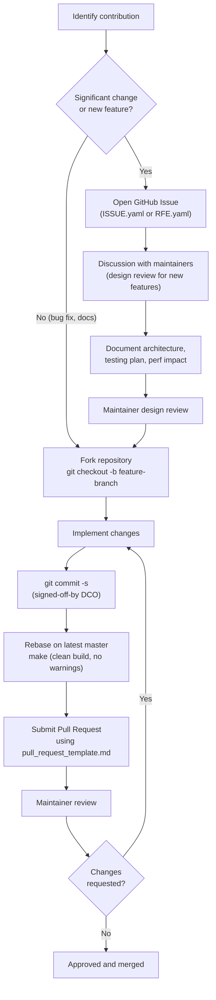

Sources: [CONTRIBUTING.md:8-75](), [.github/pull_request_template.md:1-16]()

### Pull Request Guidelines

The `pull_request_template.md` requires a clear description of the change, related issue numbers, and a summary of performance impact (if applicable) [.github/pull_request_template.md:1-16]().

**Commit Requirements:**
- **Signed Commits:** All commits must be signed off (`git commit -s`) to certify agreement with the Developer Certificate of Origin (DCO) v1.1 [CONTRIBUTING.md:144-152]().
- **Message Format:** Must follow a structured format: Title (imperative mood), Problem, Solution, and Limitations [CONTRIBUTING.md:123-143]().

---

## Code Style and Formatting

NCCL enforces strict coding standards for C++ and CUDA code.

### General Guidelines

| Category | Requirement |
|---|---|
| Indentation | 2 spaces, no tabs [CONTRIBUTING.md:82-82]() |
| Line Length | 120 characters [CONTRIBUTING.md:83-83]() |
| Brace Style | K&R (opening brace on same line) [CONTRIBUTING.md:84-84]() |
| Memory | Use `ncclCalloc()` and internal wrappers [CONTRIBUTING.md:104-104]() |

### Naming Conventions

- **Functions/Variables:** `ncclCamelCase` [CONTRIBUTING.md:88-88]()
- **Macros/Constants:** `UPPER_CASE_WITH_UNDERSCORES` [CONTRIBUTING.md:89-89]()
- **Structs/Types:** `ncclFooBar` [CONTRIBUTING.md:90-90]()

### CUDA-Specific Standards
- Minimize register usage in performance-critical kernels [CONTRIBUTING.md:93-93]().
- Avoid warp divergence where possible [CONTRIBUTING.md:94-94]().
- Prefer `cudaLaunchKernel` over `<<<>>>` syntax [CONTRIBUTING.md:96-96]().

Sources: [CONTRIBUTING.md:77-116]()

---

## Community Extensions (`contrib/`)

The `contrib/` directory hosts community-maintained extensions that build on top of NCCL's public APIs without modifying the library core [contrib/README.md:7-10]().

### Contribution Policy

Extensions in `contrib/` fall outside NCCL's standard release quality and are maintained by their respective authors [contrib/README.md:9-10]().

**Requirements for Acceptance:**
1. **Self-contained:** All code must live in a single subdirectory (`contrib/<name>/`) [contrib/README.md:48-49]().
2. **README:** Must explain purpose, build instructions, and usage [contrib/README.md:51-52]().
3. **Public API only:** Code must rely solely on `nccl.h` or `nccl_device.h`. No internal header dependencies allowed [contrib/README.md:67-69]().
4. **Maintainer:** Must list at least one GitHub username responsible for maintenance [contrib/README.md:54-56]().
5. **License:** Must be Apache 2.0 compatible [contrib/README.md:58-61]().

### Current Community Extensions

| Directory | Description |
|---|---|
| `custom_algos/` | Reference collective kernels built on the Device API [contrib/README.md:28-28]() |
| `pace/` | Parallelism-aware collectives built on the GIN device API [contrib/README.md:29-29]() |
| `nccl_checkpoint/` | Library for communicator-aware checkpoint and restore [contrib/README.md:31-31]() |
| `nccl_ubx/` | Low-latency NVLink collectives with compute fusion [contrib/README.md:33-33]() |
| `niin/` | NVSHMEM compatibility layer built on NCCL GIN/LSA [contrib/README.md:35-35]() |

**Diagram: Community Contribution Architecture**

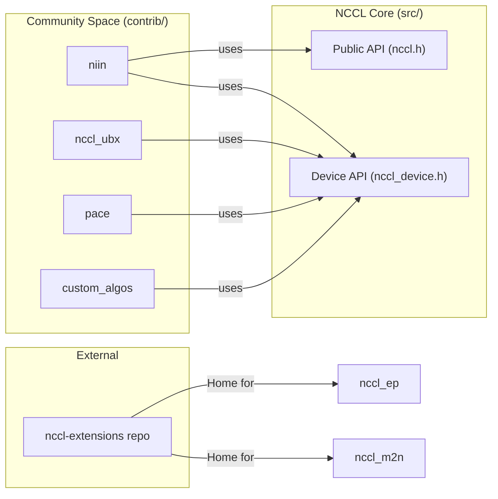

Sources: [contrib/README.md:1-107](), [contrib/niin/README.md:1-180]()

---

## Build and Distribution

NCCL provides a multi-format packaging system to support different Linux distributions and Python environments.

### Packaging Infrastructure
The build system in `pkg/` generates several distribution formats:
- **Debian/Ubuntu**: `.deb` packages via `make pkg.debian.build` [README.md:39-46]().
- **RedHat/CentOS**: `.rpm` packages via `make pkg.redhat.build` [README.md:48-55]().
- **OS-agnostic**: `.txz` tarball via `make pkg.txz.build` [README.md:57-61]().
- **Python**: A wheel package that wraps the `.txz` archive [README.md:63-71]().

### Python Wheel Build Flow
The `pkg/python_wheel/build_wheel.sh` script automates the creation of `nvidia-nccl` wheels using `uv` and `auditwheel`.

**Diagram: Python Wheel Construction**

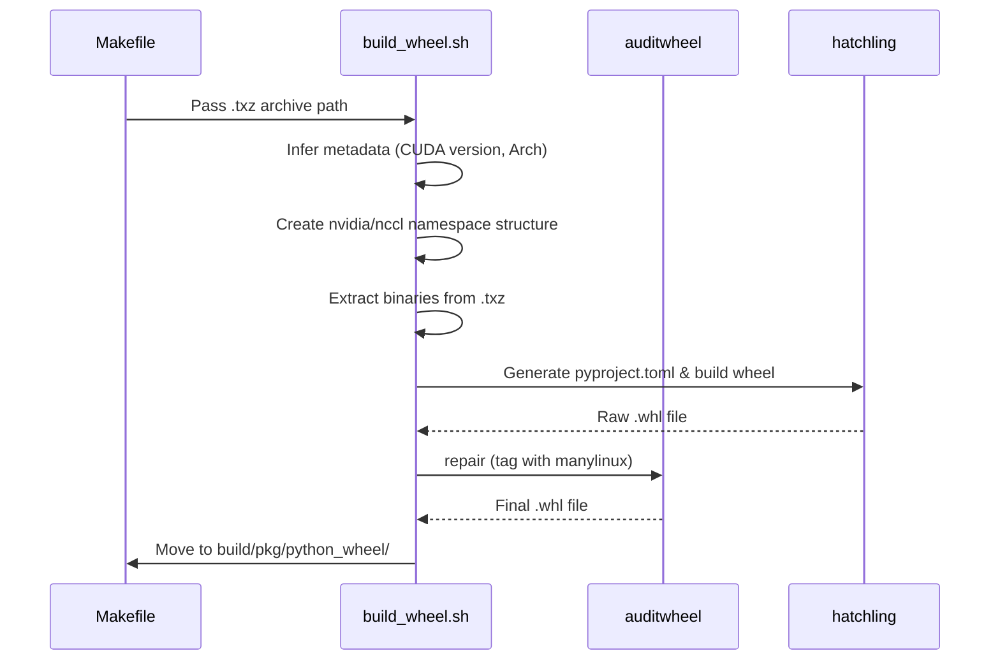

Sources: [pkg/python_wheel/build_wheel.sh:1-125](), [pkg/txz/Makefile:1-44](), [README.md:35-71]()

---

## Technical Standards

### Error Handling Macros
NCCL code must use standard guard macros for all external and internal calls to ensure uniform error reporting [CONTRIBUTING.md:98-102]().

- `NCCLCHECK(cmd)`: For internal NCCL functions.
- `CUDACHECK(cmd)`: For CUDA Driver and Runtime API calls.
- `SYSCHECK(cmd)`: For standard system calls (e.g., `read`, `write`).
- `PTHREADCHECK(cmd)`: For `pthread` library calls.

### Documentation Contributions
The `docs/contrib/` directory serves as a repository for deep-dive technical analysis provided by the community [docs/contrib/README.md:8-14](). These documents explore internal design decisions, such as:
- **Architecture Internals**: Source-oriented guides on topology discovery and tuning [docs/contrib/README.md:38-38]().
- **GIN & Symmetric Memory**: Detailed analysis of the GPU-Initiated Networking backend [docs/contrib/README.md:30-30]().
- **Framework Analysis**: Deep dives into extensions like DeepEPv2 [docs/contrib/README.md:34-34]().

Sources: [CONTRIBUTING.md:98-102](), [docs/contrib/README.md:1-38]()

---

# Page: Communicator Management

# Communicator Management

<details>
<summary>Relevant source files</summary>

The following files were used as context for generating this wiki page:

- [docs/userguide/source/api/types.rst](docs/userguide/source/api/types.rst)
- [src/bootstrap.cc](src/bootstrap.cc)
- [src/cft_dev_runtime.cc](src/cft_dev_runtime.cc)
- [src/debug.cc](src/debug.cc)
- [src/group.cc](src/group.cc)
- [src/include/comm.h](src/include/comm.h)
- [src/include/enqueue.h](src/include/enqueue.h)
- [src/include/proxy.h](src/include/proxy.h)
- [src/include/strongstream.h](src/include/strongstream.h)
- [src/include/transport.h](src/include/transport.h)
- [src/init.cc](src/init.cc)
- [src/misc/strongstream.cc](src/misc/strongstream.cc)
- [src/nccl.h.in](src/nccl.h.in)
- [src/param/c_api.cc](src/param/c_api.cc)
- [src/param/ncclparam.cc](src/param/ncclparam.cc)
- [src/proxy.cc](src/proxy.cc)
- [src/transport.cc](src/transport.cc)

</details>


## Purpose and Scope

This page covers the `ncclComm_t` handle: what it is, the data structures that back it, and how the subsystems it owns relate to each other. It serves as an entry point to the communicator subsystem.

Detailed treatments are in the sub-pages:

*   **Initialization and Bootstrap Process** — Covers `ncclCommInitRank`, bootstrap rendezvous via `ncclUniqueId`, and transport setup. For details, see [Initialization and Bootstrap Process](#2.1).
*   **Lifecycle and State Management** — Covers `ncclComm` fields, reference counting, state transitions, and the destroy/abort paths. For details, see [Lifecycle and State Management](#2.2).
*   **Split, Shrink, and Grow Operations** — Covers `ncclCommSplit` and related operations that derive child communicators or modify membership. For details, see [Split, Shrink, and Grow Operations](#2.3).
*   **Configuration and Versioning** — Covers `version.mk`, symbol visibility macros (`NCCL_API`), and runtime `NCCL_PARAM` tuning. For details, see [Configuration and Versioning](#2.4).

For the topology discovery and path computation that runs during init, see [Topology System](#3). For the transport layer that backs communicator channels, see [Transport Layer](#5). For the enqueue and kernel planning pipeline that uses the communicator at runtime, see [Communication Pipeline](#4).

---

## The `ncclComm_t` Handle

`ncclComm_t` is an opaque typedef for `struct ncclComm*` [src/nccl.h.in:36](). The full struct is defined in [src/include/comm.h:518-700]() and is internal to the library; callers only ever hold the pointer.

One `ncclComm` is created per participating GPU per communicator group. A rank is identified by its `rank` index within a group of `nRanks` GPUs. Each communicator owns or shares all resources required to drive collective operations on its device: topology data, transport connections, CUDA streams, a proxy service, and memory pools.

The struct begins and ends with sentinel fields (`startMagic`, `endMagic`) set to `NCCL_MAGIC` to detect memory corruption [src/include/comm.h:519,700](). The helper `commPoison` in [src/init.cc:207-211]() (implied by lifecycle management) deliberately overwrites identity fields before `free()` to catch use-after-free bugs.

---

## Core Data Structures

### `struct ncclComm`

The full struct is in [src/include/comm.h:518-700]().

| Field(s) | Type | Role |
| :--- | :--- | :--- |
| `rank`, `nRanks` | `int` | Rank identity within this communicator [src/include/comm.h:522-523]() |
| `cudaDev`, `busId`, `compCap` | `int` / `int64_t` | Device identity and PCI location [src/include/comm.h:525-528]() |
| `node`, `nNodes`, `localRank` | `int` | Node-level topology information [src/include/comm.h:531-534]() |
| `topo` | `ncclTopoSystem*` | Hardware topology graph built during init [src/include/comm.h:537]() |
| `peerInfo` | `ncclPeerInfo*` | Array of peer metadata exchanged via bootstrap [src/include/comm.h:541]() |
| `channels[MAXCHANNELS]` | `ncclChannel[]` | Communication channels for different algorithms [src/include/comm.h:545]() |
| `sharedRes` | `ncclSharedResources*` | Ref-counted resources shared with split children [src/include/comm.h:548]() |
| `ncclNet` | `ncclNet_t*` | Active network plugin for P2P/Collectives [src/include/comm.h:550]() |
| `bootstrap` | `void*` | Handle for out-of-band bootstrap network [src/include/comm.h:553]() |
| `planner` | `ncclKernelPlanner` | Task accumulation and plan building state [src/include/comm.h:603]() |
| `abortFlag` | `uint32_t*` | Host-side flag to signal operation abort [src/include/comm.h:614]() |
| `config` | `ncclConfig_t` | User-provided or default runtime configuration [src/nccl.h.in:91-119]() |

**Sources:** [src/include/comm.h:518-700](), [src/nccl.h.in:91-119]()

---

### `struct ncclSharedResources`

`ncclSharedResources` holds resources that are potentially shared between a parent communicator and its split children [src/include/comm.h:126-154](). It is reference-counted and freed when `refCount` reaches zero.

| Field | Type | Role |
| :--- | :--- | :--- |
| `refCount` | `int` | Number of `ncclComm` instances sharing this struct [src/include/comm.h:127]() |
| `peers[MAXCHANNELS]` | `ncclChannelPeer*` | Host-side per-channel peer connection states [src/include/comm.h:129]() |
| `deviceStream`, `hostStream` | `ncclStrongStream` | Internal CUDA streams for kernels and proxy [src/include/comm.h:145]() |
| `proxyState` | `ncclProxyState*` | State machine and thread for proxy operations [src/include/comm.h:150]() |
| `ginState` | `ncclGinState` | Shared state for GPU-Initiated Networking [src/include/comm.h:153]() |

**Sources:** [src/include/comm.h:120-154]()

---

### `struct ncclChannel`

Each communicator contains `MAXCHANNELS` channels. A channel represents one logical communication path and holds the topology layout for every algorithm [src/include/comm.h:156-178]().

| Field | Type | Role |
| :--- | :--- | :--- |
| `ring` | `ncclRing` | Ring algorithm peer ordering [src/include/comm.h:161]() |
| `tree` | `ncclTree` | Binary tree up/down peer assignments [src/include/comm.h:163]() |
| `nvls` | `ncclNvls` | NVLink SHARP multicast topology [src/include/comm.h:168]() |
| `peers`, `devPeers` | `ncclChannelPeer**` | Per-peer send/recv connectors [src/include/comm.h:157-158]() |
| `id` | `int` | Logical index of this channel [src/include/comm.h:170]() |

**Sources:** [src/include/comm.h:156-178]()

---

## Structural Relationships

**Diagram: ncclComm and its major sub-objects (mapped to code entities)**

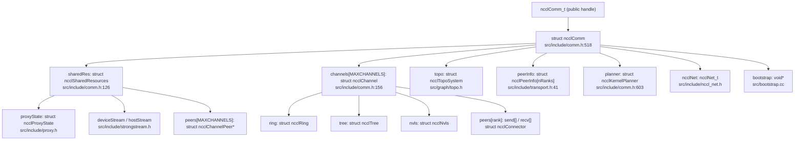

**Sources:** [src/include/comm.h:126-178](), [src/include/comm.h:518-700](), [src/include/transport.h:41-65]()

---

## Initialization Overview

A communicator is created through `ncclCommInitRank` [src/init.cc:203]() or `ncclCommInitAll`. Internally, initialization proceeds through three main phases:

1.  **Environment and Bootstrap Init** — `ncclInit` and `ncclInitEnv` prepare global library state and the bootstrap network [src/init.cc:177-193]().
2.  **`initTransportsRank`** — Runs the AllGather of peer info via `bootstrapAllGather`, topology discovery, graph search, and transport setup via `ncclTransportP2pSetup`.
3.  **Proxy and Resource Bring-up** — Initializes the `ncclProxyState` and proxy service thread if required for the selected transports [src/proxy.cc:262-276]().

**Diagram: Communicator initialization phases mapped to functions**

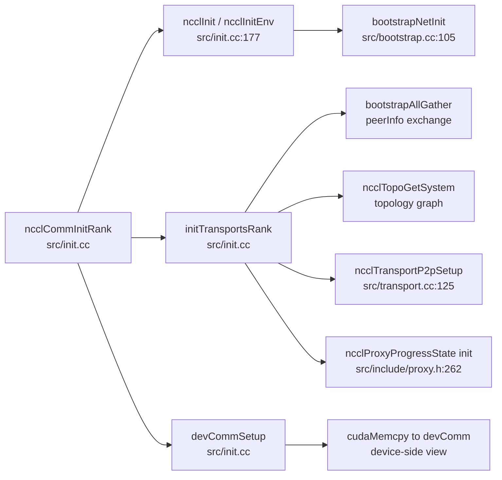

**Sources:** [src/init.cc:177-206](), [src/transport.cc:125-150](), [src/bootstrap.cc:105-138]()

---

## Communicator Lifecycle

**Diagram: State transitions of an ncclComm instance**

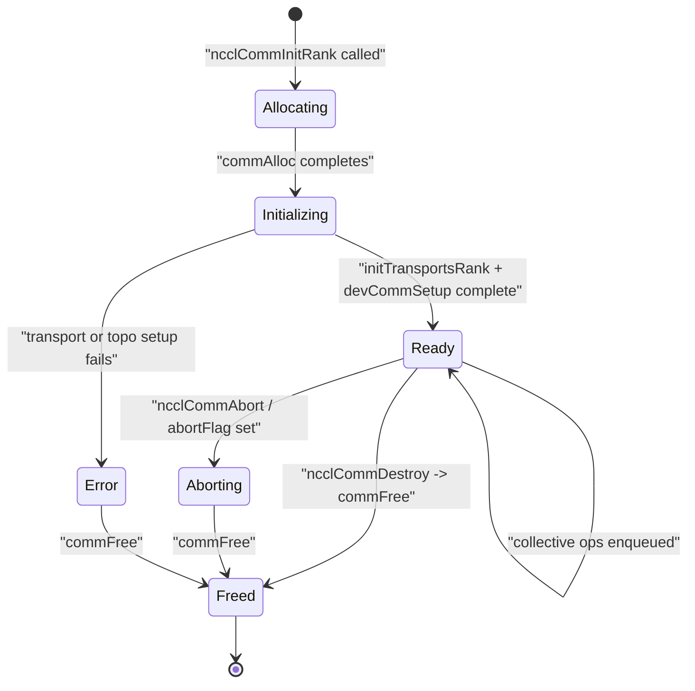

The active abort mechanism uses two flags:
*   `abortFlag` (host-mapped, `uint32_t*`) — set by `ncclCommAbort` [src/include/comm.h:614]().
*   `abortFlagDev` (device-visible, `volatile uint32_t*`) — polled by running GPU kernels [src/include/comm.h:615]().

**Sources:** [src/include/comm.h:614-617](), [src/group.cc:49-52]()

---

## Shared Resources and Communicator Splitting

When `ncclCommSplit` derives a child communicator, the new communicator can inherit the parent's `ncclSharedResources` depending on the `splitShare` configuration [src/nccl.h.in:91-119](). This increments the `refCount` in the shared resources struct [src/include/comm.h:127]().

When any communicator is freed via `commFree`, the `refCount` is decremented. Only when it reaches zero are the shared resources (proxy thread, streams, etc.) destroyed.

**Sources:** [src/include/comm.h:120-154](), [src/nccl.h.in:247-257]()

---

## Resource Cleanup

Communicator destruction is managed via `ncclCommDestroy` or `ncclCommAbort`. Resources are released in dependency order:

1.  **Destructor chain** — A linked list of `ncclDestructor` nodes registered via internal APIs to ensure specific subsystem cleanup [src/include/comm.h:109-114]().
2.  **Proxy thread join** — The proxy service thread is stopped and joined if the communicator is the owner [src/include/proxy.h:269]().
3.  **Transport Free** — Peer connectors and transport-specific buffers are released [src/include/transport.h:121]().
4.  **Shared Resources** — The ref-counted `ncclSharedResources` is freed if the count reaches zero [src/include/comm.h:127]().

**Sources:** [src/include/comm.h:109-154](), [src/include/transport.h:121-128]()

---

## Environment Parameters

Several `NCCL_PARAM` entries in `src/init.cc` affect communicator behavior:

| Parameter | Environment Variable | Default | Effect |
| :--- | :--- | :--- | :--- |
| `ncclParamCommBlocking` | `NCCL_COMM_BLOCKING` | `UNDEF` | Force blocking/non-blocking mode [src/init.cc:63]() |
| `ncclParamRuntimeConnect` | `NCCL_RUNTIME_CONNECT` | `1` | Enable lazy transport connection [src/init.cc:64]() |
| `ncclParamCollnetEnable` | `NCCL_COLLNET_ENABLE` | `UNDEF` | Enable/disable CollNet [src/init.cc:66]() |
| `ncclParamNvlsChannels` | `NCCL_NVLS_NCHANNELS` | `UNDEF` | Override NVLS channel count [src/init.cc:67]() |
| `ncclParamGdrCopyEnable` | `NCCL_GDRCOPY_ENABLE` | `0` | Enable GDRCopy support [src/init.cc:146]() |

**Sources:** [src/init.cc:60-74](), [src/init.cc:146-149]()

---

# Page: Initialization and Bootstrap Process

# Initialization and Bootstrap Process

<details>
<summary>Relevant source files</summary>

The following files were used as context for generating this wiki page:

- [src/bootstrap.cc](src/bootstrap.cc)
- [src/debug.cc](src/debug.cc)
- [src/group.cc](src/group.cc)
- [src/include/bootstrap.h](src/include/bootstrap.h)
- [src/include/comm.h](src/include/comm.h)
- [src/include/core.h](src/include/core.h)
- [src/include/enqueue.h](src/include/enqueue.h)
- [src/include/proxy.h](src/include/proxy.h)
- [src/include/socket.h](src/include/socket.h)
- [src/include/transport.h](src/include/transport.h)
- [src/init.cc](src/init.cc)
- [src/misc/socket.cc](src/misc/socket.cc)
- [src/proxy.cc](src/proxy.cc)
- [src/transport.cc](src/transport.cc)
- [src/transport/net_socket.cc](src/transport/net_socket.cc)

</details>


## Purpose and Scope

This page describes the full initialization path executed when `ncclCommInitRank` or `ncclCommInitAll` is called: library-level setup, bootstrap network bring-up, rank rendezvous via `ncclUniqueId`, topology discovery, channel assignment, transport connection, and proxy start-up.

This page does not cover what happens to a communicator after it is ready for use (see [Lifecycle and State Management](2.2)), how child communicators are derived (see [Split, Shrink, and Grow Operations](2.3)), or the topology subsystem details (see [Topology System](3)).

---

## Overview

Initialization is split into two scopes:

| Scope | Trigger | Key Function | Location |
|---|---|---|---|
| Library-wide (once per process) | First call to any NCCL API | `ncclInit()` / `initOnceFunc()` | [src/init.cc:177-180]() |
| Per-communicator | `ncclCommInitRank` / `ncclCommInitAll` | `commAlloc()`, `initTransportsRank()` | [src/init.cc:1037-1110](), [src/init.cc:1255-1310]() |
| Bootstrap network (once per process) | Inside `initOnceFunc()` | `bootstrapNetInit()` | [src/bootstrap.cc:105-138]() |

**Initialization sequence diagram** (code entity view):

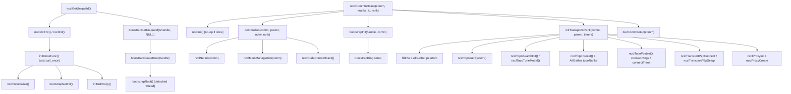

Sources: [src/init.cc:167-180](), [src/init.cc:202-210](), [src/bootstrap.cc:105-138](), [src/bootstrap.cc:445-468]()

---

## Phase 1 – Library-Level Initialization

`ncclInit()` uses `std::call_once` with `initOnceFlag` to ensure `initOnceFunc()` runs exactly once per process, regardless of how many threads call NCCL concurrently [src/init.cc:177-180]().

`initOnceFunc()` performs three tasks:

1. **OS initialization** – `ncclOsInitialize()` sets process-level resource limits and OS-specific configuration [src/init.cc:168]().
2. **Bootstrap network** – `bootstrapNetInit()` discovers the host's network interface for out-of-band communication [src/init.cc:171]().
3. **GDR Copy** – If `NCCL_GDRCOPY_ENABLE=1`, opens a GDR copy handle via `ncclGdrInit()` [src/init.cc:153-162]().

`bootstrapNetInit()` in `src/bootstrap.cc` performs interface discovery:
- If `NCCL_COMM_ID` is set, it finds the interface whose subnet matches the specified address using `ncclFindInterfaceMatchSubnet` [src/bootstrap.cc:109-122]().
- Otherwise, it calls `ncclFindInterfaces` to pick any usable interface [src/bootstrap.cc:124-129]().
- The result is stored in the module-level variables `bootstrapNetIfName` and `bootstrapNetIfAddr` [src/bootstrap.cc:98-99]().

Sources: [src/init.cc:167-180](), [src/bootstrap.cc:98-138]()

---

## Phase 2 – Generating `ncclUniqueId`

`ncclGetUniqueId` is called once (typically by rank 0) and the result is broadcast to all ranks by the application before calling `ncclCommInitRank` [src/init.cc:202-210]().

Internally, `ncclGetUniqueId` calls `bootstrapGetUniqueId(&handle, NULL)`, which:

1. Generates a random 64-bit `magic` via `getRandomData` [src/bootstrap.cc:448]().
2. Copies the bootstrap network address (`bootstrapNetIfAddr`) into `handle.addr` [src/bootstrap.cc:449]().
3. Calls `bootstrapCreateRoot(handle)` to spawn the root rendezvous thread [src/bootstrap.cc:450]().

The `ncclBootstrapHandle` struct fields:

| Field | Purpose |
|---|---|
| `addr` | Socket address where the root thread listens |
| `magic` | Random value used to distinguish this communicator's sockets |
| `nRanks` | Number of expected ranks (0 for normal init) |

`ncclUniqueId` and `ncclBootstrapHandle` are not the same size or alignment. `ncclGetUniqueId` zero-fills `ncclUniqueId` and then `memcpy`s the handle into it [src/init.cc:208-210]().

Sources: [src/init.cc:202-210](), [src/bootstrap.cc:445-468]()

---

## Phase 3 – Bootstrap Root and Ring Formation

When `bootstrapCreateRoot` is called, it:
1. Creates a `ncclSocket` listening on the chosen interface [src/bootstrap.cc:419]().
2. Updates `handle->addr` with the actual bound address (including ephemeral port) [src/bootstrap.cc:421]().
3. Allocates a `bootstrapRootArgs` struct and spawns a detached thread running `bootstrapRoot` [src/bootstrap.cc:430-435]().

The `bootstrapRoot` thread collects connection info from every rank and stitches them into a ring so that rank `i` can bootstrap-communicate with rank `i+1` [src/bootstrap.cc:260-411]().

**Bootstrap ring formation diagram**:

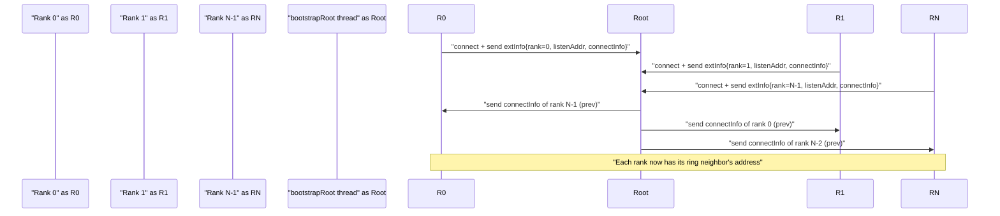

The `extInfo` struct sent by each rank contains rank identity, root partitioning, and connection handles [src/bootstrap.cc:270-285](). After ring formation, each rank holds a `bootstrapState` with sockets connected to its predecessor and successor in the ring [src/bootstrap.cc:530]().

Sources: [src/bootstrap.cc:260-411](), [src/bootstrap.cc:413-468](), [src/bootstrap.cc:488-532]()

---

## Phase 4 – Communicator Allocation (`commAlloc`)

`commAlloc()` allocates and initializes the host-side `ncclComm` struct fields that do not require inter-rank communication [src/init.cc:419-544](). Key steps:

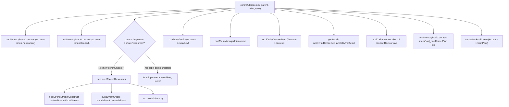

The `ncclSharedResources` object is shared among sibling communicators created via `ncclCommSplit` [src/include/comm.h:126-154]().

Sources: [src/init.cc:419-544](), [src/include/comm.h:126-154]()

---

## Phase 5 – Transport Initialization (`initTransportsRank`)

This coordinating function handles all inter-rank initialization via two AllGather rounds over the bootstrap ring [src/init.cc:1255-1310]().

### AllGather 1 – Peer Info

Each rank calls `fillInfo()` to populate an `ncclPeerInfo` describing itself, including CUDA capability, host hashes, and PCI bus IDs [src/init.cc:663-732](). After AllGather, every rank has the full `peerInfo` array.

### Topology Discovery and Search

`ncclTopoGetSystem()` builds the `ncclTopoSystem` graph. `ncclTopoSearchInit()` runs the graph search for algorithm-specific channel assignments [src/init.cc:1278-1282]().

### AllGather 2 – Topology Ranks

`ncclTopoPreset()` extracts local ring/tree endpoints into `ncclTopoRanks`. A second AllGather shares these across all ranks [src/init.cc:1284-1286]().

### Channel Finalization

`ncclTopoPostset()` uses the gathered topology ranks to assign `ring.prev` and `ring.next`, as well as `tree.up` and `tree.down[]` [src/init.cc:1288-1290]().

Sources: [src/init.cc:1255-1310](), [src/init.cc:663-732](), [src/transport.cc:23-44]()

---

## Phase 6 – Transport Connection Setup

`initTransportsRank` proceeds to set up data-plane connections based on the channel configuration.

**Transport setup diagram** (code entities):

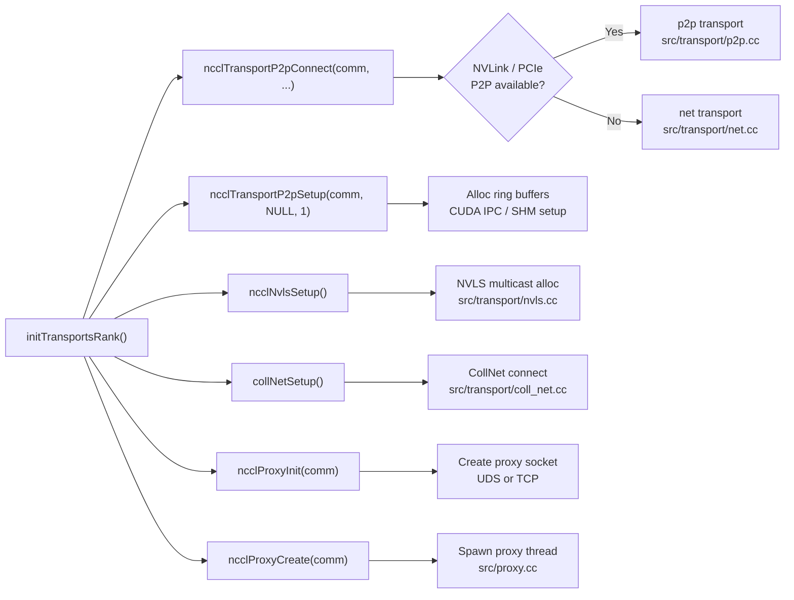

`ncclTransportP2pConnect` marks required connections in `comm->connectSend` and `comm->connectRecv` bitmasks [src/transport.cc:46-66](). `ncclTransportP2pSetup` resolves these into live `ncclConnector` objects [src/transport.cc:125-150]().

Sources: [src/init.cc:1255-1310](), [src/transport.cc:46-66](), [src/transport.cc:125-150](), [src/proxy.cc:35-47]()

---

## Phase 7 – Device Communicator Setup (`devCommSetup`)

`devCommSetup()` creates the GPU-side view of the communicator via `ncclKernelCommAndChannels` [src/init.cc:546-646]():

1. Allocates `devCommAndChans` in CUDA device memory [src/init.cc:558]().
2. Copies topology, buffer sizes, and `abortFlagDev` into the device struct [src/init.cc:570-600]().
3. Allocates the work FIFO buffer (`workFifoBuf`) in GDR-mapped memory or pinned host memory [src/init.cc:605-615]().
4. Synchronizes the device stream [src/init.cc:645]().

Sources: [src/init.cc:546-646]()

---

## Initialization Timers

`initTransportsRank` tracks wall-clock time for major phases using a timer array, including bootstrap setup, AllGather rounds, and topology discovery [src/init.cc:1115-1123]().

Sources: [src/init.cc:1115-1123]()

---

## Environment Variables Affecting Initialization

| Variable | Default | Effect |
|---|---|---|
| `NCCL_COMM_ID` | unset | Use a fixed root address; sets bootstrap interface [src/bootstrap.cc:109]() |
| `NCCL_OOB_NET_ENABLE` | 0 | Use the data-plane network plugin for bootstrap [src/bootstrap.cc:103]() |
| `NCCL_GDRCOPY_ENABLE` | 0 | Enable GDR Copy for work FIFO [src/init.cc:146]() |
| `NCCL_COMM_BLOCKING` | undef | Override blocking mode [src/init.cc:63]() |

Sources: [src/init.cc:60-74](), [src/bootstrap.cc:103-142]()

---

## Relationship to Other Subsystems

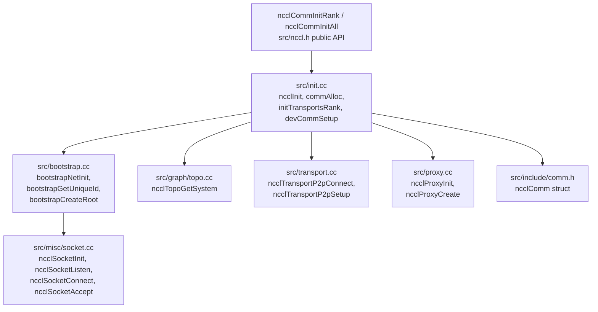

Sources: [src/init.cc:1-42](), [src/bootstrap.cc:1-20](), [src/transport.cc:8-18](), [src/include/comm.h:8-34]()

---

# Page: Lifecycle and State Management

# Lifecycle and State Management

<details>
<summary>Relevant source files</summary>

The following files were used as context for generating this wiki page:

- [src/allocator.cc](src/allocator.cc)
- [src/bootstrap.cc](src/bootstrap.cc)
- [src/debug.cc](src/debug.cc)
- [src/group.cc](src/group.cc)
- [src/include/alloc.h](src/include/alloc.h)
- [src/include/allocator.h](src/include/allocator.h)
- [src/include/comm.h](src/include/comm.h)
- [src/include/enqueue.h](src/include/enqueue.h)
- [src/include/mem_manager.h](src/include/mem_manager.h)
- [src/include/proxy.h](src/include/proxy.h)
- [src/include/transport.h](src/include/transport.h)
- [src/init.cc](src/init.cc)
- [src/mem_manager.cc](src/mem_manager.cc)
- [src/proxy.cc](src/proxy.cc)
- [src/transport.cc](src/transport.cc)

</details>


## Purpose and Scope

This page describes the lifecycle of the NCCL communicator (`ncclComm_t`), focusing on the `ncclComm` struct fields, state transitions, reference counting, and the mechanisms for graceful finalization versus emergency aborts. The communicator state machine coordinates transitions from allocation and asynchronous initialization through collective execution to resource reclamation.

## The ncclComm Structure and State Fields

The `ncclComm` structure is the central entity for managing communication state. It contains fields that track initialization progress, runtime health, and synchronization requirements across host and device.

### Primary State Fields

| Field | Type | Purpose |
| :--- | :--- | :--- |
| `initState` | `ncclResult_t` | Tracks host-side initialization progress (`ncclInProgress` → `ncclSuccess`). [src/init.cc:1585-1619]() |
| `asyncResult` | `ncclResult_t` | Captures asynchronous errors occurring during GPU kernel execution or proxy operations. [src/init.cc:2129-2137]() |
| `abortFlag` | `int*` | Host-side pointer used to signal proxy threads and the group engine to stop. [src/init.cc:2400]() |
| `abortFlagDev` | `volatile int*` | Device-mapped pointer checked by GPU kernels to exit loops on error. [src/init.cc:2401]() |
| `finalizeCalled` | `bool` | Guard to prevent multiple entries into the finalization path. [src/init.cc:2282]() |
| `destroyFlag` | `int` | Internal marker that the communicator is scheduled for destruction. [src/init.cc:2379]() |
| `revokedFlag` | `int` | Marks the communicator as "revoked" for graceful error recovery. [src/init.cc:2469]() |
| `startMagic`/`endMagic` | `uint64_t` | Integrity markers (set to `0xCCE0CCE0CCE0CCE0`) to detect memory corruption. [src/init.cc:208-210]() |

### Code Entity Relationship Diagram

The following diagram maps high-level lifecycle concepts to the specific C++ entities and flags within the `ncclComm` struct.

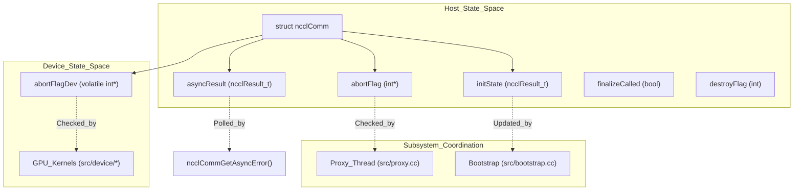
**Sources:** [src/include/comm.h:293-410](), [src/init.cc:207-211](), [src/init.cc:1585-1619](), [src/init.cc:2400-2401]()

---

## Lifecycle State Machine

The communicator transitions through several phases, often driven by asynchronous background jobs managed by the `ncclAsyncJob` infrastructure. Initialization is performed via `ncclCommInitRank` which calls `ncclInitEnv` and `ncclInit` to prepare the library [src/init.cc:204-205]().

### Complete State Transition Flow

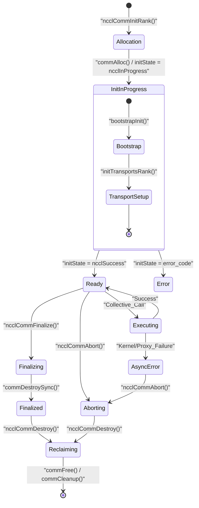
**Sources:** [src/init.cc:1512-1621](), [src/init.cc:1964-2042](), [src/init.cc:2263-2302](), [src/init.cc:2502-2541](), [src/group.cc:36-74]()

---

## Destruction and Resource Reclamation

NCCL employs a two-phase destruction process to ensure that all asynchronous work (CUDA kernels, proxy operations, and network transfers) has completed before memory is freed.

### 1. The Destroy Path (`ncclCommDestroy`)
The user calls `ncclCommDestroy()`, which marks the communicator for reclamation. If the communicator was not previously finalized, it triggers an implicit synchronization.

*   **Synchronization**: `commDestroySync()` is called to synchronize the `hostStream` and `deviceStream`. [src/init.cc:2138-2177]()
*   **Proxy Termination**: `ncclProxyStop()` is invoked to shut down the background proxy thread. [src/init.cc:2171]()
*   **Reference Counting**: Communicators often share resources (like the bootstrap network or proxy state). NCCL uses atomic reference counts (e.g., `sharedRes->refCount`) to ensure shared objects are only freed by the last rank. [src/init.cc:223-323]()

### 2. The Abort Path (`ncclCommAbort`)
`ncclCommAbort()` is the emergency exit. It bypasses graceful synchronization.
*   **Signaling**: It sets `abortFlag` and `abortFlagDev` to 1. [src/init.cc:2515]()
*   **Propagation**: This signal causes GPU kernels to terminate their loops and proxy threads to cease processing immediately. [src/init.cc:2394-2403]()
*   **Reclamation**: It schedules `commReclaim()` to clean up host-side structures as quickly as possible. [src/init.cc:2533]()

### Resource Freeing Logic (`commFree`)
The `commFree` function handles the actual deallocation of memory. NCCL uses a custom memory management system including `ncclMemoryStack` and `ncclMemoryPool` [src/include/mem_manager.h:9-20]().
*   **Permanent Memory**: Resources allocated via the `memPermanent` stack are released. [src/init.cc:207-211]()
*   **Destructors**: A linked list of `ncclDestructor` objects is processed to free CUDA memory and host buffers. [src/init.cc:221-235]()
*   **Host Allocations**: Memory allocated via `ncclCalloc` or `ncclCudaHostCalloc` is returned to the system or CUDA driver [src/include/alloc.h:148-189]().

### Intra-Process Coordination Diagram
In multi-GPU single-process scenarios, ranks coordinate via a shared resources structure to ensure the process-wide resources are cleaned up only once.

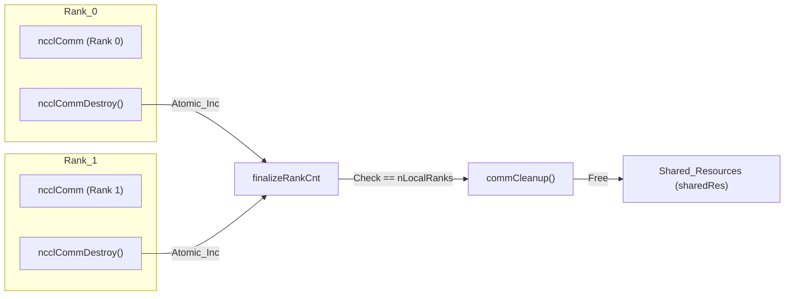
**Sources:** [src/init.cc:2230-2281](), [src/init.cc:2304-2355](), [src/include/comm.h:126-154]()

---

## Summary of Reference Counting

NCCL manages complex resource dependencies through several reference counting mechanisms:

1.  **`sharedRes->refCount`**: Tracks how many communicators (including those created via `ncclCommSplit`) are using the shared device streams and proxy state. [src/include/comm.h:127](), [src/init.cc:273-287]()
2.  **`abortFlagRefCount`**: Specifically manages the lifecycle of the `abortFlag` memory, which may be shared between a parent and its children. [src/init.cc:300-305]()
3.  **`ncclChannelPeer->refCount`**: Tracks usage of peer-to-peer connection structures across different channels and communicators. [src/include/comm.h:129](), [src/transport.cc:27-28]()

### Resource Ownership and Sharing

| Resource | Scope | Lifecycle Manager |
| :--- | :--- | :--- |
| `ncclSharedResources` | Shared across ranks in a process | `sharedRes->refCount` [src/include/comm.h:127]() |
| `ncclChannelPeer` | Shared across channels/communicators | `refCount` in `ncclChannelPeer` [src/include/comm.h:129]() |
| `ncclProxyState` | Part of `ncclSharedResources` | Managed via `sharedRes` lifecycle [src/include/comm.h:150]() |
| `memPermanent` | Per-communicator | Freed during `commFree` [src/init.cc:207-211]() |

**Sources:** [src/include/comm.h:126-154](), [src/init.cc:223-323](), [src/transport.cc:15-44]()

---

# Page: Split, Shrink, and Grow Operations

# Split, Shrink, and Grow Operations

<details>
<summary>Relevant source files</summary>

The following files were used as context for generating this wiki page:

- [src/bootstrap.cc](src/bootstrap.cc)
- [src/channel.cc](src/channel.cc)
- [src/debug.cc](src/debug.cc)
- [src/group.cc](src/group.cc)
- [src/include/comm.h](src/include/comm.h)
- [src/include/enqueue.h](src/include/enqueue.h)
- [src/include/proxy.h](src/include/proxy.h)
- [src/include/transport.h](src/include/transport.h)
- [src/init.cc](src/init.cc)
- [src/proxy.cc](src/proxy.cc)
- [src/transport.cc](src/transport.cc)

</details>


## Purpose and Scope

This page documents NCCL's dynamic communicator management operations that allow creating new communicators from existing ones. These operations enable flexible partitioning, exclusion, and expansion of communication groups during runtime without requiring full reinitialization.

Three primary operations are covered:
- **Split**: Partition a communicator into multiple sub-communicators based on color and key.
- **Shrink**: Create a new communicator by excluding specific ranks.
- **Grow**: Expand a communicator to include additional ranks.

For information about initial communicator creation, see [Initialization and Bootstrap Process](2.1). For communicator lifecycle management, see [Lifecycle and State Management](2.2).

---

## Operation Overview

### Split, Shrink, and Grow Comparison

| Operation | API Function | Purpose | Rank Selection | Bootstrap Method |
|-----------|-------------|---------|----------------|------------------|
| **Split** | `ncclCommSplit` | Create sub-communicators | Color/key based grouping | `bootstrapSplit` |
| **Shrink** | `ncclCommShrink` | Exclude specific ranks | Explicit exclusion list | `bootstrapSplit` |
| **Grow** | `ncclCommGrow` | Add new ranks | Boundary rank coordination | `bootstrapInit` |

**Sources:** [src/init.cc:2989-3005](), [src/init.cc:2786-2806](), [src/init.cc:2825-2987]()

---

## Communicator Split Operation

### Split API and Semantics

The `ncclCommSplit` function partitions ranks into groups based on the `color` parameter. Within each color group, ranks are ordered by their `key` values. The special value `NCCL_SPLIT_NOCOLOR` indicates a rank should not join any new communicator. [src/init.cc:2989-3005]()

**Key Parameters:**
- `color`: Group identifier (same color = same communicator).
- `key`: Ordering within the group (lower keys get lower ranks).
- `newcomm`: Output pointer for the new communicator.
- `config`: Optional configuration (NULL uses parent config).

**Sources:** [src/init.cc:2989-3005]()

### Split Implementation Flow

The implementation relies on `ncclCommInitRankAsyncJob` to handle the heavy lifting of initialization in the background. [src/init.cc:1589-1715]()

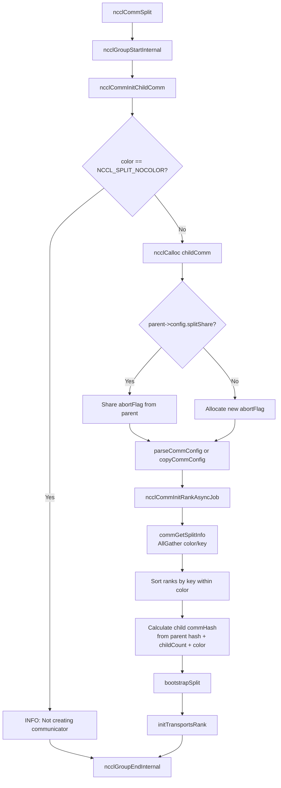

**Sources:** [src/init.cc:2989-3005](), [src/init.cc:2691-2784](), [src/init.cc:1589-1715]()

### Split Rank Mapping Algorithm

The `commGetSplitInfo` function computes the new rank assignments by gathering metadata from all peers in the parent communicator. [src/init.cc:1532-1572]()

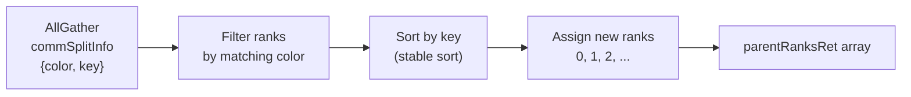

The algorithm:
1. Each rank broadcasts its `(color, key)` via `bootstrapAllGather` with the `BOOTSTRAP_TAG_COMMSPLIT` tag. [src/init.cc:1541-1546](), [src/bootstrap.cc:24-24]()
2. Ranks with matching color are collected into a local list. [src/init.cc:1551-1555]()
3. Within each color, ranks are sorted by key using a stable sort to maintain parent rank order for identical keys. [src/init.cc:1558-1568]()
4. New ranks are assigned sequentially (0, 1, 2, ...) in sorted order. [src/init.cc:1571]()

**Sources:** [src/init.cc:1532-1572](), [src/bootstrap.cc:24-24]()

---

## Communicator Shrink Operation

### Shrink API and Semantics

Shrink creates a new communicator by excluding specified ranks from the parent. Unlike split, all remaining ranks join a single new communicator. [src/init.cc:2786-2806]()

**Shrink Flags:**
- `NCCL_SHRINK_DEFAULT` (0): Normal shrink with optional resource sharing.
- `NCCL_SHRINK_ABORT`: Force parent to abort before creating child. [src/init.cc:2792-2796]()

**Sources:** [src/init.cc:2786-2806]()

### Shrink Error Handling Mode

When `NCCL_SHRINK_ABORT` is set, the parent communicator's state is invalidated to ensure no pending kernels interfere with the new communicator's initialization. [src/init.cc:2792-2796]()

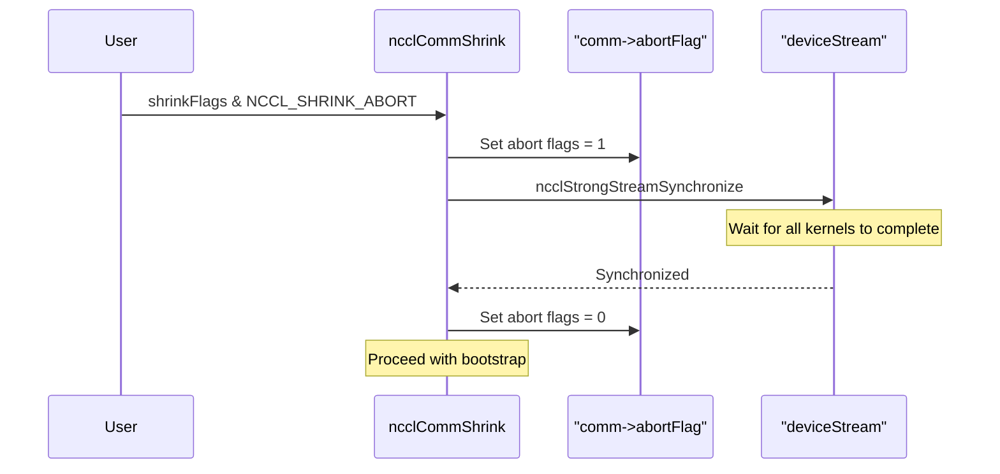

**Sources:** [src/init.cc:2792-2796]()

---

## Communicator Grow Operation

### Grow API and Coordination

Grow involves **two categories of ranks**:
1. **Existing ranks** (`comm != NULL`): Ranks from the parent communicator.
2. **New ranks** (`comm == NULL`): Freshly joining ranks. [src/init.cc:2825-2987]()

### Coordination Protocol

```mermaid
sequenceDiagram
    participant Root as "Rank 0 (existing)"
    participant New as "New Ranks"
    
    Note over Root: User calls ncclCommGetUniqueId(comm, &id)
    Root->>Root: bootstrapGetUniqueId(&growHandle)
    Root->>New: uniqueId distribution (out-of-band)
    
    par Existing Ranks
        Root->>Root: ncclCommGrow(comm, nRanks, NULL, -1, ...)
    and New Ranks
        New->>New: ncclCommGrow(NULL, nRanks, &id, rank, ...)
    end
    
    Note over Root,New: All ranks use bootstrapInit
```

**Sources:** [src/init.cc:2808-2823](), [src/init.cc:2825-2987]()

---

## Resource Sharing Mechanism

### Share vs. Non-Share Mode

Split and shrink support resource sharing to reduce memory footprint and context overhead. [src/init.cc:2724-2739]()

| Configuration Field | Environment Variable | Effect |
|---------------------|---------------------|--------|
| `config.splitShare` | `NCCL_COMM_SPLIT_SHARE_RESOURCES` | Share proxy, streams, abort flags. |
| `config.shrinkShare` | `NCCL_COMM_SHRINK_SHARE_RESOURCES` | Share proxy, streams, abort flags. |

**Sources:** [src/init.cc:2060-2077](), [src/init.cc:2724-2739]()

### Shared Resources Diagram

When sharing is enabled, the child communicator points to the parent's internal structures. [src/init.cc:2726-2730]()

```mermaid
graph TB
    subgraph Parent ["Parent ncclComm"]
        P_SR["sharedRes (ncclSharedResources)"]
        P_AF["abortFlag"]
    end
    
    subgraph Child ["Child ncclComm"]
        C_SR["sharedRes (Pointer to Parent)"]
        C_AF["abortFlag (Pointer to Parent)"]
    end
    
    P_SR --> C_SR
    P_AF --> C_AF
```

Shared resources defined in `ncclSharedResources` include the `ncclProxyState` for network communication and the `ncclStrongStream` handles for host/device synchronization. [src/include/comm.h:126-154]()

**Sources:** [src/init.cc:2726-2730](), [src/include/comm.h:126-154]()

---

## Bootstrap Mechanisms

### Bootstrap Split vs. Bootstrap Init

| Operation | Bootstrap Function | Parent Bootstrap | Unique ID Source |
|-----------|-------------------|------------------|------------------|
| Split/Shrink | `bootstrapSplit` | Reused | Derived from parent hash. |
| Grow | `bootstrapInit` | New instance | External `ncclUniqueId`. |

**Sources:** [src/init.cc:1643](), [src/init.cc:1667]()

### Bootstrap Split Implementation

`bootstrapSplit` leverages the existing out-of-band network established by the parent. It creates a virtual partition within the existing socket infrastructure using `BOOTSTRAP_TAG_COMMSPLIT`. [src/bootstrap.cc:24-24](), [src/init.cc:1643-1643]()

---

## Initialization Path Convergence

All three operations converge at `ncclCommInitRankFunc`, which performs the standard initialization sequence:

```mermaid
flowchart TD
    Entry["ncclCommInitRankFunc"]
    
    CheckPath{"job->parent && !job->isGrow?"}
    SplitShrink["Split/Shrink Path"]
    GrowNormal["Grow/Normal Path"]
    
    GetSplitInfo["commGetSplitInfo or getParentRanks"]
    CalcChildHash["Child hash from parent hash + count + color"]
    BootstrapSplit["bootstrapSplit"]
    
    CalcGrowHash["Hash from uniqueId or baseMagic + nranks"]
    BootstrapInit["bootstrapInit"]
    
    CommonPath["commAlloc<br/>initTransportsRank<br/>- Topology discovery<br/>- Graph generation<br/>- Transport setup"]
    
    Entry --> CheckPath
    CheckPath -->|Yes| SplitShrink
    CheckPath -->|No| GrowNormal
    
    SplitShrink --> GetSplitInfo
    GetSplitInfo --> CalcChildHash
    CalcChildHash --> BootstrapSplit
    BootstrapSplit --> CommonPath
    
    GrowNormal --> CalcGrowHash
    CalcGrowHash --> BootstrapInit
    BootstrapInit --> CommonPath
```

**Sources:** [src/init.cc:1589-1715](), [src/init.cc:879-1480]()

### Initialization Phases

The `initTransportsRank` function performs:
- **Topology Discovery**: Hardware probing via `ncclTopoGetSystem`. [src/init.cc:1115]()
- **Graph Generation**: Computing rings and trees via `ncclTopoCompute`. [src/init.cc:1145]()
- **Transport Selection**: Assigning P2P, SHM, or NET transports via `selectTransport`. [src/transport.cc:23-44]()
- **Connection Setup**: Establishing data plane connections via `ncclTransportP2pSetup`. [src/transport.cc:125-243]()

**Sources:** [src/init.cc:879-1480](), [src/transport.cc:23-243]()

---

# Page: Configuration and Versioning

# Configuration and Versioning

<details>
<summary>Relevant source files</summary>

The following files were used as context for generating this wiki page:

- [docs/userguide/source/env.rst](docs/userguide/source/env.rst)
- [docs/userguide/source/troubleshooting.rst](docs/userguide/source/troubleshooting.rst)
- [docs/userguide/source/troubleshooting/diagnostics.rst](docs/userguide/source/troubleshooting/diagnostics.rst)
- [docs/userguide/source/troubleshooting/gpu_troubleshooting.rst](docs/userguide/source/troubleshooting/gpu_troubleshooting.rst)
- [docs/userguide/source/troubleshooting/logging.rst](docs/userguide/source/troubleshooting/logging.rst)
- [docs/userguide/source/troubleshooting/networking_troubleshooting.rst](docs/userguide/source/troubleshooting/networking_troubleshooting.rst)
- [docs/userguide/source/troubleshooting/performance_and_tuning.rst](docs/userguide/source/troubleshooting/performance_and_tuning.rst)
- [docs/userguide/source/troubleshooting/runtime_and_mpi_issues.rst](docs/userguide/source/troubleshooting/runtime_and_mpi_issues.rst)
- [makefiles/version.mk](makefiles/version.mk)
- [src/graph/paths.cc](src/graph/paths.cc)
- [src/graph/search.cc](src/graph/search.cc)
- [src/graph/topo.cc](src/graph/topo.cc)
- [src/graph/topo.h](src/graph/topo.h)
- [src/include/graph.h](src/include/graph.h)
- [src/include/param/common.h](src/include/param/common.h)
- [src/include/param/param.h](src/include/param/param.h)
- [src/include/param/param_registry.h](src/include/param/param_registry.h)
- [src/include/param/parser_bitset.h](src/include/param/parser_bitset.h)
- [src/include/param/parser_common.h](src/include/param/parser_common.h)
- [src/include/param/parser_default.h](src/include/param/parser_default.h)
- [src/include/param/parser_enum.h](src/include/param/parser_enum.h)
- [src/include/param/parser_list.h](src/include/param/parser_list.h)
- [src/include/param/parsers.h](src/include/param/parsers.h)
- [src/include/param/utils.h](src/include/param/utils.h)
- [src/param/param.cc](src/param/param.cc)
- [src/param/param_registry.cc](src/param/param_registry.cc)
- [src/transport/coll_net.cc](src/transport/coll_net.cc)
- [src/transport/net.cc](src/transport/net.cc)
- [src/transport/p2p.cc](src/transport/p2p.cc)

</details>


This page covers how NCCL identifies its version at build time and at runtime, how public API symbols are declared and optionally aliased for profiling interception, and how runtime behavior is tuned through environment variables via the `NCCL_PARAM` system.

For details on the build system that consumes the version variables, see [Build Configuration](#8.3). For the profiler plugin interface that relies on the `PROFAPI` aliasing mechanism, see [Profiler Plugin](#6.5). For environment variables specific to debug and logging, see [Debug and Logging](#6.4).

---

## Version Numbers

The single source of truth for NCCL's version is [makefiles/version.mk](), which defines the following Make variables:

| Variable | Example Value | Purpose |
|---|---|---|
| `NCCL_MAJOR` | `2` | Major version component |
| `NCCL_MINOR` | `31` | Minor version component |
| `NCCL_PATCH` | `2` | Patch version component |
| `NCCL_SUFFIX` | *(empty)* | Optional string suffix appended after patch (e.g. `-rc1`) |
| `PKG_REVISION` | `1` | Package revision, used in `.deb`/`.rpm`/`.txz` artifact names |

[makefiles/version.mk:9-13]()

These variables flow into the preprocessor defines used during compilation and the generation of `nccl.h`, where the `NCCL_VERSION_CODE` is calculated.

### `VERSION_CODE` and the Runtime API

The public header `nccl.h` defines a packed integer `NCCL_VERSION_CODE`. This integer is returned by the `ncclGetVersion()` function. Callers compare the result against `NCCL_VERSION_CODE` to detect at runtime which library version is loaded, which is critical when the header and shared library versions differ.

### Version String

A human-readable version string is embedded into the compiled library. The build system generates version headers to include specific branch and commit information in the binary.

**Figure: Version data flow from source to runtime**

```mermaid
flowchart LR
  vmk["makefiles/version.mk\n(NCCL_MAJOR/MINOR/PATCH)"]
  cflags["Compiler -D flags\n(NCCL_MAJOR=2, etc.)"]
  nccl_h["nccl.h"]
  versioncode["NCCL_VERSION_CODE\n(packed integer)"]
  getversion["ncclGetVersion()"]
  pkgname["Package artifact name\n(libnccl.so.2.31.2)"]

  vmk --> cflags
  vmk --> nccl_h
  nccl_h --> versioncode
  versioncode --> getversion
  vmk --> pkgname
```

Sources: [makefiles/version.mk:9-13]()

---

## Symbol Visibility: `NCCL_API` and `PROFAPI`

Every public NCCL function is declared with the `NCCL_API` macro. This macro controls symbol visibility and enables profiling interception through a weak symbol aliasing mechanism.

### Visibility Control

The `NCCL_API` macro is used to mark functions as part of the public interface. This ensures that only the intended API surface is exported in the final shared library, while internal helper functions remain hidden.

### Profiling Aliasing (PROFAPI)

When profiling interception is enabled, `NCCL_API` (often used in conjunction with `PROFAPI` internal logic) allows for "aliasing" where the library exports both a strong symbol (prefixed with `p`, e.g., `pncclAllReduce`) and a weak symbol (the standard name, e.g., `ncclAllReduce`).

This pattern allows a profiling tool to:
1. Define its own strong version of `ncclAllReduce`.
2. Intercept the user's call.
3. Call the internal `pncclAllReduce` to perform the actual communication.

**Figure: NCCL_API Symbol Mapping**

```mermaid
flowchart TD
  macro["NCCL_API(ncclResult_t, ncclCommInitRank, ...)"]

  subgraph "Symbol Table (libnccl.so)"
    standard["ncclCommInitRank [Weak Symbol]"]
    internal["pncclCommInitRank [Strong Alias]"]
  end

  macro --> standard
  macro --> internal
  internal -.->|Points to| impl["Implementation in src/init.cc"]
```

Sources: [src/graph/topo.cc:12](), [src/transport/net.cc:8]()

---

## Runtime Parameters: `NCCL_PARAM`

NCCL uses a centralized parameter system to handle configuration via environment variables. Parameters are defined using the `NCCL_PARAM` macro, which handles environment lookup, parsing, and caching.

### How `NCCL_PARAM` Works

The macro `NCCL_PARAM(Name, EnvVar, Default)` creates an internal accessor function. On the first invocation, the system:
1. Looks for an environment variable prefixed with `NCCL_` (e.g., `NCCL_CROSS_NIC`).
2. Parses the value (supporting decimal, hex, and boolean).
3. Caches the result in an atomic variable to ensure subsequent calls are high-performance and thread-safe.

[src/graph/paths.cc:36](), [src/graph/search.cc:16]()

### Key Configuration Parameters

NCCL behavior can be significantly altered via these parameters:

| Accessor Function | Environment Variable | Default | Purpose |
|---|---|---|---|
| `ncclParamNvbDisable()` | `NCCL_NVB_DISABLE` | `0` | Disables NVLink-over-Bridge paths. [src/graph/paths.cc:36]() |
| `ncclParamCrossNic()` | `NCCL_CROSS_NIC` | `2` | Controls multi-NIC rail optimization. [src/graph/search.cc:16]() |
| `ncclParamNetSharedBuffers()` | `NCCL_NET_SHARED_BUFFERS` | `-2` | Configures network buffer sharing. [src/transport/net.cc:170]() |
| `ncclParamP2pUseCudaMemcpy()` | `NCCL_P2P_USE_CUDA_MEMCPY` | `0` | Forces use of CE for P2P transfers. [src/transport/p2p.cc:122]() |
| `ncclParamPxnC2c()` | `NCCL_PXN_C2C` | `(internal)` | Controls PXN over C2C links. [src/graph/topo.h:70]() |

### Advanced Parsing and Topology Tuning

The parameter system is used extensively within the topology search and path computation logic. For example, `NCCL_CROSS_NIC` directly influences how `ncclTopoSearchNextGpuSort` evaluates candidates for rings and trees by penalizing paths that switch NIC rails unless permitted by the parameter.

[src/graph/search.cc:16,149-155]()

**Figure: Runtime Parameter Resolution Sequence**

```mermaid
sequenceDiagram
  participant User as "Environment/Conf File"
  participant Code as "NCCL Subsystem"
  participant Param as "NCCL_PARAM Accessor"
  participant Cache as "Internal Atomic Cache"

  Code->>Param: ncclParamCrossNic()
  Param->>Cache: Check if loaded?
  Cache-->>Param: No
  Param->>User: getenv("NCCL_CROSS_NIC")
  User-->>Param: "1"
  Param->>Cache: Store 1
  Param-->>Code: Return 1
```

Sources: [src/graph/paths.cc:36](), [src/graph/search.cc:16](), [src/transport/net.cc:170](), [docs/userguide/source/env.rst:7-15]()

---

## Configuration Files and Scoping

NCCL environment variables can be set in `/etc/nccl.conf` (system-wide) or a file pointed to by `NCCL_CONF_FILE` (user-specific). 

[docs/userguide/source/env.rst:7-8]()

### Interface Filtering
One of the most common configuration tasks is interface selection via `NCCL_SOCKET_IFNAME`. This parameter supports complex filtering syntax:
- `eth`: Prefix match.
- `=eth0`: Exact match.
- `^docker`: Exclusion.

[docs/userguide/source/env.rst:26-53]()

Sources: [docs/userguide/source/env.rst:7-53](), [src/graph/topo.cc:22-25]()

---

# Page: Topology System

# Topology System

<details>
<summary>Relevant source files</summary>

The following files were used as context for generating this wiki page:

- [makefiles/version.mk](makefiles/version.mk)
- [src/graph/paths.cc](src/graph/paths.cc)
- [src/graph/search.cc](src/graph/search.cc)
- [src/graph/topo.cc](src/graph/topo.cc)
- [src/graph/topo.h](src/graph/topo.h)
- [src/graph/xml.cc](src/graph/xml.cc)
- [src/graph/xml.h](src/graph/xml.h)
- [src/include/cudawrap.h](src/include/cudawrap.h)
- [src/include/graph.h](src/include/graph.h)
- [src/include/ibvsymbols.h](src/include/ibvsymbols.h)
- [src/include/ibvwrap.h](src/include/ibvwrap.h)
- [src/misc/cudawrap.cc](src/misc/cudawrap.cc)
- [src/misc/ibvsymbols.cc](src/misc/ibvsymbols.cc)
- [src/misc/ibvwrap.cc](src/misc/ibvwrap.cc)
- [src/transport/coll_net.cc](src/transport/coll_net.cc)
- [src/transport/net.cc](src/transport/net.cc)
- [src/transport/p2p.cc](src/transport/p2p.cc)

</details>


## Purpose and Scope

The Topology System is responsible for discovering, representing, and analyzing the hardware topology of a multi-GPU system. It builds a graph-based model of all hardware components (GPUs, CPUs, NICs, switches, PCIe bridges) and their interconnections, then uses this model to determine optimal communication paths and algorithms for collective operations.

This page introduces the topology subsystem and its role in communicator initialization. Detailed coverage is split across four sub-pages:

| Sub-page | Topic |
|----------|-------|
| [Hardware Discovery and XML Configuration](#3.1) | How `ncclTopoSystem` is built from sysfs, NVML, and optional `NCCL_TOPO_FILE` XML overrides |
| [Path Computation and Graph Search](#3.2) | BFS-based `ncclTopoComputePaths` and recursive traversal logic for ring/tree routes |
| [Performance Tuning and Algorithm Selection](#3.3) | How `ncclTopoTuneModel` selects algorithms, channel counts, and chunk sizes |
| [Connection Setup and Channel Configuration](#3.4) | How `connectRings`/`connectTrees` in `connect.cc` maps search results to per-rank send/recv peers |

For transport-level connection establishment, see page 5 (Transport Layer).

## System Overview

The topology system operates in three phases during communicator initialization:

**Topology Initialization Pipeline**
```mermaid
graph TB
    subgraph "Phase 1: Discovery (topo.cc)"
        A["ncclTopoGetSystem()"]
        B["XML File or<br/>Auto-detection"]
        C["ncclTopoSystem<br/>Complete hardware graph"]
    end
    
    subgraph "Phase 2: Path Computation (paths.cc)"
        D["ncclTopoComputePaths()"]
        E["BFS from each<br/>GPU and NET"]
        F["Pre-computed<br/>ncclTopoLinkList paths"]
    end
    
    subgraph "Phase 3: Graph Search (search.cc)"
        G["ncclTopoSearchInit()"]
        H["Evaluate patterns:<br/>Ring/Tree/NVLS/CollNet"]
        I["ncclTopoGraph[]<br/>per algorithm"]
    end
    
    A --> B
    B --> C
    C --> D
    D --> E
    E --> F
    F --> G
    G --> H
    H --> I
```

Sources: [src/graph/topo.cc:94-137](), [src/graph/paths.cc:52-147](), [src/graph/search.cc:39-54]()

## Core Data Structures

### ncclTopoSystem

The `ncclTopoSystem` structure represents the complete hardware topology across all nodes in the communicator. It organizes hardware components into typed sets:

```c
struct ncclTopoSystem {
  int systemId;                               // Unique ID for this host
  uint64_t hostHashes[NCCL_TOPO_MAX_NODES];  // Hash for each host
  int nHosts;                                 // Number of hosts
  struct ncclTopoNodeSet nodes[NCCL_TOPO_NODE_TYPES]; // Nodes by type
  float maxBw;                                // Max bandwidth per channel
  float totalBw;                              // Total available bandwidth
  int inter;                                  // Inter-node (1) or intra-node (0)
};
```

The system maintains separate lists for ten node types (defined as `NCCL_TOPO_NODE_TYPES 10` [src/graph/topo.h:43]()):
- `GPU` (0), `PCI` (1), `NVS` (2), `CPU` (3), `NIC` (4), `NET` (5), `GIN` (6), `RMA` (7), `DEV` (8), `CXB` (9).

Sources: [src/graph/topo.h:164-172](), [src/graph/topo.h:43-53](), [src/graph/topo.cc:32]()

### ncclTopoNode

Each hardware component is represented by an `ncclTopoNode`. This structure acts as a vertex in the topology graph, containing adjacency lists (`links`) and pre-computed routing tables (`paths`).

```c
struct ncclTopoNode {
  int type;                                    // Node type
  int64_t id;                                  // Unique ID: (systemId<<56 | localId)

  // Type-specific data (union)
  union {
    struct { int dev; int rank; int cudaCompCap; int mloPart; struct ncclTopoNode* parent; } gpu;
    struct { int dev; uint64_t device; uint64_t pciId; float bw; int gdrSupport; } net;
    struct { int arch; int vendor; int model; ncclAffinity affinity; } cpu;
    struct { uint64_t device; } pci;
  };

  int nlinks;                                  // Number of outgoing links
  struct ncclTopoLink links[NCCL_TOPO_MAX_LINKS]; // Adjacency list (max 576)

  // Pre-computed paths to all node types
  struct ncclTopoLinkList* paths[NCCL_TOPO_NODE_TYPES];

  uint64_t used;                               // Bitmask for search state
};
```

The `id` field encodes both the system (host) ID and a local ID: `NCCL_TOPO_ID(systemid, localid)` [src/graph/topo.h:96](). `NCCL_TOPO_MAX_LINKS` is 576 [src/graph/topo.h:79](), sized to accommodate dense interconnects like GB200-NVL72.

Sources: [src/graph/topo.h:106-157](), [src/graph/topo.h:96](), [src/graph/topo.h:79]()

### Link and Path Types

Links represent physical connections, while Paths represent multi-hop routes. NCCL distinguishes between them to account for bandwidth overheads (e.g., PCIe TLP overhead on Intel CPUs [src/graph/topo.h:41]()).

**Hardware Interconnect Matrix**
| Type | Link Symbol | Path Symbol | Typical BW |
|-----------|-------|-------------|-------------------|
| Local | `LINK_LOC` | `PATH_LOC` | 5000.0 (LOC_BW) |
| NVLink | `LINK_NVL` | `PATH_NVL` | 12-40.1 (Gen dependent) |
| NVLink (Bridge) | - | `PATH_NVB` | Multi-hop NVLink |
| Chip-to-Chip | `LINK_C2C` | `PATH_C2C` | Grace-Hopper C2C |
| PCIe | `LINK_PCI` | `PATH_PIX` | 12.0 (Gen3 x16) |
| PCIe (Switch) | - | `PATH_PXB` | Multiple PCIe bridges |
| CPU Interconnect| `LINK_SYS` | `PATH_PHB`/`SYS` | QPI/UPI/Infinity Fabric |
| Network | `LINK_NET` | `PATH_NET` | Variable (NIC based) |

Sources: [src/graph/topo.h:57-68](), [src/graph/topo.h:120-157](), [src/graph/topo.h:17-37](), [src/graph/topo.cc:32-34]()

## Topology Discovery

### Discovery Flow

The topology is discovered during communicator initialization via `ncclTopoGetSystem()` [src/include/graph.h:24](). The system first checks for an XML override via `NCCL_TOPO_FILE`. If absent, it performs auto-detection from sysfs and NVML.

**Discovery Logic Flow**
```mermaid
graph TB
    A["ncclTopoGetSystem()"] --> B{"NCCL_TOPO_FILE?"}
    B -->|Yes| C["ncclTopoLoadSystem()"]
    B -->|No| D["ncclTopoGetSystemFromXml()"]
    
    C --> E["Parse XML file"]
    D --> F["Auto-detect via sysfs/NVML"]
    
    F --> G["ncclTopoFillGpu()"]
    F --> H["ncclTopoFillNet()"]
    
    E --> I["ncclTopoCreateNode()"]
    G --> I
    H --> I
    
    I --> J["ncclTopoConnectNodes()"]
    J --> K["ncclTopoSortSystem()"]
```

Sources: [src/graph/topo.cc:104-137](), [src/graph/topo.cc:175-193](), [src/graph/xml.h:58-60]()

### Auto-Detection and Configuration

When no XML file is provided, the system auto-detects topology by:

1.  **CPU Architecture**: Detecting vendor (Intel/AMD/ARM/Zhaoxin/Power) and model to set base inter-CPU bandwidth [src/graph/topo.cc:60-84]().
2.  **PCI Hierarchy**: Traversing PCIe trees to identify bridge levels (`PATH_PIX` vs `PATH_PXB`) [src/graph/paths.cc:101-104]().
3.  **GPU Proximity**: Identifying GPU locality relative to PCIe switches and CPUs [src/graph/topo.cc:40-55]().

For details, see [Hardware Discovery and XML Configuration](#3.1).

## Path Computation and Graph Search

### BFS-Based Path Discovery

After topology construction, `ncclTopoComputePaths()` [src/include/graph.h:28]() pre-computes shortest paths between all node pairs. This populates the `paths` routing table for every node.

The BFS algorithm in `ncclTopoSetPaths()` [src/graph/paths.cc:52-147]():
1.  Starts from a `baseNode` (GPU or NET).
2.  Explores neighbors, calculating bandwidth as `min(path->bw, link->bw)` [src/graph/paths.cc:85]().
3.  Updates `remPath` if a better path type (lower latency/higher BW) or fewer hops is found [src/graph/paths.cc:112-113]().

### Optimal Route Search

`ncclTopoFollowPath()` is used to traverse the topology graph while accounting for bandwidth consumption [src/graph/search.cc:127-173](). It "subtracts" bandwidth from links during search using `SUB_ROUND` [src/graph/search.cc:79]() and "rewinds" if a path is invalid or congested [src/graph/search.cc:169-172]().

For details, see [Path Computation and Graph Search](#3.2).

## Performance Tuning and Algorithm Selection

Once optimal graphs are found, NCCL must select the best execution strategy. `ncclTopoTuneModel` (located in `tuning.cc`) selects:
-   **Algorithm**: Ring, Tree, CollNet, or NVLS.
-   **Protocol**: Simple, LL (Low Latency), or LL128.
-   **Channels**: The number of independent communication channels.

The selection is based on message size and hardware characteristics, such as `maxBw` and `totalBw` calculated in `ncclTopoSearchInit` [src/graph/search.cc:39-54]().

For details, see [Performance Tuning and Algorithm Selection](#3.3).

## Connection Setup and Channel Configuration

The final stage is mapping the abstract search results to concrete rank-to-rank connections.

`ncclTopoPreset()` (referenced in `connect.cc`) prepares the per-rank channel configuration by assigning peers for rings, trees, and network collectives. These assignments allow the transport layer to establish the actual peer-to-peer transport connections (e.g., via `ncclTransportP2p` or `ncclTransportNet`).

For details, see [Connection Setup and Channel Configuration](#3.4).

Sources: [src/graph/search.cc:39-54](), [src/graph/paths.cc:52-147](), [src/graph/topo.cc:94-137]()

---

# Page: Hardware Discovery and XML Configuration

# Hardware Discovery and XML Configuration

<details>
<summary>Relevant source files</summary>

The following files were used as context for generating this wiki page:

- [makefiles/version.mk](makefiles/version.mk)
- [src/diagnostics.h](src/diagnostics.h)
- [src/graph/paths.cc](src/graph/paths.cc)
- [src/graph/search.cc](src/graph/search.cc)
- [src/graph/topo.cc](src/graph/topo.cc)
- [src/graph/topo.h](src/graph/topo.h)
- [src/graph/xml.cc](src/graph/xml.cc)
- [src/graph/xml.h](src/graph/xml.h)
- [src/include/cudawrap.h](src/include/cudawrap.h)
- [src/include/graph.h](src/include/graph.h)
- [src/include/ibvsymbols.h](src/include/ibvsymbols.h)
- [src/include/ibvwrap.h](src/include/ibvwrap.h)
- [src/include/nvmlwrap.h](src/include/nvmlwrap.h)
- [src/misc/cudawrap.cc](src/misc/cudawrap.cc)
- [src/misc/ibvsymbols.cc](src/misc/ibvsymbols.cc)
- [src/misc/ibvwrap.cc](src/misc/ibvwrap.cc)
- [src/misc/nvmlwrap.cc](src/misc/nvmlwrap.cc)
- [src/ras/CMakeLists.txt](src/ras/CMakeLists.txt)
- [src/ras/diagnostics.cc](src/ras/diagnostics.cc)
- [src/ras/diagnostics.h](src/ras/diagnostics.h)
- [src/ras/diagnostics_checks.h](src/ras/diagnostics_checks.h)
- [src/ras/diagnostics_checks_common.cc](src/ras/diagnostics_checks_common.cc)
- [src/ras/diagnostics_checks_common.h](src/ras/diagnostics_checks_common.h)
- [src/ras/diagnostics_env.cc](src/ras/diagnostics_env.cc)
- [src/ras/diagnostics_gpu.cc](src/ras/diagnostics_gpu.cc)
- [src/transport/coll_net.cc](src/transport/coll_net.cc)
- [src/transport/net.cc](src/transport/net.cc)
- [src/transport/p2p.cc](src/transport/p2p.cc)

</details>


## Purpose and Scope

This page describes how NCCL discovers the physical hardware topology and converts it into the `ncclTopoSystem` graph that drives all subsequent communication optimization. Specifically, it covers:

- Reading PCI topology from the Linux sysfs filesystem.
- Querying NVML for NVLink and C2C connections.
- Loading and merging a user-supplied topology override via `NCCL_TOPO_FILE`.
- The XML intermediate representation that bridges raw hardware data to a typed graph.
- The `ncclTopoSystem` data structures—nodes, links, and path type classifications.

For how this graph is used to compute shortest paths between devices, see [Path Computation and Graph Search](3.2). For how it drives algorithm and channel selection, see [Performance Tuning and Algorithm Selection](3.3).

---

## Discovery Pipeline

Hardware discovery happens during communicator initialization and produces a fully populated `ncclTopoSystem`. It is implemented across `src/graph/xml.cc` (sysfs reading, XML parsing, and NVML queries) and `src/graph/topo.cc` (converting XML to the graph structure).

**Figure 1: Hardware Discovery Pipeline**

```mermaid
flowchart TD
    A["ncclTopoGetXmlFromSys()\nsrc/graph/xml.cc\nRead /sys PCI topology"] --> D
    B["ncclTopoGetXmlFromGpu()\nsrc/graph/xml.cc\nNVML: NVLink, C2C, fabric"] --> D
    C["ncclTopoGetXmlFromFile()\nsrc/graph/xml.cc\nNCCL_TOPO_FILE override"] --> D
    D["ncclTopoFuseXml()\nsrc/graph/xml.cc\nMerge all XML sources"] --> E
    E["ncclTopoDumpXmlToFile()\nsrc/graph/xml.cc\nOptional: NCCL_TOPO_DUMP_FILE"] --> F
    F["ncclTopoGetSystemFromXml()\nsrc/graph/topo.cc\nBuild ncclTopoSystem graph"] --> G
    G["ncclTopoFlattenBcmSwitches()\nsrc/graph/topo.cc\nFlatten BCM Gen4/5 PCI switches"] --> H
    H["ncclTopoConnectCpus()\nsrc/graph/topo.cc\nAdd LINK_SYS between NUMA nodes"] --> I
    I["ncclTopoSortSystem()\nsrc/graph/topo.cc\nSort links for traversal order"]
```

Sources: [src/graph/topo.cc:521-558](), [src/graph/topo.cc:186-264](), [src/graph/topo.cc:311-341]()

---

## XML Intermediate Representation

NCCL uses an XML document as an intermediate format between raw hardware data and the typed `ncclTopoSystem` graph.

### XML Document Schema

The document structure mirrors the physical hierarchy: NUMA CPU nodes at the root, PCI subtrees hanging below each CPU, and GPU/NIC leaf devices at the bottom.

**Figure 2: XML Element Hierarchy**

```mermaid
graph TD
    SYS["\"<system version=...>\""]
    CPU["\"<cpu numaid=N arch=x86_64|arm64|ppc64\n vendor=... host_hash=... affinity=...>\""]
    PCI["\"<pci busid=... class=... vendor=...\n device=... link_width=N link_speed=...>\""]
    PCI2["\"<pci ...> (recursive for switches)\""]
    GPU["\"<gpu sm=N rank=N dev=N gdr=0|1>\""]
    NVL["\"<nvlink target=BUSID count=N speed=N>\""]
    C2C["\"<c2c ...>\""]
    NIC["\"<nic>\""]
    NET["\"<net dev=N guid=... speed=N latency=...\n port=N gdr=0|1 maxconn=N coll=0|1>\""]
    PCIL["\"<pcilink> (BCM virtual links)\""]

    SYS --> CPU
    CPU --> PCI
    PCI --> PCI2
    PCI --> GPU
    GPU --> NVL
    GPU --> C2C
    PCI --> NIC
    NIC --> NET
    PCI --> PCIL
```

Sources: [src/graph/topo.h:174-180](), [src/graph/topo.cc:521-558]()

---

## sysfs PCI Topology Discovery

NCCL walks the Linux sysfs PCI bus hierarchy to enumerate all PCI devices visible to the system.

For each NUMA node found under `/sys/devices/system/node/`, a `<cpu>` XML element is created. The discovery logic fills in CPU architecture and affinity:

- Architecture is determined by compile-time macros (`__x86_64__`, `__aarch64__`, `__PPC__`).
- On x86, vendor and family/model IDs are detected to set bandwidth constants like `BDW_QPI_BW` or `SKL_QPI_BW` [src/graph/topo.cc:60-85]().

Below each CPU, PCI devices are discovered. NCCL reads files from each device's sysfs directory (e.g., `class`, `vendor`, `device`, `current_link_width`, `current_link_speed`) and stores them as XML attributes.

Sources: [src/graph/topo.cc:60-85](), [src/graph/topo.h:17-38]()

---

## NVML GPU and NVLink Discovery

NCCL augments the sysfs-derived XML with GPU-specific information available through NVML:

- **NVLink connections**: For each GPU, NVML is queried for active NVLink lanes. Each connection becomes an `<nvlink>` child element under the `<gpu>` element, recording the target GPU's bus ID, lane count, and speed.
- **C2C connections**: On platforms using chip-to-chip (C2C) interconnects (e.g., Grace-Hopper), NVML reports these as `<c2c>` elements [src/graph/topo.cc:87-92]().
- **GPU fabric info**: On MNNVL (Multi-Node NVLink) systems, NVML provides fabric data used to verify fabric cliques.

Sources: [src/graph/topo.cc:87-92](), [src/graph/paths.cc:395-413]()

---

## User XML Override: `NCCL_TOPO_FILE`

Users can supply an XML file to override or augment auto-detected topology by setting the `NCCL_TOPO_FILE` environment variable.

The user file is **merged** into the auto-detected XML using `ncclTopoFuseXml` [src/graph/xml.cc:66-66](). This recursive tree merge allows users to add missing devices or override specific attributes (like `link_speed` or `gdr` support) while preserving auto-detected topology.

Sources: [src/graph/xml.cc:66-66](), [src/graph/search.cc:13-14]()

---

## Building the `ncclTopoSystem` Graph

`ncclTopoGetSystemFromXml()` [src/graph/topo.cc:521-558]() converts the merged XML tree into typed C graph structures. It iterates over `<cpu>` nodes and calls `ncclTopoAddCpu()`, which recursively processes the PCI subtree.

**Figure 3: XML-to-Graph Conversion Functions**

```mermaid
flowchart TD
    GSX["ncclTopoGetSystemFromXml()"] --> ACP
    ACP["ncclTopoAddCpu()\nCreates CPU node\nvia ncclTopoCreateNode()"] --> APC
    APC["ncclTopoAddPci()\nCreates PCI/GPU/NIC nodes\nvia kvDictPciClass lookup"] --> AGP
    APC --> ANC
    AGP["ncclTopoAddGpu()\nSets gpu.cudaCompCap, rank, dev, mloPart"] --> DONE1["(NVLinks added in second pass)"]
    ANC["ncclTopoAddNic()\nMerges multi-port NICs\nvia NCCL_TOPO_LOCAL_NIC_ID()"] --> ANT
    ANT["ncclTopoAddNet()\nCreates NET node\nSets net.asic, bw, latency, gdr, etc."]
    APC --> CN["ncclTopoConnectNodes()\nAdds ncclTopoLink with type and bw\nAggregates NVLink lanes"]
```

Sources: [src/graph/topo.cc:104-137](), [src/graph/topo.cc:175-190]()

### PCI Class to Node Type Mapping

NCCL maps PCI class codes to graph node types defined in `topo.h`:

| PCI Class Code | Node Type | Description |
|----------------|-----------|-------------|
| `0x060400` | `PCI` | PCI-to-PCI bridge / switch |
| `0x068000` | `NVS` | NVLink switch |
| `0x03xxxx` | `GPU` | Display / GPU class |
| `0x02xxxx` | `NIC` | Network class |

Sources: [src/graph/topo.h:44-53](), [src/graph/xml.h:18-20]()

---

## The `ncclTopoSystem` Data Model

**Figure 4: Core Topology Data Structures**

```mermaid
classDiagram
    class ncclTopoSystem {
        int systemId
        uint64_t hostHashes[640]
        int nHosts
        ncclTopoNodeSet nodes[10]
        float maxBw
        float totalBw
        int inter
    }
    class ncclTopoNodeSet {
        int count
        ncclTopoNode nodes[640]
    }
    class ncclTopoNode {
        int type
        int64_t id
        union gpu_dev_net_cpu_pci
        int nlinks
        ncclTopoLink links[576]
        ncclTopoLinkList* paths[10]
        uint64_t used
    }
    class ncclTopoLink {
        int type
        float bw
        ncclTopoNode* remNode
    }
    class ncclTopoLinkList {
        ncclTopoLink** list
        int count
        int capacity
        float bw
        int type
    }
    ncclTopoSystem "1" --> "10" ncclTopoNodeSet : "nodes[GPU..CXB]"
    ncclTopoNodeSet "1" --> "*" ncclTopoNode
    ncclTopoNode "1" --> "*" ncclTopoLink : "links[]"
    ncclTopoNode "1" --> "10" ncclTopoLinkList : "paths[GPU..CXB]"
    ncclTopoLink --> ncclTopoNode : "remNode"
```

Sources: [src/graph/topo.h:159-172](), [src/graph/topo.h:73-77](), [src/graph/topo.h:82-88](), [src/graph/topo.h:106-157]()

### Node Type Constants

Defined in `src/graph/topo.h:44-53`:

| Constant | Value | Represents |
|----------|-------|-----------|
| `GPU` | 0 | NVIDIA GPU |
| `PCI` | 1 | PCI switch or bridge |
| `NVS` | 2 | NVLink switch |
| `CPU` | 3 | NUMA domain |
| `NIC` | 4 | Network interface controller |
| `NET` | 5 | Logical network device |
| `GIN` | 6 | GPU-Initiated Networking |
| `RMA` | 7 | Remote Memory Access |
| `DEV` | 8 | Physical GPU device partition |
| `CXB` | 9 | C2C Cross-Bridge |

### Path Type Constants

Path types classify the worst-case interconnect traversed between two nodes. These are computed by `ncclTopoSetPaths()` using a BFS traversal [src/graph/paths.cc:52-147]().

Defined in `src/include/graph.h:120-157`:

| Constant | Value | Meaning |
|----------|-------|---------|
| `PATH_LOC` | 0 | Same device |
| `PATH_NVL` | 1 | Direct NVLink |
| `PATH_NVB` | 2 | NVLink via intermediate GPU |
| `PATH_C2C` | 3 | Chip-to-Chip interconnect |
| `PATH_PIX` | 4 | Single PCIe bridge |
| `PATH_PXB` | 5 | Multiple PCIe bridges |
| `PATH_P2C` | 6 | GPU to NIC via C2C + PCI |
| `PATH_PXN` | 7 | GPU to NIC via intermediate GPU |
| `PATH_PHB` | 8 | Through PCIe host bridge (CPU) |
| `PATH_SYS` | 9 | Through NUMA interconnect (QPI/UPI) |
| `PATH_NET` | 10 | Over network |

Sources: [src/graph/paths.cc:52-147](), [src/include/graph.h:120-157]()

---

## Bandwidth and Latency Constants

`src/graph/topo.h` defines default bandwidths used during graph construction:

| Interconnect | BW (GB/s) | Macro |
|---|---|---|
| Local Memory | 5000.0 | `LOC_BW` |
| PCI Gen3 x16 | 12.0 | `PCI_BW` |
| NVLink (Ampere) | 20.0 | `SM80_NVLINK_BW` |
| NVLink (Hopper) | 20.6 | `SM90_NVLINK_BW` |
| NVLink (Blackwell) | 40.1 | `SM100_NVLINK_BW` |
| Intel SKL QPI | 10.0 | `SKL_QPI_BW` |

Sources: [src/graph/topo.h:17-37]()

---

## Environment Variables

| Variable | Effect |
|----------|--------|
| `NCCL_TOPO_FILE` | Path to XML file merged into auto-detected topology. |
| `NCCL_TOPO_DUMP_FILE` | If set, writes the final merged XML to this path. |
| `NCCL_NVB_DISABLE` | Disables NVLink-via-bridge (PATH_NVB) routing [src/graph/paths.cc:36-36](). |
| `NCCL_CROSS_NIC` | Controls whether communication can cross between different NICs [src/graph/search.cc:16-16](). |

Sources: [src/graph/paths.cc:36-36](), [src/graph/search.cc:16-16](), [src/include/graph.h:24-24]()

---

# Page: Path Computation and Graph Search

# Path Computation and Graph Search

<details>
<summary>Relevant source files</summary>

The following files were used as context for generating this wiki page:

- [makefiles/version.mk](makefiles/version.mk)
- [src/graph/connect.cc](src/graph/connect.cc)
- [src/graph/paths.cc](src/graph/paths.cc)
- [src/graph/search.cc](src/graph/search.cc)
- [src/graph/topo.cc](src/graph/topo.cc)
- [src/graph/topo.h](src/graph/topo.h)
- [src/include/graph.h](src/include/graph.h)
- [src/transport/coll_net.cc](src/transport/coll_net.cc)
- [src/transport/net.cc](src/transport/net.cc)
- [src/transport/p2p.cc](src/transport/p2p.cc)

</details>


This document describes NCCL's path computation and graph search subsystems, which determine optimal communication routes between GPUs and NICs. After the topology is discovered (page 3.1), path computation runs a breadth-first search (BFS) from each node to pre-compute all paths with their bandwidths and types. Graph search then uses these paths to recursively find optimal communication patterns (rings, trees, NVLS) that maximize bandwidth utilization while respecting link capacities. For topology tuning and algorithm selection based on these computed paths, see page 3.3.

## Path Computation Overview

Path computation is implemented in [src/graph/paths.cc]() and operates in two phases:

1.  **BFS Path Discovery** ([src/graph/paths.cc:52-147]()): For each GPU, NIC, and CPU node, run breadth-first search to discover all reachable nodes, computing path bandwidth, hop count, and path type.
2.  **Path Storage** ([src/graph/paths.cc:645-771]()): Store pre-computed paths in `ncclTopoNode->paths[type]` arrays for fast lookup during graph search and connection setup.

Path types are defined in [src/include/graph.h:120-157]() and represent connection quality, from best (`PATH_LOC`) to worst (`PATH_DIS`).

**Sources:** [src/graph/paths.cc:1-147](), [src/include/graph.h:120-157]()

## Path Type Hierarchy

```mermaid
graph TD
    LOC["PATH_LOC<br/>(Local, same device)<br/>Type=0"]
    NVL["PATH_NVL<br/>(NVLink direct)<br/>Type=1"]
    NVB["PATH_NVB<br/>(NVLink via intermediate GPU)<br/>Type=2"]
    C2C["PATH_C2C<br/>(Chip-to-Chip)<br/>Type=3"]
    PIX["PATH_PIX<br/>(Single PCIe bridge)<br/>Type=4"]
    PXB["PATH_PXB<br/>(Multiple PCIe bridges)<br/>Type=5"]
    P2C["PATH_P2C<br/>(PCIe + C2C to CPU)<br/>Type=6"]
    PXN["PATH_PXN<br/>(PCIe + NVLink proxy)<br/>Type=7"]
    PHB["PATH_PHB<br/>(PCIe Host Bridge/CPU)<br/>Type=8"]
    SYS["PATH_SYS<br/>(System interconnect QPI/UPI)<br/>Type=9"]
    NET["PATH_NET<br/>(Network)<br/>Type=10"]
    DIS["PATH_DIS<br/>(Disconnected)<br/>Type=11"]
    
    LOC --> NVL
    NVL --> NVB
    NVB --> C2C
    C2C --> PIX
    PIX --> PXB
    PXB --> P2C
    P2C --> PXN
    PXN --> PHB
    PHB --> SYS
    SYS --> NET
    NET --> DIS
```

Path types are ordered by preference, with lower numeric values indicating faster, more direct connections. The `ncclTopoLinkList->type` field ([src/graph/topo.h:87]()) stores the maximum (worst) path type encountered along a path.

**Sources:** [src/include/graph.h:120-157](), [src/graph/topo.h:82-88]()

## BFS Path Computation

The `ncclTopoSetPaths` function implements breadth-first search from a base node to discover all paths:

```mermaid
graph TB
    Start["ncclTopoSetPaths(baseNode, system)"]
    Init["Initialize: basePath->count=0<br/>basePath->bw=LOC_BW<br/>basePath->type=PATH_LOC"]
    Queue["nodeList = {baseNode}"]
    
    Loop{"nodeList<br/>not empty?"}
    NextNode["For each node in nodeList"]
    Links["For each link in node->links"]
    
    CheckGPU{"Is intermediate<br/>GPU hop and<br/>NVB disabled?"}
    CheckBetter{"Is new path<br/>better than<br/>existing?"}
    
    FindRev["Find reverse link<br/>remNode->links[l]"]
    CopyPath["Copy path: remPath->list[i+1]=path->list[i]<br/>remPath->count=path->count+1"]
    CalcBW["remPath->bw = min(path->bw, link->bw)"]
    CalcType["remPath->type = max(path->type, linkType)"]
    AddQueue["Add remNode to nextNodeList"]
    
    NextIter["nodeList = nextNodeList"]
    Done["Return ncclSuccess"]
    
    Start --> Init
    Init --> Queue
    Queue --> Loop
    Loop -->|Yes| NextNode
    NextNode --> Links
    Links --> CheckGPU
    CheckGPU -->|Skip| Links
    CheckGPU -->|Continue| CheckBetter
    CheckBetter -->|Yes| FindRev
    CheckBetter -->|No| Links
    FindRev --> CopyPath
    CopyPath --> CalcBW
    CalcBW --> CalcType
    CalcType --> AddQueue
    AddQueue --> Links
    Links -->|More links| Links
    NextNode -->|More nodes| NextNode
    Loop -->|No| Done
    Links -->|Done| NextIter
    NextIter --> Loop
```

Key features of the BFS algorithm ([src/graph/paths.cc:52-147]()):

| Feature | Implementation | Location |
| :--- | :--- | :--- |
| Queue Management | Two alternating `ncclTopoNodeList` structs | [src/graph/paths.cc:59-60]() |
| Bandwidth Calculation | `std::min(path->bw, link->bw)` at each hop | [src/graph/paths.cc:85]() |
| Path Type | `std::max(path->type, newType)` - worst link wins | [src/graph/paths.cc:108]() |
| NVB Routing | Restricted intermediate hops via `DEV` nodes | [src/graph/paths.cc:92-96]() |
| Reverse Link | Find link from `remNode` back to `node` | [src/graph/paths.cc:114-126]() |

**Sources:** [src/graph/paths.cc:52-147](), [src/graph/paths.cc:19-34]()

## Path Data Structures

```mermaid
classDiagram
    class ncclTopoNode {
        +int type
        +int64_t id
        +int nlinks
        +ncclTopoLink links[NCCL_TOPO_MAX_LINKS]
        +ncclTopoLinkList* paths[NCCL_TOPO_NODE_TYPES]
        +uint64_t used
    }
    
    class ncclTopoLink {
        +int type
        +float bw
        +ncclTopoNode* remNode
    }
    
    class ncclTopoLinkList {
        +ncclTopoLink** list
        +int count
        +int capacity
        +float bw
        +int type
    }
    
    ncclTopoNode "1" --> "*" ncclTopoLink : links
    ncclTopoNode "1" --> "*" ncclTopoLinkList : paths
    ncclTopoLinkList "1" --> "*" ncclTopoLink : list
    ncclTopoLink "1" --> "1" ncclTopoNode : remNode
    
    note for ncclTopoNode "Base node in topology graph (src/graph/topo.h:106)"
    note for ncclTopoLink "Direct connection to another node (src/graph/topo.h:73)"
    note for ncclTopoLinkList "Pre-computed path sequence (src/graph/topo.h:82)"
```

The `paths` array is indexed as `node->paths[targetType][targetIndex]`, where:
*   `targetType`: GPU, NET, CPU, etc. ([src/graph/topo.h:44-53]())
*   `targetIndex`: Index within `system->nodes[targetType].nodes[]`

Example: `gpu->paths[NET][3]` contains the pre-computed path from this GPU to the 4th NIC in the system.

**Sources:** [src/graph/topo.h:73-157](), [src/graph/topo.h:82-88]()

## Path Computation Entry Point

The `ncclTopoComputePaths` function orchestrates path computation for all nodes:

```mermaid
sequenceDiagram
    participant Caller
    participant ComputePaths as ncclTopoComputePaths
    participant SetPaths as ncclTopoSetPaths
    participant AddInter as addInterStep
    participant CheckP2P as ncclTopoCheckP2p
    
    Caller->>ComputePaths: ncclTopoComputePaths(system, comm)
    
    Note over ComputePaths: Remove old paths (if recomputing)
    ComputePaths->>ComputePaths: ncclTopoRemovePaths(system)
    
    Note over ComputePaths: Compute direct paths from CPUs
    loop For each CPU
        ComputePaths->>SetPaths: ncclTopoSetPaths(cpu, system)
    end
    
    Note over ComputePaths: Compute direct paths from GPUs
    loop For each GPU
        ComputePaths->>SetPaths: ncclTopoSetPaths(gpu, system)
    end
    
    Note over ComputePaths: Compute direct paths from NICs
    loop For each NIC
        ComputePaths->>SetPaths: ncclTopoSetPaths(nic, system)
    end
    
    Note over ComputePaths: Update GPU->GPU paths without P2P
    loop For each GPU pair (p, g)
        ComputePaths->>CheckP2P: Check if P2P available
        CheckP2P-->>ComputePaths: p2p result
        alt P2P disabled/unavailable
            ComputePaths->>AddInter: Divert through CPU
        end
    end
    
    Note over ComputePaths: Update GPU->NIC paths for PXN
    loop For each NIC
        loop For each GPU
            alt Can use PXN (via intermediate GPU)
                ComputePaths->>AddInter: addInterStep(...)
            end
        end
    end
    
    ComputePaths-->>Caller: All paths computed
```

The function handles special cases ([src/graph/paths.cc:645-771]()):

| Case | Action | Reason |
| :--- | :--- | :--- |
| GPU P2P disabled | Reroute through CPU | `ncclTopoCheckP2p` reports no P2P |
| Transport unavailable | Mark as `PATH_NET` | Neither P2P nor local transport works |
| GDR unavailable | Reroute through CPU | `ncclTopoCheckGdr` reports no GDR |
| PXN opportunity | Add intermediate GPU | Better bandwidth via NVLink proxy ([src/graph/paths.cc:740-752]()) |

**Sources:** [src/graph/paths.cc:645-771](), [src/graph/paths.cc:185-201]()

## Graph Search Overview

Graph search finds optimal communication patterns by recursively exploring GPU and NIC orderings. The search is implemented in [src/graph/search.cc]() and consists of three main functions:

| Function | Purpose | Lines |
| :--- | :--- | :--- |
| `ncclTopoSearchRec` | Entry point, dispatches to GPU or NET search | [src/graph/search.cc:784-812]() |
| `ncclTopoSearchRecNet` | Try different starting NICs for inter-node | [src/graph/search.cc:669-751]() |
| `ncclTopoSearchRecGpu` | Recursively try GPUs in order for a channel | [src/graph/search.cc:576-667]() |

**Sources:** [src/graph/search.cc:784-812](), [src/graph/search.cc:669-751](), [src/graph/search.cc:576-667]()

## Recursive Search Algorithm

```mermaid
graph TB
    Start["ncclTopoSearchRec(system, graph, saveGraph, time)"]
    IsInter{"system->inter<br/>(inter-node?)"}
    
    NetStart["ncclTopoSearchRecNet<br/>(try different NICs)"]
    NetLoop["For each NIC n"]
    TryGpu["ncclTopoSearchTryGpu<br/>(start with GPU near NIC)"]
    
    GpuIntra["Intra-node search"]
    IsNVLS{"Pattern is<br/>NVLS?"}
    TryNVLS["Try GPU as NVLS head"]
    PCI["Try PCI order first"]
    
    GpuRecStart["ncclTopoSearchRecGpu<br/>(step, gpu)"]
    AtEnd{"step ==<br/>ngpus?"}
    Compare["ncclTopoCompareGraphs<br/>(check if better)"]
    
    FollowPath["ncclTopoFollowPath<br/>(reserve bandwidth)"]
    CheckBW{"Bandwidth<br/>available?"}
    NextGPU["ncclTopoSearchNextGpuSort<br/>(get sorted next GPUs)"]
    LoopNext["For each next GPU"]
    RecurseGPU["Recursive call"]
    Rewind["ncclTopoFollowPath<br/>(release bandwidth)"]
    
    Start --> IsInter
    IsInter -->|Yes| NetStart
    IsInter -->|No| GpuIntra
    
    NetStart --> NetLoop
    NetLoop --> TryGpu
    TryGpu --> GpuRecStart
    
    GpuIntra --> IsNVLS
    IsNVLS -->|Yes| TryNVLS
    IsNVLS -->|No| PCI
    PCI --> GpuRecStart
    TryNVLS --> GpuRecStart
    
    GpuRecStart --> AtEnd
    AtEnd -->|Yes| Compare
    AtEnd -->|No| FollowPath
    
    FollowPath --> CheckBW
    CheckBW -->|Yes| NextGPU
    NextGPU --> LoopNext
    LoopNext --> RecurseGPU
    RecurseGPU --> Rewind
    CheckBW -->|No| Rewind
```

The search maintains a `time` budget to prevent infinite loops ([src/graph/search.cc:315-318]()).

**Sources:** [src/graph/search.cc:784-812](), [src/graph/search.cc:576-667]()

## Bandwidth Reservation with `ncclTopoFollowPath`

The search uses bandwidth reservation to ensure links aren't over-subscribed:

```mermaid
sequenceDiagram
    participant Search as ncclTopoSearchRecGpu
    participant Follow as ncclTopoFollowPath
    participant FollowP as followPath
    
    Search->>Follow: ncclTopoFollowPath(..., mult=1, ...)
    Follow->>FollowP: followPath(path, start, count, bw, &step)
    
    loop For each link in path
        alt link->bw < required_bw
            FollowP-->>Follow: step < count (failure)
            Follow->>FollowP: followPath(..., -bw, ...) [Rewind]
            Follow-->>Search: node = NULL
        else link->bw >= required_bw
            FollowP->>FollowP: link->bw -= required_bw
            Note over FollowP: SUB_ROUND macro for precision
        end
    end
    
    alt Success
        Follow-->>Search: node = remoteNode
        Search->>Search: Recurse
        Search->>Follow: ncclTopoFollowPath(..., mult=-1, ...) [Release]
    end
```

Key aspects of bandwidth reservation ([src/graph/search.cc:81-172]()):

| Aspect | Implementation | Location |
| :--- | :--- | :--- |
| Float precision | `SUB_ROUND(a, b)` macro | [src/graph/search.cc:79]() |
| PCI overhead | Intel CPUs have 6/5 overhead for P2P | [src/graph/search.cc:88-91]() |
| GPU read overhead | Pre-Ampere GPUs: 1/8 reverse bandwidth | [src/graph/search.cc:101-104]() |
| POWER NVLink | Full reverse bandwidth on POWER CPUs | [src/graph/search.cc:105-108]() |

**Sources:** [src/graph/search.cc:79-172]()

## GPU Scoring and Search Order

The `ncclTopoSearchNextGpuSort` function scores GPUs to determine search order:

```mermaid
graph LR
    subgraph "ncclGpuScore Structure"
        interBw["interBw (most important)"]
        interPciBw["interPciBw"]
        interNhops["interNhops"]
        intraBw["intraBw"]
        intraNhops["intraNhops"]
    end
    
    subgraph "Scoring Process"
        PathsIntra["gpu->paths[GPU][g]"]
        PathsInter["netPaths[g]"]
        PciBw["gpuPciBw(gpu)"]
    end
    
    PathsIntra --> intraNhops
    PathsInter --> interBw
    PciBw --> interPciBw
```

The `cmpScore` comparison function ([src/graph/search.cc:192-201]()) prioritizes `interBw` (highest), then `interPciBw`, `interNhops` (lowest), `intraBw`, and `intraNhops`.

**Sources:** [src/graph/search.cc:242-310](), [src/graph/search.cc:181-210]()

## Path Validation: P2P and GDR Checking

### P2P Validation
`ncclTopoCheckP2p` ([src/graph/paths.cc:272-388]()) validates GPU-to-GPU P2P connectivity, checking host hashes, `MNNVL` support ([src/graph/paths.cc:286-293]()), path distance vs. `NCCL_P2P_LEVEL`, and NVML P2P status.

### GDR Validation
`ncclTopoCheckGdr` ([src/graph/paths.cc:418-485]()) validates GPU Direct RDMA, checking NIC/GPU GDR support, read mode compatibility, and topological distance.

**Sources:** [src/graph/paths.cc:272-388](), [src/graph/paths.cc:418-485]()

## Graph Comparison and Selection

`ncclTopoCompareGraphs` ([src/graph/search.cc:419-438]()) determines if a newly found graph is better than the saved one, prioritizing total bandwidth (`nChannels * bwIntra`) and then minimizing hop count.

**Sources:** [src/graph/search.cc:419-438]()

---

# Page: Performance Tuning and Algorithm Selection

# Performance Tuning and Algorithm Selection

<details>
<summary>Relevant source files</summary>

The following files were used as context for generating this wiki page:

- [src/ce_coll.cc](src/ce_coll.cc)
- [src/config/CMakeLists.txt](src/config/CMakeLists.txt)
- [src/config/algorithm_parser.cc](src/config/algorithm_parser.cc)
- [src/config/algorithm_registry.cc](src/config/algorithm_registry.cc)
- [src/config/collconfig.cc](src/config/collconfig.cc)
- [src/enqueue/CMakeLists.txt](src/enqueue/CMakeLists.txt)
- [src/enqueue/enqueue.cc](src/enqueue/enqueue.cc)
- [src/enqueue/mgmt_task_enq.cc](src/enqueue/mgmt_task_enq.cc)
- [src/enqueue/task_prep/task_classify.cc](src/enqueue/task_prep/task_classify.cc)
- [src/enqueue/task_prep/task_posttuning.cc](src/enqueue/task_prep/task_posttuning.cc)
- [src/enqueue/task_prep/task_prep.cc](src/enqueue/task_prep/task_prep.cc)
- [src/enqueue/task_prep/task_pretuning.cc](src/enqueue/task_prep/task_pretuning.cc)
- [src/include/ce_coll.h](src/include/ce_coll.h)
- [src/include/config/algorithm_parser.h](src/include/config/algorithm_parser.h)
- [src/include/config/algorithm_registry.h](src/include/config/algorithm_registry.h)
- [src/include/config/collconfig.h](src/include/config/collconfig.h)
- [src/include/rma/rma_ce.h](src/include/rma/rma_ce.h)
- [src/include/tuning.h](src/include/tuning.h)
- [src/rma/rma_ce.cc](src/rma/rma_ce.cc)
- [src/tuning/CMakeLists.txt](src/tuning/CMakeLists.txt)
- [src/tuning/collnet.cc](src/tuning/collnet.cc)
- [src/tuning/cost_model.cc](src/tuning/cost_model.cc)
- [src/tuning/cost_model.h](src/tuning/cost_model.h)
- [src/tuning/nvls.cc](src/tuning/nvls.cc)
- [src/tuning/ring.cc](src/tuning/ring.cc)
- [src/tuning/tree.cc](src/tuning/tree.cc)
- [src/tuning/tuning.cc](src/tuning/tuning.cc)
- [src/tuning/tuning_general.cc](src/tuning/tuning_general.cc)

</details>


## Purpose and Scope

This page documents how NCCL selects optimal communication algorithms and protocols based on hardware topology and how it calculates performance parameters (bandwidth, latency) for different collective operations. The tuning model determines which algorithms (Ring, Tree, NVLS, CollNet, PAT) and protocols (LL, LL128, Simple) to use for various message sizes and system configurations.

For information about topology discovery and path computation that feeds into this tuning process, see [Hardware Discovery and XML Configuration](3.1) and [Path Computation and Graph Search](3.2). For information about how the selected algorithms are implemented in channels, see [Connection Setup and Channel Configuration](3.4).

## Overview

NCCL's performance tuning system operates in two phases:

1.  **Graph Search Phase**: Computes topology graphs with bandwidth and path information for each algorithm [src/graph/search.cc:39-53]().
2.  **Tuning Model Phase**: Calculates effective bandwidths and latencies for each collective/algorithm/protocol combination based on hardware characteristics [src/tuning/tuning.cc:44-105]().

The tuning model uses topology information (number of nodes, GPUs per node, NVLink topology, network bandwidth) combined with hardware-specific constants to predict performance. These predictions guide runtime algorithm selection during collective operations.

### Tuning Flow Architecture

The following diagram maps the logical tuning flow to the code entities in `tuning.cc`.

```mermaid
graph TB
    subgraph "Input: Topology Information"
        TOPO["ncclTopoSystem<br/>(from search.cc)"]
        GRAPHS["ncclTopoGraph[]<br/>per algorithm"]
        NODES["nNodes, nRanks<br/>ppn (GPUs per node)"]
    end
    
    subgraph "Tuning Model: tuning.cc"
        INIT["ncclTuningInit()<br/>Load hardware constants & plugins"]
        TUNE["ncclTuningCompute()<br/>Calculate bandwidths/latencies"]
        COST["ncclTuningCostModelInit()<br/>Initialize specific models"]
    end
    
    subgraph "Per-Collective Calculations"
        BW["comm->tuningContext.generalBandwidths"]
        LAT["comm->tuningContext.generalLatencies"]
        THR["comm->tuningContext.maxThreads"]
    end
    
    subgraph "Runtime: Algorithm Selection"
        SELECT["ncclTuningSelectBestTuning()<br/>tuning.cc:153-167"]
        DECISION["Select tuning with<br/>minimum timeUs"]
    end
    
    TOPO --> INIT
    GRAPHS --> INIT
    NODES --> INIT
    INIT --> COST
    COST --> TUNE
    TUNE --> BW
    TUNE --> LAT
    TUNE --> THR
    BW --> SELECT
    LAT --> SELECT
    SELECT --> DECISION
```

**Sources**: [src/tuning/tuning.cc:44-105](), [src/tuning/tuning.cc:153-167](), [src/tuning/tuning.cc:174-222]()

## Tuning Constants Architecture

NCCL maintains hardware-specific tuning constants for different GPU architectures (Volta, Ampere, Hopper, Blackwell) and system configurations. These constants are defined in the `ncclTunerConstants_t` structure [src/tuning/cost_model.h:46-63]().

### Hardware Constants Mapping

This diagram bridges the natural language hardware concepts to the indices and structures used in `cost_model.cc`.

```mermaid
graph LR
    subgraph "ncclTunerConstants_t Structure"
        BASE["baseLatencies[algo][proto]<br/>Base latency (us)"]
        HW["hwLatencies[hw_type][algo][proto]<br/>Hardware-specific latency"]
        LLBW["llMaxBws[compCap][nodeConfig]<br/>LL protocol max BW"]
        RINGLL128["perChMaxRingLL128Bws[compCap][nodeConfig]"]
        TREELL128["perChMaxTreeLL128Bws[compCap][nodeConfig]"]
        TREE["perChMaxTreeBws[compCap][nodeConfig]"]
        NVLSTREE["perChMaxNVLSTreeBws[compCap][nodeConfig]"]
    end
    
    subgraph "Hardware Type (hw_type)"
        NVLINK["NCCL_HW_NVLINK<br/>NVLink connections"]
        PCI["NCCL_HW_PCI<br/>PCIe connections"]
        NET["NCCL_HW_NET<br/>Network connections"]
    end
    
    subgraph "Compute Capability (compCap Index)"
        VOLTA["0: Volta<br/>SM 70"]
        AMPERE["1: Ampere<br/>SM 80"]
        HOPPER["2: Hopper<br/>SM 90"]
        BLACKWELL["3: Blackwell<br/>SM 100+"]
    end
    
    HW --> NVLINK
    HW --> PCI
    HW --> NET
    LLBW --> VOLTA
    LLBW --> AMPERE
    LLBW --> HOPPER
    LLBW --> BLACKWELL
```

The default tuning constants are defined in [src/tuning/cost_model.cc:141-204](). For example:

| Constant | Description | Example Value (Hopper) |
|----------|-------------|---------------|
| `baseLatencies[RING][SIMPLE]` | Base Ring/Simple latency | 8.4 us [src/tuning/cost_model.cc:145]() |
| `hwLatencies[NVLINK][RING][SIMPLE]` | NVLink Ring latency | 3.4 us [src/tuning/cost_model.cc:157]() |
| `llMaxBws[HOPPER][0]` | Hopper single-node LL max BW | 141.0 GB/s [src/tuning/cost_model.cc:189]() |
| `perChMaxTreeBws[HOPPER][1]` | Hopper 2-node Tree per-channel BW | 41.4 GB/s [src/tuning/cost_model.cc:202]() |

**Sources**: [src/tuning/cost_model.cc:141-204](), [src/tuning/cost_model.h:46-63]()

## Bandwidth Calculation Process

The tuning model calculates effective bandwidth for each collective/algorithm/protocol combination in algorithm-specific model files (e.g., `ring.cc`, `tree.cc`, `nvls.cc`).

### Key Bandwidth Refinements

*   **Ring Algorithm** [src/tuning/ring.cc:37-46]():
    *   **LL Protocol**: Limited to 50% efficiency due to 2x data transmission, capped at `llMaxBw`.
    *   **LL128 Protocol**: ~92% efficiency (120/128 payload ratio), per-channel limit applied.
    *   **Simple Protocol**: Uses `bwIntra` or `bwInter` from topology graphs.
*   **Tree Algorithm** [src/tuning/tree.cc:37-48]():
    *   **LL Protocol**: ~1/3.8 efficiency due to serialization.
    *   **LL128 Protocol**: 7/9 efficiency (single-node) or 120/128 (multi-node).
*   **NVLS Algorithm** [src/tuning/nvls.cc:63-74]():
    *   Efficiency factors: Hopper=0.85, Blackwell=0.74 [src/tuning/nvls.cc:12-17]().
    *   Accounts for `(nChannels-1)/nChannels` NVLS characteristic.
    *   For AllReduce, intra-node bandwidth is multiplied by 2.0.
*   **CollNet Direct** [src/tuning/collnet.cc:53-61]():
    *   GPU/NIC ratio adjustment: `factor = ppn / nChannels`.
    *   For AllGather/ReduceScatter: `busBw = ppn * min(bwIntra, bwInter * 0.9)`.

**Sources**: [src/tuning/ring.cc:34-46](), [src/tuning/nvls.cc:63-74](), [src/tuning/collnet.cc:53-61]()

## Latency Calculation Process

Latency combines base, hardware, and topology-specific components in algorithm-specific `ModelInit` functions.

### Algorithm-Specific Latency Logic

*   **Ring Algorithm** [src/tuning/ring.cc:52-87](): Latency depends on whether all steps go through the same hardware type. Multi-node adds inter-node overhead steps: `2*(nNodes-1)` for AllReduce.
*   **Tree Algorithm** [src/tuning/tree.cc:82](): Uses logarithmic scaling for multi-node: `2 * ((nRanks/nNodes - 1) * intraLat + log2i(nNodes) * interLat)`.
*   **Network Overhead** [src/tuning/ring.cc:14-19](): Includes network post overhead based on CPU architecture (Intel: 1.0 us, AMD: 2.0 us).
*   **NVLS Tree** [src/tuning/nvls.cc:121](): Calculates latency as `intraLat + 2 * log2i(nNodes) * interLat`.

**Sources**: [src/tuning/ring.cc:52-87](), [src/tuning/nvls.cc:108-123](), [src/tuning/ring.cc:14-19]()

## Thread and Channel Configuration

NCCL configures the number of CUDA threads and channels based on message size and protocol thresholds.

### Thread Thresholds

Thread thresholds determine when to increase thread count based on message size. These are stored in `comm->tuningContext.threadThresholds[algo][proto]` [src/tuning/tuning_general.cc:106-114]().

| Algorithm | Protocol | Default Threshold (bytes) |
|-----------|----------|---------------------------|
| Tree/Ring | LL       | 256 [src/tuning/tuning_general.cc:107]() |
| Tree/Ring | LL128    | 640 [src/tuning/tuning_general.cc:108]() |
| Tree/Ring | Simple   | 1024 [src/tuning/tuning_general.cc:109]() |
| CollNet   | Simple   | 512 [src/tuning/tuning_general.cc:112]() |

### Channel Selection

`ncclTuningGetChannels` determines the number of channels to use for a specific operation [src/tuning/tuning_general.cc:140-176](). For CollNet, it iteratively reduces the channel count if the message size is smaller than the product of `nc * nt * heads * threshold` [src/tuning/tuning_general.cc:148-154]().

**Sources**: [src/tuning/tuning_general.cc:106-114](), [src/tuning/tuning_general.cc:140-176]()

## Algorithm and Protocol Selection

At runtime, NCCL selects algorithms by computing expected time for each option using `ncclTuningGetTime` [src/tuning/tuning_general.cc:52-65]().

```c
// Calculation logic from src/tuning/tuning_general.cc:64
return (*lat * latCount + inputs->nBytes / (1000 * (*bw))) * precision_ratio;
```

### Tree Correction Factors

Tree algorithms use empirical correction factors `treeCorrectionFactor` for medium message sizes on specific CPU architectures [src/tuning/nvls.cc:159-165]().

**Sources**: [src/tuning/tuning_general.cc:52-65](), [src/tuning/nvls.cc:159-165]()

## Algorithm Enable/Disable Logic

Algorithms can be disabled based on topology or configuration:

*   **NVLS**: Disabled if `nvlsSupport` is false [src/tuning/nvls.cc:21]().
*   **CollNet**: Disabled if `ncclCollNet` is not initialized [src/tuning/collnet.cc:13]().
*   **LL128 Protocol**: The function `isLL128Enabled` checks for Hopper+ (SM90) compatibility and path types (typically `PATH_NVB` intra-node and `PATH_PXN` inter-node) [src/tuning/cost_model.cc:118-138]().

**Sources**: [src/tuning/nvls.cc:21-41](), [src/tuning/collnet.cc:13-35](), [src/tuning/cost_model.cc:118-138]()

## User Configuration and Overrides

Users can override tuning decisions via environment variables. The `parseList` function [src/tuning/cost_model.cc:32-114]() handles the complex prefix-element syntax for `NCCL_ALGO` and `NCCL_PROTO`.

### Environment Variables

*   `NCCL_ALGO`: Select algorithms (e.g., `ring`, `tree`, `nvls`).
*   `NCCL_PROTO`: Select protocols (e.g., `LL`, `LL128`, `Simple`).
*   `NCCL_NTHREADS`: Override default thread count [src/tuning/tuning_general.cc:12]().
*   `NCCL_LL128_NTHREADS`: Override LL128 thread count [src/tuning/tuning_general.cc:13]().
*   `NCCL_THREAD_THRESHOLDS`: Override default thread thresholds [src/tuning/tuning_general.cc:116]().

**Sources**: [src/tuning/cost_model.cc:32-114](), [src/tuning/tuning_general.cc:12-13](), [src/tuning/tuning_general.cc:116-126]()

## Tuner Plugin API

NCCL supports external tuning plugins via the `ncclTuner_t` interface.

*   **Loading**: NCCL loads the tuner plugin specified by `NCCL_TUNER_PLUGIN` via `ncclTunerPluginLoad` [src/tuning/tuning.cc:47]().
*   **Interaction**: Core NCCL calls `comm->tuner->init` to provide topology information (`nvlDomainInfo`) and hardware constants [src/tuning/tuning.cc:49-52]().

**Sources**: [src/tuning/tuning.cc:47-52](), [src/include/tuning.h:13]()

---

# Page: Connection Setup and Channel Configuration

# Connection Setup and Channel Configuration

<details>
<summary>Relevant source files</summary>

The following files were used as context for generating this wiki page:

- [src/channel.cc](src/channel.cc)
- [src/graph/connect.cc](src/graph/connect.cc)
- [src/mnnvl.cc](src/mnnvl.cc)

</details>


This page documents how NCCL establishes communication channels and connects ranks according to the topology patterns discovered during graph search. It covers the `ncclTopoPreset` and `ncclTopoPostset` functions that configure channel structures, the connection establishment logic for different algorithms (Ring, Tree, NVLS, CollNet), and the determination of the final channel count.

For information about topology discovery and graph search that precedes connection setup, see [Path Computation and Graph Search](3.2). For details on algorithm selection and performance tuning, see [Algorithm Selection and Performance Tuning](3.3). For the actual transport layer implementations that perform the data movement, see [Transport Layer](5).

## Connection Setup Pipeline

Connection setup occurs in two main phases during communicator initialization:

**Connection Setup Flow**
```mermaid
sequenceDiagram
    participant Init as "ncclCommInitRank (comm.cc)"
    participant Search as "Graph Search (search.cc)"
    participant Preset as "ncclTopoPreset (connect.cc)"
    participant Group as "ncclGroupEnd (group.cc)"
    participant Preconnect as "ncclCollPreconnect (group.cc)"
    participant Postset as "ncclTopoPostset (connect.cc)"
    participant Transport as "Transport Setup (transport.cc)"
    
    Init->>Search: "ncclTopoCompute(graphs)"
    Search-->>Init: "ncclTopoGraph per algorithm"
    
    Init->>Preset: "ncclTopoPreset(comm, graphs, topoRanks)"
    Note over Preset: "Set local channel structures<br/>Ring prev/next, tree up/down<br/>NVLS heads"
    Preset-->>Init: "Local channels configured"
    
    Init->>Postset: "ncclTopoPostset(comm, ...)"
    Note over Postset: "Gather all ranks' topoRanks<br/>Connect ring/tree globally<br/>Determine final channel count"
    Postset-->>Init: "Global channels connected"
    
    Note over Group: "First collective operation"
    Group->>Preconnect: "ncclCollPreconnect(comm, algoNeedConnect)"
    loop For each algorithm
        Preconnect->>Transport: "ncclTransportRingConnect()"
        Preconnect->>Transport: "ncclTransportTreeConnect()"
        Preconnect->>Transport: "ncclNvlsBufferSetup()"
        Preconnect->>Transport: "ncclCollNetChainBufferSetup()"
    end
    Preconnect-->>Group: "Connections established"
```

Sources: [src/graph/connect.cc:20-92](), [src/graph/connect.cc:374-522](), [src/group.cc:144-187]()

## Topology Preset Phase

The `ncclTopoPreset` function initializes local channel structures based on the computed topology graphs. This occurs during communicator initialization, before inter-node coordination.

### Channel Structure Initialization

For each channel, `ncclTopoPreset` initializes the connection fields to sentinel values, then populates them based on the local rank's position in the intra-node topology:

| Channel Field | Algorithm | Description |
|---------------|-----------|-------------|
| `ring.prev` | Ring | Previous rank in ring |
| `ring.next` | Ring | Next rank in ring |
| `tree.up` | Tree | Parent rank in tree |
| `tree.down[]` | Tree | Child ranks in tree (up to `NCCL_MAX_TREE_ARITY`) |
| `collnetChain.up` | CollNet Chain | Upstream rank in chain |
| `collnetChain.down[]` | CollNet Chain | Downstream ranks |
| `collnetDirect.*` | CollNet Direct | Head rank and peer connections |
| `nvls.*` | NVLS | NVLS-specific topology |

**Preset Logic for Ring Topology**
```mermaid
graph TB
    Start["ncclTopoPreset (connect.cc)"] --> InitChannels["Initialize ncclChannel structures<br/>Set all prev/next/up/down to -1"]
    InitChannels --> GetGraphs["Get ncclTopoGraph->intra arrays<br/>ringIntra, treeIntra, collNetIntra"]
    
    GetGraphs --> LoopChannels{"For each<br/>channel c"}
    LoopChannels --> LoopRanks{"For each<br/>local rank i"}
    
    LoopRanks --> CheckRing{"ringIntra[i]<br/>== myRank?"}
    CheckRing -->|Yes| SetRing["topoRanks->ringRecv[c] = ringIntra[0]<br/>topoRanks->ringSend[c] = ringIntra[localRanks-1]<br/>topoRanks->ringPrev[c] = ringIntra[i-1]<br/>topoRanks->ringNext[c] = ringIntra[i+1]"]
    CheckRing -->|No| CheckTree
    
    CheckTree{"treeIntra[i]<br/>== myRank?"}
    CheckTree -->|Yes| SetTree["topoRanks->treeToParent[c] = treeIntra[0]<br/>topoRanks->treeToChild0[c] = treeIntra[child0Index]<br/>topoRanks->treeToChild1[c] = treeIntra[child1Index]<br/>channel->tree.up = treeIntra[i-1]<br/>channel->tree.down[0] = treeIntra[i+1]"]
    CheckTree -->|No| CheckCollNet
    
    CheckCollNet{"collNetIntra[i]<br/>== myRank?"}
    CheckCollNet -->|Yes| SetCollNet["channel->collnetChain.up = collNetIntra[i-1]<br/>channel->collnetChain.down[0] = collNetIntra[i+1]"]
    CheckCollNet -->|No| NextRank
    
    SetRing --> NextRank["Next rank i"]
    SetTree --> NextRank
    SetCollNet --> NextRank
    NextRank --> LoopRanks
    
    LoopRanks -->|Done| DupChannels["Duplicate channels 0..n-1<br/>to channels n..2n-1"]
    DupChannels --> ExtractNVLS["Extract NVLS heads<br/>topoRanks->nvlsHeads[]<br/>topoRanks->nvlsHeadNum"]
    ExtractNVLS --> End["Return"]
```

Sources: [src/graph/connect.cc:20-92]()

### NVLS Head Extraction

NVLS requires identifying "head" ranks that manage multicast groups. The preset phase extracts unique heads from the NVLS graph:

```mermaid
graph LR
    NVLSGraph["NVLS Graph<br/>graphs[NCCL_ALGO_NVLS]"] --> LoopChannels["Loop channels<br/>c = 0..nChannels"]
    LoopChannels --> GetHead["nvlsIntra = graph->intra + c*localRanks<br/>headRank = nvlsIntra[0]"]
    GetHead --> CheckDup{"Head already<br/>in nvlsHeads[]?"}
    CheckDup -->|No| AddHead["nvlsHeads[topoRanks->nvlsHeadNum++] = headRank"]
    CheckDup -->|Yes| Skip["Skip duplicate"]
    AddHead --> NextChan
    Skip --> NextChan["Next channel"]
    NextChan --> LoopChannels
```

The `nvlsHeads` array contains unique head ranks that will coordinate NVLS multicast operations. Each head manages one or more NVLS channels across all nodes.

Sources: [src/graph/connect.cc:76-90]()

## Channel Initialization and Resource Management

The `initChannel` function in `src/channel.cc` is responsible for allocating the memory structures required for each channel, including peer information and device-side pointers.

### Peer Allocation

NCCL maintains both host-side (`ncclChannelPeer`) and device-side (`ncclDevChannelPeer`) structures for every peer in a channel.

```mermaid
graph TD
    InitChannel["initChannel (channel.cc)"] --> AllocPeers["Allocate channel->peers<br/>(ncclMemoryStackAlloc)"]
    AllocPeers --> LinkShared["Link to sharedRes->peers[channelId]<br/>Increment refCount"]
    LinkShared --> AllocDevPeers["ncclCudaCallocAsync channel->devPeers<br/>(Device Memory)"]
    AllocDevPeers --> CopyDevAddr["Copy sharedRes->devPeers addresses<br/>into channel->devPeers"]
    CopyDevAddr --> InitRing["Allocate channel->ring.userRanks<br/>and rankToIndex"]
```

Sources: [src/channel.cc:13-68]()

### NVLS and CollNet Channel Specialization

Specific collective algorithms require additional peer structures. `initNvlsChannel` and `initCollnetChannel` extend the basic channel setup to include multicast or network-reduction specific peers.

Sources: [src/channel.cc:70-114](), [src/channel.cc:116-150]()

## Connection Establishment by Algorithm

When the first collective operation is enqueued, `ncclCollPreconnect` establishes transport-level connections for each algorithm that will be used. This is performed asynchronously in the group end phase.

### Connection Function Mapping

The `ncclCollPreconnect` function dispatches to algorithm-specific connection functions:

| Algorithm | Connection Function | Description |
|-----------|---------------------|-------------|
| `NCCL_ALGO_RING` | `ncclTransportRingConnect()` | Establishes P2P/NET connections for ring topology |
| `NCCL_ALGO_TREE` | `ncclTransportTreeConnect()` | Establishes tree topology connections |
| `NCCL_ALGO_NVLS` | `ncclNvlsBufferSetup()` | Allocates and registers NVLS multicast buffers |
| `NCCL_ALGO_NVLS_TREE` | `ncclNvlsTreeConnect()` | Combines NVLS intra-node with tree inter-node |
| `NCCL_ALGO_COLLNET_CHAIN` | `ncclCollNetChainBufferSetup()` | Sets up CollNet chain buffers |
| `NCCL_ALGO_COLLNET_DIRECT` | `ncclCollNetDirectBufferSetup()` | Sets up CollNet direct buffers |
| `NCCL_ALGO_PAT` | `ncclTransportPatConnect()` | Establishes PAT algorithm connections |

Sources: [src/group.cc:144-187](), [src/group.cc:189-216](), [src/group.cc:466-507]()

## Multi-Node NVLink (MNNVL) Support

The `ncclMnnvlCheck` function determines if the system supports Multi-Node NVLink, which allows direct load/store access across nodes via the GPU Fabric.

### MNNVL Eligibility Criteria
A communicator enables MNNVL (`comm->MNNVL = 1`) if:
1. `cuMem` support is enabled [src/mnnvl.cc:16]().
2. All ranks support Fabric Handles [src/mnnvl.cc:20]().
3. All ranks have completed GPU Fabric initialization [src/mnnvl.cc:24]().
4. The system successfully exports and imports a `CU_MEM_HANDLE_TYPE_FABRIC` handle [src/mnnvl.cc:74-85]().

Sources: [src/mnnvl.cc:14-95]()

## Topology Postset Phase

The `ncclTopoPostset` function performs global coordination to establish the final channel configuration. It gathers topology rank information from all ranks and connects the inter-node topology.

### Global Data Gathering

`ncclTopoPostset` collects connection information from all ranks using the `allTopoRanks` array:

**Postset Data Collection**
```mermaid
graph TB
    Postset["ncclTopoPostset (connect.cc)"] --> AllocArrays["Allocate global arrays<br/>ringRecv[nNodes*MAXCHANNELS]<br/>ringSend, ringPrev, ringNext<br/>treeToParent, treeToChild0, treeToChild1<br/>nvlsHeads"]
    
    AllocArrays --> AlternateRings["Alternate rings for crossNic=2<br/>Exchange odd/even channels<br/>for odd nodes"]
    
    AlternateRings --> GatherRing["Gather ring data<br/>for c in 0..nChannels:<br/>  for n in 0..nNodes:<br/>    r = firstRanks[n]<br/>    ringRecv[c*nNodes+n] = allTopoRanks[r]->ringRecv[c]<br/>    ringSend[c*nNodes+n] = allTopoRanks[r]->ringSend[c]"]
    
    GatherRing --> GatherTree["Gather tree data<br/>treeToParent[c*nNodes+n] = allTopoRanks[r]->treeToParent[c]<br/>treeToChild0, treeToChild1"]
    
    GatherTree --> GatherNVLS["Gather NVLS heads<br/>minHeadNum = min(all nvlsHeadNum)<br/>nvlsHeads[c*nNodes+n] = allTopoRanks[r]->nvlsHeads[c]"]
    
    GatherNVLS --> ConnectRings["connectRings(comm, ringRecv, ringSend, ringPrev, ringNext)"]
    ConnectRings --> ConnectTrees["connectTrees(comm, treeToParent, treeToChild0, treeToChild1, treePatterns)"]
    ConnectTrees --> DupChannels["Duplicate channels<br/>nChannels *= 2"]
```

Sources: [src/graph/connect.cc:374-442]()

### Ring Connection Logic

The `connectRings` function establishes global ring connections by linking send and receive ranks across nodes:

```mermaid
graph LR
    ConnectRings["connectRings"] --> LoopChannels["Loop c = 0..nChannels"]
    LoopChannels --> LoopNodes["Loop n = 0..nNodes"]
    LoopNodes --> GetRecv["recvRank = recv[n]<br/>prevSendRank = send[(n-1+nNodes)%nNodes]"]
    GetRecv --> SetPrev["prev[recvRank] = prevSendRank"]
    SetPrev --> GetSend["sendRank = send[n]<br/>nextRecvRank = recv[(n+1)%nNodes]"]
    GetSend --> SetNext["next[sendRank] = nextRecvRank"]
    SetNext --> NextNode["Next node"]
    NextNode --> LoopNodes
```

Sources: [src/graph/connect.cc:95-113]()

### Tree Connection Logic

The `connectTrees` function uses a double-tree structure where each channel has two independent trees (channel0 and channel1). It uses `ncclGetDtree` to determine the node-level hierarchy.

Sources: [src/graph/connect.cc:138-174]()

## Channel Count Determination

The final channel count is determined through a multi-stage process that considers hardware capabilities, user configuration, and algorithm requirements.

### Base Channel Count Calculation

The initial channel count comes from the topology graph search, then is doubled during postset:

```mermaid
graph TB
    GraphSearch["Graph Search<br/>graphs[algo]->nChannels"] --> Preset["ncclTopoPreset<br/>comm->nChannels = graph->nChannels"]
    
    Preset --> Postset["ncclTopoPostset"]
    Postset --> DupForDoubleTree["Duplicate for double-tree<br/>nChannels = min(MAXCHANNELS, nChannels*2)"]
    
    DupForDoubleTree --> CheckCollNet{"collnetEnable<br/>&& bwIntra > bwInter?"}
    CheckCollNet -->|Yes| AddCollNet["Add CollNet channels<br/>nChannels = min(MAXCHANNELS, nChannels + nChannels/2)"]
    CheckCollNet -->|No| CheckMinCompCap
    AddCollNet --> CheckMinCompCap
    
    CheckMinCompCap{"minCompCap >= 90<br/>&& nNodes > 1<br/>&& bwIntra > 45<br/>&& nChannels < 16?"}
    CheckMinCompCap -->|Yes| QuadChannels["Quadruple channels<br/>nChannels *= 2"]
    CheckMinCompCap -->|No| CheckUnpack
    QuadChannels --> CheckUnpack
    
    CheckUnpack{"netDeviceType == UNPACK<br/>&& nNodes > 1<br/>&& nChannels < 16?"}
    CheckUnpack -->|Yes| DoubleUnpack["Double for unpack<br/>nChannels *= 2"]
    CheckUnpack -->|No| ApplyLimits
    DoubleUnpack --> ApplyLimits
    
    ApplyLimits["Apply user limits<br/>nChannels = min(nChannels, ncclMaxNchannels())<br/>nChannels = max(nChannels, ncclMinNchannels())"]
```

Sources: [src/graph/connect.cc:452-505]()

### Environment Variable Controls

Users can control the channel count through environment variables:

| Environment Variable | Function | Default | Description |
|---------------------|----------|---------|-------------|
| `NCCL_MIN_NCHANNELS` | `ncclMinNchannels()` | 0 | Minimum channels (forces duplication) |
| `NCCL_MAX_NCHANNELS` | `ncclMaxNchannels()` | `MAXCHANNELS` | Maximum channels (limits count) |

Sources: [src/graph/connect.cc:322-353](), [src/graph/connect.cc:483-492]()

## Summary Tables

### Key Functions

| Function | File | Purpose |
|----------|------|---------|
| `ncclTopoPreset` | [src/graph/connect.cc:20]() | Initialize local channel structures from graphs |
| `ncclTopoPostset` | [src/graph/connect.cc:374]() | Gather global topology and finalize connections |
| `initChannel` | [src/channel.cc:13]() | Allocate channel memory and peer structures |
| `ncclMnnvlCheck` | [src/mnnvl.cc:14]() | Detect and initialize Multi-Node NVLink support |
| `connectRings` | [src/graph/connect.cc:95]() | Connect ring topology across nodes |
| `connectTrees` | [src/graph/connect.cc:138]() | Connect double-tree topology |
| `copyChannels` | [src/graph/connect.cc:355]() | Duplicate channel configurations |

### Channel Configuration Fields

| Structure | Field | Type | Description |
|-----------|-------|------|-------------|
| `ncclChannel` | `ring.prev` | int | Previous rank in ring |
| `ncclChannel` | `ring.next` | int | Next rank in ring |
| `ncclChannel` | `tree.up` | int | Parent rank in tree |
| `ncclChannel` | `tree.down[]` | int[] | Child ranks (up to `NCCL_MAX_TREE_ARITY`) |
| `ncclChannel` | `peers` | `ncclChannelPeer**` | Array of pointers to channel peers |
| `ncclChannel` | `devPeers` | `ncclDevChannelPeer**` | Device-side array of peer pointers |

Sources: [src/graph/connect.cc:27-67](), [src/channel.cc:35-48]()

---

# Page: Communication Pipeline

# Communication Pipeline

<details>
<summary>Relevant source files</summary>

The following files were used as context for generating this wiki page:

- [src/bootstrap.cc](src/bootstrap.cc)
- [src/ce_coll.cc](src/ce_coll.cc)
- [src/debug.cc](src/debug.cc)
- [src/enqueue/CMakeLists.txt](src/enqueue/CMakeLists.txt)
- [src/enqueue/enqueue.cc](src/enqueue/enqueue.cc)
- [src/enqueue/mgmt_task_enq.cc](src/enqueue/mgmt_task_enq.cc)
- [src/enqueue/task_prep/task_classify.cc](src/enqueue/task_prep/task_classify.cc)
- [src/enqueue/task_prep/task_posttuning.cc](src/enqueue/task_prep/task_posttuning.cc)
- [src/enqueue/task_prep/task_prep.cc](src/enqueue/task_prep/task_prep.cc)
- [src/enqueue/task_prep/task_pretuning.cc](src/enqueue/task_prep/task_pretuning.cc)
- [src/group.cc](src/group.cc)
- [src/include/ce_coll.h](src/include/ce_coll.h)
- [src/include/comm.h](src/include/comm.h)
- [src/include/enqueue.h](src/include/enqueue.h)
- [src/include/proxy.h](src/include/proxy.h)
- [src/include/rma/rma_ce.h](src/include/rma/rma_ce.h)
- [src/include/transport.h](src/include/transport.h)
- [src/init.cc](src/init.cc)
- [src/proxy.cc](src/proxy.cc)
- [src/rma/rma_ce.cc](src/rma/rma_ce.cc)
- [src/transport.cc](src/transport.cc)
- [src/tuning/tuning_general.cc](src/tuning/tuning_general.cc)

</details>


## Purpose and Scope

This page describes the host-side pipeline that carries a user collective call — for example, `ncclAllReduce` — from the public API boundary through task preparation, kernel plan assembly, and GPU launch. It covers the major stages and the data structures that cross those stage boundaries.

This page is intentionally introductory. Detailed coverage is split across:
- [Group Operations and Batching](#4.1) — `ncclGroupStart`/`ncclGroupEnd` and deferred execution.
- [Task Preparation and Scheduling](#4.2) — `ncclEnqueueCheck`, `ncclPrepareTasks`, and algorithm selection.
- [Kernel Planning and Execution](#4.3) — `ncclKernelPlan` assembly and `ncclLaunchKernel`.

For the proxy service that drives network-bound transfers after the GPU kernel launches, see [Proxy Service Architecture](#5.6). For how the communicator is initialized and how channels are configured, see [Communicator Management](#2).

---

## Pipeline Overview

A collective operation passes through conceptual stages before any GPU work begins. The process is heavily influenced by whether the call is part of a `ncclGroupStart`/`ncclGroupEnd` block, which enables multi-communicator and multi-GPU batching.

**Pipeline Stages: User Call to GPU Kernel**

```mermaid
flowchart TD
    A["User API\n(ncclAllReduce, ncclSend, etc.)"]
    B["ncclEnqueueCheck\nsrc/enqueue.cc\nValidate args, create ncclTaskColl"]
    C["Group Buffer\nncclKernelPlanner::collSorter\nAccumulate tasks per group"]
    D["ncclPrepareTasks\nsrc/enqueue.cc\nAlgorithm/protocol selection\nBuffer registration"]
    E["scheduleCollTasksToPlan\nsrc/enqueue.cc\nAssign tasks to channels\nBuild ncclDevWorkBatch list"]
    F["finishPlan\nsrc/enqueue.cc\nOrganize batches into kernel args\nMerge-sort proxy op queues"]
    G["ncclLaunchKernel\nsrc/enqueue.cc\nSubmit CUDA kernel"]
    H["ncclProxySaveOp / ncclLocalOpAppend\nsrc/proxy.cc\nSubmit network ops to proxy thread"]

    A --> B
    B --> C
    C -->|"ncclGroupEnd triggers"| D
    D --> E
    E --> F
    F --> G
    F --> H
```

Sources: [src/enqueue.cc:362-561](), [src/enqueue.cc:571-750](), [src/enqueue.cc:201-275](), [src/proxy.cc:233-276]()

---

## Key Data Structures

The pipeline is driven by a sequence of struct transformations. Each stage consumes one representation and produces a more specialized one.

**Data Structure Transformation Across Pipeline Stages**

```mermaid
flowchart LR
    A["ncclInfo\nnccl.h\nUser-facing parameters\n(count, datatype, op, sendbuff, recvbuff)"]
    B["ncclTaskColl\nsrc/include/comm.h\nAlgorithm, protocol, nWarps\ndevFuncId, trafficBytes"]
    C["ncclDevWorkColl / ncclDevWorkCollReg\nsrc/device/device.h\nDevice-side work descriptor\npointers, offsets, chunk params"]
    D["ncclDevWorkBatch\nsrc/device/device.h\nworkType, funcId, offsetBase\noffsetBitset, nextJump"]
    E["ncclDevKernelArgs\nsrc/device/device.h\ncommDevPtr, channelMask\nworkStorageType, inline batches+work"]
    F["ncclKernelPlan\nsrc/include/enqueue.h\nnWorkBatches, workBytes\nhasProxyOps, proxyOpQueue\nkernelArgs ptr"]

    A -->|"ncclEnqueueCheck"| B
    B -->|"ncclPrepareTasks\nncclTasksRegAndEnqueue"| C
    C -->|"scheduleCollTasksToPlan\nncclAddWorkBatchToPlan"| D
    D -->|"finishPlan"| E
    E --> F
```

Sources: [src/include/comm.h:199-245](), [src/enqueue.cc:121-158](), [src/enqueue.cc:201-275](), [src/enqueue.cc:362-561]()

---

## The `ncclKernelPlanner` and `ncclKernelPlan`

The `ncclComm` struct holds a `ncclKernelPlanner` (`comm->planner`) that accumulates in-progress work for the current group. Within the planner, the `wipPlan` (work-in-progress plan) holds per-channel queues.

| Field | Type | Purpose |
|---|---|---|
| `comm->planner.collSorter` | `ncclTaskCollSorter` | Accumulates collective tasks sorted by traffic bytes descending. |
| `comm->planner.collTaskQueue` | `ncclIntruQueue<ncclTaskColl>` | Final ordered list after algorithm selection. |
| `comm->planner.collWorkQueue` | `ncclIntruQueue<ncclWorkList>` | Parallel list of device work structs matching `collTaskQueue`. |
| `comm->planner.wipPlan.channels[c].workBatchQueue` | `ncclIntruQueue<ncclWorkBatchList>` | Per-channel batch queue accumulated during scheduling. |
| `comm->planner.wipPlan.channels[c].proxyOpQueue` | `ncclIntruQueue<ncclProxyOp>` | Per-channel proxy ops before final merge. |

A completed `ncclKernelPlan` is the final artifact submitted to the execution engine. It contains the `kernelArgs` and metadata required for `ncclLaunchKernel`.

Sources: [src/enqueue.cc:108-117](), [src/enqueue.cc:121-177](), [src/include/comm.h:174-184]()

---

## Work Storage Decision

When `finishPlan` runs, it decides where device work descriptors are stored based on available budget. `comm->workArgsBytes` is initialized as the minimum of `NCCL_WORK_ARGS_BYTES` and the architecture-specific maximum kernel args size.

| Storage Type | Location | When Used |
|---|---|---|
| `ncclDevWorkStorageTypeArgs` | Inline in kernel launch args | Fits within `workArgsBytes`. |
| `ncclDevWorkStorageTypeFifo` | Host-mapped FIFO (`comm->workFifoBuf`) | Overflow, non-branching non-graph. |
| `ncclDevWorkStorageTypePersistentBuf` | Persistent GPU buffer | CUDA graph capture. |

The work FIFO buffer size is controlled by `NCCL_WORK_FIFO_BYTES` (default 1 MiB).

Sources: [src/enqueue.cc:201-230](), [src/include/comm.h:165-166]()

---

## Work Batch Layout

`ncclAddWorkBatchToPlan` [src/enqueue.cc:121-177]() manages packing. Each `ncclDevWorkBatch` covers a contiguous region in the work buffer for one channel. The `offsetBitset` field is a 64-bit bitmask indicating which work slots within the batch are populated.

Conditions that force a new batch (rather than appending to the current one):
- Different `workType` or `funcId` [src/enqueue.cc:132-133]().
- For P2P: different epoch, same round already present, or different P2P group [src/enqueue.cc:139-150]().
- For collective: exceeding `NCCL_MAX_DEV_WORK_BATCH_BYTES` or `nBcasts` limit [src/enqueue.cc:152-157]().
- Offset exceeds 63 × element size (causes an extension batch with `nextExtends=1`) [src/enqueue.cc:160-162]().

Sources: [src/enqueue.cc:121-177]()

---

## Proxy Operation Generation

For transports that require the CPU proxy thread (network transports, CollNet, NVLS tree), each scheduled task also generates a `ncclProxyOp`.

**Proxy Operation Flow**

```mermaid
flowchart TD
    A["scheduleCollTasksToPlan\nsrc/enqueue.cc\nGenerates ncclProxyOp per channel/connection"]
    B["ncclAddProxyOpIfNeeded\nsrc/enqueue.cc:108-117\nCalls ncclProxySaveOp to test if needed\nIf needed: enqueue to wipPlan.channels[c].proxyOpQueue"]
    C["finishPlan\nsrc/enqueue.cc:201-275\nMerge-sorts all per-channel proxy op queues\nby opCount into plan->proxyOpQueue"]
    D["ncclLaunchKernel\nAfter kernel launch:\nWalk plan->proxyOpQueue\nCall ncclProxySaveOp for each op"]
    E["ncclProxySaveOp\nsrc/proxy.cc\nRoute by pattern: ring, tree, collnet, nvls, p2p"]
    F["ncclLocalOpAppend\nsrc/proxy.cc\nCopy op into shared memory pool\nPost via ncclProxyPost when pool fills"]
    G["Proxy Thread\nsrc/proxy.cc\nProgressOps loop\nncclProxyArgs state machine"]

    A --> B
    B --> C
    C --> D
    D --> E
    E --> F
    F --> G
```

`ncclProxySaveOp` dispatches by `op->pattern` to activate specific proxy connections (e.g., `ring.prev` for recv, `ring.next` for send).

Sources: [src/enqueue.cc:108-117](), [src/enqueue.cc:201-275](), [src/include/proxy.h:72-120]()

---

## Algorithm and Protocol Selection

`ncclPrepareTasks` [src/enqueue.cc:362-561]() selects the algorithm and protocol for each task group. It bins tasks by function and datatype, then calls `ncclGetAlgoInfo` to select the best match based on topology tuning data.

Algorithms and protocols available [src/init.cc:55-58]():

| Algorithms | Protocols |
|---|---|
| Tree, Ring, CollNetDirect, CollNetChain, NVLS, NVLSTree, PAT | LL, LL128, Simple |

Sources: [src/enqueue.cc:362-561](), [src/init.cc:55-58]()

---

## Channel Assignment

`scheduleCollTasksToPlan` [src/enqueue.cc:571-750]() assigns tasks across channels. The scheduler load-balances by computing a `trafficPerChannel` target and dividing task data ranges across channels using a `cellSize` granularity.

Sources: [src/enqueue.cc:571-750]()

---

## Symmetric CE Collective Pipeline

NCCL supports offloading certain collectives (AllGather, Scatter, Gather, AlltoAll) to the Copy Engine (CE) when using symmetric memory. These bypass the standard GPU kernel launch and are handled via `ncclLaunchCeColl` [src/include/ce_coll.h:94]().

**CE Pipeline Components**

| Entity | Role |
|---|---|
| `ncclCeCollArgs` | Argument descriptor for CE collectives [src/include/ce_coll.h:45-58](). |
| `ncclMemOpSync` | Barrier synchronization for CE ranks [src/include/ce_coll.h:84](). |
| `ncclCeLaunchBatchOps` | Submission of batched memory copies to the CE stream [src/include/ce_coll.h:91-92](). |
| `ncclRmaCeCtx` | Context for RMA signals and acknowledgments used by CE [src/rma/rma_ce.cc:34-38](). |

Sources: [src/ce_coll.cc:53-74](), [src/rma/rma_ce.cc:161-175](), [src/include/ce_coll.h:45-58]()

---

## CUDA Graph Capture

When `comm->planner.persistent == true` (during CUDA graph capture), the pipeline adjusts:
- Work storage type shifts to `ncclDevWorkStorageTypePersistentBuf`.
- `ncclAddProxyOpIfNeeded` still registers ops, but they become part of the graph re-submission path.
- The `NCCL_GRAPH_REGISTER` parameters affect registration behavior.

Sources: [src/enqueue.cc:121-177](), [src/include/comm.h:178-183]()

---

## Summary of Environment Variables

| Variable | Parameter Name | Default | Purpose |
|---|---|---|---|
| `NCCL_P2P_EPOCH_ENABLE` | `ncclParamP2pEpochEnable` | 1 | P2P epoch enforcement in batches. |
| `NCCL_L1_SHARED_MEMORY_CARVEOUT` | `ncclParamL1SharedMemoryCarveout` | 0 | Preferred L1 shared memory carveout. |
| `NCCL_ALLGATHERV_ENABLE` | `ncclParamAllgathervEnable` | 1 | Enable optimized AllGatherV path. |
| `NCCL_CE_COLL_AG_MULTICAST_THRESHOLD` | `ncclParamCeCollAgMulticastThreshold` | -1 | Threshold for CE AllGather multicast. |

Sources: [src/enqueue.cc:29-31](), [src/ce_coll.cc:18]()

---

# Page: Group Operations and Batching

# Group Operations and Batching

<details>
<summary>Relevant source files</summary>

The following files were used as context for generating this wiki page:

- [src/bootstrap.cc](src/bootstrap.cc)
- [src/ce_coll.cc](src/ce_coll.cc)
- [src/debug.cc](src/debug.cc)
- [src/enqueue/CMakeLists.txt](src/enqueue/CMakeLists.txt)
- [src/enqueue/enqueue.cc](src/enqueue/enqueue.cc)
- [src/enqueue/mgmt_task_enq.cc](src/enqueue/mgmt_task_enq.cc)
- [src/enqueue/task_prep/task_classify.cc](src/enqueue/task_prep/task_classify.cc)
- [src/enqueue/task_prep/task_posttuning.cc](src/enqueue/task_prep/task_posttuning.cc)
- [src/enqueue/task_prep/task_prep.cc](src/enqueue/task_prep/task_prep.cc)
- [src/enqueue/task_prep/task_pretuning.cc](src/enqueue/task_prep/task_pretuning.cc)
- [src/group.cc](src/group.cc)
- [src/include/ce_coll.h](src/include/ce_coll.h)
- [src/include/comm.h](src/include/comm.h)
- [src/include/enqueue.h](src/include/enqueue.h)
- [src/include/proxy.h](src/include/proxy.h)
- [src/include/rma/rma_ce.h](src/include/rma/rma_ce.h)
- [src/include/transport.h](src/include/transport.h)
- [src/init.cc](src/init.cc)
- [src/proxy.cc](src/proxy.cc)
- [src/rma/rma_ce.cc](src/rma/rma_ce.cc)
- [src/transport.cc](src/transport.cc)
- [src/tuning/tuning_general.cc](src/tuning/tuning_general.cc)

</details>


## Purpose and Scope

This document describes NCCL's group operations mechanism, which allows multiple communication operations to be batched together for efficient execution. Group operations enable optimizations such as shared connection setup, coordinated kernel launches, asynchronous execution for non-blocking communicators, and parallel communicator initialization.

For details on task preparation and scheduling within a group, see page 4.2. For information on kernel planning and execution, see page 4.3. For bootstrap system details relevant to parallel initialization, see page 2.1.

## Overview

Group operations in NCCL provide a batching mechanism where multiple communication calls can be accumulated and then executed together. This enables several optimizations:

- **Amortized connection setup**: Connections can be established once for multiple operations.
- **Coordinated launches**: Multiple communicators can synchronize kernel launches.
- **Asynchronous execution**: Non-blocking communicators can execute groups in background threads via `ncclAsyncLaunch`.
- **Parallel initialization**: Multiple `ncclCommInitRank()` calls can execute concurrently within a group.
- **Reduced latency**: Multiple operations can be pipelined and launched as a single unit of work.

The group API consists of three primary functions: `ncclGroupStart()` marks the beginning of a group [src/group.cc:165-172](), `ncclGroupEnd()` triggers the batched execution of all enqueued operations [src/group.cc:174-182](), and `ncclGroupSimulateEnd()` performs a dry-run that collects timing and bandwidth estimates without actually launching kernels [src/group.cc:184-192](). The async job framework (`ncclAsyncJob`) provides the infrastructure for both batched operations and parallel initialization [src/group.cc:36-74]().

Sources: [src/group.cc:36-74](), [src/group.cc:165-172](), [src/group.cc:174-182](), [src/group.cc:184-192]()

## Thread-Local State Management

NCCL maintains group state using thread-local variables to support nested groups and per-thread isolation. This state is critical for tracking which communicators are involved in the current batch.

Title: Group State Variables and Task Types
```mermaid
graph TB
    subgraph "Thread-Local Storage (src/group.cc:28-33)"
        DEPTH["ncclGroupDepth<br/>Nesting level counter"]
        ERROR["ncclGroupError<br/>Accumulated error status"]
        COMM_HEAD["ncclGroupCommHead[ncclGroupTaskTypeNum]<br/>Lists of comms per task type"]
        PRECONNECT["ncclGroupCommPreconnectHead<br/>Comms needing P2P setup"]
        ASYNC_JOBS["ncclAsyncJobs<br/>Intrusive queue of async jobs"]
        BLOCKING["ncclGroupBlocking<br/>Blocking mode flag"]
    end
    
    subgraph "Task Types (src/include/group.h)"
        TASK_COLL["ncclGroupTaskTypeCollective"]
        TASK_P2P["ncclGroupTaskTypeP2p"]
        TASK_SYM["ncclGroupTaskTypeSymRegister"]
    end
    
    COMM_HEAD --> TASK_COLL
    COMM_HEAD --> TASK_P2P
    COMM_HEAD --> TASK_SYM
    
    DEPTH -.->|"0: Immediate execution<br/>>0: Batching mode"| DEPTH
    BLOCKING -.->|"-1: Unset<br/>0: Non-blocking<br/>1: Blocking"| BLOCKING
```

**Thread-Local State Variables**

| Variable | Type | Purpose |
|----------|------|---------|
| `ncclGroupDepth` | `int` | Tracks nesting depth of `ncclGroupStart()` calls. Zero means no active group [src/group.cc:28](). |
| `ncclGroupError` | `ncclResult_t` | Accumulates the first error encountered during group operation enqueuing [src/group.cc:29](). |
| `ncclGroupCommHead` | `ncclComm*[]` | Linked lists of communicators by task type (collective, P2P, symmetric) [src/group.cc:30](). |
| `ncclGroupCommPreconnectHead` | `ncclComm*` | Linked list of communicators requiring P2P preconnection [src/group.cc:31](). |
| `ncclAsyncJobs` | `ncclIntruQueue` | Queue of async jobs (e.g., `ncclAsyncJob`) to be executed [src/group.cc:32](). |
| `ncclGroupBlocking` | `int` | Blocking mode flag: -1 (unset), 0 (non-blocking), 1 (blocking) [src/group.cc:33](). |

Sources: [src/group.cc:28-33]()

## Group Start/End API

### ncclGroupStart

`ncclGroupStart()` is a public API that calls `ncclGroupStartInternal()`. It increments the thread-local `ncclGroupDepth`. If entering the first level (depth was 0), it initializes the group state by clearing the communicator heads and job queues [src/group.cc:165-172]().

**Nested Groups**: The group depth counter supports nested `ncclGroupStart()` calls. Only when the outermost `ncclGroupEnd()` is called (returning depth to 0) does the library trigger task preparation and kernel launches.

Sources: [src/group.cc:165-172]()

### ncclGroupEnd and ncclGroupSimulateEnd

Both `ncclGroupEnd()` and `ncclGroupSimulateEnd()` are wrappers for `ncclGroupEndInternal()`. `ncclGroupSimulateEnd()` passes an `ncclSimInfo_t*` pointer, which informs the pipeline to perform task preparation and performance modeling without submitting kernels to the GPU [src/group.cc:184-192]().

Title: ncclGroupEnd Logic and Dispatch
```mermaid
graph TB
    END["ncclGroupEnd() [src/group.cc:174]"]
    SIMEND["ncclGroupSimulateEnd(simInfo) [src/group.cc:184]"]
    INTERNAL["ncclGroupEndInternal(simInfo)"]
    
    END -->|"simInfo=NULL"| INTERNAL
    SIMEND -->|"passes simInfo*"| INTERNAL
    
    INTERNAL --> DEC["Decrement ncclGroupDepth"]
    DEC --> CHECK_DEPTH{"Depth > 0?"}
    CHECK_DEPTH -->|"Yes"| RETURN_NESTED["Return (nested group)"]
    
    CHECK_DEPTH -->|"No"| CHECK_ERROR{"ncclGroupError != ncclSuccess?"}
    CHECK_ERROR -->|"Yes"| FAIL["groupCleanup() then return error"]
    
    CHECK_ERROR -->|"No"| LAUNCH["ncclGroupJobLaunch(...) [src/group.cc:76]"]
```

Sources: [src/group.cc:174-182](), [src/group.cc:184-192](), [src/group.cc:76-77]()

## Async Job Framework

The async job framework provides the infrastructure for executing work, such as communicator initialization or P2P preconnection, either synchronously or in background threads using `ncclAsyncLaunch`.

### ncclAsyncLaunch

`ncclAsyncLaunch()` is the central dispatch mechanism for batching operations. If `ncclGroupDepth` is zero, the function is executed immediately in the caller's context. Otherwise, it is enqueued into `ncclAsyncJobs` for deferred execution [src/group.cc:36-74]().

Title: ncclAsyncLaunch Execution Path
```mermaid
graph TB
    START["ncclAsyncLaunch(job, func, undo, destructor, comm) [src/group.cc:36]"]
    CHECK_DEPTH{"ncclGroupDepth == 0?"}
    
    IMMEDIATE["Execute immediately: func(job)"]
    CLEANUP["destructor(job)"]
    
    ENQUEUE["Populate job: state=ncclGroupJobRunning"]
    CHECK_MODE["Validate comm->config.blocking consistency"]
    QUEUE["ncclIntruQueueEnqueue(&ncclAsyncJobs, job)"]
    
    START --> CHECK_DEPTH
    CHECK_DEPTH -->|"Yes"| IMMEDIATE
    IMMEDIATE --> CLEANUP
    
    CHECK_DEPTH -->|"No"| ENQUEUE
    ENQUEUE --> CHECK_MODE
    CHECK_MODE -->|"OK"| QUEUE
```

Sources: [src/group.cc:36-74]()

### Parallel Initialization and Threading

When multiple initialization calls are wrapped in a group, `ncclGroupJobLaunch` handles the concurrent execution. It spawns one thread per job using `ncclAsyncJobMain` [src/group.cc:76-141]().

**ncclAsyncJobMain**: This function runs the job's `func`, stores the result in `job->result`, and updates the state to `ncclGroupJobDone` [src/group.cc:143-151]().

Sources: [src/group.cc:76-141](), [src/group.cc:143-151]()

## Deferred Execution and Connection Setup

Within `ncclGroupEndInternal`, NCCL performs a multi-stage deferred execution process:

1.  **P2P Preconnection**: Establishes point-to-point transport connections using `ncclP2PPreconnectFunc`, which internally calls `ncclTransportP2pSetup` [src/group.cc:194-204]().
2.  **Task Preparation**: Enqueues collective tasks and resolves algorithm-specific preconnections (e.g., Tree, Ring, NVLS) via `ncclPrepareTasksAndCollPreconnectFunc` [src/group.cc:200-211]().
3.  **Kernel Launch**: Coordinates the submission of `ncclKernelPlan` batches to the GPU.

### Algorithm-Specific Preconnection

The `ncclCollPreconnect` function (called during task preparation) ensures that the hardware channels for the selected algorithm are established before the kernel is launched [src/group.cc:218-288]().

| Algorithm | Connection Logic |
|-----------|------------------|
| `NCCL_ALGO_RING` | Calls `ncclTransportRingConnect` [src/group.cc:224]() |
| `NCCL_ALGO_TREE` | Calls `ncclTransportTreeConnect` [src/group.cc:229]() |
| `NCCL_ALGO_NVLS` | Calls `ncclNvlsBufferSetup` [src/group.cc:235]() |
| `NCCL_ALGO_COLLNET_DIRECT` | Calls `ncclCollNetDirectBufferSetup` [src/group.cc:249]() |

Sources: [src/group.cc:218-288]()

## Kernel Launch Coordination

The `doLaunches` function handles the final stage of group execution. It iterates through the communicators collected in the group and submits their work batches [src/group.cc:290-339]().

**Launch Modes**:
- **Implicit Launch**: If `ncclParamLaunchOrderImplicit()` is enabled, NCCL assumes a specific order of execution to avoid deadlocks in multi-communicator groups [src/init.cc:73]().
- **CUDA Stream Batching**: Depending on the CUDA version, NCCL may use an internal CUDA stream for group operations to avoid blocking the user stream [src/init.cc:49-53]().

### CE Collective Launching

For hardware-accelerated Copy Engine (CE) collectives, `doLaunches` calls `ncclLaunchCeColl` instead of the standard `ncclLaunchKernel` if the plan indicates a CE-based task [src/ce_coll.h:94](). This utilizes the specialized `ncclCeLaunchBatchOps` pipeline for intra-node LSA (Load-Store Accessible) communication [src/ce_coll.cc:91-92]().

Sources: [src/group.cc:290-339](), [src/init.cc:49-73](), [src/ce_coll.h:94](), [src/ce_coll.cc:91-92]()

## Task Type Organization

Group operations organize communicators into separate linked lists by task type in the thread-local `ncclGroupCommHead` array [src/group.cc:30](). This allows the library to process different classes of operations (collectives vs. P2P) in specialized passes.

| Task Type Index | Enum Value | Description |
|-----------------|------------|-------------|
| 0 | `ncclGroupTaskTypeCollective` | Standard collective operations (AllReduce, Broadcast, etc.). |
| 1 | `ncclGroupTaskTypeP2p` | Point-to-point Send/Recv operations. |
| 2 | `ncclGroupTaskTypeSymRegister` | Symmetric memory registration operations (LSA/NVLS). |

Sources: [src/group.cc:30](), [src/include/group.h:20-24]() (referenced by index)

---

# Page: Task Preparation and Scheduling

# Task Preparation and Scheduling

<details>
<summary>Relevant source files</summary>

The following files were used as context for generating this wiki page:

- [src/ce_coll.cc](src/ce_coll.cc)
- [src/config/CMakeLists.txt](src/config/CMakeLists.txt)
- [src/config/algorithm_parser.cc](src/config/algorithm_parser.cc)
- [src/config/algorithm_registry.cc](src/config/algorithm_registry.cc)
- [src/config/collconfig.cc](src/config/collconfig.cc)
- [src/enqueue/CMakeLists.txt](src/enqueue/CMakeLists.txt)
- [src/enqueue/enqueue.cc](src/enqueue/enqueue.cc)
- [src/enqueue/mgmt_task_enq.cc](src/enqueue/mgmt_task_enq.cc)
- [src/enqueue/task_prep/task_classify.cc](src/enqueue/task_prep/task_classify.cc)
- [src/enqueue/task_prep/task_posttuning.cc](src/enqueue/task_prep/task_posttuning.cc)
- [src/enqueue/task_prep/task_prep.cc](src/enqueue/task_prep/task_prep.cc)
- [src/enqueue/task_prep/task_pretuning.cc](src/enqueue/task_prep/task_pretuning.cc)
- [src/include/ce_coll.h](src/include/ce_coll.h)
- [src/include/config/algorithm_parser.h](src/include/config/algorithm_parser.h)
- [src/include/config/algorithm_registry.h](src/include/config/algorithm_registry.h)
- [src/include/config/collconfig.h](src/include/config/collconfig.h)
- [src/include/rma/rma_ce.h](src/include/rma/rma_ce.h)
- [src/include/tuning.h](src/include/tuning.h)
- [src/rma/rma_ce.cc](src/rma/rma_ce.cc)
- [src/tuning/cost_model.cc](src/tuning/cost_model.cc)
- [src/tuning/tuning.cc](src/tuning/tuning.cc)
- [src/tuning/tuning_general.cc](src/tuning/tuning_general.cc)

</details>


## Purpose and Scope

This page describes how NCCL translates a user-facing collective API call into an internal structured task, selects a communication algorithm, assigns work across channels, and inserts proxy operations before handing the plan to the kernel launch stage.

The pipeline covered here begins after a collective is submitted (via `ncclEnqueueCheck`) and ends when `ncclKernelPlan` is fully populated and ready for GPU submission. This stage includes specialized handling for **Compute Engine (CE) collectives** and **Symmetric Memory** tasks.

---

## System Overview

The preparation stage is implemented across `src/enqueue/` and `src/tuning/`, with core logic in `src/enqueue/task_prep/task_prep.cc` and `src/enqueue/enqueue.cc`.

**Stage pipeline:**

```mermaid
flowchart TD
    A["ncclEnqueueCheck(ncclInfo*)"]
    B["ncclPrepareTasks(comm, ...)"]
    C["ncclTuningCompute(input, result)"]
    D["scheduleCollTasksToPlan(comm, plan, budget)"]
    E["calcCollChunking(comm, task, ...)"]
    F["ncclAddWorkBatchToPlan(comm, plan, channelId, ...)"]
    G["ncclAddProxyOpIfNeeded(comm, plan, proxyOp)"]
    H["finishPlan(comm, plan)"]
    I["ncclTasksRegAndEnqueue(comm)"]

    A --> B
    B --> C
    B --> I
    I --> D
    D --> E
    D --> F
    D --> G
    F --> H
    G --> H
```

Sources: [src/enqueue/enqueue.cc:24-32](), [src/enqueue/enqueue.cc:140-150](), [src/tuning/tuning.cc:174-174](), [src/include/ce_coll.h:94-96]()

---

## Key Data Structures

**Diagram: Core types across the preparation stage**

```mermaid
classDiagram
    class ncclInfo {
        +ncclFunc_t coll
        +void* sendbuff
        +void* recvbuff
        +size_t count
        +ncclDataType_t datatype
        +ncclRedOp_t op
        +int root
    }

    class ncclTaskColl {
        +ncclFunc_t func
        +ncclDevRedOpFull opDev
        +ncclDataType_t datatype
        +size_t count
        +size_t trafficBytes
        +int algorithm
        +int protocol
        +int symKernelId
        +int ceMethodId
        +int nMaxChannels
        +int nWarps
    }

    class ncclTuningInput_t {
        +uint64_t tuningMask
        +ncclFunc_t func
        +size_t nBytes
        +int numPipeOps
        +ncclSymRegType_t winRegType
        +int captured
    }

    class ncclTuningResult_t {
        +int algo
        +int proto
        +int symKernelId
        +int ceMethodId
        +float timeUs
        +int nChannels
    }

    class ncclCeCollArgs {
        +ncclFunc_t func
        +uint8_t* sendBuff
        +uint8_t* recvBuff
        +struct ncclDevrWindow* sendWin
        +struct ncclDevrWindow* recvWin
    }

    ncclInfo --> ncclTaskColl : "enqueueCheck populates"
    ncclTaskColl --> ncclTuningInput_t : "translated to"
    ncclTuningInput_t --> ncclTuningResult_t : "ncclTuningCompute"
    ncclTaskColl --> ncclCeCollArgs : "CE scheduling"
```

Sources: [src/include/tuning.h:40-76](), [src/include/ce_coll.h:45-58](), [src/enqueue/enqueue.cc:140-150]()

---

## Entry Point: `ncclEnqueueCheck`

`ncclEnqueueCheck(ncclInfo*)` [src/enqueue/enqueue.cc:24]() is the single entry point for collective calls. It validates arguments and resolves the reduction operator.

### CE and Symmetric Thresholds
The enqueuer evaluates if a task should use Symmetric Memory or the Compute Engine (CE).
- **CE Threshold:** Controlled by `NCCL_SYM_CE_THRESHOLD` (default 8MB). For AllGather on Blackwell (minCompCap >= 100) using TMA, this threshold is quadrupled [src/enqueue/enqueue.cc:34-52]().
- **CE Implementation Check:** `ncclCeImplemented` checks if the collective and datatype are supported by the CE (CUDA 12.5+) [src/ce_coll.cc:146-155]().

Sources: [src/enqueue/enqueue.cc:24-52](), [src/ce_coll.cc:146-155]()

---

## Algorithm Selection and Tuning

Algorithm selection is handled by `ncclTuningCompute` [src/tuning/tuning.cc:174](), which simulates costs for different paths.

### Tuning Mask
The `tuningMask` determines which execution paths are considered [src/include/tuning.h:21-24]():
- `NCCL_TUNING_MASK_GENERAL_KERNELS`: Standard Ring/Tree kernels.
- `NCCL_TUNING_MASK_SYM_KERNELS`: Symmetric memory kernels.
- `NCCL_TUNING_MASK_CE`: Compute Engine collectives.

### Cost Modeling
`ncclTuningSelectBestTuning` [src/tuning/tuning.cc:153-167]() selects the tuning result with the lowest `timeUs`.
- **Latency/BW Constants:** Default latencies for Tree/Ring/NVLS are defined in `ncclTunerConstantsDefaults` [src/tuning/cost_model.cc:141-184]().
- **CE AllGather Multicast:** `ncclCeAllGatherUseMulticast` uses the cost model to decide between Unicast (UC) and Multicast (MC) CE methods, unless overridden by `NCCL_CE_COLL_AG_MULTICAST_THRESHOLD` [src/ce_coll.cc:53-74]().

Sources: [src/tuning/tuning.cc:153-174](), [src/tuning/cost_model.cc:141-184](), [src/ce_coll.cc:53-74]()

---

## Scheduling and Proxy Operations

### `scheduleCollTasksToPlan`
This function distributes the collective workload across channels.
- **Budget Testing:** `ncclTestBudget` [src/enqueue/enqueue.cc:289-297]() gates whether a task fits in the current `ncclKernelPlan` based on `inArgsBytes` (inline) or `outArgsBytes` (external FIFO).
- **Traffic Metrics:** `ncclFuncTrafficPerByte` scales element counts (e.g., AllReduce = 2, AllGather = nRanks) to calculate channel distribution [src/enqueue/enqueue.cc:123-134]().

### CE Collective Scheduling
If a CE path is selected, `scheduleCeCollTaskToPlan` [src/ce_coll.cc:96]() is invoked.
- **Batching:** CE operations are batched into `ncclCeBatchOpsParams` [src/include/ce_coll.h:60-71]().
- **Intra-Batch Sync:** For large messages (>512MB) or high frequency (every 8 ops), `intraBatchSync` is enabled to improve performance at scale [src/ce_coll.cc:23-28]().

### Proxy Op Insertion
`ncclAddProxyOpIfNeeded` [src/enqueue/enqueue.cc:140-150]() conditionally enqueues a `ncclProxyOp` to the plan's channel queue. This is essential for network (InfiniBand/TCP) or P2P transfers that require host-side coordination.

Sources: [src/enqueue/enqueue.cc:123-150](), [src/ce_coll.cc:23-28](), [src/ce_coll.cc:96-96]()

---

## RMA and CE Initialization

Task scheduling for RMA and CE requires pre-initialized device resources.

### CE Resource Setup
`ncclCeInit` [src/ce_coll.cc:76-109]():
- Allocates symmetric memory for synchronization flags (`baseUCSymReadyPtr`, `baseUCSymComplPtr`).
- Registers a `ncclDevrWindow` for LSA (Local Store Access) rank synchronization.
- Initializes sequence numbers (`ceSeqNum`) to track progress.

### RMA CE Contexts
`ncclRmaCeInit` [src/rma/rma_ce.cc:18-86]():
- Creates multiple RMA CE contexts based on `comm->config.numRmaCtx`.
- Allocates symmetric windows for signals and ACKs.
- Layout includes regions for non-graph signals, graph signals, and graph ACK flags [src/include/rma/rma_ce.h:35-55]().

Sources: [src/ce_coll.cc:76-109](), [src/rma/rma_ce.cc:18-86](), [src/include/rma/rma_ce.h:35-55]()

---

## `ncclAddWorkBatchToPlan`: Work Batch Packing

`ncclAddWorkBatchToPlan` [src/enqueue/enqueue.cc:153-200]() manages the packing of work into device-visible batches.

**Batch Reuse vs. New Batch:**
A new batch is started if:
1. The channel's `workBatchQueue` is empty [src/enqueue/enqueue.cc:159]().
2. The `workType` (Coll vs P2p) or `funcId` (kernel specialization) changes [src/enqueue/enqueue.cc:164-165]().
3. P2P Epochs change, or the batch reaches `NCCL_MAX_DEV_WORK_P2P_PER_BATCH` [src/enqueue/enqueue.cc:170-172]().
4. Collective work would exceed `NCCL_MAX_DEV_WORK_BATCH_BYTES` [src/enqueue/enqueue.cc:156]().

**Extension Batches:**
If a work item's offset is too far from the batch base or misaligned, `nextExtends` is set, and an extension batch is linked to logically fuse with the predecessor [src/enqueue/enqueue.cc:161-164]().

Sources: [src/enqueue/enqueue.cc:153-200]()

---

# Page: Kernel Planning and Execution

# Kernel Planning and Execution

<details>
<summary>Relevant source files</summary>

The following files were used as context for generating this wiki page:

- [docs/userguide/source/api/types.rst](docs/userguide/source/api/types.rst)
- [src/ce_coll.cc](src/ce_coll.cc)
- [src/cft_dev_runtime.cc](src/cft_dev_runtime.cc)
- [src/device/symmetric/all_gather.cuh](src/device/symmetric/all_gather.cuh)
- [src/device/symmetric/all_gather_gin.cuh](src/device/symmetric/all_gather_gin.cuh)
- [src/device/symmetric/all_reduce.cuh](src/device/symmetric/all_reduce.cuh)
- [src/device/symmetric/data_ops.cuh](src/device/symmetric/data_ops.cuh)
- [src/device/symmetric/generate.py](src/device/symmetric/generate.py)
- [src/device/symmetric/kernel.cuh](src/device/symmetric/kernel.cuh)
- [src/device/symmetric/primitives.cuh](src/device/symmetric/primitives.cuh)
- [src/device/symmetric/reduce_scatter.cuh](src/device/symmetric/reduce_scatter.cuh)
- [src/device/symmetric/reduce_scatter_gin.cuh](src/device/symmetric/reduce_scatter_gin.cuh)
- [src/enqueue/CMakeLists.txt](src/enqueue/CMakeLists.txt)
- [src/enqueue/enqueue.cc](src/enqueue/enqueue.cc)
- [src/enqueue/mgmt_task_enq.cc](src/enqueue/mgmt_task_enq.cc)
- [src/enqueue/task_prep/task_classify.cc](src/enqueue/task_prep/task_classify.cc)
- [src/enqueue/task_prep/task_posttuning.cc](src/enqueue/task_prep/task_posttuning.cc)
- [src/enqueue/task_prep/task_prep.cc](src/enqueue/task_prep/task_prep.cc)
- [src/enqueue/task_prep/task_pretuning.cc](src/enqueue/task_prep/task_pretuning.cc)
- [src/include/ce_coll.h](src/include/ce_coll.h)
- [src/include/rma/rma_ce.h](src/include/rma/rma_ce.h)
- [src/include/strongstream.h](src/include/strongstream.h)
- [src/include/sym_kernels.h](src/include/sym_kernels.h)
- [src/misc/strongstream.cc](src/misc/strongstream.cc)
- [src/nccl.h.in](src/nccl.h.in)
- [src/param/c_api.cc](src/param/c_api.cc)
- [src/param/ncclparam.cc](src/param/ncclparam.cc)
- [src/rma/rma_ce.cc](src/rma/rma_ce.cc)
- [src/scheduler/symmetric_sched.cc](src/scheduler/symmetric_sched.cc)
- [src/sym_kernels.cc](src/sym_kernels.cc)
- [src/tuning/sym_model.cc](src/tuning/sym_model.cc)
- [src/tuning/tuning_general.cc](src/tuning/tuning_general.cc)

</details>


## Purpose and Scope

This page describes how NCCL converts a prepared set of collective tasks into a `ncclKernelPlan`, how that plan is laid out in memory and submitted to the GPU, and how the launch sequence is structured for CUDA graph capture compatibility. It specifically covers the interaction between standard collective planning and the newer **Symmetric Collective (CE)** planning path.

For how tasks are originally prepared and algorithms selected (the step before planning), see [Task Preparation and Scheduling](4.2). For group batching of multiple operations before planning begins, see [Group Operations and Batching](4.1). For the device-side kernel infrastructure that consumes these plans, see [Device-Side Execution](7).

---

## Pipeline Overview

After `ncclPrepareTasks` assigns algorithms and protocols to each collective, the planner builds one or more `ncclKernelPlan` objects. Each plan maps to exactly one CUDA kernel launch. Multiple plans are emitted when the available kernel argument buffer space is exhausted before all tasks have been consumed.

**Kernel Planning Pipeline**

```mermaid
flowchart TD
    A["ncclPrepareTasks()\nsrc/enqueue.cc"] --> B
    B["scheduleCollTasksToPlan()\nsrc/enqueue.cc"] --> C
    C["ncclAddWorkBatchToPlan()\nsrc/enqueue.cc\nper channel, per task"] --> D
    D["finishPlan()\nsrc/enqueue.cc\nlayout batches + merge proxy ops"] --> E
    E["ncclLaunchPrepare()\nsrc/enqueue.cc"] --> F
    F["ncclLaunchKernelBefore_NoUncapturedCuda()\nsrc/enqueue.cc\nmemcpy args, sync"] --> G
    G["ncclLaunchKernel()\nsrc/enqueue.cc\ncudaLaunchKernel"] --> H
    H["ncclLaunchKernelAfter_NoCuda()\nsrc/enqueue.cc\nsubmit proxy ops"] --> I
    I["ncclLaunchFinish()\nsrc/enqueue.cc"]
```

Sources: [src/enqueue/enqueue.cc:106-117](), [src/enqueue/enqueue.cc:119-199](), [src/enqueue/enqueue.cc:201-275]()

---

## Key Data Structures

### `ncclKernelPlan`

A plan is a snapshot of everything needed for one kernel invocation. It is allocated from `comm->memScoped` and lives until the launch completes.

| Field | Type | Description |
|---|---|---|
| `nWorkBatches` | `int` | Total number of `ncclDevWorkBatch` entries across all channels |
| `workBytes` | `size_t` | Total bytes occupied by work descriptors |
| `channelMask` | `uint64_t` | Bitmask of channels active in this plan |
| `threadPerBlock` | `int` | Max threads per block across all tasks in the plan |
| `kernelFn` | `void*` | Selected kernel function pointer |
| `kernelSpecialized` | `bool` | Whether the kernel is a specialized (per-func) variant |
| `kernelArgs` | `ncclDevKernelArgs*` | Pointer to the packed kernel argument buffer |
| `kernelArgsSize` | `size_t` | Total size of the kernel arg buffer |
| `workStorageType` | `ncclDevWorkStorageType` | `ncclDevWorkStorageTypeArgs` or external FIFO |
| `hasProxyOps` | `bool` | Whether any channel has network proxy ops |
| `proxyOpQueue` | `ncclIntruQueue<ncclProxyOp>` | Merged, opCount-sorted queue of proxy ops |
| `collOpCount` | `int` | Monotonic counter for collective proxy op IDs |
| `isSymColl` | `bool` | Symmetric collective flag (skips standard layout finalization) |
| `rmaArgs` | `ncclRmaArgs*` | Arguments for RMA/CE-based execution |

### `ncclDevKernelArgs`

This is the struct written to pinned host memory and passed as the CUDA kernel argument. Its layout is:

```
[ ncclDevKernelArgs header ]
[ ncclDevWorkBatch[0] ]     <- batchZero[0] = first batch for channel 0
[ ncclDevWorkBatch[1] ]     <- first batch for channel 1 (round-robin layout)
...
[ ncclDevWorkColl / ncclDevWorkP2p data ]  (only if workStorageType == ncclDevWorkStorageTypeArgs)
```

Key fields in the header: `comm` (device communicator pointer), `channelMask`, `workStorageType`.

### `ncclDevWorkBatch`

A batch groups one or more work descriptors of the same type and function ID within a single channel.

| Field | Purpose |
|---|---|
| `workType` | `ncclDevWorkTypeColl`, `ncclDevWorkTypeP2p`, etc. |
| `funcId` | Device function ID (encodes func + op + datatype + algo + proto) |
| `offsetBase` | Byte offset of first work item in the work buffer |
| `offsetBitset` | 64-bit bitset: bit `i` set means work item at `offsetBase + i*workSize` is active |
| `nextExtends` | 1 if the next batch in sequence is a logical extension of this one |
| `nextJump` | Relative offset (in batch units) to the next batch for this channel |

Sources: [src/enqueue/enqueue.cc:121-164](), [src/include/comm.h:174-177]()

---

## Building Work Batches

`ncclAddWorkBatchToPlan` is called once per channel per work item. It decides whether to append to the current open batch, open a new batch, or create an extension batch.

**Batch creation logic in `ncclAddWorkBatchToPlan`**

```mermaid
flowchart TD
    Start["ncclAddWorkBatchToPlan() called"] --> Q1{"tail == nullptr?"}
    Q1 -->|yes| NewBatch["allocate new batch node"]
    Q1 -->|no| Q2{"workType or funcId mismatch?\nor size limit exceeded?\nor P2p epoch/round conflict?"}
    Q2 -->|yes| NewBatch
    Q2 -->|no| Q3{"offset fits in batch\nwithout extension?"}
    Q3 -->|no| ExtBatch["set prev->nextExtends=1\nallocate extension batch"]
    Q3 -->|yes| Append["set bit in offsetBitset\nincrement wipBatch counters"]
    NewBatch --> Append
    ExtBatch --> Append
    Append --> Done["plan->nWorkBatches += 1\n(if new or extension batch)"]
```

The conditions that force a new batch:
- The channel has no open batch yet [src/enqueue/enqueue.cc:159]().
- `workType` or `funcId` differs from the current tail [src/enqueue/enqueue.cc:164-165]().
- For `ncclDevWorkTypeP2p`: different P2p epoch, same round already in batch, batch full (`NCCL_MAX_DEV_WORK_P2P_PER_BATCH`), or different P2p group [src/enqueue/enqueue.cc:170-181]().
- General: `NCCL_MAX_DEV_WORK_BATCH_BYTES < chan->wipBatch.workBytes + workSize` [src/enqueue/enqueue.cc:188]().

Extension batches are created when the work item's offset from `offsetBase` exceeds the 6-bit bitset range (`63 * workSize`) or is not aligned to `workSize` [src/enqueue/enqueue.cc:193-194]().

Sources: [src/enqueue/enqueue.cc:153-199]()

---

## Symmetric Collective Planning (CE)

For hardware supporting **Copy Engines (CE)** and **Symmetric Memory (LSA)**, NCCL uses a specialized planning path. This bypasses the standard channel-based traffic distribution in favor of CE-specific batching.

### `ncclMakeSymmetricTaskList`
This function identifies tasks eligible for symmetric kernels based on topology and datatype [src/scheduler/symmetric_sched.cc:79-118]().
- It checks if a symmetric kernel is available via `ncclSymkAvailable` [src/scheduler/symmetric_sched.cc:99]().
- It finds or registers symmetric memory windows for the buffers [src/scheduler/symmetric_sched.cc:106-107]().
- It groups tasks into `tasksSymByFnOpTy` to enable kernel fusion [src/scheduler/symmetric_sched.cc:110-115]().

### CE Task Batching
Symmetric tasks are aggregated into batches until the `workArgsBytes` limit is reached or a configuration boundary (like `aggIsolate`) is encountered [src/scheduler/symmetric_sched.cc:162-167](). For CE-only operations (e.g., AllGather via `ncclCeAllGather`), the planner populates `plan->rmaArgs` [src/ce_coll.cc:161-163]().

Sources: [src/scheduler/symmetric_sched.cc:79-197](), [src/ce_coll.cc:161-174]()

---

## Finalizing the Plan

`finishPlan` is called after all tasks have been scheduled. It performs two critical layout tasks:

### 1. Batch Layout in Kernel Args
Batches are written to the contiguous `batchZero[]` array in `kernelArgs` using a round-robin traversal over channels. This ensures that `batchZero[blockIdx.x]` is always the first batch for the channel mapped to that block index. `batchPrev[c]->nextJump` is set to the relative index distance between the previous batch for that channel and its successor.

### 2. Proxy Op Merge-Sort
Each channel's `wipChannels[c].proxyOpQueue` is a FIFO sorted by insertion order. `finishPlan` merge-sorts these per-channel lists into a single `plan->proxyOpQueue`.

Sources: [src/enqueue/enqueue.cc:201-275]()

---

## Kernel Initialization and Constraints

`ncclInitKernelsForDevice` is called once per device during communicator initialization to prepare the function attributes and shared memory budgets.

**Kernel Initialization Steps**
1. Iterates over standard kernels (`ncclDevKernelList`) and symmetric kernels (`ncclSymkKernelList`) [src/enqueue/enqueue.cc:65-66]().
2. Skips kernels whose required driver version exceeds the installed driver [src/enqueue/enqueue.cc:72-76]().
3. Sets `cudaFuncAttributeMaxDynamicSharedMemorySize` based on available device shared memory [src/enqueue/enqueue.cc:104]().
4. For symmetric kernels, it also initializes instrumented variants for the profiler [src/enqueue/enqueue.cc:69-70]().

Sources: [src/enqueue/enqueue.cc:55-118]()

---

## Launch Sequence and CUDA Graph Compatibility

The kernel launch is split into phases to support CUDA graph capture. This is managed by the `ncclStrongStream` abstraction.

**Launch Sequence with StrongStream**
```mermaid
sequenceDiagram
    participant Host as "Host Thread"
    participant CG as "CUDA Graph Capture Context"
    participant GPU as "GPU"
    Host->>Host: "ncclLaunchPrepare()\nallocate plan, run finishPlan"
    Host->>CG: "ncclStrongStreamAcquire()\nEstablish serialEvent dependency"
    CG->>GPU: "ncclLaunchKernel()\ncudaLaunchKernel / cuLaunchKernelEx"
    Host->>CG: "ncclStrongStreamRelease()\nRecord serialEvent"
    Host->>Host: "ncclLaunchFinish()\nCleanup scoped memory"
```

### CUDA Graph Capture Handling
NCCL detects capture via `ncclCudaGetCapturingGraph`. If capture is active:
- It establishing ordering via `serialEvent`, ensuring that captured work in the strong stream is serialized correctly relative to non-captured work [src/misc/strongstream.cc:171-173]().
- For CE operations, `ncclLaunchCeColl` handles the submission of batch operations to the CE stream, which may involve `cudaMemcpyAsync` or `cuLogicalEndpoint` operations depending on the `ncclHostCftMode_t` [src/ce_coll.cc:94](), [src/cft_dev_runtime.cc:105-142]().

Sources: [src/include/strongstream.h:69-110](), [src/misc/strongstream.cc:77-205](), [src/ce_coll.cc:94-111]()

---

## Proxy Service Interaction

The proxy service thread (defined in `src/proxy.cc`) drives the network-side data movement. The host thread communicates with it via `ncclProxyArgs` and `ncclProxyOp` structures.

**Proxy Data Flow**
```mermaid
graph LR
    subgraph "Main Thread"
        A["ncclAddProxyOpIfNeeded"] -- "Enqueue" --> B["planner.wipPlan"]
        B -- "Merge" --> C["plan->proxyOpQueue"]
    end
    subgraph "Proxy Service Thread"
        D["ncclProxyProgress"] -- "Poll" --> E["ncclProxyArgs"]
        E -- "Execute" --> F["Network Transport"]
    end
    C -- "ncclProxyStart" --> E
```

Sources: [src/enqueue/enqueue.cc:140-149](), [src/include/proxy.h:185-220]()

---

# Page: Transport Layer

# Transport Layer

<details>
<summary>Relevant source files</summary>

The following files were used as context for generating this wiki page:

- [makefiles/version.mk](makefiles/version.mk)
- [src/bootstrap.cc](src/bootstrap.cc)
- [src/debug.cc](src/debug.cc)
- [src/graph/paths.cc](src/graph/paths.cc)
- [src/graph/search.cc](src/graph/search.cc)
- [src/graph/topo.cc](src/graph/topo.cc)
- [src/graph/topo.h](src/graph/topo.h)
- [src/group.cc](src/group.cc)
- [src/include/comm.h](src/include/comm.h)
- [src/include/enqueue.h](src/include/enqueue.h)
- [src/include/graph.h](src/include/graph.h)
- [src/include/proxy.h](src/include/proxy.h)
- [src/include/transport.h](src/include/transport.h)
- [src/init.cc](src/init.cc)
- [src/proxy.cc](src/proxy.cc)
- [src/transport.cc](src/transport.cc)
- [src/transport/coll_net.cc](src/transport/coll_net.cc)
- [src/transport/net.cc](src/transport/net.cc)
- [src/transport/p2p.cc](src/transport/p2p.cc)

</details>


## Purpose and Scope

The Transport Layer provides a modular abstraction for moving data between GPUs in a communicator. It handles both intra-node communication (GPU-to-GPU on the same host) and inter-node communication (across network interconnects). The layer selects the optimal transport mechanism based on hardware topology and establishes connections between peers.

The central abstraction is the `ncclTransport` struct, which defines a `canConnect` predicate and a pair of `ncclTransportComm` vtables (one for send, one for receive). Each channel endpoint holds an `ncclConnector`, which binds to one of the available transport implementations at initialization time. [src/include/transport.h:136-141]()

| Sub-page | Coverage |
|----------|----------|
| [Transport Selection and P2P Communication](#5.1) | `ncclTransport` interface, transport selection, P2P over NVLink/PCIe |
| [Bootstrap Communication](#5.2) | Bootstrap-only socket channel used during `ncclCommInit` |
| [InfiniBand and RDMA Transport](#5.3) | IB queue pairs, RDMA, GPUDirect, `ibvwrap.cc` |
| [Socket-Based Transport](#5.4) | TCP socket transport in `net_socket.cc` |
| [NVLS Multicast Transport](#5.5) | NVLink SHARP multicast in `nvls.cc` |
| [Proxy Service Architecture](#5.6) | Proxy thread, `ncclProxyOp`, `ncclProxyArgs` state machine |
| [CollNet and Buffer Registration](#5.7) | Switch-assisted collectives in `coll_net.cc` |
| [Network Plugin Interface](#5.8) | `ncclNet_t` / `ncclCollNet_t` plugin contract, dynamic loading |
| [GIN and RMA: Device-Initiated Networking](#5.9) | GPU-Initiated Networking and Remote Memory Access |

Sources: [src/init.cc:13-16](), [src/include/transport.h:1-131]()

---

## Transport Architecture

### Core Transport Interface

NCCL defines a modular transport interface. Each transport provides both send and receive capabilities through the `ncclTransport` struct in `src/include/transport.h`. [src/include/transport.h:136-141]()

**`ncclTransport` and `ncclTransportComm` struct layout**

```mermaid
graph TB
    subgraph "src/include/transport.h"
        ncclTransport["ncclTransport
        name[8]
        canConnect()
        send: ncclTransportComm
        recv: ncclTransportComm"]

        ncclTransportComm["ncclTransportComm
        setup()
        connect()
        free()
        proxySharedInit()
        proxySetup()
        proxyConnect()
        proxyFree()
        proxyProgress()
        proxyRegister()
        proxyDeregister()"]
    end

    subgraph "src/transport.cc"
        ncclTransports["ncclTransports[NTRANSPORTS+1]
        [0] p2pTransport
        [1] shmTransport
        [2] netTransport
        [3] collNetTransport
        [4] profilerTransport"]
    end

    ncclTransport -- "send / recv" --> ncclTransportComm
    ncclTransports -- "elements are" --> ncclTransport
```

Sources: [src/include/transport.h:117-141](), [src/transport.cc:15-18]()

The `ncclTransport` struct defines the contract all transport implementations must satisfy:

| Field | Type | Description |
|-------|------|-------------|
| `name` | `char[8]` | Transport identifier (e.g., `"P2P"`, `"NET"`) |
| `canConnect` | function pointer | Tests if two `ncclPeerInfo` peers can use this transport |
| `send` | `ncclTransportComm` | Send-side vtable |
| `recv` | `ncclTransportComm` | Receive-side vtable |

The `ncclTransportComm` vtable callbacks [src/include/transport.h:118-134]():

| Callback | Called by | Purpose |
|----------|-----------|---------|
| `setup` | `selectTransport` | Populate `ncclConnect` info for peer exchange |
| `connect` | `ncclTransportP2pSetup` | Finalize connection using peer's `ncclConnect` |
| `free` | Communicator teardown | Release transport resources |
| `proxySetup` | Proxy thread | Initialize proxy-side state |
| `proxyConnect` | Proxy thread | Connect proxy-side resources |
| `proxyProgress` | Proxy thread | Advance async network operations |
| `proxyRegister` | Buffer registration | Register memory with the network device |

Sources: [src/include/transport.h:117-141](), [src/transport.cc:15-18]()

### Available Transport Implementations

**Transport registry in `src/transport.cc`**

```mermaid
graph LR
    subgraph "src/transport.cc — ncclTransports[]"
        T0["[0] p2pTransport
        (TRANSPORT_P2P)"]
        T1["[1] shmTransport
        (TRANSPORT_SHM)"]
        T2["[2] netTransport
        (TRANSPORT_NET)"]
        T3["[3] collNetTransport
        (TRANSPORT_COLLNET)"]
        T4["[4] profilerTransport
        (TRANSPORT_PROFILER)"]
    end
```

| Constant | Value | Source File | Purpose |
|----------|-------|-------------|---------|
| `TRANSPORT_P2P` | 0 | `src/transport/p2p.cc` | Intra-node: CUDA IPC, cuMem API, NVLink/PCIe direct |
| `TRANSPORT_SHM` | 1 | `src/transport/shm.cc` | Intra-node: host shared memory staging |
| `TRANSPORT_NET` | 2 | `src/transport/net.cc` | Inter-node: InfiniBand, RoCE, TCP via `ncclNet_t` plugin |
| `TRANSPORT_COLLNET` | 3 | `src/transport/coll_net.cc` | Switch-assisted collectives via `ncclCollNet_t` plugin |

Sources: [src/include/transport.h:16-22](), [src/transport.cc:15-18]()

---

## Transport Selection

### Selection Algorithm

Transport selection occurs during communicator channel setup. `selectTransport` (a template function in `src/transport.cc`) iterates `ncclTransports[]` in index order and picks the first transport whose `canConnect()` returns nonzero. [src/transport.cc:20-42]()

**`selectTransport` flow**

```mermaid
flowchart TD
    A["selectTransport<type>(comm, graph, connect,
    channelId, peer, connIndex, transportType)"]
    B["Loop t = 0 to NTRANSPORTS-1"]
    C["ncclTransports[t]->canConnect(ret, ...)"]
    D{"ret == 1?"}
    E["connector->transportComm = &transport->send or recv"]
    F["transportComm->setup(comm, graph, myInfo,
    peerInfo, connect, connector, channelId, connIndex)"]
    G["Return ncclSuccess"]
    H["WARN: No transport found
    Return ncclSystemError"]

    A --> B
    B --> C
    C --> D
    D -- "Yes" --> E
    E --> F
    F --> G
    D -- "No" --> B
    B -- "exhausted" --> H
```

Sources: [src/transport.cc:20-42]()

**Transport selection order and `canConnect` criteria:**

| Priority | Transport | `canConnect` key conditions |
|----------|-----------|----------------------------|
| 1 | `p2pTransport` | Same host; CUDA P2P available; topology path within `NCCL_P2P_LEVEL`. [src/transport/p2p.cc:129-213]() |
| 2 | `shmTransport` | Same host; shared `/dev/shm` (between containers); fallback for intra-node. |
| 3 | `netTransport` | Any pair; intra-node NET not disabled by topology. [src/transport/net.cc:160-168]() |
| 4 | `collNetTransport` | Used for collective-specific network paths; returns 0 for P2P. [src/transport/coll_net.cc:143-148]() |

Sources: [src/transport.cc:20-42](), [src/transport/p2p.cc:129-213](), [src/transport/net.cc:160-168]()

---

## Transport Implementations at a Glance

The diagram below maps the transport subsystem to code entities.

**Transport subsystem — code entity map**

```mermaid
graph TB
    subgraph "src/include/transport.h"
        PeerInfo["struct ncclPeerInfo
        rank, hostHash, pidHash, busId
        supportedGinType, rmaPluginAvailable"]
        Connect["struct ncclConnect
        data[CONNECT_SIZE]"]
    end

    subgraph "src/transport/p2p.cc"
        p2pCanConnect["p2pCanConnect()"]
        p2pResources["struct p2pResources
        type: p2pType
        sendDevMem / recvDevMem
        proxyInfo: p2pShmProxyInfo"]
    end

    subgraph "src/include/comm.h"
        ncclSendMem["struct ncclSendMem
        head, ptrExchange, offsFifo"]
        ncclRecvMem["struct ncclRecvMem
        tail, connFifo, flush"]
    end
```

Sources: [src/include/transport.h:43-72](), [src/transport/p2p.cc:79-94](), [src/include/comm.h:59-83]()

### Peer-to-Peer (P2P) Transport Summary

The P2P transport (`p2pTransport`, `src/transport/p2p.cc`) handles intra-node communication via NVLink or PCIe. It supports direct CUDA IPC, the newer `cuMem` API, and intermediate staging if needed. [src/transport/p2p.cc:19-24]()

Key structures:
- `p2pResources`: Manages the type of P2P connection (Direct, IPC, CuMem) and associated device memory pointers. [src/transport/p2p.cc:79-94]()
- `ncclSendMem` / `ncclRecvMem`: Control structures used for flow control and buffer exchange between peers. [src/include/comm.h:59-83]()

### NVLS Transport Summary

NVLS (NVLink SHARP) provides multicast communication over NVLink fabrics. It is set up via dedicated functions in `nvls.cc`. Resources are held in `ncclNvlsSharedRes`, which tracks multicast (`mcBuff`) and unicast (`ucBuff`) buffer handles and their corresponding CUDA memory properties. [src/include/transport.h:77-102]()

Sources: [src/include/transport.h:77-102](), [src/include/comm.h:168]()

---

## Connection Establishment

### Overall Flow: `ncclTransportP2pSetup`

`ncclTransportP2pSetup` in `src/transport.cc` coordinates connection establishment across all peer ranks and channels. It handles the bootstrap exchange of `ncclConnect` structures. [src/transport.cc:123-233]()

**`ncclTransportP2pSetup` sequence**

```mermaid
flowchart TD
    A["ncclTransportP2pSetup(comm, graph, connIndex)"]
    B["Acquire StrongStreams
    (Host and Device)"]
    C["Loop i = 1 to nRanks-1:
    Calculate recvPeer and sendPeer"]
    D["Exchange ncclConnect data
    via bootstrapNet"]
    E["Finalize connections:
    transportComm->connect(...)"]

    A --> B
    B --> C
    C --> D
    D --> E
```

Sources: [src/transport.cc:123-233]()

**Batching:** Connection setup is performed in rounds to avoid overwhelming the bootstrap network. The default round size is 128 peers, controlled by `NCCL_CONNECT_ROUND_MAX_PEERS`. [src/transport.cc:75-76]()

---

## Key Data Structures

**Connection state struct hierarchy**

```mermaid
graph TB
    ncclChannel["ncclChannel
    peers: ncclChannelPeer**
    ring: ncclRing
    tree: ncclTree
    nvls: ncclNvls"]

    ncclChannelPeer["ncclChannelPeer
    send[NCCL_MAX_CONNS]: ncclConnector
    recv[NCCL_MAX_CONNS]: ncclConnector"]

    ncclConnector["ncclConnector
    transportComm: ncclTransportComm*
    proxyConn: ncclProxyConnection
    connected: int"]

    ncclChannel --> ncclChannelPeer
    ncclChannelPeer --> ncclConnector
```

Sources: [src/include/comm.h:156-178](), [src/include/transport.h:117-134]()

### Flow Control: `ncclSendMem` / `ncclRecvMem`

Flow-control structures shared between the GPU kernel and the host-side proxy thread. Both are aligned to `MEM_ALIGN` (4096 bytes) to ensure safe access across the PCIe/NVLink bus:

- `ncclSendMem.head`: Producer counter incremented by the sender. [src/include/comm.h:62]()
- `ncclRecvMem.tail`: Consumer counter incremented by the receiver. [src/include/comm.h:76]()
- `connFifo[NCCL_STEPS]`: Per-pipeline-step metadata used to synchronize progress between peers. [src/include/comm.h:78]()

Sources: [src/include/comm.h:59-83]()

---

# Page: Transport Selection and P2P Communication

# Transport Selection and P2P Communication

<details>
<summary>Relevant source files</summary>

The following files were used as context for generating this wiki page:

- [makefiles/version.mk](makefiles/version.mk)
- [src/graph/paths.cc](src/graph/paths.cc)
- [src/graph/search.cc](src/graph/search.cc)
- [src/graph/topo.cc](src/graph/topo.cc)
- [src/graph/topo.h](src/graph/topo.h)
- [src/include/graph.h](src/include/graph.h)
- [src/transport/coll_net.cc](src/transport/coll_net.cc)
- [src/transport/net.cc](src/transport/net.cc)
- [src/transport/p2p.cc](src/transport/p2p.cc)
- [src/transport/shm.cc](src/transport/shm.cc)

</details>


## Purpose and Scope

This page describes the `ncclTransport` interface and the mechanism by which NCCL selects a transport for each channel connection during communicator initialization. It details the P2P transport implementation in [src/transport/p2p.cc](), which handles intra-host GPU communication over NVLink and PCIe using CUDA shared memory (IPC or cuMem), and the SHM transport in [src/transport/shm.cc]() for CPU-mediated shared memory.

For network transport over InfiniBand or TCP sockets, see [InfiniBand and RDMA Transport](#5.3) and [Socket-Based Transport](#5.4). For the NVLink SHARP multicast transport, see [NVLS Multicast Transport](#5.5).

---

## The `ncclTransport` Interface

Every transport is represented by a statically-allocated `ncclTransport` struct defined in [src/include/transport.h:125-130]():

```cpp
struct ncclTransport {
  const char name[8];
  ncclResult_t (*canConnect)(int*, struct ncclComm* comm, struct ncclTopoGraph* graph, struct ncclPeerInfo*, struct ncclPeerInfo*);
  struct ncclTransportComm send;
  struct ncclTransportComm recv;
};
```

The `send` and `recv` fields are `ncclTransportComm` function tables [src/include/transport.h:112-123](), each with the following operations:

| Function pointer | Called by | Purpose |
|---|---|---|
| `setup` | Host, during init | Allocate local resources; produce `ncclConnect` info to send to peer |
| `connect` | Host, during init | Consume peer's `ncclConnect` info; finalize connection |
| `free` | Host, during teardown | Release connector resources |
| `proxySharedInit` | Proxy thread | Shared-buffer initialization |
| `proxySetup` | Proxy thread | Transport-side setup on the proxy |
| `proxyConnect` | Proxy thread | Transport-side connect on the proxy |
| `proxyFree` | Proxy thread | Free proxy-side resources |
| `proxyProgress` | Proxy thread | Drive send/recv completion (NET transports only) |
| `proxyRegister` / `proxyDeregister` | Proxy thread | Buffer registration for zero-copy |

The 256-byte `ncclConnect` struct [src/include/transport.h:67-69]() is the opaque blob each rank exchanges with its peer during `setup`/`connect`.

**Transport interface diagram**

```mermaid
classDiagram
    class "ncclTransport" {
        +char name[8]
        +canConnect(int* ret, ncclComm* comm, ...)
        +ncclTransportComm send
        +ncclTransportComm recv
    }
    class "ncclTransportComm" {
        +setup(ncclComm* comm, ncclTopoGraph* graph, ...)
        +connect(ncclComm* comm, ncclConnect* connect, ...)
        +free(ncclComm* comm, ncclConnector* connector)
        +proxyProgress(ncclProxyState* proxyState, ncclProxyArgs* args)
    }
    class "ncclConnect" {
        +char data[256]
    }
    class "ncclConnector" {
        +ncclTransportComm* transportComm
        +ncclProxyConnection proxyConn
        +ncclConn conn
    }
    "ncclTransport" --> "ncclTransportComm" : "send / recv"
    "ncclTransportComm" ..> "ncclConnect" : "produces / consumes"
    "ncclConnector" --> "ncclTransportComm" : "transportComm"
```

Sources: [src/include/transport.h:67-130]()

---

## Transport Registry and Priority Order

The global transport array is defined in [src/transport.cc:15-21]():

```c
struct ncclTransport* ncclTransports[NTRANSPORTS+1] = {
  &p2pTransport,       // TRANSPORT_P2P  = 0
  &shmTransport,       // TRANSPORT_SHM  = 1
  &netTransport,       // TRANSPORT_NET  = 2
  &collNetTransport,   // TRANSPORT_COLLNET = 3
  &profilerTransport   // Not really used for transport
};
```

Selection is first-match in this order: once `canConnect` returns nonzero for a transport, that transport is used for the channel/peer pair and no further transports are tried.

Sources: [src/transport.cc:15-21](), [src/include/transport.h:16-22]()

---

## Transport Selection Per Channel

**The `selectTransport` function**

`selectTransport<type>()` in [src/transport.cc:23-43]() iterates the transport array and selects the first eligible transport for a single (channel, peer, direction) triple:

```cpp
for (int t=0; t<NTRANSPORTS; t++) {
    struct ncclTransport *transport = ncclTransports[t];
    transport->canConnect(&ret, comm, graph, myInfo, peerInfo);
    if (ret) {
        connector->transportComm = type == 1 ? &transport->send : &transport->recv;
        transportComm->setup(comm, graph, myInfo, peerInfo, connect, connector, channelId, connIndex);
        return ncclSuccess;
    }
}
```

**The `ncclTransportP2pSetup` function**

`ncclTransportP2pSetup()` in [src/transport.cc:118-305]() is the top-level function that wires all peers across all channels. It executes in two phases:

**Phase 1 — Setup and exchange**:
1. Walk all channels, call `selectTransport<0>` (recv) and `selectTransport<1>` (send) for peers marked in `comm->connectRecv` and `comm->connectSend` [src/transport.cc:140-165]().
2. Exchange the produced `ncclConnect` structs with each peer using `bootstrapSend` / `bootstrapRecv` [src/transport.cc:200-218]().

**Phase 2 — Connect**:
3. Call `connector->transportComm->connect()` for each channel [src/transport.cc:245-255](). This may return `ncclInProgress` (async), requiring iteration until `done` [src/transport.cc:230-265]().
4. On success, `cudaMemcpyAsync` copies the finalized `ncclConn` into the `devPeers` struct so the GPU kernel can access it [src/transport.cc:269-281]().
5. A final round of `bootstrapSend/Recv` synchronizes all ranks before returning [src/transport.cc:290-300]().

**Transport selection and setup flow diagram**

```mermaid
sequenceDiagram
    participant "ncclTransportP2pSetup" as Setup
    participant "selectTransport" as Sel
    participant "ncclTransport.canConnect" as CC
    participant "ncclTransportComm.setup" as TS
    participant "bootstrapSend/Recv" as BS
    participant "ncclTransportComm.connect" as TC
    participant "cudaMemcpyAsync" as CM

    Setup->>Sel: for each (channel, peer, direction)
    Sel->>CC: p2pTransport.canConnect()
    CC-->>Sel: ret=1 (or 0, try next)
    Sel->>TS: p2pTransport.send.setup()
    TS-->>Sel: fills ncclConnect[256]
    Setup->>BS: exchange ncclConnect with peer
    BS-->>Setup: peer's ncclConnect
    Setup->>TC: connector->transportComm->connect()
    TC-->>Setup: ncclSuccess or ncclInProgress
    Setup->>CM: copy ncclConn to devPeers[peer]
```

Sources: [src/transport.cc:23-305]()

---

## P2P Transport: `canConnect`

`p2pCanConnect()` in [src/transport/p2p.cc:129-213]() determines whether two ranks can use the P2P transport.

```mermaid
flowchart TD
    A["p2pCanConnect()"] --> B["ncclTopoCheckP2p()\nTopology check"]
    B -->|"ret=0"| Z["Return 0\n(not eligible)"]
    B -->|"intermediateRank != -1\nand useMemcpy"| Z
    B -->|"OK"| C["ncclTopoCheckNet()\nPrefer NET over P2P?"]
    C -->|"useNet=1"| Z
    C -->|"useNet=0"| D["Same host check\nhostHash comparison"]
    D -->|"different host"| Y["Return (topology says OK)"]
    D -->|"same host"| E["busIdToCudaDev()\nResolve CUDA device indices"]
    E --> F["cudaDeviceCanAccessPeer()"]
    F -->|"p2p=0"| Z
    F -->|"p2p=1\nncclCuMemEnable()"| Y
    F -->|"p2p=1\nlegacy IPC"| G["cudaIpcGetMemHandle()\nlegacy IPC probe"]
    G --> Y
```

Key conditions:
- `ncclTopoCheckP2p()` consults the topology graph [src/include/graph.h:42-43](). If the path is too long (beyond `NCCL_P2P_LEVEL`), it returns 0 [src/transport/p2p.cc:136-138]().
- If `ncclTopoCheckNet()` returns `useNet=1`, P2P yields to the NET transport [src/transport/p2p.cc:147-151]().
- `cudaDeviceCanAccessPeer()` is queried directly; on failure, P2P is disabled [src/transport/p2p.cc:178-183]().
- A one-time legacy IPC probe (`cudaIpcGetMemHandle`) checks if IPC is functional (e.g., WSL workaround) [src/transport/p2p.cc:195-202]().

Sources: [src/transport/p2p.cc:129-213](), [src/include/graph.h:42-43]()

---

## P2P Connection Modes

The enum `p2pType` in [src/transport/p2p.cc:19-24]() defines the following modes:

| Mode | Constant | Condition | Data path |
|---|---|---|---|
| Direct pointer | `P2P_DIRECT` | Same PID, same GPU | Pointer equality; no IPC needed |
| IPC (legacy) | `P2P_IPC` | Same host, different PID, `cudaIpc` enabled | `cudaIpcGetMemHandle` / `cudaIpcOpenMemHandle` |
| cuMem | `P2P_CUMEM` | Same host, `ncclCuMemEnable()` | `cuMemExportToShareableHandle` / `cuMemImportFromShareableHandle` |
| Intermediate | `P2P_INTERMEDIATE` | Requires relay rank | CE memcpy via a third GPU |

`ncclP2pAllocateShareableBuffer()` [src/transport/p2p.cc:223-253]() handles buffer allocation for the IPC and cuMem paths. `ncclShmImportShareableBuffer()` [src/transport/shm.cc:160-161]() and related functions handle mapping the exported buffer into the local process's address space.

Sources: [src/transport/p2p.cc:19-253](), [src/transport/shm.cc:160-161]()

---

## SHM Transport

The `shmTransport` [src/transport/shm.cc]() provides shared-memory communication between GPUs on the same host that may not have direct P2P access (e.g., across different PCIe root complexes without P2P support).

- **`shmCanConnect`**: Checks if ranks are on the same host (`hostHash`) and share the same `/dev/shm` [src/transport/shm.cc:73-78]().
- **Locality**: Controlled by `NCCL_SHM_LOCALITY`. `SHM_SEND_SIDE` (1) puts the buffer on the sender's side, while `SHM_RECV_SIDE` (2) puts it on the receiver's side [src/transport/shm.cc:55-56]().
- **Setup**: `shmSendSetup` and `shmRecvSetup` allocate shared memory via the proxy thread using `ncclProxyCallBlocking` with `ncclProxyMsgSetup` [src/transport/shm.cc:109-110](), [src/transport/shm.cc:142-143]().

Sources: [src/transport/shm.cc:53-150]()

---

## P2P Data Structures: `ncclSendMem` and `ncclRecvMem`

These structs form the control region between sender and receiver GPU kernels [src/include/comm.h:53-77]().

```cpp
struct ncclSendMem {
  union {
    struct {
      uint64_t head;                     // Sender's step counter
      char pad1[CACHE_LINE_SIZE - sizeof(uint64_t)];
      void* ptrExchange;                 // Pointer exchange for direct mode
      uint64_t redOpArgExchange[2];
      char pad2[CACHE_LINE_SIZE - sizeof(void*) - 2 * sizeof(uint64_t)];
      int offsFifo[NCCL_STEPS];          // Offset FIFO for Simple protocol
    };
    char pad3[MEM_ALIGN];
  };
};

struct ncclRecvMem {
  union {
    struct {
      uint64_t tail;                     // Receiver's step counter
      char pad1[CACHE_LINE_SIZE - sizeof(uint64_t)];
      struct ncclConnFifo connFifo[NCCL_STEPS]; // Step metadata (size, flags)
      int flush;                         // GDRCopy-based flush
    };
    char pad4[MEM_ALIGN];
  };
};
```

**P2P data structures and connections diagram**

```mermaid
graph LR
    subgraph "GPU_A (sender)"
        SRC["ncclSendMem\n(device memory)\n.head"]
        SBUF["ring buffer\n(per protocol)"]
    end
    subgraph "GPU_B (receiver)"
        DST["ncclRecvMem\n(device memory)\n.tail\n.connFifo[]"]
        DBUF["ring buffer\n(per protocol)"]
    end
    subgraph "send ncclConn (GPU_A)"
        SC["send->conn\n.head -> SRC.head\n.tail -> DST.tail (imported)\n.buffs[] -> SBUF"]
    end
    subgraph "recv ncclConn (GPU_B)"
        RC["recv->conn\n.head -> SRC.head (imported)\n.tail -> DST.tail\n.buffs[] -> DBUF"]
    end
    SRC -.->|"IPC/cuMem export"| RC
    DST -.->|"IPC/cuMem export"| SC
    SC --> SRC
    SC --> DST
    RC --> SRC
    RC --> DST
```

Sources: [src/include/comm.h:53-77](), [src/transport/p2p.cc:79-94]()

---

## Summary: Full Selection and Setup Code Path

```mermaid
flowchart TD
    A["ncclTransportP2pConnect()\nsrc/transport.cc:45\nMark channels in bitmasks"]
    B["ncclTransportP2pSetup()\nsrc/transport.cc:118\nOuter loop over ranks"]
    C["selectTransport()\nsrc/transport.cc:24\nIterate ncclTransports[]"]
    D["p2pCanConnect()\nsrc/transport/p2p.cc:129\nTopology & CUDA P2P check"]
    E["p2pSendSetup() / p2pRecvSetup()\nAllocate ncclSendMem/RecvMem\nFill ncclConnect blob"]
    F["bootstrapSend/Recv\nExchange ncclConnect blobs"]
    G["p2pSendConnect() / p2pRecvConnect()\nImport peer buffer\nWire conn.head/tail/buffs"]
    H["cudaMemcpyAsync\nCopy ncclConn to GPU"]
    I["bootstrapSend/Recv barrier\nFinal sync"]

    A --> B
    B --> C
    C --> D
    D -->|"ret=1"| E
    E --> F
    F --> G
    G --> H
    H --> I
```

Sources: [src/transport.cc:23-305](), [src/transport/p2p.cc:129-213](), [src/include/transport.h:112-130]()

---

# Page: Bootstrap Communication

# Bootstrap Communication

<details>
<summary>Relevant source files</summary>

The following files were used as context for generating this wiki page:

- [src/bootstrap.cc](src/bootstrap.cc)
- [src/debug.cc](src/debug.cc)
- [src/group.cc](src/group.cc)
- [src/include/bootstrap.h](src/include/bootstrap.h)
- [src/include/comm.h](src/include/comm.h)
- [src/include/core.h](src/include/core.h)
- [src/include/enqueue.h](src/include/enqueue.h)
- [src/include/proxy.h](src/include/proxy.h)
- [src/include/socket.h](src/include/socket.h)
- [src/include/transport.h](src/include/transport.h)
- [src/init.cc](src/init.cc)
- [src/misc/socket.cc](src/misc/socket.cc)
- [src/proxy.cc](src/proxy.cc)
- [src/transport.cc](src/transport.cc)
- [src/transport/net_socket.cc](src/transport/net_socket.cc)

</details>


## Purpose and Scope

This page describes the bootstrap communication system in NCCL, implemented in `src/bootstrap.cc` [src/bootstrap.cc:1-6](). The bootstrap channel is a temporary, CPU-side TCP socket network used **exclusively during communicator initialization** to exchange peer addresses, proxy socket addresses, and intra-node topology data [src/bootstrap.cc:686-864](). Once the main transport connections are established, the bootstrap ring is no longer used for data movement.

For the socket primitives the bootstrap builds on, see [6.3 Socket Abstraction Layer](). For the full communicator initialization sequence that calls into bootstrap, see [2.1 Initialization and Bootstrap Process](). For the proxy service that bootstrap helps bring up, see [5.6 Proxy Service Architecture]().

---

## Role in Initialization

The bootstrap system solves a chicken-and-egg problem: before any transport (NVLink, IB, etc.) is set up, all ranks must learn each other's network addresses. Bootstrap provides a lightweight rendezvous mechanism using only TCP sockets to accomplish this [src/bootstrap.cc:686-700](). After `bootstrapInit()` completes, all ranks have:

- A ring of TCP socket connections for all-gather operations [src/bootstrap.cc:792-814]().
- Each other's proxy socket addresses (`peerProxyAddresses`, `peerProxyAddressesUDS`) [src/bootstrap.cc:524-525]().
- Each other's P2P bootstrap socket addresses (`peerP2pAddresses`) [src/bootstrap.cc:526]().

**Bootstrap is completely torn down** via `bootstrapClose()` after transport setup is complete [src/bootstrap.cc:866-891]().

---

## Key Data Structures

### `bootstrapState`

The per-rank runtime state for the bootstrap system, stored as `ncclComm::bootstrap` [src/include/bootstrap.h:25]().

[src/bootstrap.cc:519-532]()

| Field | Type | Purpose |
|---|---|---|
| `ring` | `bootstrapRing_t` | Send/recv endpoints for the ring |
| `listen` | `bootstrapListen_t` | Listening sockets for ring and P2P |
| `net` | `ncclNet_t*` | OOB net plugin (if enabled) |
| `peerProxyAddresses` | `ncclSocketAddress*` | Proxy TCP addresses for all ranks |
| `peerProxyAddressesUDS` | `uint64_t*` | UDS identifiers for proxy IPC |
| `peerP2pAddresses` | `ncclSocketAddress*` | P2P direct socket addresses |
| `unexpectedConnections` | `unexConn*` | Out-of-order connection queue |
| `rank`, `nranks`, `magic` | `int`, `int`, `uint64_t` | Identity and safety check |
| `abortFlag` | `volatile uint32_t*` | Abort signaling |

### `bootstrapRing_t`

A union representing the ring communication transport — either socket-based or OOB net-based:

[src/bootstrap.cc:495-506]()

```
bootstrapRing_t
  ├── socket variant: { recv: ncclSocket, send: ncclSocket }
  └── net variant:    { sendComm, recvComm, sendDevHandle, recvDevHandle }
```

### `extInfo`

The message each rank sends to the root during rendezvous. Contains the rank's identity, root assignment, and how the root can reach back.

[src/bootstrap.cc:265-273]()

| Field | Purpose |
|---|---|
| `rank`, `nranks` | Rank identity |
| `iroot`, `nroots`, `offset` | Multi-root assignment for scalability |
| `listenRootAddress` | Address the root sends ring-next info back to |
| `connectInfo` | Address/handle for the next ring neighbor |

### `ncclBootstrapHandle`

The public `ncclUniqueId` representation, carrying the root's TCP address and a `magic` value used to identify connections [src/include/bootstrap.h:14-18]().

---

## Initialization Sequence

**Bootstrap initialization diagram (functions in `src/bootstrap.cc`)**

```mermaid
sequenceDiagram
    participant R0 as "Rank 0 (ncclGetUniqueId)"
    participant Root as "bootstrapRoot thread"
    participant Rn as "All ranks (bootstrapInit)"

    R0->>Root: "bootstrapCreateRoot(handle)\nspawns detached thread"
    R0->>Rn: "broadcast ncclBootstrapHandle\n(via launcher / NCCL_COMM_ID)"
    Rn->>Rn: "bootstrapNetInit()\nselect TCP interface"
    Rn->>Rn: "create ring listen socket\n(createListenSocket)"
    Rn->>Rn: "create root listen socket\n(listenSockRoot)"
    Rn->>Root: "sendToRoot(handle->addr, extInfo)"
    Root->>Rn: "rootSend(listenRootAddress, nextPeer connectInfo)"
    Rn->>Rn: "socketRingConnect / netRingConnect\nbuild send+recv ring"
    Rn->>Rn: "ringAllInfo()\nallgather proxy + P2P addresses"
```

Sources: [src/bootstrap.cc:413-436](), [src/bootstrap.cc:438-468](), [src/bootstrap.cc:686-864]()

### Step 1 — Network Interface Selection (`bootstrapNetInit`)

`bootstrapNetInit()` runs once per process (protected by `bootstrapNetMutex`) to select the TCP network interface for bootstrap traffic [src/bootstrap.cc:106-108]().

- If `NCCL_COMM_ID` is set, `ncclFindInterfaceMatchSubnet()` finds a local interface on the same subnet as the remote address [src/bootstrap.cc:113-118]().
- Otherwise, `ncclFindInterfaces()` picks the first available interface [src/bootstrap.cc:124-125]().

The result is stored in process-global `bootstrapNetIfName` / `bootstrapNetIfAddr` [src/bootstrap.cc:98-99]().

### Step 2 — Unique ID Generation (`ncclGetUniqueId`)

`ncclGetUniqueId()` fills a `ncclBootstrapHandle` which is broadcast to all ranks out-of-band by the launcher [src/init.cc:202-211]():

- If `NCCL_COMM_ID` is set, the address is parsed from the environment [src/bootstrap.cc:440-452]().
- Otherwise, a random `magic` is generated, `handle->addr` is set to the local interface, and `bootstrapCreateRoot()` spawns a root thread [src/bootstrap.cc:453-467]().

### Step 3 — Root Thread (`bootstrapRoot`)

`bootstrapCreateRoot()` starts a detached `std::thread` running `bootstrapRoot()` [src/bootstrap.cc:413-436](). The root:

1. **Accepts** connections from all expected ranks [src/bootstrap.cc:328-332]().
2. For each incoming `extInfo`, determines the **ring neighbor** using `localIdFromRoot()` / `firstRankFromRoot()` [src/bootstrap.cc:344-347]().
3. Sends back the next ring neighbor's `connectInfo` to each rank's `listenRootAddress` via `rootSend()` [src/bootstrap.cc:358-361]().

The root exits and closes its listen socket when all ranks have checked in [src/bootstrap.cc:405-411]().

**Root state machine diagram**

```mermaid
flowchart TD
    A["ncclSocketAccept\n(from rank r)"]
    B["ncclSocketRecv(extInfo)"]
    C{"prev rank\nchecked in?"}
    D["rootSend(prev.listenRootAddress,\nnew rank connectInfo)"]
    E["store connectInfo[localId]"]
    F{"next rank\nchecked in?"}
    G["rootSend(rank.listenRootAddress,\nstored connectInfo[next])"]
    H["store listenRootAddress[localId]"]
    I{"all nrecv\nreceived?"}
    J["flush remaining\nrootSend calls"]
    K["close listenSock, free, exit"]

    A --> B --> C
    C -- yes --> D
    C -- no --> E
    E --> F
    F -- yes --> G
    F -- no --> H
    H --> I
    D --> I
    G --> I
    I -- no --> A
    I -- yes --> J --> K
```

Sources: [src/bootstrap.cc:299-411]()

### Step 4 — Per-Rank Initialization (`bootstrapInit`)

Each rank runs `bootstrapInit()` which:

1. Creates a `bootstrapState` and assigns it to `comm->bootstrap` [src/bootstrap.cc:702-715]().
2. Creates a **ring listen socket** (or net listen comm) for the ring neighbor to connect to [src/bootstrap.cc:732-742]().
3. Creates a **root listen socket** for the root to send back neighbor info [src/bootstrap.cc:744-750]().
4. Sends `extInfo` to its assigned root via `sendToRoot()` [src/bootstrap.cc:782-790]().
5. Accepts the root's reply containing the next rank's `connectInfo` [src/bootstrap.cc:792-794]().
6. Calls `socketRingConnect()` or `netRingConnect()` to complete the ring [src/bootstrap.cc:796-814]().
7. Calls `ringAllInfo()` to all-gather proxy/P2P addresses [src/bootstrap.cc:837-841]().

---

## The Bootstrap Ring

All ranks form a **unidirectional ring** of TCP socket connections (rank 0 → rank 1 → … → rank N-1 → rank 0). This ring is the substrate for `bootstrapAllGather()`.

**Ring data flow**

```mermaid
flowchart LR
    subgraph "Ring direction"
        R0["rank 0\nsend→"] --> R1["rank 1\nsend→"] --> R2["rank 2\nsend→"] --> RN["rank N-1\nsend→"] --> R0
    end
```

**Ring transport selection**

| Condition | Transport | Functions used |
|---|---|---|
| `NCCL_OOB_NET_ENABLE=0` (default) | TCP sockets | `socketRingConnect`, `ncclSocketSend`, `ncclSocketRecv` |
| `NCCL_OOB_NET_ENABLE=1` | Network plugin | `netRingConnect`, `netIsend`, `netIrecv` |

The OOB net path uses the `ncclNet_t` interface via `comm->ncclNet`, selected if the parameter `BootstrapNetEnable` is set [src/bootstrap.cc:103](), [src/bootstrap.cc:159-212]().

---

## Communication Operations

### `bootstrapAllGather`

Implements a ring-based all-gather. Each rank:
1. Sends its data chunk to `next` rank [src/bootstrap.cc:644-647]().
2. Receives from `prev` rank, then forwards the received chunk onward [src/bootstrap.cc:648-653]().
3. Repeats until all `nranks` chunks have been collected [src/bootstrap.cc:642-654]().

Tag used: `BOOTSTRAP_TAG_ALLGATHER` [src/bootstrap.cc:23]().

This is the mechanism used by `ringAllInfo()` to distribute proxy/P2P addresses to all ranks in a single pass [src/bootstrap.cc:534-554]().

### `bootstrapIntraNodeAllGather`

A faster variant that only gathers data within the same node [src/bootstrap.cc:1011-1025](). Uses `BOOTSTRAP_TAG_INTRANODE_ALLGATHER` [src/bootstrap.cc:25]().

### `bootstrapSend` / `bootstrapRecv`

Point-to-point message passing between arbitrary rank pairs. Each rank listens on `state->listen.peerSocket` [src/bootstrap.cc:752-760](). Connections are identified by `(tag, peer_rank)`.

**Unexpected connections**: because multiple send/recvs may arrive out of order, received connections that don't match the current `bootstrapRecv` call are stored in the `unexpectedConnections` linked list (`unexConn`) and matched later [src/bootstrap.cc:488-493](), [src/bootstrap.cc:952-972]().

**Message framing**: `ncclSocketSend` / `ncclSocketRecv` in `src/misc/socket.cc` manage the underlying TCP stream, while `bootstrapSend`/`bootstrapRecv` handle the tag-based multiplexing [src/bootstrap.cc:918-933](), [src/bootstrap.cc:944-972]().

---

## Message Tag System

Tags multiplex different logical channels over the same physical sockets:

| Constant | Bit | Usage |
|---|---|---|
| `BOOTSTRAP_TAG_CONNECT` | 31 | Initial ring connection info |
| `BOOTSTRAP_TAG_ALLGATHER` | 30 | Ring all-gather data |
| `BOOTSTRAP_TAG_COMMSPLIT` | 29 | `ncclCommSplit` coordination |
| `BOOTSTRAP_TAG_INTRANODE_ALLGATHER` | 28 | Intra-node all-gather |
| `BOOTSTRAP_TAG_GROW_BOUNDARY` | 27 | `ncclCommGrow` handle broadcast |

[src/bootstrap.cc:22-26]()

---

## Multi-Root Support

For large communicators, the root thread can become a bottleneck. NCCL supports splitting root responsibilities across multiple root processes (`nHandles > 1`). Each root manages a subset of ranks:

- `rootIdFromRank(rank, nRanks, nRoots, offset)` — assigns a root to each rank [src/bootstrap.cc:59-69]().
- `firstRankFromRoot(root, nRanks, nRoots, offset)` — first rank managed by root [src/bootstrap.cc:51-56]().
- `nRankFromRoot(root, nRanks, nRoots, offset)` — count of ranks per root [src/bootstrap.cc:71-78]().

The "boundary" ranks (first rank of each root's range) also register with the **previous root** so that the ring wraps correctly across root boundaries [src/bootstrap.cc:782-790]().

```mermaid
flowchart TD
    subgraph "Root 0 manages ranks 0..K-1"
        Root0["bootstrapRoot thread 0"]
        R0["rank 0"] --> Root0
        R1["rank 1"] --> Root0
        Rk["rank K-1"] --> Root0
    end
    subgraph "Root 1 manages ranks K..N-1"
        Root1["bootstrapRoot thread 1"]
        Rk1["rank K"] --> Root1
        RN["rank N-1"] --> Root1
    end
    Rk1 -- "also registers with Root 0\n(boundary rank)" --> Root0
```

Sources: [src/bootstrap.cc:51-94](), [src/bootstrap.cc:782-790]()

---

## Grow Operation Support (`bcastGrowHandle`)

When a communicator is grown via `ncclCommGrow`, `bcastGrowHandle()` distributes the new `ncclBootstrapHandle` to all existing ranks using `bootstrapSend`/`bootstrapRecv` on the parent communicator's bootstrap channel [src/bootstrap.cc:470-486]().

The `offset` field in `extInfo` signals to the root thread that some ranks are "pre-existing" and should be excluded from the distribution [src/bootstrap.cc:269]().

---

## Teardown (`bootstrapClose`)

After the main transports are established, `bootstrapClose()` closes all bootstrap sockets, frees peer address arrays, and releases the `bootstrapState` [src/bootstrap.cc:866-891]().

---

## Full Data Flow Diagram

**bootstrap.cc entity map**

```mermaid
flowchart TD
    NetInit["bootstrapNetInit()\nglobal: bootstrapNetIfAddr"]
    GetUID["ncclGetUniqueId()\nncclBootstrapHandle{addr, magic}"]
    CreateRoot["bootstrapCreateRoot()\nstd::thread → bootstrapRoot()"]
    BsRoot["bootstrapRoot()\naccepts extInfo, sends connectInfo\nvia rootSend()"]
    BsInit["bootstrapInit()\nper-rank, fills bootstrapState"]
    ExtInfo["extInfo\n{rank, nranks, iroot, nroots,\nlistenRootAddress, connectInfo}"]
    RingConn["socketRingConnect()\nor netRingConnect()"]
    RingAllInfo["ringAllInfo()\ncalls bootstrapAllGather()"]
    BsAllGather["bootstrapAllGather()\nring send/recv loop"]

    NetInit --> GetUID
    GetUID --> CreateRoot
    CreateRoot --> BsRoot
    GetUID -->|"handle broadcast"| BsInit
    BsInit -->|"sendToRoot()"| BsRoot
    BsRoot -->|"rootSend(connectInfo)"| BsInit
    BsInit --> RingConn
    RingConn -->|"ring ready"| RingAllInfo
    RingAllInfo --> BsAllGather
```

Sources: [src/bootstrap.cc:106-142](), [src/bootstrap.cc:413-468](), [src/bootstrap.cc:686-864]()

---

# Page: InfiniBand and RDMA Transport

# InfiniBand and RDMA Transport

<details>
<summary>Relevant source files</summary>

The following files were used as context for generating this wiki page:

- [src/graph/xml.cc](src/graph/xml.cc)
- [src/graph/xml.h](src/graph/xml.h)
- [src/include/cudawrap.h](src/include/cudawrap.h)
- [src/include/ibvcore.h](src/include/ibvcore.h)
- [src/include/ibvsymbols.h](src/include/ibvsymbols.h)
- [src/include/ibvwrap.h](src/include/ibvwrap.h)
- [src/include/plugin/gin/gin_v13.h](src/include/plugin/gin/gin_v13.h)
- [src/misc/cudawrap.cc](src/misc/cudawrap.cc)
- [src/misc/ibvsymbols.cc](src/misc/ibvsymbols.cc)
- [src/misc/ibvwrap.cc](src/misc/ibvwrap.cc)
- [src/os/windows_ipcsocket.cc](src/os/windows_ipcsocket.cc)
- [src/transport/net_ib/CMakeLists.txt](src/transport/net_ib/CMakeLists.txt)
- [src/transport/net_ib/common.cc](src/transport/net_ib/common.cc)
- [src/transport/net_ib/common.h](src/transport/net_ib/common.h)
- [src/transport/net_ib/connect.cc](src/transport/net_ib/connect.cc)
- [src/transport/net_ib/connect.h](src/transport/net_ib/connect.h)
- [src/transport/net_ib/gdaki/doca-gpunetio/include/host/doca_error.h](src/transport/net_ib/gdaki/doca-gpunetio/include/host/doca_error.h)
- [src/transport/net_ib/gdaki/doca-gpunetio/include/host/mlx5_ifc.h](src/transport/net_ib/gdaki/doca-gpunetio/include/host/mlx5_ifc.h)
- [src/transport/net_ib/gdaki/doca-gpunetio/src/doca_gpunetio.cpp](src/transport/net_ib/gdaki/doca-gpunetio/src/doca_gpunetio.cpp)
- [src/transport/net_ib/gdaki/doca-gpunetio/src/doca_gpunetio_gdrcopy.h](src/transport/net_ib/gdaki/doca-gpunetio/src/doca_gpunetio_gdrcopy.h)
- [src/transport/net_ib/gdaki/doca-gpunetio/src/doca_verbs_device_attr.cpp](src/transport/net_ib/gdaki/doca-gpunetio/src/doca_verbs_device_attr.cpp)
- [src/transport/net_ib/gdaki/doca-gpunetio/src/doca_verbs_net_wrapper.h](src/transport/net_ib/gdaki/doca-gpunetio/src/doca_verbs_net_wrapper.h)
- [src/transport/net_ib/gdaki/doca-gpunetio/src/doca_verbs_uar.cpp](src/transport/net_ib/gdaki/doca-gpunetio/src/doca_verbs_uar.cpp)
- [src/transport/net_ib/gdaki/doca-gpunetio/src/doca_verbs_umem.cpp](src/transport/net_ib/gdaki/doca-gpunetio/src/doca_verbs_umem.cpp)
- [src/transport/net_ib/gdaki/gin_host_gdaki.cc](src/transport/net_ib/gdaki/gin_host_gdaki.cc)
- [src/transport/net_ib/gdaki/gin_host_gdaki.h](src/transport/net_ib/gdaki/gin_host_gdaki.h)
- [src/transport/net_ib/gin.cc](src/transport/net_ib/gin.cc)
- [src/transport/net_ib/init.cc](src/transport/net_ib/init.cc)
- [src/transport/net_ib/p2p.cc](src/transport/net_ib/p2p.cc)
- [src/transport/net_ib/p2p_resiliency.cc](src/transport/net_ib/p2p_resiliency.cc)
- [src/transport/net_ib/p2p_resiliency.h](src/transport/net_ib/p2p_resiliency.h)
- [src/transport/net_ib/p2p_resiliency_recovery.cc](src/transport/net_ib/p2p_resiliency_recovery.cc)
- [src/transport/net_ib/p2p_resiliency_recovery.h](src/transport/net_ib/p2p_resiliency_recovery.h)
- [src/transport/net_ib/wqe_lat_mon.cc](src/transport/net_ib/wqe_lat_mon.cc)
- [src/transport/net_ib/wqe_lat_mon.h](src/transport/net_ib/wqe_lat_mon.h)

</details>


## Purpose and Scope

This page describes NCCL's InfiniBand and RoCE (RDMA over Converged Ethernet) transport implementation. The transport layer is responsible for high-performance inter-node communication using Remote Memory Access (RDMA) primitives.

The implementation is centered around:
- `src/transport/net_ib/`: The core InfiniBand network plugin, implementing the `ncclNet_t` interface. This includes complex Queue Pair (QP) management, RDMA send/recv operations, and resiliency mechanisms.
- `src/misc/ibvwrap.cc` and `src/misc/ibvsymbols.cc`: A dynamic symbol resolution layer that loads `libibverbs` at runtime, providing a shim for all `ibv_*` calls with enhanced error checking and retry logic.
- `src/transport/net_ib/gdaki/`: Support for GPU-Initiated Direct Access (GDAKI), allowing GPU kernels to trigger network operations directly via the GIN (GPU-Initiated Networking) subsystem and DOCA GPUNetIO.

The IB transport is selected during communicator initialization when InfiniBand hardware is detected and determined to be the optimal path by the topology system.

Sources: [src/transport/net_ib/p2p.cc:1-20](), [src/misc/ibvwrap.cc:1-30](), [src/transport/net_ib/init.cc:1-30]()

---

## Architecture and Component Mapping

The InfiniBand transport acts as a bridge between the NCCL network API and the low-level verbs drivers.

**IB Transport Component Map**

```mermaid
graph TB
    subgraph "NCCL Network Plugin (net_ib/)"
        NETIB["ncclNetIb (ncclNet_t)"]
        QP_MGMT["QP Management (connect.cc)"]
        P2P_OPS["P2P Send/Recv (p2p.cc)"]
        RESILIENCY["Resiliency & Recovery (p2p_resiliency.cc)"]
    end

    subgraph "Dynamic Verbs Shim (misc/)"
        WRAP["ibvwrap.cc (Retry Logic)"]
        SYM["ibvsymbols.cc (dlopen/dlsym)"]
    end

    subgraph "GPU-Initiated Networking (gin/)"
        GIN_IB["gin.cc (GIN over IB)"]
        GDAKI_HOST["gin_host_gdaki.cc (DOCA/MLX5)"]
        DOCA["doca_gpunetio.cpp (GPUNetIO Open)"]
    end

    NETIB --> QP_MGMT
    NETIB --> P2P_OPS
    QP_MGMT --> WRAP
    P2P_OPS --> WRAP
    WRAP --> SYM
    GIN_IB --> NETIB
    GDAKI_HOST --> WRAP
    GDAKI_HOST --> DOCA
```

Sources: [src/transport/net_ib/p2p.cc:21-36](), [src/transport/net_ib/connect.cc:64-78](), [src/misc/ibvwrap.cc:26-30](), [src/transport/net_ib/gdaki/gin_host_gdaki.cc:25-30]()

---

## Queue Pair (QP) Management

NCCL establishes RDMA connections using Reliable Connected (RC) Queue Pairs. The connection process involves a handshake over the bootstrap network to exchange GIDs, LIDs, and Queue Pair Numbers (QPNs).

### QP Lifecycle and States
QPs transition through several states defined by the IB specification. The `ncclIbCommState` enum in `connect.cc` tracks the internal state machine for establishing these connections.
1.  **RESET -> INIT**: Sets the primary port and access flags (Local Write, Remote Write, Remote Read).
2.  **INIT -> RTR (Ready to Receive)**: Configures the remote QPN, LID/GID, and MTU.
3.  **RTR -> RTS (Ready to Send)**: Configures timeout, retry counts, and sequence numbers.

### Multi-QP Support
NCCL can use multiple QPs per connection to maximize bandwidth and utilize hardware features like Adaptive Routing (AR). The number of QPs is controlled by `NCCL_IB_QPS_PER_CONNECTION`.

| Entity | Role |
| :--- | :--- |
| `ncclIbQp` | Struct holding `ibv_qp` and its connection attributes (`initAttr`, `rtrAttr`, `rtsAttr`). |
| `ncclIbHandle` | Metadata exchanged via bootstrap to establish the RDMA link. |
| `ncclIbInitCommDevBase` | Initializes the protection domain (`ibv_pd`) and completion queue (`ibv_cq`). |

Sources: [src/transport/net_ib/connect.cc:32-43](), [src/transport/net_ib/connect.cc:52-60](), [src/transport/net_ib/connect.cc:66-84](), [src/transport/net_ib/common.cc:51-62]()

---

## `ibvwrap.cc`: Resilient Symbol Resolution

NCCL does not link directly against `libibverbs.so` at build time by default. Instead, it uses a dynamic loading mechanism to remain portable.

### Dynamic Loading
`buildIbvSymbols` in `ibvsymbols.cc` attempts to load `libibverbs.so` or `libibverbs.so.1` using `dlopen`. It populates the `ncclIbvSymbols` structure with function pointers for all required verbs APIs.

Sources: [src/misc/ibvsymbols.cc:74-88](), [src/misc/ibvsymbols.cc:108-137]()

### `ibv_modify_qp` Retry Logic
Modifying QP states can fail transiently in heavily loaded systems. `wrap_ibv_modify_qp` implements a retry loop with exponential backoff.

| Parameter | Environment Variable | Default |
| :--- | :--- | :--- |
| Max Retries | `NCCL_IB_MQP_RETRY_CNT` | 34 |
| Sleep Interval | `NCCL_IB_MQP_RETRY_SLEEP_MSEC` | 100ms |
| Retry All Errors | `NCCL_IB_MQP_RETRY_ALL` | 0 (Only ETIMEDOUT) |

Sources: [src/misc/ibvwrap.cc:98-106](), [src/misc/ibvwrap.cc:290-312]()

---

## Resiliency and Recovery

The IB transport includes a resiliency layer to handle network faults without aborting the communicator.

### Error Detection
When a Work Completion (`ibv_wc`) returns an error (e.g., `IBV_WC_RETRY_EXC_ERR` or `IBV_WC_WR_FLUSH_ERR`), `ncclIbResiliencyCheckErrorNotFatal` determines if the system can recover. If non-fatal, NCCL attempts a failover to another functional device or QP.

Sources: [src/transport/net_ib/p2p_resiliency.cc:23-65](), [src/transport/net_ib/p2p_resiliency.cc:68-124]()

### Port Recovery Protocol
The recovery process involves an asynchronous thread (`ncclIbPortRecoveryAsyncThread`) that executes a handshake protocol to re-establish connectivity on a failed port.

**Recovery State Machine**

```mermaid
stateDiagram-v2
    [*] --> ncclIbPortRecoveryStateInit
    ncclIbPortRecoveryStateInit --> ncclIbPortRecoveryStateAliveMessages : Drain QPs
    ncclIbPortRecoveryStateAliveMessages --> ncclIbPortRecoveryStateAck : Receive Peer Alive
    ncclIbPortRecoveryStateAck --> ncclIbPortRecoveryStateSuccess : Final Ack Received
    ncclIbPortRecoveryStateAck --> ncclIbPortRecoveryStateAliveMessages : Timeout
    ncclIbPortRecoveryStateAliveMessages --> ncclIbPortRecoveryStateFailed : Max Attempts Reached
```

Sources: [src/transport/net_ib/p2p_resiliency_recovery.cc:78-112](), [src/transport/net_ib/p2p_resiliency_recovery.cc:35-42]()

---

## GPUDirect RDMA and DMA-BUF

NCCL optimizes data transfers by allowing the HCA to access GPU memory directly.

### Memory Registration
NCCL supports multiple memory registration paths in `gdakiRegMr`:
- **Standard Verbs**: `ibv_reg_mr_iova2` with `IBV_ACCESS_RELAXED_ORDERING` if supported.
- **DMA-BUF**: Uses Linux DMA-BUF handles for GPU memory, providing a more robust registration path that avoids some limitations of `nv_peer_mem`. It uses `cuMemGetHandleForAddressRange` to obtain the FD.

Sources: [src/transport/net_ib/gdaki/gin_host_gdaki.cc:100-153](), [src/transport/net_ib/gdaki/gin_host_gdaki.cc:155-166]()

### GDAKI (GPU-Direct Access)
For Hopper and later architectures, NCCL supports GDAKI, which allows the GPU to initiate network operations via DOCA GPUNetIO. This bypasses the CPU for posting work requests.

| Code Entity | Description |
| :--- | :--- |
| `doca_gpu_create` | Initializes the DOCA GPU device handle using the PCI Bus ID. |
| `gdakiRegMr` | Registers memory with `MLX5DV_REG_DMABUF_ACCESS_DATA_DIRECT` for low-latency access. |
| `ncclGinIbGdakiInitOnce` | Discovers MLX5 providers capable of GDAKI support. |

Sources: [src/transport/net_ib/gdaki/doca-gpunetio/src/doca_gpunetio.cpp:123-162](), [src/transport/net_ib/gdaki/gin_host_gdaki.cc:124-133](), [src/transport/net_ib/gin.cc:54-72]()

---

## Configuration Parameters

The IB transport is highly tunable via environment variables:

| Variable | Description | Default |
| :--- | :--- | :--- |
| `NCCL_IB_DISABLE` | Disable InfiniBand transport | 0 |
| `NCCL_IB_ADAPTIVE_ROUTING` | Enable Adaptive Routing support | -2 (Auto) |
| `NCCL_IB_TIMEOUT` | IB QP timeout (4.096us * 2^timeout) | 20 |
| `NCCL_IB_RETRY_CNT` | IB QP retry count | 7 |
| `NCCL_IB_PCI_RELAXED_ORDERING` | Enable PCI Relaxed Ordering | 2 |
| `NCCL_IB_OOO_RQ` | Enable Out-of-Order Receive Queue support | 0 |

Sources: [src/transport/net_ib/init.cc:11-16](), [src/transport/net_ib/connect.cc:12-22](), [src/transport/net_ib/init.cc:27-30]()

---

# Page: Socket-Based Transport

# Socket-Based Transport

<details>
<summary>Relevant source files</summary>

The following files were used as context for generating this wiki page:

- [src/include/core.h](src/include/core.h)
- [src/include/socket.h](src/include/socket.h)
- [src/misc/socket.cc](src/misc/socket.cc)
- [src/transport/net_socket.cc](src/transport/net_socket.cc)

</details>


## Purpose and Scope

The Socket-Based Transport provides TCP/IP socket communication for inter-node NCCL operations. It implements the `ncclNet_t` plugin interface to enable network communication between GPUs on different physical nodes when specialized RDMA hardware (like InfiniBand) is unavailable or disabled. This transport uses standard Berkeley sockets with optimizations including multi-socket parallelism, multi-threading, and inline data transfer for small messages.

For information about other transport mechanisms, see page 5.1 for intra-node GPU-to-GPU transfers, page 5.3 for high-performance inter-node communication, and page 5.8 for the plugin architecture details.

Sources: [src/transport/net_socket.cc:1-745]()

## Architecture Overview

The Socket-Based Transport implements a multi-socket, multi-thread architecture to maximize network bandwidth utilization. The implementation consists of three main layers:

1.  **Socket Abstraction Layer**: Low-level socket operations with state machine management defined in `ncclSocket` [src/include/socket.h:83-100]().
2.  **Network Interface Management**: Device discovery and configuration using `ncclNetSocketDev` [src/transport/net_socket.cc:24-29]().
3.  **Transport Communication Layer**: High-level send/receive operations with parallelism via `ncclNetSocketComm` [src/transport/net_socket.cc:214-231]().

### Component Relationship Diagram

```mermaid
graph TB
    subgraph "ncclNet_t Interface [net_socket.cc]"
        INIT["ncclNetSocketInit"]
        LISTEN["ncclNetSocketListen"]
        CONNECT["ncclNetSocketConnect"]
        ACCEPT["ncclNetSocketAccept"]
        ISEND["ncclNetSocketIsend"]
        IRECV["ncclNetSocketIrecv"]
        TEST["ncclNetSocketTest"]
    end
    
    subgraph "Socket Communication Layer [net_socket.cc]"
        LCOMM["ncclNetSocketListenComm"]
        COMM["ncclNetSocketComm"]
        REQUEST["ncclNetSocketRequest"]
        TASK["ncclNetSocketTask"]
    end
    
    subgraph "Socket Abstraction [socket.h]"
        SOCKET["ncclSocket"]
        PROGRESS["ncclSocketProgress"]
        SEND["ncclSocketSend"]
        RECV["ncclSocketRecv"]
    end
    
    subgraph "Network Discovery"
        FIND_IFS["ncclFindInterfaces"]
        DEV_ARRAY["ncclNetSocketDevs[MAX_IFS]"]
        NCCL_NET_IFS["ncclNetIfs"]
    end
    
    subgraph "Thread Pool [net_socket.cc]"
        HELPER_THREADS["helperThread[MAX_THREADS]"]
        THREAD_FUNC["persistentSocketThread"]
        TASK_QUEUE["ncclNetSocketTaskQueue"]
    end
    
    INIT --> FIND_IFS
    FIND_IFS --> DEV_ARRAY
    FIND_IFS --> NCCL_NET_IFS
    
    LISTEN --> LCOMM
    CONNECT --> COMM
    ACCEPT --> COMM
    
    ISEND --> REQUEST
    IRECV --> REQUEST
    TEST --> REQUEST
    
    REQUEST --> TASK
    TASK --> HELPER_THREADS
    HELPER_THREADS --> THREAD_FUNC
    THREAD_FUNC --> TASK_QUEUE
    
    TASK --> PROGRESS
    PROGRESS --> SEND
    PROGRESS --> RECV
    
    LCOMM --> SOCKET
    COMM --> SOCKET
```

**Diagram: Socket Transport Architecture and Component Relationships**

Sources: [src/transport/net_socket.cc:23-231](), [src/include/socket.h:83-100]()

## Socket Abstraction Layer

The `ncclSocket` structure [src/include/socket.h:83-100]() provides a unified abstraction over Berkeley sockets with built-in state management, async operation support, and error handling. Each socket maintains its own state machine and metadata.

### Socket Structure and State Machine

| Field | Type | Purpose |
| :--- | :--- | :--- |
| `socketDescriptor` | `ncclSocketDescriptor` | The underlying OS socket file descriptor [src/include/socket.h:84]() |
| `acceptSocketDescriptor` | `ncclSocketDescriptor` | Socket descriptor for accepted connections [src/include/socket.h:85]() |
| `state` | `enum ncclSocketState` | Current socket state (e.g., Initialized, Connected, Ready) [src/include/socket.h:90]() |
| `addr` | `union ncclSocketAddress` | Socket address (IPv4/IPv6) [src/include/socket.h:87]() |
| `abortFlag` | `volatile uint32_t*` | Pointer to abort flag for cooperative cancellation [src/include/socket.h:88]() |
| `asyncFlag` | `int` | Whether socket operates in async mode [src/include/socket.h:89]() |
| `type` | `enum ncclSocketType` | Socket purpose (Bootstrap, Proxy, NetSocket, etc.) [src/include/socket.h:93]() |
| `magic` | `uint64_t` | Magic number for validation [src/include/socket.h:92]() |

Sources: [src/include/socket.h:58-100]()

### State Transitions

```mermaid
stateDiagram-v2
    [*] --> ncclSocketStateNone
    ncclSocketStateNone --> ncclSocketStateInitialized: "ncclSocketInit()"
    
    ncclSocketStateInitialized --> ncclSocketStateAccepting: "ncclSocketAccept()"
    ncclSocketStateAccepting --> ncclSocketStateAccepted: "Connection arrives"
    ncclSocketStateAccepted --> ncclSocketStateReady: "Handshake complete"
    
    ncclSocketStateInitialized --> ncclSocketStateConnecting: "ncclSocketConnect()"
    ncclSocketStateConnecting --> ncclSocketStateConnectPolling: "connect() in progress"
    ncclSocketStateConnectPolling --> ncclSocketStateConnected: "Connection established"
    ncclSocketStateConnected --> ncclSocketStateReady: "Handshake complete"
    
    ncclSocketStateReady --> ncclSocketStateTerminating: "ncclSocketShutdown()"
    ncclSocketStateTerminating --> ncclSocketStateClosed: "ncclSocketClose()"
    
    ncclSocketStateNone --> ncclSocketStateError: "Error occurs"
    
    ncclSocketStateClosed --> [*]
    ncclSocketStateError --> [*]
```

**Diagram: Socket State Machine Transitions**

The state machine [src/include/socket.h:58-72]() supports both blocking and non-blocking (async) operations. In async mode, operations like `ncclSocketConnect` [src/include/socket.h:126]() and `ncclSocketAccept` [src/include/socket.h:131]() return immediately and must be polled using `ncclSocketReady` [src/include/socket.h:128]() to check completion.

Sources: [src/include/socket.h:58-72](), [src/include/socket.h:119-148]()

## Network Interface Discovery

During initialization, the Socket Transport discovers available network interfaces and their properties. This information is stored globally and shared across all communicators via a reference counting mechanism [src/transport/net_socket.cc:48-57]().

### Discovery Process

The `ncclNetSocketInit` function [src/transport/net_socket.cc:50-89]() performs the discovery. It uses `ncclFindInterfaces` [src/misc/socket.cc:190-244]() to retrieve interface names and addresses, then stores them in the `ncclNetSocketDevs` array.

```mermaid
sequenceDiagram
    participant INIT as "ncclNetSocketInit()"
    participant FIND as "ncclFindInterfaces()"
    participant SYSFS as "/sys/class/net"
    participant DEVS as "ncclNetSocketDevs[]"
    
    INIT->>INIT: "Check netRefCount"
    alt "netRefCount == 0"
        INIT->>FIND: "ncclFindInterfaces(names, addrs, ...)"
        FIND->>SYSFS: "Enumerate network interfaces"
        SYSFS-->>FIND: "Interface names and addresses"
        FIND-->>INIT: "ncclNetIfs count"
        
        loop "For each interface"
            INIT->>DEVS: "Store devName, addr"
            INIT->>SYSFS: "ncclNetSocketGetPciPath(devName)"
            SYSFS-->>INIT: "PCI path (via realpath)"
            INIT->>DEVS: "Store pciPath"
        end
    end
```

**Diagram: Network Interface Discovery Sequence**

Sources: [src/transport/net_socket.cc:50-89](), [src/transport/net_socket.cc:33-39](), [src/misc/socket.cc:190-244]()

### Device Properties

Each discovered network device is represented by `ncclNetSocketDev` [src/transport/net_socket.cc:24-28](). Properties exposed via `ncclNetSocketGetProperties` [src/transport/net_socket.cc:173-195]() include:
*   **Speed**: Detected from `/sys/class/net/{dev}/speed` on Linux [src/transport/net_socket.cc:150-169]() or `GetAdaptersAddresses` on Windows [src/transport/net_socket.cc:100-149]().
*   **PCI Path**: Extracted from `/sys/class/net/{dev}/device` [src/transport/net_socket.cc:33-39]().
*   **Pointer Support**: Set to `NCCL_PTR_HOST` only [src/transport/net_socket.cc:177]().

Sources: [src/transport/net_socket.cc:24-28](), [src/transport/net_socket.cc:173-195]()

## Connection Establishment

Socket connections are established using an asynchronous, multi-socket protocol. The connection process creates multiple data sockets plus one control socket per communicator.

### Multi-Socket Configuration

The number of sockets and threads is determined by `ncclNetSocketGetNsockNthread` [src/transport/net_socket.cc:290-344](). It utilizes several `NCCL_PARAM` settings:

| Parameter | Environment Variable | Default | Description |
| :--- | :--- | :--- | :--- |
| `SocketNthreads` | `NCCL_SOCKET_NTHREADS` | Auto-detect | Number of helper threads (max: 16) |
| `SocketNsocksPerThread` | `NCCL_NSOCKS_PERTHREAD` | Auto-detect | Sockets per thread (max total: 64) |

**Auto-Detection Logic [src/transport/net_socket.cc:315-334]():**
*   **AWS devices**: 2 threads × 8 sockets = 16 total.
*   **GCP devices**: 4 threads × 1 socket = 4 total.
*   **Default**: 1 thread × 1 socket.

Sources: [src/transport/net_socket.cc:290-344](), [src/transport/net_socket.cc:199-201]()

### Connection State Machine

The connection process is resumable—if a socket is not ready, the function returns `ncclSuccess` with `*sendComm` or `*recvComm` set to `NULL` [src/transport/net_socket.cc:433, 473](), allowing the caller to retry. The `ncclNetSocketCommStage` structure [src/transport/net_socket.cc:155-160]() maintains the current stage (e.g., `ncclNetSocketCommStageConnect`, `ncclNetSocketCommStageSendIdx`).

Sources: [src/transport/net_socket.cc:375-474](), [src/transport/net_socket.cc:155-160]()

## Data Transfer Mechanism

The Socket Transport implements a two-phase transfer protocol with inline optimization for small messages and work distribution for large transfers.

### Data Flow Entity Diagram

```mermaid
graph LR
    subgraph "ncclNetSocketComm [net_socket.cc]"
        COMM_CTRL["ctrlSock<br/>(control channel)"]
        COMM_SOCKS["socks[MAX_SOCKETS]<br/>(data channels)"]
        COMM_REQ["requests[MAX_REQUESTS]"]
        COMM_INLINE["inlineData buffer"]
    end
    
    subgraph "ncclNetSocketRequest [net_socket.cc]"
        REQ_OP["op: SEND/RECV"]
        REQ_DATA["data: user buffer"]
        REQ_SIZE["size: transfer size"]
        REQ_TASKS["tasks[MAX_SOCKETS]"]
    end
    
    subgraph "ncclNetSocketTask [net_socket.cc]"
        TASK_OP["op: SEND/RECV"]
        TASK_DATA["data: chunk pointer"]
        TASK_SIZE["size: chunk size"]
        TASK_SOCK["sock: assigned socket"]
        TASK_OFFSET["offset: progress"]
    end
    
    COMM_CTRL --> REQ_OP
    COMM_REQ --> REQ_OP
    REQ_TASKS --> TASK_OP
    COMM_SOCKS --> TASK_SOCK
```

**Diagram: Request and Task Structure Relationships**

Sources: [src/transport/net_socket.cc:170-197](), [src/transport/net_socket.cc:214-231]()

### Transfer Protocol

1.  **Control Exchange**: Both sides exchange a 4-byte size and inline data on the `ctrlSock` [src/transport/net_socket.cc:538-642]().
2.  **Data Transfer**: If the data fits in the inline buffer (≤ `SocketInlineSize`, default 128B [src/transport/net_socket.cc:203]()), transfer is complete. Otherwise, the remaining data is split into `ncclNetSocketTask` objects [src/transport/net_socket.cc:170-178]() across the data `socks[]`.

Sources: [src/transport/net_socket.cc:538-642](), [src/transport/net_socket.cc:203]()

## Multi-Socket and Multi-Thread Architecture

Large transfers are parallelized across multiple sockets and processed by a pool of persistent helper threads.

### Thread Pool Architecture

Each `ncclNetSocketComm` maintains helper threads with `ncclNetSocketThreadResources` [src/transport/net_socket.cc:205-212](), which includes a `ncclNetSocketTaskQueue` [src/transport/net_socket.cc:199-203]().

```mermaid
graph TB
    subgraph "Main Thread"
        ISEND["ncclNetSocketIsend()"]
        TEST["ncclNetSocketTest()"]
        SPLIT["Split data into chunks"]
    end
    
    subgraph "Task Assignment"
        ROUND_ROBIN["Round-robin socket selection"]
        THREAD_ID["tid = nextSock % nThreads"]
        QUEUE["threadTaskQueue[tid]"]
        NOTIFY["threadCond.notify_one()"]
    end
    
    subgraph "Helper Thread [persistentSocketThread]"
        WAIT["Wait on threadCond"]
        LOOP["Loop over tasks"]
        PROGRESS["ncclSocketProgress()"]
    end
    
    ISEND --> TEST
    TEST --> SPLIT
    SPLIT --> ROUND_ROBIN
    ROUND_ROBIN --> THREAD_ID
    THREAD_ID --> QUEUE
    QUEUE --> NOTIFY
    NOTIFY --> WAIT
    WAIT --> LOOP
    LOOP --> PROGRESS
```

**Diagram: Task Distribution and Thread Execution Flow**

Sources: [src/transport/net_socket.cc:233-288](), [src/transport/net_socket.cc:496-533]()

### Work Partitioning Strategy

When `ncclNetSocketTest` [src/transport/net_socket.cc:541-645]() is called, it partitions the data into tasks using `SocketMinTaskSize` [src/transport/net_socket.cc:204]() (default 64 KiB). This ensures load balancing across the available data sockets.

Sources: [src/transport/net_socket.cc:587-598]()

## Request and Task Management

### Request Pool Management

Each `ncclNetSocketComm` maintains a fixed pool of `MAX_REQUESTS` [src/transport/net_socket.cc:231](). `ncclNetSocketGetRequest` [src/transport/net_socket.cc:479-494]() scans for an available slot where `r->used == 0`.

| State (`used`) | Meaning |
| :--- | :--- |
| 0 | Available [src/transport/net_socket.cc:482]() |
| 1 | Control exchange in progress [src/transport/net_socket.cc:492]() |
| 2 | Data transfer/task execution in progress [src/transport/net_socket.cc:585]() |

Sources: [src/transport/net_socket.cc:185-197](), [src/transport/net_socket.cc:479-494]()

### Completion Detection

`ncclNetSocketTest` [src/transport/net_socket.cc:541-645]() checks completion:
*   **Multi-socket**: Iterates over `r->tasks`. When all tasks have `offset == size`, it sets `*done = 1` and frees the request [src/transport/net_socket.cc:601-616]().
*   **Single-socket**: Drives progress directly on `r->ctrlSock` until the handshake/inline data is complete [src/transport/net_socket.cc:618-642]().

Sources: [src/transport/net_socket.cc:541-645]()

## Integration with NCCL Transport Layer

The Socket Transport implements the `ncclNet_t` interface [src/transport/net_socket.cc:724-747]().

| `ncclNet_t` slot | Implementation | Notes |
| :--- | :--- | :--- |
| `init` | `ncclNetSocketInit` | Interface discovery [src/transport/net_socket.cc:50]() |
| `getProperties` | `ncclNetSocketGetProperties` | Reports `NCCL_PTR_HOST` [src/transport/net_socket.cc:177]() |
| `listen` | `ncclNetSocketListen` | Creates `ncclNetSocketListenComm` [src/transport/net_socket.cc:346]() |
| `connect` | `ncclNetSocketConnect` | Async connection logic [src/transport/net_socket.cc:375]() |
| `accept` | `ncclNetSocketAccept` | Async acceptance logic [src/transport/net_socket.cc:435]() |
| `isend` / `irecv` | `ncclNetSocketIsend`/`Irecv` | Request allocation [src/transport/net_socket.cc:535, 538]() |
| `test` | `ncclNetSocketTest` | Drives task/control progress [src/transport/net_socket.cc:541]() |

Sources: [src/transport/net_socket.cc:724-747]()

---

# Page: NVLS Multicast Transport

# NVLS Multicast Transport

<details>
<summary>Relevant source files</summary>

The following files were used as context for generating this wiki page:

- [src/dev_runtime.cc](src/dev_runtime.cc)
- [src/dev_runtime_internal.h](src/dev_runtime_internal.h)
- [src/dev_runtime_segments.cc](src/dev_runtime_segments.cc)
- [src/include/nccl_device/impl/comm__types.h](src/include/nccl_device/impl/comm__types.h)
- [src/transport/nvls.cc](src/transport/nvls.cc)

</details>


## Purpose and Scope

The NVLS (NVLink SHARP) Multicast Transport provides high-performance collective communication for GPUs connected via NVLink by leveraging CUDA's `cuMulticast` API. This transport enables efficient intra-node and multi-node collective operations by creating hardware-accelerated multicast memory regions accessible by multiple GPUs simultaneously.

This document covers the NVLS transport implementation in `nvls.cc`, including multicast group management, buffer allocation/registration, and integration with NCCL's collective algorithms.

**Sources:** [src/transport/nvls.cc:1-16]()

## Architecture Overview

NVLS transport operates exclusively for collective operations and is not used for peer-to-peer (P2P) communication between individual ranks. It provides specialized multicast memory regions accessed by all participating GPUs through virtual channels.

### Key Data Structures

```mermaid
graph TB
    subgraph "ncclComm Structure"
        COMM["ncclComm"]
        NVLS_SUPPORT["nvlsSupport (int)"]
        NVLS_CHANNELS["nvlsChannels (int)"]
        NVLS_RESOURCES["nvlsResources (ncclNvlsSharedRes*)"]
    end
    
    subgraph "ncclNvlsSharedRes Structure"
        RES["ncclNvlsSharedRes"]
        REF_COUNT["refCount"]
        INITED["inited (bool)"]
        BUF_PROP["bufProp (CUmulticastObjectProp)"]
        MC_BUFF_HANDLE["mcBuffHandle (CUmemGenericAllocationHandle)"]
        UC_BUFF_HANDLE["ucBuffHandle (CUmemGenericAllocationHandle)"]
        MC_BUFF["mcBuff (char*)"]
        UC_BUFF["ucBuff (char*)"]
        N_CHANNELS["nChannels"]
        NVLS_SHMEM["nvlsShmem (ncclShmemCollBuff)"]
    end
    
    subgraph "Channel Connection"
        CHANNEL["ncclChannel"]
        SEND_CONN["send[1].conn (ncclConnInfo)"]
        RECV_CONN["recv[0].conn (ncclConnInfo)"]
    end
    
    COMM --> NVLS_SUPPORT
    COMM --> NVLS_CHANNELS
    COMM --> NVLS_RESOURCES
    
    NVLS_RESOURCES --> RES
    RES --> REF_COUNT
    RES --> INITED
    RES --> BUF_PROP
    RES --> MC_BUFF_HANDLE
    RES --> UC_BUFF_HANDLE
    RES --> MC_BUFF
    RES --> UC_BUFF
    RES --> N_CHANNELS
    RES --> NVLS_SHMEM
    
    COMM --> CHANNEL
    CHANNEL --> SEND_CONN
    CHANNEL --> RECV_CONN
```

**Key Structures:**

| Structure | Purpose | Location |
|-----------|---------|----------|
| `ncclNvlsSharedRes` | Contains multicast handles, buffer addresses, and shared configuration | [src/include/transport.h:74-97]() |
| `ncclComm.nvlsResources` | Pointer to shared NVLS resources | [src/include/comm.h:667]() |
| `ncclComm.nvlsSupport` | Flag indicating hardware support (0=no, 1=yes) | [src/include/comm.h:664]() |
| `ncclComm.nvlsChannels` | Number of channels allocated for NVLS | [src/include/comm.h:590]() |

**Sources:** [src/include/transport.h:74-97](), [src/include/comm.h:590-667]()

## Initialization and Capability Detection

NVLS detection occurs during communicator initialization. It requires specific hardware and driver versions.

### Detection and Tuning Logic

1. **Hardware Support**: Checks `CU_DEVICE_ATTRIBUTE_MULTICAST_SUPPORTED` using the CUDA Driver API [src/transport/nvls.cc:173-176]().
2. **Architecture**: Specifically targets Hopper (SM90) and Blackwell (SM100) architectures [src/transport/nvls.cc:181-187]().
3. **Channel Configuration**:
    - **SM90**: Defaults to 16 channels (`NVLS_NCHANNELS_SM90`) [src/transport/nvls.cc:155]().
    - **SM100**: Supports up to 32 channels (`NVLS_NCHANNELS_SM100`) for multi-node configurations [src/transport/nvls.cc:156]().
    - **SM100 NVL**: Defaults to 24 channels for single-node NVLink domains [src/transport/nvls.cc:157]().

The tuning logic for SM100 multi-node configurations is handled in `ncclNvlsTreeSm100Tuning`, which adjusts channel counts and chunk sizes based on the number of nodes, NIC bandwidth, and P2P path types [src/transport/nvls.cc:164-204]().

**Sources:** [src/transport/nvls.cc:149-204]()

## Multicast Group Management

NVLS uses CUDA multicast groups to enable multiple GPUs to share the same physical memory region.

### Group Creation and Connection

```mermaid
sequenceDiagram
    participant Leader as "Rank 0 (Leader)"
    participant Proxy as "Proxy Service (proxy.cc)"
    participant Follower as "Rank N (Follower)"
    
    Leader->>Leader: cuMulticastCreate(&mcHandle, prop)
    Leader->>Leader: cuMemExportToShareableHandle(shareableHandle, mcHandle)
    Leader-->>Follower: (via Bootstrap) Send shareableHandle
    
    Follower->>Proxy: ncclProxyClientGetFdBlocking(shareableHandle)
    Proxy-->>Follower: Return FD
    Follower->>Follower: cuMemImportFromShareableHandle(&mcHandle, FD)
```

**Key Functions:**
- `ncclNvlsGroupCreate`: Called by the leader rank to initialize the multicast object and export a shareable handle [src/transport/nvls.cc:52-72]().
- `ncclNvlsGroupConnect`: Called by followers to import the shareable handle. If using POSIX FDs, it utilizes the proxy service (`ncclProxyClientGetFdBlocking`) to transfer the file descriptor across processes [src/transport/nvls.cc:74-103]().

**Sources:** [src/transport/nvls.cc:52-103](), [src/transport/nvls.cc:87-88]()

## Buffer Allocation and Registration

NVLS supports both internal buffer allocation and registration of user-provided buffers.

### Memory Allocation (`nvlsAllocateMem`)
Internal buffers (e.g., for `ncclShmemCollBuff`) are allocated as follows:
1. Determine alignment requirements using `cuMulticastGetGranularity` [src/transport/nvls.cc:233]().
2. Allocate Unicast (UC) physical memory on each rank via `cuMemCreate` [src/transport/nvls.cc:256]().
3. Bind the local UC memory to the global MC group via `cuMulticastBindMem` [src/transport/nvls.cc:276]().
4. Map the MC group to a virtual address space on the local device via `cuMemMap` [src/transport/nvls.cc:302]().

### User Buffer Registration
Users can register buffers for NVLS to perform zero-copy reductions.
- **`ncclNvlsLocalRegisterBuffer`**: Registers a buffer for the local rank by binding the user's physical memory to a multicast object [src/transport/nvls.cc:778]().
- **`ncclNvlsGraphRegisterBuffer`**: Handles registration during CUDA Graph capture, ensuring the multicast mapping is preserved in the graph [src/transport/nvls.cc:833]().
- **Validation**: `registrationCheck` in `argcheck.cc` ensures all ranks provide buffers with matching offsets and registration status before proceeding with an NVLS collective [src/misc/argcheck.cc:47-130]().

**Sources:** [src/transport/nvls.cc:223-308](), [src/transport/nvls.cc:778-889](), [src/misc/argcheck.cc:47-130]()

## In-Network Reductions

NVLS performs reductions using specialized hardware instructions on Hopper+ GPUs.

### Device-Side Primitives
The `Primitives` class in `prims_simple.h` includes logic to poll for multicast data completion.
- **`loadStepValue`**: Uses `multimem.ld_reduce.acquire.sys.global.min.u64` on SM90+ to atomically check the status of a multicast reduction across all participating ranks [src/device/prims_simple.h:85-93]().
- **Data Flow**:
    - **Reduce-Scatter**: Ranks write to their local UC buffer; the hardware aggregates these into the MC buffer.
    - **All-Gather**: Ranks read from the MC buffer which contains the combined results.

### Connector Mapping
The transport assigns UC and MC addresses to connectors during the setup phase:
- `send[1]`: Points to Unicast memory (source for reduction) [src/transport/nvls.cc:464]().
- `recv[0]`: Points to Multicast memory (destination for reduced data) [src/transport/nvls.cc:445]().

**Sources:** [src/device/prims_simple.h:84-98](), [src/transport/nvls.cc:432-473]()

## Cleanup and Deallocation

### Resource Release Sequence
1. **Unbinding**: `nvlsGroupUnbind` removes physical memory from the multicast group for a given device [src/transport/nvls.cc:105-113]().
2. **Deregistration**: `ncclNvlsDeregBuffer` unmaps the MC virtual addresses, frees the address space, and releases the multicast handle [src/transport/nvls.cc:115-126]().
3. **Unmapping**: `nvlsGroupUnmapMem` specifically cleans up the virtual address reservations for both UC and MC mappings and releases the underlying `CUmemGenericAllocationHandle` [src/transport/nvls.cc:128-149]().

**Sources:** [src/transport/nvls.cc:105-149]()

---

# Page: Proxy Service Architecture

# Proxy Service Architecture

<details>
<summary>Relevant source files</summary>

The following files were used as context for generating this wiki page:

- [docs/userguide/source/api/p2p.rst](docs/userguide/source/api/p2p.rst)
- [docs/userguide/source/usage/p2p.rst](docs/userguide/source/usage/p2p.rst)
- [src/bootstrap.cc](src/bootstrap.cc)
- [src/debug.cc](src/debug.cc)
- [src/group.cc](src/group.cc)
- [src/include/comm.h](src/include/comm.h)
- [src/include/enqueue.h](src/include/enqueue.h)
- [src/include/proxy.h](src/include/proxy.h)
- [src/include/rma/rma.h](src/include/rma/rma.h)
- [src/include/rma/rma_proxy.h](src/include/rma/rma_proxy.h)
- [src/include/transport.h](src/include/transport.h)
- [src/init.cc](src/init.cc)
- [src/proxy.cc](src/proxy.cc)
- [src/rma/rma.cc](src/rma/rma.cc)
- [src/rma/rma_proxy.cc](src/rma/rma_proxy.cc)
- [src/rma/rma_proxy_launch.cc](src/rma/rma_proxy_launch.cc)
- [src/rma/rma_proxy_progress.cc](src/rma/rma_proxy_progress.cc)
- [src/transport.cc](src/transport.cc)

</details>


## Purpose and Scope

The proxy service is a CPU-side thread subsystem that drives network transport operations on behalf of GPU kernels. GPU kernels cannot block on CPU-side network APIs (InfiniBand verbs, socket calls, etc.), so a dedicated CPU thread manages the network data path while the GPU executes collective operations. This page covers the proxy thread model, data structures, operation submission pipeline, inter-process communication, and the connection state machine.

For details on which transport types require proxy service, see the Transport Layer overview ([5]()), P2P transport ([5.1]()), and Network transport ([5.3](), [5.4]()). For the enqueue pipeline that submits operations to the proxy, see [4.2]().

---

## Thread Model

The proxy service runs three distinct threads per communicator group.

**Proxy Service Architecture: Thread Roles**

```mermaid
graph TD
  MainThread["Main Thread\n(ncclEnqueueCheck,\nncclGroupEnd)"]

  subgraph "ncclProxyState (src/include/proxy.h)"
    ServiceThread["thread\nService Thread\nncclProxyService()"]
    UDSThread["threadUDS\nUDS Thread\nncclProxyServiceUDS()"]
    subgraph "ncclProxyProgressState"
      ProgressThread["thread\nProgress Thread\nncclProxyProgress()"]
      ActiveList["active\nncclProxyArgs list"]
    end
  end

  subgraph "Shared Memory (ncclProxyOpsPool)"
    OpsPool["ops[]\nncclProxyOp slots"]
    FreeList["freeOps[]\nper-rank free chains"]
    NextOps["nextOps / nextOpsEnd\npending chain head/tail"]
  end

  MainThread -->|"ncclLocalOpAppend()"| OpsPool
  MainThread -->|"ncclProxyStart() -> ncclProxyPost()"| NextOps
  MainThread -->|"ncclProxyCallBlocking/Async()"| ServiceThread
  ServiceThread -->|"ncclTransport setup/connect"| ProgressThread
  ProgressThread -->|"ncclProxyGetPostedOps()"| NextOps
  ProgressThread -->|"ProxyAppend()"| ActiveList
  ProgressThread -->|"progressOps()"| ActiveList
  UDSThread -->|"FD passing\ncuMem API"| MainThread
```

Sources: [src/include/proxy.h:268-286](), [src/proxy.cc:944-1003](), [src/proxy.cc:33]()

| Thread | Field in `ncclProxyState` | Entry Function | Responsibility |
|---|---|---|---|
| Service thread | `thread` | `ncclProxyService()` | Accept peer socket connections; dispatch RPC messages (init, setup, connect, close) |
| UDS thread | `threadUDS` | `ncclProxyServiceUDS()` | Handle Unix Domain Socket messages for file-descriptor passing (cuMem API) |
| Progress thread | `progressState.thread` | `ncclProxyProgress()` | Poll active ops, call transport progress functions, consume the shared ops pool |

---

## Key Data Structures

### Operation Descriptors

**Data Structure Relationships**

```mermaid
graph TD
  ncclProxyOp["ncclProxyOp\nsrc/include/proxy.h:72-120\nOne op per channel/peer,\nsubmitted by main thread"]
  ncclProxyArgs["ncclProxyArgs\nsrc/include/proxy.h:174-209\nAggregated op used\nby progress thread"]
  ncclProxySubArgs["ncclProxySubArgs\nsrc/include/proxy.h:129-172\nPer-sub progress counters\n(posted, received, done, ...)"]
  ncclProxyConnection["ncclProxyConnection\nsrc/include/proxy.h:386-400\nPer-connection transport resources\nand append pointer"]
  ncclProxyOpsPool["ncclProxyOpsPool\nsrc/include/proxy.h:218-227\nShared memory ring of ncclProxyOp slots"]
  ncclProxyProgressState["ncclProxyProgressState\nsrc/include/proxy.h:262-276\nProgress thread state"]

  ncclProxyOp -->|"ncclProxyOpToArgs()"| ncclProxyArgs
  ncclProxyArgs -->|"subs[]"| ncclProxySubArgs
  ncclProxyOp -->|"connection"| ncclProxyConnection
  ncclProxyConnection -->|"proxyAppendPtr"| ncclProxyArgs
  ncclProxyOpsPool -->|"ops[]"| ncclProxyOp
  ncclProxyProgressState -->|"active list"| ncclProxyArgs
  ncclProxyProgressState -->|"opsPool"| ncclProxyOpsPool
```

Sources: [src/include/proxy.h:72-276](), [src/proxy.cc:363-433]()

#### `ncclProxyOp`
[src/include/proxy.h:72-120]()

Represents a single pending network operation as submitted by the main thread. Key fields:

| Field | Type | Meaning |
|---|---|---|
| `connection` | `ncclProxyConnection*` | Which transport connection to use |
| `pattern` | `uint8_t (ncclPattern_t)` | Communication pattern (ring, tree, collnet, nvls, send, recv) |
| `opCount` | `uint64_t` | Collective operation sequence number |
| `nsteps` | `int` | Number of pipeline steps |
| `nbytes` | `ssize_t` | Total bytes to transfer |
| `channelId` | `uint8_t` | Channel index |
| `enqNext` | `ncclProxyOp*` | Next op in the enqueued list |

#### `ncclProxyArgs`
[src/include/proxy.h:174-209]()

The aggregated form of one or more proxy ops used by the progress thread. A single `ncclProxyArgs` may cover multiple channels (sub-operations) sharing the same operation count and peer.

| Field | Type | Meaning |
|---|---|---|
| `subs[]` | `ncclProxySubArgs[NCCL_PROXY_MAX_SUBS]` | Per-channel sub-operation state |
| `progress` | `proxyProgressFunc_t` | Transport-specific progress callback |
| `state` | `int` | `ncclProxyOpNone`, `ncclProxyOpReady`, `ncclProxyOpProgress` |
| `next` | `ncclProxyArgs*` | Next args in the active list |
| `nextPeer` | `ncclProxyArgs*` | Next args queued behind this for the same peer |
| `proxyAppendPtr` | `ncclProxyArgs**` | Back-pointer used when removing from list |

#### `ncclProxySubArgs`
[src/include/proxy.h:129-172]()

Tracks per-step progress for a single sub-operation (one channel, one peer):

| Counter | Meaning |
|---|---|
| `posted` | Steps posted to the network |
| `received` | Steps where data has arrived |
| `flushed` | Steps flushed to GPU memory |
| `transmitted` | Steps transmitted to the peer |
| `done` | Steps acknowledged complete |

---

### Shared Memory Pool

`ncclProxyOpsPool` is a shared memory region (opened via `ncclShmOpen`) that connects the main thread's `ncclLocalOpAppend()` calls to the progress thread's consumption loop.

[src/include/proxy.h:218-227]()

```
ncclProxyOpsPool layout in /dev/shm/nccl-XXXXXX:
┌────────────────────────────────────────────────────────────┐
│ ops[MAX_OPS_PER_PEER * NCCL_MAX_LOCAL_RANKS]               │  ← ncclProxyOp slots
│ nextOps (volatile int)    — head of pending chain          │
│ nextOpsEnd (volatile int) — tail of pending chain          │
│ freeOps[NCCL_MAX_LOCAL_RANKS] — per-rank free-list heads   │
│ mutex + cond              — for progress thread sleep/wake  │
└────────────────────────────────────────────────────────────┘
```

`MAX_OPS_PER_PEER` is defined to hold two full rounds of operations for all channels. [src/include/proxy.h:216]()

---

### RMA Proxy Service

NCCL also implements a specialized proxy for Remote Memory Access (RMA) operations, typically used with GPU-initiated networking (GIN).

**RMA Proxy State Machine**

```mermaid
graph TD
  GPU["GPU Kernel\n(Signal Update)"]
  Progress["RMA Proxy Progress\n(rma_proxy_progress.cc)"]
  Queue["Circular Buffer\n(Pending Descs)"]
  NIC["NIC / Network\n(ib_put / signal)"]

  GPU -->|"readySeq update"| Progress
  Progress -->|"ncclRmaProxyPollNonPersistDesc"| Queue
  Queue -->|"ncclRmaProxyIssuePutSignal"| NIC
  NIC -->|"completion"| Progress
  Progress -->|"doneSeq update"| GPU
```

Sources: [src/rma/rma_proxy_progress.cc:110-149](), [src/rma/rma_proxy.cc:115-164]()

The RMA proxy uses a lock-free circular buffer for low-latency operation submission [src/rma/rma_proxy.cc:138-157](). It tracks `readySeq` (from GPU) and `doneSeq` (to GPU) to coordinate asynchronous transfers [src/rma/rma_proxy_launch.cc:71-89]().

---

## Operation Submission Pipeline

When a collective or P2P operation is enqueued, the main thread routes proxy operations as follows:

**Operation Submission: ncclProxySaveOp → ncclProxyStart**

```mermaid
flowchart TD
  Enqueue["ncclEnqueueCheck()\nsrc/enqueue.cc"]
  SaveOp["ncclProxySaveOp()\nsrc/proxy.cc:590"]
  SaveProxy["SaveProxy()\nsrc/proxy.cc:568"]
  LocalAppend["ncclLocalOpAppend()\nsrc/proxy.cc:484"]
  ProxyStart["ncclProxyStart()\nsrc/proxy.cc:1006"]
  ProxyPost["ncclProxyPost()\nsrc/proxy.cc:472"]
  ProgressThread["ncclProxyProgress()\nprogress thread wakes"]

  Enqueue -->|"per-channel op"| SaveOp
  SaveOp -->|"pattern dispatch\n(ring/tree/collnet/nvls/p2p)"| SaveProxy
  SaveProxy -->|"check proxyProgress != NULL"| LocalAppend
  LocalAppend -->|"write into\nncclProxyOpsPool.ops[]"| ProxyPost
  LocalAppend -->|"if count < MAX_OPS_PER_PEER"| ProxyStart
  ProxyStart -->|"flush remaining ops"| ProxyPost
  ProxyPost -->|"lock mutex,\nset nextOps,\ncond.notify_one()"| ProgressThread
```

Sources: [src/proxy.cc:590-731](), [src/proxy.cc:484-547](), [src/proxy.cc:472-482](), [src/proxy.cc:1006-1020]()

### Pattern Routing in `ncclProxySaveOp`

[src/proxy.cc:590-731]()

`ncclProxySaveOp` dispatches to `SaveProxy` based on `op->pattern`. `SaveProxy` [src/proxy.cc:568-586]() returns early if `connector->proxyConn.proxyProgress == NULL`, meaning the transport handles this operation entirely on the GPU and no CPU proxy is needed.

---

## Progress Thread Loop

`ncclProxyProgress` [src/proxy.cc:944-1003]() is the core of the proxy service:

**Progress Thread State Machine**

```mermaid
flowchart TD
  Start(["Thread starts\nncclProxyProgress()"])
  SetDevice["cudaSetDevice()\nor cuCtxSetCurrent()"]
  LoopTop["Main loop iteration"]
  ProgressOps["progressOps()\nCall op->progress() for each\nactive ncclProxyArgs"]
  CheckIdle{"idle or\nappend freq?"}
  GetPostedOps["ncclProxyGetPostedOps()\nDequeue from ncclProxyOpsPool"]
  AppendOps["ProxyAppend()\nAdd to active list"]
  Sleep["pool->cond.wait()\nSleep until ncclProxyPost()"]
  Stop{"state->stop && !active\nor abortFlag?"}
  End(["Thread exits"])

  Start --> SetDevice --> LoopTop
  LoopTop --> ProgressOps --> CheckIdle
  CheckIdle -->|"yes"| GetPostedOps
  CheckIdle -->|"no"| LoopTop
  GetPostedOps -->|"nextOps == -1\nand active == NULL"| Sleep
  Sleep -->|"cond signaled"| GetPostedOps
  GetPostedOps -->|"ops available"| AppendOps
  AppendOps --> LoopTop
  LoopTop --> Stop
  Stop -->|"yes"| End
  Stop -->|"no"| LoopTop
```

Sources: [src/proxy.cc:944-1003](), [src/proxy.cc:791-870](), [src/proxy.cc:765-787]()

---

## RPC Mechanism: Blocking and Async Calls

Transport setup (setup, connect, buffer registration) goes through an RPC protocol over the TCP socket to the service thread.

**RPC Call Patterns**

```mermaid
sequenceDiagram
  participant Main as "Main Thread"
  participant State as "ncclProxyState\n(expectedResponses list)"
  participant Service as "Service Thread\nncclProxyService()"

  Main->>State: "ncclProxyCallAsync()\nenqueue ncclExpectedProxyResponse(opId)"
  Main->>Service: "ncclSocketSend(header + reqBuff)"
  Service->>Service: "dispatch by ncclProxyMsgType\n(setup, connect, register, ...)"
  Service->>Main: "ncclSocketSend(ncclProxyRpcResponseHeader + respBuff)"
  Main->>State: "ncclPollProxyResponse()\npoll expectedResponses list for done==true"

  Note over Main,Service: "ncclProxyCallBlocking() = CallAsync() + spin on PollProxyResponse()"
```

Sources: [src/include/proxy.h:432-443](), [src/proxy.cc:1186-1300]()

| Function | Behavior |
|---|---|
| `ncclProxyCallAsync()` | Sends request, registers opId in `expectedResponses`, returns immediately [src/proxy.cc:1232-1264]() |
| `ncclPollProxyResponse()` | Checks if the response for `opId` is done [src/proxy.cc:1274-1288]() |
| `ncclProxyCallBlocking()` | Calls `ncclProxyCallAsync` then spins on `ncclPollProxyResponse` [src/proxy.cc:1290-1300]() |

---

## UDS / IPC Mechanism

The UDS (Unix Domain Socket) subsystem enables file descriptor passing for the CUDA `cuMem` API, which requires that memory import handles are passed as open file descriptors across process boundaries rather than as opaque integers.

[src/include/proxy.h:310-318](), [src/proxy.cc:1185-1230]()

`ncclProxyCallBlockingUDS` [src/proxy.cc:1186]():
1. Creates a temporary `ncclIpcSocket` for the response.
2. Fills `ncclIpcHdr` and calls `ncclIpcSocketSendMsg` to the UDS thread, embedding the open FD in the ancillary data.
3. Blocks until `ncclIpcSocketRecvMsg` returns the response FD.

The UDS thread (`proxyState->threadUDS`) accepts such messages and maps or passes the FD to the requesting process [src/proxy.cc:33]().

Sources:
- `src/proxy.cc`
- `src/include/proxy.h`
- `src/rma/rma_proxy.cc`
- `src/rma/rma_proxy_launch.cc`
- `src/rma/rma_proxy_progress.cc`
- `src/init.cc`
- `src/group.cc`

---

# Page: CollNet and Buffer Registration

# CollNet and Buffer Registration

<details>
<summary>Relevant source files</summary>

The following files were used as context for generating this wiki page:

- [docs/userguide/source/usage/bufferreg.rst](docs/userguide/source/usage/bufferreg.rst)
- [makefiles/version.mk](makefiles/version.mk)
- [src/graph/paths.cc](src/graph/paths.cc)
- [src/graph/search.cc](src/graph/search.cc)
- [src/graph/topo.cc](src/graph/topo.cc)
- [src/graph/topo.h](src/graph/topo.h)
- [src/include/graph.h](src/include/graph.h)
- [src/register/coll_reg.cc](src/register/coll_reg.cc)
- [src/transport/coll_net.cc](src/transport/coll_net.cc)
- [src/transport/net.cc](src/transport/net.cc)
- [src/transport/p2p.cc](src/transport/p2p.cc)

</details>


This page documents NCCL's collective network (CollNet) transport and the buffer registration system used to enable direct GPU memory access by network adapters. CollNet provides switch-assisted collective operations for inter-node communication, while the registration system enables GPU Direct RDMA (GDRDMA) with support for both traditional registration and DMA-BUF mechanisms.

For general network transport details, see [Network Plugin Interface](#5.8). For proxy service architecture that drives CollNet operations, see [Proxy Service Architecture](#5.6).

---

## CollNet Transport Overview

CollNet is a specialized transport that offloads collective operations to network switches or smart NICs. Unlike point-to-point transports that implement collectives through multiple send/recv operations, CollNet uses native switch support for operations like allreduce, allgather, and reducescatter.

### Key Characteristics

| Feature | Description |
|---------|-------------|
| **Transport Type** | Collective-native, switch-assisted |
| **Operations** | AllReduce, AllGather, ReduceScatter |
| **Topology** | Requires CollNet-capable graph from topology system |
| **Memory Model** | Shared buffers across channels, optional user buffer registration |
| **Proxy** | Required for asynchronous network progress |

CollNet is enabled via the topology system when `ncclTopoGraph` with `collNet=1` is available [src/include/graph.h:194](). The transport is initialized through `ncclCollNetSetup` [src/transport/coll_net.cc:1471-1637]().

**Architecture:**

```mermaid
graph TB
    subgraph "User Space"
        App["Application<br/>ncclAllReduce"]
    end
    
    subgraph "NCCL Core - register/coll_reg.cc"
        Enqueue["ncclEnqueue<br/>Task Preparation"]
        RegCheck["Buffer Registration<br/>ncclRegisterCollBuffers"]
    end
    
    subgraph "CollNet Transport - transport/coll_net.cc"
        SendConn["sendResources<br/>Send Connector"]
        RecvConn["recvResources<br/>Recv Connector"]
        ConnMap["connectMap<br/>Memory Banks"]
    end
    
    subgraph "Proxy Service - proxy.cc"
        SendProxy["sendProxyProgress<br/>Drive Send Operations"]
        RecvProxy["recvProxyProgress<br/>Drive Recv Operations"]
    end
    
    subgraph "CollNet Plugin Interface"
        Plugin["ncclCollNet_t<br/>iallreduce/iallgather/ireducescatter"]
        RegMr["regMr/regMrDmaBuf<br/>Buffer Registration"]
    end
    
    subgraph "Network Hardware"
        Switch["CollNet Switch<br/>In-Network Collectives"]
    end
    
    App --> Enqueue
    Enqueue --> RegCheck
    RegCheck --> SendConn
    RegCheck --> RecvConn
    
    SendConn --> SendProxy
    RecvConn --> RecvProxy
    
    SendProxy --> Plugin
    RecvProxy --> Plugin
    
    SendConn -.uses.-> ConnMap
    RecvConn -.uses.-> ConnMap
    
    Plugin --> RegMr
    Plugin --> Switch
    
    RegMr --> Switch
```

Sources: [src/transport/coll_net.cc:1-1645](), [src/register/coll_reg.cc:137-160](), [src/include/graph.h:193-200]()

---

## CollNet Resources and Memory Management

### Resource Structures

CollNet maintains separate resource structures for send and receive operations:

**sendResources Structure:**

```mermaid
graph LR
    subgraph "sendResources [src/transport/coll_net.cc:100]"
        Map["connectMap<br/>Memory layout"]
        Comm["collNetComm<br/>Plugin comm handle"]
        SendMem["ncclSendMem*<br/>Host control structures"]
        RecvMem["ncclRecvMem*<br/>Tail pointer"]
        Handles["sendMhandles[NCCL_NUM_PROTOCOLS]<br/>Registered memory handles"]
        ReqFifo["reqFifo<br/>Request synchronization"]
        State["rank, nranks, netDev<br/>useGdr, useDmaBuf<br/>maxCollBytes"]
    end
    
    Map --> SendMem
    Map --> RecvMem
    Comm --> Handles
```

**recvResources Structure:**

```mermaid
graph LR
    subgraph "recvResources [src/transport/coll_net.cc:121]"
        Map2["connectMap<br/>Memory layout"]
        Comm2["collNetComm<br/>Plugin comm handle"]
        SendMem2["ncclSendMem*<br/>Head pointer"]
        RecvMem2["ncclRecvMem*<br/>Host control structures"]
        Handles2["mhandles[NCCL_NUM_PROTOCOLS]<br/>Registered memory handles"]
        ReqFifo2["reqFifo[COLLNET_MAX_GROUPS]<br/>Request synchronization"]
        State2["rank, nranks, netDev<br/>useGdr, needFlush<br/>maxCollBytes"]
    end
    
    Map2 --> SendMem2
    Map2 --> RecvMem2
    Comm2 --> Handles2
```

Sources: [src/transport/coll_net.cc:100-141]()

### Memory Bank System

The `connectMap` structure organizes memory into multiple banks with bit-encoded offsets:

| Bank ID | Name | Purpose | Encoding |
|---------|------|---------|----------|
| 0 | NCCL_NET_MAP_HOSTMEM | Host memory buffers | 0x20000000 (USED) |
| 1 | NCCL_NET_MAP_DEVMEM | Device memory buffers | 0x60000000 (USED\|DEVMEM) |
| 2 | NCCL_NET_MAP_SHARED_HOSTMEM | Shared host buffers | 0xA0000000 (USED\|SHARED) |
| 3 | NCCL_NET_MAP_SHARED_DEVMEM | Shared device buffers | 0xE0000000 (USED\|SHARED\|DEVMEM) |
| 4 | NCCL_NET_MAP_GDCMEM | GDRCopy sync memory | Device-mapped host memory |

The offset encoding uses the top 3 bits to indicate the memory bank, with the lower 29 bits storing the actual offset within that bank [src/transport/coll_net.cc:43-58]().

**Memory Bank Layout:**

```mermaid
graph TB
    subgraph "connectMap Structure [src/transport/coll_net.cc:82]"
        Offsets["offsets<br/>sendMem: uint32_t<br/>recvMem: uint32_t<br/>buffs[NCCL_NUM_PROTOCOLS]: uint32_t"]
        
        subgraph "mems[5] - Memory Banks"
            Bank0["Bank 0: HOSTMEM<br/>Control structures<br/>cpuPtr, gpuPtr, size"]
            Bank1["Bank 1: DEVMEM<br/>Optional device buffers<br/>cpuPtr, gpuPtr, size"]
            Bank2["Bank 2: SHARED_HOSTMEM<br/>Shared host buffers<br/>cpuPtr, gpuPtr, size"]
            Bank3["Bank 3: SHARED_DEVMEM<br/>Shared device buffers<br/>cpuPtr, gpuPtr, size"]
            Bank4["Bank 4: GDCMEM<br/>GDRCopy sync memory<br/>cpuPtr, gpuPtr, size"]
        end
    end
    
    Offsets -.encodes bank in top 3 bits.-> Bank0
    Offsets -.encodes bank in top 3 bits.-> Bank1
    Offsets -.encodes bank in top 3 bits.-> Bank2
    Offsets -.encodes bank in top 3 bits.-> Bank3
    Offsets -.encodes bank in top 3 bits.-> Bank4
```

Sources: [src/transport/coll_net.cc:36-93](), [src/transport/net.cc:24-86]()

---

## Buffer Registration System

Buffer registration enables network adapters to directly access GPU memory (GDRDMA) without CPU involvement. NCCL supports two registration mechanisms:

### Registration Mechanisms

**1. Traditional Registration (nv_peermem/nvidia-peermem):**
- Uses Linux kernel modules for peer memory mapping.
- Called via `ncclNet->regMr(comm, buffer, size, NCCL_PTR_CUDA, &handle)`.
- Available on all CUDA versions.

**2. DMA-BUF Registration (CUDA 11.7+):**
- Uses Linux DMA-BUF framework for modern GPU memory export.
- Obtains file descriptor via `cuMemGetHandleForAddressRange()` [src/transport/coll_net.cc:150-158]().
- Preferred when available due to better PCIe vs C2C handling.

**Registration Decision Flow:**

```mermaid
graph TD
    Start["Registration Request<br/>buffer, size"]
    
    CheckGDR{"useGdr enabled?"}
    CheckDmaBuf{"CUDA >= 11.7 &&<br/>useDmaBuf &&<br/>plugin supports DMABUF?"}
    GetFD["cuMemGetHandleForAddressRange<br/>Get DMA-BUF fd"]
    RegDmaBuf["ncclNet->regMrDmaBuf<br/>fd, buffer, size"]
    RegMr["ncclNet->regMr<br/>buffer, size, NCCL_PTR_CUDA"]
    RegHost["ncclNet->regMr<br/>buffer, size, NCCL_PTR_HOST"]
    
    Start --> CheckGDR
    CheckGDR -->|Yes| CheckDmaBuf
    CheckGDR -->|No| RegHost
    CheckDmaBuf -->|Yes| GetFD
    CheckDmaBuf -->|No| RegMr
    GetFD --> RegDmaBuf
    RegDmaBuf -->|Success| Done["Return handle"]
    RegDmaBuf -->|Fail| RegMr
    RegMr --> Done
    RegHost --> Done
```

Sources: [src/transport/coll_net.cc:150-158](), [src/register/coll_reg.cc:58-115](), [src/transport/net.cc:152-157]()

### CollNet Registration API

NCCL provides specialized registration APIs for CollNet operations, coordinated in `coll_reg.cc`:

**1. Registration Entry Point:**
```cpp
ncclRegisterCollBuffers(comm, info, outRegBufSend, outRegBufRecv, cleanupQueue, regNeedConnect)
```
- Determines if the buffer is RDMA capable based on MLOPart settings [src/register/coll_reg.cc:16-25]().
- Checks for `NCCL_ALGO_NVLS` or `NCCL_ALGO_NVLS_TREE` support [src/register/coll_reg.cc:60]().
- Dispatches to either `ncclCollnetGraphRegisterBuffer` or `ncclCollnetLocalRegisterBuffer` based on persistent planner state [src/register/coll_reg.cc:88-114]().

**2. Local Registration:**
- Used for local buffer registration outside of CUDA graphs.
- Checks if a buffer is already registered in the communicator's registration cache to avoid redundant calls.

**3. Graph Registration:**
- Used for CUDA graph capture mode.
- Enqueues cleanup callback for deregistration once the graph is destroyed.

**Registration Call Flow:**

```mermaid
sequenceDiagram
    participant App as Application
    participant Enqueue as ncclEnqueue
    participant CollReg as ncclRegisterCollBuffers [coll_reg.cc]
    participant Proxy as Proxy Thread [proxy.cc]
    participant Plugin as CollNet Plugin
    
    App->>Enqueue: ncclAllReduce(sendbuff, ...)
    Enqueue->>CollReg: Request Registration
    
    alt Local Registration
        CollReg->>CollReg: ncclCollnetLocalRegisterBuffer
        CollReg->>Proxy: ncclProxyCallBlocking(ncclProxyMsgRegister)
        Proxy->>Plugin: regMrDmaBuf or regMr
        Plugin-->>Proxy: handle
        Proxy-->>CollReg: handle
    else Graph Registration
        CollReg->>CollReg: ncclCollnetGraphRegisterBuffer
        CollReg->>Proxy: ncclProxyCallBlocking(ncclProxyMsgRegister)
        Proxy->>Plugin: handle
        CollReg->>CollReg: Enqueue Cleanup
    end
    
    CollReg-->>Enqueue: Store handle in info->sendMhandle
```

Sources: [src/register/coll_reg.cc:50-135](), [src/register/coll_reg.cc:137-160]()

---

## CollNet Operations

CollNet supports native collective operations driven by the proxy service.

### Operation Types

**1. AllReduce:**
- Drives in-network reduction using the plugin's `iallreduce` interface.
- Handles floating point and integer reductions across ranks.

**2. AllGather:**
- Broadcasts data from each rank to all other ranks via the network switch.

**3. ReduceScatter:**
- Performs a reduction and scatters results across the communicator ranks.

### Proxy Progress Logic

The proxy thread drives CollNet operations by monitoring the request FIFO and interacting with the plugin:

| Function | Role |
|----------|------|
| `sendProxyProgress` | Drives data filling and network transmission |
| `recvProxyProgress` | Drives network reception and GDR flushing |

**GDR Flush:**
When `useGdr` is enabled and a flush is required (e.g., on systems with unordered PCIe/C2C paths), the proxy ensures memory consistency before signaling the GPU [src/graph/topo.h:55-65]().

---

## Setup and Connection Flow

### Connection Establishment

**Send Connection:**
```mermaid
graph TB
    SendSetup["sendSetup [src/transport/coll_net.cc:169]<br/>Get netDev from topology<br/>Check GDR support"]
    
    ProxyConn["ncclProxyConnect [src/transport/coll_net.cc:181]<br/>Connect to proxy rank"]
    
    ProxyCall["ncclProxyCallBlocking [src/transport/coll_net.cc:184]<br/>ncclProxyMsgSetup"]
    
    SharedRes["collNetSharedRes<br/>Reference counting shared resources"]
    
    SendSetup --> ProxyConn
    ProxyConn --> ProxyCall
    ProxyCall --> SharedRes
```
Sources: [src/transport/coll_net.cc:169-189]()

### Resource Sharing

NCCL can share CollNet resources between parent and child communicators to reduce memory usage. The `ncclCollNetSharedRes` structure tracks these resources via reference counting [src/transport/coll_net.cc:182]().

---

## Key APIs and Functions

### CollNet Registration Functions

| Function | Purpose | Location |
|----------|---------|----------|
| `ncclRegisterCollNvlsBuffers` | Main entry for NVLS buffer registration | [src/register/coll_reg.cc:50-135]() |
| `ncclRegisterCollBuffers` | Entry for standard collective buffer registration | [src/register/coll_reg.cc:137-160]() |
| `isMloPartBufRdmaCapable` | Checks if buffer can use RDMA with MLOPart | [src/register/coll_reg.cc:16-25]() |

### Setup Functions

| Function | Purpose | Location |
|----------|---------|----------|
| `sendSetup` | Setup send connector | [src/transport/coll_net.cc:169-189]() |
| `recvSetup` | Setup receive connector | [src/transport/coll_net.cc:191-209]() |
| `getHandleForAddressRangeFlags` | Determines flags for DMA-BUF handle acquisition | [src/transport/coll_net.cc:151-158]() |

---

## Configuration Parameters

| Parameter | Default | Description |
|-----------|---------|-------------|
| `NCCL_NET_SHARED_BUFFERS` | -2 | Control shared buffer usage in net transport [src/transport/net.cc:170]() |
| `NCCL_MLOPART_RDMA_ENABLE` | 0 | Enable RDMA for MLOPart partitions [src/register/coll_reg.cc:14]() |
| `NCCL_LEGACY_CUDA_REGISTER` | 0 | Enable registration for legacy cudaMalloc buffers [src/transport/p2p.cc:103]() |

Sources: [src/register/coll_reg.cc:14-15](), [src/transport/net.cc:170-171](), [src/transport/p2p.cc:103]()

---

# Page: Network Plugin Interface

# Network Plugin Interface

<details>
<summary>Relevant source files</summary>

The following files were used as context for generating this wiki page:

- [plugins/net/example/nccl/gin_v11.h](plugins/net/example/nccl/gin_v11.h)
- [plugins/net/example/nccl/net.h](plugins/net/example/nccl/net.h)
- [plugins/net/example/nccl/net_device.h](plugins/net/example/nccl/net_device.h)
- [src/include/os.h](src/include/os.h)
- [src/include/plugin/nccl_net.h](src/include/plugin/nccl_net.h)
- [src/include/plugin/plugin.h](src/include/plugin/plugin.h)
- [src/os/linux.cc](src/os/linux.cc)
- [src/os/windows.cc](src/os/windows.cc)
- [src/plugin/gin.cc](src/plugin/gin.cc)
- [src/plugin/plugin_open.cc](src/plugin/plugin_open.cc)
- [src/plugin/rma.cc](src/plugin/rma.cc)

</details>


## Purpose and Scope

The Network Plugin Interface defines the abstraction layer that allows NCCL to support multiple network backends through a common API. This interface enables NCCL to work with different network technologies (TCP/IP sockets, InfiniBand/RoCE, proprietary networks) without changing the core library code. Plugins implement the `ncclNet_t` interface to provide network communication capabilities.

NCCL supports both built-in plugins (socket and InfiniBand) and external plugins loaded dynamically at runtime via `plugin_open.cc` [src/plugin/plugin_open.cc:79-130](). The plugin system includes version negotiation to ensure API compatibility and allows multiple plugins to coexist, with automatic selection based on network configuration. In addition to standard networking (`ncclNet_t`), the interface supports Collective Networking (`ncclCollNet_t`), GPU-Initiated Networking (`ncclGin_t`), and Remote Memory Access (`ncclRma_t`).

## Plugin Loading and Discovery

### Plugin Types and Sources

NCCL supports several types of plugins managed through a unified loading mechanism in `plugin_open.cc`. These types are defined in `ncclPluginType` [src/include/plugin/plugin.h:13-20]().

```mermaid
graph TB
    subgraph "Plugin Sources"
        EXT["External Plugins<br/>(libnccl-net-*.so)"]
        GIN_EXT["GIN Plugins<br/>(libnccl-gin.so)"]
        RMA_EXT["RMA Plugins<br/>(libnccl-rma.so)"]
    end
    
    subgraph "Loading Logic (plugin_open.cc)"
        OPEN["openPluginLib()"]
        TRY["tryOpenLib()"]
        DL["ncclOsDlopen()"]
    end
    
    subgraph "Discovery & Selection"
        NET_CC["net.cc Discovery"]
        GIN_CC["gin.cc Discovery"]
        RMA_CC["rma.cc Discovery"]
    end
    
    OPEN --> TRY
    TRY --> DL
    DL --> EXT
    DL --> GIN_EXT
    DL --> RMA_EXT
    
    EXT --> NET_CC
    GIN_EXT --> GIN_CC
    RMA_EXT --> RMA_CC
```

**Plugin Loading Architecture**

Sources: [src/plugin/plugin_open.cc:79-130](), [src/plugin/plugin_open.cc:31-57](), [src/include/plugin/plugin.h:13-20]()

The plugin loading process follows these steps:
1.  **Library Resolution**: `openPluginLib` constructs the expected library name based on the `ncclPluginType`. It searches for a specific name provided by environment variables or falls back to standard prefixes like `libnccl-net.so` [src/plugin/plugin_open.cc:85-89]().
2.  **Dynamic Loading**: `tryOpenLib` calls `ncclOsDlopen` to load the shared object into the process address space [src/plugin/plugin_open.cc:41-41](). This utilizes platform-specific implementations in `os/linux.cc` [src/os/linux.cc:51-57]() or `os/windows.cc` [src/os/windows.cc:73-79]().
3.  **Path Resolution**: On Linux, `getLibPath` uses `dlinfo` with `RTLD_DI_LINKMAP` to resolve the absolute path of the loaded plugin for logging [src/plugin/plugin_open.cc:65-69]().
4.  **Handle Storage**: Loaded handles are stored in `libHandles` and their paths in `ncclPluginLibPaths` [src/plugin/plugin_open.cc:19-21]().

Sources: [src/plugin/plugin_open.cc:22-25](), [src/plugin/plugin_open.cc:79-130](), [src/os/linux.cc:51-57](), [src/os/windows.cc:73-79]()

### Version Negotiation

NCCL maintains backward compatibility by negotiating the highest supported API version between the library and the plugin.

```mermaid
graph LR
    subgraph "net.cc Version Loop"
        V12["getNcclNet_v12()"]
        V11["getNcclNet_v11()"]
        V10["getNcclNet_v10()"]
        V_ETC["..."]
        V6["getNcclNet_v6()"]
    end
    
    subgraph "Plugin Entry Points"
        SYM_V12["ncclNetPlugin_v12"]
        SYM_V11["ncclNetPlugin_v11"]
    end
    
    V12 --> |"dlsym"| SYM_V12
    V12 -- "NULL" --> V11
    V11 --> |"dlsym"| SYM_V11
```

**Plugin API Version Negotiation**

Sources: [src/plugin/gin.cc:24-26](), [src/plugin/rma.cc:25-27]()

The version negotiation process:
1.  **NET/CollNet**: The loading logic attempts to resolve symbols via `getNcclNet` and `getNcclCollNet` function pointers across supported versions [src/include/plugin/nccl_net.h:44-50]().
2.  **GIN**: `ncclGinPluginLoad` checks versions 14 and 13 [src/plugin/gin.cc:25-26](). It resolves the `getNcclGin_vX` symbol to populate the `ncclGin_t` structure [src/plugin/gin.cc:79-83]().
3.  **RMA**: `ncclRmaPluginLoad` checks versions 15, 14, and 13 [src/plugin/rma.cc:25-27]().

Sources: [src/plugin/gin.cc:70-104](), [src/plugin/rma.cc:71-102](), [src/include/plugin/nccl_net.h:44-64]()

### Plugin State Management

The lifecycle of network, GIN, and RMA plugins is tracked via state enums (e.g., `ncclGinPluginState_t`, `ncclRmaPluginState_t`).

| State | Value | Description |
| :--- | :--- | :--- |
| `LoadReady` | 0 | Plugin library is ready to be loaded [src/plugin/gin.cc:34](). |
| `InitReady` | 1 | Library loaded; `getNccl*` symbol resolved [src/plugin/gin.cc:35](). |
| `Enabled` | 2 | Plugin `init()` succeeded and devices found [src/plugin/gin.cc:36](). |
| `LoadFailed` | -1 | `dlopen` or symbol resolution failed [src/plugin/gin.cc:33](). |
| `Disabled` | -2 | Internal `init()` or `devices()` call failed [src/plugin/gin.cc:32](). |

Sources: [src/plugin/gin.cc:31-37](), [src/plugin/rma.cc:32-38]()

## Plugin Interface Contracts

### ncclNet_t and ncclCollNet_t
These structures provide the core networking primitives. `ncclNet_t` (currently aliased to v12) handles point-to-point transfers, while `ncclCollNet_t` provides collective offload [src/include/plugin/nccl_net.h:54-55]().

- **Properties**: `getProperties` returns `ncclNetProperties_t`, which includes the `netDeviceType` (Host, Unpack, GIN Proxy, GIN GDAKI) [plugins/net/example/nccl/net_device.h:18-23]().
- **Memory**: `regMr` and `regMrDmaBuf` register memory for RDMA operations [plugins/net/example/nccl/gin_v11.h:31-32]().
- **Communication**: `isend`, `irecv`, `iflush`, and `test` drive the asynchronous state machine.

Sources: [src/include/plugin/nccl_net.h:54-60](), [plugins/net/example/nccl/net_device.h:18-23]()

### ncclGin_t (GPU-Initiated Networking)
GIN plugins allow GPU kernels to initiate network operations directly.
- **Contexts**: `createContext` creates a device-side handle (`ncclNetDeviceHandle_t`) passed to the GPU [plugins/net/example/nccl/gin_v11.h:27-29]().
- **Operations**: `iput` and `iputSignal` allow remote writes with optional signal/completion notifications [plugins/net/example/nccl/gin_v11.h:39-45]().
- **Progress**: `ginProgress` is called by the proxy thread if the device requires host-side assistance [plugins/net/example/nccl/gin_v11.h:50-51]().

Sources: [plugins/net/example/nccl/gin_v11.h:10-58](), [src/plugin/gin.cc:103-129]()

### ncclRma_t (Remote Memory Access)
RMA plugins specialize in remote memory operations, often used as a backend for GIN Proxy modes.
- **Initialization**: `init` sets up the RMA context with a communicator hash and debug logger [src/plugin/rma.cc:108-111]().
- **Assignment**: `ncclRmaPluginAssignToComm` binds the plugin to the communicator's `rmaState` [src/plugin/rma.cc:128-130]().

Sources: [src/plugin/rma.cc:103-135](), [src/plugin/rma.cc:19-27]()

## Plugin Discovery and Selection

### Selection Logic
NCCL discovers network providers during communicator initialization:
1.  **Enumeration**: `initPluginLibsOnceFunc` scans for plugins based on environment variables like `NCCL_NET_PLUGIN`, `NCCL_GIN_PLUGIN`, and `NCCL_RMA_PLUGIN` [src/plugin/rma.cc:155-175]().
2.  **Assignment**: `ncclGinPluginAssignToComm` binds a specific GIN plugin to the `ncclComm` based on compatibility and `netDeviceType` [src/plugin/gin.cc:131-170]().
3.  **Conflict Resolution**: If an external GIN plugin is a proxy type, NCCL may prefer the internal GIN proxy over the RMA backend [src/plugin/gin.cc:164-170]().

Sources: [src/plugin/gin.cc:131-175](), [src/plugin/rma.cc:123-135](), [src/plugin/rma.cc:155-175]()

### Dynamic Unloading
Plugins are reference-counted. When a communicator is destroyed:
1.  The reference count for the assigned plugin is decremented [src/plugin/gin.cc:56-66]().
2.  If the count reaches zero, `ncclGinPluginUnload` (or equivalent) calls `ncclClosePluginLib` [src/plugin/gin.cc:58-58]().
3.  `ncclOsDlclose` is called to release the library handle [src/plugin/plugin_open.cc:178-178]().

Sources: [src/plugin/gin.cc:55-68](), [src/plugin/rma.cc:56-69](), [src/plugin/plugin_open.cc:176-186]()

## Environment Variables

| Variable | Description |
| :--- | :--- |
| `NCCL_NET_PLUGIN` | Comma-separated list of network plugins to attempt loading [src/plugin/plugin_open.cc:22](). |
| `NCCL_GIN_PLUGIN` | Comma-separated list of GIN plugins to attempt loading [src/plugin/gin.cc:183](). |
| `NCCL_RMA_PLUGIN` | Comma-separated list of RMA plugins to attempt loading [src/plugin/rma.cc:164](). |
| `NCCL_GIN_TYPE` | Filters GIN plugins by `netDeviceType` (e.g., PROXY=2, GDAKI=3) [src/plugin/gin.cc:144](). |
| `GIN_PLUGIN_REF_COUNT` | Reference counting control for GIN plugins [src/plugin/gin.cc:23](). |
| `RMA_PLUGIN_REF_COUNT` | Reference counting control for RMA plugins [src/plugin/rma.cc:24](). |

Sources: [src/plugin/plugin_open.cc:22-25](), [src/plugin/gin.cc:23-26](), [src/plugin/gin.cc:140-150](), [src/plugin/rma.cc:164-175]()

---

# Page: GIN and RMA: Device-Initiated Networking

# GIN and RMA: Device-Initiated Networking

<details>
<summary>Relevant source files</summary>

The following files were used as context for generating this wiki page:

- [.clang-format](.clang-format)
- [.clang-format-ignore](.clang-format-ignore)
- [docs/userguide/source/api/p2p.rst](docs/userguide/source/api/p2p.rst)
- [docs/userguide/source/usage/p2p.rst](docs/userguide/source/usage/p2p.rst)
- [maint/README.md](maint/README.md)
- [maint/run-clang-format.sh](maint/run-clang-format.sh)
- [src/gin/gin_host.cc](src/gin/gin_host.cc)
- [src/gin/gin_host_proxy.cc](src/gin/gin_host_proxy.cc)
- [src/include/gin/gin_host.h](src/include/gin/gin_host.h)
- [src/include/gin/gin_host_win_stub.h](src/include/gin/gin_host_win_stub.h)
- [src/include/nccl_device/core.h](src/include/nccl_device/core.h)
- [src/include/nccl_device/gin.h](src/include/nccl_device/gin.h)
- [src/include/nccl_device/gin/efa_gda/gin_efa_gda.h](src/include/nccl_device/gin/efa_gda/gin_efa_gda.h)
- [src/include/nccl_device/gin/efa_gda/gin_efa_gda_dev.h](src/include/nccl_device/gin/efa_gda/gin_efa_gda_dev.h)
- [src/include/nccl_device/gin/gdaki/gin_gdaki.h](src/include/nccl_device/gin/gdaki/gin_gdaki.h)
- [src/include/nccl_device/gin/gin_device_api.h](src/include/nccl_device/gin/gin_device_api.h)
- [src/include/nccl_device/gin/gin_device_common.h](src/include/nccl_device/gin/gin_device_common.h)
- [src/include/nccl_device/gin/gpi/gin_gpi.h](src/include/nccl_device/gin/gpi/gin_gpi.h)
- [src/include/nccl_device/gin/proxy/gin_proxy.h](src/include/nccl_device/gin/proxy/gin_proxy.h)
- [src/include/nccl_device/gin/proxy/gin_proxy_device_host_common.h](src/include/nccl_device/gin/proxy/gin_proxy_device_host_common.h)
- [src/include/nccl_device/impl/gin__funcs.h](src/include/nccl_device/impl/gin__funcs.h)
- [src/include/nccl_device/net_device.h](src/include/nccl_device/net_device.h)
- [src/include/plugin/gin/gin_v13.h](src/include/plugin/gin/gin_v13.h)
- [src/include/plugin/gin/gin_v14.h](src/include/plugin/gin/gin_v14.h)
- [src/include/plugin/nccl_gin.h](src/include/plugin/nccl_gin.h)
- [src/include/plugin/nccl_rma.h](src/include/plugin/nccl_rma.h)
- [src/include/plugin/rma/rma_v14.h](src/include/plugin/rma/rma_v14.h)
- [src/include/plugin/rma/rma_v15.h](src/include/plugin/rma/rma_v15.h)
- [src/include/profiler.h](src/include/profiler.h)
- [src/include/rma/rma.h](src/include/rma/rma.h)
- [src/include/rma/rma_proxy.h](src/include/rma/rma_proxy.h)
- [src/os/windows_stubs.cc](src/os/windows_stubs.cc)
- [src/plugin/gin/gin_v13.cc](src/plugin/gin/gin_v13.cc)
- [src/plugin/gin/gin_v14.cc](src/plugin/gin/gin_v14.cc)
- [src/plugin/profiler.cc](src/plugin/profiler.cc)
- [src/plugin/rma/CMakeLists.txt](src/plugin/rma/CMakeLists.txt)
- [src/plugin/rma/rma_v13.cc](src/plugin/rma/rma_v13.cc)
- [src/plugin/rma/rma_v14.cc](src/plugin/rma/rma_v14.cc)
- [src/plugin/rma/rma_v15.cc](src/plugin/rma/rma_v15.cc)
- [src/rma/rma.cc](src/rma/rma.cc)
- [src/rma/rma_proxy.cc](src/rma/rma_proxy.cc)
- [src/rma/rma_proxy_launch.cc](src/rma/rma_proxy_launch.cc)
- [src/rma/rma_proxy_progress.cc](src/rma/rma_proxy_progress.cc)
- [src/transport/net_ib/gdaki/gin_host_gdaki.cc](src/transport/net_ib/gdaki/gin_host_gdaki.cc)
- [src/transport/net_ib/gdaki/gin_host_gdaki.h](src/transport/net_ib/gdaki/gin_host_gdaki.h)
- [src/transport/net_ib/gin.cc](src/transport/net_ib/gin.cc)

</details>


This page describes the architecture and implementation of **GPU-Initiated Networking (GIN)** in `src/gin/` and **Remote Memory Access (RMA)** in `src/rma/`. These subsystems enable GPU kernels to directly initiate network transfers and perform remote memory operations, reducing CPU overhead and latency for fine-grained communication.

## Purpose and Scope

Traditionally, NCCL relies on a host-side proxy thread to manage network state machines and InfiniBand verbs. GIN and RMA shift the initiation of these operations to the GPU device itself.
- **GIN (GPU-Initiated Networking):** Provides device-side primitives for network transfers (Put, Signal) via specialized hardware paths or proxy-assisted mechanisms.
- **RMA (Remote Memory Access):** Manages window-based memory registration and coordination between host-side proxy paths and hardware-accelerated device paths.

## Architecture Overview

The GIN/RMA subsystem bridges high-level collectives with low-level network hardware. It supports multiple backend types categorized by how the GPU interacts with the NIC.

### GIN Types
1.  **PROXY:** The GPU kernel writes a command (GFD) to a shared memory FIFO. The host-side progress thread polls this queue and executes the network operation [src/gin/gin_host_proxy.cc:112-152]().
2.  **GDAKI (GPU Direct Async Kernel Initiation):** A hardware-accelerated path using NVIDIA DOCA GPUNetIO. The GPU kernel directly triggers NIC operations via doorbells, bypassing the host CPU [src/include/nccl_device/gin/gdaki/gin_gdaki.h:59-126]().
3.  **EFA_GDA:** A specialization for AWS EFA devices using `efa-dp-direct` to post WQEs and ring doorbells directly from GPU threads [src/include/nccl_device/gin/efa_gda/gin_efa_gda.h:10-15]().

### Coordination Diagram: Device to Network
The following diagram illustrates the data flow from a GPU kernel through the GIN backends to the network.

**Diagram: GIN/RMA Data Flow**
```mermaid
graph TD
    subgraph "GPU Device (src/device/)"
        [GPU_Kernel] --> |"ncclGinPut/Signal"| [ncclGin_C]
        [ncclGin_C] --> |"buildGfd"| [GFD_Descriptor]
    end

    subgraph "GIN Backends (src/gin/)"
        [GFD_Descriptor] --> |"PROXY Path"| [ginProxyHostGpuCtx]
        [GFD_Descriptor] --> |"GDAKI Path"| [ncclGinGdakiGPUContext]
        [GFD_Descriptor] --> |"EFA Path"| [nccl_ofi_gin_gdaki_dev_handle]
    end

    subgraph "Host Progress (src/gin/)"
        [ginProxyHostGpuCtx] --> |"Poll GFD"| [proxyGinPollCompletions]
        [proxyGinPollCompletions] --> |"rmaBackend->test"| [Network_NIC]
        [ncclGinProgress] --> |"ginProgress"| [Backend_Poll]
    end

    subgraph "Hardware"
        [ncclGinGdakiGPUContext] --> |"Direct Doorbell"| [Network_NIC]
        [nccl_ofi_gin_gdaki_dev_handle] --> |"ringDoorbell"| [Network_NIC]
        [Network_NIC] --> |"RDMA"| [Remote_Peer]
    end
```
**Sources:** [src/include/nccl_device/impl/gin__funcs.h:145-154](), [src/include/nccl_device/gin/proxy/gin_proxy.h:101-136](), [src/gin/gin_host_proxy.cc:112-152](), [src/include/nccl_device/gin/gdaki/gin_gdaki.h:59-126](), [src/gin/gin_host.cc:56-87](), [src/include/nccl_device/gin/efa_gda/gin_efa_gda.h:111-122]()

---

## Remote Memory Access (RMA) Implementation

The RMA subsystem handles memory window lifecycles and coordination of proxy paths.

### RMA Proxy Path
When network involvement is required in proxy mode, the RMA proxy manages asynchronous `put` and `signal` operations coordinated via host threads.
- **Signal Buffers:** Signals are allocated on the GPU and registered with the RMA plugin. Host-side `signalsHost` tracks expected values [src/rma/rma_proxy.cc:122-129]().
- **Sequence Management:** Per-rank sequence numbers (`opSeqs`, `readySeqs`, `doneSeqs`) are used to track descriptor progress across CPU-accessible memory [src/rma/rma_proxy.cc:132-137]().
- **Progress Loop:** A host thread polls for completions in `proxyGinPollCompletions`, updating GPU counters once operations are finished [src/gin/gin_host_proxy.cc:112-152]().

**Sources:** [src/rma/rma_proxy.cc:122-156](), [src/gin/gin_host_proxy.cc:112-152]()

---

## GPU-Initiated Networking (GIN) Implementation

GIN provides the device-side logic to initiate network operations, abstracting hardware into a unified API.

### GIN Device-Side Logic
The `ncclGin_C` class and `ncclGinCtx` manage the device state [src/include/nccl_device/impl/gin__funcs.h:139-143]().
- **GFD Building:** For PROXY mode, `buildGfd` constructs a descriptor containing the operation type, source/destination offsets, and handles [src/include/nccl_device/gin/proxy/gin_proxy.h:141-150]().
- **Posting:** `postGfd` writes the descriptor to the queue using 16-byte vector stores (`__stwt`) to ensure write-through to memory visible by the host [src/include/nccl_device/gin/proxy/gin_proxy.h:101-136]().

### GDAKI (DOCA) Path
GDAKI utilizes `doca_gpu_dev_verbs` to perform direct operations [src/include/nccl_device/gin/gdaki/gin_gdaki.h:27-28]().
- **Resource Sharing:** Supports `EXCLUSIVE`, `CTA`, and `GPU` sharing modes for Queue Pairs (QP) [src/include/nccl_device/gin/gdaki/gin_gdaki.h:131-150]().
- **Direct Put:** `putImplMode` translates GIN parameters into DOCA verbs like `doca_gpu_dev_verbs_put_signal_counter` [src/include/nccl_device/gin/gdaki/gin_gdaki.h:99-102]().

### EFA GDA Path
The EFA GDA implementation targets AWS EFA via `efa-dp-direct` [src/include/nccl_device/gin/efa_gda/gin_efa_gda.h:5-9]().
- **Hardware Counters:** Uses 31-bit masked differences to compare producer cursors with NIC hardware counters [src/include/nccl_device/gin/efa_gda/gin_efa_gda.h:47-54]().
- **Doorbell MMIO:** `ringDoorbell` performs a relaxed MMIO write to the SQ doorbell address followed by a system-scope fence [src/include/nccl_device/gin/efa_gda/gin_efa_gda.h:111-122]().

**Sources:** [src/include/nccl_device/gin/proxy/gin_proxy.h:101-150](), [src/include/nccl_device/gin/gdaki/gin_gdaki.h:131-150](), [src/include/nccl_device/gin/efa_gda/gin_efa_gda.h:111-122]()

---

## Code Entity Map

The following diagram maps the GIN/RMA system components to the specific code entities that implement them.

**Diagram: GIN/RMA Code Entity Relationship**
```mermaid
classDiagram
    class ncclComm {
        +ncclGinState ginState
        +ncclSymmetricState symmetricSupport
    }
    class ncclDevComm {
        +int ginConnectionCount
        +uint64_t* ginHandles
        +ncclNetDeviceType* ginNetDeviceTypes
    }
    class ncclGinCtx {
        +ncclNetDeviceType backend
        +int rank
        +void* handle
        +int contextId
    }
    class ncclGinBackendState {
        +ncclGinType_t ginType
        +ncclGin_t* ncclGin
        +void* ginInstance
    }
    class ncclGinProxyGfd_t {
        +ncclGinProxyQword_t qword[4]
    }
    
    ncclComm --> ncclGinState : "Owns"
    ncclGinState --> ncclGinBackendState : "Active Backends"
    ncclDevComm --> ncclGinCtx : "Context Setup"
    ncclGinCtx ..> ncclGinProxyGfd_t : "Builds (Proxy Mode)"
```
**Sources:** [src/gin/gin_host.cc:92-110](), [src/include/nccl_device/impl/gin__funcs.h:159-174](), [src/include/gin/gin_host.h:40-60](), [src/include/nccl_device/gin/proxy/gin_proxy_device_host_common.h:52-56]()

### Key Data Structures

| Structure | File | Description |
| :--- | :--- | :--- |
| `ncclGinState` | [src/include/gin/gin_host.h:40-60]() | Host-side state managing backends, progress threads, and connection types. |
| `ncclGinProxyGfd_t` | [src/include/nccl_device/gin/proxy/gin_proxy_device_host_common.h:52-56]() | 64-byte descriptor for GPU-to-Proxy communication. |
| `ncclGinGdakiGPUContext` | [src/transport/net_ib/gdaki/gin_host_gdaki.h:14-22]() | Device-side handle for GDAKI (DOCA) Queue Pairs and memory keys. |
| `ncclDevCommRequirements` | [src/include/nccl_device/core.h:106-155]() | Structure used to request GIN resources (contexts, signals, counters) during communicator init. |

**Sources:** [src/include/gin/gin_host.h:40-60](), [src/include/nccl_device/gin/proxy/gin_proxy_device_host_common.h:52-56](), [src/include/nccl_device/core.h:106-155]()

---

# Page: Infrastructure and Utilities

# Infrastructure and Utilities

<details>
<summary>Relevant source files</summary>

The following files were used as context for generating this wiki page:

- [src/include/debug.h](src/include/debug.h)
- [src/include/utils.h](src/include/utils.h)
- [src/misc/utils.cc](src/misc/utils.cc)

</details>


## Purpose and Scope

This document describes the core infrastructure and utility systems that support NCCL's operation. These components provide fundamental services such as memory management, concurrency primitives, socket abstraction, debugging facilities, profiling, and common helper functions used throughout the codebase.

For information about transport-specific infrastructure (bootstrap, sockets, proxy service), see [Transport Layer](#5). For device-side execution infrastructure, see [Device-Side Execution](#7). For build system infrastructure, see [Build System](#8).

**Sources:** [src/include/utils.h:1-25](), [src/misc/utils.cc:1-16]()

---

## Overview

NCCL's infrastructure layer provides several categories of functionality:

| Category | Purpose | Key Components |
|----------|---------|----------------|
| **Memory Management** | Efficient allocation strategies for host memory | `ncclMemoryStack`, `ncclMemoryPool` |
| **Concurrency Primitives** | Lock-free and intrusive data structures | `ncclIntruQueue`, `ncclIntruQueueMpsc`, `ncclThreadSignal` |
| **Socket Abstraction** | Platform-agnostic socket operations | `ncclSocket` API |
| **Debug & Logging** | Configurable logging and diagnostics | `ncclDebugLog`, subsystem filtering |
| **Profiler Plugin** | Performance instrumentation hooks | `ncclProfiler_t` plugin interface |
| **Core Utilities** | Common helpers and system functions | Hash functions, bus ID conversion, time utilities |
| **RAS** | Reliability and Serviceability | `ncclras` daemon, health monitoring |

These systems are designed to minimize overhead while providing the flexibility needed for NCCL's diverse execution environments (single-node, multi-node, different network fabrics, etc.).

**Sources:** [src/include/utils.h:132-196](), [src/misc/utils.cc:18-82](), [src/include/checks.h:14-156]()

---

## Infrastructure Architecture

### Bridging Code Entities to System Roles

The following diagram maps high-level infrastructure roles to the specific code entities (structs, functions, and files) that implement them.

```mermaid
graph TB
    subgraph "Memory_Management_[6.1]"
        STACK["ncclMemoryStack<br/>(utils.h / utils.cc)"]
        POOL["ncclMemoryPool<br/>(utils.h)"]
    end
    
    subgraph "Concurrency_[6.2]"
        IQ["ncclIntruQueue<br/>(SPSC)"]
        MPSC["ncclIntruQueueMpsc<br/>(Lock-free)"]
        SIG["ncclThreadSignal<br/>(Mutex+Cond)"]
        MAP["ncclIntruAddressMap<br/>(Hash Map)"]
    end
    
    subgraph "Socket_&_Network_[6.3]"
        SOCK["ncclSocket<br/>(socket.h)"]
        ADDR["ncclSocketAddress"]
    end
    
    subgraph "Debug_&_Profiling_[6.4,_6.5]"
        DLOG["ncclDebugLog<br/>(debug.h)"]
        PROF["ncclProfiler_t<br/>(profiler.h)"]
    end

    subgraph "RAS_Subsystem_[6.7]"
        RASD["ncclras daemon<br/>(src/ras/)"]
    end

    subgraph "Core_Utilities_[6.6]"
        BUSID["busIdToInt64<br/>(utils.cc)"]
        HASH["getHostHash<br/>(utils.cc)"]
    end

    ANY_CORE_FILE -. "uses" .-> DLOG
    ANY_CORE_FILE -. "uses" .-> BUSID
    COMM_INIT -. "uses" .-> STACK
    PROXY_SERVICE -. "uses" .-> MPSC
    PROXY_SERVICE -. "uses" .-> SIG
    NET_TRANSPORT -. "uses" .-> SOCK
```

**Sources:** [src/include/utils.h:132-196](), [src/misc/utils.cc:27-71](), [src/include/checks.h:148-156]()

### Utility and Check Macro Flow

NCCL uses a robust macro-based error checking system defined in `checks.h` to propagate results across infrastructure boundaries.

```mermaid
graph LR
    subgraph "Error_Handling_[checks.h]"
        NCCLCHECK["NCCLCHECK(call)"]
        CUDACHECK["CUDACHECK(cmd)"]
        SYSCHECK["SYSCHECK(statement, name)"]
    end

    subgraph "System_Utilities_[utils.cc]"
        GET_HASH["getHostHash()"]
        GET_BUS["getBusId()"]
    end

    subgraph "Execution"
        COMM_INIT["Communicator Init"]
        PROXY["Proxy Service"]
    end

    COMM_INIT --> GET_HASH
    GET_HASH --> NCCLCHECK
    PROXY --> GET_BUS
    GET_BUS --> CUDACHECK
    NCCLCHECK --> RETURN["Return ncclResult_t"]
```

**Sources:** [src/include/checks.h:14-22](), [src/include/checks.h:58-66](), [src/include/checks.h:148-156](), [src/misc/utils.cc:63-71]()

---

## Memory Management (6.1)

NCCL uses specialized allocation strategies to minimize overhead and fragmentation in host-side memory management.

*   **ncclMemoryStack**: A bump-pointer allocator using a "hunk/frame" model. It provides fast LIFO ordered allocation [src/include/utils.h:123-131](). Frames allow bulk deallocation via `ncclMemoryStackPush` and `ncclMemoryStackPop`; popping a frame restores the stack pointer to its state when the frame was pushed [src/include/utils.h:136-137]().
*   **ncclMemoryPool**: A free-list of fixed-size allocations. It is an error for a pool to hold objects of differing sizes or alignments [src/include/utils.h:145-151](). It typically uses a `ncclMemoryStack` as its backing memory source during allocation [src/include/utils.h:157-158]().

For details, see [Memory Management](#6.1).

**Sources:** [src/include/utils.h:123-161]()

---

## Concurrency Primitives (6.2)

NCCL relies on intrusive data structures to avoid dynamic memory allocation during performance-critical paths, especially in the proxy service.

*   **ncclIntruQueue**: A singly-linked list queue where the next pointer is a member of the object itself, specified via template arguments [src/include/utils.h:163-172]().
*   **ncclIntruQueueMpsc**: A multi-producer single-consumer queue that utilizes atomic operations for thread-safe enqueuing without mutex locks [src/include/utils.h:173-174]().
*   **ncclThreadSignal**: A synchronization primitive wrapping a `std::mutex` and `std::condition_variable` for thread signaling [src/include/utils.h:21-22]().

For details, see [Concurrency Primitives](#6.2).

**Sources:** [src/include/utils.h:163-196]()

---

## Socket Abstraction Layer (6.3)

The socket layer provides a unified, platform-agnostic API for network communication. This layer underpins both the bootstrap process and the standard TCP network transport.

*   **ncclSocket**: The core structure representing a network socket [src/include/utils.h:46-51]().
*   **API Functions**: Includes `ncclSocketInit`, `ncclSocketListen`, `ncclSocketConnect`, `ncclSocketAccept`, `ncclSocketSend`, and `ncclSocketRecv`.
*   **State Management**: Tracks socket state to handle non-blocking operations and platform differences between Linux and Windows.

For details, see [Socket Abstraction Layer](#6.3).

**Sources:** [src/include/utils.h:46-55](), [src/misc/utils.cc:189-216]()

---

## Debug and Logging (6.4)

NCCL provides a sophisticated logging system, `ncclDebugLog`, controlled by environment variables.

*   **Levels**: `ncclDebugLevel` (set via `NCCL_DEBUG`) determines verbosity, ranging from `NONE` to `TRACE` [src/include/debug.h:20]().
*   **Subsystems**: `ncclDebugMask` (set via `NCCL_DEBUG_SUBSYS`) allows filtering logs by component, such as `INIT`, `COLL`, `P2P`, `NET`, or `PROXY` [src/include/debug.h:21]().
*   **Macros**: The system provides `WARN`, `INFO`, and `TRACE` macros for consistent log formatting and conditional execution based on the current level/mask [src/include/debug.h:51-87]().

For details, see [Debug and Logging](#6.4).

**Sources:** [src/include/debug.h:20-97](), [src/include/checks.h:153-154]()

---

## Profiler Plugin (6.5)

The profiler system allows external plugins to intercept and record NCCL events for performance analysis.

*   **Interface**: Defined by the `ncclProfiler_t` versioned struct contract.
*   **Event Lifecycle**: Tracks events across API calls, kernel launches, and proxy operations via `startEvent` and `stopEvent` hooks.
*   **Time Tracking**: Infrastructure provides high-resolution timing utilities such as `clockNano()` [src/include/utils.h:66-69]().

For details, see [Profiler Plugin](#6.5).

**Sources:** [src/include/utils.h:66-69]()

---

## Core Definitions and Utilities (6.6)

General-purpose helpers and system definitions used throughout the library.

*   **PCI/Hardware**: Functions for converting between PCI Bus IDs and 64-bit integers (`busIdToInt64`, `int64ToBusId`) and querying device compute capability (`ncclCudaCompCap`) [src/misc/utils.cc:18-48]().
*   **Hashing**: `getHostHash()` and `getPidHash()` provide unique identifiers for nodes and processes, essential for rank rendezvous and resource isolation [src/misc/utils.cc:117-187]().
*   **Network Parsing**: `parseStringList()` handles parsing network interface prefixes and ports from environment strings like `NCCL_SOCKET_IFNAME` [src/misc/utils.cc:189-216]().
*   **Math Helpers**: Includes integer math utilities like `gcd`, `log2i`, and `compareInts` [src/include/utils.h:56-108]().

For details, see [Core Definitions and Utilities](#6.6).

**Sources:** [src/include/utils.h:31-108](), [src/misc/utils.cc:18-216]()

---

## RAS: Reliability, Availability, and Serviceability (6.7)

The RAS subsystem monitors the health and serviceability of the NCCL runtime environment.

*   **ncclras Daemon**: A background process that monitors hardware health and peer connectivity.
*   **Host Identification**: Utilizes `getHostHash()` to identify unique nodes across bare-metal and containerized environments [src/misc/utils.cc:155-159]().
*   **Environment Overrides**: Allows overriding host identification via the `NCCL_HOSTID` environment variable [src/misc/utils.cc:125-129]().

For details, see [RAS: Reliability, Availability, and Serviceability](#6.7).

**Sources:** [src/misc/utils.cc:117-159]()

---

# Page: Memory Management

# Memory Management

<details>
<summary>Relevant source files</summary>

The following files were used as context for generating this wiki page:

- [src/allocator.cc](src/allocator.cc)
- [src/include/alloc.h](src/include/alloc.h)
- [src/include/allocator.h](src/include/allocator.h)
- [src/include/mem_manager.h](src/include/mem_manager.h)
- [src/include/utils.h](src/include/utils.h)
- [src/mem_manager.cc](src/mem_manager.cc)
- [src/misc/utils.cc](src/misc/utils.cc)

</details>


This page describes the host-side memory allocation utilities used throughout NCCL: `ncclMemoryStack` and `ncclMemoryPool`. These structures are designed to minimize `malloc`/`free` overhead in performance-critical paths such as communicator initialization and the task enqueue engine. Additionally, this page covers the `ncclMemManager` used for tracking and migrating dynamic GPU memory.

---

## ncclMemoryStack

`ncclMemoryStack` is a bump-pointer allocator organized into *frames*. Deallocation granularity is a frame, not an individual object: all objects allocated within a frame are freed simultaneously when the frame is popped. The stack contains a permanent "nil" frame at its base that lives until the stack is destructed.

### Internal Structure

The structure is defined at [src/include/utils.h:225-246](). It manages a chain of memory slabs called "Hunks".

| Member | Type | Role |
|---|---|---|
| `stub` | `Hunk` | Sentinel base hunk; its `size` is 0 and it is never freed until destruction. |
| `topFrame` | `Frame` | The current active allocation context (top of the frame stack). |

**Implementation Entities:**

| Type | Fields | Purpose |
|---|---|---|
| `Hunk` | `above`, `size` | A raw `malloc`'d slab. Forms a singly-linked chain via the `above` pointer [src/include/utils.h:226-229](). |
| `Frame` | `hunk`, `bumper`, `end`, `unhunks`, `below` | Tracks the allocation `bumper` (cursor) and `end` within a specific `hunk`. `below` points to the previous frame [src/include/utils.h:234-240](). |
| `Unhunk` | `next`, `obj` | A proxy stored inside a hunk to track an oversized object that was `malloc`'d out-of-band [src/include/utils.h:230-233](). |

**Diagram 1: ncclMemoryStack Entity Relationships**

```mermaid
graph TD
    subgraph "Code Entities (src/include/utils.h)"
        Stack["struct ncclMemoryStack"]
        Hunk["struct Hunk"]
        Frame["struct Frame"]
        Unhunk["struct Unhunk"]
    end

    Stack -->|"topFrame"| Frame
    Stack -->|"stub"| Hunk
    Frame -->|"hunk"| Hunk
    Frame -->|"below"| Frame
    Frame -->|"unhunks"| Unhunk
    Hunk -->|"above"| Hunk
    Unhunk -->|"obj (void*)"| ExternalMalloc["External malloc'd memory"]
```
Sources: [src/include/utils.h:225-246]()

---

### Allocation Logic

Allocation follows a fast-path/slow-path model.

1.  **Fast Path (`allocate`)**: The inline `allocate` function [src/include/utils.h:258-268]() aligns the current `bumper` to the requested alignment. If `bumper + size <= end`, it advances the bumper and returns the pointer.
2.  **Slow Path (`allocateSpilled`)**: If the current hunk is full, `allocateSpilled` [src/misc/utils.cc:218-293]() is called. 
    *   If the object is small but the hunk is full, it moves to the next hunk in the `above` chain (allocating a new 64KB-incremented hunk if necessary) [src/misc/utils.cc:233-257]().
    *   If the object is large (oversized, specifically `size > 8192`), it performs a direct `malloc` and records the pointer in an `Unhunk` structure placed within the current hunk's remaining space [src/misc/utils.cc:259-278]().

**Diagram 2: Allocation Flow in allocateSpilled**

```mermaid
flowchart TD
    Start["ncclMemoryStack::allocateSpilled(size, align)"] --> CheckSpace{"Current Hunk\nfree >= 8KB?"}
    CheckSpace -- "No" --> CheckNext{"Next Hunk\nexists/fits?"}
    CheckNext -- "Yes" --> UseNext["Advance topFrame.hunk\nReturn from next hunk"]
    CheckNext -- "No" --> NewHunk["malloc new Hunk\n(prev size + 64KB)\nLink to .above"]
    CheckSpace -- "Yes" --> LargeObj["Direct malloc(size)\nCreate Unhunk proxy\nLink to topFrame.unhunks"]
    NewHunk --> UseNext
```
Sources: [src/misc/utils.cc:218-293]()

---

### Frame Lifecycle (Push/Pop)

*   **Push**: `ncclMemoryStackPush` [src/include/utils.h:294-301]() saves the current `topFrame` state by allocating a new `Frame` structure *inside* the current hunk and setting `topFrame.below` to this snapshot.
*   **Pop**: `ncclMemoryStackPop` [src/include/utils.h:303-310]() first iterates through the `topFrame.unhunks` list to `free()` any out-of-band allocations. It then restores `topFrame` from the `topFrame.below` pointer, effectively rewinding the bump pointer.

**Destruction**: `ncclMemoryStackDestruct` [src/misc/utils.cc:295-313]() walks all frames to free `unhunks`, then walks the `Hunk` chain to free all allocated slabs.

---

## ncclMemoryPool

`ncclMemoryPool` [src/include/utils.h:315-321]() is a fixed-size free-list allocator. It recycles objects of a specific type to avoid `malloc` churn. It is typically backed by an `ncclMemoryStack`.

### Pool Mechanism

*   **Allocation**: `ncclMemoryPoolAlloc` [src/include/utils.h:327-342]() checks the `head` of the free list. If non-null, it pops and returns the cell. If empty, it calls `ncclMemoryStack::allocate` to get fresh memory from the provided `backing` stack.
*   **Deallocation**: `ncclMemoryPoolFree` [src/include/utils.h:344-351]() casts the object to a `Cell` and prepends it to the `head` of the free list.
*   **TakeAll**: `ncclMemoryPoolTakeAll` [src/include/utils.h:353-360]() allows one pool to absorb the entire free list of another pool in $O(1)$ time by linking the tail of the source to the head of the destination.

**Diagram 3: Memory Pool and Stack Interaction**

```mermaid
graph LR
    subgraph Pool ["ncclMemoryPool"]
        Head["head (Cell*)"]
        Tail["tail (Cell*)"]
    end

    subgraph FreeList ["Free List (LIFO)"]
        C1["Cell A"] --> C2["Cell B"] --> C3["Cell C"]
    end

    subgraph Stack ["ncclMemoryStack"]
        Hunk["Hunk Slab"]
    end

    Head --> C1
    Tail --> C3
    C3 -. "If Empty" .-> Hunk
```
Sources: [src/include/utils.h:315-360]()

---

## ncclMemManager

The `ncclMemManager` [src/include/mem_manager.h:114-131]() is a subsystem within the communicator (`ncclComm`) that tracks GPU memory allocations, specifically for "Scratch" and "Offload" types. It supports P2P export of memory handles and host-side offloading during communicator suspension.

### Memory Types and State
NCCL classifies managed memory into three types [src/include/mem_manager.h:40-44]():
1.  **ncclMemPersist**: Permanent allocations (e.g., communicator state). Only statistics are tracked.
2.  **ncclMemScratch**: Temporary buffers that can be freed without saving.
3.  **ncclMemOffload**: Buffers that must be copied to CPU memory (`cpuBackup`) before being freed during a suspend operation, and restored upon resume.

### Management Lifecycle
*   **Initialization**: `ncclMemManagerInit` [src/mem_manager.cc:32-60]() allocates the manager and initializes atomic counters for usage statistics.
*   **Tracking**: `ncclMemTrack` [src/mem_manager.cc:130-205]() creates a `ncclDynMemEntry` and prepends it to a linked list. If the memory is imported from a peer, it stores the owner's rank and pointer [src/include/mem_manager.h:70-74]().
*   **P2P Export**: `ncclDynMemMarkExportToPeer` [src/mem_manager.cc:295-323]() tracks which peer ranks have received a handle to a local allocation, facilitating cleanup and reference tracking.

**Diagram 4: ncclMemManager and Dynamic Memory Tracking**

```mermaid
graph TD
    Comm["struct ncclComm"] -->|"memManager"| Mgr["struct ncclMemManager"]
    Mgr -->|"entries (List Head)"| Entry1["ncclDynMemEntry"]
    Entry1 -->|"next"| Entry2["ncclDynMemEntry"]
    
    subgraph Entry ["Memory Entry Details"]
        Entry1 -->|"ptr"| GPUAddr["GPU Virtual Address"]
        Entry1 -->|"cpuBackup"| HostAddr["Host Pinned Memory"]
        Entry1 -->|"desc.local"| Local["ncclDynMemLocalDesc"]
        Entry1 -->|"desc.imported"| Import["ncclDynMemImportDesc"]
    end
```
Sources: [src/include/mem_manager.h:77-131](), [src/mem_manager.cc:32-205]()

---

## Memory Allocation Utilities

NCCL provides several wrappers for host and device memory allocation, handling CUDA context state and error checking.

### Cuda Host Allocation
*   **ncclCudaHostCalloc**: [src/include/alloc.h:148-163]() uses `cudaHostAlloc` with `cudaHostAllocMapped`. It exchanges the stream capture mode to `cudaStreamCaptureModeRelaxed` during allocation to ensure compatibility with CUDA graph capture [src/include/alloc.h:152-158]().
*   **ncclCuMemHostAlloc**: [src/include/alloc.h:60-105]() (CUDA 12.2+) uses the `cuMem` API to allocate pinned host memory that is exportable via `CUmemGenericAllocationHandle`. It sets up both GPU and CPU access descriptors [src/include/alloc.h:88-98]().

### Standard Host Allocation
*   **ncclCalloc**: [src/include/alloc.h:173-190]() is a wrapper around `malloc` and `memset` that includes logging via `NCCL_ALLOC_HOST`.
*   **ncclUniquePtr**: [src/include/alloc.h:54-56]() provides C++ `std::unique_ptr` wrappers with a custom `free` deleter for automated lifecycle management of standard host memory.

### Device Memory Management
*   **ncclMemAlloc**: [src/allocator.cc:17-107]() attempts to use `cuMemCreate` (VMM API) if supported [src/allocator.cc:38-94](), falling back to standard `cudaMalloc` [src/allocator.cc:101](). It handles P2P access setup for the allocated range across all visible GPUs [src/allocator.cc:83-92]().

Sources: [src/include/alloc.h:54-190](), [src/allocator.cc:17-107]()

---

## Summary Table: Memory Utilities

| Utility | Allocation Strategy | Deallocation Strategy | Thread Safety |
|---|---|---|---|
| `ncclMemoryStack` | Bump-pointer (LIFO) | Frame-based (Pop) | No |
| `ncclMemoryPool` | Free-list (Singly Linked) | Manual `Free` to list | No |
| `ncclMemManager` | Linked-list Tracking | Explicit `Untrack` | Yes (via `std::mutex`) |
| `ncclCudaHostCalloc` | `cudaHostAlloc` | `cudaFreeHost` | Yes (CUDA managed) |
| `ncclMemAlloc` | `cuMemCreate` / `cudaMalloc` | `ncclMemFree` | Yes (CUDA managed) |

Sources: [src/include/utils.h:225-360](), [src/include/alloc.h:148-190](), [src/include/mem_manager.h:114-131]()

---

# Page: Concurrency Primitives

# Concurrency Primitives

<details>
<summary>Relevant source files</summary>

The following files were used as context for generating this wiki page:

- [docs/userguide/source/api/types.rst](docs/userguide/source/api/types.rst)
- [src/cft_dev_runtime.cc](src/cft_dev_runtime.cc)
- [src/include/strongstream.h](src/include/strongstream.h)
- [src/include/utils.h](src/include/utils.h)
- [src/misc/strongstream.cc](src/misc/strongstream.cc)
- [src/misc/utils.cc](src/misc/utils.cc)
- [src/nccl.h.in](src/nccl.h.in)
- [src/param/c_api.cc](src/param/c_api.cc)
- [src/param/ncclparam.cc](src/param/ncclparam.cc)

</details>


This page documents the intrusive data structures and synchronization helpers defined in [`src/include/utils.h`]() and implemented in [`src/misc/utils.cc`](). These are low-level building blocks used throughout NCCL's host-side runtime. They are distinct from memory management helpers (`ncclMemoryStack`, `ncclMemoryPool`), which are covered in [Memory Management](6.1), and from the socket abstraction used by the transport and bootstrap layers, covered in [Socket Abstraction Layer](6.3).

---

## Overview

NCCL's host-side runtime coordinates work across multiple threads: the caller thread submitting operations, the proxy service thread managing network I/O, and background threads inside individual transports. The primitives documented here support that coordination without requiring per-object heap allocation.

The four main primitives are:

| Primitive | Thread Safety | Purpose |
|---|---|---|
| `ncclIntruQueue` | Not thread-safe (single-threaded) | FIFO queue; `next` pointer embedded in element |
| `ncclIntruQueueMpsc` | Multi-producer, single-consumer | Lock-free MPSC queue with optional blocking consumer |
| `ncclThreadSignal` | Yes (wraps `std::mutex` + `std::condition_variable`) | Sleep/wake coordination between threads |
| `ncclIntruAddressMap` | Not thread-safe | Pointer-keyed intrusive hash map |

Additionally, `ncclAtomicRefCountIncrement` and `ncclAtomicRefCountDecrement` provide reference count helpers built on compiler atomic intrinsics.

Sources: [`src/include/utils.h:112-214`]()

---

## Intrusive Design Pattern

All queue and map structures use the **intrusive** pattern: instead of allocating a node wrapper per element, the `next` pointer used for linking is a member field of the element type itself. The field is specified as a C++ pointer-to-member template argument:

```cpp
ncclIntruQueue<Foo, &Foo::next1>
```

This means `Foo` objects can simultaneously live in two different lists (using different member fields) with zero extra allocation. The tradeoff is that the element type must declare the appropriate pointer field(s).

Sources: [`src/include/utils.h:163-172`]()

---

## `ncclIntruQueue` — Single-Threaded FIFO Queue

**Diagram: `ncclIntruQueue` structure and operations**

```mermaid
graph LR
    subgraph "ncclIntruQueue[T,next]"
        [H_ptr] -- "points to" --> [E1_element]
        [TL_ptr] -- "points to" --> [E3_element]
    end
    [E1_element] -- "T::*next" --> [E2_element]
    [E2_element] -- "T::*next" --> [E3_element]
    [E3_element] -- "T::*next = nullptr" --> [NIL_nullptr]
```

`ncclIntruQueue` is a singly-linked FIFO. It maintains a `head` and `tail` pointer. The next-pointer field name is given as the `next` template parameter.

### API

| Function | Description |
|---|---|
| `ncclIntruQueueConstruct(me)` | Sets `head` and `tail` to `nullptr` [src/include/utils.h:177]() |
| `ncclIntruQueueEmpty(me)` | Returns `true` if `head == nullptr` [src/include/utils.h:179]() |
| `ncclIntruQueueHead(me)` | Returns the head element without removing it [src/include/utils.h:181]() |
| `ncclIntruQueueEnqueue(me, x)` | Appends `x` to the tail [src/include/utils.h:183]() |
| `ncclIntruQueueEnqueueFront(me, x)` | Prepends `x` to the head [src/include/utils.h:185]() |
| `ncclIntruQueueDequeue(me)` | Removes and returns the head [src/include/utils.h:187]() |
| `ncclIntruQueueTryDequeue(me)` | Removes and returns head, or `nullptr` if empty [src/include/utils.h:189]() |
| `ncclIntruQueueTransfer(dst, src)` | Moves all elements from `src` to the end of `dst` [src/include/utils.h:191]() |
| `ncclIntruQueueDelete(me, x, cmp)` | Linear-scans the list and removes the first element matching `cmp` [src/include/utils.h:193]() |

All operations are O(1) except `ncclIntruQueueDelete`, which is O(n). This structure is **not thread-safe**.

Sources: [`src/include/utils.h:173-194`]()

---

## `ncclIntruQueueMpsc` — Multi-Producer Single-Consumer Queue

This is a high-performance primitive providing a lock-free enqueue path for multiple producer threads and a blocking-capable dequeue path for a single consumer thread. It is primarily used by the proxy service to receive work items from caller threads.

### Internal State

```mermaid
graph TD
    subgraph "ncclIntruQueueMpsc[T,next]"
        [HEAD_atomic]
        [TAIL_atomic]
        [WAIT_signal]
    end
    [TAIL_atomic] -- "0x0" --> [S0_idle]
    [TAIL_atomic] -- "0x1" --> [S1_sleeping]
    [TAIL_atomic] -- "0x2" --> [S2_abandoned]
    [TAIL_atomic] -- "ptr" --> [S3_last_element]
```

The `tail` field doubles as both a pointer to the last enqueued element and a sentinel for queue state. Because valid heap pointers are never `0x0`, `0x1`, or `0x2`, these low values serve as flags.

| `tail` value | Meaning |
|---|---|
| `0x0` | Queue is idle/empty |
| `0x1` | Consumer has registered itself and is sleeping on `waiting->cond` |
| `0x2` | Queue is abandoned; producers are notified via return value |
| Any other | Points to the most recently enqueued element |

Sources: [`src/include/utils.h:215-227`]()

### Enqueue — `ncclIntruQueueMpscEnqueue`

Producers atomically swap their element into `tail` using `COMPILER_ATOMIC_EXCHANGE` with `memory_order_acq_rel` [src/include/utils.h:234](). The old `tail` value tells the producer where to link the new element. If `tail` was `0x1` (consumer sleeping), the producer locks and immediately unlocks the consumer's mutex, then calls `notify_all` on the condition variable [src/include/utils.h:238-244]().

Sources: [`src/include/utils.h:230-247`]()

### Dequeue — `ncclIntruQueueMpscDequeueAll`

The consumer calls `ncclIntruQueueMpscDequeueAll(me, waitSome)`. If `waitSome` is `true` and the queue is empty, the consumer spins for 10 µs before registering its per-thread `ncclThreadSignalLocalInstance` and transitioning `tail` from `0x0` to `0x1` via compare-and-exchange [src/include/utils.h:263-270]().

**Diagram: Enqueue/Dequeue coordination**

```mermaid
sequenceDiagram
    participant P as "Producer Thread"
    participant Q as "ncclIntruQueueMpsc"
    participant C as "Consumer Thread"

    C->>Q: "ncclIntruQueueMpscDequeueAll(waitSome=true)"
    Note over C: "spins 10us, then sets tail=0x1"
    C->>Q: "ATOMIC_CAS tail: 0x0 -> 0x1"
    C->>C: "cond.wait()"

    P->>Q: "ncclIntruQueueMpscEnqueue(x)"
    P->>Q: "ATOMIC_EXCHANGE tail <- ptr(x)"
    Note over P: "old tail was 0x1 (sleeping)"
    P->>P: "lock/unlock waiting->mutex"
    P->>Q: "cond.notify_all()"

    C->>Q: "wakes up, loads head"
    C->>Q: "ATOMIC_EXCHANGE tail <- 0x0"
    C->>C: "traverses chain, returns head"
```

Sources: [`src/include/utils.h:249-287`]()

---

## `ncclThreadSignal` — Mutex + Condition Variable

`ncclThreadSignal` is a plain struct pairing a `std::mutex` and a `std::condition_variable` [src/include/utils.h:203-206](). It is used to keep these two related objects together and make passing them around as a unit convenient.

A thread-local convenience instance is declared:
`thread_local struct ncclThreadSignal ncclThreadSignalLocalInstance;` [src/misc/utils.cc:216]().

`ncclIntruQueueMpscDequeueAll` uses this instance so that a sleeping consumer thread does not need to allocate a signal object separately.

Sources: [`src/include/utils.h:203-209`](), [`src/misc/utils.cc:216`]()

---

## `ncclIntruAddressMap` — Intrusive Hash Map

`ncclIntruAddressMap` is a pointer-keyed hash map that avoids per-entry allocation by embedding the bucket chain's `next` pointer and the key directly into user objects.

### Types and Logic

| Type | Role |
|---|---|
| `ncclIntruAddressMap<Obj, Key, keyField, nextField>` | Typed template wrapper; enforces compile-time key-size check [src/include/utils.h:342-368]() |
| `ncclIntruAddressMap_untyped` | Internal POD struct: `hbits`, `count`, `table` [src/include/utils.h:293-297]() |

The typed wrapper delegates all operations to untyped internal functions after computing the byte offsets of the key and next-pointer fields using a stack-allocated dummy object [src/include/utils.h:351-355]().

**Diagram: Map structure and bucket chaining**

```mermaid
graph TD
    subgraph "ncclIntruAddressMap_untyped"
        [HBITS_val]
        [COUNT_val]
        [TABLE_ptr]
    end
    [TABLE_ptr] -- "index 0" --> [B0_bucket]
    [TABLE_ptr] -- "index 1" --> [B1_bucket]
    [TABLE_ptr] -- "index N-1" --> [BN_bucket]
    [B1_bucket] -- "points to" --> [OBJ1_element]
    [OBJ1_element] -- "nextField" --> [OBJ2_element]
    [OBJ2_element] -- "nextField" --> [NIL_nullptr]
```

### Lifecycle and API

- **Lazy Allocation**: The table is allocated on first insert with an initial size of 16 buckets [src/misc/utils.cc:349]().
- **Resize**: When `count > 2 * tableSize`, the table is doubled and rehashed [src/misc/utils.cc:375]().
- **Hash Function**: `ncclHashPointer(hbits, key)` treats the key as a pointer-width integer and applies a multiply-xorshift mix [src/include/utils.h:299-302]().

**Thread safety**: None. The caller must provide external synchronization.

Sources: [`src/include/utils.h:293-368`](), [`src/misc/utils.cc:341-562`]()

---

## Atomic Reference Count Helpers

Two small template helpers provide atomic reference counting using compiler intrinsics:

| Function | Memory Order | Description |
|---|---|---|
| `ncclAtomicRefCountIncrement(refs)` | `relaxed` | Atomically increments `*refs` [src/include/utils.h:113-115]() |
| `ncclAtomicRefCountDecrement(refs)` | `acq_rel` | Atomically decrements `*refs`, returns new value [src/include/utils.h:118-120]() |

The decrement uses `acq_rel` to ensure that any operations performed before the decrement are visible to the thread that observes the count reaching zero.

Sources: [`src/include/utils.h:112-121`]()

---

## Summary Diagram

**Diagram: Concurrency primitive relationships within NCCL**

```mermaid
graph TD
    subgraph "src/include/utils.h"
        [IQ_ncclIntruQueue]
        [MPSC_ncclIntruQueueMpsc]
        [TS_ncclThreadSignal]
        [IAM_ncclIntruAddressMap]
        [ARC_ncclAtomicRefCount]
    end

    [MPSC_ncclIntruQueueMpsc] -- "uses for blocking wait" --> [TS_ncclThreadSignal]
    [MPSC_ncclIntruQueueMpsc] -- "thread_local instance" --> [TLS_ncclThreadSignalLocalInstance]
    [TS_ncclThreadSignal] -- "populates" --> [TLS_ncclThreadSignalLocalInstance]

    [IQ_ncclIntruQueue] -- "used by" --> [ENQ_Enqueue_pipeline]
    [MPSC_ncclIntruQueueMpsc] -- "used by" --> [PROXY_Proxy_service]
    [IAM_ncclIntruAddressMap] -- "used by" --> [COMM_Communicator_state]
    [ARC_ncclAtomicRefCount] -- "used by" --> [COMM_Communicator_state]
```

Sources: [`src/include/utils.h:112-368`](), [`src/misc/utils.cc:216`]()

---

# Page: Socket Abstraction Layer

# Socket Abstraction Layer

<details>
<summary>Relevant source files</summary>

The following files were used as context for generating this wiki page:

- [src/include/core.h](src/include/core.h)
- [src/include/socket.h](src/include/socket.h)
- [src/misc/socket.cc](src/misc/socket.cc)
- [src/transport/net_socket.cc](src/transport/net_socket.cc)

</details>


## Purpose and Scope

The socket abstraction layer provides a unified, portable interface for socket operations across NCCL. This layer encapsulates OS socket primitives with state machine management, progress-based I/O for non-blocking operations, and support for both IPv4 and IPv6. The abstraction supports multiple socket types used throughout NCCL for different communication purposes, including bootstrap, network transports, and proxy services.

**Sources:** [src/include/socket.h:1-115]()

## Core Data Structures

### Socket Address Representation

The `ncclSocketAddress` union [src/include/socket.h:51-55]() provides a unified representation for both IPv4 and IPv6 socket addresses. This abstraction allows NCCL to work transparently with either IP version based on environment configuration.

```c
union ncclSocketAddress {
  struct sockaddr sa;       // Generic socket address
  struct sockaddr_in sin;   // IPv4 address
  struct sockaddr_in6 sin6; // IPv6 address
};
```

The socket family can be controlled via the `NCCL_SOCKET_FAMILY` environment variable, checked by `ncclEnvSocketFamily()` [src/misc/socket.cc:178-188]().

**Sources:** [src/include/socket.h:51-55](), [src/misc/socket.cc:178-188]()

### Socket Structure

The `ncclSocket` structure [src/include/socket.h:83-100]() is the central abstraction that encapsulates all socket state and metadata:

| Field | Type | Purpose |
|-------|------|---------|
| `socketDescriptor` | `ncclSocketDescriptor` | Primary socket file descriptor |
| `acceptSocketDescriptor` | `ncclSocketDescriptor` | Listening socket descriptor (for accept operations) |
| `errorRetries` | `int` | Counter for error retry logic |
| `addr` | `union ncclSocketAddress` | Remote endpoint address |
| `abortFlag` | `volatile uint32_t*` | Pointer to abort flag for cancellation |
| `asyncFlag` | `int` | Whether socket operates in async mode |
| `state` | `enum ncclSocketState` | Current state in socket lifecycle |
| `salen` | `int` | Size of socket address structure |
| `magic` | `uint64_t` | Magic number for validation (default: `NCCL_SOCKET_MAGIC` = `0x564ab9f2fc4b9d6cULL`) |
| `type` | `enum ncclSocketType` | Socket purpose classification |
| `customRetry` | `int` | Enable custom retry logic |
| `finalizeCounter` | `int` | Progress counter for async handshake |
| `finalizeBuffer` | `char[8]` | Buffer for async handshake data |

**Sources:** [src/include/socket.h:83-100]()

### Socket Operation Structure

The `ncclSocketOp` structure [src/include/socket.h:101-107]() represents a single socket I/O operation for multi-operation APIs:

```c
struct ncclSocketOp {
  int op;                    // NCCL_SOCKET_SEND or NCCL_SOCKET_RECV
  struct ncclSocket* sock;   // Socket to operate on
  void* ptr;                 // Data pointer
  int size;                  // Total size of data
  int offset;                // Current progress offset
};
```

**Sources:** [src/include/socket.h:101-107]()

### Socket State Machine

NCCL manages socket lifecycle through a comprehensive state machine defined by `ncclSocketState` [src/include/socket.h:58-72]():

**Socket State Machine Diagram**

```mermaid
stateDiagram-v2
    [*] --> "ncclSocketStateNone"
    "ncclSocketStateNone" --> "ncclSocketStateInitialized" : "ncclSocketInit()"
    
    "ncclSocketStateInitialized" --> "ncclSocketStateAccepting" : "ncclSocketListen()"
    "ncclSocketStateAccepting" --> "ncclSocketStateAccepted" : "ncclSocketAccept()"
    
    "ncclSocketStateInitialized" --> "ncclSocketStateConnecting" : "ncclSocketConnect()"
    "ncclSocketStateConnecting" --> "ncclSocketStateConnectPolling" : "Connection in progress"
    "ncclSocketStateConnectPolling" --> "ncclSocketStateConnected" : "Connection established"
    
    "ncclSocketStateAccepted" --> "ncclSocketStateReady" : "Handshake complete"
    "ncclSocketStateConnected" --> "ncclSocketStateReady" : "Handshake complete"
    
    "ncclSocketStateReady" --> "ncclSocketStateTerminating" : "ncclSocketShutdown()"
    "ncclSocketStateTerminating" --> "ncclSocketStateClosed" : "ncclSocketClose()"
    
    "ncclSocketStateReady" --> "ncclSocketStateError" : "Error condition"
    "ncclSocketStateConnectPolling" --> "ncclSocketStateError" : "Connection failed"
    "ncclSocketStateAccepting" --> "ncclSocketStateError" : "Accept failed"
    
    "ncclSocketStateError" --> "ncclSocketStateClosed" : "ncclSocketClose()"
    "ncclSocketStateClosed" --> [*]
```

| State | Value | Description |
|-------|-------|-------------|
| `ncclSocketStateNone` | 0 | Uninitialized socket |
| `ncclSocketStateInitialized` | 1 | Socket structure initialized |
| `ncclSocketStateAccepting` | 2 | Listening for incoming connections |
| `ncclSocketStateAccepted` | 3 | Connection accepted but not finalized |
| `ncclSocketStateConnecting` | 4 | Outbound connection initiated |
| `ncclSocketStateConnectPolling` | 5 | Polling for connection completion (non-blocking) |
| `ncclSocketStateConnected` | 6 | Connection established but not finalized |
| `ncclSocketStateReady` | 7 | Fully connected and ready for data transfer |
| `ncclSocketStateTerminating` | 8 | Shutdown initiated |
| `ncclSocketStateClosed` | 9 | Socket closed |
| `ncclSocketStateError` | 10 | Error state |

**Sources:** [src/include/socket.h:58-72]()

### Socket Types

The `ncclSocketType` enumeration [src/include/socket.h:74-81]() classifies sockets by their usage within NCCL:

| Type | Value | Purpose |
|------|-------|---------|
| `ncclSocketTypeUnknown` | 0 | Unspecified socket type |
| `ncclSocketTypeBootstrap` | 1 | Bootstrap ring setup and collective operations |
| `ncclSocketTypeProxy` | 2 | Proxy service communication |
| `ncclSocketTypeNetSocket` | 3 | Socket-based network transport |
| `ncclSocketTypeNetIb` | 4 | InfiniBand transport control channel |
| `ncclSocketTypeRasNetwork` | 5 | Reliability, availability, serviceability network |

**Sources:** [src/include/socket.h:74-81]()

## Socket Operations

### Initialization and Connection

**Socket Initialization Flow**

```mermaid
graph TB
    Init["ncclSocketInit()"]
    Listen["ncclSocketListen()"]
    Connect["ncclSocketConnect()"]
    Accept["ncclSocketAccept()"]
    Ready["ncclSocketReady()"]
    
    Init -->|"Server path"| Listen
    Init -->|"Client path"| Connect
    
    Listen --> Accept
    Accept --> Ready
    Connect --> Ready
    
    Ready -->|"State: ncclSocketStateReady"| DataTransfer["Data Transfer Operations"]
    
    Init -.->|"Parameters"| InitParams["addr, magic, type,<br/>abortFlag, asyncFlag"]
    Listen -.->|"Fills"| ListenData["sock->socketDescriptor,<br/>sock->addr"]
    Connect -.->|"Uses"| ConnectData["sock->addr"]
    Accept -.->|"Uses"| AcceptData["ulistenSock->socketDescriptor"]
    Accept -.->|"Fills"| AcceptFill["sock->socketDescriptor,<br/>sock->addr (peer)"]
```

**Sources:** [src/include/socket.h:119-131]()

#### `ncclSocketInit()`

Initializes a socket structure [src/include/socket.h:119]():

```c
ncclResult_t ncclSocketInit(
  struct ncclSocket* sock,
  const union ncclSocketAddress* addr = NULL,
  uint64_t magic = ncclSocketDefaultMagic(),
  enum ncclSocketType type = ncclSocketTypeUnknown,
  volatile uint32_t* abortFlag = NULL,
  int asyncFlag = 0,
  int customRetry = 0
);
```

Parameters:
- `sock`: Socket structure to initialize
- `addr`: Optional pre-filled address (for clients) or NULL (for servers)
- `magic`: Validation magic number (default: `ncclSocketDefaultMagic()`)
- `type`: Socket type classification
- `abortFlag`: Optional pointer to abort flag for cancellation support
- `asyncFlag`: Enable non-blocking operations (1) or blocking (0)
- `customRetry`: Enable custom retry logic

**Sources:** [src/include/socket.h:119](), [src/misc/socket.cc:25-46]()

#### `ncclSocketListen()`

Creates a listening socket for accepting incoming connections [src/include/socket.h:123](). The `sock->addr` can be pre-filled with IP and port information. After successful execution, `sock->socketDescriptor` contains the listening socket descriptor. Implementation involves `bind()` and `listen()` system calls [src/misc/socket.cc:137-148]().

**Sources:** [src/include/socket.h:123](), [src/misc/socket.cc:110-154]()

#### `ncclSocketConnect()`

Initiates an outbound connection to the address in `sock->addr` [src/include/socket.h:126](). Sets `sock->socketDescriptor` after successful connection. For async sockets, this may return immediately with the socket in `ncclSocketStateConnecting` or `ncclSocketStateConnectPolling` state.

**Sources:** [src/include/socket.h:126]()

#### `ncclSocketAccept()`

Accepts an incoming connection from a listening socket [src/include/socket.h:131]():

```c
ncclResult_t ncclSocketAccept(
  struct ncclSocket* sock,        // New socket for accepted connection
  struct ncclSocket* ulistenSock, // Listening socket
  bool retry = true
);
```

The function accepts a connection on `ulistenSock->socketDescriptor` and stores the new connection in `sock->socketDescriptor` with the remote peer's IP/port in `sock->addr`.

**Sources:** [src/include/socket.h:131]()

#### `ncclSocketReady()`

Checks whether a socket has completed its connection/accept handshake [src/include/socket.h:128]():

```c
ncclResult_t ncclSocketReady(struct ncclSocket* sock, int* running);
```

Returns `running=1` if the socket is ready for data transfer (`ncclSocketStateReady`), or `running=0` if still in progress.

**Sources:** [src/include/socket.h:128]()

### Data Transfer Operations

NCCL provides both progress-based and blocking APIs for socket I/O, supporting non-blocking operation patterns used throughout the codebase.

**Socket I/O API Hierarchy**

```mermaid
graph TB
    subgraph "Progress-Based API (Async)"
        Progress["ncclSocketProgress(op, sock, ptr, size, offset)"]
    end
    
    subgraph "Blocking API"
        Wait["ncclSocketWait(op, sock, ptr, size, offset)"]
        Send["ncclSocketSend(sock, ptr, size)"]
        Recv["ncclSocketRecv(sock, ptr, size)"]
        SendRecv["ncclSocketSendRecv(sendSock, ..., recvSock, ...)"]
    end
    
    subgraph "Multi-Operation API"
        MultiOp["ncclSocketMultiOp(ops[], numOps)"]
    end
    
    subgraph "Utility API"
        TryRecv["ncclSocketTryRecv(sock, ptr, size, closed, blocking)"]
    end
    
    Wait --> Progress
    Send --> Wait
    Recv --> Wait
    SendRecv --> Send
    SendRecv --> Recv
    MultiOp --> Progress
    TryRecv --> Progress
```

**Sources:** [src/include/socket.h:139-146]()

#### `ncclSocketProgress()`

The fundamental non-blocking I/O primitive [src/include/socket.h:139]():

```c
ncclResult_t ncclSocketProgress(
  int op,                   // NCCL_SOCKET_SEND (0) or NCCL_SOCKET_RECV (1)
  struct ncclSocket* sock,
  void* ptr,                // Data buffer
  int size,                 // Total size
  int* offset,              // Current progress (in/out)
  int* closed = NULL        // Optional: set to 1 if connection closed
);
```

This function attempts to make progress on a send or receive operation without blocking. The `offset` parameter tracks the current progress. Internally, it calls `ncclOsSocketProgressOpt()` [src/misc/socket.cc:51]().

**Sources:** [src/include/socket.h:139](), [src/misc/socket.cc:48-64]()

#### `ncclSocketWait()`

Blocking wrapper around `ncclSocketProgress()` [src/include/socket.h:140]():

```c
ncclResult_t ncclSocketWait(
  int op,
  struct ncclSocket* sock,
  void* ptr,
  int size,
  int* offset
);
```

Repeatedly calls `ncclSocketProgress()` until the operation completes (when `*offset == size`). If configured, it uses `ncclOsPollSocket()` to wait for socket readiness [src/misc/socket.cc:72]().

**Sources:** [src/include/socket.h:140](), [src/misc/socket.cc:66-76]()

#### `ncclSocketSend()` and `ncclSocketRecv()`

Convenience wrappers that send/receive complete buffers [src/include/socket.h:141-142]():

```c
ncclResult_t ncclSocketSend(struct ncclSocket* sock, void* ptr, int size);
ncclResult_t ncclSocketRecv(struct ncclSocket* sock, void* ptr, int size);
```

Both functions block until the entire buffer is transferred. Internally use `ncclSocketWait()`.

**Sources:** [src/include/socket.h:141-142]()

#### `ncclSocketSendRecv()`

Simultaneous send and receive on different sockets [src/include/socket.h:143]():

```c
ncclResult_t ncclSocketSendRecv(
  struct ncclSocket* sendSock, void* sendPtr, int sendSize,
  struct ncclSocket* recvSock, void* recvPtr, int recvSize
);
```

Useful for exchange patterns where deadlock avoidance requires concurrent operations.

**Sources:** [src/include/socket.h:143-144]()

#### `ncclSocketMultiOp()`

Executes multiple socket operations concurrently [src/include/socket.h:145]():

```c
ncclResult_t ncclSocketMultiOp(struct ncclSocketOp* ops, int numOps);
```

Takes an array of `ncclSocketOp` structures and makes progress on all operations.

**Sources:** [src/include/socket.h:145]()

#### `ncclSocketTryRecv()`

Non-blocking receive with connection status detection [src/include/socket.h:146]():

```c
ncclResult_t ncclSocketTryRecv(
  struct ncclSocket* sock,
  void* ptr,
  int size,
  int* closed,      // Set to 1 if connection closed
  bool blocking
);
```

**Sources:** [src/include/socket.h:146]()

### State Management and Cleanup

#### `ncclSocketShutdown()`

Initiates graceful socket shutdown [src/include/socket.h:147]():

```c
ncclResult_t ncclSocketShutdown(struct ncclSocket* sock, int how);
```

Implementation calls the `shutdown()` system call and sets the state to `ncclSocketStateTerminating` [src/misc/socket.cc:82-90]().

**Sources:** [src/include/socket.h:147](), [src/misc/socket.cc:82-90]()

#### `ncclSocketClose()`

Closes the socket and releases resources [src/include/socket.h:148]():

```c
ncclResult_t ncclSocketClose(struct ncclSocket* sock, bool wait = false);
```

**Sources:** [src/include/socket.h:148]()

## Socket Utilities

### Address Resolution and Formatting

#### `ncclSocketToString()`

Converts a socket address to human-readable string [src/misc/socket.cc:160-175]():

```c
const char* ncclSocketToString(
  const union ncclSocketAddress* addr,
  char* buf,
  const int numericHostForm = 1
);
```

Implementation uses `getnameinfo()` to format the address as "host<port>" [src/misc/socket.cc:169-171]().

**Sources:** [src/misc/socket.cc:160-175]()

#### `ncclSocketGetAddrFromString()`

Parses an "IP:port" string into a socket address [src/include/socket.h:109]().

**Sources:** [src/include/socket.h:109]()

#### `ncclSocketGetAddr()`

Retrieves the current address from a socket [src/include/socket.h:124]().

**Sources:** [src/include/socket.h:124]()

#### `ncclSocketToPort()`

Extracts the port number from a socket address [src/misc/socket.cc:78-80]():

```c
uint16_t ncclSocketToPort(union ncclSocketAddress* addr) {
  return ntohs(addr->sa.sa_family == AF_INET ? addr->sin.sin_port : addr->sin6.sin6_port);
}
```

**Sources:** [src/misc/socket.cc:78-80]()

### Interface Discovery

#### `ncclFindInterfaces()`

Discovers available network interfaces [src/misc/socket.cc:190-201](). It respects `NCCL_SOCKET_IFNAME` if set, otherwise attempts to find appropriate interfaces based on environment and system configuration.

**Sources:** [src/misc/socket.cc:190-201]()

#### `ncclFindInterfaceMatchSubnet()`

Finds a network interface matching a specific subnet [src/include/socket.h:110-111](). Used to select the appropriate local interface when connecting to a specific remote address.

**Sources:** [src/include/socket.h:110-111]()

## Integration with Network Transport

The socket abstraction is extensively used by the socket-based network transport plugin (`net_socket.cc`), which implements the `ncclNet_t` interface for TCP/IP communication.

**Socket Transport Architecture**

```mermaid
graph TB
    subgraph "ncclNet_t Interface (src/transport/net_socket.cc)"
        NetInit["ncclNetSocketInit()"]
        NetDevices["ncclNetSocketDevices()"]
        NetGetProps["ncclNetSocketGetProperties()"]
    end
    
    subgraph "Socket Abstraction Layer (src/include/socket.h)"
        SocketInit["ncclSocketInit()"]
        SocketListen["ncclSocketListen()"]
        SocketConnect["ncclSocketConnect()"]
        SocketAccept["ncclSocketAccept()"]
        SocketProgress["ncclSocketProgress()"]
    end
    
    subgraph "Internal State (src/transport/net_socket.cc)"
        NetDevs["ncclNetSocketDevs[MAX_IFS]"]
        NetIfs["ncclNetIfs"]
    end
    
    NetInit --> SocketInit
    NetInit --> FindIF["ncclFindInterfaces()"]
    FindIF --> NetIfs
    NetIfs --> NetDevs
    NetGetProps --> NetDevs
    
    NetDevices -.->|"returns"| NetIfs
```

**Sources:** [src/transport/net_socket.cc:50-82](), [src/transport/net_socket.cc:166-188]()

### Network Interface Properties

The socket transport queries interface properties to report speed and PCI location to the NCCL topology system.

- **Speed Detection**: On Linux, it reads `/sys/class/net/<dev>/speed` [src/transport/net_socket.cc:151-163](). On Windows, it uses `GetAdaptersAddresses` [src/transport/net_socket.cc:101-140]().
- **PCI Path**: It resolves the PCI path via `/sys/class/net/<dev>/device` [src/transport/net_socket.cc:33-39]().

**Sources:** [src/transport/net_socket.cc:33-39](), [src/transport/net_socket.cc:96-170]()

### Configuration Parameters

The socket layer behavior is tuned via several `NCCL_PARAM` settings:
- `NCCL_SOCKET_RETRY_CNT`: Number of retries for socket operations (default: 34) [src/misc/socket.cc:19]().
- `NCCL_SOCKET_RETRY_SLEEP_MSEC`: Sleep time between retries (default: 100ms) [src/misc/socket.cc:20]().
- `NCCL_SOCKET_POLL_TIMEOUT_MSEC`: Timeout for polling socket readiness [src/misc/socket.cc:21]().
- `NCCL_SOCKET_RCVBUF` / `NCCL_SOCKET_SNDBUF`: OS-level socket buffer sizes [src/misc/socket.cc:22-23]().
- `NCCL_SOCKET_MAGIC`: Handshake validation magic [src/misc/socket.cc:25-46]().

**Sources:** [src/misc/socket.cc:19-23](), [src/misc/socket.cc:25-46]()

---

# Page: Debug and Logging

# Debug and Logging

<details>
<summary>Relevant source files</summary>

The following files were used as context for generating this wiki page:

- [docs/userguide/source/env.rst](docs/userguide/source/env.rst)
- [docs/userguide/source/troubleshooting.rst](docs/userguide/source/troubleshooting.rst)
- [docs/userguide/source/troubleshooting/diagnostics.rst](docs/userguide/source/troubleshooting/diagnostics.rst)
- [docs/userguide/source/troubleshooting/gpu_troubleshooting.rst](docs/userguide/source/troubleshooting/gpu_troubleshooting.rst)
- [docs/userguide/source/troubleshooting/logging.rst](docs/userguide/source/troubleshooting/logging.rst)
- [docs/userguide/source/troubleshooting/networking_troubleshooting.rst](docs/userguide/source/troubleshooting/networking_troubleshooting.rst)
- [docs/userguide/source/troubleshooting/performance_and_tuning.rst](docs/userguide/source/troubleshooting/performance_and_tuning.rst)
- [docs/userguide/source/troubleshooting/runtime_and_mpi_issues.rst](docs/userguide/source/troubleshooting/runtime_and_mpi_issues.rst)
- [src/include/debug.h](src/include/debug.h)

</details>


## Purpose and Scope

This document explains NCCL's debug and logging system, which provides runtime diagnostic output, error reporting, and performance tracing capabilities. The system allows selective enabling of log messages by level and subsystem, configurable output formatting, and file redirection. The logging infrastructure is used throughout NCCL to report initialization progress, warn about misconfigurations, and trace operation execution.

For information about the profiler plugin system, which provides structured performance instrumentation, see [Profiler Plugin](#6.5). For general utility functions and definitions, see [Core Definitions and Utilities](#6.6).

## Debug Levels

NCCL supports five debug levels that control the verbosity of log output. Each level is inclusive of the levels below it (e.g., `INFO` includes `WARN` and `VERSION`).

| Level | Value | Macro | Description |
|-------|-------|-------|-------------|
| `NONE` | 0 | - | No debug output |
| `VERSION` | 1 | `VERSION()` | Print version information only |
| `WARN` | 2 | `WARN()` | Print warnings and errors |
| `INFO` | 3 | `INFO()` | Print informational messages about initialization and operations |
| `ABORT` | 4 | - | Print all messages including abort conditions |
| `TRACE` | 5 | `TRACE()` / `TRACE_CALL()` | Print detailed execution traces with timestamps |

The debug level is set via the `NCCL_DEBUG` environment variable and stored in the global variable `ncclDebugLevel` [src/include/debug.h:20](). The level determines which messages are printed by the `ncclDebugLog()` function [src/include/debug.h:25-32]().

**Sources:** [src/include/debug.h:20-95](), [docs/userguide/source/troubleshooting/logging.rst:33-52]()

## Debug Subsystems

NCCL partitions its logging into subsystems, allowing fine-grained control over which components produce output. Each subsystem is represented by a bit in the `ncclDebugMask` bitmask [src/include/debug.h:21]().

| Subsystem | Constant | Description |
|-----------|----------|-------------|
| `INIT` | `NCCL_INIT` | Communicator initialization and setup |
| `COLL` | `NCCL_COLL` | Collective operations |
| `P2P` | `NCCL_P2P` | Point-to-point operations |
| `SHM` | `NCCL_SHM` | Shared memory transport |
| `NET` | `NCCL_NET` | Network transport and plugins |
| `GRAPH` | `NCCL_GRAPH` | Topology graphs and path search |
| `TUNING` | `NCCL_TUNING` | Performance tuning decisions |
| `ENV` | `NCCL_ENV` | Environment variable parsing |
| `ALLOC` | `NCCL_ALLOC` | Memory allocation |
| `CALL` | `NCCL_CALL` | API call tracing |
| `PROXY` | `NCCL_PROXY` | Proxy thread operations |
| `NVLS` | `NCCL_NVLS` | NVLink SHARP operations |
| `BOOTSTRAP` | `NCCL_BOOTSTRAP` | Bootstrap communication |
| `REG` | `NCCL_REG` | Buffer registration |
| `PROFILE` | `NCCL_PROFILE` | Profiler plugin |
| `RAS` | `NCCL_RAS` | Reliability, Availability, Serviceability |
| `DESTROY` | `NCCL_DESTROY` | Communicator destroy and abort operations |
| `ALL` | `NCCL_ALL` | All subsystems |

Subsystems are configured via `NCCL_DEBUG_SUBSYS` as a comma-separated list or with inversion (e.g., `^COLL`) [docs/userguide/source/troubleshooting/logging.rst:98-114]().

**Sources:** [src/include/debug.h:21](), [docs/userguide/source/troubleshooting/logging.rst:118-143]()

## Environment Variable Configuration

The debug system is configured entirely through environment variables.

### Primary Configuration Variables

| Variable | Default | Description |
|----------|---------|-------------|
| `NCCL_DEBUG` | `NONE` | Sets debug level: `VERSION`, `WARN`, `INFO`, `ABORT`, or `TRACE` [docs/userguide/source/troubleshooting/logging.rst:15]() |
| `NCCL_DEBUG_SUBSYS` | `INIT,BOOTSTRAP,ENV` | Comma-separated list of enabled subsystems [docs/userguide/source/troubleshooting/logging.rst:17]() |
| `NCCL_DEBUG_FILE` | `stdout` | Output file path with variable expansion: `%h` (hostname), `%p` (pid) [docs/userguide/source/troubleshooting/logging.rst:19]() |

### Timestamp Configuration Variables

| Variable | Default | Description |
|----------|---------|-------------|
| `NCCL_DEBUG_TIMESTAMP_LEVELS` | `WARN` | Which levels include timestamps [docs/userguide/source/troubleshooting/logging.rst:23]() |
| `NCCL_DEBUG_TIMESTAMP_FORMAT` | `[%F %T] ` | `strftime` format string [docs/userguide/source/troubleshooting/logging.rst:21]() |

**Sources:** [docs/userguide/source/troubleshooting/logging.rst:7-25]()

## Debug Initialization Flow

The debug system uses lazy initialization triggered on the first log message.

Title: NCCL Debug Initialization Sequence
```mermaid
flowchart TD
    Start["Application logs message via<br/>WARN/INFO/TRACE macro"]
    CheckLevel{"ncclDebugLevel initialized?"}
    Lock["Acquire Debug Mutex"]
    Init["ncclDebugInit()"]
    ParseEnv["Parse NCCL_DEBUG*<br/>environment variables"]
    SetLevel["Set ncclDebugLevel"]
    SetMask["Set ncclDebugMask"]
    ParseSubsys["Parse NCCL_DEBUG_SUBSYS"]
    OpenFile["Open NCCL_DEBUG_FILE<br/>if specified"]
    Release["Release Debug Mutex"]
    Filter{"Level/Subsystem<br/>filter passes?"}
    Format["Format message with<br/>prefix, timestamp, location"]
    Print["Output to ncclDebugFile"]
    End["Return"]
    
    Start --> CheckLevel
    CheckLevel -->|"Yes"| Filter
    CheckLevel -->|"No"| Lock
    Lock --> Init
    Init --> ParseEnv
    ParseEnv --> SetLevel
    SetLevel --> SetMask
    SetMask --> ParseSubsys
    ParseSubsys --> OpenFile
    OpenFile --> Release
    Release --> Filter
    Filter -->|"Pass"| Format
    Filter -->|"Fail"| End
    Format --> Print
    Print --> End
```

**Sources:** [src/include/debug.h:50-95](), [docs/userguide/source/troubleshooting/logging.rst:7-25]()

## Core Logging Function

The `ncclDebugLog()` and `ncclDebugLogInternal()` functions are the central entry points.

### Function Signatures
```cpp
void ncclDebugLog(ncclDebugLogLevel level, unsigned long flags, const char* filefunc, int line, const char* fmt, ...);
void ncclDebugLogInternal(ncclDebugLogLevel level, unsigned long flags, const char* file, const char* func, int line, const char* fmt, ...);
```
[src/include/debug.h:25-44]()

### Message Format by Level

| Level | Format Example |
|-------|--------|
| `VERSION` | `NCCL version 2.30.3+cuda13.0` |
| `WARN` | `[2026-05-05 06:16:47] node-01:189884:189884 [3] plugin/net.cc:334 NCCL WARN Failed to initialize...` |
| `INFO` | `node-01:3873285:3873285 [0] NCCL INFO Initialized NET plugin IB` |
| `TRACE` (CALL) | `node-01:986207:986207 NCCL CALL ncclGroupStart()` |

WARN messages are saved to the global `ncclLastError` buffer [src/include/debug.h:48]().

**Sources:** [src/include/debug.h:48-90](), [docs/userguide/source/troubleshooting/logging.rst:59-90]()

## Thread-Local State

- **`ncclDebugNoWarn`**: Thread-local flag to temporarily suppress WARN messages [src/include/debug.h:47](). The `NOWARN` macro toggles this state to allow code to temporarily downgrade warnings into info logs [src/include/debug.h:53-59]().

**Sources:** [src/include/debug.h:47-59]()

## Concurrency and Thread Safety

Title: Debug Concurrency Control
```mermaid
stateDiagram-v2
    [*] --> FastPath: ncclDebugLogInternal() called
    FastPath --> Check: COMPILER_ATOMIC_LOAD ncclDebugLevel
    Check --> Filter: Level initialized
    Check --> Lock: Uninitialized
    Lock --> Initialize: ncclDebugInit()
    Initialize --> Unlock
    Unlock --> Filter
    Filter --> Return: Filtered out
    Filter --> Format: Passes filter
    Format --> Print: vfprintf to ncclDebugFile
    Print --> Return
    Return --> [*]
```

**Sources:** [src/include/debug.h:61-95]()

## Debug System Components

Title: Debug Subsystem Entity Map
```mermaid
graph TB
    subgraph "Global State (debug.h)"
        Level["ncclDebugLevel (int)"]
        Mask["ncclDebugMask (uint64_t)"]
        File["ncclDebugFile (FILE*)"]
        LastErr["ncclLastError (char array)"]
    end
    
    subgraph "Thread-Local State (debug.h)"
        NoWarn["ncclDebugNoWarn (int)"]
    end
    
    subgraph "Environment Variables (env.rst)"
        EnvDebug["NCCL_DEBUG"]
        EnvSubsys["NCCL_DEBUG_SUBSYS"]
        EnvFile["NCCL_DEBUG_FILE"]
        EnvTSLevel["NCCL_DEBUG_TIMESTAMP_LEVELS"]
        EnvTSFormat["NCCL_DEBUG_TIMESTAMP_FORMAT"]
    end
    
    Level --> EnvDebug
    Mask --> EnvSubsys
    File --> EnvFile
```

**Sources:** [src/include/debug.h:20-49](), [docs/userguide/source/env.rst:12]()

## Thread Naming

NCCL provides `ncclSetThreadName` to label internal threads for debuggers. The name is limited to `NCCL_THREAD_NAMELEN` (16 characters) [src/include/debug.h:18-97]().

**Sources:** [src/include/debug.h:18-97]()

---

# Page: Profiler Plugin

# Profiler Plugin

<details>
<summary>Relevant source files</summary>

The following files were used as context for generating this wiki page:

- [plugins/profiler/example/event.h](plugins/profiler/example/event.h)
- [plugins/profiler/example/nccl/profiler.h](plugins/profiler/example/nccl/profiler.h)
- [plugins/profiler/example/nccl/profiler_v7.h](plugins/profiler/example/nccl/profiler_v7.h)
- [plugins/profiler/example/plugin.cc](plugins/profiler/example/plugin.cc)
- [plugins/profiler/example/print_event.cc](plugins/profiler/example/print_event.cc)
- [plugins/profiler/example/profiler_plugin_ce.cc](plugins/profiler/example/profiler_plugin_ce.cc)
- [plugins/profiler/inspector/Makefile](plugins/profiler/inspector/Makefile)
- [plugins/profiler/inspector/README.md](plugins/profiler/inspector/README.md)
- [plugins/profiler/inspector/grafana/README.md](plugins/profiler/inspector/grafana/README.md)
- [plugins/profiler/inspector/grafana/nccl-inspector-job-performance-template.json](plugins/profiler/inspector/grafana/nccl-inspector-job-performance-template.json)
- [plugins/profiler/inspector/inspector.cc](plugins/profiler/inspector/inspector.cc)
- [plugins/profiler/inspector/inspector.h](plugins/profiler/inspector/inspector.h)
- [plugins/profiler/inspector/inspector_otel.cc](plugins/profiler/inspector/inspector_otel.cc)
- [plugins/profiler/inspector/inspector_otel.h](plugins/profiler/inspector/inspector_otel.h)
- [plugins/profiler/inspector/inspector_prom.cc](plugins/profiler/inspector/inspector_prom.cc)
- [src/gin/gin_host.cc](src/gin/gin_host.cc)
- [src/include/gin/gin_host.h](src/include/gin/gin_host.h)
- [src/include/gin/gin_host_win_stub.h](src/include/gin/gin_host_win_stub.h)
- [src/include/plugin/profiler/profiler_v7.h](src/include/plugin/profiler/profiler_v7.h)
- [src/include/profiler.h](src/include/profiler.h)
- [src/os/windows_stubs.cc](src/os/windows_stubs.cc)
- [src/plugin/profiler.cc](src/plugin/profiler.cc)

</details>


## Purpose and Scope

The Profiler Plugin system provides a pluggable interface for external performance instrumentation tools to collect detailed execution traces from NCCL operations. This system allows profiler plugins to instrument events across the entire communication pipeline, from high-level API calls down to individual network transfers and device-side kernel execution, without requiring modifications to NCCL's core code.

This document covers the profiler plugin architecture, event hierarchy, integration points, and the versioned plugin interface.

---

## Plugin Loading and Lifecycle

The profiler plugin system supports dynamic loading of external profiler libraries at runtime. The plugin is loaded once and shared across all communicators within a process.

### Plugin Discovery and Loading

**Plugin Discovery and Loading Flow (`ncclProfilerPluginLoad`)**

```mermaid
graph TB
    ENV["NCCL_PROFILER_PLUGIN<br/>environment variable"]
    CHECK{"Plugin name<br/>specified?"}
    SEARCH["ncclOpenProfilerPluginLib()<br/>Try libnccl-profiler.so<br/>or named library"]
    NET_LIB["ncclGetNetPluginLib(ncclPluginTypeProfiler)<br/>Check if net plugin lib<br/>also exports profiler symbols"]
    NEGOTIATE["Version negotiation<br/>getNcclProfiler_v7 through getNcclProfiler_v1<br/>First non-NULL result wins"]
    STORE["Store in global<br/>ncclProfiler pointer<br/>Store pid via ncclOsGetPid()"]
    FAIL["profilerPluginStatus =<br/>profilerPluginLoadFailed"]
    SUCCESS["profilerPluginStatus =<br/>profilerPluginLoadSuccess<br/>profilerPluginRefCount++"]

    ENV --> CHECK
    CHECK -->|"Yes (not 'none')"| SEARCH
    CHECK -->|"No / 'none'"| FAIL
    SEARCH -->|"Found"| NEGOTIATE
    SEARCH -->|"Not found"| NET_LIB
    NET_LIB -->|"Found"| NEGOTIATE
    NET_LIB -->|"Not found"| FAIL
    NEGOTIATE -->|"Compatible version found"| STORE
    NEGOTIATE -->|"No compatible version"| FAIL
    STORE --> SUCCESS
```

**Plugin Discovery Process**

The profiler plugin loader follows a multi-step discovery process defined in `ncclProfilerPluginLoad` [src/plugin/profiler.cc:96-164]():

1.  **Environment Variable Check**: Read `NCCL_PROFILER_PLUGIN`. If set to `"none"`, skip loading [src/plugin/profiler.cc:108-110]().
2.  **Direct Load**: Call `ncclOpenProfilerPluginLib(profilerName)` which attempts to load the library specified by the environment variable [src/plugin/profiler.cc:112]().
3.  **Fallback to Net Plugin**: If not found, call `ncclGetNetPluginLib(ncclPluginTypeProfiler)` to check if the network plugin (e.g., InfiniBand) also exports profiler symbols [src/plugin/profiler.cc:114-117]().
4.  **Version Negotiation**: Probe for `getNcclProfiler_v7` down to `getNcclProfiler_v1` using `dlsym`; the first compatible version found is assigned to the global `ncclProfiler` pointer [src/plugin/profiler.cc:123-141]().

The `pid` of the loading process is captured via `ncclOsGetPid()` [src/plugin/profiler.cc:155]().

**Sources**: [src/plugin/profiler.cc:96-164](), [src/include/profiler.h:26-32]()

### Lifecycle Management

```mermaid
sequenceDiagram
    participant App as Application
    participant Comm as ncclComm
    participant Loader as Plugin Loader
    participant Plugin as Profiler Plugin
    participant Mutex as profilerMutex
    
    App->>Comm: ncclCommInitRank()
    Comm->>Loader: ncclProfilerPluginInit()
    Loader->>Mutex: lock()
    
    alt First communicator
        Loader->>Loader: ncclProfilerPluginLoad()
        Loader->>Plugin: dlopen(library)
        Loader->>Plugin: getNcclProfiler_vX()
        Plugin-->>Loader: ncclProfiler_t*
        Loader->>Loader: profilerPluginRefCount = 1
    else Subsequent communicator
        Loader->>Loader: profilerPluginRefCount++
    end
    
    Loader->>Plugin: init(profilerContext, commHash, ...)
    Plugin-->>Loader: ncclProfilerEventMask
    Loader->>Mutex: unlock()
    
    Note over Comm,Plugin: Normal operation with events
    
    App->>Comm: ncclCommFinalize()
    Comm->>Loader: ncclProfilerPluginFinalize()
    Loader->>Mutex: lock()
    Loader->>Plugin: finalize(profilerContext)
    Loader->>Loader: profilerPluginRefCount--
    
    alt Last communicator
        Loader->>Plugin: dlclose()
        Loader->>Loader: Reset plugin state
    else Subsequent communicator
        Note right of Loader: Still active
    end
    
    Loader->>Mutex: unlock()
```

**Reference Counting**: The system uses `profilerPluginRefCount` to manage the plugin lifecycle. The library is loaded during the first communicator initialization and unloaded only after the last communicator is destroyed [src/plugin/profiler.cc:79,104,148,168]().

**Sources**: [src/plugin/profiler.cc:96-178]()

---

## Event Hierarchy and Filtering

The profiler plugin instruments events across multiple layers of the NCCL stack, using a mask to filter unnecessary events.

### Event Hierarchy

NCCL organizes events into a parent-child hierarchy.

| Level | Event Type | Description |
| :--- | :--- | :--- |
| **API** | `ncclProfileGroupApi` | `ncclGroupStart`/`ncclGroupEnd` calls [plugins/profiler/example/nccl/profiler.h:25]() |
| **Collective API** | `ncclProfileCollApi` | High-level collective calls (e.g., `ncclAllReduce`) [plugins/profiler/example/nccl/profiler.h:26]() |
| **Kernel Launch** | `ncclProfileKernelLaunch` | CUDA kernel submission to a stream [plugins/profiler/example/nccl/profiler.h:28]() |
| **Task** | `ncclProfileColl`/`ncclProfileP2p` | Internal task preparation [plugins/profiler/example/nccl/profiler.h:18-19]() |
| **Proxy** | `ncclProfileProxyOp` | Host-side proxy thread network operation [plugins/profiler/example/nccl/profiler.h:20]() |
| **Step** | `ncclProfileProxyStep` | Individual data transfer steps [plugins/profiler/example/nccl/profiler.h:21]() |
| **Network** | `ncclProfileNetPlugin` | Events emitted by network plugins [plugins/profiler/example/nccl/profiler.h:24]() |
| **CE** | `ncclProfileCeColl` | Copy Engine collective operations (v6) [plugins/profiler/example/nccl/profiler.h:30]() |
| **Kernel Phase** | `ncclProfileKernelPhase` | Kernel barrier phase sub-events (v7) [plugins/profiler/example/nccl/profiler.h:34]() |

### Filtering Mechanism

The `ncclProfilerEventMask` is a bitmask returned by the plugin during `init`. NCCL checks this mask before invoking any profiler functions to minimize overhead [src/include/profiler.h:79]().

**Sources**: [plugins/profiler/example/nccl/profiler.h:16-35](), [src/include/profiler.h:79]()

---

## Data Flow and Implementation

### API and Task Lifecycle

API events are tracked via thread-local state `ncclProfilerApiState_t` [src/include/profiler.h:67-75](). When a collective is called, NCCL creates a `CollApi` event. If inside a group, the `GroupApi` event serves as the parent [plugins/profiler/example/event.h:191-194]().

### Proxy Progress and Kernel Timing

The proxy thread progress is instrumented via `ncclProfilerStartProxyCtrlEvent` to measure the overhead of the proxy progress loop [src/include/profiler.h:123]().

For device-side execution, the profiler tracks kernel channels. The host-side `ncclProfilerCommState` stores `workStarted` and `workCompleted` buffers to poll device progress [src/include/profiler.h:44-58]().

### Mermaid: Device to Host Timing Flow

```mermaid
graph LR
    subgraph "GPU Device"
        K["Collective Kernel"]
        BUF["ncclDevProfiler Buffer<br/>(timestamps/counters)"]
    end
    subgraph "Profiler Thread"
        P["ncclProfilerThread"]
        S["ncclProfilerStartKernelChEvent()"]
    end
    subgraph "Plugin"
        PL["Profiler Plugin"]
    end

    K -- "Atomic update" --> BUF
    BUF -- "Memory Poll" --> P
    P -- "Event Dispatch" --> S
    S -- "startEvent()" --> PL
```

**Sources**: [src/include/profiler.h:24-58](), [src/include/profiler.h:127-128](), [src/plugin/profiler.cc:38-69]()

---

## Profiler Plugin Interface (`ncclProfiler_t`)

The plugin implements a versioned structure. Version 7 is the latest, adding support for kernel barrier phases [src/include/plugin/profiler/profiler_v7.h]().

### Core Functions

| Function | Purpose |
| :--- | :--- |
| `init` | Called per-communicator. Receives `commHash` and `rank` [plugins/profiler/example/nccl/profiler_v6.h:18](). |
| `finalize` | Called during communicator destruction [plugins/profiler/example/nccl/profiler_v6.h:22](). |
| `startEvent` | Begins a trace event. Receives a descriptor and returns a handle [plugins/profiler/example/nccl/profiler_v6.h:25](). |
| `stopEvent` | Ends a trace event using the handle [plugins/profiler/example/nccl/profiler_v6.h:27](). |
| `recordEventState` | Updates an active event (e.g., state transitions) [plugins/profiler/example/nccl/profiler_v6.h:30](). |

### Copy Engine (CE) Events

Starting with version 6, the profiler supports Copy Engine events (`ncclProfileCeColl`, `ncclProfileCeSync`, `ncclProfileCeBatch`). These are polled by a dedicated `cePollerThreadMain` in the plugin [plugins/profiler/example/profiler_plugin_ce.cc:198-204](). The poller queries CUDA events (`cudaEventQuery`) to determine when CE operations start and stop on the GPU [plugins/profiler/example/profiler_plugin_ce.cc:57,63]().

**Sources**: [plugins/profiler/example/nccl/profiler_v6.h:17-32](), [plugins/profiler/example/profiler_plugin_ce.cc:49-195]()

---

# Page: Core Definitions and Utilities

# Core Definitions and Utilities

<details>
<summary>Relevant source files</summary>

The following files were used as context for generating this wiki page:

- [src/include/gdrwrap.h](src/include/gdrwrap.h)
- [src/include/utils.h](src/include/utils.h)
- [src/misc/argcheck.cc](src/misc/argcheck.cc)
- [src/misc/gdrwrap.cc](src/misc/gdrwrap.cc)
- [src/misc/utils.cc](src/misc/utils.cc)

</details>


## Purpose and Scope

This page documents the foundational definitions, macros, and utility functions that support NCCL's core operations. These utilities provide system-level capabilities including API visibility control, device identification, timing, hashing, and basic mathematical operations. This infrastructure is used throughout NCCL for tasks like identifying hardware, generating unique IDs, and performing common operations.

For memory management utilities (`ncclMemoryStack`, `ncclMemoryPool`), see [Memory Management](6.1). For concurrency primitives (`ncclIntruQueue`, `ncclIntruQueueMpsc`, `ncclIntruAddressMap`), see [Concurrency Primitives](6.2). For debug and logging capabilities, see [Debug and Logging](6.4).

---

## NCCL_API Macro: Public API Visibility Control

The `NCCL_API` macro controls symbol visibility for NCCL's public API functions. It ensures that public functions are exported from the shared library while keeping internal functions hidden.

### Macro Definition

```mermaid
graph TB
    subgraph "NCCL_API Macro Definition"
        PROFAPI{PROFAPI<br/>defined?}
        
        PROF_MODE["PROFAPI Mode:<br/>Creates two symbols:<br/>1. func (weak symbol)<br/>2. pfunc (strong alias)"]
        
        NORMAL_MODE["Normal Mode:<br/>Creates single symbol:<br/>func (visible)"]
        
        EXTERN["extern C"]
        VISIBILITY["__attribute__((visibility default))"]
        ALIAS["__attribute__((alias))"]
        WEAK["__attribute__((weak))"]
    end
    
    PROFAPI -->|Yes| PROF_MODE
    PROFAPI -->|No| NORMAL_MODE
    
    PROF_MODE --> EXTERN
    PROF_MODE --> VISIBILITY
    PROF_MODE --> ALIAS
    PROF_MODE --> WEAK
    
    NORMAL_MODE --> EXTERN
    NORMAL_MODE --> VISIBILITY
```

**Sources:** [src/include/core.h:17-32]()

The macro supports two modes:

| Mode | Condition | Behavior |
|------|-----------|----------|
| **Normal** | `PROFAPI` undefined | Creates single visible symbol with C linkage |
| **Profiler** | `PROFAPI` defined | Creates aliased symbol pair: weak `func` and strong `pfunc` for profiler interposition |

**Usage Pattern:**
```cpp
NCCL_API(ncclResult_t, ncclAllReduce, const void* sendbuff, ...)
```

This expands to a function declaration with appropriate visibility attributes, ensuring the function is exported from `libnccl.so` and can be called by applications.

---

## Core Header Infrastructure

The `core.h` header serves as the central include point for NCCL's internal infrastructure, aggregating essential headers and providing common definitions used throughout the codebase.

### Header Dependency Graph

```mermaid
graph TB
    CORE["core.h<br/>Central Infrastructure Header"]
    
    NCCL["nccl.h<br/>Public API definitions"]
    DEBUG["debug.h<br/>Logging macros"]
    CHECKS["checks.h<br/>Error checking macros"]
    CUDAWRAP["cudawrap.h<br/>CUDA API wrappers"]
    ALLOC["alloc.h<br/>Memory allocation"]
    UTILS["utils.h<br/>Utility functions"]
    PARAM["param.h<br/>Configuration parameters"]
    NVTX["nvtx.h<br/>NVTX profiling"]
    
    CORE --> NCCL
    CORE --> DEBUG
    CORE --> CHECKS
    CORE --> CUDAWRAP
    CORE --> ALLOC
    CORE --> UTILS
    CORE --> PARAM
    CORE --> NVTX
```

**Sources:** [src/include/core.h:1-37]()

The header provides:
- **Standard libraries:** `pthread.h`, `unistd.h`, `stdlib.h`, `stdint.h`, `algorithm`
- **NCCL_API macro:** For public symbol visibility
- **Common infrastructure:** Debug logging, error checking, CUDA wrappers, memory allocation, utilities, parameters, profiling

This single include point simplifies dependency management across NCCL's source files.

---

## System Identification and Hashing

NCCL uses various identification mechanisms to uniquely identify hosts, processes, and devices. These identifiers enable consistent distributed coordination and debugging.

### PCI Bus ID Conversion

PCI Bus IDs identify GPUs and network devices. NCCL provides bidirectional conversion between human-readable strings and compact 64-bit integers.

```mermaid
graph LR
    subgraph "Bus ID Format Conversion"
        STRING["Bus ID String<br/>'0000:3b:00.0'"]
        INT64["int64_t<br/>Compact representation"]
        
        BUSIDTOINT64["busIdToInt64()"]
        INT64TOBUSID["int64ToBusId()"]
        
        STRING -->|Parse| BUSIDTOINT64
        BUSIDTOINT64 --> INT64
        
        INT64 -->|Format| INT64TOBUSID
        INT64TOBUSID --> STRING
    end
    
    subgraph "CUDA Device Lookup"
        CUDADEV["CUDA Device Index"]
        GETBUSID["getBusId()"]
        CUDAAPI["cudaDeviceGetPCIBusId()"]
        
        CUDADEV --> GETBUSID
        GETBUSID --> CUDAAPI
        CUDAAPI --> STRING
    end
```

**Sources:** [src/include/utils.h:33-38](), [src/misc/utils.cc:27-71]()

#### Function Details

| Function | Purpose | Format |
|----------|---------|--------|
| `busIdToInt64` | Convert string to int64 | Extracts hex digits, ignoring `:` and `.` [src/misc/utils.cc:33-48]() |
| `int64ToBusId` | Convert int64 to string | Formats as `%04lx:%02lx:%02lx.%01lx` [src/misc/utils.cc:27-31]() |
| `getBusId` | Get bus ID from CUDA device | Calls `cudaDeviceGetPCIBusId()` then converts [src/misc/utils.cc:63-71]() |
| `pciPathToInt64` | Extract ID from sysfs path | Parses tail of PCI path string [src/misc/utils.cc:51-60]() |

### Host and Process Identification

NCCL generates unique hashes for hosts and processes to enable distributed coordination and prevent ID collisions.

```mermaid
graph TB
    subgraph "Host Hash Generation"
        HOSTID_ENV["NCCL_HOSTID<br/>environment variable"]
        HOSTNAME["hostname"]
        BOOTID["/proc/sys/kernel/random/boot_id"]
        
        COMBINE["Concatenate:<br/>hostname + boot_id"]
        GETHASH["getHash()<br/>Hash function"]
        HOSTHASH["Host Hash<br/>uint64_t"]
        
        HOSTID_ENV -->|If set| COMBINE
        HOSTNAME -->|Default| COMBINE
        BOOTID --> COMBINE
        COMBINE --> GETHASH
        GETHASH --> HOSTHASH
    end
    
    subgraph "PID Hash Generation"
        PID["Process PID"]
        PIDNS["/proc/self/ns/pid<br/>PID namespace"]
        
        PIDCOMBINE["Concatenate:<br/>PID + namespace"]
        PIDHASH["PID Hash<br/>uint64_t"]
        
        PID --> PIDCOMBINE
        PIDNS --> PIDCOMBINE
        PIDCOMBINE --> GETHASH
        GETHASH --> PIDHASH
    end
    
    subgraph "Hash Combining"
        HASH1["Base Hash"]
        HASH2["Value"]
        HASHCOMBINE["hashCombine()"]
        COMBINED["Combined Hash"]
        
        HASH1 --> HASHCOMBINE
        HASH2 --> HASHCOMBINE
        HASHCOMBINE --> COMBINED
    end
```

**Sources:** [src/include/utils.h:41-43](), [src/misc/utils.cc:84-187]()

#### Host Hash Details

The host hash uniquely identifies a physical or virtual machine:

1. **Base identifier:** Hostname from `getHostName()` [src/misc/utils.cc:73-82]()
2. **Uniqueness guarantee:** Appends `/proc/sys/kernel/random/boot_id` (Linux) [src/misc/utils.cc:131-140]() or `MachineGuid` (Windows) [src/misc/utils.cc:141-145]().
3. **Override:** Can be set via `NCCL_HOSTID` environment variable [src/misc/utils.cc:125-129]()
4. **Container-safe:** Different containers share the same `boot_id`, so same host = same hash.

**Function:** `getHostHash()` [src/misc/utils.cc:155-159]()
- Lazy initialization with `std::once_flag` and `std::call_once` [src/misc/utils.cc:156-157]()
- Returns cached 64-bit hash value.

#### PID Hash Details

The PID hash uniquely identifies a process, even across PID namespaces:

1. **Base identifier:** Process ID from `ncclOsGetPid()` [src/misc/utils.cc:176]()
2. **Namespace handling:** Appends `/proc/self/ns/pid` for container isolation on Linux [src/misc/utils.cc:178-182]()

**Function:** `getPidHash()` [src/misc/utils.cc:173-187]()

#### Hash Combination

```cpp
uint64_t hashCombine(uint64_t baseHash, uint64_t value)
```

Combines two hash values using NCCL's internal hash accumulator:
- Uses `eatHash()` to accumulate both inputs [src/misc/utils.cc:163-164]()
- Returns `digestHash()` final value [src/misc/utils.cc:165]()

**Sources:** [src/misc/utils.cc:161-166]()

---

## Timing and Clock Utilities

NCCL uses monotonic and realtime clock sources for timing measurements and logging timestamps.

### Monotonic Clock

**Function signature:**
```cpp
inline uint64_t clockNano()
```
- **Clock source:** `std::chrono::steady_clock` [src/include/utils.h:67]()
- **Resolution:** Nanoseconds [src/include/utils.h:68]()
- **Return value:** 64-bit unsigned integer representing nanoseconds since epoch.

### Realtime Clock

**Function signature:**
```cpp
inline void clockRealtime(struct timespec* ts)
```
- **Clock source:** `std::chrono::system_clock` [src/include/utils.h:73]()
- **Purpose:** Used for wall-clock timestamps in logging.

**Sources:** [src/include/utils.h:66-77]()

---

## String and Network Interface Parsing

NCCL provides utilities for parsing network interface specifications, primarily used for transport configuration (e.g., `NCCL_SOCKET_IFNAME`).

### Network Interface List Parsing

```mermaid
graph TB
    subgraph "String Format"
        INPUT["Input String:<br/>'eth0:8001:1:0,ib0:8002'"]
        PARSE["parseStringList()"]
        
        subgraph "Parsed Structure Array"
            IF1["netIf[0]<br/>prefix='eth0'<br/>port=8001<br/>rail=1<br/>plane=0"]
            IF2["netIf[1]<br/>prefix='ib0'<br/>port=8002<br/>rail=-1<br/>plane=-1"]
        end
        
        INPUT --> PARSE
        PARSE --> IF1
        PARSE --> IF2
    end
```

**Sources:** [src/include/utils.h:46-51](), [src/misc/utils.cc:189-216]()

#### Data Structure

```cpp
struct netIf {
  char prefix[64];  // Interface name prefix
  int port;         // Port number
  int16_t rail;     // Rail number
  int16_t plane;    // Plane number
};
```

#### Parsing and Matching

- `parseStringList`: Splits a comma-separated list into `netIf` structs, handling optional `:port:rail:plane` suffixes [src/misc/utils.cc:189-216]().
- `matchIfList`: Checks if a given interface name and port match any entry in a `netIf` list [src/misc/utils.cc:218-230]().

---

## Mathematical and Logic Helpers

NCCL includes several mathematical helper functions for common operations.

| Function | Purpose | Implementation |
|----------|---------|----------------|
| `log2i` | Integer log₂ | Delegates to `log2Down(n)` [src/include/utils.h:56-58]() |
| `gcd` | Greatest Common Divisor | Euclidean algorithm [src/include/utils.h:100-108]() |
| `compareInts` | Integer comparator | Used for `qsort` or `bsearch` [src/include/utils.h:61-64]() |

---

## Random Data Generation

NCCL provides a utility to generate random data using C++ `<random>` facilities.

**Function signature:**
```cpp
inline ncclResult_t getRandomData(void* buffer, size_t bytes)
```
- **Implementation:** Uses `std::random_device` to fill the buffer [src/include/utils.h:87-91]().
- **Error handling:** Catches `std::exception` and returns `ncclSystemError` [src/include/utils.h:93-95]().

**Sources:** [src/include/utils.h:80-98]()

---

## CUDA Compute Capability Query

NCCL provides a convenience function to query the compute capability of the current CUDA device.

**Function signature:**
```cpp
int ncclCudaCompCap()
```
- **Implementation:** Calls `cudaDeviceGetAttribute` for major and minor CC versions [src/misc/utils.cc:22-23]().
- **Returns:** `major * 10 + minor` (e.g., 80 for SM 8.0) [src/misc/utils.cc:24]().

**Sources:** [src/misc/utils.cc:18-25]()

---

## Atomic Reference Counting

NCCL provides template functions for atomic reference count manipulation using compiler-specific atomic built-ins.

```cpp
template <typename Int>
inline void ncclAtomicRefCountIncrement(Int* refs) {
  COMPILER_ATOMIC_FETCH_ADD(refs, static_cast<Int>(1), std::memory_order_relaxed);
}

template <typename Int>
inline Int ncclAtomicRefCountDecrement(Int* refs) {
  return COMPILER_ATOMIC_SUB_FETCH(refs, static_cast<Int>(1), std::memory_order_acq_rel);
}
```

**Sources:** [src/include/utils.h:112-120]()

---

## GDRCopy Wrapper and Internal DMA-BUF

NCCL provides a dynamic wrapper for the GDRCopy library and an internal DMA-BUF mmap backend for GPU-Direct RDMA optimizations.

### GDR Initialization and Backend Selection

NCCL can use either the standard `libgdrapi` library or an internal DMA-BUF based implementation if the system supports it.

```mermaid
graph TD
    INIT["ncclGdrInit()"]
    SYMS["wrap_gdr_symbols()"]
    DMABUF_CHECK["ncclGdrDmaBufSupported()"]
    
    INIT --> SYMS
    SYMS -->|Success| OPEN["wrap_gdr_open()"]
    SYMS -->|Fail| DMABUF_CHECK
    
    OPEN -->|Returns NULL| DMABUF_CHECK
    DMABUF_CHECK -->|Supported| INTERNAL["NCCL Internal DMA-BUF Backend"]
    OPEN -->|Success| LIBRARY["GDRCopy Library Backend"]
```

**Sources:** [src/include/gdrwrap.h:131-174](), [src/misc/gdrwrap.cc:129-161]()

#### DMA-BUF Backend Details
On Linux systems with CUDA 11.7+ and drivers 13.03+, NCCL can use `cuMemGetHandleForAddressRange` to obtain a DMA-BUF file descriptor for GPU memory [src/misc/gdrwrap.cc:177-210](). This descriptor is then mapped into the CPU address space using `mmap` [src/misc/gdrwrap.cc:218-230]().

### Argument Checking Utilities
NCCL provides validation functions to ensure pointers and communicators are valid before use in collectives.

| Function | Purpose |
|----------|---------|
| `CudaPtrCheck` | Validates that a pointer is a valid CUDA device pointer and matches the communicator's device [src/misc/argcheck.cc:12-28](). |
| `PtrCheck` | Simple null check [src/misc/argcheck.cc:30-36](). |
| `CommCheck` | Validates communicator magic numbers [src/misc/argcheck.cc:38-45](). |

**Sources:** [src/misc/argcheck.cc:1-45]()

---

## Summary of Core Infrastructure Components

| Category | Key Symbols | Purpose |
|----------|-------------|---------|
| **API Control** | `NCCL_API`, `PROFAPI` | Symbol visibility and profiling interposition [src/include/core.h:17-32]() |
| **Core Headers** | `core.h`, `utils.h` | Central inclusion hubs for definitions and helpers. |
| **System ID** | `getHostHash`, `getPidHash`, `getBusId` | Unique identification for distributed coordination [src/misc/utils.cc:63,155,173]() |
| **Timing** | `clockNano`, `clockRealtime` | Performance and logging timestamps [src/include/utils.h:66-77]() |
| **Parsing** | `parseStringList`, `matchIfList` | Interface filtering for transport setup [src/misc/utils.cc:189,218]() |
| **Concurrency** | `ncclAtomicRefCountIncrement` | Thread-safe lifecycle management [src/include/utils.h:112]() |
| **Device Query** | `ncclCudaCompCap` | Architecture-specific path selection [src/misc/utils.cc:18]() |
| **GDR Support** | `ncclGdrInit`, `gdr_mem_desc` | GPU-Direct RDMA CPU-side mapping [src/include/gdrwrap.h:123,131]() |

---

# Page: RAS: Reliability, Availability, and Serviceability

# RAS: Reliability, Availability, and Serviceability

<details>
<summary>Relevant source files</summary>

The following files were used as context for generating this wiki page:

- [docs/userguide/source/troubleshooting/ras.rst](docs/userguide/source/troubleshooting/ras.rst)
- [src/device/reduce_kernel.h](src/device/reduce_kernel.h)
- [src/diagnostics.cc](src/diagnostics.cc)
- [src/diagnostics.h](src/diagnostics.h)
- [src/diagnostics/CMakeLists.txt](src/diagnostics/CMakeLists.txt)
- [src/diagnostics/device/CMakeLists.txt](src/diagnostics/device/CMakeLists.txt)
- [src/diagnostics/device/Makefile](src/diagnostics/device/Makefile)
- [src/diagnostics/device/p2p.cu](src/diagnostics/device/p2p.cu)
- [src/diagnostics/p2p.cc](src/diagnostics/p2p.cc)
- [src/diagnostics/p2p.h](src/diagnostics/p2p.h)
- [src/include/nvmlwrap.h](src/include/nvmlwrap.h)
- [src/include/ras.h](src/include/ras.h)
- [src/misc/nvmlwrap.cc](src/misc/nvmlwrap.cc)
- [src/ras/CMakeLists.txt](src/ras/CMakeLists.txt)
- [src/ras/client.cc](src/ras/client.cc)
- [src/ras/client_support.cc](src/ras/client_support.cc)
- [src/ras/collectives.cc](src/ras/collectives.cc)
- [src/ras/diagnostics.cc](src/ras/diagnostics.cc)
- [src/ras/diagnostics.h](src/ras/diagnostics.h)
- [src/ras/diagnostics_checks.h](src/ras/diagnostics_checks.h)
- [src/ras/diagnostics_checks_common.cc](src/ras/diagnostics_checks_common.cc)
- [src/ras/diagnostics_checks_common.h](src/ras/diagnostics_checks_common.h)
- [src/ras/diagnostics_env.cc](src/ras/diagnostics_env.cc)
- [src/ras/diagnostics_gpu.cc](src/ras/diagnostics_gpu.cc)
- [src/ras/peers.cc](src/ras/peers.cc)
- [src/ras/ras.cc](src/ras/ras.cc)
- [src/ras/ras_internal.h](src/ras/ras_internal.h)
- [src/ras/ras_param.cc](src/ras/ras_param.cc)
- [src/ras/ras_param.h](src/ras/ras_param.h)
- [src/ras/rasnet.cc](src/ras/rasnet.cc)

</details>


The RAS (Reliability, Availability, and Serviceability) subsystem in NCCL provides infrastructure for monitoring the health of distributed training jobs, detecting failures in the communication fabric, and reporting state information for serviceability. It consists of a background thread (or daemon), a dedicated out-of-band monitoring network, and collective operations used to synchronize and gather health data across all ranks in a communicator.

## RAS Architecture Overview

The RAS subsystem operates alongside the primary NCCL data path. While the data path focuses on high-bandwidth collective operations, the RAS path focuses on low-bandwidth, high-reliability monitoring. It is initialized during `ncclRasCommInit` [src/ras/ras.cc:99-100]().

### System Components and Data Flow

The RAS architecture bridges the NCCL communicator state to a background monitoring thread that communicates across the cluster.

**RAS Subsystem Component Mapping**
```mermaid
graph TD
    subgraph "NCCL User Process"
        "ncclComm"["struct ncclComm (comm.h)"]
        "RAS_Thread"["RAS Thread (ras.cc: rasThreadMain)"]
        "RAS_Client_Socket"["RAS Client Socket (ras_internal.h: NCCL_RAS_CLIENT_PORT)"]
    end

    subgraph "RAS Network (Ring)"
        "RAS_Net_Socket"["struct rasSocket (ras_internal.h)"]
        "RAS_Msg"["struct rasMsg (ras_internal.h)"]
    end

    "ncclComm" -- "ncclRasCommInit" --> "RAS_Thread"
    "RAS_Thread" -- "rasNetListeningSocket" --> "RAS_Net_Socket"
    "RAS_Net_Socket" -- "rasMsgType" --> "RAS_Msg"
    "RAS_Client_Socket" -- "Query" --> "RAS_Thread"
    
    "RAS_Msg" -- "RAS_MSG_KEEPALIVE" --> "Remote_RAS_Nodes"["Remote RAS Nodes"]
```
Sources: [src/ras/ras.cc:99-125](), [src/ras/ras_internal.h:30-57](), [src/ras/rasnet.cc:12-21]()

## The RAS Thread and Network

Instead of a standalone daemon, NCCL launches a background thread named `"NCCL RAS"` within the process [src/ras/ras.cc:118-119](). This thread manages a dedicated RAS network, which typically forms a ring topology to monitor peer health [src/ras/rasnet.cc:12-13]().

### Key Components
1.  **RAS Notification Pipe**: A `ncclSocketPair` used by the main NCCL threads to asynchronously notify the RAS thread of new ranks, diagnostics requests, or termination [src/ras/ras.cc:60-60](), [src/ras/ras.cc:116-116]().
2.  **RAS Network Sockets**: Implemented using `struct rasSocket`, these maintain connections between RAS threads on different nodes [src/ras/rasnet.cc:20-21]().
3.  **Keep-Alive Mechanism**: The network uses `RAS_MSG_KEEPALIVE` messages to detect silent node failures and measure network travel time [src/ras/ras_internal.h:33-33](), [src/ras/rasnet.cc:33-33]().

### Peer Health Monitoring
The RAS thread maintains an array of `struct rasPeerInfo` [src/ras/ras_internal.h:110-117](). This structure includes:
*   **Process ID (`pid`)**: The system PID of the NCCL process [src/ras/ras_internal.h:112-112]().
*   **GPU Masks**: `cudaDevs` and `nvmlDevs` bitmasks to identify which GPUs are in use [src/ras/ras_internal.h:113-114]().
*   **Host/PID Hashes**: Used for unique identification across the cluster, derived from `ncclComm` but made communicator-independent [src/ras/ras_internal.h:115-117]().

Sources: [src/ras/ras.cc:110-120](), [src/ras/rasnet.cc:12-21](), [src/ras/ras_internal.h:110-117]()

## State Gathering Collectives

When a failure is suspected or a client queries the system, the RAS thread performs "RAS Collectives." These are out-of-band operations defined by `rasCollectiveType` [src/ras/ras_internal.h:40-48]().

### RAS Collective Types
| Type | Enum Value | Description |
| :--- | :--- | :--- |
| `RAS_BC_DEADPEER` | 1 | Broadcasts information about a detected failed peer [src/ras/ras_internal.h:42-42](). |
| `RAS_BC_PROFILER_MASK` | 2 | Updates the profiler event mask job-wide [src/ras/ras_internal.h:43-43](). |
| `RAS_COLL_CONNS` | 1001 | Collects state data about all active RAS connections [src/ras/ras_internal.h:45-45](). |
| `RAS_COLL_COMMS` | 1002 | Gathers state for all `ncclComm` objects, including collective operation counts [src/ras/ras_internal.h:46-46](). |
| `RAS_COLL_DIAG` | 1003 | Gathers variable-size per-peer diagnostics payloads [src/ras/ras_internal.h:47-47](). |

These collectives use `struct rasCollRequest` and `struct rasCollResponse` to encapsulate the data flow across the RAS network [src/ras/ras_internal.h:59-106]().

Sources: [src/ras/ras_internal.h:40-106](), [src/ras/collectives.cc:114-144]()

## RAS Diagnostics

NCCL 2.26+ includes a diagnostics framework within RAS to perform automated health checks on GPUs, drivers, and the environment.

### Diagnostics Workflow
1.  **Context Initialization**: `rasDiagnosticsContextInit` scopes the diagnostics to specific communicators or the whole job [src/ras/diagnostics.cc:75-95]().
2.  **Check Dispatch**: The system executes a series of checks defined in `rasDiagnosticsChecks` [src/ras/diagnostics.cc:63-70]():
    *   `RAS_DIAG_CHECK_GPU_MODEL`: Verifies GPU hardware consistency.
    *   `RAS_DIAG_CHECK_CUDA_DRIVER_VERSION`: Checks for driver version mismatches.
    *   `RAS_DIAG_CHECK_ECC`: Reports ECC error counters via NVML [src/include/nvmlwrap.h:37-39]().
    *   `RAS_DIAG_CHECK_NVLINK`: Monitors NVLink status and errors.
    *   `RAS_DIAG_CHECK_NCCL_ENV`: Validates environment variable consistency across ranks.
3.  **Aggregation**: The `RAS_COLL_DIAG` collective gathers these payloads to the requesting rank for summarization [src/ras/diagnostics.h:106-107]().

Sources: [src/ras/diagnostics.cc:63-95](), [src/ras/diagnostics.h:19-58](), [src/ras/collectives.cc:138-143]()

## Client Interface and Serviceability

NCCL provides a standalone client tool `ncclras` (built from `src/ras/client.cc`) that connects to the RAS thread via a TCP socket on port `28028` [src/ras/ras_internal.h:13-13]().

### Querying Runtime Health
The client interface allows external tools to inspect the "Serviceability" of the NCCL job:
*   **JSON/Text Output**: Supports formatted dumps of communicator states [src/ras/client.cc:105-111]().
*   **Collective Operation Tracking**: The `rasAuxComm` structure in the client support code tracks `firstCollOpCounts` to detect ranks that have fallen behind or drifted [src/ras/client_support.cc:64-74]().
*   **Status Bitmasks**: Ranks are monitored for states such as `RAS_ACS_RUNNING`, `RAS_ACS_FINALIZE`, or `RAS_ACS_ABORT` [src/ras/client_support.cc:42-48]().

**Client-to-RAS Communication Flow**
```mermaid
sequenceDiagram
    participant Client as "RAS Client (client.cc)"
    participant RAS_T as "NCCL RAS Thread (ras.cc)"
    participant Comm as "ncclComm_t"

    Client->>RAS_T: Connect (Port 28028)
    Client->>RAS_T: Request RAS_COLL_COMMS
    RAS_T->>Comm: Inspect comm->opCount
    RAS_T->>RAS_T: Aggregate cluster-wide comm state
    RAS_T-->>Client: Send JSON/Text Report
```
Sources: [src/ras/client.cc:188-200](), [src/ras/client_support.cc:64-74](), [src/ras/ras_internal.h:153-162]()

## Implementation Details (src/ras/)

| Component | File | Description |
| :--- | :--- | :--- |
| **Thread Management** | `ras.cc` | Handles thread lifecycle, `ncclRasCommInit`, and the main poll loop [src/ras/ras.cc:99-152](). |
| **Network Backbone** | `rasnet.cc` | Manages the ring topology, `rasConnection` objects, and socket retries [src/ras/rasnet.cc:83-148](). |
| **Collectives Engine** | `collectives.cc` | Implements the broadcast and reduction logic for RAS health data [src/ras/collectives.cc:114-160](). |
| **Diagnostics** | `diagnostics.cc` | Dispatcher for GPU and environment health checks [src/ras/diagnostics.cc:63-131](). |
| **Internal Protocol** | `ras_internal.h` | Defines `rasMsg`, `rasPeerInfo`, and collective message structures [src/ras/ras_internal.h:121-162](). |
| **Client Support** | `client_support.cc` | Logic for processing collective results and formatting them for the client [src/ras/client_support.cc:122-126](). |

Sources: [src/ras/ras.cc:1-200](), [src/ras/rasnet.cc:1-180](), [src/ras/collectives.cc:1-160](), [src/ras/diagnostics.cc:1-150]()

---

# Page: Device-Side Execution

# Device-Side Execution

<details>
<summary>Relevant source files</summary>

The following files were used as context for generating this wiki page:

- [src/device/CMakeLists.txt](src/device/CMakeLists.txt)
- [src/device/Makefile](src/device/Makefile)
- [src/device/common.h](src/device/common.h)
- [src/device/common_kernel.h](src/device/common_kernel.h)
- [src/device/generate.py](src/device/generate.py)
- [src/device/prims_ll.h](src/device/prims_ll.h)
- [src/device/prims_ll128.h](src/device/prims_ll128.h)
- [src/include/os/windows.h](src/include/os/windows.h)
- [src/plugin/net.cc](src/plugin/net.cc)

</details>


## Purpose and Scope

This page covers the infrastructure that compiles, links, and dispatches GPU-side NCCL kernels. It describes the `src/device/` build process and manifest system, the architecture-specific function registration mechanism, and the host-side launch chain that bridges host-side planning to device-side execution.

For details on specific kernel logic, see:
- [Collective Kernel Implementations](#7.1) — Per-collective logic (Ring, Tree, NVLS).
- [Communication Primitives and Protocols](#7.2) — Data movement protocols (Simple, LL, LL128).
- [Symmetric Memory and Device API](#7.3) — GPU-initiated networking and direct memory access.

---

## The `src/device/` Subdirectory

All GPU-executable code lives under `src/device/`. It is built as a separate make invocation rather than as part of the main `src/` compilation. The build process uses a manifest system to coordinate with the host-side library link.

- **Source Generation**: NCCL uses `generate.py` and `symmetric/generate.py` to produce a large volume of kernel variants for different data types, collectives, algorithms, and protocols. [src/device/Makefile:80-91](), [src/device/CMakeLists.txt:1-17]()
- **Object Compilation**: Kernels are compiled into `.o` object files with architecture-specific flags (e.g., `-maxrregcount=128`). [src/device/Makefile:27-28]()
- **Device Link (dlink)**: All device objects are combined into a single `device_glue.o` using `nvcc -dlink`. [src/device/Makefile:133-134]()
- **Manifest**: A file at `$(OBJDIR)/manifest` lists all generated object files and the glue object for the top-level link. [src/device/Makefile:137-138]()

Sources: [src/device/Makefile:20-22](), [src/device/Makefile:80-91](), [src/device/Makefile:133-139](), [src/device/CMakeLists.txt:48-71]()

---

## The Manifest System

The manifest file is the interface between the device sub-build and the main library link step.

**Build-time data flow diagram:**

```mermaid
graph TD
    subgraph "Device Build (src/device/)"
        devMakefile["src/device/Makefile"]
        genPy["generate.py"]
        nvcc["nvcc (per CUDA arch)"]
        archObjs["per-arch .o files\n(sm_80, sm_90, ...)"]
        glue["device_glue.o (nvcc -dlink)"]
        manifestFile["manifest file\n(list of .o paths)"]
    end

    subgraph "Host Build (src/)"
        hostMakefile["src/Makefile"]
        libObj["Host .o files\n(LIBOBJ)"]
        linker["Linker (ld/ar)"]
        libnccl["libnccl.so / libnccl_static.a"]
    end

    devMakefile --> genPy
    genPy --> nvcc
    nvcc --> archObjs
    archObjs --> glue
    archObjs --> manifestFile
    glue --> manifestFile
    manifestFile -- "cat manifest" --> linker
    libObj --> linker
    linker --> libnccl
```

When the top-level `src/Makefile` links `libnccl.so`, it reads the manifest and passes those object file paths directly to the linker. This ensures the final library contains optimized kernels for all targeted architectures.

Sources: [src/device/Makefile:20-22](), [src/device/Makefile:137-139](), [src/device/CMakeLists.txt:1-17]()

---

## Architecture-Specific Function Selection

NCCL selects kernel function pointers at communicator creation time based on the target GPU's compute capability.

### Device Function Table
The device code exports a global table of function pointers, `ncclDevFuncTable`, which contains the entry points for all supported combinations of collectives, algorithms, and protocols. [src/device/common.h:26-32]()

```cpp
typedef void (*ncclDevFuncPtr_t)();
extern __device__ ncclDevFuncPtr_t const ncclDevFuncTable[];
```

### Registration and Initialization
The device kernels are compiled for specific architectures (e.g., SM90 for Hopper, SM100 for Blackwell). The build system uses `NVCC_GENCODE_LDMC_FP8` and other flags to target specific hardware features. [src/device/Makefile:47-53](). This allows NCCL to use architecture-specific optimizations when available, while falling back to generic implementations on older hardware.

Sources: [src/device/common.h:26-32](), [src/device/Makefile:47-53](), [src/device/Makefile:27-28]()

---

## The Host-to-Device Launch Chain

Once a `ncclKernelPlan` is assembled, the host drives it to execution through a sequence of functions designed to be compatible with **CUDA Graph Capture**.

**Kernel Launch Sequence:**

```mermaid
sequenceDiagram
    participant Host as "Host Thread"
    participant Comm as "ncclComm"
    participant GPU as "GPU Stream"

    Host->>Host: "ncclLaunchPrepare(comm)"
    Note right of Host: "Allocates work descriptor memory"
    
    Host->>Comm: "ncclLaunchKernelBefore_NoUncapturedCuda(comm, plan)"
    Note right of Host: "Stages descriptors to device"
    
    Host->>GPU: "cudaLaunchKernel (via plan)"
    Note right of Host: "Actual kernel execution"
    
    Host->>Host: "ncclLaunchKernelAfter_NoCuda(comm, plan)"
    Note right of Host: "Proxy op setup & bookkeeping"
    
    Host->>Host: "ncclLaunchFinish(comm)"
    Note right of Host: "Recycles plan resources"
```

The system is split to ensure that no "uncaptured" CUDA calls occur during the critical path of a CUDA Graph recording. The device kernel receives its parameters through the `ncclDevKernelArgs` structure. [src/device/common.h:49-53]()

Sources: [src/device/common.h:49-53](), [src/device/common.h:140-142]()

---

## Work Batch Dispatch

The GPU kernel is a generic driver that processes a list of `ncclDevWorkBatch` structures. These batches are loaded into shared memory to minimize global memory traffic.

### Device-Side Dispatch
Inside the kernel, threads load the work batch into Shared Memory (`ncclShmem`) using `loadWorkBatchToShmem`. [src/device/common.h:140-141](). The kernel then dispatches to the implementation indexed by `funcId`. [src/device/common.h:58]()

**Work Loading Logic:**
1.  **Bitset Resolution**: The kernel uses `offsetBitset` to identify which work items are active in the current batch. [src/device/common.h:145-164]()
2.  **Shared Memory Copy**: Data is moved to `ncclShmem` using optimized 16-byte copies (`copyToShmem16`). [src/device/common.h:129-137]()
3.  **Warp Scratchpad**: Warps use `ncclScratchForWarp` to manage intermediate results during bitset computation. [src/device/common.h:80-82]()

```mermaid
graph LR
    subgraph "Shared Memory (ncclShmemData)"
        batch["ncclDevWorkBatch"]
        shmemGroup["ncclShmemGroup"]
        workStorage["workStorage (Batch Bytes)"]
    end

    subgraph "Execution"
        kernel["GPU Kernel Thread"]
        table["ncclDevFuncTable"]
        impl["Collective Impl"]
    end

    kernel -- "1. loadWorkBatchToShmem" --> batch
    kernel -- "2. copyToShmem16" --> workStorage
    kernel -- "3. Lookup funcId" --> table
    table -- "4. Dispatch" --> impl
    impl -- "5. Access Group Info" --> shmemGroup
```

Sources: [src/device/common.h:48-72](), [src/device/common.h:129-137](), [src/device/common.h:140-196]()

---

## Shared Memory Layout

NCCL heavily utilizes shared memory for performance. The `ncclShmemData` structure contains:
- **`args`**: Kernel arguments and communicator state. [src/device/common.h:49-53]()
- **`groups`**: Metadata for the active communication groups (up to `NCCL_MAX_GROUPS`). [src/device/common.h:63]()
- **`workStorage`**: A buffer of size `ncclMaxDevWorkBatchBytes()` for staging work items. [src/device/common.h:65]()
- **`devicePlugin`**: Opaque storage for plugin-specific shared memory data (e.g., for `unpack`). [src/device/common.h:67-70]()
- **`ncclShmemPerWarp`**: A scratchpad used by warps for synchronization and bitset operations. [src/device/common.h:73-78]()

Sources: [src/device/common.h:48-82]()

---

# Page: Collective Kernel Implementations

# Collective Kernel Implementations

<details>
<summary>Relevant source files</summary>

The following files were used as context for generating this wiki page:

- [src/device/all_gather.h](src/device/all_gather.h)
- [src/device/prims_simple.h](src/device/prims_simple.h)
- [src/device/reduce_kernel.h](src/device/reduce_kernel.h)
- [src/device/reduce_scatter.h](src/device/reduce_scatter.h)
- [src/include/collectives.h](src/include/collectives.h)
- [src/include/device.h](src/include/device.h)
- [src/include/ras.h](src/include/ras.h)
- [src/ras/client.cc](src/ras/client.cc)
- [src/ras/client_support.cc](src/ras/client_support.cc)
- [src/ras/collectives.cc](src/ras/collectives.cc)
- [src/ras/peers.cc](src/ras/peers.cc)
- [src/ras/ras.cc](src/ras/ras.cc)
- [src/ras/ras_internal.h](src/ras/ras_internal.h)
- [src/ras/ras_param.cc](src/ras/ras_param.cc)
- [src/ras/ras_param.h](src/ras/ras_param.h)
- [src/ras/rasnet.cc](src/ras/rasnet.cc)

</details>


The device-side implementation of NCCL collectives is located in `src/device/`. Each collective operation (AllReduce, AllGather, ReduceScatter, Broadcast, Reduce, and SendRecv) is implemented as a set of header files that define the data movement logic for different communication algorithms (Ring, Tree, NVLS, PAT). These implementations leverage a common set of communication primitives and math functions to ensure high performance and consistency across different hardware topologies and protocols.

## Architecture of Collective Kernels

Collective kernels are structured as template functions that are specialized based on the data type (`T`), the reduction operation (`RedOp`), and the communication protocol (`Proto`).

### Per-Collective Implementation Headers

Each collective has a dedicated header file in `src/device/` that contains the algorithm-specific logic:

*   **AllReduce** (`all_reduce.h`): Implements Ring, Tree, and NVLS algorithms.
*   **AllGather** (`all_gather.h`): Implements Ring and PAT (Parallel Aggregation Tree) algorithms. [src/device/all_gather.h:13-115]()
*   **ReduceScatter** (`reduce_scatter.h`): Implements Ring, PAT, and NVLS algorithms. [src/device/reduce_scatter.h:13-152]()
*   **Broadcast** (`broadcast.h`): Implements Ring and Tree algorithms.
*   **Reduce** (`reduce.h`): Implements Ring and Tree algorithms.
*   **SendRecv** (`sendrecv.h`): Implements point-to-point primitives used within the collective framework.

### Mapping Collective to Code Entities

The following diagram shows how a collective operation call maps to specific implementation classes and functions within the device code.

**Collective Kernel Mapping**
```mermaid
graph TD
    subgraph "Collective Headers (src/device/)"
        AR["all_reduce.h"]
        AG["all_gather.h"]
        RS["reduce_scatter.h"]
    end

    subgraph "Implementation Classes"
        RW["RunWorkColl&lt;Func, T, RedOp, Algo, Proto&gt;"]
        RR["runRing&lt;T, RedOp, Proto&gt;"]
        RPAT["runPat&lt;T, RedOp, Proto&gt;"]
        RNV["runNVLS&lt;T, RedOp, Proto&gt;"]
    end

    subgraph "Communication Primitives"
        PR["Primitives&lt;T, RedOp, Fan, Direct, Proto...&gt;"]
    end

    AR -->|Specializes| RW
    AG -->|Specializes| RW
    RS -->|Specializes| RW

    RW --> RR
    RW --> RPAT
    RW --> RNV
    
    RR --> PR
    RPAT --> PR
    RNV --> PR
```
**Sources:** [src/device/all_gather.h:91-115](), [src/device/reduce_scatter.h:59-152](), [src/device/reduce_scatter.h:13-56]()

---

## Algorithm Variants

NCCL selects the optimal algorithm based on the topology and message size. The kernels are structured to handle these variants:

### Ring Algorithm
The Ring algorithm divides the data into chunks and passes them around a logical ring of GPUs.
*   **AllGather Ring**: Data from the local rank is pushed to the next GPU in the ring, and then forwarded $nranks-1$ times. [src/device/all_gather.h:13-88]()
*   **ReduceScatter Ring**: Data is reduced as it moves around the ring. In step 0, data is sent to the next GPU. In subsequent steps, incoming data is reduced with local data and sent forward. [src/device/reduce_scatter.h:13-56]()
*   **Implementation**: Uses `Primitives::send`, `recvReduceSend`, and `recvReduceCopy` to pipeline data between `ring->prev` and `ring->next`. [src/device/reduce_scatter.h:31-54]()

### Tree Algorithm
The Tree algorithm is used primarily for AllReduce and Reduce/Broadcast operations, utilizing a binary tree topology to reduce latency for small messages.
*   **Structure**: Uses `ncclTree` to manage parent (`up`) and children (`down`) connections. [src/include/device.h:194-198]()

### PAT (Parallel Aggregation Tree)
PAT is a specialized algorithm for AllGather and ReduceScatter that uses multiple warps to parallelize the aggregation.
*   **Logic**: It uses a computation thread (e.g., `tid == nworkers` or `tid == NCCL_MAX_NTHREADS - 1`) to generate operations and multiple worker threads to execute them. [src/device/reduce_scatter.h:109-152]()
*   **Implementation**: Found in `all_gather.h` and `reduce_scatter.h`. It utilizes `ncclPatStep` and `ncclPatShmem` for coordination. [src/device/reduce_scatter.h:97-104]()

### NVLS (NVLink SHARP)
NVLS utilizes hardware-accelerated in-network reduction for systems with NVLink Switch.
*   **Implementation**: Utilizes `multimem.ld_reduce` instructions to perform atomic reductions in the network. [src/device/prims_simple.h:85-95]()
*   **Polling**: Optimized with `NvlsMinPolling` flags to reduce overhead when waiting for data. [src/device/prims_simple.h:27-27]()

---

## Math Primitives (`reduce_kernel.h`)

The `src/device/reduce_kernel.h` file defines the fundamental math operations used during reductions. It uses template metaprogramming to support various data types and operations.

### Key Components:
1.  **Function Classes**: Structs like `FuncSum`, `FuncProd`, and `FuncMinMax` define the operation type. [src/device/reduce_kernel.h:41-66]()
2.  **Apply Traits**: `Apply_Reduce`, `Apply_PreOp`, and `Apply_PostOp` provide the actual CUDA inline assembly or intrinsic calls to perform the math on `BytePack` data structures. [src/device/reduce_kernel.h:105-136]()
3.  **Vectorization**: The `BytePack` system allows the kernels to operate on vectorized loads/stores regardless of the underlying data type size. [src/device/reduce_kernel.h:193-210]()

**Math Primitive Flow**
```mermaid
graph LR
    subgraph "Math API (reduce_kernel.h)"
        AR["applyReduce&lt;Fn, Pack&gt;"]
        APRE["applyPreOp&lt;Fn, Pack&gt;"]
        ACAST["applyCast&lt;A, B, PackA&gt;"]
    end

    subgraph "Trait Specializations"
        TR["Apply_Reduce_MaybeEmpty"]
        TP["Apply_PreOp_MaybeEmpty"]
        TC["Apply_Cast_MaybeEmpty"]
    end

    subgraph "Hardware Data Structure"
        BP["BytePack&lt;Size&gt;"]
    end

    AR --> TR
    APRE --> TP
    ACAST --> TC
    TR --> BP
    TP --> BP
    TC --> BP
```
**Sources:** [src/device/reduce_kernel.h:149-210](), [src/device/reduce_kernel.h:41-66]()

---

## Data Flow and Pipelining

The collective implementations use a "Step and Slice" pipelining model to overlap memory copies with network transfers.

### `ncclCollCbdPart`
This function is called at the start of every collective kernel to calculate the specific portion of the user buffer (count, offset, and chunk size) this channel/thread-block is responsible for.
[src/device/reduce_scatter.h:22-22](), [src/device/reduce_scatter.h:92-93]()

### Loop Structure
Kernels iterate over the data in `chunkCount` increments. Inside the loop, the `Primitives` class manages the synchronization and data movement:

1.  **Wait**: `waitPeer` ensures the producer (local or remote) has finished writing data to the current FIFO slice by polling `connStepPtr`. [src/device/prims_simple.h:102-116]()
2.  **Work**: `genericOp` performs the math (if reduction) and copy data. It handles `DirectWrite` and `DirectRead` optimizations. [src/device/prims_simple.h:176-180]()
3.  **Post**: `postPeer` increments the local step counter and performs a `fence_acq_rel_sys` to signal the consumer. [src/device/prims_simple.h:166-174]()

### Multi-Protocol Support
The kernels are transparently compatible with different protocols via the `Proto` template parameter:
*   **Simple**: Standard buffer-based communication. [src/device/prims_simple.h:17-20]()
*   **LL (Low Latency)**: Uses 8-byte flags embedded in the data stream. [src/device/reduce_scatter.h:68-72]()
*   **LL128**: Optimized for NVLink, using 128-bit loads/stores and specialized flag placement. [src/device/reduce_scatter.h:75-79]()

**Sources:** [src/device/prims_simple.h:17-182](), [src/device/reduce_scatter.h:13-56](), [src/include/device.h:134-152]()

---

# Page: Communication Primitives and Protocols

# Communication Primitives and Protocols

<details>
<summary>Relevant source files</summary>

The following files were used as context for generating this wiki page:

- [src/device/all_gather.h](src/device/all_gather.h)
- [src/device/common_kernel.h](src/device/common_kernel.h)
- [src/device/prims_ll.h](src/device/prims_ll.h)
- [src/device/prims_ll128.h](src/device/prims_ll128.h)
- [src/device/prims_simple.h](src/device/prims_simple.h)
- [src/device/reduce_scatter.h](src/device/reduce_scatter.h)
- [src/include/collectives.h](src/include/collectives.h)
- [src/include/device.h](src/include/device.h)
- [src/include/nccl_device/coop.h](src/include/nccl_device/coop.h)
- [src/include/nccl_device/impl/core__funcs.h](src/include/nccl_device/impl/core__funcs.h)
- [src/include/nccl_device/impl/ll_a2a__funcs.h](src/include/nccl_device/impl/ll_a2a__funcs.h)
- [src/include/nccl_device/impl/multimem__funcs.h](src/include/nccl_device/impl/multimem__funcs.h)
- [src/include/nccl_device/impl/reduce_copy__impl.h](src/include/nccl_device/impl/reduce_copy__impl.h)
- [src/include/nccl_device/impl/reduce_copy__types.h](src/include/nccl_device/impl/reduce_copy__types.h)
- [src/include/nccl_device/impl/vector__funcs.h](src/include/nccl_device/impl/vector__funcs.h)
- [src/include/nccl_device/impl/vector__types.h](src/include/nccl_device/impl/vector__types.h)
- [src/plugin/net.cc](src/plugin/net.cc)

</details>


The communication primitives and protocols in NCCL form the device-side execution engine that drives data movement across the interconnect. This layer abstracts the complexity of different hardware capabilities (NVLink, PCIe, InfiniBand) and memory consistency models into a unified interface used by collective operations.

## Overview of Protocols

NCCL implements three distinct protocols in `src/device/` to optimize for different message sizes and hardware topologies. These protocols are selected at runtime based on the performance tuning model.

| Protocol | File | Description |
| :--- | :--- | :--- |
| **Simple** | [src/device/prims_simple.h:19-21]() | Standard buffered or direct-copy protocol using FIFO-based flow control and credit management. |
| **LL (Low-Latency)** | [src/device/prims_ll.h:17-19]() | Optimized for small messages. Uses an 8-byte flag per 8-byte data chunk to signal readiness. |
| **LL128** | [src/device/prims_ll128.h:17-19]() | Optimized for NVLink. Uses 128-byte lines with embedded flags for high-bandwidth, low-latency transfers. |

**Sources:** [src/device/prims_simple.h:17-21](), [src/device/prims_ll.h:17-19](), [src/device/prims_ll128.h:17-19]()

---

## The Primitives Abstraction Layer

The `Primitives` class, defined in `prims.h` (and specialized in the protocol headers), provides a high-level API for collective kernels (e.g., `AllReduce`, `AllGather`). It acts as a dispatcher that selects the underlying protocol implementation based on the `Proto` template argument.

### Key Primitive Operations
Collective implementations call these methods to move data between ranks:
*   `send`/`recv`: Basic point-to-point data movement.
*   `recvReduceSend`: Receives data, reduces it with local data, and sends the result to the next rank (used in Ring `ReduceScatter`) [src/device/reduce_scatter.h:48-49]().
*   `directSend`/`directRecv`: Zero-copy transfers when memory is directly accessible (e.g., NVLink or P2P PCIe) [src/device/prims_simple.h:122-156]().
*   `recvReduceCopy`: Receives data, reduces it, and writes the result to the output buffer [src/device/reduce_scatter.h:54-54]().

### Mapping Collective Logic to Primitives
The following diagram illustrates how a `ReduceScatter` Ring algorithm uses these primitives to coordinate data flow.

**ReduceScatter Ring Execution Flow**
```mermaid
graph TD
    subgraph "Collective Kernel (reduce_scatter.h)"
        Start["runRing Loop"] --> Step0["prims.send()"]
        Step0 --> StepK2["Loop (k-2 steps): prims.recvReduceSend()"]
        StepK2 --> StepK1["Final Step: prims.recvReduceCopy()"]
    end

    subgraph "Primitives Layer (prims_simple.h)"
        prims.send["prims.send()"] --> genericOp["genericOp()"]
        genericOp --> waitPeer["waitPeer (Check FIFO/Flags)"]
        waitPeer --> reduceCopyPacks["reduceCopyPacks (Data Move/Reduce)"]
        reduceCopyPacks --> postPeer["postPeer (Update Remote Flags)"]
    end

    subgraph "Hardware/Memory"
        reduceCopyPacks --> LD["ld_volatile_global"]
        reduceCopyPacks --> ST["st_global / multimem_st_global"]
    end
```
**Sources:** [src/device/reduce_scatter.h:34-55](), [src/device/prims_simple.h:176-184](), [src/device/common_kernel.h:80-162]()

---

## Simple Protocol Implementation

The Simple protocol ([src/device/prims_simple.h]()) is the primary path for large transfers. It uses a credit-based flow control system where the sender waits for the receiver to signal available space in a circular buffer (FIFO).

### Data Flow and Synchronization
1.  **Wait for Peer**: `waitPeer` polls a synchronization variable `connStepPtr` (using `loadStepValue`) to ensure the remote peer is ready [src/device/prims_simple.h:105-115]().
2.  **Pointer Calculation**: It determines the source or destination pointer based on whether `Direct` mode is enabled or if it must use the internal `connEltsFifo` [src/device/prims_simple.h:122-156]().
3.  **Data Transfer**: The `reduceCopyPacks` function performs the actual movement, supporting multi-source reduction and `multimem` (NVLS) instructions [src/device/common_kernel.h:37-177](). It uses `BytePack` to handle vectorized loads/stores [src/device/common_kernel.h:87-98]().
4.  **Post Peer**: `postPeer` increments the local step counter and releases it to the system memory scope via `st_relaxed_sys_global`, signaling the peer that the operation is complete [src/device/prims_simple.h:165-173]().

### Vectorized Reductions
For higher performance, NCCL uses `reduceCopyLoopCore` and `reduceCopyPacks` to process data in chunks. The `reduceCopyLoopCoreImpl` handles the core reduction loop, unrolling across multiple sources and destinations [src/include/nccl_device/impl/reduce_copy__impl.h:25-30](). It utilizes `EltPack` for typed element access and `AccumulateType` to determine the precision of intermediate sums (e.g., accumulating `half` into `float`) [src/include/nccl_device/impl/vector__types.h:35-103]().

**Sources:** [src/device/prims_simple.h:101-162](), [src/device/common_kernel.h:37-177](), [src/include/nccl_device/impl/reduce_copy__impl.h:25-163](), [src/include/nccl_device/impl/vector__types.h:35-103]()

---

## Low-Latency Protocols (LL and LL128)

These protocols are designed to minimize the overhead of the CPU/GPU handshake and memory barriers by embedding synchronization flags directly within the data stream.

### LL Protocol (8-byte)
In `prims_ll.h`, data is split into 8-byte chunks. The receiver polls the flag directly in the data buffer to minimize latency for small messages. Each `ncclLLFifoLine` contains two 32-bit data elements and two 32-bit flags [src/include/device.h:75-88]().

### LL128 Protocol (NVLink Optimized)
The LL128 protocol ([src/device/prims_ll128.h]()) uses 128-byte lines to match the cache line size and NVLink transaction properties. 
*   **Flag Management**: It uses a specific `flagThread` (the last thread in a line) to manage synchronization [src/device/prims_ll128.h:10-10]().
*   **Data Layout**: Each 128-byte line contains 120 bytes of data and 8 bytes of flags. The protocol uses `load128` and `store128` to perform 16-byte aligned accesses [src/device/prims_ll128.h:112-114]().
*   **Warp Coordination**: Threads within a warp cooperate to load data into registers (`loadRegsBegin`), shuffle data if necessary (`loadRegsFinish`), and store it to the destination (`storeRegs`) [src/device/prims_ll128.h:99-179]().

**Sources:** [src/include/device.h:75-88](), [src/device/prims_ll128.h:13-25](), [src/device/prims_ll128.h:99-179]()

---

## Code Entity Map

The following diagram maps the high-level primitive concepts to the specific C++ templates and structs used in the device code.

**Primitives Class Hierarchy and Dispatch**
```mermaid
classDiagram
    class Primitives {
        <<Template>>
        +tid: int
        +nthreads: int
        +send(offset, nelts)
        +recv(offset, nelts)
        +genericOp(srcIx, dstIx, nelem, postOp)
    }

    class ProtoSimple {
        <<Struct>>
        +SlicePerChunk: int
        +StepPerSlice: int
    }

    class ProtoLL {
        <<Struct>>
    }

    class ProtoLL128 {
        <<Struct>>
    }

    Primitives --|> ProtoSimple : specialized for
    Primitives --|> ProtoLL : specialized for
    Primitives --|> ProtoLL128 : specialized for

    class ncclConnInfo {
        +uint64_t* tail
        +uint64_t* head
        +char* buffs[NCCL_NUM_PROTOCOLS]
        +int stepSize
    }

    class ncclDevWorkColl {
        +void* sendbuff
        +void* recvbuff
        +uint64_t redOpArg
    }

    Primitives o-- ncclConnInfo : uses for transport
    Primitives o-- ncclDevWorkColl : uses for buffers
```
**Sources:** [src/device/prims_simple.h:17-21](), [src/device/prims_ll128.h:12-14](), [src/include/device.h:134-152](), [src/device/all_gather.h:42-45](), [src/device/reduce_scatter.h:31-32]()

## Protocol Selection Logic

The selection of which `RunWorkColl` specialization to use is determined during the kernel launch preparation on the host. The device-side dispatcher then executes the specific protocol:

1.  **Algorithm Selection**: The kernel is launched with a specific protocol ID (Simple, LL, or LL128) based on topology and message size [src/device/all_gather.h:92-114]().
2.  **Template Instantiation**: The `RunWorkColl` struct is instantiated with the chosen protocol (e.g., `NCCL_PROTO_SIMPLE`) [src/device/all_gather.h:92-93]().
3.  **Primitive Construction**: The `Primitives` object is initialized with the channel's connection information (`ring->prev`, `ring->next`) and user buffers [src/device/all_gather.h:42-45]().
4.  **Network Offload**: If `isNetOffload` is true (e.g., for `OneRPN` or `netRegUsed`), the protocol may adjust its thread usage, such as using only one warp for network driving [src/device/all_gather.h:31-36]().
5.  **Alignment Handling**: The system uses `computeLambdaAlignmentOffsetWithFallback` to determine if data can be processed using wider vector types (e.g., 16-byte vs 4-byte packs) based on pointer alignment [src/include/nccl_device/impl/vector__funcs.h:164-166]().

**Sources:** [src/device/all_gather.h:14-45](), [src/device/all_gather.h:92-114](), [src/device/reduce_scatter.h:60-79](), [src/include/nccl_device/impl/vector__funcs.h:164-166]()

---

# Page: Symmetric Memory and Device API

# Symmetric Memory and Device API

<details>
<summary>Relevant source files</summary>

The following files were used as context for generating this wiki page:

- [bindings/ir/nccl_device_wrapper.h](bindings/ir/nccl_device_wrapper.h)
- [bindings/ir/nccl_device_wrapper__impl.h](bindings/ir/nccl_device_wrapper__impl.h)
- [docs/examples/01_communicators/01_multiple_devices_single_process/c/README.md](docs/examples/01_communicators/01_multiple_devices_single_process/c/README.md)
- [docs/examples/01_communicators/01_multiple_devices_single_process/python/README.md](docs/examples/01_communicators/01_multiple_devices_single_process/python/README.md)
- [docs/examples/08_ras/01_fault_detection/README.md](docs/examples/08_ras/01_fault_detection/README.md)
- [docs/userguide/source/api/device_gin.rst](docs/userguide/source/api/device_gin.rst)
- [docs/userguide/source/api/device_memory.rst](docs/userguide/source/api/device_memory.rst)
- [docs/userguide/source/api/device_setup.rst](docs/userguide/source/api/device_setup.rst)
- [docs/userguide/source/api/flags.rst](docs/userguide/source/api/flags.rst)
- [docs/userguide/source/usage/communicators.rst](docs/userguide/source/usage/communicators.rst)
- [docs/userguide/source/usage/deviceapi.rst](docs/userguide/source/usage/deviceapi.rst)
- [src/dev_runtime.cc](src/dev_runtime.cc)
- [src/dev_runtime_internal.h](src/dev_runtime_internal.h)
- [src/dev_runtime_segments.cc](src/dev_runtime_segments.cc)
- [src/devcomm/CMakeLists.txt](src/devcomm/CMakeLists.txt)
- [src/devcomm/devcomm_v22902.cc](src/devcomm/devcomm_v22902.cc)
- [src/devcomm/devcomm_v22902.h](src/devcomm/devcomm_v22902.h)
- [src/devcomm/devcomm_v22907.cc](src/devcomm/devcomm_v22907.cc)
- [src/devcomm/devcomm_v23000.cc](src/devcomm/devcomm_v23000.cc)
- [src/devcomm/devcomm_v23100.cc](src/devcomm/devcomm_v23100.cc)
- [src/device/symmetric/all_gather.cuh](src/device/symmetric/all_gather.cuh)
- [src/device/symmetric/all_gather_gin.cuh](src/device/symmetric/all_gather_gin.cuh)
- [src/device/symmetric/all_reduce.cuh](src/device/symmetric/all_reduce.cuh)
- [src/device/symmetric/data_ops.cuh](src/device/symmetric/data_ops.cuh)
- [src/device/symmetric/generate.py](src/device/symmetric/generate.py)
- [src/device/symmetric/kernel.cuh](src/device/symmetric/kernel.cuh)
- [src/device/symmetric/primitives.cuh](src/device/symmetric/primitives.cuh)
- [src/device/symmetric/reduce_scatter.cuh](src/device/symmetric/reduce_scatter.cuh)
- [src/device/symmetric/reduce_scatter_gin.cuh](src/device/symmetric/reduce_scatter_gin.cuh)
- [src/include/bitops.h](src/include/bitops.h)
- [src/include/dev_runtime.h](src/include/dev_runtime.h)
- [src/include/nccl_device/barrier.h](src/include/nccl_device/barrier.h)
- [src/include/nccl_device/cft.h](src/include/nccl_device/cft.h)
- [src/include/nccl_device/gin_barrier.h](src/include/nccl_device/gin_barrier.h)
- [src/include/nccl_device/impl/barrier__funcs.h](src/include/nccl_device/impl/barrier__funcs.h)
- [src/include/nccl_device/impl/barrier__types.h](src/include/nccl_device/impl/barrier__types.h)
- [src/include/nccl_device/impl/cft__funcs.h](src/include/nccl_device/impl/cft__funcs.h)
- [src/include/nccl_device/impl/cft__types.h](src/include/nccl_device/impl/cft__types.h)
- [src/include/nccl_device/impl/cft_barrier__funcs.h](src/include/nccl_device/impl/cft_barrier__funcs.h)
- [src/include/nccl_device/impl/comm__types.h](src/include/nccl_device/impl/comm__types.h)
- [src/include/nccl_device/impl/core__types.h](src/include/nccl_device/impl/core__types.h)
- [src/include/nccl_device/impl/gin_barrier__funcs.h](src/include/nccl_device/impl/gin_barrier__funcs.h)
- [src/include/nccl_device/impl/gin_barrier__types.h](src/include/nccl_device/impl/gin_barrier__types.h)
- [src/include/nccl_device/impl/lsa_barrier__funcs.h](src/include/nccl_device/impl/lsa_barrier__funcs.h)
- [src/include/nccl_device/impl/lsa_barrier__types.h](src/include/nccl_device/impl/lsa_barrier__types.h)
- [src/include/nccl_device/lsa_barrier.h](src/include/nccl_device/lsa_barrier.h)
- [src/include/nccl_device/utility.h](src/include/nccl_device/utility.h)
- [src/include/sym_kernels.h](src/include/sym_kernels.h)
- [src/scheduler/symmetric_sched.cc](src/scheduler/symmetric_sched.cc)
- [src/sym_kernels.cc](src/sym_kernels.cc)
- [src/tuning/sym_model.cc](src/tuning/sym_model.cc)

</details>


The Symmetric Memory and Device API subsystem provides the infrastructure for direct GPU-to-GPU communication initiated from within CUDA kernels. It bypasses the traditional host-side orchestration by exposing a low-level API for window registration, Load-Store Accessible (LSA) operations, and GPU-Initiated Networking (GIN). This subsystem is primarily located in `src/device/symmetric/`, `src/gin/`, and `src/scheduler/`.

## 1. Symmetric Memory Subsystem

Symmetric memory allows GPUs to expose local memory regions to peers, creating a "window" that can be accessed via direct load/store instructions or network primitives. The host-side management of these regions is handled by the `ncclDevrState` within the communicator [src/dev_runtime.cc:145-146]().

### Window Registration and Management
A window (`ncclWindow_t`) represents a memory region that is registered across a communicator. The registration process ensures that each rank can resolve the remote address of any other rank's buffer.

*   **Global Window Map**: NCCL maintains a global map of window objects using an intrusive address map (`ncclWindowMap`), which uses the video memory address as a key [src/dev_runtime.cc:81-83]().
*   **LSA Team Calculation**: LSA requires a consecutive set of ranks. The `computeLsaSize` function determines the team size based on the topology, often extending to the full NVLink domain if cross-clique P2P is enabled [src/dev_runtime.cc:110-136]().
*   **Virtual Address (VA) Stride**: Symmetric windows are mapped into a large contiguous virtual address space, with the stride size determined by `NCCL_WIN_STRIDE` or the maximum global memory of peers [src/dev_runtime.cc:176-184]().

### Load-Store Accessible (LSA) Operations
LSA enables a GPU kernel to directly dereference a pointer belonging to another GPU. The Device API provides functions to resolve these addresses and synchronize.

| Function | Description |
| :--- | :--- |
| `ncclGetPeerPointerTeam` | Returns a direct pointer to a peer's memory within a symmetric window [bindings/ir/nccl_device_wrapper.h:100-100](). |
| `ncclLsaBarrierSession` | A device-side synchronization primitive used to coordinate LSA kernels across ranks [src/include/nccl_device/lsa_barrier.h:29-30](). |
| `ncclMultimemHandle_t` | Handle for NVLink Multicast (NVLS) memory used in LSA collectives [src/include/nccl_device/impl/comm__types.h:45-45](). |

**Sources:** [src/dev_runtime.cc:81-184](), [src/include/nccl_device/impl/comm__types.h:28-78](), [bindings/ir/nccl_device_wrapper.h:88-100]()

---

## 2. GIN: GPU-Initiated Networking

GPU-Initiated Networking (GIN) allows kernels to perform Remote Memory Access (RMA) operations—such as `put`, `get`, and `signal`—directly through the network interface without CPU intervention [docs/userguide/source/api/device_gin.rst:6-9]().

### Device-Side Primitives
The GIN API is encapsulated in the `ncclGin` class, callable only from device code [docs/userguide/source/api/device_gin.rst:9-11]().

*   **`ncclGin` Class**: Initialized with a device communicator and a `contextIndex`. Using multiple contexts allows traffic to spread across multiple network channels [docs/userguide/source/api/device_gin.rst:18-24]().
*   **`put` / `get`**: One-sided data transfers between local and remote windows. These support `RemoteAction` (e.g., `ncclGin_StrongSignalInc`) to trigger completion events on the peer [docs/userguide/source/api/device_gin.rst:30-71]().
*   **`flush` / `wait`**: Primitives to ensure local consumption of transfers or visibility of remote data [docs/userguide/source/api/device_gin.rst:73-90]().
*   **Signals and Counters**: 64-bit integer values manipulated atomically. "Strong" signals imply visibility of all preceding puts on the same context, while "Weak" signals only cover the attached payload [docs/userguide/source/api/device_gin.rst:97-125]().

### GIN Barrier and Synchronization
The `ncclGinBarrierSession` provides synchronization across a GIN team. It can be bound to a single context or every context on the communicator to ensure all sharded traffic is flushed [src/include/nccl_device/gin_barrier.h:55-64]().

**Title: GIN System Entity Relationship**
```mermaid
graph TD
    subgraph "Host Space (dev_runtime.cc)"
        STATE["ncclDevrState"] -- "manages" --> WIN["ncclWindow_t"]
        INIT["ncclDevrInitOnce"] -- "sets" --> DC["ncclDevComm"]
    end

    subgraph "Device Kernel Space (nccl_device/)"
        K["GPU Kernel"] -- "calls" --> GIN["ncclGin::put/get"]
        GIN -- "signals" --> GSIG["ncclGinSignal_t"]
        K -- "syncs via" --> GBS["ncclGinBarrierSession"]
    end

    subgraph "Hardware Interface (impl/)"
        GBS -- "executes" --> SMEM["ncclGinBarrierSession_internal::syncInternal"]
        SMEM -- "flushes" --> FASYNC["ncclGin::flushAsync"]
        SMEM -- "polls" --> RSIG["ncclGin::readSignal"]
    end

    GIN -- "references" --> DC
    DC -- "contains" --> GCTX["ginContextCount"]
    GBS -- "iterates" --> GCTX
```
**Sources:** [src/include/nccl_device/impl/gin_barrier__funcs.h:71-155](), [docs/userguide/source/api/device_gin.rst:11-61](), [src/include/nccl_device/impl/comm__types.h:28-78]()

---

## 3. CFT: Collective Fabric Technology

For architectures supporting fabric-native instructions (CUDA 13.3+), NCCL provides `ncclCft` (Collective Fabric Technology) for GPU-initiated reductions [src/include/nccl_device/impl/cft__funcs.h:18-23]().

*   **Fabric Reductions**: Uses PTX instructions like `fabric.try_red.async` and `fabric.try_pullred.async` to perform in-network reductions [src/include/nccl_device/impl/cft__funcs.h:97-155]().
*   **Multimem Support**: CFT integrates with `multimem` for efficient multicast-based reductions [src/include/nccl_device/impl/cft__funcs.h:122-132]().
*   **Mbarrier Sync**: CFT operations are coordinated via shared memory `mbarrier` objects [src/include/nccl_device/impl/cft__funcs.h:68-88]().

**Sources:** [src/include/nccl_device/impl/cft__funcs.h:18-178](), [src/include/nccl_device/impl/cft__types.h:15-25]()

---

## 4. Device API Kernels and Scheduler

The Device API enables the implementation of complex collectives as symmetric kernels. These are managed by the scheduler and specialized per architecture.

### Symmetric Collective Kernels
Collective operations like `AllReduce` and `AllGather` are implemented as specialized device functions in `src/device/symmetric/`.

*   **Kernel Selection**: The `ncclSymkKernelId` enum identifies variants such as `AllReduce_RSxLDMC_AGxSTMC` (Reduce-Scatter via LDMC, All-Gather via STMC) [src/sym_kernels.cc:17-39]().
*   **TMA Support**: On Blackwell+ (CompCap 100+), kernels use Tensor Memory Accelerator (TMA) for asynchronous deep-loop memory movement [src/sym_kernels.cc:92-116]().
*   **GIN Kernels**: Specialized kernels like `ReduceScatter_RailA2A_LsaLDMC` use GIN for cross-rail communication [src/sym_kernels.cc:55-57]().

### Scheduler Logic
The scheduler (`src/scheduler/symmetric_sched.cc`) determines the optimal symmetric kernel and CTA configuration during task preparation.

*   **Task Aggregation**: The scheduler batches multiple symmetric tasks into a single kernel launch if they share the same function, reduction op, and datatype [src/scheduler/symmetric_sched.cc:139-169]().
*   **Performance Modeling**: `queryModel` in `sym_model.cc` estimates execution time using hardware latencies and bus multipliers to select the best algorithm [src/tuning/sym_model.cc:114-121]().
*   **Alignment Checks**: The scheduler verifies 16-byte alignment for TMA-eligible batches [src/scheduler/symmetric_sched.cc:69-77]().

**Title: Symmetric Task Scheduling and Execution**
```mermaid
graph TD
    subgraph "Host Scheduler (symmetric_sched.cc)"
        PREP["ncclPrepareTasks"] -- "calls" --> MAKE["ncclMakeSymmetricTaskList"]
        MAKE -- "finds" --> FWIN["ncclDevrFindWindow"]
        MAKE -- "groups" --> BATCH["Task Batching (nWorks)"]
        BATCH -- "queries" --> MODEL["queryModel (sym_model.cc)"]
    end

    subgraph "Kernel Execution (sym_kernels.cc / .cuh)"
        LAUNCH["ncclLaunchKernel"] -- "executes" --> KID["ncclSymkKernelId"]
        KID -- "checks" --> TMATIER["ncclSymkTmaDeepEligible"]
        KID -- "uses" --> PRIMS["symmetric/primitives.cuh"]
    end

    MODEL -- "selects" --> KID
    BATCH -- "fills" --> ARGS["ncclSymkDevWorkArgs"]
    ARGS -- "passed to" --> LAUNCH
```
**Sources:** [src/scheduler/symmetric_sched.cc:79-178](), [src/sym_kernels.cc:92-129](), [src/tuning/sym_model.cc:123-178]()

---

## 5. Summary of Subsystem Components

| Component | File | Role |
| :--- | :--- | :--- |
| `ncclDevrState` | `src/dev_runtime.cc` | Host-side state for symmetric memory, LSA team, and VA management [src/dev_runtime.cc:143-184](). |
| `ncclGin` | `docs/api/device_gin.rst` | Device-side class for initiating one-sided network operations [docs/userguide/source/api/device_gin.rst:11-33](). |
| `ncclCft` | `cft__funcs.h` | Fabric-native collective primitives for reductions [src/include/nccl_device/impl/cft__funcs.h:97-155](). |
| `ncclGinBarrierSession` | `gin_barrier.h` | Synchronization primitive for GIN teams with multi-context fence support [src/include/nccl_device/gin_barrier.h:55-73](). |
| `ncclSymkKernelId` | `sym_kernels.h` | Enumeration of available symmetric collective kernels [src/include/sym_kernels.h:16-54](). |

**Sources:** [src/dev_runtime.cc:143-184](), [src/include/nccl_device/gin_barrier.h:55-106](), [src/scheduler/symmetric_sched.cc:79-129]()

---

# Page: Build System

# Build System

<details>
<summary>Relevant source files</summary>

The following files were used as context for generating this wiki page:

- [CMakeLists.txt](CMakeLists.txt)
- [Makefile](Makefile)
- [bindings/ir/CMakeLists.txt](bindings/ir/CMakeLists.txt)
- [bindings/ir/Makefile](bindings/ir/Makefile)
- [bindings/ir/clang_compat/texture_fetch_functions.h](bindings/ir/clang_compat/texture_fetch_functions.h)
- [makefiles/common.mk](makefiles/common.mk)
- [src/CMakeLists.txt](src/CMakeLists.txt)
- [src/Makefile](src/Makefile)
- [src/include/nccl_device.h](src/include/nccl_device.h)
- [src/transport/net_efa_gda/CMakeLists.txt](src/transport/net_efa_gda/CMakeLists.txt)
- [src/transport/net_efa_gda/efa-dp-direct/CMakeLists.txt](src/transport/net_efa_gda/efa-dp-direct/CMakeLists.txt)

</details>


The NCCL build system is a hierarchical GNU Make-based system that orchestrates compilation of host and device code, manages library versioning, and produces multiple distribution formats. The build system consists of a top-level `Makefile` that delegates to subsystem makefiles in `src/`, `pkg/`, `bindings/`, and `docs/examples/` directories, with shared configuration defined in `makefiles/`. In addition to the primary Make system, a `CMakeLists.txt` is provided for platform detection and integration with modern C++ build workflows.

For detailed information on specific subsystems, see the following child pages:
*   [Build Orchestration](#8.1) — Detailed target DAG and root directory dispatch.
*   [Source Build System](#8.2) — Compilation of `libnccl.so`, source groups, and device manifest.
*   [Build Configuration](#8.3) — Compiler flags, CUDA architecture targeting, versioning, and LLVM IR generation.
*   [Packaging and Distribution](#8.4) — Generation of `.deb`, `.rpm`, and `.txz` packages.

---

## Build Directory Structure

The build system uses a configurable output directory (default: `./build`) that contains all generated artifacts. The directory layout isolates build products from source files and organizes outputs by type.

| Directory | Content |
|:---|:---|
| `include/` | Public headers (`nccl.h`, `nccl_device.h`) and internal device headers. |
| `lib/` | Shared libraries (`libnccl.so`), static archives (`libnccl_static.a`), and LLVM bitcode (`libnccl_device.bc`). |
| `obj/` | Intermediate object files (`.o`), dependency tracking files (`.d`), and IR aux files. |
| `bin/` | Compiled utility binaries, such as `ncclras`. |
| `lib/pkgconfig/` | Metadata for `pkg-config` integration (`nccl.pc`). |

**Sources:** [Makefile:27-28](), [src/Makefile:73-78](), [bindings/ir/Makefile:13-15](), [bindings/ir/CMakeLists.txt:12-14]()

---

## Top-Level Build Orchestration

The root `Makefile` provides the primary entry point for developers. It defines the `BUILDDIR` and `ABSBUILDDIR` variables and uses pattern rules to dispatch commands to subdirectories. It also handles the generation of LLVM IR bitcode if `EMIT_LLVM_IR` or `NCCL_EMIT_LTO_IR` is enabled.

### Target Dispatch Logic

The root Makefile maps high-level targets to specific directory actions:

```mermaid
graph TD
    "default"["default"] --> "src.build"["src.build"]
    "default" -->|"if IR_GOALS"| "ir-emit"["ir-emit"]
    
    "install"["install"] --> "src.install"["src.install"]
    
    "clean"["clean"] --> "src.clean"["src.clean"]
    "clean" --> "pkg.clean"["pkg.clean"]
    "clean" --> "nccl4py.clean"["nccl4py.clean"]
    "clean" --> "ir.clean"["ir.clean"]
    
    "examples"["examples"] --> "src.build"
    "examples" --> "ExamplesMake"["make -C docs/examples"]
    
    "pkg.txz.prep"["pkg.txz.prep"] --> "lic"["lic (License Copy)"]
```

**Sources:** [Makefile:9-30](), [Makefile:44-64]()

---

## Build Configuration and Versioning

Configuration is centralized in `makefiles/common.mk` and `makefiles/version.mk`. These files define compiler flags, sanitizer options, and the semantic versioning components.

### Version and Architecture Flow

The build system translates version definitions and hardware requirements into compiler definitions:

```mermaid
graph TB
    subgraph "Configuration Space"
        "VMK"["makefiles/version.mk"]
        "CMK"["makefiles/common.mk"]
    end

    subgraph "Code Entity Space"
        "MAJOR"["NCCL_MAJOR"]
        "MINOR"["NCCL_MINOR"]
        "GENCODE"["NVCC_GENCODE"]
        "CSTD"["CXXSTD (-std=c++17)"]
    end

    "VMK" --> "MAJOR"
    "VMK" --> "MINOR"
    "CMK" --> "GENCODE"
    "CMK" --> "CSTD"

    "MAJOR" -->|"add_compile_definitions"| "CMakeLists.txt:14-20"
    "GENCODE" -->|"NVCUFLAGS"| "NVCC_Compiler_Call"["NVCC Compiler Call"]
    "CSTD" -->|"CUDA 13 Logic"| "CMK_STD"["common.mk:93-98"]
```

**Sources:** [makefiles/common.mk:58-91](), [makefiles/common.mk:93-98](), [CMakeLists.txt:5-11](), [CMakeLists.txt:13-20](), [CMakeLists.txt:138-166]()

---

## LLVM IR Generation Pipeline

NCCL supports generating LLVM IR bitcode and LTO IR for device APIs, primarily used by downstream JIT consumers. This pipeline uses `clang`, `opt`, and `llvm-as` for standard bitcode, and `nvcc` for LTO IR.

### IR Build Process

The IR generation process involves several stages of transformation to ensure compatibility with `libNVVM`:

1.  **Clang Compilation:** Compiles `nccl_device_wrapper__impl.h` to unoptimized bitcode using `--cuda-device-only` [bindings/ir/Makefile:77-80]().
2.  **Optimization:** Runs `opt` with `internalize` and `inline` passes, preserving only `*nccl*` symbols [bindings/ir/Makefile:82-84]().
3.  **Cleaning:** Disassembles to human-readable `.ll` to strip `nvvm-reflect-ftz` and alignment attributes that cause rejection by `libNVVM` [bindings/ir/Makefile:89-97]().
4.  **Assembly:** Re-assembles the cleaned IR into the final `libnccl_device.bc` [bindings/ir/Makefile:99-102]().
5.  **LTO IR:** Separately generates LTO bitcode using `nvcc -dlto --ltoir` [bindings/ir/Makefile:115-122]().

**Sources:** [bindings/ir/Makefile:49-63](), [bindings/ir/Makefile:77-102](), [bindings/ir/CMakeLists.txt:97-143]()

---

## Packaging and Distribution

The `pkg/` directory contains logic for wrapping the compiled artifacts into OS-specific formats.

*   **Debian/Ubuntu:** Uses `debuild` to create `.deb` files.
*   **RedHat/CentOS:** Uses `rpmbuild` with a provided `.spec` file to create `.rpm` files.
*   **Generic:** Produces a `.txz` tarball containing the `include`, `lib`, and `bin` directories.
*   **CMake Support:** The `CMakeLists.txt` provides options like `BUILD_DEBIAN_PACKAGE`, `BUILD_REDHAT_PACKAGE`, and `BUILD_TXZ_PACKAGE` to automate these steps within a CMake workflow.

**Sources:** [Makefile:63-64](), [CMakeLists.txt:36-40]()

---

## Key Build Variables

| Variable | Description |
|:---|:---|
| `CUDA_HOME` | Path to the CUDA toolkit installation (default: `/usr/local/cuda`). |
| `NVCC_GENCODE` | Target CUDA architectures (e.g., `-gencode=arch=compute_90,code=sm_90`). |
| `EMIT_LLVM_IR` | If set to `1`, triggers the LLVM IR generation pipeline. |
| `NCCL_EMIT_LTO_IR` | If set to `1`, triggers the LTO IR generation pipeline. |
| `BUILDDIR` | Location for all build artifacts (default: `./build`). |
| `DEBUG` | If set to `1`, enables debug host and device flags. |

**Sources:** [makefiles/common.mk:8-12](), [makefiles/common.mk:58-91](), [Makefile:9-19]()

---

# Page: Build Orchestration

# Build Orchestration

<details>
<summary>Relevant source files</summary>

The following files were used as context for generating this wiki page:

- [CMakeLists.txt](CMakeLists.txt)
- [Makefile](Makefile)
- [bindings/ir/CMakeLists.txt](bindings/ir/CMakeLists.txt)
- [bindings/ir/Makefile](bindings/ir/Makefile)
- [bindings/ir/clang_compat/texture_fetch_functions.h](bindings/ir/clang_compat/texture_fetch_functions.h)
- [makefiles/common.mk](makefiles/common.mk)
- [src/include/nccl_device.h](src/include/nccl_device.h)

</details>


## Purpose and Scope

This page covers the root `Makefile` at the top of the NCCL repository. It describes the top-level build target dependency graph, how build work is dispatched to sub-directories, and the role of the `BUILDDIR`/`ABSBUILDDIR` variable system. For details about what happens inside each sub-directory, see the following related pages:

- Sub-directory source compilation: [Source Build System](8.2)
- Compiler flags, CUDA arch targeting, and version variables: [Build Configuration](8.3)
- Debian, RPM, and tarball packaging: [Packaging and Distribution](8.4)

While a `CMakeLists.txt` exists at the root to support CMake-based builds (detecting CUDA versions, setting standards like C++17 for CUDA 13+, and defining `NCCL_MAJOR/MINOR/PATCH`), the primary orchestration for the legacy build path remains the root `Makefile`.

Sources: [Makefile:1-64](), [CMakeLists.txt:1-110]()

---

## Directory Layout

The root `Makefile` orchestrates four named sub-directories, each with their own `Makefile`.

| Sub-directory | Variable name (`TARGETS`) | Content |
|---|---|---|
| `src/` | `src` | Core library: `libnccl.so`, `libnccl_static.a`, `ncclras` |
| `pkg/` | `pkg` | Packaging rules: `.deb`, `.rpm`, `.txz` |
| `bindings/nccl4py/` | `nccl4py` | Python bindings |
| `bindings/ir/` | `ir` | LLVM IR and LTO IR generation for device APIs |

`docs/examples/` is handled separately and is not listed in `TARGETS`.

Sources: [Makefile:29-30](), [Makefile:44-62]()

---

## Build Directory Variables

Two variables control where all build output lands.

| Variable | Definition | Meaning |
|---|---|---|
| `BUILDDIR` | `?= $(abspath ./build)` | User-overridable path; defaults to `./build` relative to the repo root |
| `ABSBUILDDIR` | `:= $(abspath $(BUILDDIR))` | Unconditionally resolved absolute path; always passed down to sub-makes |

`ABSBUILDDIR` is always derived from `BUILDDIR`, ensuring that sub-directory invocations receive a consistent, absolute path regardless of the working directory. All `${MAKE} -C <subdir>` calls pass `BUILDDIR=${ABSBUILDDIR}`.

Sources: [Makefile:27-28](), [Makefile:44-62]()

---

## Top-Level Target Dependency DAG

The following diagram illustrates the relationship between the top-level targets and their recursive calls into sub-directory Makefiles.

**Diagram: Root Makefile Target Dependency Graph**

```mermaid
graph TD
    default["default"]
    install["install"]
    clean["clean"]
    lic["lic"]
    examples["examples"]
    ir_emit["ir-emit"]

    src_build["src.build\n(Make -C src build)"]
    src_install["src.install\n(Make -C src install)"]
    src_clean["src.clean\n(Make -C src clean)"]

    ir_build["ir.build\n(Make -C bindings/ir build)"]
    ir_llvm_ir["ir.llvm_ir\n(Make -C bindings/ir llvm_ir)"]
    ir_ltoir["ir.ltoir\n(Make -C bindings/ir ltoir)"]
    ir_clean["ir.clean\n(Make -C bindings/ir clean)"]

    pkg_debian_prep["pkg.debian.prep\n(Make -C pkg debian.prep)"]
    pkg_txz_prep["pkg.txz.prep\n(Make -C pkg txz.prep)"]
    pkg_clean["pkg.clean\n(Make -C pkg clean)"]

    nccl4py_clean["nccl4py.clean\n(Make -C bindings/nccl4py clean)"]

    examples_build["docs/examples\n(Make -C docs/examples)"]

    LICENSE_TARGETS["BUILDDIR/LICENSE.txt"]
    LICENSE_FILES["LICENSE.txt"]

    default --> src_build
    default -->|if IR_GOALS not empty| ir_emit
    ir_emit --> src_build
    ir_emit -->|Make -C bindings/ir| IR_GOALS
    
    install --> src_install
    clean --> src_clean
    clean --> ir_clean
    clean --> pkg_clean
    clean --> nccl4py_clean
    
    examples --> src_build
    examples --> examples_build
    
    ir_build --> src_build
    ir_llvm_ir --> src_build
    ir_ltoir --> src_build
    
    pkg_debian_prep --> lic
    pkg_txz_prep --> lic
    lic --> LICENSE_TARGETS
    LICENSE_TARGETS --> LICENSE_FILES
```

Sources: [Makefile:7-64]()

---

## Pattern-Based Sub-Directory Dispatch

The root `Makefile` uses a small set of pattern rules to forward arbitrary sub-targets into sub-directories. Any target of the form `<prefix>.<action>` is dispatched as `make -C <dir> <action> BUILDDIR=<ABSBUILDDIR>`.

**Diagram: Pattern Rule Dispatch**

```mermaid
graph LR
    src_star["src.%"]
    pkg_star["pkg.%"]
    nccl4py_star["nccl4py.%"]
    ir_star["ir.%"]

    src_dir["src/Makefile\n(target: %)"]
    pkg_dir["pkg/Makefile\n(target: %)"]
    nccl4py_dir["bindings/nccl4py/Makefile\n(target: %)"]
    ir_dir["bindings/ir/Makefile\n(target: %)"]

    src_star -->|"make -C src $* BUILDDIR=ABSBUILDDIR"| src_dir
    pkg_star -->|"make -C pkg $* BUILDDIR=ABSBUILDDIR"| pkg_dir
    nccl4py_star -->|"make -C bindings/nccl4py $* BUILDDIR=ABSBUILDDIR"| nccl4py_dir
    ir_star -->|"make -C bindings/ir $* BUILDDIR=ABSBUILDDIR"| ir_dir
```

The `examples` target is invoked differently: it calls `make -C docs/examples NCCL_HOME=${ABSBUILDDIR}` instead of using the `BUILDDIR=` convention, and it requires `src.build` to complete first.

Sources: [Makefile:44-62]()

---

## Default Target and IR Generation

The `default` target builds the primary library and optional Intermediate Representation (IR) artifacts. IR generation is controlled by two flags: `EMIT_LLVM_IR` and `NCCL_EMIT_LTO_IR`.

1. **`src.build`** — compiles the core NCCL library and binaries (see [Source Build System](8.2)).
2. **`ir-emit`** — generates LLVM bitcode and LTO IR artifacts (see [LLVM IR Bindings](10.2)). This target is gated by the `IR_GOALS` variable, which is populated based on environment variables.

```makefile
IR_GOALS :=
ifneq ($(EMIT_LLVM_IR), 0)
IR_GOALS += llvm_ir
endif
ifneq ($(NCCL_EMIT_LTO_IR), 0)
IR_GOALS += ltoir
endif

default: src.build
ifneq ($(IR_GOALS),)
default: ir-emit
endif
```

Sources: [Makefile:9-24](), [Makefile:60-62]()

---

## Install Target

The `install` target delegates entirely to `src.install`:

```makefile
install: src.install
```

No top-level install logic exists for `pkg/`, `bindings/`, or `docs/`. Installing packaged artifacts is handled via the `pkg.*` targets described in [Packaging and Distribution](8.4).

Sources: [Makefile:26]()

---

## Clean Target

`clean` expands the `TARGETS` list (`src pkg nccl4py ir`) into individual `<name>.clean` targets using Make's `%` substitution:

```makefile
TARGETS := src pkg nccl4py ir
clean: ${TARGETS:%=%.clean}
```

Each `<name>.clean` is then handled by the corresponding pattern rule, so the clean is recursive across all four sub-directories. Note that `docs/examples` is **not** cleaned by the top-level `clean` target.

Sources: [Makefile:29-30]()

---

## License Gate on Packaging Targets

Packaging targets that produce distributable archives are required to include the license file. This is enforced as a prerequisite on the `lic` target:

```makefile
pkg.debian.prep: lic
pkg.txz.prep: lic
```

The `lic` target copies every file listed in `LICENSE_FILES` (`LICENSE.txt`) to `$(BUILDDIR)/LICENSE.txt` using an `install -m 644` command. If `BUILDDIR` does not yet exist, it is created with `mkdir -p`.

Sources: [Makefile:35-42](), [Makefile:63-64]()

---

## Summary of Top-Level Targets

| Target | What it does |
|---|---|
| `default` | Builds `src.build` (and optionally `ir-emit` if `IR_GOALS` is non-empty) |
| `install` | Delegates to `src.install` |
| `clean` | Cleans `src`, `pkg`, `nccl4py`, `ir` sub-directories |
| `lic` | Copies `LICENSE.txt` into `$(BUILDDIR)/` |
| `examples` | Builds `src.build`, then builds `docs/examples` using `NCCL_HOME` |
| `ir-emit` | Builds `src.build`, then invokes `bindings/ir` with `IR_GOALS` |
| `src.<action>` | Forwards `<action>` to `src/Makefile` |
| `pkg.<action>` | Forwards `<action>` to `pkg/Makefile` |
| `nccl4py.<action>` | Forwards `<action>` to `bindings/nccl4py/Makefile` |
| `ir.<action>` | Forwards `<action>` to `bindings/ir/Makefile` |

Sources: [Makefile:7-64]()

---

# Page: Source Build System

# Source Build System

<details>
<summary>Relevant source files</summary>

The following files were used as context for generating this wiki page:

- [src/CMakeLists.txt](src/CMakeLists.txt)
- [src/Makefile](src/Makefile)
- [src/device/CMakeLists.txt](src/device/CMakeLists.txt)
- [src/device/Makefile](src/device/Makefile)
- [src/device/generate.py](src/device/generate.py)
- [src/include/os/windows.h](src/include/os/windows.h)
- [src/transport/net_efa_gda/CMakeLists.txt](src/transport/net_efa_gda/CMakeLists.txt)
- [src/transport/net_efa_gda/efa-dp-direct/CMakeLists.txt](src/transport/net_efa_gda/efa-dp-direct/CMakeLists.txt)

</details>


This document details the source-level build system implemented in `src/Makefile`, including source file organization, compilation workflows, device manifest generation, and library linking. For high-level build orchestration and targets, see [Build Orchestration](). For compiler flags and architecture targeting, see [Build Configuration]().

---

## Overview and Scope

The source build system is responsible for:
- Organizing source files (`.cc` files) into library and binary components.
- Compiling C++ host code into object files.
- Generating a device manifest that references pre-compiled CUDA device code.
- Linking object files and device code into shared and static libraries.
- Generating headers from templates and copying them to the build directory.
- Building the `ncclras` and `ncclparam` binary utilities.

The build process produces:
- `libnccl.so.<version>` - Shared library for dynamic linking. [src/Makefile:65-65](), [src/Makefile:89-90]()
- `libnccl_static.a` - Static library for static linking. [src/Makefile:66-66](), [src/Makefile:91-91]()
- `ncclras` - Runtime analysis server binary. [src/Makefile:68-68]()
- `ncclparam` - Environment variable and parameter inspection tool. [src/Makefile:69-69]()
- Header files in `build/include/`. [src/Makefile:74-74]()
- pkgconfig file in `build/lib/pkgconfig/`. [src/Makefile:77-77]()

**Sources:** [src/Makefile:1-174]()

---

## Source File Organization

### Library Source Files (`LIBSRCFILES`)

The Makefile defines `LIBSRCFILES` which aggregates all source files that compile into the NCCL library. These are organized into several categories:

| Group | Files / Path | Description |
| :--- | :--- | :--- |
| **Core** | `bootstrap.cc`, `channel.cc`, `collectives.cc`, `debug.cc`, `group.cc`, `init.cc`, `proxy.cc`, `transport.cc`, `mnnvl.cc`, `allocator.cc`, `dev_runtime.cc`, `sym_kernels.cc`, `ce_coll.cc`, `mem_manager.cc` | Core communicator, transport, and memory management logic. [src/Makefile:22-23](), [src/CMakeLists.txt:7-24]() |
| **Graph** | `graph/*.cc` | Topology discovery and path search algorithms. [src/Makefile:25-25]() |
| **Enqueue** | `enqueue/*.cc`, `enqueue/task_prep/*.cc`, `enqueue/task_sched/*.cc` | Task preparation and kernel scheduling logic. [src/Makefile:26-28]() |
| **Misc** | `misc/*.cc` | Utility functions, logging, and hashing. [src/Makefile:29-29]() |
| **Transport** | `transport/*.cc`, `transport/net_ib/*.cc`, `transport/net_ib/gdaki/*.cc` | P2P, Socket, InfiniBand, and GDAKI transport implementations. [src/Makefile:30-33]() |
| **Plugins** | `plugin/*.cc`, `plugin/net/*.cc`, `plugin/gin/*.cc`, `plugin/rma/*.cc`, `plugin/tuner/*.cc`, `plugin/profiler/*.cc`, `plugin/env/*.cc` | Plugin loading infrastructure and reference implementations. [src/Makefile:35-41]() |
| **RAS** | `ras/*.cc` (excluding `ras/client.cc`) | Reliability, Availability, and Serviceability subsystem logic. [src/Makefile:50-50]() |
| **Device** | `nccl_device/*.cc` | Host-side support for device execution. [src/Makefile:42-42]() |
| **Other** | `register/*.cc`, `scheduler/*.cc`, `gin/*.cc`, `rma/*.cc`, `devcomm/*.cc`, `tuning/*.cc` | Buffer registration, kernel scheduling, GPU-initiated networking, and performance tuning. [src/Makefile:34-49]() |

**Sources:** [src/Makefile:21-50](), [src/CMakeLists.txt:7-93]()

### Binary Source Files (`BINSRCFILES` & `PARAMBINSRCFILES`)

The Makefile identifies sources for standalone executables:
- `ras/client.cc`: Compiled into the `ncclras` binary for interacting with the RAS subsystem. [src/Makefile:51-51]()
- `param/ncclparam.cc`: Compiled into the `ncclparam` binary for inspecting NCCL environment parameters. [src/Makefile:52-52]()

### Platform and Feature Conditionals

- **OS Specific**: `os/linux.cc` or `os/windows.cc` (and corresponding socket helpers) are added based on the detected operating system. [src/Makefile:54-58]()
- **NVTX**: `init_nvtx.cc` is included if `NVTX` is enabled for profiling. [src/Makefile:60-62]()
- **CUDA Compatibility**: `enhcompat.cc` is added when using `cudart_static` to handle runtime versioning shims. [src/Makefile:84-86]()

---

## Device Code and Manifest Mechanism

NCCL uses a unique "manifest" mechanism to bridge the host-side C++ build and the device-side CUDA build.

### Manifest Generation
The host Makefile triggers the device build in the `src/device/` subdirectory. This sub-build produces the actual GPU kernels and outputs their file paths into a manifest file.
- **Manifest Path**: `$(BUILDDIR)/obj/device/manifest`. [src/Makefile:100-100]()
- **Trigger**: The `$(DEVMANIFEST)` target invokes `$(MAKE) -C ./device`. [src/Makefile:142-143]()
- **Device Link**: In `src/device/Makefile`, all device objects (including `common.cu.o`) are combined into `device_glue.o` via `nvcc -dlink`. [src/device/Makefile:133-134]()
- **Manifest Content**: The manifest file contains the list of all device object files and the glue object. [src/device/Makefile:137-138]()

### Manifest Consumption during Linking
Instead of explicitly listing `.cu.o` files in the main Makefile, the linker reads the manifest content at runtime using shell expansion:
- **Shared Library**: Uses `$$(cat $(DEVMANIFESTS))` in the link command. [src/Makefile:171-171]()
- **Static Library**: Uses `$$(cat $(DEVMANIFESTS))` in the `ar` command. [src/Makefile:178-178]()

```mermaid
graph TD
    subgraph "Host_Build_(src/Makefile)"
        LIBOBJ["LIBOBJ (*.o from *.cc)"]
        LINK_SO["Link libnccl.so"]
        ARCH_A["Archive libnccl_static.a"]
    end

    subgraph "Device_Build_(src/device/Makefile)"
        GEN_PY["generate.py"]
        GEN_SRC["Generated Kernels (*.cu)"]
        DEV_OBJ["Device Objects (*.o)"]
        GLUE_OBJ["device_glue.o (nvcc -dlink)"]
        MANIFEST["device/manifest (Text file)"]
    end

    GEN_PY -->|Script Execution| GEN_SRC
    GEN_SRC -->|nvcc -dc| DEV_OBJ
    DEV_OBJ -->|nvcc -dlink| GLUE_OBJ
    DEV_OBJ -->|Path Export| MANIFEST
    GLUE_OBJ -->|Path Export| MANIFEST
    MANIFEST -->|cat manifest| LINK_SO
    MANIFEST -->|cat manifest| ARCH_A
    LIBOBJ --> LINK_SO
    LIBOBJ --> ARCH_A
```
**Sources:** [src/Makefile:100-178](), [src/device/Makefile:80-138](), [src/device/generate.py:1-182]()

---

## Linking and Binaries

### libnccl.so and libnccl_static.a
The libraries are linked from the combination of host objects (`LIBOBJ`) and device objects listed in the manifest.
- **Versioning**: The shared library is versioned using `NCCL_MAJOR`, `NCCL_MINOR`, and `NCCL_PATCH` from `version.mk`. [src/Makefile:89-90]()
- **Symbol Control**: Uses `libnccl.map` as a version script to control symbol visibility. [src/Makefile:171-171]()
- **Static Archive**: Built using `ar cr`. [src/Makefile:178-178]()

### Standalone Binaries
- **ncclras**: Built from `ras/client.cc`. It provides a client interface for the RAS subsystem. [src/Makefile:180-183]()
- **ncclparam**: Built from `param/ncclparam.cc`. It links against the generated `libnccl.so` to query internal parameters. [src/Makefile:185-188]()

---

## Data Flow: From Source to Artifact

The following diagram maps the source groups to their final build artifacts.

```mermaid
graph LR
    subgraph "Source_Groups"
        CORE["Core (init.cc, collectives.cc)"]
        ENQ["Enqueue (task_prep, task_sched)"]
        TRANS["Transport (net_ib, net_socket)"]
        RAS_LIB["RAS Subsystem (ras/*.cc)"]
        RAS_CLI["RAS Client (ras/client.cc)"]
        PARAM_CLI["Param Tool (param/ncclparam.cc)"]
        DEV_KERN["Device Kernels (all_reduce.h, etc)"]
    end

    subgraph "Intermediate"
        LIB_O["LIBOBJ (*.o)"]
        BIN_O["BINOBJ (client.o)"]
        PARAM_O["PARAMBINOBJ (ncclparam.o)"]
        MANIFEST["device/manifest"]
    end

    subgraph "Artifacts"
        SO["libnccl.so"]
        A["libnccl_static.a"]
        BIN_RAS["ncclras"]
        BIN_PARAM["ncclparam"]
    end

    CORE --> LIB_O
    ENQ --> LIB_O
    TRANS --> LIB_O
    RAS_LIB --> LIB_O
    
    RAS_CLI --> BIN_O
    PARAM_CLI --> PARAM_O
    DEV_KERN --> MANIFEST

    LIB_O --> SO
    LIB_O --> A
    MANIFEST --> SO
    MANIFEST --> A
    
    BIN_O --> BIN_RAS
    PARAM_O --> BIN_PARAM
    SO --> BIN_PARAM
```

**Sources:** [src/Makefile:21-69](), [src/Makefile:168-188]()

---

## Specialized Transport Integrations

### DOCA GPUNetIO Integration
- **Sources**: Defined in `DOCA_LIBSRC`. [src/Makefile:120-120]()
- **Objects**: Compiled into `DOCA_LIBOBJ` and merged into the main `LIBOBJ`. [src/Makefile:121-122]()
- **Headers**: Installed into `nccl_device/gin/gdaki/doca_gpunetio`. [src/Makefile:115-119]()
- **Definitions**: Built with `-DDOCA_GPUNETIO_USE_CUDA_WRAPPER` on Linux. [src/device/Makefile:32-32]()

### EFA-DP-Direct Integration
- **Headers**: Gathers device and common headers from `EFA_DP_DIRECT_HOME`. [src/Makefile:125-128](), [src/transport/net_efa_gda/efa-dp-direct/CMakeLists.txt:1-31]()
- **Installation**: Mirrors the DOCA pattern, installing headers into the build directory for device-side inclusion. [src/Makefile:126-129]()

**Sources:** [src/Makefile:113-130](), [src/device/Makefile:30-33](), [src/transport/net_efa_gda/efa-dp-direct/CMakeLists.txt:1-34]()

---

# Page: Build Configuration

# Build Configuration

<details>
<summary>Relevant source files</summary>

The following files were used as context for generating this wiki page:

- [CMakeLists.txt](CMakeLists.txt)
- [Makefile](Makefile)
- [bindings/ir/CMakeLists.txt](bindings/ir/CMakeLists.txt)
- [bindings/ir/Makefile](bindings/ir/Makefile)
- [bindings/ir/clang_compat/texture_fetch_functions.h](bindings/ir/clang_compat/texture_fetch_functions.h)
- [makefiles/common.mk](makefiles/common.mk)
- [makefiles/version.mk](makefiles/version.mk)
- [src/graph/paths.cc](src/graph/paths.cc)
- [src/graph/search.cc](src/graph/search.cc)
- [src/graph/topo.cc](src/graph/topo.cc)
- [src/graph/topo.h](src/graph/topo.h)
- [src/include/graph.h](src/include/graph.h)
- [src/include/nccl_device.h](src/include/nccl_device.h)
- [src/transport/coll_net.cc](src/transport/coll_net.cc)
- [src/transport/net.cc](src/transport/net.cc)
- [src/transport/p2p.cc](src/transport/p2p.cc)

</details>


## Purpose and Scope

This page describes the build configuration infrastructure for NCCL, primarily centered around `makefiles/version.mk` and `makefiles/common.mk`. These files define versioning, compiler flags, CUDA architecture targets, and feature toggles shared across the repository. It also covers the CMake-based platform detection and the LLVM IR bitcode generation pipeline used for the Device API.

---

## Version Numbers — `makefiles/version.mk`

[makefiles/version.mk:1-13]() defines the authoritative library versioning. These variables are parsed by both the root `Makefile` and `CMakeLists.txt` to inject preprocessor definitions into the build.

| Variable | Value | Purpose |
|---|---|---|
| `NCCL_MAJOR` | `2` | Major version component |
| `NCCL_MINOR` | `31` | Minor version component |
| `NCCL_PATCH` | `2` | Patch version component |
| `NCCL_SUFFIX` | *(empty)* | Optional release suffix, e.g. `-rc1` |
| `PKG_REVISION` | `1` | Package revision used by `.deb` and `.rpm` builds |

In `CMakeLists.txt`, these are converted into `NCCL_VERSION_CODE` using the formula `(MAJOR * 10000) + (MINOR * 100) + PATCH` [CMakeLists.txt:11](). This code is exposed to source files via `add_compile_definitions` [CMakeLists.txt:14-20]().

Sources: [makefiles/version.mk:1-13](), [CMakeLists.txt:5-20]()

---

## Build System Orchestration

NCCL supports both GNU Make and CMake. The Make system relies on `common.mk` for flag propagation, while `CMakeLists.txt` performs equivalent platform and toolchain detection.

### `makefiles/common.mk` Overview

`common.mk` is the central hub for tool discovery and flag construction. It defines `CXXFLAGS` for host code, `NVCUFLAGS` for `nvcc` device code, and `NVLDFLAGS` for linking.

**Diagram: Variables defined in `common.mk` and how they reach the compiler**

```mermaid
flowchart TD
    version_mk["makefiles/version.mk\nNCCL_MAJOR / MINOR / PATCH"]
    common_mk["makefiles/common.mk"]

    subgraph "Tool Discovery"
        CUDA_HOME_var["CUDA_HOME\n(default: /usr/local/cuda)"]
        NVCC_var["NVCC = $(CUDA_HOME)/bin/nvcc"]
        CUDA_VER["CUDA_VERSION / CUDA_MAJOR / CUDA_MINOR\nparsed from nvcc --version"]
    end

    subgraph "Arch Selection"
        GENCODE["NVCC_GENCODE\n(-gencode arch=...,code=...)"]
        CXXSTD_var["CXXSTD\n(-std=c++14 or -std=c++17)"]
    end

    subgraph "Flag Variables"
        CXXFLAGS_var["CXXFLAGS\n(host compiler)"]
        NVCUFLAGS_var["NVCUFLAGS\n(nvcc device compiler)"]
        NVLDFLAGS_var["NVLDFLAGS\n(linker)"]
    end

    version_mk -->|"-DNCCL_MAJOR=...\n-DNCCL_MINOR=...\n-DNCCL_PATCH=..."| CXXFLAGS_var
    common_mk --> CUDA_HOME_var --> NVCC_var --> CUDA_VER
    CUDA_VER --> GENCODE
    CUDA_VER --> CXXSTD_var
    CUDA_VER -->|"-DCUDA_MAJOR=...\n-DCUDA_MINOR=..."| CXXFLAGS_var
    GENCODE --> NVCUFLAGS_var
    CXXSTD_var --> CXXFLAGS_var
    CXXSTD_var --> NVCUFLAGS_var
    common_mk --> NVLDFLAGS_var
```

Sources: [makefiles/common.mk:8-116](), [makefiles/version.mk:1-13]()

### CMake Platform Detection

`CMakeLists.txt` performs OS and compiler detection to set appropriate flags:
*   **OS Detection**: Sets `NCCL_OS_WINDOWS` or `NCCL_OS_LINUX` based on `CMAKE_SYSTEM_NAME` [CMakeLists.txt:74-84]().
*   **Compiler Detection**: Distinguishes between `MSVC` and `GCC`/`Clang` to apply specific warning suppressions and visibility flags [CMakeLists.txt:87-95]().
*   **CUDA Detection**: Uses `find_package(CUDAToolkit)` and extracts `CUDA_MAJOR`/`CUDA_MINOR` for macro definitions [CMakeLists.txt:105-121]().

Sources: [CMakeLists.txt:73-121]()

---

## CUDA Architecture Targeting

NCCL targets a broad range of NVIDIA GPU architectures. The selection logic ensures that the library contains cubins for supported hardware while providing PTX for forward compatibility.

### Architecture Constants

[makefiles/common.mk:58-72]() defines constants for different CUDA generations. `CMakeLists.txt` implements a similar logic [CMakeLists.txt:138-164]().

| Constant | Cubin Target(s) | PTX Fallback |
|---|---|---|
| `CUDA8_GENCODE` | sm_60, sm_61 | compute_61 |
| `CUDA9_GENCODE` | sm_70 | compute_70 |
| `CUDA10_GENCODE` | sm_75 | — |
| `CUDA11_GENCODE` | sm_80 | compute_80 |
| `CUDA12_GENCODE` | sm_90 | compute_90 |
| `CUDA12_8_GENCODE`| sm_100, sm_120 | — |
| `CUDA13_GENCODE` | sm_110 | — |
| `CUDA13_PTX` | — | compute_120 |

### Default `NVCC_GENCODE` Selection

The selection logic picks the default based on the detected `CUDA_MAJOR` [makefiles/common.mk:74-90]():
*   **CUDA ≥ 13**: Targets sm_75 through sm_120. Architectures prior to sm_75 are deprecated and excluded [makefiles/common.mk:74-76]().
*   **CUDA 12.8+**: Includes Blackwell (sm_100, sm_120) support [makefiles/common.mk:77-79]().
*   **Hopper Support**: Targeted when `CUDA_MAJOR` is 11 and `CUDA_MINOR` ≥ 8, or `CUDA_MAJOR` > 11 [makefiles/common.mk:80-82]().

Sources: [makefiles/common.mk:58-91](), [CMakeLists.txt:138-166]()

---

## LLVM IR Bitcode Generation Pipeline

For the Device API and JIT consumers, NCCL generates optimized LLVM bitcode files. This process uses `clang` to compile CUDA device code directly to bitcode, followed by optimization and "cleaning" steps.

**Diagram: LLVM IR Generation Pipeline**

```mermaid
graph TD
    src["nccl_device_wrapper.h"] --> clang["clang -emit-llvm -O1"]
    clang --> unopt_bc["libnccl_device.bc.unoptimized"]
    unopt_bc --> opt["opt --passes='internalize,inline,globaldce'"]
    opt --> opt_bc["libnccl_device.bc.optimized"]
    opt_bc --> llvm_dis["llvm-dis"]
    llvm_dis --> ll_file["libnccl_device.ll"]
    ll_file --> cleaning["IR Cleaning (bash/sed/awk)"]
    cleaning --> cleaned_ll["Cleaned LLVM IR"]
    cleaned_ll --> llvm_as["llvm-as"]
    llvm_as --> final_bc["libnccl_device.bc"]
```

### The `clang_compat` Shim
Clang's CUDA wrapper includes headers that may have been removed or changed in newer CUDA versions. NCCL provides a compatibility shim in `bindings/ir/clang_compat/` (e.g., `texture_fetch_functions.h`) to ensure the bitcode generation pipeline remains stable across CUDA releases [bindings/ir/clang_compat/texture_fetch_functions.h:1-6]().

### IR Generation Goals
The root `Makefile` defines `ir-emit` as a goal that dispatches to `bindings/ir` [Makefile:7-24](). It supports two types of IR generation:
1.  **llvm_ir**: Standard LLVM bitcode [Makefile:15]().
2.  **ltoir**: Link Time Optimization IR [Makefile:18]().

Sources: [Makefile:7-62](), [bindings/ir/clang_compat/texture_fetch_functions.h:1-6]()

---

## Feature Toggle Variables

These variables control conditional compilation and are exposed in both Make and CMake.

| Variable | Default | Preprocessor / Flag Effect |
|---|---|---|
| `DEBUG` | `0` | `-O0 -g` (Host/Device) vs `-O3` [makefiles/common.mk:130-137]() |
| `ASAN` | `0` | `-fsanitize=address` [makefiles/common.mk:140-144]() |
| `TRACE` | `0` | `-DENABLE_TRACE` [makefiles/common.mk:168-170]() |
| `PROFAPI`| `1` | `-DPROFAPI` [makefiles/common.mk:184-186]() |
| `RDMA_CORE` | `0` | `-DNCCL_BUILD_RDMA_CORE=1 -libverbs` [makefiles/common.mk:188-190]() |
| `EMIT_LLVM_IR` | `0` | Triggers the `ir-emit` target [Makefile:9-24]() |

### Register Constraints
NCCL kernels are sensitive to register pressure. `NVCUFLAGS` includes `-maxrregcount=96` [makefiles/common.mk:107](). This limit is calibrated for a thread block size of 640 threads to ensure occupancy and avoid launch errors [makefiles/common.mk:104-106]().

Sources: [makefiles/common.mk:8-208](), [Makefile:9-62](), [CMakeLists.txt:30-59]()

---

# Page: Packaging and Distribution

# Packaging and Distribution

<details>
<summary>Relevant source files</summary>

The following files were used as context for generating this wiki page:

- [.github/pull_request_template.md](.github/pull_request_template.md)
- [CONTRIBUTING.md](CONTRIBUTING.md)
- [LICENSE.txt](LICENSE.txt)
- [README.md](README.md)
- [ThirdPartyNotices.txt](ThirdPartyNotices.txt)
- [cmake/NCCLConfig.cmake.in](cmake/NCCLConfig.cmake.in)
- [docs/dev_guide/nccl_coding_style.md](docs/dev_guide/nccl_coding_style.md)
- [pkg/debian/Makefile](pkg/debian/Makefile)
- [pkg/debian/libnccl-dev.install.in](pkg/debian/libnccl-dev.install.in)
- [pkg/debian/rules](pkg/debian/rules)
- [pkg/python_wheel/Makefile](pkg/python_wheel/Makefile)
- [pkg/python_wheel/build_wheel.sh](pkg/python_wheel/build_wheel.sh)
- [pkg/redhat/nccl.spec.in](pkg/redhat/nccl.spec.in)
- [pkg/txz/CMakeLists.txt](pkg/txz/CMakeLists.txt)
- [pkg/txz/Makefile](pkg/txz/Makefile)
- [pkg/txz/create_txz.sh.in](pkg/txz/create_txz.sh.in)

</details>


## Purpose and Scope

This document describes NCCL's packaging and distribution system, which transforms build artifacts into distributable packages. The system creates four package formats: TXZ archives for manual installation, RPM packages for Red Hat-based distributions, DEB packages for Debian-based distributions, and Python wheels for seamless integration into Python environments. This document covers the packaging pipeline, version string construction, package variants, and file organization.

For information about the build process that precedes packaging, see [Build Orchestration]() and [Source Build System](). For version management and configuration parameters, see [Build Configuration]().

---

## Packaging Pipeline Overview

The packaging system operates in a multi-stage pipeline, with TXZ archives serving as the common intermediate format that feeds into RPM, Python wheel, and manual distribution paths.

**Diagram: Packaging Pipeline and Data Flow**

```mermaid
graph TB
    subgraph "Build Stage"
        [SRCBUILD] --> [ARTIFACTS]
        [LICENSE]
    end
    
    subgraph "TXZ Archive Stage"
        [TXZPREP] --> [TXZSCRIPT]
        [ARTIFACTS] --> [TXZSCRIPT]
        [LICENSE] --> [TXZPREP]
        [TXZSCRIPT] --> [TXZBUILD]
        [TXZBUILD] --> [TXZFILE]
    end

    subgraph "Python Wheel Stage"
        [TXZFILE] --> [WHEELPREP]
        [WHEELPREP] --> [WHEELSCRIPT]
        [WHEELSCRIPT] --> [WHEELFILE]
    end
    
    subgraph "RPM Package Stage"
        [TXZFILE] --> [RPMSPEC]
        [RPMSPEC] --> [RPMBUILD]
        [RPMBUILD] --> [RPMFILES]
    end
    
    subgraph "Debian Package Stage"
        [DEBPREP] --> [DEBFILES]
        [ARTIFACTS] --> [DEBBUILD]
        [DEBFILES] --> [DEBBUILD]
        [DEBBUILD] --> [DEBPKGS]
        [LICENSE] --> [DEBPREP]
    end

    [SRCBUILD] ["src.build target<br/>(README.md:19)"]
    [ARTIFACTS] ["Build Artifacts:<br/>libnccl.so.X.Y.Z<br/>libnccl_static.a<br/>ncclras<br/>headers"]
    [LICENSE] ["LICENSE.txt"]
    [TXZPREP] ["pkg.txz.prep target<br/>(pkg/txz/Makefile:20)"]
    [TXZSCRIPT] ["pkg/txz/create_txz.sh.in<br/>(template substitution)"]
    [TXZBUILD] ["pkg.txz.build target<br/>(pkg/txz/Makefile:23)"]
    [TXZFILE] ["nccl_*.txz archive"]
    [WHEELPREP] ["pkg.python_wheel.prep<br/>(pkg/python_wheel/Makefile:20)"]
    [WHEELSCRIPT] ["build_wheel.sh<br/>(pkg/python_wheel/build_wheel.sh)"]
    [WHEELFILE] ["nvidia_nccl-*.whl"]
    [RPMSPEC] ["pkg/redhat/nccl.spec.in<br/>(template substitution)"]
    [RPMBUILD] ["rpmbuild command<br/>(extracts TXZ, installs files)"]
    [RPMFILES] ["RPM Packages:<br/>libnccl-*.rpm<br/>libnccl-devel-*.rpm<br/>libnccl-static-*.rpm"]
    [DEBPREP] ["pkg.debian.prep target<br/>(pkg/debian/Makefile:23)"]
    [DEBFILES] ["Debian Control Files:<br/>debian/control<br/>debian/changelog<br/>debian/libnccl-dev.install"]
    [DEBBUILD] ["debuild command<br/>(builds from source tree)"]
    [DEBPKGS] ["Debian Packages:<br/>libnccl2_*.deb<br/>libnccl-dev_*.deb"]
```

**Key Pipeline Stages:**

1.  **Build Stage**: Source compilation produces shared library, static library, utility binary, and headers. [README.md:15-20]()
2.  **TXZ Stage**: Creates compressed archive with consistent naming for use as RPM source and manual distribution. [pkg/txz/Makefile:23-27]()
3.  **Python Wheel Stage**: Consumes the TXZ archive to package NCCL as a Python-distributable wheel under the `nvidia` namespace. [pkg/python_wheel/Makefile:24-31]()
4.  **RPM Stage**: Consumes TXZ archive, generates three package variants with proper metadata and dependencies. [pkg/redhat/nccl.spec.in:1-83]()
5.  **Debian Stage**: Builds directly from source tree using generated control files, produces two package variants. [pkg/debian/Makefile:26-31]()

**Sources:** [README.md:35-71](), [pkg/txz/create_txz.sh.in:1-25](), [pkg/redhat/nccl.spec.in:1-84](), [pkg/debian/Makefile:1-54](), [pkg/python_wheel/Makefile:1-34]()

---

## TXZ Archive Creation

The TXZ (tar with xz compression) archive serves as the portable distribution format and the source input for RPM and Python wheel packaging.

### Archive Creation Process

The `create_txz.sh.in` template script is processed with version variables and executed to generate the archive. The variables are substituted via `sed` in the `pkg/txz/Makefile` [pkg/txz/Makefile:33-44]().

### Archive Naming Convention

The archive name encodes version, CUDA compatibility, and architecture information:
`nccl_${NCCL_MAJOR}.${NCCL_MINOR}.${NCCL_PATCH}${NCCL_SUFFIX}-${PKG_REVISION}+cuda${CUDA_MAJOR}.${CUDA_MINOR}_${PKG_ARCH}` [pkg/txz/create_txz.sh.in:23]().

### Archive Contents

The script packages the following directories from `BUILDDIR` with path transformation [pkg/txz/create_txz.sh.in:25]():

| Source Path | Archive Path | Contents |
|-------------|--------------|----------|
| `$BUILDDIR/bin` | `$NCCLNAME/bin` | `ncclras` utility binary |
| `$BUILDDIR/include` | `$NCCLNAME/include` | Public headers (`nccl.h`, `nccl_net.h`, etc.) |
| `$BUILDDIR/lib` | `$NCCLNAME/lib` | `libnccl.so.X.Y.Z`, `libnccl_static.a` |
| `$BUILDDIR/*.txt` | `$NCCLNAME/*.txt` | `LICENSE.txt`, `ThirdPartyNotices.txt` |

**Sources:** [pkg/txz/create_txz.sh.in:1-25](), [pkg/txz/Makefile:1-44]()

---

## Python Wheel Distribution

NCCL can be distributed as a Python wheel, which is built by extracting a pre-existing TXZ archive and wrapping it with Python metadata.

### Wheel Build Logic (`build_wheel.sh`)

The `build_wheel.sh` script performs the following steps:
1.  **Metadata Inference**: Extracts version, CUDA version, and architecture from the TXZ filename [pkg/python_wheel/build_wheel.sh:17-29]().
2.  **Workspace Setup**: Creates a nested namespace structure `nvidia/nccl` and extracts the TXZ binaries into it [pkg/python_wheel/build_wheel.sh:57-61]().
3.  **Project Generation**: Dynamically creates a `pyproject.toml` using the `hatchling` build backend [pkg/python_wheel/build_wheel.sh:66-78]().
4.  **Compilation**: Uses `uv` to create a virtual environment, install build dependencies, and run the wheel build [pkg/python_wheel/build_wheel.sh:92-100]().
5.  **Audit and Repair**: Runs `auditwheel` to check and repair the wheel, ensuring compliance with `manylinux` policies and excluding libraries like `libcuda.so.1` that should be provided at runtime [pkg/python_wheel/build_wheel.sh:113-117]().

**Sources:** [pkg/python_wheel/Makefile:1-34](), [pkg/python_wheel/build_wheel.sh:1-125]()

---

## RPM Package Generation

The RPM packaging system produces three package variants from the TXZ archive source using the `nccl.spec` file.

### RPM Specification and Installation

**Package Metadata [pkg/redhat/nccl.spec.in:1-10]():**
- **Name**: `libnccl`
- **Source0**: References the generated TXZ archive.
- **Requires**: `/sbin/ldconfig` for post-install library path updates.

**Installation Logic [pkg/redhat/nccl.spec.in:40-56]():**
- **Runtime**: Installs `libnccl.so.X.Y.Z` and creates a major version symlink `libnccl.so.X`.
- **Devel**: Installs headers to `/usr/include`, `ncclras` to `/usr/bin`, and the development symlink `libnccl.so`.
- **Static**: Installs `libnccl_static.a` to the library directory.

**Sources:** [pkg/redhat/nccl.spec.in:1-84]()

---

## Debian Package Generation

The Debian packaging system builds packages directly from the source tree using dynamically generated control files and the `debuild` tool [pkg/debian/Makefile:26-31]().

### File Installation Specification

The `libnccl-dev.install.in` template specifies the mapping of build artifacts to the Debian filesystem [pkg/debian/libnccl-dev.install.in:1-4]():
- `bin/ncclras` -> `/usr/bin`
- `include/*` -> `/usr/include`
- `lib/libnccl.so` -> `/usr/lib/${pkg:MultiArch}`
- `lib/libnccl_static.a` -> `/usr/lib/${pkg:MultiArch}`

The `rules` file handles the standard `debhelper` sequence for building and compressing the packages with `xz` [pkg/debian/Makefile:29]().

**Sources:** [pkg/debian/Makefile:1-54](), [pkg/debian/libnccl-dev.install.in:1-4]()

---

## CMake Integration

NCCL provides a `NCCLConfig.cmake` file to support downstream consumers using `find_package(NCCL)`.

### NCCLConfig.cmake Implementation

**Diagram: CMake Consumer Interface**

```mermaid
graph LR
    subgraph "NCCL Internal Targets"
        [SHARED] ["NCCL::nccl"]
        [STATIC] ["NCCL::nccl_static"]
    end

    subgraph "NCCLConfig.cmake.in"
        [DEPS] ["find_dependency(CUDAToolkit)<br/>find_dependency(Threads)"]
        [TARGETS] ["include(NCCLTargets.cmake)"]
        [CUDA_IFACE] ["Append CUDA_INCLUDE_DIRS<br/>to INTERFACE_INCLUDE_DIRECTORIES"]
        [VARS] ["Set NCCL_VERSION<br/>Set NCCL_LIBRARIES"]
    end

    [CONSUMER] ["Consumer:<br/>find_package(NCCL)"] --> [DEPS]
    [DEPS] --> [TARGETS]
    [TARGETS] --> [SHARED]
    [TARGETS] --> [STATIC]
    [SHARED] --> [CUDA_IFACE]
    [STATIC] --> [CUDA_IFACE]
    [CUDA_IFACE] --> [VARS]
```

**Key Features:**
- **Dependency Management**: Automatically resolves `CUDAToolkit` and `Threads` [cmake/NCCLConfig.cmake.in:5-6]().
- **Interface Propagation**: Appends CUDA include directories to the `INTERFACE_INCLUDE_DIRECTORIES` property of both shared and static targets [cmake/NCCLConfig.cmake.in:10-20]().
- **Exported Variables**: Defines `NCCL_VERSION`, `NCCL_INCLUDE_DIRS`, and `NCCL_LIBRARIES` for legacy CMake compatibility [cmake/NCCLConfig.cmake.in:22-24]().

**Sources:** [cmake/NCCLConfig.cmake.in:1-25](), [pkg/txz/CMakeLists.txt:1-55]()

---

## Version String Construction

Version strings are constructed from components defined in `makefiles/version.mk` and used across all packaging formats.

| Format | Template Variable | Example Result |
|---|---|---|
| **Full Version** | `${nccl:Major}.${nccl:Minor}.${nccl:Patch}${nccl:Suffix}` | `2.18.1-rc1` |
| **Release** | `${pkg:Revision}+cuda${cuda:Major}.${cuda:Minor}` | `1+cuda12.1` |
| **Archive** | `nccl_..._${pkg:Arch}.txz` | `nccl_2.18.1-1+cuda12.1_x86_64.txz` |

**Sources:** [pkg/txz/Makefile:36-44](), [pkg/redhat/nccl.spec.in:2-3](), [pkg/txz/create_txz.sh.in:23]()

---

# Page: Plugin Ecosystem

# Plugin Ecosystem

<details>
<summary>Relevant source files</summary>

The following files were used as context for generating this wiki page:

- [src/include/os.h](src/include/os.h)
- [src/include/plugin/nccl_net.h](src/include/plugin/nccl_net.h)
- [src/include/plugin/plugin.h](src/include/plugin/plugin.h)
- [src/os/linux.cc](src/os/linux.cc)
- [src/os/windows.cc](src/os/windows.cc)
- [src/plugin/gin.cc](src/plugin/gin.cc)
- [src/plugin/plugin_open.cc](src/plugin/plugin_open.cc)
- [src/plugin/rma.cc](src/plugin/rma.cc)

</details>


The NCCL plugin ecosystem provides a modular framework for extending NCCL's capabilities without modifying the core library. By using a shared-library plugin model, NCCL can interface with proprietary network stacks, custom hardware tuners, and external profiling tools.

## Shared-Library Model

NCCL discovers and loads plugins dynamically at runtime using `dlopen` abstractions. On Linux, this maps to `dlopen(RTLD_NOW | RTLD_LOCAL)` [src/os/linux.cc:51-57](), while on Windows it uses `LoadLibraryA` [src/os/windows.cc:73-79](). The library maintains a versioned contract with these plugins through specific structure definitions (e.g., `ncclNet_t`, `ncclGin_t`, `ncclProfiler_t`). To ensure backward compatibility, NCCL attempts to load the highest supported version of a plugin's interface before falling back to older versions [src/plugin/gin.cc:79-83](), [src/plugin/rma.cc:80-84]().

### Plugin Loading Mechanism

The loading process follows a standardized path for each plugin type defined in `ncclPluginType` [src/include/plugin/plugin.h:13-20]():
1.  **Environment Check**: NCCL checks for specific environment variables (e.g., `NCCL_NET_PLUGIN`, `NCCL_GIN_PLUGIN`, `NCCL_RMA_PLUGIN`) [src/plugin/gin.cc:184](), [src/plugin/rma.cc:164-165]().
2.  **Library Search**: If no environment variable is set, it searches for default shared objects like `libnccl-net.so`, `libnccl-gin.so`, or `libnccl-tuner.so` [src/plugin/plugin_open.cc:23-25]().
3.  **Symbol Resolution**: Once the library is loaded, NCCL calls a version-specific "getter" function (e.g., `getNcclGin_v14`, `getNcclRma_v15`) to retrieve the plugin's function table [src/plugin/gin.cc:26](), [src/plugin/rma.cc:27]().

### Code Entity Mapping: Plugin Loading
The following diagram illustrates how the host-side plugin management code interacts with external shared libraries and internal versioned getters.

```mermaid
graph TD
    subgraph "NCCL_Core_Space"
        A["openPluginLib()"] -- "ncclOsDlopen" --> B["libHandles[type]"]
        C["ncclNet_t"] -- "v12_Interface" --> D["ncclNetPlugin_v12"]
        E["ncclGin_t"] -- "v14_Interface" --> F["getNcclGin_v14()"]
        G["ncclRma_t"] -- "v15_Interface" --> H["getNcclRma_v15()"]
    end

    subgraph "External_Plugin_Space"
        I["libnccl-net.so"]
        J["libnccl-gin.so"]
        K["libnccl-rma.so"]
    end

    A -.-> I
    A -.-> J
    A -.-> K
    D -- "dlsym" --> I
    F -- "dlsym" --> J
    H -- "dlsym" --> K
```
Sources: [src/plugin/plugin_open.cc:22-41](), [src/include/plugin/nccl_net.h:62-63](), [src/plugin/gin.cc:24-26](), [src/plugin/rma.cc:25-27]()

## Plugin Types and Environment Variables

NCCL supports several categories of plugins, each controlled by a specific environment variable.

| Plugin Type | Environment Variable | Default Library Name | Interface Struct |
| :--- | :--- | :--- | :--- |
| **Network** | `NCCL_NET_PLUGIN` | `libnccl-net.so` | `ncclNet_t` |
| **GIN (GPU-Initiated)** | `NCCL_GIN_PLUGIN` | `libnccl-gin.so` | `ncclGin_t` |
| **RMA (Remote Memory)** | `NCCL_RMA_PLUGIN` | `libnccl-rma.so` | `ncclRma_t` |
| **Tuner** | `NCCL_TUNER_PLUGIN` | `libnccl-tuner.so` | `ncclTuner_t` |
| **Profiler** | `NCCL_PROFILER_PLUGIN` | `libnccl-profiler.so` | `ncclProfiler_t` |
| **Environment** | `NCCL_ENV_PLUGIN` | `libnccl-env.so` | `ncclEnv_t` |

Sources: [src/plugin/plugin_open.cc:22-25](), [src/plugin/gin.cc:23-26](), [src/plugin/rma.cc:24-27](), [src/include/plugin/plugin.h:13-20]()

## Plugin Lifecycle

The lifecycle of a plugin is managed through state transitions and reference counting to ensure libraries are not unloaded while active communicators still hold references [src/plugin/gin.cc:55-68](), [src/plugin/rma.cc:56-69]().

```mermaid
graph LR
    READY["ncclGinPluginStateLoadReady"] -- "ncclGinPluginLoad" --> LOADED["ncclGinPluginStateInitReady"]
    LOADED -- "ncclGinPluginInit" --> ACTIVE["ncclGinPluginStateEnabled"]
    ACTIVE -- "refCount == 0" --> UNLOAD["ncclGinPluginUnload"]
    UNLOAD -- "ncclClosePluginLib" --> READY
```
Sources: [src/plugin/gin.cc:31-37](), [src/plugin/gin.cc:55-68](), [src/plugin/rma.cc:32-38]()

## Plugin APIs

Detailed documentation for each plugin interface can be found in the following sub-pages:

### [Profiler Plugin API](#9.2)
The Profiler plugin provides a mechanism for external tools to capture NCCL internal events. It tracks a hierarchy of events from high-level `GroupApi` calls down to individual `ProxyOp` steps and network transfers. It uses the `ncclProfiler_t` versioned struct.
For details, see [Profiler Plugin API](#9.2).

### [Tuner Plugin API](#9.3)
The Tuner plugin allows users to override NCCL's default algorithm and protocol selection logic. By implementing the `getCollInfo` callback, a tuner can modify cost tables to optimize performance for specific network topologies or message sizes.
For details, see [Tuner Plugin API](#9.3).

### [Environment Plugin API](#9.4)
The Environment plugin provides a hook for custom environment variable resolution via the `getEnv` callback. This is useful for integrating NCCL with cluster-wide configuration files or performing dynamic validation of runtime parameters.
For details, see [Environment Plugin API](#9.4).

### [GIN Plugin Developer Guide](#9.5)
The GIN (GPU-Initiated Networking) plugin enables GPU kernels to directly initiate network transfers. It supports both CPU Proxy and GDAKI (GPU Direct Async Kernel Initiation) paths. Developers implement the `ncclGin_t` interface, including memory registration (`regMrSym`) and context management.
For details, see [GIN Plugin Developer Guide](#9.5).

Sources: [src/plugin/gin.cc:103-129](), [src/plugin/rma.cc:104-121](), [src/plugin/plugin_open.cc:132-154](), [src/include/plugin/nccl_net.h:54-60]()

---

# Page: Profiler Plugin API

# Profiler Plugin API

<details>
<summary>Relevant source files</summary>

The following files were used as context for generating this wiki page:

- [plugins/profiler/example/event.h](plugins/profiler/example/event.h)
- [plugins/profiler/example/nccl/profiler.h](plugins/profiler/example/nccl/profiler.h)
- [plugins/profiler/example/nccl/profiler_v7.h](plugins/profiler/example/nccl/profiler_v7.h)
- [plugins/profiler/example/plugin.cc](plugins/profiler/example/plugin.cc)
- [plugins/profiler/example/print_event.cc](plugins/profiler/example/print_event.cc)
- [plugins/profiler/example/profiler_plugin_ce.cc](plugins/profiler/example/profiler_plugin_ce.cc)
- [plugins/profiler/inspector/Makefile](plugins/profiler/inspector/Makefile)
- [plugins/profiler/inspector/README.md](plugins/profiler/inspector/README.md)
- [plugins/profiler/inspector/grafana/README.md](plugins/profiler/inspector/grafana/README.md)
- [plugins/profiler/inspector/grafana/nccl-inspector-job-performance-template.json](plugins/profiler/inspector/grafana/nccl-inspector-job-performance-template.json)
- [plugins/profiler/inspector/inspector.cc](plugins/profiler/inspector/inspector.cc)
- [plugins/profiler/inspector/inspector.h](plugins/profiler/inspector/inspector.h)
- [plugins/profiler/inspector/inspector_otel.cc](plugins/profiler/inspector/inspector_otel.cc)
- [plugins/profiler/inspector/inspector_otel.h](plugins/profiler/inspector/inspector_otel.h)
- [plugins/profiler/inspector/inspector_prom.cc](plugins/profiler/inspector/inspector_prom.cc)
- [src/gin/gin_host.cc](src/gin/gin_host.cc)
- [src/include/gin/gin_host.h](src/include/gin/gin_host.h)
- [src/include/gin/gin_host_win_stub.h](src/include/gin/gin_host_win_stub.h)
- [src/include/plugin/profiler/profiler_v7.h](src/include/plugin/profiler/profiler_v7.h)
- [src/include/profiler.h](src/include/profiler.h)
- [src/os/windows_stubs.cc](src/os/windows_stubs.cc)
- [src/plugin/profiler.cc](src/plugin/profiler.cc)

</details>


The NCCL Profiler Plugin API provides a structured interface for external tools to intercept and record internal NCCL events. This telemetry spans the entire execution lifecycle, from high-level user API calls down to low-level network proxy operations and transport-layer transitions. The profiler operates as a versioned plugin (currently supporting up to v7), allowing third-party libraries to register callbacks that NCCL invokes at critical state changes.

## Profiler Architecture and Data Flow

The profiler subsystem is initialized during communicator setup. NCCL searches for a shared library defined by the `NCCL_PROFILER_PLUGIN` environment variable [src/plugin/profiler.cc:108-112](). If found, it dynamically loads the profiler struct and initializes it for the specific communicator instance. The system supports multiple versions of the `ncclProfiler_t` struct, attempting to load from v7 down to v1 [src/plugin/profiler.cc:123-141]().

### System Hierarchy and Entity Mapping

The following diagram illustrates how high-level code entities map to the profiler's event hierarchy.

**Profiler Event Hierarchy and Code Mapping**
```mermaid
graph TD
    subgraph "User Space (API)"
        A["ncclGroupStart/End"] -- "Triggers" --> B["ncclProfileGroupApi"]
        C["ncclAllReduce/ncclSend"] -- "Triggers" --> D["ncclProfileCollApi / ncclProfileP2pApi"]
    end

    subgraph "Host Pipeline (Task Prep)"
        D -- "Parent of" --> E["ncclProfileColl / ncclProfileP2p"]
        F["ncclPrepareTasks()"] -- "Creates" --> E
    end

    subgraph "Proxy Service (Execution)"
        E -- "Contains" --> G["ncclProfileProxyOp"]
        H["ncclProxyProgress()"] -- "Drives" --> G
        G -- "Contains" --> I["ncclProfileProxyStep"]
    end

    subgraph "Network Plugin"
        I -- "Optional Callback" --> J["ncclProfileNetPlugin"]
    end

    subgraph "Device Execution (v7)"
        E -- "Tracks Channels" --> K["ncclProfileKernelCh"]
        K -- "Tracks Barriers" --> L["ncclProfileKernelPhase"]
    end

    B --> D
    D --> E
    E --> G
    G --> I
    I --> J
```
Sources: [src/include/profiler.h:24-58](), [plugins/profiler/example/event.h:35-189](), [plugins/profiler/example/nccl/profiler.h:16-35]()

## The `ncclProfiler_t` Contract

The profiler plugin must export a versioned structure that NCCL uses to communicate. NCCL manages an internal `ncclProfilerThread` per communicator to handle asynchronous event processing and backpressure management [src/plugin/profiler.cc:38-69]().

### Versioned Struct (v5/v6/v7)
The primary interface is defined by `ncclProfiler_t`. When a plugin is loaded, NCCL calls the `init` function to establish a context and retrieve an event activation mask.

| Function | Purpose |
| :--- | :--- |
| `init` | Initializes the profiler for a rank; returns a `context` and `eActivationMask` [src/plugin/profiler.cc:96-158](). |
| `startEvent` | Signals the beginning of a profiled event (e.g., a collective launch) [src/include/profiler.h:89-123](). |
| `stopEvent` | Signals the completion of a profiled event [src/include/profiler.h:90-124](). |
| `recordEventState` | Records fine-grained state transitions within an active event [src/include/profiler.h:131-134](). |
| `finalize` | Cleans up the profiler context during communicator destruction [src/plugin/profiler.cc:166-178](). |

Sources: [src/plugin/profiler.cc:123-145](), [src/include/profiler.h:85-134]()

## Event Descriptors and Hierarchy

Every event started via `startEvent` is described by a `ncclProfilerEventDescr_t`. This descriptor contains metadata specific to the event type.

### 1. API Events (`ncclProfileGroupApi`, `ncclProfileCollApi`, `ncclProfileP2pApi`)
These events track the duration of NCCL host-side API calls.
*   **Group API**: Tracks `ncclGroupStart` to `ncclGroupEnd`.
*   **Collective/P2P API**: Tracks individual operations like `ncclAllReduce`.
*   **Metadata**: Includes `func` (collective type), `count`, `datatype`, and whether the call was made during CUDA graph capture (`isGraphCaptured`) [plugins/profiler/example/event.h:191-226]().

### 2. Task Events (`ncclProfileColl`, `ncclProfileP2p`)
These represent the actual execution of a collective or point-to-point task.
*   **Metadata**: Includes `seqNumber`, `algo`, `proto`, and the number of channels used (`nChannels`). In v7, it also includes `kernelVariant` for symmetric collectives [plugins/profiler/example/event.h:148-178]().

### 3. Proxy Operations and Steps
*   **ProxyOp (`ncclProfileProxyOp`)**: Represents host-side orchestration for a specific channel and peer. Tracks `channelId`, `peer`, and `transSize` [plugins/profiler/example/event.h:106-122]().
*   **ProxyStep (`ncclProfileProxyStep`)**: The finest level of granularity, representing a single chunk transfer. Tracks the specific `step` index and whether it is a send or receive [plugins/profiler/example/event.h:93-104]().

### 4. Kernel and Phase Events (v7)
*   **KernelCh (`ncclProfileKernelCh`)**: Tracks the GPU execution time per channel.
*   **KernelPhase (`ncclProfileKernelPhase`)**: Tracks specific sub-phases of a kernel: `initial_sync`, `compute`, and `final_sync` [plugins/profiler/example/event.h:61-83]().

## State Transitions

The `recordEventState` function captures instantaneous state changes, particularly within the Proxy Service and Copy Engine.

### Event States
| State | Subsystem | Description |
| :--- | :--- | :--- |
| `ncclProfilerProxyStepSendGPUWait` | Proxy | Waiting for GPU to signal data is ready [plugins/profiler/example/nccl/profiler.h:49](). |
| `ncclProfilerProxyStepRecvWait` | Proxy | Waiting for data to arrive from network [plugins/profiler/example/nccl/profiler.h:52](). |
| `ncclProfilerCeCollStart/Complete` | Copy Engine | Start/Stop of a CE-based collective [plugins/profiler/example/nccl/profiler.h:75-76](). |
| `ncclProfilerKernelPhaseStop` | Kernel | Completion of a barrier phase [plugins/profiler/example/nccl/profiler.h:83](). |

Sources: [plugins/profiler/example/nccl/profiler.h:37-84](), [src/include/profiler.h:131-134]()

## Implementation: Custom Event Emission

Network plugins and other internal components can emit custom events via the `ncclProfilerCallback_t`.

**Network Plugin Event Data Flow**
```mermaid
sequenceDiagram
    participant Net as Network Plugin (e.g., net_ib.cc)
    participant Core as NCCL Core (profiler.cc)
    participant Prof as Profiler Plugin (libnccl-profiler-*.so)

    Net->>Core: ncclProfilerCallback(type, pHandle, pluginId, extData)
    Core->>Prof: startEvent(ncclProfileNetPlugin, descriptor)
    Note over Prof: descriptor contains QP or Socket info
    Prof-->>Core: eventHandle
    Core-->>Net: eventHandle
```

The `ncclProfilerCallback` allows network plugins to report low-level details like Queue Pair numbers (`qpNum`), file descriptors (`fd`), or transfer lengths (`length`) directly into the profiling stream [plugins/profiler/example/event.h:35-57](), [src/include/profiler.h:153]().

## Copy Engine (CE) Profiling

The API supports profiling for Copy Engine (CE) based collectives. These events use specialized start/stop wrappers:
*   `ncclProfilerStartCeCollEvent`: Tracks CE-based collective execution [src/include/profiler.h:164]().
*   `ncclProfilerStartCeSyncEvent`: Tracks synchronization overheads [src/include/profiler.h:166]().
*   **Timing Modes**: Supports `CE_TIMING_CPU` and `CE_TIMING_GPU` (using `cudaEventElapsedTime`) [plugins/profiler/example/event.h:21-24, 49-80]().

Sources: [src/include/profiler.h:156-170](), [plugins/profiler/example/event.h:240-265](), [plugins/profiler/example/profiler_plugin_ce.cc:49-195]()

---

# Page: Tuner Plugin API

# Tuner Plugin API

<details>
<summary>Relevant source files</summary>

The following files were used as context for generating this wiki page:

- [plugins/mixed/example/plugin.c](plugins/mixed/example/plugin.c)
- [plugins/tuner/example/nccl/tuner.h](plugins/tuner/example/nccl/tuner.h)
- [plugins/tuner/example/plugin.c](plugins/tuner/example/plugin.c)
- [src/include/plugin/nccl_tuner.h](src/include/plugin/nccl_tuner.h)
- [src/include/plugin/tuner/tuner_v6.h](src/include/plugin/tuner/tuner_v6.h)
- [src/plugin/tuner.cc](src/plugin/tuner.cc)
- [src/plugin/tuner/CMakeLists.txt](src/plugin/tuner/CMakeLists.txt)
- [src/plugin/tuner/tuner_v2.cc](src/plugin/tuner/tuner_v2.cc)
- [src/plugin/tuner/tuner_v3.cc](src/plugin/tuner/tuner_v3.cc)
- [src/plugin/tuner/tuner_v4.cc](src/plugin/tuner/tuner_v4.cc)

</details>


The Tuner Plugin API allows external developers to override NCCL's default performance models and collective selection logic. By providing a shared library that implements the `ncclTuner_t` interface, users can fine-tune algorithm selection (Ring, Tree, NVLS, PAT), protocol selection (Simple, LL, LL128), channel counts, and chunk sizes based on specific topology characteristics or message sizes.

## The `ncclTuner_t` Interface

The tuner plugin is defined by a versioned structure contract. NCCL supports multiple versions of the tuner API (v2 through v6) to maintain backward compatibility with older plugins [src/plugin/tuner.cc:18-22]().

### Structure Definition (v6)
The `ncclTuner_v6_t` struct (aliased to `ncclTuner_t` in modern NCCL) contains function pointers that NCCL calls during communicator initialization and collective planning [src/include/plugin/nccl_tuner.h:21](). Key members include:

*   `name`: A string identifier for the tuner plugin [src/include/plugin/tuner/tuner_v6.h:21]().
*   `init`: Called during communicator initialization. It provides the tuner with `commId`, `nRanks`, `nNodes`, and topology-specific `nvlDomainInfo` and `constants` [src/include/plugin/tuner/tuner_v6.h:34-35]().
*   `getCollInfo`: The core callback used to query the tuner for the optimal configuration of a specific collective operation [src/include/plugin/tuner/tuner_v6.h:59-60]().
*   `getChunkSize`: An optional callback allowing the tuner to override the chunk size computed by NCCL [src/include/plugin/tuner/tuner_v6.h:79-80]().
*   `finalize`: Called during communicator teardown to clean up plugin-allocated resources [src/include/plugin/tuner/tuner_v6.h:64]().

### Plugin Loading and Versioning
NCCL attempts to load the tuner plugin during communicator initialization via `ncclTunerPluginLoad` [src/plugin/tuner.cc:39](). The loader performs a version handshake, checking for symbols from version 6 down to version 2 [src/plugin/tuner.cc:73-85](). The expected symbol for the latest version is `ncclTunerPlugin_v6` [src/include/plugin/nccl_tuner.h:25]().

**Tuner Plugin Loading Sequence**
```mermaid
sequenceDiagram
    participant C as "ncclComm"
    participant L as "ncclTunerPluginLoad (src/plugin/tuner.cc)"
    participant OS as "dlopen/dlsym"
    participant P as "Tuner Plugin (libnccl-tuner.so)"

    C->>L: "ncclTunerPluginLoad(comm)"
    L->>L: "Check NCCL_TUNER_PLUGIN env"
    alt "Plugin Name Provided"
        L->>OS: "ncclOpenTunerPluginLib(tunerName)"
    else "Default Path"
        L->>OS: "ncclGetNetPluginLib(ncclPluginTypeTuner)"
    end
    OS-->>L: "Handle to lib"
    L->>OS: "getNcclTuner_v6(lib)"
    alt "v6 Not Found"
        L->>OS: "getNcclTuner_v5(lib)"
    end
    OS-->>L: "ncclTuner_t* symbol"
    L->>C: "comm->tuner = tunerSymbol"
    L->>P: "tuner->init(ctx, ...)"
```
Sources: [src/plugin/tuner.cc:39-95](), [src/include/plugin/nccl_tuner.h:21-25](), [src/include/plugin/tuner/tuner_v6.h:18-81]()

## Collective Tuning with `getCollInfo`

The primary mechanism for performance modification is the `getCollInfo` callback. When NCCL prepares a collective task, it invokes this function to allow the plugin to override the default cost-table-based selection.

### Cost-Table Modification Pattern
The tuner receives a `collCostTable`, which is a 2D array of floats representing the estimated time for each `[algorithm][protocol]` combination [src/include/plugin/tuner/tuner_v6.h:51-52](). NCCL sets ignored entries to `NCCL_ALGO_PROTO_IGNORE` (-1.0) [src/include/plugin/nccl_tuner.h:43]().

The tuner can:
1.  Modify the time values in the table. Setting a value to `0.0` effectively forces NCCL to select that combination [plugins/mixed/example/plugin.c:115-117]().
2.  Override the `nChannels` output parameter to control the number of SMs/channels used [src/include/plugin/tuner/tuner_v6.h:60]().

**Natural Language to Code Entity Mapping: Tuning Logic**
```mermaid
graph TD
    subgraph "NCCL Core Logic"
        A["Collective Call (e.g. AllReduce)"] --> B["ncclTopoTuneModel (src/graph/tuning.cc)"]
        B --> C{"comm->tuner exists?"}
    end

    subgraph "Tuner Plugin Interface"
        C -- "Yes" --> D["getCollInfo(...)"]
        D -- "Inputs" --> E["ncclFunc_t collType"]
        D -- "Inputs" --> F["size_t nBytes"]
        D -- "InOut" --> G["float** collCostTable"]
        D -- "Output" --> H["int* nChannels"]
    end

    G -- "Plugin logic" --> I["table[algo][proto] = 0.0"]
    H -- "Plugin logic" --> J["*nChannels = X"]
    
    I --> K["NCCL selects lowest time"]
    J --> K
```
Sources: [src/include/plugin/tuner/tuner_v6.h:59-60](), [plugins/mixed/example/plugin.c:110-120](), [src/plugin/tuner/tuner_v2.cc:50-53]()

## Implementation and Reference Examples

The NCCL repository provides reference implementations and shims for version compatibility in `src/plugin/tuner/` and `plugins/tuner/example/`.

### Configuration-Based Tuning
The example plugin in `plugins/tuner/example/plugin.c` demonstrates loading tuning rules from a CSV file [plugins/tuner/example/plugin.c:204-207](). It maps string identifiers (e.g., "ring", "tree", "ll") to NCCL internal constants like `NCCL_ALGO_RING` and `NCCL_PROTO_LL` [plugins/tuner/example/plugin.c:81-112]().

### Plugin Lifecycle Management
*   **Loading**: Controlled by the `NCCL_TUNER_PLUGIN` environment variable [src/plugin/tuner.cc:58](). Setting it to `"none"` disables the tuner [src/plugin/tuner.cc:60]().
*   **Thread Safety**: Loading and unloading are protected by `tunerPluginMutex` [src/plugin/tuner.cc:24, 47, 107]().
*   **Reference Counting**: `tunerPluginRefCount` ensures the shared library is opened once and closed only when the last communicator is destroyed [src/plugin/tuner.cc:25, 93, 108]().
*   **Unloading**: `ncclTunerPluginUnload` handles cleaning up the library handle and resetting communicator state [src/plugin/tuner.cc:106-118]().

### Algorithm and Protocol Constants
Tuners interact with the following core definitions defined in `nccl_tuner.h`:
*   **Algorithms**: `NCCL_ALGO_TREE` (0), `NCCL_ALGO_RING` (1), `NCCL_ALGO_COLLNET_DIRECT` (2), `NCCL_ALGO_COLLNET_CHAIN` (3), `NCCL_ALGO_NVLS` (4), `NCCL_ALGO_NVLS_TREE` (5), `NCCL_ALGO_PAT` (6) [src/include/plugin/nccl_tuner.h:28-34]().
*   **Protocols**: `NCCL_PROTO_LL` (0), `NCCL_PROTO_LL128` (1), `NCCL_PROTO_SIMPLE` (2) [src/include/plugin/nccl_tuner.h:38-40]().
*   **Hardware Links**: `NCCL_HW_NVLINK` (0), `NCCL_HW_PCI` (1), `NCCL_HW_NET` (2) [src/include/plugin/nccl_tuner.h:46-48]().

### Chunk Size Overrides
Introduced in v6, the `getChunkSize` callback allows plugins to modify the `chunkSize` computed by NCCL core [src/include/plugin/tuner/tuner_v6.h:79-80](). This is particularly useful for tuning performance on specific architectures where standard chunking is sub-optimal.

Sources: [src/plugin/tuner.cc:58-118](), [src/include/plugin/nccl_tuner.h:27-62](), [plugins/tuner/example/plugin.c:35-56](), [src/include/plugin/tuner/tuner_v6.h:66-81]()

---

# Page: Environment Plugin API

# Environment Plugin API

<details>
<summary>Relevant source files</summary>

The following files were used as context for generating this wiki page:

- [docs/userguide/source/env.rst](docs/userguide/source/env.rst)
- [docs/userguide/source/troubleshooting.rst](docs/userguide/source/troubleshooting.rst)
- [docs/userguide/source/troubleshooting/diagnostics.rst](docs/userguide/source/troubleshooting/diagnostics.rst)
- [docs/userguide/source/troubleshooting/gpu_troubleshooting.rst](docs/userguide/source/troubleshooting/gpu_troubleshooting.rst)
- [docs/userguide/source/troubleshooting/logging.rst](docs/userguide/source/troubleshooting/logging.rst)
- [docs/userguide/source/troubleshooting/networking_troubleshooting.rst](docs/userguide/source/troubleshooting/networking_troubleshooting.rst)
- [docs/userguide/source/troubleshooting/performance_and_tuning.rst](docs/userguide/source/troubleshooting/performance_and_tuning.rst)
- [docs/userguide/source/troubleshooting/runtime_and_mpi_issues.rst](docs/userguide/source/troubleshooting/runtime_and_mpi_issues.rst)
- [src/include/os.h](src/include/os.h)
- [src/include/plugin/plugin.h](src/include/plugin/plugin.h)
- [src/os/linux.cc](src/os/linux.cc)
- [src/os/windows.cc](src/os/windows.cc)
- [src/plugin/gin.cc](src/plugin/gin.cc)
- [src/plugin/plugin_open.cc](src/plugin/plugin_open.cc)
- [src/plugin/rma.cc](src/plugin/rma.cc)

</details>


The Environment Plugin API provides a mechanism for external libraries to intercept and provide values for NCCL environment variables. This is particularly useful for integrating NCCL with cluster-wide configuration management systems, implementing custom validation logic, or enabling diagnostics through specialized logging.

## Overview

By default, NCCL resolves configuration parameters by checking the process environment and local configuration files. The Environment Plugin API allows an external shared library to override this behavior by providing a `getEnv` callback. NCCL supports versioned plugin structures to maintain backward compatibility while expanding functionality.

### Use Cases
*   **Config File Integration**: Redirecting environment variable lookups to a centralized configuration service or a custom file format like `/etc/nccl.conf` [docs/userguide/source/env.rst:7-8]().
*   **Validation**: Enforcing site-specific policies on NCCL parameters (e.g., restricting the maximum number of channels or QPs per connection) [docs/userguide/source/troubleshooting/performance_and_tuning.rst:109-112]().
*   **Hot-Reload**: Dynamically changing NCCL behavior at runtime if the plugin implementation supports returning different values over time for non-cached variables.
*   **Diagnostics**: Integrating plugin-specific messages into the NCCL debug stream using versioned logging callbacks.

## The ncclEnv_t Contract

The plugin must export a versioned structure. NCCL uses a dynamic loading mechanism to discover these structures within a shared library specified by the user.

### Data Structures

The core contract is defined by the `ncclEnv_t` structure. The plugin is expected to implement the following lifecycle and functional callbacks:

| Field | Type | Description |
| :--- | :--- | :--- |
| `name` | `const char*` | A string identifying the plugin (e.g., "ncclEnvExample"). |
| `init` | Function Pointer | Initializes the plugin with NCCL version info and a logger callback. |
| `finalize` | Function Pointer | Cleans up plugin resources. |
| `getEnv` | Function Pointer | Callback to retrieve a variable value: `const char* (*getEnv)(const char* name)`. |

### Environment Plugin Architecture
The following diagram illustrates how the environment plugin infrastructure bridges the NCCL internal parameter loading logic with external configuration sources.

**Diagram: Environment Plugin Entity Map**
```mermaid
graph TD
    subgraph "NCCL Core Space"
        NCCL_INIT["ncclInit()"]
        PARAM_GET["ncclParam*()"]
    end

    subgraph "Plugin Infrastructure (src/plugin/plugin_open.cc)"
        OPEN_ENV["ncclOpenEnvPluginLib()"]
        TYPE_ENV["ncclPluginTypeEnv"]
    end

    subgraph "OS Abstraction (src/os/linux.cc / src/os/windows.cc)"
        DLOPEN["ncclOsDlopen()"]
        DLSYM["ncclOsDlsym()"]
        SETENV["ncclOsSetEnv()"]
    end

    subgraph "Plugin Implementation (External SO)"
        PLUGIN_STRUCT["ncclEnv_t"]
        GET_ENV_CB["getEnv() Callback"]
    end

    NCCL_INIT --> OPEN_ENV
    OPEN_ENV --> DLOPEN
    OPEN_ENV --> DLSYM
    DLSYM --> PLUGIN_STRUCT
    PARAM_GET --> GET_ENV_CB
    GET_ENV_CB -.-> SETENV
```
Sources: [src/plugin/plugin_open.cc:22-28](), [src/plugin/plugin_open.cc:152-154](), [src/os/linux.cc:51-57](), [src/os/windows.cc:73-79]()

## Loading and Lifecycle

NCCL manages the environment plugin lifecycle through the `ncclPluginTypeEnv` registry.

### Plugin Discovery
1.  **Environment Variable**: NCCL checks for the `NCCL_ENV_PLUGIN` environment variable. If set, it attempts to load the specified library [src/plugin/plugin_open.cc:24]().
2.  **Naming Convention**: The loader searches for libraries prefixed with `libnccl-env` [src/plugin/plugin_open.cc:24]().
3.  **Symbol Resolution**: NCCL uses `ncclOsDlsym` to locate the plugin structure and its associated versioning info [src/os/linux.cc:59-65]().

### Lifecycle Flow
The initialization happens during the early stages of NCCL setup to ensure all subsequent parameter lookups are intercepted.

**Diagram: Environment Variable Resolution Data Flow**
```mermaid
sequenceDiagram
    participant U as User/App
    participant C as NCCL Core
    participant P as Plugin Loader (plugin_open.cc)
    participant E as Env Plugin (SO)
    participant OS as OS Environment

    U->>C: Call ncclCommInitRank()
    C->>P: ncclOpenEnvPluginLib(NCCL_ENV_PLUGIN)
    P->>OS: ncclOsDlopen("libnccl-env.so")
    P->>E: Resolve ncclEnv_t symbols
    E->>E: init(ncclDebugLog)
    
    Note over C, OS: Later variable lookup
    C->>E: getEnv("NCCL_IB_DISABLE")
    alt Plugin Has Value
        E-->>C: "1"
    else Plugin Fallback
        E->>OS: getenv("NCCL_IB_DISABLE")
        OS-->>E: NULL
        E-->>C: NULL
    end
```
Sources: [src/plugin/plugin_open.cc:152-154](), [src/os/linux.cc:51-57](), [src/include/os.h:49-53]()

## Implementation Details

### The Default Behavior
If no external plugin is provided, NCCL relies on its internal `ncclGetEnv` wrapper, which typically resolves to standard OS calls like `getenv` on Linux or `GetEnvironmentVariableA` on Windows [src/os/windows.cc:130-142]().

### OS Compatibility
The Environment Plugin API is supported across platforms:
*   **Linux**: Uses `dlopen`/`dlsym` and `setenv` [src/os/linux.cc:51-65]().
*   **Windows**: Uses `LoadLibraryA`/`GetProcAddress` and `SetEnvironmentVariableA` [src/os/windows.cc:73-87]().

### Summary of Key Entities

| Entity | File | Description |
| :--- | :--- | :--- |
| `ncclOpenEnvPluginLib` | [src/plugin/plugin_open.cc:152]() | The entry point for loading the environment plugin library. |
| `ncclPluginTypeEnv` | [src/include/plugin/plugin.h:19]() | Enum identifier for the environment plugin subsystem. |
| `ncclOsSetEnv` | [src/include/os.h:42]() | OS-agnostic wrapper for setting environment variables. |
| `libnccl-env` | [src/plugin/plugin_open.cc:24]() | The default prefix used for environment plugin library search. |

Sources: [src/plugin/plugin_open.cc:1-190](), [src/include/plugin/plugin.h:1-35](), [src/os/linux.cc:1-223](), [src/os/windows.cc:1-230]()

---

# Page: GIN Plugin Developer Guide

# GIN Plugin Developer Guide

<details>
<summary>Relevant source files</summary>

The following files were used as context for generating this wiki page:

- [plugins/gin/NCCL_GIN_Architecture.jpg](plugins/gin/NCCL_GIN_Architecture.jpg)
- [plugins/gin/README.md](plugins/gin/README.md)
- [plugins/gin/example/CMakeLists.txt](plugins/gin/example/CMakeLists.txt)
- [plugins/gin/example/Makefile](plugins/gin/example/Makefile)
- [plugins/gin/example/nccl/common.h](plugins/gin/example/nccl/common.h)
- [plugins/gin/example/nccl/err.h](plugins/gin/example/nccl/err.h)
- [plugins/gin/example/nccl/gin.h](plugins/gin/example/nccl/gin.h)
- [plugins/gin/example/nccl/gin_v11.h](plugins/gin/example/nccl/gin_v11.h)
- [plugins/gin/example/nccl/gin_v12.h](plugins/gin/example/nccl/gin_v12.h)
- [plugins/gin/example/nccl/gin_v13.h](plugins/gin/example/nccl/gin_v13.h)
- [plugins/gin/example/nccl/gin_v14.h](plugins/gin/example/nccl/gin_v14.h)
- [plugins/gin/example/nccl/net_device.h](plugins/gin/example/nccl/net_device.h)
- [plugins/gin/example/plugin.c](plugins/gin/example/plugin.c)
- [plugins/gin/gin_contexts.jpg](plugins/gin/gin_contexts.jpg)
- [plugins/rma/README.md](plugins/rma/README.md)
- [plugins/rma/example/CMakeLists.txt](plugins/rma/example/CMakeLists.txt)
- [plugins/rma/example/Makefile](plugins/rma/example/Makefile)
- [plugins/rma/example/nccl/common.h](plugins/rma/example/nccl/common.h)
- [plugins/rma/example/nccl/err.h](plugins/rma/example/nccl/err.h)
- [plugins/rma/example/nccl/rma.h](plugins/rma/example/nccl/rma.h)
- [src/include/plugin/gin/gin_v14.h](src/include/plugin/gin/gin_v14.h)
- [src/include/plugin/nccl_gin.h](src/include/plugin/nccl_gin.h)
- [src/include/plugin/nccl_rma.h](src/include/plugin/nccl_rma.h)
- [src/include/plugin/rma/rma_v14.h](src/include/plugin/rma/rma_v14.h)
- [src/include/plugin/rma/rma_v15.h](src/include/plugin/rma/rma_v15.h)
- [src/plugin/gin/gin_v13.cc](src/plugin/gin/gin_v13.cc)
- [src/plugin/gin/gin_v14.cc](src/plugin/gin/gin_v14.cc)
- [src/plugin/rma/CMakeLists.txt](src/plugin/rma/CMakeLists.txt)
- [src/plugin/rma/rma_v13.cc](src/plugin/rma/rma_v13.cc)
- [src/plugin/rma/rma_v14.cc](src/plugin/rma/rma_v14.cc)
- [src/plugin/rma/rma_v15.cc](src/plugin/rma/rma_v15.cc)

</details>


The **GPU-Initiated Networking (GIN)** subsystem enables GPU kernels to directly trigger network operations, bypassing the CPU for low-latency communication. This guide details the GIN plugin architecture, the developer contract for implementing custom GIN backends, and the lifecycle of device-side networking.

## 1. Overview and Architecture

The GIN framework supports two primary implementation paths:
1.  **GIN CPU Proxy**: A path where NCCL implements the device-side GIN API and translates GIN requests into host-initiated network operations. Custom implementations only need to implement the host-side API [plugins/gin/README.md:9-12](). This implementation shares the same host plugin API as NCCL RMA [plugins/gin/README.md:19-20]().
2.  **Full Custom Implementation**: Enables GPUDirect-Async on custom networks. Custom implementations must provide both a host-side plugin (`ncclGin`) and a device-side API (`ncclGinApi`) [plugins/gin/README.md:12-26]().

### System Component Map
The following diagram illustrates how the GIN plugin interacts with the NCCL core and the hardware.

**GIN Architecture Data Flow**
```mermaid
graph TD
    subgraph "GPU Device"
        Kernel["GPU Kernel"] -- "ncclGinApi" --> GIN_Dev["GIN Device implementation"]
        GIN_Dev -- "Direct Ring Doorbell" --> NIC["Network Interface Card"]
    end

    subgraph "Host Process"
        Comm["ncclComm"] -- "Loads libnccl-gin.so" --> Plugin["ncclGin_t Plugin"]
        Plugin -- "createContext()" --> Context["GIN Context"]
        Context -- "Exposes" --> DevHandle["ncclNetDeviceHandle_t"]
    end

    Comm -- "Initializes" --> GIN_Dev
    Plugin -- "Uses" --> NetStack["Network Stack (Verbs/DOCA/Custom)"]
    NetStack -- "Maps Resources" --> NIC
```
Sources: [plugins/gin/README.md:7-31](), [src/plugin/gin/gin_v13.cc:22-32](), [src/include/plugin/gin/gin_v14.h:27-57]()

## 2. Implementation Paths

### 2.1 CPU Proxy Path
The Proxy path is used when `netDeviceType` is set to `NCCL_NET_DEVICE_GIN_PROXY` [src/plugin/rma/rma_v13.cc:23-26](). In this mode, the GPU initiates operations that are progressed by a CPU thread via the `ginProgress` (or `rmaProgress`) function [src/include/plugin/gin/gin_v14.h:60](), [src/plugin/rma/rma_v13.cc:105]().

### 2.2 Full Custom Path
This path enables the GPU to act as the primary initiator. The host-side plugin prepares hardware resources and returns a `devHandle` to NCCL, which is then passed to GPU kernels [src/include/plugin/gin/gin_v14.h:46-47](). This handle contains the necessary device-side pointers for the GPU to communicate with the NIC without CPU intervention [plugins/gin/README.md:12-13]().

## 3. Plugin Contract and Lifecycle

A GIN plugin must implement the `ncclGin_t` versioned struct [src/include/plugin/nccl_gin.h:33]().

### 3.1 Connection and Context Setup
1.  **Initialization**: NCCL calls `init()` to provide a unique communicator ID and a debug logger [src/include/plugin/gin/gin_v14.h:31](). The plugin should perform sanity checks (e.g., driver support) here [plugins/gin/README.md:80-84]().
2.  **Device Discovery**: NCCL queries `devices()` to determine the number of available GIN-capable NICs [src/include/plugin/gin/gin_v14.h:33]().
3.  **Connection**: During setup, NCCL calls `listen()` and `connect()` to establish metadata exchange between ranks [src/include/plugin/gin/gin_v14.h:41-44]().
4.  **Context Creation**: The `createContext()` call allocates GIN contexts (parallel communication channels) and returns an `ncclNetDeviceHandle_v11_t` for device-side access [src/include/plugin/gin/gin_v14.h:46-47](), [plugins/gin/README.md:88-95]().

### Lifecycle Sequence
**GIN Context Lifecycle**
```mermaid
sequenceDiagram
    participant C as NCCL Core
    participant P as GIN Plugin (ncclGin_t)
    participant D as GPU Device (ncclGinApi)
    
    C->>P: init(commId, logFn)
    C->>P: devices(&ndev)
    C->>P: listen(dev, &handle)
    C->>P: connect(handles, nranks, rank, &collComm)
    C->>P: createContext(collComm, &config, &ginCtx, &devHandle)
    P-->>C: return devHandle (NIC Doorbell/Resources)
    C->>D: Launch Kernel with devHandle
    D->>D: GPU Direct Put/Signal/Get
    C->>P: destroyContext(ginCtx)
    C->>P: finalize()
```
Sources: [plugins/gin/README.md:150-180](), [src/include/plugin/gin/gin_v14.h:31-68](), [src/plugin/gin/gin_v13.cc:43-54]()

## 4. Memory Registration

GIN plugins must support symmetric memory registration to allow the GPU to target remote buffers directly [plugins/rma/README.md:84-87]().

*   **`regMrSym`**: Registers a local buffer for symmetric access. It provides both a network `mhandle` and a `ginHandle` for device-side tracking [src/include/plugin/gin/gin_v14.h:49-50]().
*   **`regMrSymDmaBuf`**: Handles DMA-BUF file descriptors for GPUDirect RDMA compatibility [src/include/plugin/gin/gin_v14.h:51-52]().

Memory registration flags like `NCCL_NET_MR_FLAG_FORCE_SO` (Strong Ordering) or `NCCL_NET_MR_FLAG_SIGNAL_NEVER_RESET` may be passed to optimize signal operations [plugins/rma/README.md:89-94]().

## 5. Device-Side Requirements

The device-side implementation must provide the `ncclGinApi`. This interface allows kernels to perform:
*   **Put/PutValue**: Move data to a remote target [plugins/gin/README.md:114-116]().
*   **Signal**: Increment remote memory with *Strong* (guarantees previous puts) or *Weak* visibility [plugins/gin/README.md:126-130]().
*   **Get**: Fetch data from a remote source [plugins/gin/README.md:122-123]().
*   **Flush**: Ensure previous operations are locally complete [plugins/gin/README.md:138-142]().

## 6. Versioning and Compatibility

NCCL manages compatibility via versioned symbols. The plugin should export symbols like `ncclGinPlugin_v14` [src/include/plugin/nccl_gin.h:37]().
*   **v13 Compatibility**: NCCL includes shims to load `ncclGinPlugin_v13` and map it to internal structures [src/plugin/gin/gin_v13.cc:34-58]().
*   **Backend Versioning**: The `ncclGinConfig_v14_t` struct includes a `backendVersion` field to ensure the host and device components are synchronized [src/include/plugin/gin/gin_v14.h:23]().

## 7. Example Plugin

Reference implementations are provided to demonstrate the plugin contract.

| Path | Purpose |
| :--- | :--- |
| `plugins/gin/example/` | Template for a full GIN plugin implementation [plugins/gin/README.md:191-193](). |
| `plugins/rma/example/` | Template for a host-side RMA plugin used by the GIN CPU Proxy path [plugins/rma/README.md:115-117](). |
| `src/include/plugin/gin/gin_v14.h` | Header defining the latest GIN struct contract [src/include/plugin/gin/gin_v14.h:1-68](). |

Sources: [plugins/gin/README.md:1-200](), [plugins/rma/README.md:1-120](), [src/plugin/gin/gin_v13.cc:1-58]()

---

# Page: Language Bindings and Extensions

# Language Bindings and Extensions

<details>
<summary>Relevant source files</summary>

The following files were used as context for generating this wiki page:

- [CMakeLists.txt](CMakeLists.txt)
- [Makefile](Makefile)
- [bindings/ir/CMakeLists.txt](bindings/ir/CMakeLists.txt)
- [bindings/ir/Makefile](bindings/ir/Makefile)
- [bindings/ir/clang_compat/texture_fetch_functions.h](bindings/ir/clang_compat/texture_fetch_functions.h)
- [bindings/nccl4py/nccl/bindings/_internal/nccl.pxd](bindings/nccl4py/nccl/bindings/_internal/nccl.pxd)
- [bindings/nccl4py/nccl/bindings/_internal/nccl_linux.pyx](bindings/nccl4py/nccl/bindings/_internal/nccl_linux.pyx)
- [bindings/nccl4py/nccl/bindings/cynccl.pxd](bindings/nccl4py/nccl/bindings/cynccl.pxd)
- [bindings/nccl4py/nccl/bindings/cynccl.pyx](bindings/nccl4py/nccl/bindings/cynccl.pyx)
- [bindings/nccl4py/nccl/bindings/nccl.pxd](bindings/nccl4py/nccl/bindings/nccl.pxd)
- [bindings/nccl4py/nccl/bindings/nccl.pyx](bindings/nccl4py/nccl/bindings/nccl.pyx)
- [bindings/nccl4py/nccl/core/__init__.py](bindings/nccl4py/nccl/core/__init__.py)
- [bindings/nccl4py/nccl/core/communicator.py](bindings/nccl4py/nccl/core/communicator.py)
- [bindings/nccl4py/nccl/core/params.py](bindings/nccl4py/nccl/core/params.py)
- [bindings/nccl4py/nccl/core/resources.py](bindings/nccl4py/nccl/core/resources.py)
- [bindings/nccl4py/nccl/core/team.py](bindings/nccl4py/nccl/core/team.py)
- [docs/userguide/source/nccl4py/parameters.rst](docs/userguide/source/nccl4py/parameters.rst)
- [makefiles/common.mk](makefiles/common.mk)
- [src/include/nccl_device.h](src/include/nccl_device.h)

</details>


NCCL provides a variety of language bindings and architectural extensions to facilitate high-performance collective communication across different programming environments and specialized parallel workloads. While the core of NCCL is implemented in C++, these extensions allow seamless integration into Python and Rust ecosystems, provide an Intermediate Representation (IR) layer for compiler-driven JIT consumers, and offer specialized primitives for advanced scaling techniques like Expert Parallelism (EP).

### Ecosystem Overview

The following diagram illustrates how the various bindings and extensions interface with the core NCCL library and the underlying hardware.

**NCCL Language and Extension Architecture**
```mermaid
graph TD
    subgraph "User Application Space"
        PY["Python App (PyTorch/CuPy)"]
        LLVM["LLVM JIT Consumer"]
        MOE["MoE Model (Expert Parallelism)"]
        RUST["Rust Application"]
    end

    subgraph "Binding & Extension Layer"
        nccl4py["nccl4py (Cython)"]
        nccl_ep["NCCL EP (Expert Parallelism)"]
        nccl_ir["LLVM IR Bindings"]
        nccl4rust["nccl4rust"]
    end

    subgraph "Core NCCL"
        API["nccl.h (C API)"]
        DEV["Device API (LSA/GIN)"]
        BITCODE["libnccl_device.bc"]
    end

    PY --> nccl4py
    MOE --> nccl_ep
    LLVM --> nccl_ir
    RUST --> nccl4rust
    
    nccl4py --> API
    nccl_ep --> DEV
    nccl_ep --> API
    nccl_ir --> BITCODE
    nccl4rust --> API
```
Sources: [bindings/nccl4py/nccl/bindings/cynccl.pxd:16-100](), [bindings/nccl4py/nccl/core/communicator.py:6-69](), [Makefile:29-58]()

---

### Python Bindings (nccl4py)

The `nccl4py` package provides high-performance Python bindings for NCCL using Cython. It exposes both a low-level API that mirrors the C interface and a high-level Pythonic API that simplifies communicator management and collective execution.

*   **Low-level Bindings**: Defined in `nccl.pyx` and `cynccl.pxd`, providing direct access to `ncclComm_t` [bindings/nccl4py/nccl/bindings/cynccl.pxd:99-99]() and collective functions like `ncclAllReduce` [bindings/nccl4py/nccl/bindings/nccl.pxd:80-80]().
*   **High-level API**: The `Communicator` class in `communicator.py` provides a Pythonic interface for collectives, supporting automatic stream management and integration with `torch` and `cupy` [bindings/nccl4py/nccl/core/communicator.py:68-138]().
*   **Resource Management**: Classes like `RegisteredBufferHandle` and `RegisteredWindowHandle` in `resources.py` manage the lifecycle of communicator-owned objects [bindings/nccl4py/nccl/core/resources.py:165-220]().

For details, see [nccl4py: Python Bindings](#10.1).

---

### LLVM IR Bindings

The NCCL IR layer provides a pipeline for generating optimized LLVM bitcode of NCCL device functions. This allows downstream JIT compilers to inline and fuse communication primitives directly into compute kernels.

*   **Bitcode Generation**: Device functions are compiled to `libnccl_device.bc` using a pipeline of `clang`, `opt`, and `llvm-as` [bindings/ir/Makefile:18-22]().
*   **Compatibility**: Includes a `clang_compat` shim to handle headers removed in CUDA 13, ensuring consistent compilation [bindings/ir/Makefile:48-51]().
*   **JIT Integration**: The `nccl_device_wrapper.h` provides the necessary interface for consumers to link against NCCL's device-side bitcode at runtime [bindings/ir/Makefile:70-75]().

For details, see [LLVM IR Bindings](#10.2).

---

### NCCL EP: Expert Parallelism Extension

NCCL EP is an extension designed for efficient communication in Mixture-of-Experts (MoE) models. It leverages the NCCL Device API, specifically Load-Store Accessible (LSA) and GPU-Initiated Networking (GIN) operations, to minimize CPU overhead during token routing.

**Expert Parallelism Component Mapping**
```mermaid
graph LR
    subgraph "Python API (nccl.ep)"
        PY_EP["nccl.ep.dispatch"]
        PY_EP_H["nccl.ep.Handle"]
    end

    subgraph "libnccl_ep.so (C++ Extension)"
        EP_H["ncclEpHandle_t"]
        EP_INIT["ncclEpInitHandle"]
        EP_D["ncclEpDispatch"]
        EP_C["ncclEpCombine"]
    end

    subgraph "NCCL Device API"
        LSA["LSA (Symmetric Memory)"]
        GIN["GIN (GPU-Initiated Net)"]
    end

    PY_EP -- "Calls" --> EP_D
    EP_D -- "Uses" --> LSA
    EP_D -- "Uses" --> GIN
    EP_C -- "Uses" --> LSA
```
Sources: [bindings/nccl4py/nccl/bindings/nccl.pxd:95-96](), [bindings/nccl4py/nccl/bindings/cynccl.pxd:188-203]()

*   **Primitives**: Introduces specialized routing logic for MoE, supporting both Low-Latency and High-Throughput algorithm modes.
*   **Lifecycle**: Managed via `ncclEpGroup` and `ncclEpHandle` to coordinate staged execution and compute-communication overlap.

For details, see [NCCL EP: Expert Parallelism Extension](#10.3).

---

### Community Contributions (contrib/)

The `contrib/` directory contains specialized extensions and experimental features provided by the community.

*   **Resilience and Interop**: `nccl_checkpoint` provides an `LD_PRELOAD` shim for communicator save/restore via Redis, while `nccl_m2n` enables cross-group tensor resharding [bindings/nccl4py/nccl/bindings/nccl.pxd:72-74]().
*   **Advanced Hardware Support**: `nccl_ubx` provides ultra-bandwidth NVLink collectives with compute fusion support for Hopper and Blackwell architectures.
*   **Experimental Bindings and Engines**: Includes `nccl4rust` (Rust bindings), `NIIN` (NVSHMEM implemented in NCCL), and `PACE` (Parallelism-Aware Collective Engine).

For details, see [Community Contributions: Checkpoint, M2N, UBX, and Custom Algorithms](#10.4) and [Additional Community Contributions: NIIN, PACE, and nccl4rust](#10.5).

Sources:
- [Makefile:29-61]()
- [bindings/nccl4py/nccl/bindings/nccl.pyx:73-112]()
- [bindings/nccl4py/nccl/core/communicator.py:72-138]()
- [bindings/ir/Makefile:9-43]()
- [bindings/nccl4py/nccl/core/resources.py:39-98]()

---

# Page: nccl4py: Python Bindings

# nccl4py: Python Bindings

<details>
<summary>Relevant source files</summary>

The following files were used as context for generating this wiki page:

- [bindings/nccl4py/.gitignore](bindings/nccl4py/.gitignore)
- [bindings/nccl4py/CMakeLists.txt](bindings/nccl4py/CMakeLists.txt)
- [bindings/nccl4py/MANIFEST.in](bindings/nccl4py/MANIFEST.in)
- [bindings/nccl4py/Makefile](bindings/nccl4py/Makefile)
- [bindings/nccl4py/examples/cute/01_coop_and_teams.py](bindings/nccl4py/examples/cute/01_coop_and_teams.py)
- [bindings/nccl4py/examples/cute/02_lsa_allreduce.py](bindings/nccl4py/examples/cute/02_lsa_allreduce.py)
- [bindings/nccl4py/examples/cute/03_multimem.py](bindings/nccl4py/examples/cute/03_multimem.py)
- [bindings/nccl4py/examples/cute/04_gin_ops.py](bindings/nccl4py/examples/cute/04_gin_ops.py)
- [bindings/nccl4py/examples/cute/05_barriers.py](bindings/nccl4py/examples/cute/05_barriers.py)
- [bindings/nccl4py/examples/cute/06_resource_buffers.py](bindings/nccl4py/examples/cute/06_resource_buffers.py)
- [bindings/nccl4py/examples/cute/README.md](bindings/nccl4py/examples/cute/README.md)
- [bindings/nccl4py/examples/cute/main.py](bindings/nccl4py/examples/cute/main.py)
- [bindings/nccl4py/examples/cute/requirements-cu12.txt](bindings/nccl4py/examples/cute/requirements-cu12.txt)
- [bindings/nccl4py/examples/cute/requirements-cu13.txt](bindings/nccl4py/examples/cute/requirements-cu13.txt)
- [bindings/nccl4py/nccl/bindings/_internal/nccl.pxd](bindings/nccl4py/nccl/bindings/_internal/nccl.pxd)
- [bindings/nccl4py/nccl/bindings/_internal/nccl_linux.pyx](bindings/nccl4py/nccl/bindings/_internal/nccl_linux.pyx)
- [bindings/nccl4py/nccl/bindings/cynccl.pxd](bindings/nccl4py/nccl/bindings/cynccl.pxd)
- [bindings/nccl4py/nccl/bindings/cynccl.pyx](bindings/nccl4py/nccl/bindings/cynccl.pyx)
- [bindings/nccl4py/nccl/bindings/nccl.pxd](bindings/nccl4py/nccl/bindings/nccl.pxd)
- [bindings/nccl4py/nccl/bindings/nccl.pyx](bindings/nccl4py/nccl/bindings/nccl.pyx)
- [bindings/nccl4py/nccl/core/__init__.py](bindings/nccl4py/nccl/core/__init__.py)
- [bindings/nccl4py/nccl/core/buffer.py](bindings/nccl4py/nccl/core/buffer.py)
- [bindings/nccl4py/nccl/core/communicator.py](bindings/nccl4py/nccl/core/communicator.py)
- [bindings/nccl4py/nccl/core/constants.py](bindings/nccl4py/nccl/core/constants.py)
- [bindings/nccl4py/nccl/core/cuda.py](bindings/nccl4py/nccl/core/cuda.py)
- [bindings/nccl4py/nccl/core/device/cute/__init__.py](bindings/nccl4py/nccl/core/device/cute/__init__.py)
- [bindings/nccl4py/nccl/core/device/cute/_bindings.py](bindings/nccl4py/nccl/core/device/cute/_bindings.py)
- [bindings/nccl4py/nccl/core/device/cute/_helpers.py](bindings/nccl4py/nccl/core/device/cute/_helpers.py)
- [bindings/nccl4py/nccl/core/device/cute/_structs.py](bindings/nccl4py/nccl/core/device/cute/_structs.py)
- [bindings/nccl4py/nccl/core/device/cute/barrier.py](bindings/nccl4py/nccl/core/device/cute/barrier.py)
- [bindings/nccl4py/nccl/core/device/cute/comm.py](bindings/nccl4py/nccl/core/device/cute/comm.py)
- [bindings/nccl4py/nccl/core/device/cute/coop.py](bindings/nccl4py/nccl/core/device/cute/coop.py)
- [bindings/nccl4py/nccl/core/device/cute/gin.py](bindings/nccl4py/nccl/core/device/cute/gin.py)
- [bindings/nccl4py/nccl/core/device/cute/handles.py](bindings/nccl4py/nccl/core/device/cute/handles.py)
- [bindings/nccl4py/nccl/core/device/cute/types.py](bindings/nccl4py/nccl/core/device/cute/types.py)
- [bindings/nccl4py/nccl/core/device/cute/window.py](bindings/nccl4py/nccl/core/device/cute/window.py)
- [bindings/nccl4py/nccl/core/group.py](bindings/nccl4py/nccl/core/group.py)
- [bindings/nccl4py/nccl/core/interop/cupy.py](bindings/nccl4py/nccl/core/interop/cupy.py)
- [bindings/nccl4py/nccl/core/interop/torch.py](bindings/nccl4py/nccl/core/interop/torch.py)
- [bindings/nccl4py/nccl/core/memory.py](bindings/nccl4py/nccl/core/memory.py)
- [bindings/nccl4py/nccl/core/params.py](bindings/nccl4py/nccl/core/params.py)
- [bindings/nccl4py/nccl/core/resources.py](bindings/nccl4py/nccl/core/resources.py)
- [bindings/nccl4py/nccl/core/team.py](bindings/nccl4py/nccl/core/team.py)
- [bindings/nccl4py/nccl/core/typing.py](bindings/nccl4py/nccl/core/typing.py)
- [bindings/nccl4py/pyproject.toml](bindings/nccl4py/pyproject.toml)
- [bindings/nccl4py/setup.py](bindings/nccl4py/setup.py)
- [bindings/nccl4py/uv.lock](bindings/nccl4py/uv.lock)
- [docs/userguide/source/nccl4py.rst](docs/userguide/source/nccl4py.rst)
- [docs/userguide/source/nccl4py/communicator/class.rst](docs/userguide/source/nccl4py/communicator/class.rst)
- [docs/userguide/source/nccl4py/communicator/device_setup.rst](docs/userguide/source/nccl4py/communicator/device_setup.rst)
- [docs/userguide/source/nccl4py/communicator/registration.rst](docs/userguide/source/nccl4py/communicator/registration.rst)
- [docs/userguide/source/nccl4py/configuration.rst](docs/userguide/source/nccl4py/configuration.rst)
- [docs/userguide/source/nccl4py/parameters.rst](docs/userguide/source/nccl4py/parameters.rst)
- [docs/userguide/source/nccl4py/resources.rst](docs/userguide/source/nccl4py/resources.rst)
- [docs/userguide/source/nccl4py/types.rst](docs/userguide/source/nccl4py/types.rst)

</details>


The `nccl4py` package provides high-performance Pythonic interfaces to the NCCL library. It is designed to bridge the gap between Python-based deep learning frameworks (like PyTorch and CuPy) and the low-level C++ NCCL implementation. The package consists of thin Cython-based bindings that map directly to the NCCL C API, and a high-level object-oriented layer that manages communicator lifecycles, memory registration, and stream synchronization.

### System Architecture

The package is structured into three distinct layers:
1.  **Low-level Bindings (`nccl.bindings`)**: Auto-generated Cython code providing direct access to `libnccl.so` symbols and C-struct definitions.
2.  **Core API (`nccl.core`)**: Pythonic wrappers around communicators, groups, and memory resources.
3.  **CUTE Device API (`nccl.core.device.cute`)**: Experimental bindings for GPU-initiated communication using the Cutlass DSL.

#### Data Flow and Entity Mapping
The following diagram illustrates how Python entities map to the underlying NCCL C entities and how data flows through the interop layers.

**Entity Relationship: Python to C Space**
```mermaid
graph TD
    subgraph "Python Space (nccl4py)"
        Comm["Communicator (communicator.py)"]
        Config["NCCLConfig (communicator.py)"]
        Res["CommResource (resources.py)"]
        Group["Group (group.py)"]
    end

    subgraph "Cython/C Binding Layer"
        pyx["nccl.pyx"]
        pxd["cynccl.pxd"]
    end

    subgraph "Native NCCL (libnccl.so)"
        cComm["ncclComm_t"]
        cConfig["ncclConfig_t"]
        cId["ncclUniqueId"]
        cWin["ncclWindow_t"]
    end

    Comm -- "wraps" --> pyx
    Config -- "maps to" --> pxd
    pyx -- "calls" --> cComm
    Config -- "initializes" --> cConfig
    Group -- "invokes" --> pyx
    Res -- "manages" --> cWin
```
Sources: [bindings/nccl4py/nccl/core/communicator.py:68-70](), [bindings/nccl4py/nccl/bindings/nccl.pyx:112-117](), [bindings/nccl4py/nccl/bindings/cynccl.pxd:99-110](), [bindings/nccl4py/nccl/core/resources.py:100-106]()

---

### Low-level Cython Bindings

The bindings are split into definition files (`.pxd`) and implementation files (`.pyx`). They handle the translation of Python types (like NumPy arrays) into raw C pointers required by NCCL.

*   **`cynccl.pxd`**: Defines the C-level interface, including `ncclResult_t`, `ncclComm_t`, and the configuration struct `ncclConfig_t` [bindings/nccl4py/nccl/bindings/cynccl.pxd:16-132]().
*   **`nccl.pyx`**: Implements helper classes like `PointerBox` for stable pointer storage and `UniqueId` for rank rendezvous [bindings/nccl4py/nccl/bindings/nccl.pyx:73-112]().
*   **Dynamic Loading**: The package uses `load_nvidia_dynamic_lib` from `cuda.pathfinder` to find and load `libnccl.so` at runtime [bindings/nccl4py/nccl/bindings/_internal/nccl_linux.pyx:153-155]().

Sources: [bindings/nccl4py/nccl/bindings/cynccl.pxd:1-132](), [bindings/nccl4py/nccl/bindings/nccl.pyx:73-112](), [bindings/nccl4py/nccl/bindings/_internal/nccl_linux.pyx:153-155]()

---

### High-level API

The `nccl.core` module provides an object-oriented interface that abstracts away pointer management and manual synchronization.

#### Communicator Management
The `Communicator` class manages the lifecycle of a `ncclComm_t`. It supports:
*   **Initialization**: Using `NCCLConfig` to set parameters like `blocking`, `cga_cluster_size`, and `graph_usage_mode` [bindings/nccl4py/nccl/core/communicator.py:73-138]().
*   **Resource Management**: The `CommResource` hierarchy manages objects like `RegisteredBufferHandle` for zero-copy communication and `RegisteredWindowHandle` for RMA operations [bindings/nccl4py/nccl/core/resources.py:165-220]().
*   **Device API Support**: Configuring device-side communicator requirements via `NCCLDevCommRequirements`, which allows requesting LSA or GIN barrier resources [bindings/nccl4py/nccl/core/communicator.py:190-215]().

#### Framework Interoperability
`nccl4py` includes interop layers for PyTorch and CuPy. These layers implement the `NcclStreamSpec` protocol, allowing users to pass framework-native streams directly to NCCL operations [bindings/nccl4py/nccl/core/cuda.py:34-35]().

**Interop Data Flow**
```mermaid
sequenceDiagram
    participant User as Python User Code
    participant Comm as Communicator.py
    participant Interop as Interop Layer (torch.py/cupy.py)
    participant Cython as nccl.pyx
    participant NCCL as libnccl.so

    User->>Comm: all_reduce(tensor, stream=torch_stream)
    Comm->>Interop: get_stream_ptr(torch_stream)
    Interop-->>Comm: <cudaStream_t>
    Comm->>Cython: ncclAllReduce(...)
    Cython->>NCCL: ncclAllReduce(...)
```
Sources: [bindings/nccl4py/nccl/core/communicator.py:68-70](), [bindings/nccl4py/nccl/core/interop/torch.py:1-10](), [bindings/nccl4py/nccl/core/interop/cupy.py:1-10](), [bindings/nccl4py/nccl/core/cuda.py:34-35]()

---

### CUTE Device API

The `nccl.core.device.cute` subpackage provides experimental CuTeDSL bindings for GPU-initiated networking (GIN) and Remote Memory Access (RMA).

*   **`DevComm`**: A CuTeDSL view over a host-owned `DevCommResource`. It materializes a device-local pointer to the communicator struct on demand [bindings/nccl4py/nccl/core/device/cute/comm.py:65-73]().
*   **`Window`**: A view over a `RegisteredWindowHandle` that allows translating byte offsets into local, LSA, or peer virtual addresses [bindings/nccl4py/nccl/core/device/cute/window.py:21-33]().
*   **`Gin`**: Exposes `put` and `get` operations for network communication, accepting `cute.Tensor` arguments to derive transfer sizes and offsets [bindings/nccl4py/nccl/core/device/cute/gin.py:25-54]().
*   **`BarrierSession`**: Manages LSA (intra-node) and GIN (inter-node) barrier phases, supporting hybrid synchronization across the entire communicator [bindings/nccl4py/nccl/core/device/cute/barrier.py:3-8]().

**CUTE Entity Mapping**
```mermaid
graph LR
    subgraph "CuTeDSL Space"
        dComm["DevComm (comm.py)"]
        dWin["Window (window.py)"]
        dGin["Gin (gin.py)"]
    end

    subgraph "Device Bitcode (libnccl_device.bc)"
        fComm["ncclDevComm_t"]
        fPtr["ncclGetPeerPointer"]
        fPut["ncclGinPut_v2"]
    end

    dComm -- "maps to" --> fComm
    dWin -- "wraps" --> fPtr
    dGin -- "calls" --> fPut
```
Sources: [bindings/nccl4py/nccl/core/device/cute/comm.py:65-80](), [bindings/nccl4py/nccl/core/device/cute/window.py:99-117](), [bindings/nccl4py/nccl/core/device/cute/gin.py:33-54](), [bindings/nccl4py/nccl/core/device/cute/_bindings.py:128-143]()

---

### Build and Installation

The package uses `setuptools` and `Cython` for compilation. It defines optional dependencies for CUDA 12 and CUDA 13 to pull in the correct NCCL and Cutlass DSL versions.

*   **Requirements**: Python >= 3.10, `numpy`, `cuda-core`, and `cuda-pathfinder` [bindings/nccl4py/pyproject.toml:4-39]().
*   **Device Bitcode**: For CUTE API support, `libnccl_device.bc` is located using `NCCL_HOME` or `cuda.pathfinder` [bindings/nccl4py/nccl/core/device/cute/_bindings.py:35-56]().
*   **Packaging**: The package is distributed as a wheel, with `auditwheel` excluding `libnccl.so.2` and `libcuda.so.1` to maintain external library dependencies [bindings/nccl4py/pyproject.toml:116-116]().

Sources: [bindings/nccl4py/pyproject.toml:1-124](), [bindings/nccl4py/nccl/core/device/cute/_bindings.py:35-61]()

---

# Page: LLVM IR Bindings

# LLVM IR Bindings

<details>
<summary>Relevant source files</summary>

The following files were used as context for generating this wiki page:

- [CMakeLists.txt](CMakeLists.txt)
- [Makefile](Makefile)
- [bindings/ir/CMakeLists.txt](bindings/ir/CMakeLists.txt)
- [bindings/ir/Makefile](bindings/ir/Makefile)
- [bindings/ir/clang_compat/texture_fetch_functions.h](bindings/ir/clang_compat/texture_fetch_functions.h)
- [bindings/ir/nccl_device_wrapper.h](bindings/ir/nccl_device_wrapper.h)
- [bindings/ir/nccl_device_wrapper__impl.h](bindings/ir/nccl_device_wrapper__impl.h)
- [docs/userguide/source/api/device_gin.rst](docs/userguide/source/api/device_gin.rst)
- [docs/userguide/source/api/flags.rst](docs/userguide/source/api/flags.rst)
- [makefiles/common.mk](makefiles/common.mk)
- [src/include/bitops.h](src/include/bitops.h)
- [src/include/nccl_device.h](src/include/nccl_device.h)
- [src/include/nccl_device/barrier.h](src/include/nccl_device/barrier.h)
- [src/include/nccl_device/gin_barrier.h](src/include/nccl_device/gin_barrier.h)
- [src/include/nccl_device/impl/barrier__funcs.h](src/include/nccl_device/impl/barrier__funcs.h)
- [src/include/nccl_device/impl/barrier__types.h](src/include/nccl_device/impl/barrier__types.h)
- [src/include/nccl_device/impl/gin_barrier__funcs.h](src/include/nccl_device/impl/gin_barrier__funcs.h)
- [src/include/nccl_device/impl/gin_barrier__types.h](src/include/nccl_device/impl/gin_barrier__types.h)
- [src/include/nccl_device/impl/lsa_barrier__funcs.h](src/include/nccl_device/impl/lsa_barrier__funcs.h)
- [src/include/nccl_device/impl/lsa_barrier__types.h](src/include/nccl_device/impl/lsa_barrier__types.h)
- [src/include/nccl_device/lsa_barrier.h](src/include/nccl_device/lsa_barrier.h)
- [src/include/nccl_device/utility.h](src/include/nccl_device/utility.h)

</details>


The LLVM IR bindings in NCCL provide a mechanism to compile NCCL device-side functions into optimized LLVM bitcode (`libnccl_device.bc`). This allows downstream Just-In-Time (JIT) consumers, such as the NCCL Python bindings (`nccl4py`) or custom DSL compilers, to link against NCCL's high-performance communication primitives without requiring the full CUDA C++ toolchain at runtime.

### IR Generation Pipeline

The generation of the bitcode library is orchestrated by a specialized build pipeline that utilizes `clang`, `opt`, `llvm-dis`, and `llvm-as`. This pipeline ensures that NCCL's C++ device templates are instantiated, optimized, and stripped of incompatible metadata before being packaged.

#### Data Flow and Build Stages

The pipeline follows a multi-stage transformation process:

1.  **Clang Compilation**: The source `nccl_device_wrapper__impl.h` is compiled by `clang` using the `-emit-llvm` flag. This stage instantiates the necessary C++ templates for the Device API [bindings/ir/Makefile:77-80]().
2.  **LLVM Optimization**: The `opt` tool applies optimization passes, specifically `internalize`, `inline`, and `globaldce`. The `internalize` pass is configured to preserve symbols matching `*nccl*` while allowing the optimizer to aggressively prune unused code [bindings/ir/Makefile:66-67, 82-84]().
3.  **IR Cleaning**: The bitcode is disassembled into human-readable LLVM IR (`.ll`). The build system then performs text-based cleaning to remove `nvvm-reflect-ftz` flags (to preserve subnormal handling) and strips function alignment attributes that are rejected by `libNVVM` [bindings/ir/Makefile:89-97]().
4.  **Final Assembly**: The cleaned IR is re-assembled into the final `libnccl_device.bc` using `llvm-as` [bindings/ir/Makefile:99-102]().
5.  **LTO IR Generation**: Optionally, if `NCCL_EMIT_LTO_IR` is set, the system uses `nvcc` with `-dlto --ltoir` to generate a `.ltoir` file for link-time optimization consumers [bindings/ir/Makefile:115-123]().

**Pipeline Architecture Diagram**

```mermaid
graph TD
    subgraph "Source Space"
        WRAP_H["nccl_device_wrapper.h"]
        IMPL_H["nccl_device_wrapper__impl.h"]
    end

    subgraph "Build Tools"
        CLANG["clang -emit-llvm"]
        OPT["opt (internalize, inline)"]
        DIS["llvm-dis"]
        CLEAN["sed/awk (IR Cleaning)"]
        AS["llvm-as"]
        NVCC_LTO["nvcc -dlto --ltoir"]
    end

    subgraph "Output Artifacts"
        UNOPT_BC["libnccl_device.bc.unoptimized"]
        OPT_BC["libnccl_device.bc.optimized"]
        LL_FILE["libnccl_device.ll"]
        FINAL_BC["libnccl_device.bc"]
        LTO_IR["libnccl_device.ltoir"]
    end

    IMPL_H --> CLANG
    WRAP_H --> CLANG
    CLANG --> UNOPT_BC
    UNOPT_BC --> OPT
    OPT --> OPT_BC
    OPT_BC --> DIS
    DIS --> LL_FILE
    LL_FILE --> CLEAN
    CLEAN --> AS
    AS --> FINAL_BC
    IMPL_H --> NVCC_LTO
    NVCC_LTO --> LTO_IR
```
Sources: [bindings/ir/Makefile:12-136](), [bindings/ir/nccl_device_wrapper.h:10-19](), [Makefile:9-24]()

---

### Clang Compatibility Shim

To support compilation with `clang` against newer CUDA Toolkits (specifically CUDA 13+), NCCL includes a `clang_compat` directory. This is necessary because `clang`'s internal CUDA wrappers may unconditionally include headers that were removed in later CUDA versions, such as `texture_fetch_functions.h`.

The build system adds these compatibility stubs to the include path during IR generation [bindings/ir/Makefile:51-58](). This ensures that the device code, which does not use legacy texture/surface APIs, can still compile successfully under `clang` [bindings/ir/Makefile:48-50]().

Sources: [bindings/ir/Makefile:48-58](), [bindings/ir/clang_compat/texture_fetch_functions.h:1-5]()

---

### Device Wrapper Interface

The `nccl_device_wrapper.h` header serves as the primary interface for LLVM IR consumers. It provides a C-style view of the NCCL Device API, enabling interoperability with languages and runtimes that cannot directly consume C++ templates.

#### Key Implementation Details

*   **Linkage Overrides**: To ensure symbols are emitted in the bitcode rather than being inlined away, the wrapper undefines `NCCL_DEVICE_INLINE` and redefines it based on the build mode (e.g., `__attribute__((always_inline))` for clang bitcode) [bindings/ir/nccl_device_wrapper.h:22-41]().
*   **Opaque Session Wrappers**: C++ templates like `ncclBarrierSession<Coop>` are wrapped in C-style structs (e.g., `ncclBarrierSession_C`) which use `ncclCoopAny` as the concrete cooperative group type [bindings/ir/nccl_device_wrapper.h:63-73]().
*   **Size Accessors**: Functions like `ncclBarrierSession_C_size()` allow JIT consumers to allocate the correct amount of stack space using `llvm.alloca` without needing to mirror the complex C++ struct layout in the high-level language [bindings/ir/nccl_device_wrapper.h:75-82]().
*   **Comm Accessors**: Since the `ncclDevComm` struct contains internal types, the wrapper provides accessor functions (e.g., `ncclDevComm_Rank`, `ncclDevComm_LsaBarrier`) to read fields [bindings/ir/nccl_device_wrapper.h:84-97]().
*   **Cooperative Groups**: The wrapper exposes `ncclCoopAny` initialization functions to define the scope of threads (Thread, Warp, CTA) participating in a collective or barrier [bindings/ir/nccl_device_wrapper.h:103-112]().

**Code Entity Mapping: C++ to IR Wrapper**

| C++ Entity (Device API) | IR Wrapper Entity (C-style) | Implementation Site |
| :--- | :--- | :--- |
| `ncclLsaBarrierSession<Coop>` | `ncclLsaBarrierSession_C` | [bindings/ir/nccl_device_wrapper.h:63-65]() |
| `ncclGinBarrierSession<Coop>` | `ncclGinBarrierSession_C` | [bindings/ir/nccl_device_wrapper.h:67-69]() |
| `ncclBarrierSession<Coop>` | `ncclBarrierSession_C` | [bindings/ir/nccl_device_wrapper.h:71-73]() |
| `ncclDevComm::rank` | `ncclDevComm_Rank()` | [bindings/ir/nccl_device_wrapper__impl.h:28]() |
| `ncclCoopThread` | `ncclCoopAnyInitThread()` | [bindings/ir/nccl_device_wrapper__impl.h:44-46]() |

**IR Binding Entity Relationship Diagram**

```mermaid
classDiagram
    class "ncclDevComm" {
        +int rank
        +ncclLsaBarrierHandle lsaBarrier
        +ncclGinBarrierHandle worldGinBarrier
    }
    class "nccl_device_wrapper.h" {
        <<interface>>
        +ncclDevComm_Rank(comm)
        +ncclBarrierSessionInit(session, coop, ...)
        +ncclBarrierSessionSync(session, coop, ...)
    }
    class "ncclBarrierSession_C" {
        +ncclBarrierSession bar
    }
    class "ncclCoopAny" {
        +ncclCoopAnyInitThread()
        +ncclCoopAnyInitCta()
    }

    "nccl_device_wrapper.h" ..> "ncclDevComm" : accesses
    "nccl_device_wrapper.h" ..> "ncclBarrierSession_C" : manages
    "nccl_device_wrapper.h" ..> "ncclCoopAny" : configures
```
Sources: [bindings/ir/nccl_device_wrapper.h:40-170](), [bindings/ir/nccl_device_wrapper__impl.h:22-148](), [src/include/nccl_device/barrier.h:18-42]()

---

### Integration with Downstream Consumers

The `libnccl_device.bc` is generated during the standard build process if `EMIT_LLVM_IR=1` is passed to `make` [Makefile:9-16](). The resulting bitcode and the `nccl_device_wrapper.h` header are installed into the build directory's `lib/` and `include/` folders respectively [bindings/ir/Makefile:13-22, 72-75]().

Downstream tools (like the Python Device API in `nccl4py`) load this bitcode, link it with user-generated IR, and then use the `nccl_device_wrapper.h` symbols to invoke NCCL's optimized communication routines [bindings/ir/nccl_device_wrapper.h:15-19, 75-79]().

Sources: [Makefile:29-34, 57-61](), [bindings/ir/Makefile:104-113](), [bindings/ir/nccl_device_wrapper.h:10-19]()

---

# Page: NCCL EP: Expert Parallelism Extension

# NCCL EP: Expert Parallelism Extension

<details>
<summary>Relevant source files</summary>

The following files were used as context for generating this wiki page:

- [contrib/nccl_ep/CMakeLists.txt](contrib/nccl_ep/CMakeLists.txt)
- [contrib/nccl_ep/Makefile](contrib/nccl_ep/Makefile)
- [contrib/nccl_ep/README.md](contrib/nccl_ep/README.md)
- [contrib/nccl_ep/device/device_primitives.cuh](contrib/nccl_ep/device/device_primitives.cuh)
- [contrib/nccl_ep/device/hybrid_ep.cuh](contrib/nccl_ep/device/hybrid_ep.cuh)
- [contrib/nccl_ep/device/hybridep_adapter.cu](contrib/nccl_ep/device/hybridep_adapter.cu)
- [contrib/nccl_ep/device/hybridep_adapter.cuh](contrib/nccl_ep/device/hybridep_adapter.cuh)
- [contrib/nccl_ep/device/hybridep_configs.cuh](contrib/nccl_ep/device/hybridep_configs.cuh)
- [contrib/nccl_ep/device/jit/ht_combine_jit.cuh](contrib/nccl_ep/device/jit/ht_combine_jit.cuh)
- [contrib/nccl_ep/device/jit/ht_dispatch_jit.cuh](contrib/nccl_ep/device/jit/ht_dispatch_jit.cuh)
- [contrib/nccl_ep/device/jit/jit_cache.cc](contrib/nccl_ep/device/jit/jit_cache.cc)
- [contrib/nccl_ep/device/jit/jit_cache.hpp](contrib/nccl_ep/device/jit/jit_cache.hpp)
- [contrib/nccl_ep/device/jit/jit_compiler.hpp](contrib/nccl_ep/device/jit/jit_compiler.hpp)
- [contrib/nccl_ep/device/jit/jit_runtime.cc](contrib/nccl_ep/device/jit/jit_runtime.cc)
- [contrib/nccl_ep/device/jit/jit_runtime.hpp](contrib/nccl_ep/device/jit/jit_runtime.hpp)
- [contrib/nccl_ep/device/jit/jit_utils.cc](contrib/nccl_ep/device/jit/jit_utils.cc)
- [contrib/nccl_ep/device/jit/jit_utils.hpp](contrib/nccl_ep/device/jit/jit_utils.hpp)
- [contrib/nccl_ep/device/jit/ll_clean_jit.cuh](contrib/nccl_ep/device/jit/ll_clean_jit.cuh)
- [contrib/nccl_ep/device/jit/ll_combine_jit.cuh](contrib/nccl_ep/device/jit/ll_combine_jit.cuh)
- [contrib/nccl_ep/device/jit/ll_dispatch_jit.cuh](contrib/nccl_ep/device/jit/ll_dispatch_jit.cuh)
- [contrib/nccl_ep/device/jit/nvcc_compiler.cc](contrib/nccl_ep/device/jit/nvcc_compiler.cc)
- [contrib/nccl_ep/device/jit/preprocess_jit.cuh](contrib/nccl_ep/device/jit/preprocess_jit.cuh)
- [contrib/nccl_ep/device/ll_ep.cuh](contrib/nccl_ep/device/ll_ep.cuh)
- [contrib/nccl_ep/device/scan_kernel.cuh](contrib/nccl_ep/device/scan_kernel.cuh)
- [contrib/nccl_ep/ep_bench.cu](contrib/nccl_ep/ep_bench.cu)
- [contrib/nccl_ep/ep_test.cu](contrib/nccl_ep/ep_test.cu)
- [contrib/nccl_ep/ep_test.py](contrib/nccl_ep/ep_test.py)
- [contrib/nccl_ep/include/common.hpp](contrib/nccl_ep/include/common.hpp)
- [contrib/nccl_ep/include/ep_enums.h](contrib/nccl_ep/include/ep_enums.h)
- [contrib/nccl_ep/include/nccl_ep.h](contrib/nccl_ep/include/nccl_ep.h)
- [contrib/nccl_ep/nccl_ep.cc](contrib/nccl_ep/nccl_ep.cc)
- [contrib/nccl_ep/nccl_ep_env.cc](contrib/nccl_ep/nccl_ep_env.cc)
- [contrib/nccl_ep/nccl_ep_env.h](contrib/nccl_ep/nccl_ep_env.h)
- [contrib/nccl_ep/nccl_ep_test_internal.h](contrib/nccl_ep/nccl_ep_test_internal.h)
- [contrib/nccl_ep/tests/Makefile](contrib/nccl_ep/tests/Makefile)
- [contrib/nccl_ep/tests/run_tests.sh](contrib/nccl_ep/tests/run_tests.sh)
- [contrib/nccl_ep/tests/test_common.h](contrib/nccl_ep/tests/test_common.h)
- [contrib/nccl_ep/tests/test_handle_maps.cu](contrib/nccl_ep/tests/test_handle_maps.cu)
- [contrib/nccl_ep/tests/test_ht_bwd.cu](contrib/nccl_ep/tests/test_ht_bwd.cu)
- [contrib/nccl_ep/tests/test_ht_stale_routing_map.cu](contrib/nccl_ep/tests/test_ht_stale_routing_map.cu)
- [contrib/nccl_ep/tests/test_lifecycle.cu](contrib/nccl_ep/tests/test_lifecycle.cu)
- [contrib/nccl_ep/tests/test_output_layout.cu](contrib/nccl_ep/tests/test_output_layout.cu)
- [contrib/nccl_ep/tests/test_tensor_create.cu](contrib/nccl_ep/tests/test_tensor_create.cu)

</details>


NCCL EP is a high-performance extension for efficient Mixture-of-Experts (MoE) communication [contrib/nccl_ep/README.md:1-5](). It provides optimized primitives for token "dispatch" and expert output "combine" operations, implemented on top of the NCCL Device API using Load-Store Accessible (LSA) and GPU-Initiated Networking (GIN) operations [contrib/nccl_ep/README.md:7-9]().

## Overview and Core Primitives

The extension targets Expert Parallelism (EP) by eliminating CPU involvement in the critical path while inheriting NCCL's topology detection and plugin architecture [contrib/nccl_ep/README.md:41-43]().

### Key Primitives
*   **`ncclEpDispatch`**: Routes tokens from a batch to their assigned experts across the distributed system [contrib/nccl_ep/nccl_ep.cc:606-613]().
*   **`ncclEpCombine`**: Aggregates processed expert outputs back into the original batch format [contrib/nccl_ep/nccl_ep.cc:631-637]().
*   **`ncclEpComplete`**: Finalizes outstanding asynchronous operations, primarily used in Low-Latency mode to ensure all GIN signals are processed [contrib/nccl_ep/nccl_ep.cc:653-658]().

### Execution Modes
NCCL EP supports two distinct communication algorithms tailored for different workloads:

| Mode | Target Workload | Characteristics |
| :--- | :--- | :--- |
| **Low-Latency (LL)** | LLM Inference (small batch) | Point-to-point all-to-all using direct NVLink/RDMA. Minimizes latency by avoiding aggregation steps [contrib/nccl_ep/README.md:38-39](). |
| **High-Throughput (HT)** | Training / Prefilling (large batch) | Hierarchical patterns; NVLink for intra-node aggregation and RDMA for inter-node communication. Leverages Hopper warp-specialized pipelines [contrib/nccl_ep/README.md:40-42](). |

**Sources:** [contrib/nccl_ep/README.md:30-43](), [contrib/nccl_ep/nccl_ep.cc:606-658]()

## Lifecycle and Resource Management

The API uses a tiered management structure involving `ncclEpGroup` for shared resources and `ncclEpHandle` for operation-specific metadata.

### Group and Handle Lifecycle
1.  **Group Creation**: `ncclEpCreateGroup` initializes the environment, associating it with a `ncclComm_t`. It allows custom allocators via `ncclEpAllocConfig_t` [contrib/nccl_ep/nccl_ep.cc:257-264]().
2.  **Handle Creation**: `ncclEpCreateHandle` prepares routing metadata. It captures the `ncclEpLayout_t` and caches routing info from `topk_idx` [contrib/nccl_ep/nccl_ep.cc:398-406]().
3.  **Update**: `ncclEpUpdateHandle` allows refreshing routing information (e.g., for new tokens) without destroying the handle [contrib/nccl_ep/nccl_ep.cc:536-541]().
4.  **Execution**: Dispatch and Combine operations are launched on a specified `cudaStream_t` [contrib/nccl_ep/nccl_ep.cc:613-637]().
5.  **Destruction**: Resources are freed via `ncclEpHandleDestroy` and `ncclEpGroupDestroy` [contrib/nccl_ep/nccl_ep.cc:380-385](), [contrib/nccl_ep/nccl_ep.cc:589-593]().

### MoE Routing Data Flow
The following diagram illustrates the transition from high-level MoE concepts to the specific code entities in the EP extension.

**MoE to NCCL EP Mapping**
```mermaid
graph TD
    subgraph "Natural Language Space"
        A["Token Routing"]
        B["Expert Aggregation"]
        C["Routing Metadata"]
    end

    subgraph "Code Entity Space (contrib/nccl_ep/)"
        A --> D["ncclEpDispatch"]
        B --> E["ncclEpCombine"]
        C --> F["ncclEpHandle"]
        
        D --> G["nccl_ep::hybridep::convert_topk_to_routing_map"]
        E --> H["nccl_ep::hybridep::dense_to_sparse_prob_combine"]
        F --> I["ncclEpUpdateHandle"]
    end
```
**Sources:** [contrib/nccl_ep/nccl_ep.cc:606-637](), [contrib/nccl_ep/device/hybridep_adapter.cu:33-42](), [contrib/nccl_ep/device/hybridep_adapter.cuh:115-123]()

## Implementation Details

### Low-Latency (LL) Mode
The LL mode implementation utilizes direct point-to-point communication. It is designed for minimal overhead in latency-sensitive inference tasks [contrib/nccl_ep/README.md:38-39]().

*   **Staged Execution**: Supports computation-communication overlap via a `send-only` flag in `ncclEpDispatchConfig_t` [contrib/nccl_ep/README.md:46-47]().
*   **Message Format**: Uses `DispatchHdr` to carry token identity and per-topk routing entries [contrib/nccl_ep/include/common.hpp:128-131]().
*   **RDMA Staging**: Uses `LowLatencyBuffer` to manage relative offsets for send/recv data and signaling flags within the group's RDMA buffer [contrib/nccl_ep/include/common.hpp:166-178]().

### High-Throughput (HT) Mode
HT mode uses hierarchical patterns and JIT-compiled kernels to optimize for specific topologies [contrib/nccl_ep/device/hybridep_adapter.cuh:26-36]().

*   **Memory Regions**: Uses `dispatch_memory_region_info_t` to manage staging buffers for RDMA and intra-node aggregation [contrib/nccl_ep/device/hybrid_ep.cuh:76-90]().
*   **Layouts**: Supports `NCCL_EP_LAYOUT_FLAT` and `NCCL_EP_LAYOUT_EXPERT_MAJOR` [contrib/nccl_ep/README.md:153-156](). Expert-major layout groups received tokens by local expert to optimize downstream computation.
*   **Preprocessing**: The `call_metadata_preprocessing` function generates dense routing maps from sparse top-k indices, fusing expert-major remap passes when alignment is required [contrib/nccl_ep/device/hybridep_adapter.cuh:132-142]().

### Architecture: Hardware Interaction
The diagram below shows how the EP kernels interact with NCCL's underlying transport mechanisms via the Device API.

**NCCL EP Hardware Abstraction**
```mermaid
graph LR
    subgraph "NCCL EP Kernels"
        K1["device/ll_ep.cuh"]
        K2["device/hybrid_ep.cuh"]
    end

    subgraph "Device API (nccl_device.h)"
        LSA["ncclGetPeerPointer (LSA)"]
        GIN["ncclGin (GIN)"]
    end

    subgraph "Hardware"
        NVL["NVLink"]
        RDMA["InfiniBand/RoCE"]
    end

    K1 --> LSA
    K1 --> GIN
    K2 --> LSA
    K2 --> GIN
    LSA --> NVL
    GIN --> RDMA
```
**Sources:** [contrib/nccl_ep/device/hybrid_ep.cuh:73-82](), [contrib/nccl_ep/README.md:7-9](), [contrib/nccl_ep/device/hybridep_adapter.cuh:77-86]()

## Python Bindings

The extension includes Python bindings provided via the `nccl.ep` namespace, which can be installed alongside `nccl4py` [contrib/nccl_ep/README.md:80-82]().

*   **`nccl.ep.Group`**: Manages the lifecycle of the EP group.
*   **`nccl.ep.Handle`**: Encapsulates routing state and layout metadata.
*   **Allocators**: Allows Python-defined memory allocators to be used by the C++ library via `nccl_ep.AllocFn` and `nccl_ep.FreeFn` decorators [contrib/nccl_ep/ep_test.py:47-61]().
*   **Tensor Abstraction**: Uses `nccl_ep.Tensor` (or `DevTensor` in tests) to pair raw `cudaMalloc` allocations with NCCL EP descriptors [contrib/nccl_ep/ep_test.py:116-130]().

## Build and Configuration

The extension requires a Hopper (SM90) or newer GPU architecture for HT mode and certain LL optimizations [contrib/nccl_ep/Makefile:17-19]().

### Build Requirements
*   **Compute Capability**: Requires `sm_90` or higher. The build system detects CUDA version to set appropriate architecture flags (e.g., `sm_100` for CUDA 12.8+) [contrib/nccl_ep/Makefile:20-37]().
*   **C++ Standard**: Requires `C++17` for host and device code [contrib/nccl_ep/Makefile:7-7]().
*   **JIT Headers**: Staged headers in `device/jit/` are used for runtime kernel generation in HT mode [contrib/nccl_ep/Makefile:61-72]().

### Key Build Variables
*   **`WARP_TIMING=1`**: Enables internal warp-level timing instrumentation via `HYBRIDEP_ENABLE_WARP_TIMING` [contrib/nccl_ep/Makefile:99-102]().
*   **`NCCL_EP_MAJOR/MINOR/PATCH`**: Defined in `include/nccl_ep.h`, these serve as the single source of truth for library versioning [contrib/nccl_ep/include/nccl_ep.h:21-23]().

**Sources:** [contrib/nccl_ep/Makefile:7-102](), [contrib/nccl_ep/CMakeLists.txt:6-33](), [contrib/nccl_ep/include/nccl_ep.h:21-68]()

---

# Page: Community Contributions: Checkpoint, M2N, UBX, and Custom Algorithms

# Community Contributions: Checkpoint, M2N, UBX, and Custom Algorithms

<details>
<summary>Relevant source files</summary>

The following files were used as context for generating this wiki page:

- [contrib/README.md](contrib/README.md)
- [contrib/custom_algos/README.md](contrib/custom_algos/README.md)
- [contrib/custom_algos/allreduce/.gitkeep](contrib/custom_algos/allreduce/.gitkeep)
- [contrib/custom_algos/allreduce/Makefile](contrib/custom_algos/allreduce/Makefile)
- [contrib/custom_algos/allreduce/README.md](contrib/custom_algos/allreduce/README.md)
- [contrib/custom_algos/allreduce/allreduce_perf_4gpu.png](contrib/custom_algos/allreduce/allreduce_perf_4gpu.png)
- [contrib/custom_algos/allreduce/allreduce_perf_8gpu.png](contrib/custom_algos/allreduce/allreduce_perf_8gpu.png)
- [contrib/custom_algos/allreduce/main.cu](contrib/custom_algos/allreduce/main.cu)
- [contrib/custom_algos/allreduce/oneshot_mc_allreduce_kernel.cuh](contrib/custom_algos/allreduce/oneshot_mc_allreduce_kernel.cuh)
- [contrib/custom_algos/allreduce/twoshot_mc_poison_allreduce_kernel.cuh](contrib/custom_algos/allreduce/twoshot_mc_poison_allreduce_kernel.cuh)
- [contrib/custom_algos/allreduce/twoshot_mc_simple_allreduce_kernel.cuh](contrib/custom_algos/allreduce/twoshot_mc_simple_allreduce_kernel.cuh)
- [contrib/custom_algos/alltoall/Makefile](contrib/custom_algos/alltoall/Makefile)
- [contrib/custom_algos/alltoall/README.md](contrib/custom_algos/alltoall/README.md)
- [contrib/custom_algos/alltoall/alltoall_perf.png](contrib/custom_algos/alltoall/alltoall_perf.png)
- [contrib/custom_algos/alltoall/alltoall_perf_32gpu.png](contrib/custom_algos/alltoall/alltoall_perf_32gpu.png)
- [contrib/custom_algos/alltoall/alltoall_perf_64gpu.png](contrib/custom_algos/alltoall/alltoall_perf_64gpu.png)
- [contrib/custom_algos/alltoall/lsa_poison_alltoall_kernel.cuh](contrib/custom_algos/alltoall/lsa_poison_alltoall_kernel.cuh)
- [contrib/custom_algos/alltoall/lsa_simple_alltoall_kernel.cuh](contrib/custom_algos/alltoall/lsa_simple_alltoall_kernel.cuh)
- [contrib/custom_algos/alltoall/main.cu](contrib/custom_algos/alltoall/main.cu)
- [contrib/nccl_m2n/Makefile](contrib/nccl_m2n/Makefile)
- [contrib/nccl_m2n/Makefile.common](contrib/nccl_m2n/Makefile.common)
- [contrib/nccl_m2n/README.md](contrib/nccl_m2n/README.md)
- [contrib/nccl_m2n/RELEASE.md](contrib/nccl_m2n/RELEASE.md)
- [contrib/nccl_m2n/ThirdPartyNotices.txt](contrib/nccl_m2n/ThirdPartyNotices.txt)
- [contrib/nccl_m2n/benchmarks/Makefile](contrib/nccl_m2n/benchmarks/Makefile)
- [contrib/nccl_m2n/benchmarks/bench_common.h](contrib/nccl_m2n/benchmarks/bench_common.h)
- [contrib/nccl_m2n/benchmarks/bench_common_kernels.cu](contrib/nccl_m2n/benchmarks/bench_common_kernels.cu)
- [contrib/nccl_m2n/benchmarks/bench_common_kernels.h](contrib/nccl_m2n/benchmarks/bench_common_kernels.h)
- [contrib/nccl_m2n/benchmarks/configs/model_configs/dsv3-toy.model.json](contrib/nccl_m2n/benchmarks/configs/model_configs/dsv3-toy.model.json)
- [contrib/niin/LICENSE.txt](contrib/niin/LICENSE.txt)
- [contrib/niin/README.md](contrib/niin/README.md)
- [contrib/niin/ThirdPartyNotices.txt](contrib/niin/ThirdPartyNotices.txt)

</details>


The `contrib/` directory serves as a host for community and partner extensions that provide new capabilities, algorithms, or higher-level APIs building on top of NCCL's public interfaces [contrib/README.md:7-10](). These contributions are maintained by their respective authors and must rely solely on public headers such as `nccl.h` and `nccl_device.h` [contrib/README.md:67-69]().

## 1. Custom Algorithms (custom_algos)

The `custom_algos` directory provides reference implementations of collective kernels built directly on the **NCCL Device API**. These examples demonstrate how to build high-performance collective algorithms that bypass the host-driven NCCL pipeline to achieve lower latency for small-to-medium messages [contrib/custom_algos/alltoall/README.md:3-8]().

### 1.1 Implementation Architecture
Custom kernels utilize the `ncclDevComm` handle, passed by value, to access NVLink primitives [contrib/custom_algos/alltoall/README.md:15-16](). Key primitives include:
*   **`ncclGetLsaPointer`**: Resolves peer symmetric buffer addresses for direct load/store via `ncclWindow_t` [contrib/custom_algos/alltoall/README.md:19-20]().
*   **`ncclLsaBarrierSession`**: A lightweight, GPU-only inter-rank barrier that synchronizes GPUs in an LSA team without CPU involvement [contrib/custom_algos/alltoall/README.md:21-22]().
*   **`ncclGetLsaMultimemPointer`**: (Hopper/Blackwell) Resolves multicast virtual addresses for hardware-accelerated reductions using `multimem.*` PTX instructions [contrib/custom_algos/allreduce/README.md:10-13]().

### 1.2 AllToAll Variants
| Algorithm | Completion Mechanism | Synchronization |
| :--- | :--- | :--- |
| `lsa_simple` | `ncclLsaBarrierSession` | Explicit barrier after all ranks finish writing [contrib/custom_algos/alltoall/README.md:31-48](). |
| `lsa_poison` | Lamport Sentinel (Poison) | Polls `.w` field of `uint4` for `!= LSA_SENTINEL_POISON` (`0xFFFAFFFA`) [contrib/custom_algos/alltoall/README.md:54-67](). |

### 1.3 AllReduce Variants (Multicast)
These kernels require Compute Capability 9.0+ for `multimem` PTX instructions [contrib/custom_algos/allreduce/main.cu:21-23]().
*   **Oneshot**: Every rank independently issues `multimem.ld_reduce.add` to read the hardware-summed value from all peers simultaneously [contrib/custom_algos/allreduce/README.md:39-52]().
*   **Twoshot**: Fuses ReduceScatter and AllGather into a single loop. Each rank reduces $1/N$ of the data and broadcasts the result via `multimem.st` [contrib/custom_algos/allreduce/README.md:60-81]().

**Sources:** [contrib/custom_algos/alltoall/README.md:1-122](), [contrib/custom_algos/allreduce/README.md:1-118](), [contrib/custom_algos/allreduce/main.cu:1-60]().

## 2. NCCL M2N (Cross-group Transfer)

`nccl_m2n` provides an API for resharding global tensors between disjoint sets of ranks (e.g., between an Inference group and a Training group) [contrib/nccl_m2n/README.md:7-11](). It leverages `ncclWindow_t` for zero-copy, one-sided transfers [contrib/nccl_m2n/README.md:13-14]().

### 2.1 Mesh and Tensor Configuration
The library uses `ncclMesh_t` to describe rank topology and `ncclDistTensor_t` to describe the logical sharding/replication layout [contrib/nccl_m2n/README.md:42-50](), [contrib/nccl_m2n/README.md:166-179]().

| Entity | Description |
| :--- | :--- |
| `ncclMesh_t` | 2-axis description of ranks, including `startRank` and `placement` (SHARD or REPLICATE) [contrib/nccl_m2n/README.md:42-50](). |
| `ncclDistTensor_t` | Logical tensor metadata: `dataPtr`, `localShape`, `ndims`, and `dtype` [contrib/nccl_m2n/README.md:166-179](). |
| `ncclReshardWithWindow` | Public entry point for executing the redistribution [contrib/nccl_m2n/README.md:15](). |

### 2.2 M2N Execution Flow
The following diagram maps the logical resharding request to the underlying NCCL window API.

**M2N Resharding Logic**
```mermaid
graph TD
    subgraph "Host Control Space"
        A["ncclReshardWithWindow"] --> B["ncclM2nInit (Config)"]
        B --> C["Mesh Validation (ncclMesh_t)"]
        C --> D["Task Generation"]
    end
    subgraph "NCCL Public API Space"
        D --> E["ncclCommWindowRegister"]
        E --> F["ncclWindow_t"]
    end
    subgraph "Device Execution"
        F --> G["One-sided P2P Kernels"]
        G --> H["Symmetric Buffer (buffer)"]
    end
```
**Sources:** [contrib/nccl_m2n/README.md:1-187](), [contrib/nccl_m2n/benchmarks/bench_common_kernels.cu:1-155]().

## 3. NCCL UBX (Ultra-Bandwidth eXperimental)

`nccl_ubx` implements low-latency NVLink collectives specifically optimized for Hopper and Blackwell architectures [contrib/README.md:33](). It focuses on fusing communication with compute kernels, such as performing `Residual + RMSNorm` or `mxfp8 dispatch` during the collective operation [contrib/README.md:33]().

### 3.1 Key Features
*   **Symmetric Allocator**: Uses a specialized allocator to ensure buffers are Load-Store Accessible (LSA) across the NVLink fabric [contrib/README.md:33]().
*   **Compute Fusion**: Minimizes kernel launch overhead by embedding collective logic inside mathematical transformation kernels [contrib/README.md:33]().

**Sources:** [contrib/README.md:26-35]().

## 4. NCCL Checkpoint

The `nccl_checkpoint` library is an `LD_PRELOAD` shim designed for multi-node, communicator-aware save and restore operations [contrib/README.md:31](). It is built to work with CUDA Checkpoint/CRIU (Checkpoint/Restore In Userspace).

### 4.1 Checkpoint/Restore Mechanism
The library captures the state of `ncclComm_t` and associated network connections, storing the metadata in a **Redis Key-Value Store (KVS)** [contrib/README.md:31](). This allows a distributed application to resume execution on a different set of nodes while maintaining the logical consistency of the NCCL communicators.

**Checkpoint State Mapping**
```mermaid
graph LR
    subgraph "Application Space"
        COMM["ncclComm_t Handle"]
        STREAM["cudaStream_t"]
    end
    subgraph "Checkpoint Shim (LD_PRELOAD)"
        SHIM["nccl_checkpoint.so"]
        META["Communicator Metadata"]
    end
    subgraph "External Storage"
        REDIS["Redis KVS (Save/Restore)"]
    end

    COMM --> SHIM
    SHIM --> META
    META --> REDIS
```
**Sources:** [contrib/README.md:26-35]().

## 5. NIIN (NVSHMEM Implemented In NCCL)

NIIN implements the NVSHMEM API on top of NCCL's infrastructure (LSA pointers, GIN transport, barriers) [contrib/niin/README.md:3-5](). It allows applications to use `nvshmem_*` calls while using NCCL for underlying communication [contrib/niin/README.md:6-7]().

### 5.1 Routing and Primitives
NIIN performs RMA operations by checking if the target PE is an LSA peer [contrib/niin/README.md:172-173]():
*   **LSA Path**: Direct load/store via `ncclGetPeerPointer()` [contrib/niin/README.md:174]().
*   **Network Path (GIN)**: Uses `ncclGin::put()` or `ncclGin::get()` for non-LSA peers [contrib/niin/README.md:175-176]().

**Sources:** [contrib/niin/README.md:1-180]().

## 6. Contribution Policy

Community contributions must adhere to the following requirements for maintenance in the `contrib/` tree:
1.  **Self-containment**: All code must reside within `contrib/<name>/` [contrib/README.md:48-49]().
2.  **No Internal Dependencies**: Code must rely only on public headers (e.g., `nccl.h`, `nccl_device.h`) [contrib/README.md:67-69]().
3.  **Maintainer Responsibility**: Each entry must have a named maintainer responsible for keeping the code building against current NCCL releases [contrib/README.md:86-90]().

**Sources:** [contrib/README.md:1-107]().

---

# Page: Additional Community Contributions: NIIN, PACE, and nccl4rust

# Additional Community Contributions: NIIN, PACE, and nccl4rust

<details>
<summary>Relevant source files</summary>

The following files were used as context for generating this wiki page:

- [contrib/nccl4rust/README.md](contrib/nccl4rust/README.md)
- [contrib/nccl4rust/crates/nccl-device-sys/src/lib.rs](contrib/nccl4rust/crates/nccl-device-sys/src/lib.rs)
- [contrib/nccl4rust/crates/nccl-device/README.md](contrib/nccl4rust/crates/nccl-device/README.md)
- [contrib/nccl4rust/crates/nccl-device/src/lib.rs](contrib/nccl4rust/crates/nccl-device/src/lib.rs)
- [contrib/nccl4rust/crates/nccl-sys/README.md](contrib/nccl4rust/crates/nccl-sys/README.md)
- [contrib/nccl4rust/crates/nccl-sys/src/lib.rs](contrib/nccl4rust/crates/nccl-sys/src/lib.rs)
- [contrib/nccl4rust/crates/nccl/Cargo.toml](contrib/nccl4rust/crates/nccl/Cargo.toml)
- [contrib/nccl4rust/crates/nccl/src/config.rs](contrib/nccl4rust/crates/nccl/src/config.rs)
- [contrib/nccl4rust/crates/nccl/src/device.rs](contrib/nccl4rust/crates/nccl/src/device.rs)
- [contrib/nccl4rust/crates/nccl/src/lib.rs](contrib/nccl4rust/crates/nccl/src/lib.rs)
- [contrib/nccl4rust/crates/nccl/src/memory.rs](contrib/nccl4rust/crates/nccl/src/memory.rs)
- [contrib/nccl4rust/shim/nccl4rust_device.cu](contrib/nccl4rust/shim/nccl4rust_device.cu)
- [contrib/nccl4rust/shim/nccl4rust_device.h](contrib/nccl4rust/shim/nccl4rust_device.h)
- [contrib/nccl4rust/tests/cuda-oxide-smoke/README.md](contrib/nccl4rust/tests/cuda-oxide-smoke/README.md)
- [contrib/nccl4rust/tests/cuda-oxide-smoke/src/main.rs](contrib/nccl4rust/tests/cuda-oxide-smoke/src/main.rs)
- [contrib/nccl4rust/tests/runtime-smoke/README.md](contrib/nccl4rust/tests/runtime-smoke/README.md)
- [contrib/nccl4rust/tests/runtime-smoke/src/main.rs](contrib/nccl4rust/tests/runtime-smoke/src/main.rs)
- [contrib/niin/.gitignore](contrib/niin/.gitignore)
- [contrib/niin/Makefile](contrib/niin/Makefile)
- [contrib/niin/examples/hello_put_signal.cu](contrib/niin/examples/hello_put_signal.cu)
- [contrib/niin/include/niin/atomics.h](contrib/niin/include/niin/atomics.h)
- [contrib/niin/include/niin/collectives.h](contrib/niin/include/niin/collectives.h)
- [contrib/niin/include/niin/config.h](contrib/niin/include/niin/config.h)
- [contrib/niin/include/niin/context.h](contrib/niin/include/niin/context.h)
- [contrib/niin/include/niin/host.h](contrib/niin/include/niin/host.h)
- [contrib/niin/include/niin/nvshmem_host.h](contrib/niin/include/niin/nvshmem_host.h)
- [contrib/niin/include/niin/query.h](contrib/niin/include/niin/query.h)
- [contrib/niin/include/niin/rma.h](contrib/niin/include/niin/rma.h)
- [contrib/niin/include/niin/signaling.h](contrib/niin/include/niin/signaling.h)
- [contrib/niin/include/niin/stream.h](contrib/niin/include/niin/stream.h)
- [contrib/niin/include/niin/sync.h](contrib/niin/include/niin/sync.h)
- [contrib/niin/perftest/Makefile](contrib/niin/perftest/Makefile)
- [contrib/niin/perftest/common/perftest.h](contrib/niin/perftest/common/perftest.h)
- [contrib/niin/perftest/device/pt-to-pt/shmem_get_latency.cu](contrib/niin/perftest/device/pt-to-pt/shmem_get_latency.cu)
- [contrib/niin/perftest/device/pt-to-pt/shmem_p_latency.cu](contrib/niin/perftest/device/pt-to-pt/shmem_p_latency.cu)
- [contrib/niin/perftest/device/pt-to-pt/shmem_put_bw.cu](contrib/niin/perftest/device/pt-to-pt/shmem_put_bw.cu)
- [contrib/niin/perftest/device/pt-to-pt/shmem_put_latency.cu](contrib/niin/perftest/device/pt-to-pt/shmem_put_latency.cu)
- [contrib/niin/perftest/device/pt-to-pt/shmem_put_signal_latency.cu](contrib/niin/perftest/device/pt-to-pt/shmem_put_signal_latency.cu)
- [contrib/niin/test/.gitignore](contrib/niin/test/.gitignore)
- [contrib/niin/test/TESTING.md](contrib/niin/test/TESTING.md)
- [contrib/niin/test/compat/run_nvshmem_tests.sh](contrib/niin/test/compat/run_nvshmem_tests.sh)
- [contrib/niin/test/compat/utils.h](contrib/niin/test/compat/utils.h)
- [contrib/pace/.gitignore](contrib/pace/.gitignore)
- [contrib/pace/README.md](contrib/pace/README.md)
- [contrib/pace/csrc/bindings.cpp](contrib/pace/csrc/bindings.cpp)
- [contrib/pace/csrc/collective/ag/ag_ring.cu](contrib/pace/csrc/collective/ag/ag_ring.cu)
- [contrib/pace/csrc/collective/ag/ag_ring.cuh](contrib/pace/csrc/collective/ag/ag_ring.cuh)
- [contrib/pace/csrc/collective/ag/ag_zero_sm.cu](contrib/pace/csrc/collective/ag/ag_zero_sm.cu)
- [contrib/pace/csrc/collective/ag/ag_zero_sm.cuh](contrib/pace/csrc/collective/ag/ag_zero_sm.cuh)
- [contrib/pace/csrc/collective/ag/agcomm.cpp](contrib/pace/csrc/collective/ag/agcomm.cpp)
- [contrib/pace/csrc/collective/rs/rs.cu](contrib/pace/csrc/collective/rs/rs.cu)
- [contrib/pace/csrc/collective/rs/rs.cuh](contrib/pace/csrc/collective/rs/rs.cuh)
- [contrib/pace/csrc/collective/rs/rscomm.cpp](contrib/pace/csrc/collective/rs/rscomm.cpp)
- [contrib/pace/csrc/collective/sg/sgcomm.cpp](contrib/pace/csrc/collective/sg/sgcomm.cpp)
- [contrib/pace/csrc/runtime/commoncomm.cpp](contrib/pace/csrc/runtime/commoncomm.cpp)
- [contrib/pace/csrc/runtime/gincomm.hpp](contrib/pace/csrc/runtime/gincomm.hpp)
- [contrib/pace/pace/ag/agcomm.py](contrib/pace/pace/ag/agcomm.py)
- [contrib/pace/pace/rs/rscomm.py](contrib/pace/pace/rs/rscomm.py)
- [contrib/pace/pace/sg/sgcomm.py](contrib/pace/pace/sg/sgcomm.py)
- [contrib/pace/pace/utils.py](contrib/pace/pace/utils.py)
- [contrib/pace/test/test_ag.py](contrib/pace/test/test_ag.py)

</details>


This page describes three significant community contributions located in the `contrib/` directory of the NCCL repository. These projects extend NCCL's capabilities into high-level PGAS programming models, fused collective engines for Deep Learning, and modern systems programming languages.

## 1. NIIN: NVSHMEM Implemented In NCCL

**NIIN** (NVSHMEM Implemented In NCCL) is a header-only implementation of the NVSHMEM-compatible API built entirely on top of NCCL’s low-level abstractions, specifically Symmetric Memory (LSA), GPU-Initiated Networking (GIN), and device-side barriers.

### Architecture and Implementation
NIIN provides a subset of the NVSHMEM API that allows GPU kernels to perform one-sided Remote Memory Access (RMA) and synchronization without CPU involvement. It maps NVSHMEM concepts to NCCL entities:

*   **Symmetric Heap:** Implemented using NCCL's symmetric memory windows (`ncclWindow_t`).
*   **Device Networking:** Leverages the GIN (GPU-Initiated Networking) device API for `put`, `get`, and `signal` operations.
*   **Synchronization:** Uses NCCL device-side barriers and LSA-backed memory for quiescence and completion.

### Key Components
*   **Host API:** Managed via `niin/host.h` and `niin/nvshmem_host.h`, providing initialization routines that wrap `ncclComm_t` and `ncclWindow_t` setup.
*   **Device API:** Defined in `niin/rma.h`, `niin/signaling.h`, and `niin/sync.h`. These headers translate NVSHMEM-style calls (e.g., `nvshmem_put`) into `ncclGin` device primitives.
*   **Query Interface:** `niin/query.h` provides rank and size information derived from the underlying NCCL communicator.

**Sources:** [contrib/niin/include/niin/host.h](), [contrib/niin/include/niin/rma.h](), [contrib/niin/include/niin/signaling.h]()

---

## 2. PACE: Parallelism-Aware Collective Engine

**PACE** is a fused collective engine designed to eliminate "glue" memory operations (layout conversion, dtype casting, scatter/gather) that typically surround communication in LLM training and inference. It is implemented as a PyTorch C++ extension that links statically to NCCL.

### Fused Execution Model
PACE structures collectives into three fused stages to minimize HBM passes:
1.  **Prologue:** Handles multi-tensor input, on-the-wire dtype conversion (e.g., `fp32` to `bf16`), and strided reads for Ulysses-CP.
2.  **Communication:** Pipelined data movement using SM-resident kernels or resource-lean **0-SM** (stream-based) and **1-SM** variants.
3.  **Epilogue:** Lays received data out in the format expected by the next compute kernel (e.g., token-major vs rank-major).

### Code Entity Map
The following diagram bridges the Python user-facing API to the internal C++ runtime components.

**PACE System Mapping**
```mermaid
graph TD
    subgraph "Python Space (pace/)"
        PY_RS["RSComm (rscomm.py)"]
        PY_AG["AGComm (agcomm.py)"]
        PY_SG["SGComm (sgcomm.py)"]
    end

    subgraph "C++ Binding (bindings.cpp)"
        B_RS["pace::RSComm binding"]
        B_AG["pace::AGComm binding"]
        B_SG["pace::SGComm binding"]
    end

    subgraph "Runtime Core (runtime/)"
        COMM["pace::Comm (gincomm.hpp)"]
        TOPO["pace::Topology"]
        TRANS["pace::Transport (ncclComm_t + ncclDevComm)"]
        BUFF["pace::CommBuffer (ncclWindow_t)"]
    end

    subgraph "Device Kernels (collective/)"
        K_RS["rscomm.cpp / rs.cuh"]
        K_AG["agcomm.cpp / ag_ring.cuh"]
        K_SG["sgcomm.cpp / sg.cuh"]
    end

    PY_RS --> B_RS
    PY_AG --> B_AG
    PY_SG --> B_SG

    B_RS --> K_RS
    B_AG --> K_AG
    B_SG --> K_SG

    K_RS & K_AG & K_SG --> COMM
    COMM --> TOPO & TRANS & BUFF
```
**Sources:** [contrib/pace/README.md:64-90](), [contrib/pace/csrc/runtime/gincomm.hpp:20-89](), [contrib/pace/csrc/bindings.cpp:42-70]()

### Implementation Details
*   **Comm Class:** The central `pace::Comm` object in `gincomm.hpp` manages four concerns: `Topology`, `Transport` (NCCL handles), `CommBuffer` (symmetric memory), and `LaunchContext` (CUDA streams) [contrib/pace/csrc/runtime/gincomm.hpp:91-130]().
*   **0-SM Path:** The `AGComm` implementation includes a `ag_zero_sm` path that uses a single ring-depth dimension and can be captured into a CUDA graph to reduce CPU overhead [contrib/pace/csrc/collective/ag/agcomm.cpp:58-80]().
*   **Strided SG:** The `ScatterGather` kernel in `sgcomm.cpp` supports non-contiguous input tensors for Ulysses-CP, provided they meet 16-byte alignment and specific stride requirements [contrib/pace/csrc/collective/sg/sgcomm.cpp:119-130]().

**Sources:** [contrib/pace/csrc/runtime/gincomm.hpp](), [contrib/pace/csrc/collective/ag/agcomm.cpp](), [contrib/pace/csrc/collective/sg/sgcomm.cpp](), [contrib/pace/pace/utils.py]()

---

## 3. nccl4rust: Experimental Rust Bindings

`nccl4rust` provides a Rust interface to NCCL's host and device APIs. It follows the "CUDA-Oxide" pattern, which splits raw FFI bindings from safe, idiomatic Rust wrappers.

### Crate Structure
| Crate | Purpose |
|---|---|
| `nccl-sys` | Bindgen-generated raw host ABI [contrib/nccl4rust/README.md:22-22](). |
| `nccl` | Rust-style host wrappers with RAII ownership [contrib/nccl4rust/README.md:23-23](). |
| `nccl-device-sys` | `no_std` declarations for the device shim [contrib/nccl4rust/README.md:24-24](). |
| `nccl-device` | Typed wrappers for `DevComm`, `Team`, `Window`, and barriers [contrib/nccl4rust/README.md:25-25](). |

### Device-Side "CUDA-Oxide" Flow
Rust GPU kernels cannot directly consume NCCL's C++ templates. `nccl4rust` uses a C ABI shim (`shim/nccl4rust_device.cu`) to bridge the gap.

**Rust-to-NCCL Device Mapping**
```mermaid
graph LR
    subgraph "Rust Kernel"
        R_DEV["nccl_device::DevComm"]
        R_BAR["nccl_device::Barrier"]
    end

    subgraph "nccl-device-sys (FFI)"
        F_COMM["extern C ncclDevComm_t"]
        F_BAR["extern C ncclDevBarrier"]
    end

    subgraph "C ABI Shim (nccl4rust_device.cu)"
        S_COMM["ncclDevCommCreate_shim"]
        S_BAR["ncclDevBarrier_shim"]
    end

    subgraph "NCCL Core (nccl_device.h)"
        N_COMM["ncclDevComm"]
        N_BAR["ncclDeviceBarrier"]
    end

    R_DEV --> F_COMM --> S_COMM --> N_COMM
    R_BAR --> F_BAR --> S_BAR --> N_BAR
```
**Sources:** [contrib/nccl4rust/README.md:3-8](), [contrib/nccl4rust/crates/nccl/src/device.rs:56-103]()

### Implementation Details
*   **DeviceCommRequirements:** The `DeviceCommRequirements` struct in `device.rs` provides a builder-style API to configure GIN connection types, LSA barrier counts, and memory requirements for the device communicator [contrib/nccl4rust/crates/nccl/src/device.rs:65-103]().
*   **RAII Communicators:** The `nccl` crate ensures that `ncclComm_t` handles are properly destroyed via the `Drop` trait, and manages the `UniqueId` bootstrap process safely [contrib/nccl4rust/README.md:132-147]().
*   **LTOIR Build:** The device shim is compiled into LLVM Link-Time Optimization Intermediate Representation (`.ltoir`) to allow the Rust compiler to inline NCCL device calls into GPU kernels [contrib/nccl4rust/README.md:154-168]().

**Sources:** [contrib/nccl4rust/README.md](), [contrib/nccl4rust/crates/nccl/src/device.rs](), [contrib/nccl4rust/crates/nccl/src/lib.rs]()

---

# Page: Testing and Examples

# Testing and Examples

<details>
<summary>Relevant source files</summary>

The following files were used as context for generating this wiki page:

- [docs/examples/08_ras/01_fault_detection/c/README.md](docs/examples/08_ras/01_fault_detection/c/README.md)
- [docs/examples/08_ras/01_fault_detection/c/main.cc](docs/examples/08_ras/01_fault_detection/c/main.cc)
- [docs/examples/08_ras/Makefile](docs/examples/08_ras/Makefile)
- [docs/examples/08_ras/README.md](docs/examples/08_ras/README.md)
- [docs/examples/Makefile](docs/examples/Makefile)
- [docs/examples/README.md](docs/examples/README.md)

</details>


This page provides an overview of the NCCL repository's testing infrastructure and the collection of example programs designed to guide developers from basic communicator setup to advanced kernel fusion techniques and RAS monitoring. NCCL employs a multi-tiered testing strategy ranging from unit tests for specific extensions to comprehensive multi-process collective validation.

## Test Infrastructure

The NCCL test infrastructure is designed to validate correctness and performance across various hardware configurations. The primary test suite is located in the `test/` directory, while specialized extensions like **Expert Parallelism (EP)** maintain their own test suites.

### Core Test Suite
The core tests utilize a set of utilities and harnesses to simulate real-world distributed environments:
*   **MPI-based Harness**: The `mpi_test.cu` harness provides a multi-process execution environment, allowing tests to run across multiple GPUs and nodes using MPI for rank synchronization and `ncclUniqueId` distribution.
*   **Single-process Collectives**: Individual tests for collectives such as `all_reduce`, `all_gather`, `reduce_scatter`, `broadcast`, and `reduce` validate the functional correctness of the underlying algorithms.
*   **Correctness Scanning**: Tests often include scan-based verification where results are compared against a CPU-calculated reference to ensure bit-accurate reductions and data movement.

### Expert Parallelism (EP) Tests
Located in `contrib/nccl_ep/tests/`, this suite focuses on the `nccl_ep` extension, which provides optimized primitives for Mixture-of-Experts (MoE) routing.
*   **Test Runner**: The `run_tests.sh` script manages multi-GPU execution without requiring an MPI runtime by using a shared UID file for rank rendezvous.
*   **Layout Validation**: Tests like `test_output_layout.cu` verify that tokens are correctly grouped by either source rank (`NCCL_EP_LAYOUT_RANK_MAJOR`) or local expert (`NCCL_EP_LAYOUT_EXPERT_MAJOR`).
*   **Lifecycle and Memory**: Tests validate handle initialization (`ncclEpInitHandle`), update (`ncclEpUpdateHandle`), and the use of caller-owned memory to prevent leaks.

For details, see [Test Infrastructure](#11.1).

### Test System Mapping
The following diagram maps the testing abstractions to the physical code entities in the `nccl_ep` test suite.

**NCCL EP Test Entity Map**
```mermaid
graph TD
    subgraph "Test Execution Space"
        RUN["run_tests.sh"] -- "Spawns" --> BIN["Test Binaries"]
        BIN -- "Uses" --> BASE["EpTestBase (test_common.h)"]
    end

    subgraph "Code Entity Space"
        BIN --- T1["test_output_layout.cu"]
        BIN --- T2["test_lifecycle.cu"]
        BIN --- T3["test_ht_bwd.cu"]
        
        BASE --- FUNC1["epTensorCreate"]
        BASE --- FUNC2["exchange_uid"]
        
        T2 --- API1["ncclEpInitHandle"]
        T2 --- API2["ncclEpUpdateHandle"]
    end
```
Sources: [docs/examples/README.md:19-22](), [docs/examples/08_ras/01_fault_detection/c/main.cc:104-105]()

## Examples and Tutorials

The `docs/examples/` directory contains a progressive collection of programs that demonstrate how to integrate NCCL into applications [docs/examples/README.md:10-13](). These examples are designed to be pedagogical, moving from simple setup to complex performance optimizations.

### Example Progression
The examples are categorized by complexity and feature set [docs/examples/Makefile:11-15]():
1.  **Communicators (01)**: Demonstrates creating, testing, and destroying communicators using single-thread, multi-thread, and multi-process patterns [docs/examples/README.md:36-41]().
2.  **Point 2 Point (02)**: Implements a simple ring pattern using `ncclSend` and `ncclRecv` [docs/examples/README.md:43-47]().
3.  **Collectives (03)**: Showcases basic collective communication calls [docs/examples/README.md:48-51]().
4.  **User Buffer Registration (04)**: Eliminates data copy overhead by registering user buffers with internal NCCL structures [docs/examples/README.md:71-75]().
5.  **Symmetric Memory (05)**: Demonstrates window registration for low-latency Load-Store Accessible (LSA) communication [docs/examples/README.md:77-82]().
6.  **Device APIs (06)**: Enables communication directly from within CUDA kernels [docs/examples/README.md:84-90]().
7.  **Kernel Fusion (07)**: Fuses reduction, computation, and distribution (e.g., RMSNorm) into a single kernel launch using LSA, Multimem, or GIN [docs/examples/README.md:92-100]().
8.  **RAS (08)**: Demonstrates health monitoring and fault detection (exit, suspend, sleep modes) using the `ncclras` diagnostic subsystem [docs/examples/README.md:103-112]().

### Execution and Bindings
*   **Execution Models**: Examples support single process (multi-GPU), one thread per GPU, or MPI-based multi-process execution [docs/examples/README.md:59-64]().
*   **Python Variants**: Where `nccl4py` supports the required APIs, Python variants are provided in the `python/` subdirectories [docs/examples/README.md:24-27]().

For details, see [Examples and Tutorials](#11.2).

### Example Infrastructure Mapping
The following diagram illustrates how the example layer bridges host-side process management with NCCL diagnostic and communication features.

**Example Utility Infrastructure**
```mermaid
graph TD
    subgraph "Application Layer"
        EX_MAIN["docs/examples/08_ras/01_fault_detection/c/main.cc"]
        EX_MAIN -- "Injects" --> FAULT["TestType (exit/suspend/sleep)"]
    end

    subgraph "Execution & Sync"
        EX_MAIN -- "Calls" --> AR_LOOP["allreduceLoop"]
        AR_LOOP -- "Uses" --> NCCL_AR["ncclAllReduce"]
        AR_LOOP -- "Uses" --> CUDA_SYNC["cudaStreamSynchronize"]
    end

    subgraph "RAS Monitoring"
        NCCL_AR -- "Monitored by" --> RAS_DAEMON["ncclras daemon"]
        RAS_DAEMON -- "Reports" --> STATUS["RUNNING / INCOMPLETE / DEAD"]
    end
```
Sources: [docs/examples/08_ras/01_fault_detection/c/main.cc:108-112](), [docs/examples/08_ras/01_fault_detection/c/main.cc:130-137](), [docs/examples/08_ras/README.md:99-107]()

### Summary of Components

| Component | Location | Purpose |
| :--- | :--- | :--- |
| **Core Examples** | `docs/examples/` | Progressive C and Python tutorials for all major NCCL features [docs/examples/README.md:29-112](). |
| **RAS Fault Demo** | `docs/examples/08_ras/` | Interactive playground for observing NCCL's health monitoring [docs/examples/08_ras/README.md:52-64](). |
| **Build Orchestration** | `docs/examples/Makefile` | Centralized management for building, testing, and installing examples [docs/examples/Makefile:19-45](). |
| **Common Helpers** | `docs/examples/common/` | Shared bootstrap and broadcast logic to reduce boilerplate in examples [docs/examples/README.md:66-70](). |

Sources: [docs/examples/Makefile:11-15](), [docs/examples/README.md:29-112](), [docs/examples/08_ras/01_fault_detection/c/main.cc:130-137]()

---

# Page: Test Infrastructure

# Test Infrastructure

<details>
<summary>Relevant source files</summary>

The following files were used as context for generating this wiki page:

- [contrib/nccl_ep/nccl_ep_test_internal.h](contrib/nccl_ep/nccl_ep_test_internal.h)
- [contrib/nccl_ep/tests/Makefile](contrib/nccl_ep/tests/Makefile)
- [contrib/nccl_ep/tests/run_tests.sh](contrib/nccl_ep/tests/run_tests.sh)
- [contrib/nccl_ep/tests/test_common.h](contrib/nccl_ep/tests/test_common.h)
- [contrib/nccl_ep/tests/test_handle_maps.cu](contrib/nccl_ep/tests/test_handle_maps.cu)
- [contrib/nccl_ep/tests/test_ht_bwd.cu](contrib/nccl_ep/tests/test_ht_bwd.cu)
- [contrib/nccl_ep/tests/test_ht_stale_routing_map.cu](contrib/nccl_ep/tests/test_ht_stale_routing_map.cu)
- [contrib/nccl_ep/tests/test_lifecycle.cu](contrib/nccl_ep/tests/test_lifecycle.cu)
- [contrib/nccl_ep/tests/test_output_layout.cu](contrib/nccl_ep/tests/test_output_layout.cu)
- [contrib/nccl_ep/tests/test_tensor_create.cu](contrib/nccl_ep/tests/test_tensor_create.cu)

</details>


The NCCL test infrastructure provides a comprehensive suite for verifying the correctness and performance of collective operations across various hardware topologies. The suite includes a multi-process MPI-based harness, single-process multi-GPU tests, and specialized extensions for Expert Parallelism (EP).

## Overview of the Test Suite

The NCCL tests are located in the `test/` directory and are designed to exercise the library's core collective operations under different configurations. The infrastructure supports testing on a single node with multiple GPUs or across multiple nodes using MPI for process synchronization and rank assignment.

### Core Components

| Component | File | Description |
| :--- | :--- | :--- |
| **Test Utilities** | `test/test_utilities.h` | Common helpers for memory allocation, data initialization, and error checking. |
| **MPI Harness** | `test/mpi_test.cu` | A wrapper that uses MPI to coordinate multiple processes, each managing one or more GPUs. |
| **Collective Tests** | `test/all_reduce.cu`, etc. | Specific implementations for testing `all_reduce`, `all_gather`, etc. |
| **EP Tests** | `contrib/nccl_ep/tests/` | Specialized unit tests for Expert Parallelism (MoE) primitives. |

**Sources:**
- [test/test_utilities.h:1-10]()
- [test/mpi_test.cu:1-20]()

---

## MPI-Based Multi-Process Harness

The `mpi_test.cu` harness is the primary vehicle for multi-node testing. It leverages MPI to handle the "out-of-band" communication required to bootstrap NCCL communicators across different physical machines.

### Execution Flow

1.  **MPI Initialization**: The harness calls `MPI_Init` to establish the process group.
2.  **ID Distribution**: Rank 0 generates a `ncclUniqueId` via `ncclGetUniqueId` and broadcasts it to all other MPI ranks using `MPI_Bcast`.
3.  **Communicator Setup**: Each MPI rank calls `ncclCommInitRank` using the shared ID.
4.  **Test Execution**: The harness iterates through different data sizes and types, calling the target collective operation.
5.  **Verification**: After the collective completes, the results are synchronized and checked for correctness against a CPU-calculated reference.

### Multi-Process Coordination Diagram

Title: MPI Test Harness Coordination
```mermaid
graph TD
    subgraph "Process 0 (MPI Rank 0)"
        M0["mpi_test.cu"] -- "ncclGetUniqueId()" --> N0["NCCL Lib"]
        M0 -- "MPI_Bcast(id)" --> NET["Network / MPI"]
        M0 -- "ncclCommInitRank()" --> N0
        M0 -- "Run Test (e.g., AllReduce)" --> N0
    end

    subgraph "Process N (MPI Rank N)"
        MN["mpi_test.cu"] -- "MPI_Bcast(id)" --> NET
        MN -- "ncclCommInitRank(id)" --> NN["NCCL Lib"]
        MN -- "Run Test (e.g., AllReduce)" --> NN
    end

    N0 <--> NN["NCCL Lib"]
```

**Sources:**
- [test/mpi_test.cu:25-80]()

---

## Expert Parallelism (EP) Test Suite

Located in `contrib/nccl_ep/tests/`, this suite focuses on the specialized MoE (Mixture of Experts) primitives. Unlike the core NCCL tests, these use a GoogleTest-based framework and a custom bash-based multi-process launcher.

### EP Test Harness (`run_tests.sh`)

The `run_tests.sh` script manages multi-GPU execution without requiring an MPI runtime. It spawns one process per rank and uses a shared file on disk (`UID_FILE`) to exchange the `ncclUniqueId` [contrib/nccl_ep/tests/run_tests.sh:4-7]().

1.  **Rank Assignment**: Each process is assigned a `--rank` and `--nranks` via command line [contrib/nccl_ep/tests/run_tests.sh:58-60]().
2.  **GPU Selection**: Processes call `cudaSetDevice(rank % device_count)` to bind to a specific local GPU [contrib/nccl_ep/tests/test_common.h:176]().
3.  **Rendezvous**: Rank 0 writes the NCCL ID to the file; others poll until it is available [contrib/nccl_ep/tests/test_common.h:71-97]().

### EP Test Logic Entities

Title: NCCL EP Test Code Entities
```mermaid
graph LR
    subgraph "Test Infrastructure"
        TS["run_tests.sh"] -- "spawns" --> TB["Test Binary"]
        TB -- "includes" --> TC["test_common.h"]
        TC -- "defines" --> EB["EpTestBase"]
    end

    subgraph "Test Cases"
        EB -- "inherited by" --> LOT["OutputLayoutTest"]
        EB -- "inherited by" --> LT["LifecycleTest"]
        EB -- "inherited by" --> BT["HtBwdTest"]
    end

    subgraph "NCCL EP API"
        LOT -- "calls" --> EPCH["ncclEpCreateHandle"]
        LT -- "calls" --> EPUH["ncclEpUpdateHandle"]
        BT -- "calls" --> EPD["ncclEpDispatch"]
    end
```

### Key EP Test Scenarios

*   **Output Layouts**: Verifies `NCCL_EP_LAYOUT_RANK_MAJOR` and `NCCL_EP_LAYOUT_EXPERT_MAJOR` mappings [contrib/nccl_ep/tests/test_output_layout.cu:6-15]().
*   **Sparse-to-Dense (S2D) Maps**: Uses internal inspector helpers (e.g., `ncclEpHandle_test_getSparseToDenseMap`) to verify the correctness of the internal routing tables generated during handle creation [contrib/nccl_ep/tests/test_handle_maps.cu:88-91]().
*   **Lifecycle and Memory**: Tests handle reuse, separated Init/Update phases, and caller-owned handle memory buffers [contrib/nccl_ep/tests/test_lifecycle.cu:5-14]().
*   **Backward Flow**: Exercises `backward_combine` paths where tokens and weights are reduced back to sources via `ncclEpCombine` [contrib/nccl_ep/tests/test_ht_bwd.cu:7-11]().
*   **Regression Tests**: Includes specific tests for known bugs, such as the `HtStaleRoutingMapTest` which ensures the routing map tail is properly cleared via `cudaMemsetAsync` in `ncclEpUpdateHandle` to prevent `cudaErrorIllegalAddress` [contrib/nccl_ep/tests/test_ht_stale_routing_map.cu:5-20]().
*   **Tensor Creation**: Validates both stack-allocated (via `NCCL_EP_TENSOR_INIT`) and heap-allocated (via `ncclEpTensorAlloc`) tensor descriptors [contrib/nccl_ep/tests/test_tensor_create.cu:5-11]().

**Sources:**
- [contrib/nccl_ep/tests/run_tests.sh:4-65]()
- [contrib/nccl_ep/tests/test_common.h:101-144]()
- [contrib/nccl_ep/tests/test_handle_maps.cu:60-115]()
- [contrib/nccl_ep/nccl_ep_test_internal.h:11-37]()
- [contrib/nccl_ep/tests/test_ht_stale_routing_map.cu:21-40]()
- [contrib/nccl_ep/tests/test_tensor_create.cu:17-83]()

---

## Correctness and Verification Logic

Correctness is verified using a reference-based approach. For core collectives, this is a CPU-side serial reduction. For EP, the tests use an "identity expert" pattern.

### EP Identity Verification Flow

Title: EP Identity Verification Flow
```mermaid
graph TD
    subgraph "Forward Path"
        TOK["Source Tokens"] -- "ncclEpDispatch" --> RECV["Recv Tokens"]
    end
    
    subgraph "Identity Expert"
        RECV -- "No-op / Echo" --> RECV_OUT["Combine Input"]
    end

    subgraph "Backward/Combine Path"
        RECV_OUT -- "ncclEpCombine" --> FINAL["Combined Tokens"]
    end

    TOK -- "EXPECT_NEAR" --> FINAL
```

1.  **Input Generation**: Tokens are initialized with unique values based on source rank and token index [contrib/nccl_ep/tests/test_output_layout.cu:87-90]().
2.  **Round-Trip**: A full `ncclEpDispatch` followed by `ncclEpComplete` and `ncclEpCombine` is performed [contrib/nccl_ep/tests/test_lifecycle.cu:72-81]().
3.  **Validation**: The resulting tokens must match the original inputs (within floating point tolerance for `bfloat16`) [contrib/nccl_ep/tests/test_lifecycle.cu:123-126]().
4.  **Internal State Inspection**: Tests utilize internal helpers like `ncclEpHandle_test_getNumRecvTokens` to verify handle state after updates [contrib/nccl_ep/tests/test_lifecycle.cu:119-120]().

**Sources:**
- [contrib/nccl_ep/tests/test_output_layout.cu:83-120]()
- [contrib/nccl_ep/tests/test_lifecycle.cu:59-76]()
- [contrib/nccl_ep/tests/test_common.h:33-41]()
- [contrib/nccl_ep/nccl_ep_test_internal.h:30-33]()

---

# Page: Examples and Tutorials

# Examples and Tutorials

<details>
<summary>Relevant source files</summary>

The following files were used as context for generating this wiki page:

- [docs/examples/01_communicators/01_multiple_devices_single_process/c/main.cc](docs/examples/01_communicators/01_multiple_devices_single_process/c/main.cc)
- [docs/examples/01_communicators/01_multiple_devices_single_process/python/multiple_devices_single_process.py](docs/examples/01_communicators/01_multiple_devices_single_process/python/multiple_devices_single_process.py)
- [docs/examples/02_point_to_point/01_ring_pattern/c/main.cc](docs/examples/02_point_to_point/01_ring_pattern/c/main.cc)
- [docs/examples/02_point_to_point/01_ring_pattern/python/ring_pattern.py](docs/examples/02_point_to_point/01_ring_pattern/python/ring_pattern.py)
- [docs/examples/03_collectives/01_allreduce/c/main.cc](docs/examples/03_collectives/01_allreduce/c/main.cc)
- [docs/examples/03_collectives/01_allreduce/python/allreduce.py](docs/examples/03_collectives/01_allreduce/python/allreduce.py)
- [docs/examples/04_user_buffer_registration/01_allreduce/c/Makefile](docs/examples/04_user_buffer_registration/01_allreduce/c/Makefile)
- [docs/examples/05_symmetric_memory/01_allreduce/c/Makefile](docs/examples/05_symmetric_memory/01_allreduce/c/Makefile)
- [docs/examples/05_symmetric_memory/02_allgather/c/Makefile](docs/examples/05_symmetric_memory/02_allgather/c/Makefile)
- [docs/examples/06_device_api/01_allreduce_lsa/c/Makefile](docs/examples/06_device_api/01_allreduce_lsa/c/Makefile)
- [docs/examples/06_device_api/02_alltoall_gin/README.md](docs/examples/06_device_api/02_alltoall_gin/README.md)
- [docs/examples/06_device_api/02_alltoall_gin/c/Makefile](docs/examples/06_device_api/02_alltoall_gin/c/Makefile)
- [docs/examples/06_device_api/03_alltoall_hybrid/README.md](docs/examples/06_device_api/03_alltoall_hybrid/README.md)
- [docs/examples/06_device_api/03_alltoall_hybrid/c/Makefile](docs/examples/06_device_api/03_alltoall_hybrid/c/Makefile)
- [docs/examples/06_device_api/04_cft_barrier/README.md](docs/examples/06_device_api/04_cft_barrier/README.md)
- [docs/examples/06_device_api/04_cft_barrier/c/Makefile](docs/examples/06_device_api/04_cft_barrier/c/Makefile)
- [docs/examples/06_device_api/04_cft_barrier/c/main.cu](docs/examples/06_device_api/04_cft_barrier/c/main.cu)
- [docs/examples/06_device_api/Makefile](docs/examples/06_device_api/Makefile)
- [docs/examples/06_device_api/README.md](docs/examples/06_device_api/README.md)
- [docs/examples/07_kernel_fusion/01_rmsnorm_lsa/c/Makefile](docs/examples/07_kernel_fusion/01_rmsnorm_lsa/c/Makefile)
- [docs/examples/07_kernel_fusion/02_rmsnorm_multimem/c/Makefile](docs/examples/07_kernel_fusion/02_rmsnorm_multimem/c/Makefile)
- [docs/examples/07_kernel_fusion/03_rmsnorm_gin/c/Makefile](docs/examples/07_kernel_fusion/03_rmsnorm_gin/c/Makefile)
- [docs/examples/07_kernel_fusion/04_rmsnorm_hybrid/c/Makefile](docs/examples/07_kernel_fusion/04_rmsnorm_hybrid/c/Makefile)
- [docs/examples/07_kernel_fusion/README.md](docs/examples/07_kernel_fusion/README.md)
- [docs/examples/08_ras/01_fault_detection/c/Makefile](docs/examples/08_ras/01_fault_detection/c/Makefile)
- [docs/examples/08_ras/01_fault_detection/c/README.md](docs/examples/08_ras/01_fault_detection/c/README.md)
- [docs/examples/08_ras/01_fault_detection/c/main.cc](docs/examples/08_ras/01_fault_detection/c/main.cc)
- [docs/examples/08_ras/Makefile](docs/examples/08_ras/Makefile)
- [docs/examples/08_ras/README.md](docs/examples/08_ras/README.md)
- [docs/examples/Makefile](docs/examples/Makefile)
- [docs/examples/README.md](docs/examples/README.md)
- [docs/userguide/source/api/comms.rst](docs/userguide/source/api/comms.rst)

</details>


The NCCL repository provides a collection of progressive examples in `docs/examples/` designed to guide developers from basic communicator setup to advanced GPU-side communication using the Device API and kernel fusion. These examples demonstrate the evolution of NCCL usage patterns, prioritizing clarity for educational purposes over absolute performance optimization [docs/examples/README.md:10-14]().

Many examples include both C/C++ and Python variants. Python implementations utilize `nccl4py` (found in `bindings/nccl4py/`), which provides Cython-based bindings for the NCCL API [docs/examples/README.md:24-28]().

### 1. Basic Communicator Setup (01)
The first example demonstrates the fundamental lifecycle of a NCCL communicator. It covers the generation of a `ncclUniqueId`, rank synchronization, and initialization using `ncclCommInitRank`.
*   **Key Functions:** `ncclGetUniqueId` [docs/userguide/source/api/comms.rst:38-38](), `ncclCommInitRank` [docs/userguide/source/api/comms.rst:47-47]().
*   **Process:** One rank (typically rank 0) generates the ID and distributes it to all ranks before calling initialization [docs/userguide/source/api/comms.rst:40-42]().

**Sources:** [docs/examples/01_communicators/01_multiple_devices_single_process/c/main.cc:1-20](), [docs/userguide/source/api/comms.rst:35-55]().

### 2. Point-to-Point Communication (02)
This tutorial introduces `ncclSend` and `ncclRecv`. It demonstrates how to perform direct transfers between specific ranks without involving the entire communicator in a collective.
*   **Concepts:** Peer-to-peer (P2P) transport selection, stream-based execution, and synchronization.

**Sources:** [docs/examples/02_point_to_point/01_ring_pattern/c/main.cc:1-20](), [docs/examples/README.md:43-46]().

### 3. Collective Operations (03)
A demonstration of standard collective primitives such as `ncclAllReduce`. It shows how these operations utilize multiple channels and rings/trees automatically determined by the NCCL topology system.
*   **Key Functions:** `ncclAllReduce` is typically used to demonstrate basic collective calls [docs/examples/03_collectives/01_allreduce/c/main.cc:1-20]().

**Sources:** [docs/examples/README.md:48-51](), [docs/examples/03_collectives/01_allreduce/c/main.cc:1-30]().

### 4. User Buffer Registration (04)
This example explains how to reduce overhead by registering user buffers. Registration allows NCCL to perform zero-copy operations, bypassing internal intermediate buffers [docs/examples/README.md:71-75]().
*   **Benefits:** Eliminates the overhead of copying data between user buffers and internal NCCL buffers.

**Sources:** [docs/examples/README.md:71-75](), [docs/examples/04_user_buffer_registration/01_allreduce/c/Makefile:1-10]().

### 5. Symmetric Memory Windows (05)
Introduces the concept of symmetric memory, a prerequisite for the Device API. A symmetric window ensures that a buffer is accessible across all ranks in a communicator using a unified addressing scheme [docs/examples/README.md:77-82]().
*   **Key Feature:** Enables extreme low latency and high bandwidth communication [docs/examples/README.md:79-81]().

**Sources:** [docs/examples/README.md:77-82](), [docs/examples/05_symmetric_memory/01_allreduce/c/Makefile:1-10]().

### 6. Device API Usage (06)
This set of examples demonstrates communication initiated directly from within a user CUDA kernel, removing the need for CPU-side launches for every communication step [docs/examples/06_device_api/README.md:11-13]().

| Module | Description | Implementation Detail |
| :--- | :--- | :--- |
| **LSA** | Load/Store Accessible | Uses CUDA P2P over NVLink/PCIe [docs/examples/06_device_api/README.md:19-20](). |
| **GIN** | GPU-Initiated Networking | Direct network access from GPU threads [docs/examples/06_device_api/README.md:10-12](). |
| **CFT** | Cuda Fabric Transport | Synchronization for large multi-node NVLink domains [docs/examples/06_device_api/04_cft_barrier/README.md:14-17](). |

#### Hybrid Communication Pattern
In multi-node deployments, the hybrid example (`06_device_api/03_alltoall_hybrid`) classifies peers at runtime:
1.  **Local Peers:** Accessed via **LSA** using `ncclGetLsaPointer` [docs/examples/06_device_api/03_alltoall_hybrid/README.md:60-61]().
2.  **Remote Peers:** Accessed via **GIN** using `gin.put()` operations [docs/examples/06_device_api/03_alltoall_hybrid/README.md:61-62]().

**Sources:** [docs/examples/06_device_api/README.md:16-50](), [docs/examples/06_device_api/03_alltoall_hybrid/README.md:10-23](), [docs/examples/06_device_api/04_cft_barrier/README.md:8-17]().

### 7. Kernel Fusion and Overlap (07)
The most advanced example demonstrates fusing computation (e.g., RMSNorm) with communication (Reduce-Scatter and All-Gather) into a single kernel [docs/examples/07_kernel_fusion/README.md:10-12]().

**The Three-Phase Fused Pattern:**
*   **Phase 1 (Reduce-Scatter):** Threads aggregate partial contributions from all GPUs for assigned tokens [docs/examples/07_kernel_fusion/README.md:64-64]().
*   **Phase 2 (Computation):** Local RMSNorm is applied to the fully reduced tokens [docs/examples/07_kernel_fusion/README.md:65-65]().
*   **Phase 3 (All-Gather):** Normalized results are distributed back to all GPUs for the next model layer [docs/examples/07_kernel_fusion/README.md:66-66]().

**Sources:** [docs/examples/07_kernel_fusion/README.md:8-68]().

### 8. RAS: Fault Detection (08)
The RAS example demonstrates NCCL's built-in health monitoring. It shows how to observe communicator state transitions (e.g., `RUNNING` to `DEAD`) by injecting faults like process exits or suspensions [docs/examples/08_ras/README.md:105-110]().

**Sources:** [docs/examples/08_ras/README.md:103-112](), [docs/examples/08_ras/01_fault_detection/c/main.cc:1-20]().

### Data Flow: Natural Language to Code Entity Mapping

The following diagram bridges the conceptual requirement of "Synchronized Device Communication" to the specific NCCL Device API entities used in the examples.

**Device API Synchronization Flow**
```mermaid
graph TD
    subgraph "Host Setup Space"
        A["ncclComm_t"] -- "ncclDevCommCreate()" --> B["ncclDevComm"]
        C["ncclDevCommRequirements"] -- "Set cftBarrierCount" --> B
    end

    subgraph "Device Kernel Space"
        B -- "Passed as arg" --> D["simpleCftBarrierKernel"]
        D -- "Instantiate" --> E["ncclCftBarrierSession"]
        E -- "bar.sync()" --> F["Hardware Barrier"]
        
        D -- "ncclGetLsaPointer()" --> G["Peer Memory Pointer"]
        G -- "Direct Access" --> H["LSA Data Exchange"]
        
        D -- "gin.put()" --> I["GIN Network Interface"]
        I -- "ncclGin_SignalInc" --> J["Remote Completion Signal"]
    end
```
**Sources:** [docs/examples/06_device_api/04_cft_barrier/c/main.cu:55-61](), [docs/examples/06_device_api/03_alltoall_hybrid/README.md:59-65](), [docs/examples/06_device_api/02_alltoall_gin/README.md:51-60]().

**Kernel Fusion Logic Flow**
```mermaid
graph TD
    Start["Launch Fused Kernel"] --> P1["Phase 1: Reduce-Scatter"]
    P1 --> Comm1["Device API: LSA/GIN/Multimem"]
    Comm1 --> P2["Phase 2: RMSNorm Computation"]
    P2 --> P3["Phase 3: All-Gather"]
    P3 --> Comm2["Device API: Broadcast Result"]
    Comm2 --> End["Next Model Layer"]
```
**Sources:** [docs/examples/07_kernel_fusion/README.md:63-68](), [docs/examples/07_kernel_fusion/README.md:20-22]().

### Summary of Key Example Entities

| Entity | File Reference | Role |
| :--- | :--- | :--- |
| `ncclDevComm` | [docs/examples/06_device_api/04_cft_barrier/c/main.cu:55-55]() | Device-side handle for communicator state used in kernels. |
| `ncclDevCommRequirements` | [docs/examples/06_device_api/04_cft_barrier/c/main.cu:129-129]() | Host-side struct to request LSA/GIN/CFT resources. |
| `ncclCftBarrierSession` | [docs/examples/06_device_api/04_cft_barrier/c/main.cu:59-59]() | Device class for synchronizing ranks via CFT. |
| `ncclCommProperties_t` | [docs/examples/06_device_api/04_cft_barrier/c/main.cu:109-109]() | Struct to query Device API support on a communicator. |
| `ncclGetLsaPointer` | [docs/examples/06_device_api/03_alltoall_hybrid/README.md:60-60]() | Accessor for local peer memory in LSA kernels. |
| `gin.put()` | [docs/examples/06_device_api/02_alltoall_gin/README.md:52-52]() | Interface for one-sided remote network writes. |

**Sources:** [docs/examples/06_device_api/04_cft_barrier/c/main.cu:126-133](), [docs/examples/06_device_api/03_alltoall_hybrid/README.md:39-65](), [docs/examples/06_device_api/02_alltoall_gin/README.md:38-60]().

---

# Page: Glossary

# Glossary

<details>
<summary>Relevant source files</summary>

The following files were used as context for generating this wiki page:

- [bindings/ir/nccl_device_wrapper.h](bindings/ir/nccl_device_wrapper.h)
- [bindings/ir/nccl_device_wrapper__impl.h](bindings/ir/nccl_device_wrapper__impl.h)
- [contrib/nccl_ep/README.md](contrib/nccl_ep/README.md)
- [contrib/nccl_ep/device/device_primitives.cuh](contrib/nccl_ep/device/device_primitives.cuh)
- [contrib/nccl_ep/device/hybrid_ep.cuh](contrib/nccl_ep/device/hybrid_ep.cuh)
- [contrib/nccl_ep/device/hybridep_adapter.cu](contrib/nccl_ep/device/hybridep_adapter.cu)
- [contrib/nccl_ep/device/hybridep_adapter.cuh](contrib/nccl_ep/device/hybridep_adapter.cuh)
- [contrib/nccl_ep/device/hybridep_configs.cuh](contrib/nccl_ep/device/hybridep_configs.cuh)
- [contrib/nccl_ep/device/jit/preprocess_jit.cuh](contrib/nccl_ep/device/jit/preprocess_jit.cuh)
- [contrib/nccl_ep/device/scan_kernel.cuh](contrib/nccl_ep/device/scan_kernel.cuh)
- [contrib/nccl_ep/ep_bench.cu](contrib/nccl_ep/ep_bench.cu)
- [contrib/nccl_ep/ep_test.cu](contrib/nccl_ep/ep_test.cu)
- [contrib/nccl_ep/ep_test.py](contrib/nccl_ep/ep_test.py)
- [contrib/nccl_ep/include/common.hpp](contrib/nccl_ep/include/common.hpp)
- [contrib/nccl_ep/include/ep_enums.h](contrib/nccl_ep/include/ep_enums.h)
- [contrib/nccl_ep/include/nccl_ep.h](contrib/nccl_ep/include/nccl_ep.h)
- [contrib/nccl_ep/nccl_ep.cc](contrib/nccl_ep/nccl_ep.cc)
- [docs/userguide/source/api/device_gin.rst](docs/userguide/source/api/device_gin.rst)
- [docs/userguide/source/api/flags.rst](docs/userguide/source/api/flags.rst)
- [makefiles/version.mk](makefiles/version.mk)
- [src/bootstrap.cc](src/bootstrap.cc)
- [src/debug.cc](src/debug.cc)
- [src/dev_runtime.cc](src/dev_runtime.cc)
- [src/dev_runtime_internal.h](src/dev_runtime_internal.h)
- [src/dev_runtime_segments.cc](src/dev_runtime_segments.cc)
- [src/device/symmetric/all_gather.cuh](src/device/symmetric/all_gather.cuh)
- [src/device/symmetric/all_gather_gin.cuh](src/device/symmetric/all_gather_gin.cuh)
- [src/device/symmetric/all_reduce.cuh](src/device/symmetric/all_reduce.cuh)
- [src/device/symmetric/data_ops.cuh](src/device/symmetric/data_ops.cuh)
- [src/device/symmetric/generate.py](src/device/symmetric/generate.py)
- [src/device/symmetric/kernel.cuh](src/device/symmetric/kernel.cuh)
- [src/device/symmetric/primitives.cuh](src/device/symmetric/primitives.cuh)
- [src/device/symmetric/reduce_scatter.cuh](src/device/symmetric/reduce_scatter.cuh)
- [src/device/symmetric/reduce_scatter_gin.cuh](src/device/symmetric/reduce_scatter_gin.cuh)
- [src/gin/gin_host_proxy.cc](src/gin/gin_host_proxy.cc)
- [src/graph/paths.cc](src/graph/paths.cc)
- [src/graph/search.cc](src/graph/search.cc)
- [src/graph/topo.cc](src/graph/topo.cc)
- [src/graph/topo.h](src/graph/topo.h)
- [src/group.cc](src/group.cc)
- [src/include/bitops.h](src/include/bitops.h)
- [src/include/comm.h](src/include/comm.h)
- [src/include/enqueue.h](src/include/enqueue.h)
- [src/include/graph.h](src/include/graph.h)
- [src/include/ibvcore.h](src/include/ibvcore.h)
- [src/include/nccl_device/barrier.h](src/include/nccl_device/barrier.h)
- [src/include/nccl_device/core.h](src/include/nccl_device/core.h)
- [src/include/nccl_device/gin.h](src/include/nccl_device/gin.h)
- [src/include/nccl_device/gin/gdaki/gin_gdaki.h](src/include/nccl_device/gin/gdaki/gin_gdaki.h)
- [src/include/nccl_device/gin/gin_device_common.h](src/include/nccl_device/gin/gin_device_common.h)
- [src/include/nccl_device/gin/gpi/gin_gpi.h](src/include/nccl_device/gin/gpi/gin_gpi.h)
- [src/include/nccl_device/gin/proxy/gin_proxy.h](src/include/nccl_device/gin/proxy/gin_proxy.h)
- [src/include/nccl_device/gin/proxy/gin_proxy_device_host_common.h](src/include/nccl_device/gin/proxy/gin_proxy_device_host_common.h)
- [src/include/nccl_device/gin_barrier.h](src/include/nccl_device/gin_barrier.h)
- [src/include/nccl_device/impl/barrier__funcs.h](src/include/nccl_device/impl/barrier__funcs.h)
- [src/include/nccl_device/impl/barrier__types.h](src/include/nccl_device/impl/barrier__types.h)
- [src/include/nccl_device/impl/comm__types.h](src/include/nccl_device/impl/comm__types.h)
- [src/include/nccl_device/impl/gin__funcs.h](src/include/nccl_device/impl/gin__funcs.h)
- [src/include/nccl_device/impl/gin_barrier__funcs.h](src/include/nccl_device/impl/gin_barrier__funcs.h)
- [src/include/nccl_device/impl/gin_barrier__types.h](src/include/nccl_device/impl/gin_barrier__types.h)
- [src/include/nccl_device/impl/lsa_barrier__funcs.h](src/include/nccl_device/impl/lsa_barrier__funcs.h)
- [src/include/nccl_device/impl/lsa_barrier__types.h](src/include/nccl_device/impl/lsa_barrier__types.h)
- [src/include/nccl_device/lsa_barrier.h](src/include/nccl_device/lsa_barrier.h)
- [src/include/nccl_device/utility.h](src/include/nccl_device/utility.h)
- [src/include/proxy.h](src/include/proxy.h)
- [src/include/sym_kernels.h](src/include/sym_kernels.h)
- [src/include/transport.h](src/include/transport.h)
- [src/init.cc](src/init.cc)
- [src/os/windows_ipcsocket.cc](src/os/windows_ipcsocket.cc)
- [src/proxy.cc](src/proxy.cc)
- [src/scheduler/symmetric_sched.cc](src/scheduler/symmetric_sched.cc)
- [src/sym_kernels.cc](src/sym_kernels.cc)
- [src/transport.cc](src/transport.cc)
- [src/transport/coll_net.cc](src/transport/coll_net.cc)
- [src/transport/net.cc](src/transport/net.cc)
- [src/transport/net_ib/common.cc](src/transport/net_ib/common.cc)
- [src/transport/net_ib/common.h](src/transport/net_ib/common.h)
- [src/transport/net_ib/connect.cc](src/transport/net_ib/connect.cc)
- [src/transport/net_ib/connect.h](src/transport/net_ib/connect.h)
- [src/transport/net_ib/init.cc](src/transport/net_ib/init.cc)
- [src/transport/net_ib/p2p.cc](src/transport/net_ib/p2p.cc)
- [src/transport/net_ib/p2p_resiliency.cc](src/transport/net_ib/p2p_resiliency.cc)
- [src/transport/net_ib/p2p_resiliency.h](src/transport/net_ib/p2p_resiliency.h)
- [src/transport/net_ib/p2p_resiliency_recovery.cc](src/transport/net_ib/p2p_resiliency_recovery.cc)
- [src/transport/net_ib/p2p_resiliency_recovery.h](src/transport/net_ib/p2p_resiliency_recovery.h)
- [src/transport/p2p.cc](src/transport/p2p.cc)
- [src/tuning/sym_model.cc](src/tuning/sym_model.cc)

</details>


This glossary defines codebase-specific terms, jargon, abbreviations, and domain concepts used throughout the NCCL repository.

## Core Concepts

### Communicator (`ncclComm_t`)
The central object representing a group of GPUs that can perform collective operations. It holds the state for topology, channels, and connection resources.
*   **Implementation:** Defined as a pointer to `struct ncclComm` in [src/include/comm.h:1-20]().
*   **Initialization:** Handled via `ncclCommInitRank` which triggers the bootstrap and topology discovery process [src/init.cc:182-196]().
*   **State Management:** Communicators can be "poisoned" or invalidated during destruction to prevent further operations [src/init.cc:207-211]().
*   **Sources:** [src/include/comm.h:1-20](), [src/init.cc:182-211]().

### Channel
A logical communication path within a communicator. NCCL uses multiple channels in parallel to maximize bandwidth and utilize multiple SMs on the GPU.
*   **Structure:** `struct ncclChannel` in [src/include/channel.h:1-10]().
*   **Management:** Channels are assigned specific rings or trees during the topology search phase in `ncclTopoPreset` [src/graph/connect.cc:1-20]().
*   **Sources:** [src/include/channel.h:1-10](), [src/graph/connect.cc:1-20]().

### Bootstrap
The out-of-band (OOB) communication mechanism used during initialization to exchange connection information (IPs, ports, etc.) before the high-performance transports are established.
*   **Functions:** `bootstrapGetUniqueId` generates the shared secret for rank rendezvous [src/init.cc:182-196]().
*   **Implementation:** Uses standard TCP sockets via `ncclSocket` abstractions [src/init.cc:147-155]().
*   **Sources:** [src/init.cc:147-196](), [src/bootstrap.cc:1-50]().

---

## Topology and Graph Terms

### `ncclTopoSystem`
The internal representation of the hardware topology, including GPUs, CPUs, NICs, and PCI switches.
*   **Structure:** `struct ncclTopoSystem` in [src/graph/topo.h:1-30]().
*   **Discovery:** Built in `ncclTopoComputePaths` by traversing sysfs and NVML [src/graph/paths.cc:38-129]().
*   **Sources:** [src/graph/topo.h:1-30](), [src/graph/paths.cc:38-129]().

### Path Type / Link Type
Classifications for the connection between two nodes in the topology.
*   **Link Types:** `LINK_LOC` (Local), `LINK_NVL` (NVLink), `LINK_PCI` (PCIe), `LINK_NET` (Network), `LINK_C2C` (Grace-Hopper C2C) [src/graph/topo.cc:32-33]().
*   **Path Types:** `PATH_PIX` (PCIe through same switch), `PATH_PXB` (PCIe through multiple switches), `PATH_PHB` (PCIe through Host Bridge/CPU), `PATH_NVB` (NVLink Bridge) [src/graph/topo.cc:34-34]().
*   **Sources:** [src/graph/topo.cc:32-34]().

### Search and Tuning
The process of finding the optimal communication routes (Rings, Trees, NVLS) for a given topology.
*   **Search:** BFS-based traversal in `ncclTopoSetPaths` determines path costs and bandwidths [src/graph/paths.cc:38-129]().
*   **Tuning:** Logic that selects the algorithm (Ring vs Tree) and protocol based on hardware characteristics [src/init.cc:52-55]().
*   **Sources:** [src/graph/paths.cc:38-129](), [src/init.cc:52-55]().

---

## Communication Pipeline

### Proxy Service
A background host thread that handles communication tasks that the GPU cannot perform directly, such as InfiniBand verbs or TCP socket operations.
*   **Structure:** `struct ncclProxyArgs` and `struct ncclProxyOp` in [src/include/proxy.h:1-50]().
*   **Main Loop:** `ncclProxyServiceUDS` manages local peer coordination via Unix Domain Sockets [src/proxy.cc:34-34]().
*   **Response Handling:** Uses `ncclExpectedProxyResponse` to track asynchronous completion of proxy operations [src/proxy.cc:68-96]().
*   **Sources:** [src/include/proxy.h:1-50](), [src/proxy.cc:34-96]().

### Kernel Plan
A structured set of tasks (`ncclDevWork`) prepared by the host to be executed by the GPU kernel.
*   **Logic:** `ncclAddWorkBatchToPlan` aggregates collective operations into batches to minimize launch overhead [src/enqueue.cc:121-160]().
*   **Batching:** P2P operations are grouped into batches of up to `NCCL_MAX_DEV_WORK_P2P_PER_BATCH` [src/enqueue.cc:140-145]().
*   **Sources:** [src/enqueue.cc:121-160]().

---

## Expert Parallelism (EP) Extension

### `ncclEpGroup_t`
A specialized handle for Expert Parallelism operations (MoE). It is built on top of a standard `ncclComm_t` but manages its own memory and communication handles.
*   **Implementation:** Defined in [contrib/nccl_ep/include/nccl_ep.h:1-20]().
*   **Algorithms:** Supports `LOW_LATENCY` (LL) for inference and `HIGH_THROUGHPUT` (HT) for training [contrib/nccl_ep/README.md:32-37]().
*   **Sources:** [contrib/nccl_ep/include/nccl_ep.h:1-20](), [contrib/nccl_ep/README.md:32-37]().

### Dispatch and Combine
The core primitives for MoE token routing.
*   **Dispatch:** Sends tokens from ranks to experts [contrib/nccl_ep/nccl_ep.cc:73-73]().
*   **Combine:** Collects expert outputs and reduces them back to original token locations [contrib/nccl_ep/nccl_ep.cc:74-74]().
*   **Implementation:** HT variants use JIT-compiled kernels for optimal performance [contrib/nccl_ep/device/hybridep_adapter.cu:16-18]().
*   **Sources:** [contrib/nccl_ep/nccl_ep.cc:73-74](), [contrib/nccl_ep/device/hybridep_adapter.cu:16-18]().

### Symmetric Memory and Windows
The Symmetric Memory subsystem provides a global virtual address space across all GPUs in a communicator, enabling Load-Store Accessible (LSA) operations.
*   **Window Handle:** `ncclWindow_t` represents a registered memory region across ranks [contrib/nccl_ep/include/nccl_ep.h:118-118]().
*   **LSA:** Load-Store Accessible memory allows a GPU to directly read/write peer memory via NVLink [src/dev_runtime.cc:115-120]().
*   **Sources:** [contrib/nccl_ep/include/nccl_ep.h:118-118](), [src/dev_runtime.cc:115-120]().

---

## Technical Diagrams

### Natural Language to Code Entity Mapping: Topology Discovery
This diagram bridges the conceptual hardware discovery to the specific code structures that represent it.

```mermaid
graph TD
    subgraph "Natural Language Space"
        ["PCI Topology"]
        ["NVLink Mesh"]
        ["Optimal Route"]
    end

    subgraph "Code Entity Space"
        A1["ncclTopoSystem (struct)"]
        A2["ncclTopoNode (struct)"]
        B1["ncclTopoConnectNodes()"]
        C1["ncclTopoSetPaths()"]
        C2["ncclTopoGetNode()"]
    end

    ["PCI Topology"] --> A1
    A1 --> A2
    ["NVLink Mesh"] --> B1
    ["Optimal Route"] --> C1
    C1 --> C2
```
**Sources:** [src/graph/topo.h:1-50](), [src/graph/topo.cc:92-100](), [src/graph/paths.cc:38-54]().

### Data Flow: Collective Enqueue to Execution
This diagram shows how a user-level collective call translates into internal proxy and device work.

```mermaid
graph LR
    subgraph "API Layer"
        U["ncclAllReduce()"]
    end

    subgraph "Host Pipeline"
        E["ncclEnqueueCheck()"]
        P["ncclPrepareTasks()"]
        W["ncclAddWorkBatchToPlan()"]
    end

    subgraph "Execution"
        K["ncclLaunchKernel()"]
        PX["ncclProxySaveOp()"]
    end

    U --> E
    E --> P
    P --> W
    W --> K
    W --> PX
```
**Sources:** [src/enqueue.cc:108-117](), [src/enqueue.cc:121-160](), [src/proxy.cc:106-115]().

### Natural Language to Code Entity Mapping: Expert Parallelism (EP)
Mapping MoE concepts to the NCCL EP extension code.

```mermaid
graph TD
    subgraph "MoE Concept"
        M1["Token Routing"]
        M2["Expert Weights"]
        M3["Local Experts"]
    end

    subgraph "NCCL EP Code"
        E1["ncclEpCreateHandle()"]
        E2["ncclEpTensor_t (struct)"]
        E3["ncclEpDispatch()"]
        E4["expert_counters (field)"]
    end

    M1 --> E1
    M1 --> E3
    M2 --> E2
    M3 --> E4
```
**Sources:** [contrib/nccl_ep/nccl_ep.cc:107-121](), [contrib/nccl_ep/README.md:52-72]().

---

## Abbreviations Table

| Abbreviation | Full Term | Description | Code Pointer |
| :--- | :--- | :--- | :--- |
| **LL** | Low Latency | A protocol using 8-byte flags for synchronization. | [src/init.cc:55-55]() |
| **LL128** | Low Latency 128 | NVLink-optimized protocol using 128-bit loads/stores. | [src/init.cc:55-55]() |
| **NVLS** | NVLink Switch | Transport using NVLink Switch multicast capabilities. | [src/init.cc:53-54]() |
| **P2P** | Point-to-Point | Direct GPU-to-GPU communication via NVLink or PCIe. | [src/init.cc:66-66]() |
| **SHM** | Shared Memory | Transport using host shared memory for intra-node comms. | [src/transport/shm.cc:1-20]() |
| **UDS** | Unix Domain Socket | Used for local inter-process proxy coordination. | [src/proxy.cc:34-34]() |
| **GIN** | GPU-Initiated Networking | Direct GPU-to-NIC communication without CPU involvement. | [src/init.cc:18-21]() |
| **RMA** | Remote Memory Access | Direct memory access across nodes (RDMA). | [src/init.cc:22-22]() |
| **LSA** | Load-Store Accessible | Peer GPU memory accessible via direct load/store instructions. | [src/dev_runtime.cc:109-115]() |
| **MoE** | Mixture of Experts | Neural network architecture using conditional token routing. | [contrib/nccl_ep/README.md:7-9]() |

**Sources:** [src/init.cc:18-66](), [src/proxy.cc:34-34](), [src/dev_runtime.cc:109-115](), [contrib/nccl_ep/README.md:7-9]().