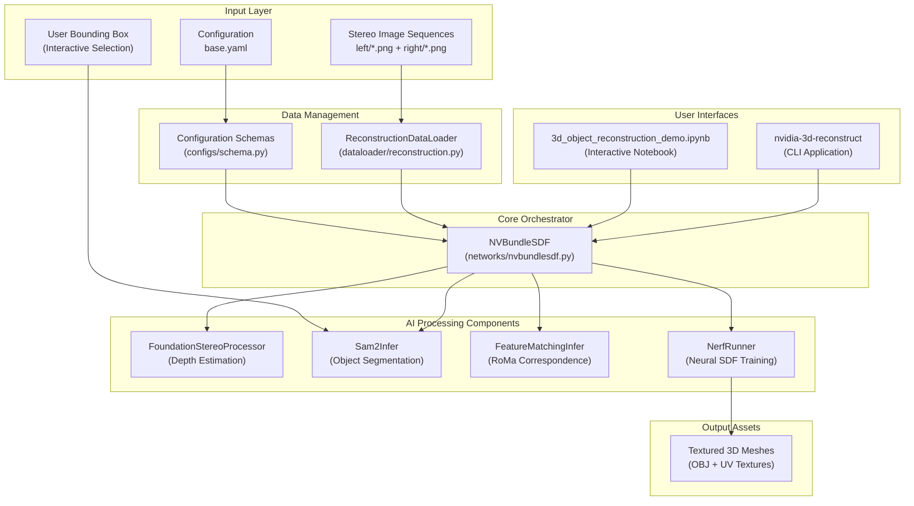
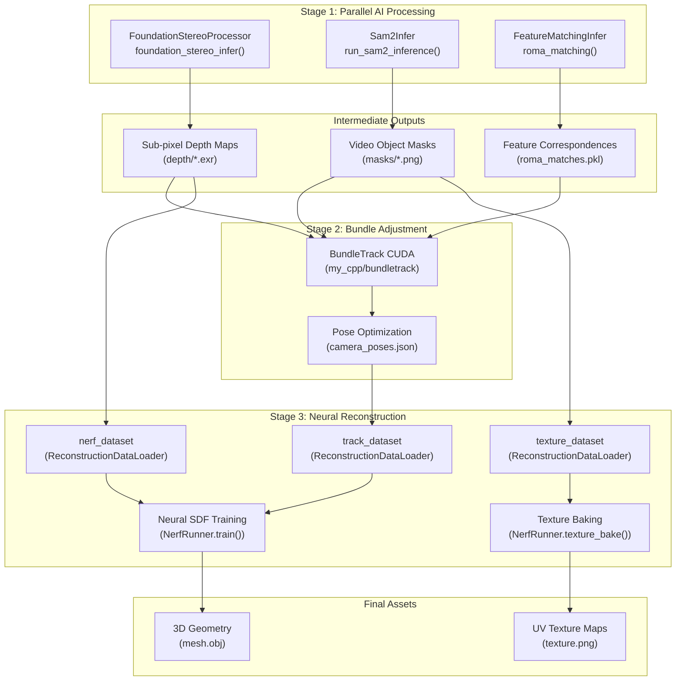

<!-- source: DeepWiki mcp.deepwiki.com · repo NVIDIA/3DObjectReconstruction · page 1 Overview · fetched 2026-10-26 -->

# Overview

Relevant source files

The following files were used as context for generating this wiki page:

- [CHANGELOG.md](CHANGELOG.md)
- [CITATION.md](CITATION.md)
- [README.md](README.md)

## Purpose and Scope

This document provides a technical overview of the NVIDIA 3D Object Reconstruction system, a reference implementation that transforms stereo video sequences into high-quality 3D textured meshes using state-of-the-art AI models. The system integrates multiple neural networks for depth estimation, object segmentation, feature matching, and implicit surface reconstruction to achieve production-ready results in approximately 30 minutes on modern GPUs.

For detailed installation and deployment instructions, see [Installation & Deployment](#2.1). For step-by-step usage guidance, see [Interactive Tutorial](#2.2). For in-depth technical architecture details, see [System Architecture](#4).

## System Architecture Overview

The reconstruction system is built around the `NVBundleSDF` orchestration framework located in [src/nvidia/objectreconstruction/networks/nvbundlesdf.py](), which coordinates four main AI processing stages through a unified pipeline.

Sources: [README.md:213-218](), [CHANGELOG.md:6-10]()

## AI Pipeline Data Flow

The system processes stereo video through a multi-stage neural pipeline, where each AI component operates on progressively refined data representations to produce the final 3D reconstruction.

Sources: [README.md:283-302](), [README.md:55-64]()

## Core AI Components

The system integrates four state-of-the-art neural networks, each addressing a specific aspect of 3D reconstruction:

| Component | Implementation | Primary Function | Key Parameters |
|-----------|---------------|------------------|----------------|
| **FoundationStereo** | `FoundationStereoProcessor` | Transformer-based stereo depth estimation | `scale`, `baseline`, `intrinsic` |
| **SAM2** | `Sam2Infer` | Video object segmentation and tracking | `checkpoint_path`, `bbox`, `device` |
| **RoMa** | `FeatureMatchingInfer` | Robust dense feature matching | `model_name`, `match_threshold` |  
| **BundleSDF** | `NerfRunner` | Neural 6-DoF tracking and SDF reconstruction | `n_step`, `batch_size`, `scene_bounds` |

The `NVBundleSDF` class coordinates these components through a unified configuration system defined in [src/nvidia/objectreconstruction/configs/schema.py](), enabling end-to-end processing from stereo input to textured 3D assets.

Sources: [README.md:59-64](), [CHANGELOG.md:7-10](), [README.md:356-387]()

## Key Capabilities

The system delivers production-ready 3D reconstruction capabilities optimized for real-world deployment scenarios:

**Performance Characteristics:**
- **Processing Speed**: Complete reconstruction in ~30 minutes on RTX A6000 hardware
- **Geometric Accuracy**: Sub-millimeter precision for objects 10-50cm in size  
- **Texture Quality**: 2048x2048 UV-mapped photorealistic textures
- **Format Compatibility**: Direct export to OBJ, USD, and game engine formats

**Technical Features:**
- **Zero-shot Stereo Matching**: FoundationStereo requires no scene-specific training
- **Consistent Video Segmentation**: SAM2 maintains object identity across temporal sequences
- **Robust Feature Correspondence**: RoMa handles challenging lighting and texture conditions
- **Neural Implicit Surfaces**: BundleSDF learns smooth geometry from sparse observations

**Deployment Options:**
- **Interactive Development**: Jupyter notebook with real-time visualization
- **Batch Processing**: CLI interface for automated workflows  
- **Container Deployment**: Docker Compose with GPU acceleration support

Sources: [README.md:155-162](), [README.md:23-24](), [CHANGELOG.md:23-25]()

## Research Foundations

This implementation builds upon peer-reviewed research in neural 3D reconstruction and computer vision:

**FoundationStereo** (CVPR 2025): Zero-shot transformer-based stereo depth estimation that generalizes across diverse scenes without fine-tuning, providing sub-pixel accurate depth maps for downstream 3D reconstruction.

**BundleSDF** (CVPR 2023): Neural 6-DoF object tracking and 3D reconstruction framework that combines bundle adjustment with neural signed distance functions to achieve accurate pose estimation and implicit surface learning for unknown objects.

The system also incorporates **SAM2** for consistent video object segmentation and **RoMa** for robust feature matching, creating a comprehensive pipeline that addresses the full spectrum of challenges in stereo-based 3D reconstruction.

Sources: [CITATION.md:5-23](), [README.md:166-171]()

## Applications and Use Cases

The reconstruction workflow targets three primary application domains:

**Robotics Applications:**
- Digital twin creation for manipulation planning and simulation
- Automated bin picking with accurate 3D object models
- Real-time environment mapping for autonomous systems

**Computer Vision Research:**
- Synthetic training data generation using NVIDIA Isaac Sim integration
- Object recognition system development with high-fidelity 3D models
- Augmented reality applications requiring precise object registration

**Production Workflows:**
- Product visualization and e-commerce asset creation  
- Quality inspection and measurement using 3D geometry
- Asset pipeline integration with Omniverse and game engines

The modular architecture supports customization for specific use cases through the hierarchical configuration system, enabling adaptation to different camera setups, object types, and quality requirements.

Sources: [README.md:264-278](), [README.md:96-100]()

---

