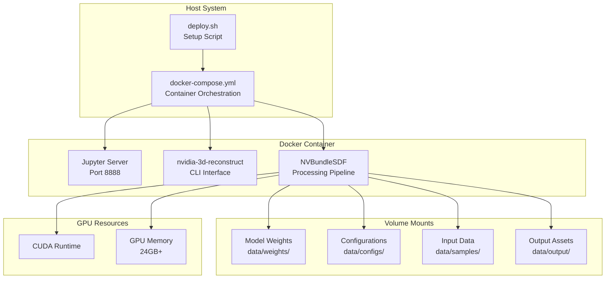
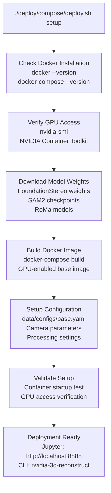
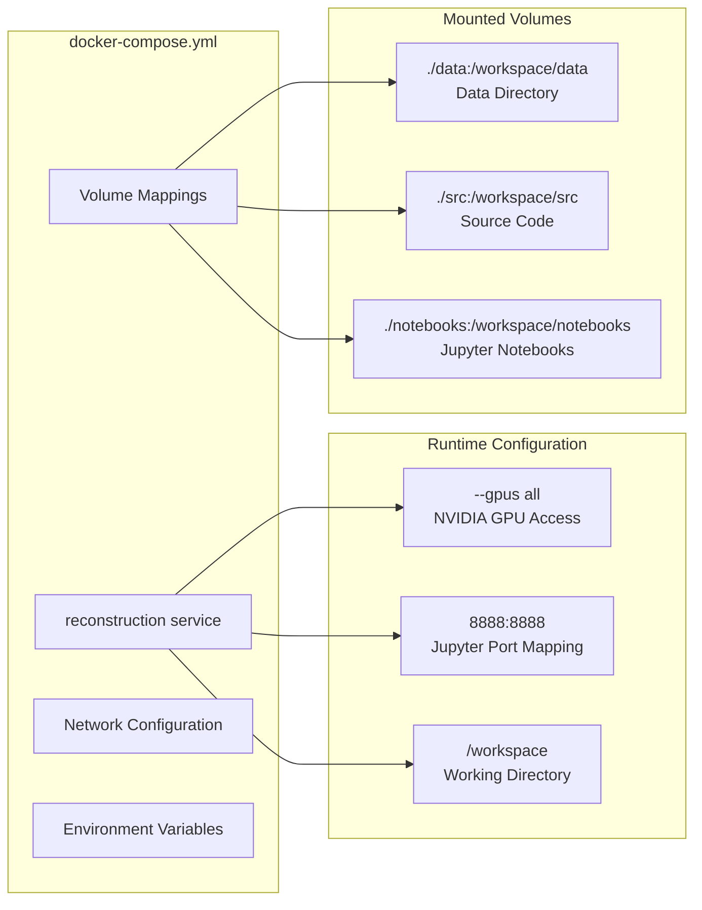
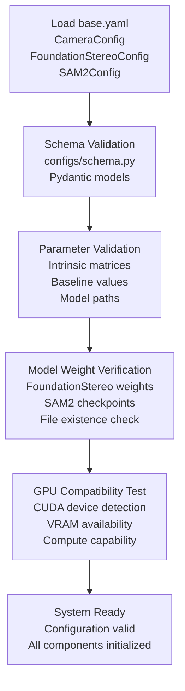

<!-- source: DeepWiki mcp.deepwiki.com · repo NVIDIA/3DObjectReconstruction · page 2.1 Installation & Deployment · fetched 2026-10-26 -->

# Installation & Deployment

<details>
<summary>Relevant source files</summary>

The following files were used as context for generating this wiki page:

- [CHANGELOG.md](CHANGELOG.md)
- [README.md](README.md)

</details>


This document covers the complete installation and deployment process for the NVIDIA 3D Object Reconstruction system. It provides step-by-step instructions for setting up the Docker-based environment, configuring GPU access, and deploying both interactive and automated interfaces.

For information about using the system after deployment, see [Interactive Tutorial](#2.2). For detailed configuration options, see [Configuration Management](#5).

## System Requirements

The system requires specific hardware and software components to function properly. These requirements are enforced by the underlying AI models and CUDA-accelerated processing components.

### Hardware Requirements

| Component | Specification | Purpose |
|-----------|---------------|---------|
| **GPU** | 24GB VRAM minimum, CUDA Compute 7.0+ | Neural network inference and training |
| **CPU** | 8-core x86_64 | Multi-threaded processing |
| **RAM** | 32GB system memory | Data loading and preprocessing |
| **Storage** | 100GB+ free space | Model weights and processing data |

### Software Requirements

| Component | Version | Installation Notes |
|-----------|---------|-------------------|
| **Ubuntu** | 22.04+ (Linux x86_64) | Host operating system |
| **Docker Engine** | 28.0.4+ | Container runtime |
| **Docker Compose** | 1.29.2+ | Container orchestration |
| **NVIDIA Drivers** | 535+ | GPU driver compatibility |
| **NVIDIA Container Toolkit** | Latest | GPU access in containers |

Sources: [README.md:236-261]()

## Docker Deployment Architecture

The system uses a containerized architecture with Docker Compose orchestration. The deployment separates concerns between the application runtime, model storage, and data processing.

### Container Architecture



Sources: [README.md:182-196](), [README.md:220-224]()

### Deployment Script Workflow



Sources: [README.md:184-194](), [CHANGELOG.md:12-14]()

## Setup Process

### Initial Setup

The deployment process is automated through a single setup script that handles all prerequisites and dependencies.

```bash
# Clone repository
git clone <repository-url>
cd 3d-object-reconstruction-github

# One-command setup
./deploy/compose/deploy.sh setup
```

The setup script performs these operations:
1. **Dependency Verification**: Checks Docker, Docker Compose, and NVIDIA Container Toolkit installation
2. **Model Weight Download**: Retrieves pre-trained weights for FoundationStereo, SAM2, and RoMa models
3. **Container Build**: Builds the GPU-enabled Docker image with all dependencies
4. **Configuration Setup**: Initializes default configuration files in `data/configs/`
5. **Volume Preparation**: Creates necessary directories for data and output storage

### Container Startup

```bash
# Start container and services
./deploy/compose/deploy.sh start

# Check container status
docker-compose ps
```

The startup process initializes:
- **Jupyter Server**: Accessible at `http://localhost:8888` (port auto-increments if unavailable)
- **GPU Access**: CUDA runtime and device mounting
- **Volume Mounts**: Persistent storage for data, configurations, and outputs
- **Network Configuration**: Port mapping for external access

Sources: [README.md:184-196]()

## Container Configuration

### Docker Compose Structure

The system uses Docker Compose to manage container lifecycle and resource allocation:



### Environment Variables

The container environment includes:
- **CUDA_VISIBLE_DEVICES**: GPU device selection
- **JUPYTER_ENABLE_LAB**: JupyterLab interface activation
- **PYTHONPATH**: Module import paths for `src/nvidia/objectreconstruction/`
- **TORCH_CUDA_ARCH_LIST**: CUDA architecture targeting

Sources: [README.md:257-260]()

## Access Methods

### Jupyter Notebook Interface

The primary interface for interactive development and experimentation:

```bash
# Access after container startup
# Navigate to: http://localhost:8888
# Open: notebooks/3d_object_reconstruction_demo.ipynb
```

**Features**:
- Interactive workflow execution
- Real-time visualization
- Parameter experimentation
- Educational content and documentation

### Command Line Interface

For automated processing and batch workflows:

```bash
# Inside container or after installation
nvidia-3d-reconstruct --help

# Basic usage
nvidia-3d-reconstruct \
    --config /workspace/data/configs/base.yaml \
    --data-path /workspace/data/samples/retail_item/ \
    --output-path /workspace/data/output/reconstruction \
    --verbose
```

**CLI Parameters**:
- `--config`: YAML configuration file path
- `--data-path`: Input stereo data directory
- `--output-path`: Output directory for 3D assets
- `--verbose`: Detailed logging output
- `--version`: Version information

Sources: [README.md:324-350]()

## Deployment Verification

### System Health Checks

After deployment, verify system functionality:

```bash
# Check container status
docker-compose ps

# Verify GPU access
docker-compose exec reconstruction nvidia-smi

# Test Jupyter server
curl -I http://localhost:8888

# Validate CLI installation
docker-compose exec reconstruction nvidia-3d-reconstruct --version
```

### Configuration Validation

The system validates configuration files during startup:



Sources: [README.md:389]()

## Troubleshooting Common Issues

### Model Weight Download Failures

**Symptoms**: `FileNotFoundError` for FoundationStereo weights, download timeouts
**Solution**:
```bash
# Manual weight download
mkdir -p data/weights/foundationstereo/
# Download from: https://github.com/NVlabs/FoundationStereo

# Retry automatic download
./deploy/compose/deploy.sh setup
```

### Container Startup Issues

**Symptoms**: `KeyError: 'ContainerConfig'`, Docker API errors
**Solution**:
```bash
# Clean up orphaned containers
cd deploy/compose
docker-compose down --remove-orphans
docker container prune -f

# Restart Docker service
sudo systemctl restart docker

# Retry setup
./deploy.sh setup
```

### GPU Memory Issues

**Symptoms**: CUDA out of memory errors
**Solution**: Modify configuration parameters in `data/configs/base.yaml`:
```yaml
nerf:
  batch_size: 16  # Reduce from default 32
foundation_stereo:
  scale: 0.2      # Reduce from default 0.3
```

### NVIDIA Driver Issues

**Symptoms**: Container cannot access GPU, CUDA errors
**Solution**:
```bash
# Verify drivers and container toolkit
nvidia-smi
sudo nvidia-ctk runtime configure --runtime=docker
sudo systemctl restart docker

# Test GPU access
docker run --rm --gpus all nvidia/cuda:12.2-runtime-ubuntu22.04 nvidia-smi
```

Sources: [README.md:406-526]()

## Container Management

### Service Control Commands

```bash
# Start all services
./deploy/compose/deploy.sh start

# Stop services (preserves data)
./deploy/compose/deploy.sh stop

# Restart services
./deploy/compose/deploy.sh restart

# Complete teardown
./deploy/compose/deploy.sh down
```

### Log Monitoring

```bash
# View all service logs
docker-compose logs -f

# View specific service logs
docker-compose logs -f reconstruction

# Monitor real-time processing
docker-compose exec reconstruction tail -f /tmp/reconstruction.log
```

### Data Persistence

The deployment maintains persistent storage across container restarts:
- **Model Weights**: `data/weights/` - Downloaded model files
- **Configurations**: `data/configs/` - User configuration files
- **Input Data**: `data/samples/` - Stereo image sequences
- **Output Assets**: `data/output/` - Generated 3D meshes and textures

Sources: [README.md:518-525]()

---

