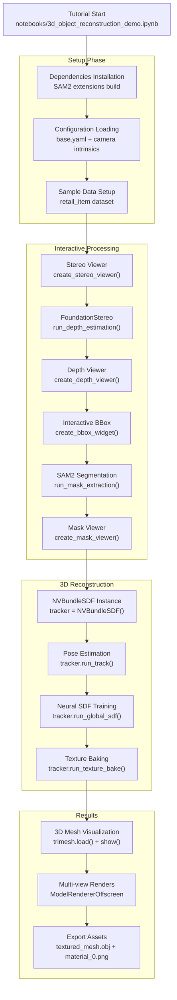
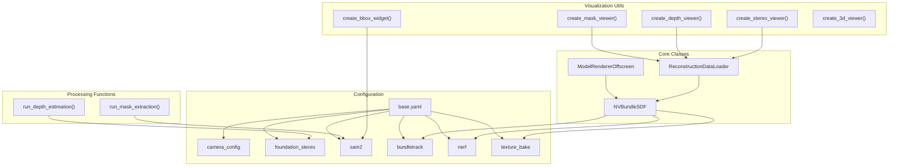
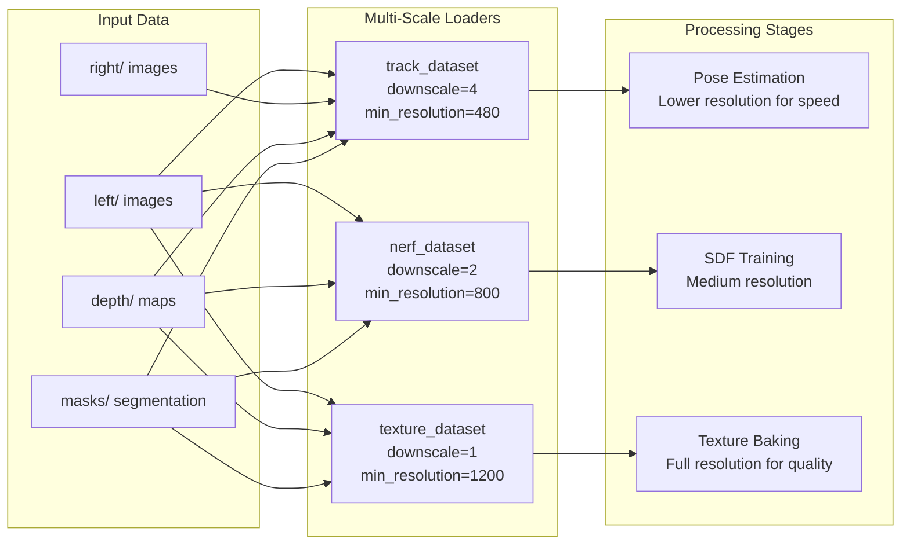

<!-- source: DeepWiki mcp.deepwiki.com · repo NVIDIA/3DObjectReconstruction · page 2.2 Interactive Tutorial · fetched 2026-10-26 -->

# Interactive Tutorial

<details>
<summary>Relevant source files</summary>

The following files were used as context for generating this wiki page:

- [notebooks/3d_object_reconstruction_demo.ipynb](notebooks/3d_object_reconstruction_demo.ipynb)

</details>


## Purpose and Scope

This document covers the interactive Jupyter notebook tutorial that guides users through the complete 3D object reconstruction pipeline. The tutorial provides a hands-on, step-by-step walkthrough of the entire reconstruction workflow from stereo video input to textured 3D assets.

For system installation and Docker deployment, see [Installation & Deployment](#2.1). For detailed technical documentation of the underlying pipeline architecture, see [Pipeline Architecture](#3.1). For configuration parameter reference, see [Configuration Schema](#5.1).

## Tutorial Overview

The interactive tutorial is implemented as a comprehensive Jupyter notebook that demonstrates the complete real2sim workflow. It combines multiple state-of-the-art AI models in a sequential pipeline to transform stereo video inputs into production-ready 3D assets.

### Tutorial Workflow



Sources: [notebooks/3d_object_reconstruction_demo.ipynb:1-874]()

### Key Code Components

The tutorial integrates multiple classes and functions from the reconstruction framework:



Sources: [notebooks/3d_object_reconstruction_demo.ipynb:232-241](), [notebooks/3d_object_reconstruction_demo.ipynb:634-656]()

## Step-by-Step Tutorial Breakdown

### Step 1: Environment Setup and Data Preparation

The tutorial begins with dependency installation and dataset configuration. Users install video codecs and build the SAM2 C++ extensions for optimal performance.

| Component | Purpose | Key Functions |
|-----------|---------|---------------|
| DeepStream Script | Video codec installation | `subprocess.check_call()` |
| SAM2 Extensions | C++ acceleration build | `setup.py build_ext --inplace` |
| Configuration Loading | Pipeline parameters | `yaml.safe_load()` |
| Dataset Setup | Sample data preparation | `shutil.copytree()` |

The configuration setup includes camera intrinsics for the QooCam stereo camera:

```yaml
camera_config:
  intrinsic: [3079.6, 0, 2000.0, 0, 3075.1, 1500.01, 0, 0, 1]
  step: 1
foundation_stereo:
  baseline: 0.0657696127  # 65.77mm baseline
```

Sources: [notebooks/3d_object_reconstruction_demo.ipynb:52-70](), [notebooks/3d_object_reconstruction_demo.ipynb:277-325]()

### Step 2: Depth Estimation with FoundationStereo

Users run stereo depth estimation using the `run_depth_estimation()` function from `nvidia.objectreconstruction.networks.foundationstereo`. The process generates dense depth maps for all stereo pairs.

The interactive depth viewer uses `create_depth_viewer()` to allow users to examine depth quality across frames with color-coded depth visualization.

Sources: [notebooks/3d_object_reconstruction_demo.ipynb:394-409](), [notebooks/3d_object_reconstruction_demo.ipynb:427-429]()

### Step 3: Interactive Object Segmentation

The tutorial provides an interactive bounding box selection widget powered by `create_bbox_widget()`. Users draw a bounding box around their target object, which SAM2 uses for video object tracking.

The segmentation process uses `run_mask_extraction()` with the user-defined bounding box coordinates:

```python
sam2_config['bbox'] = [x, y, x+w, y+h]
response = run_mask_extraction(
    config=sam2_config,
    exp_path=output_data_path,
    rgb_path=output_data_path / "left",
    mask_path=output_data_path / "masks"
)
```

Sources: [notebooks/3d_object_reconstruction_demo.ipynb:460-468](), [notebooks/3d_object_reconstruction_demo.ipynb:486-511]()

### Step 4: 3D Reconstruction Pipeline

The final step instantiates the `NVBundleSDF` class and executes the three-stage reconstruction process:

```python
tracker = NVBundleSDF(nerf_config, bundletrack_config, roma_config, texturebake_config)

# Stage 1: Pose estimation and feature matching
tracker.run_track(track_dataset)

# Stage 2: Neural SDF training  
tracker.run_global_sdf(nerf_dataset)

# Stage 3: Texture baking and mesh export
tracker.run_texture_bake(texture_dataset)
```

The tutorial includes camera pose visualization using `vis_camera_poses()` and final mesh rendering with `ModelRendererOffscreen`.

Sources: [notebooks/3d_object_reconstruction_demo.ipynb:654-656](), [notebooks/3d_object_reconstruction_demo.ipynb:672-732]()

## Interactive Components

### Visualization Widgets

The tutorial provides several interactive visualization components implemented in `nvidia.objectreconstruction.utils.visualization`:

| Widget | Class/Function | Purpose |
|--------|----------------|---------|
| Stereo Viewer | `create_stereo_viewer()` | Navigate stereo pairs |
| Depth Viewer | `create_depth_viewer()` | Examine depth maps |
| Mask Viewer | `create_mask_viewer()` | Review segmentation |
| BBox Widget | `create_bbox_widget()` | Interactive object selection |
| 3D Viewer | `create_3d_viewer()` | 3D mesh inspection |

### User Interaction Points

The tutorial includes several points where user input is required:

1. **Directory Management**: Users confirm whether to clear existing output directories
2. **Bounding Box Selection**: Interactive drawing of object boundaries
3. **Quality Assessment**: Visual inspection of depth, segmentation, and final results

Sources: [notebooks/3d_object_reconstruction_demo.ipynb:342-344](), [notebooks/3d_object_reconstruction_demo.ipynb:460-468]()

## Data Processing Flow

### Multi-Scale Dataset Loading

The tutorial demonstrates the use of `ReconstructionDataLoader` with different downscaling parameters for each processing stage:



Sources: [notebooks/3d_object_reconstruction_demo.ipynb:634-652]()

### Configuration Hierarchy

The tutorial demonstrates the hierarchical configuration system with component-specific parameters:

| Configuration Section | Key Parameters | Purpose |
|-----------------------|----------------|---------|
| `camera_config` | `intrinsic`, `step` | Camera calibration |
| `foundation_stereo` | `baseline`, `intrinsic` | Depth estimation |
| `sam2` | `bbox`, `checkpoint` | Object segmentation |
| `bundletrack` | `debug_dir`, `downscale` | Pose estimation |
| `nerf` | `save_dir`, `iterations` | SDF training |
| `texture_bake` | `resolution`, `downscale` | Asset generation |

Sources: [notebooks/3d_object_reconstruction_demo.ipynb:375-376](), [notebooks/3d_object_reconstruction_demo.ipynb:601-625]()

## Performance and Timing

The tutorial includes performance benchmarks for each pipeline stage using an RTX A6000 GPU with 36 stereo frames at 4K resolution:

| Pipeline Stage | Duration | Factors |
|----------------|----------|---------|
| FoundationStereo | 1-2 minutes | Frame count, resolution |
| SAM2 Segmentation | 25 seconds | Frame count, resolution |
| Pose Tracking | 3-4 minutes | Frame count, complexity |
| SDF Training | 3-4 minutes | Iterations, keyframes |
| Texture Baking | 22-23 minutes | Texture resolution, mesh complexity |
| **Total Pipeline** | **31-32 minutes** | End-to-end processing |

Sources: [notebooks/3d_object_reconstruction_demo.ipynb:176-196]()

## Output Assets and Integration

### Generated Assets

The tutorial produces several output files in the experiment directory:

| Asset | Filename | Description |
|-------|----------|-------------|
| 3D Mesh | `textured_mesh.obj` | Complete mesh with UV mapping |
| Texture Map | `material_0.png` | High-resolution texture |
| Camera Poses | `keyframes.yml` | Optimized camera poses |
| Depth Maps | `depth/*.png` | Dense depth for all frames |
| Segmentation | `masks/*.png` | Object masks |

### Downstream Integration

The tutorial concludes with guidance for integrating generated assets into various workflows:

- **Robotic Manipulation**: Grasping and manipulation training
- **Sim2Real Transfer**: Bridging simulation and deployment gaps  
- **Digital Twins**: Accurate digital object replicas
- **Computer Vision**: Labeled dataset generation
- **USD Export**: Omniverse integration using Isaac Lab converters

Sources: [notebooks/3d_object_reconstruction_demo.ipynb:792-849]()

## Camera Support and Specifications

The tutorial includes comprehensive camera comparison tables for stereo setup selection:

| Camera Model | Manufacturer | Resolution | Baseline | Focal Length |
|--------------|-------------|------------|----------|--------------|
| ZED 2i | Stereolabs | 2K stereo | 0.1198m | fx: 1070.8 |
| QooCam EGO 3D | Kandao | 4K/2K video | 0.0658m | fx: 3079.6 |
| Hawk Stereo | Leopard Imaging | Industrial | 0.1495m | fx: 958.35 |
| ZED Mini | Stereolabs | HD stereo | 0.12m | fx: 522.38 |

The tutorial provides detailed setup requirements and use case recommendations for each camera system.

Sources: [notebooks/3d_object_reconstruction_demo.ipynb:146-169]()

---

