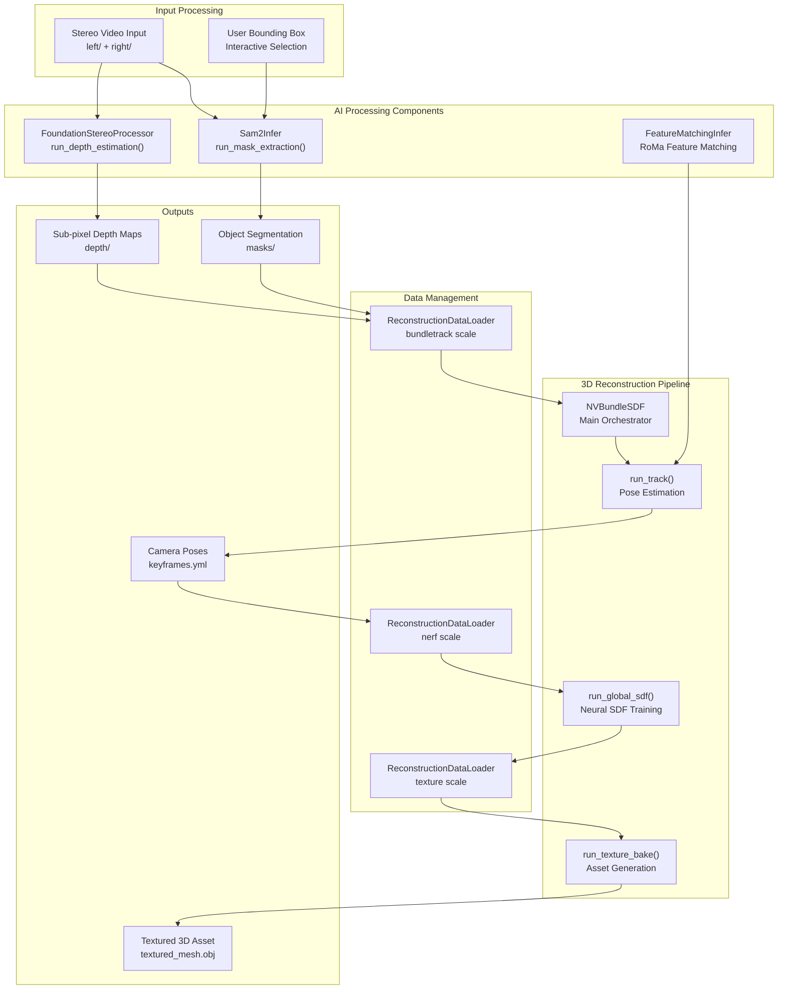
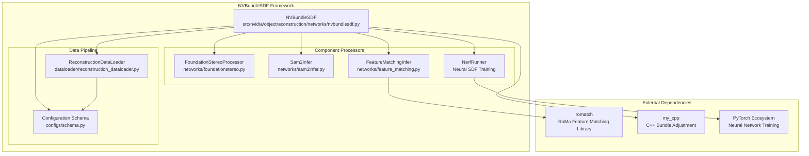
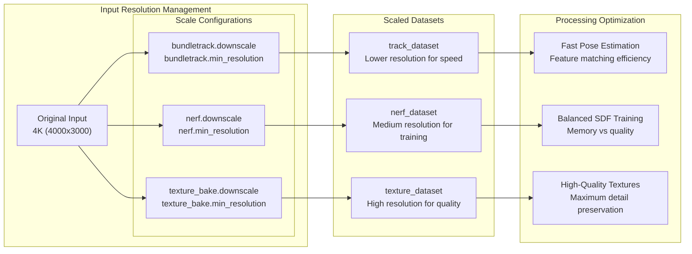
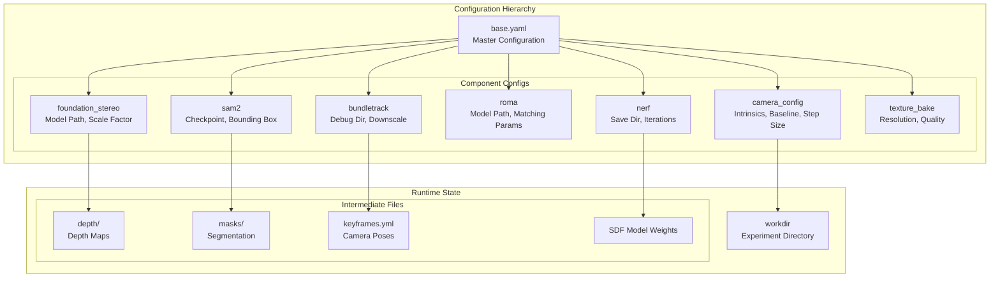
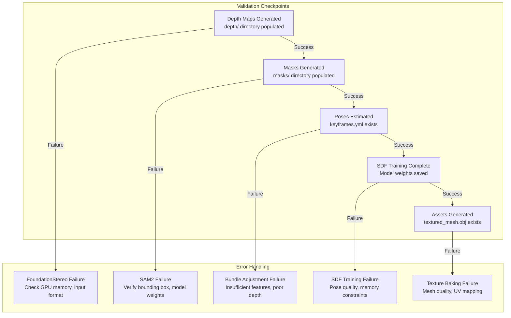

<!-- source: DeepWiki mcp.deepwiki.com · repo NVIDIA/3DObjectReconstruction · page 3 Core Pipeline · fetched 2026-10-26 -->

# Core Pipeline

Relevant source files

The following files were used as context for generating this wiki page:

- [CHANGELOG.md](CHANGELOG.md)
- [data/docs/pipeline_overview.png](data/docs/pipeline_overview.png)
- [notebooks/3d_object_reconstruction_demo.ipynb](notebooks/3d_object_reconstruction_demo.ipynb)

This document provides a comprehensive technical overview of the 3D Object Reconstruction pipeline architecture, including its AI components, data flow, and processing stages. The pipeline orchestrates multiple state-of-the-art models to transform stereo video input into production-ready 3D textured assets.

For detailed configuration parameters and schemas, see [Configuration Management](#5). For API reference and class documentation, see [API Reference](#6).

## Pipeline Architecture Overview

The core pipeline integrates four primary AI models through a multi-stage processing workflow. The `NVBundleSDF` class serves as the main orchestrator, coordinating data flow between processing stages and managing the reconstruction pipeline.

**Sources:** [notebooks/3d_object_reconstruction_demo.ipynb:535-733]()

## Data Flow and Processing Stages

The pipeline processes data through three distinct scales, each optimized for different computational requirements. The `ReconstructionDataLoader` handles multi-scale data preparation with configurable downscaling factors.

```mermaid
flowchart LR
    subgraph "Stage 1: Preprocessing"
        RawStereo["Raw Stereo Frames<br/>4K Resolution"]
        DepthEst["FoundationStereo<br/>Depth Estimation"]
        Segmentation["SAM2<br/>Object Segmentation"]
        
        RawStereo --> DepthEst
        RawStereo --> Segmentation
    end
    
    subgraph "Stage 2: Pose Estimation"
        TrackScale["Track Dataset<br/>downscale=bundletrack.downscale"]
        FeatureMatch["RoMa Feature Matching<br/>Dense Correspondences"]
        PoseOpt["Bundle Adjustment<br/>Camera Pose Optimization"]
        
        TrackScale --> FeatureMatch
        FeatureMatch --> PoseOpt
    end
    
    subgraph "Stage 3: Neural Reconstruction"
        NeRFScale["NeRF Dataset<br/>downscale=nerf.downscale"]
        SDFTrain["Neural SDF Training<br/>Implicit Surface Learning"]
        MeshExtract["Mesh Extraction<br/>Marching Cubes"]
        
        NeRFScale --> SDFTrain
        SDFTrain --> MeshExtract
    end
    
    subgraph "Stage 4: Asset Generation"
        TextureScale["Texture Dataset<br/>downscale=texture_bake.downscale"]
        UVMap["UV Mapping<br/>Texture Coordinate Generation"]
        TextureBake["Texture Baking<br/>High-Resolution Asset"]
        
        TextureScale --> UVMap
        UVMap --> TextureBake
    end
    
    DepthEst --> TrackScale
    Segmentation --> TrackScale
    PoseOpt --> NeRFScale
    MeshExtract --> TextureScale
```

**Sources:** [notebooks/3d_object_reconstruction_demo.ipynb:634-656](), [notebooks/3d_object_reconstruction_demo.ipynb:671-733]()

## Core Component Integration

The `NVBundleSDF` framework coordinates multiple specialized processors, each handling specific aspects of the reconstruction pipeline. The system uses a hierarchical configuration approach to manage component parameters.

**Sources:** [notebooks/3d_object_reconstruction_demo.ipynb:654-656](), [notebooks/3d_object_reconstruction_demo.ipynb:232-241]()

## Processing Stage Execution

Each processing stage follows a specific execution pattern with defined inputs, outputs, and configuration parameters. The pipeline maintains state through file-based checkpoints and intermediate results.

| Processing Stage | Primary Function | Input Data | Output Data | Key Configuration |
|------------------|------------------|------------|-------------|-------------------|
| **Depth Estimation** | `run_depth_estimation()` | Stereo pairs from `left/`, `right/` | Dense depth maps in `depth/` | `foundation_stereo.intrinsic`, `foundation_stereo.baseline` |
| **Object Segmentation** | `run_mask_extraction()` | RGB frames, user bounding box | Object masks in `masks/` | `sam2.bbox`, `sam2.checkpoint` |
| **Pose Estimation** | `run_track()` | Depth maps, masks, RGB frames | Camera poses in `keyframes.yml` | `bundletrack.downscale`, `roma.model_path` |
| **SDF Training** | `run_global_sdf()` | Poses, masked RGB, depth data | Neural SDF model weights | `nerf.iterations`, `nerf.downscale` |
| **Texture Baking** | `run_texture_bake()` | SDF model, high-res RGB frames | `textured_mesh.obj`, `material_0.png` | `texture_bake.resolution`, `texture_bake.downscale` |

**Sources:** [notebooks/3d_object_reconstruction_demo.ipynb:394-409](), [notebooks/3d_object_reconstruction_demo.ipynb:497-511](), [notebooks/3d_object_reconstruction_demo.ipynb:672-678](), [notebooks/3d_object_reconstruction_demo.ipynb:715-717](), [notebooks/3d_object_reconstruction_demo.ipynb:732-733]()

## Multi-Scale Data Processing

The `ReconstructionDataLoader` implements multi-scale processing to optimize computational efficiency across different pipeline stages. Each stage operates at its optimal resolution while maintaining geometric consistency.

**Sources:** [notebooks/3d_object_reconstruction_demo.ipynb:634-653]()

## Configuration and State Management

The pipeline uses a hierarchical configuration system where each component maintains its own parameter namespace while sharing common data paths and camera calibration information.

**Sources:** [notebooks/3d_object_reconstruction_demo.ipynb:277-325](), [notebooks/3d_object_reconstruction_demo.ipynb:375-377](), [notebooks/3d_object_reconstruction_demo.ipynb:591-626]()

## Error Handling and Validation

The pipeline implements checkpoint-based validation to ensure each stage completes successfully before proceeding to the next. Critical validation points include pose estimation success and SDF model convergence.

**Sources:** [notebooks/3d_object_reconstruction_demo.ipynb:404-409](), [notebooks/3d_object_reconstruction_demo.ipynb:505-511](), [notebooks/3d_object_reconstruction_demo.ipynb:675-678]()

---

