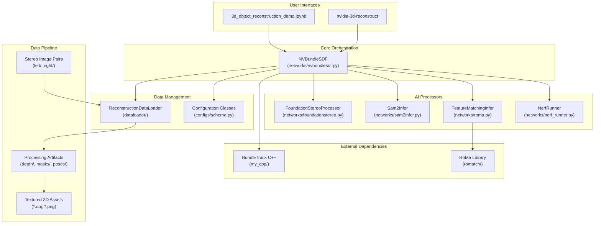
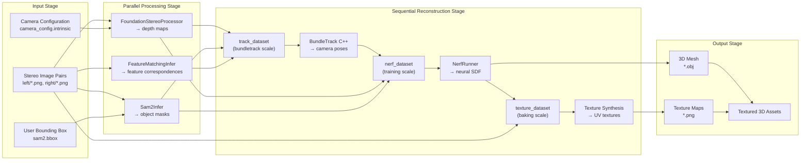
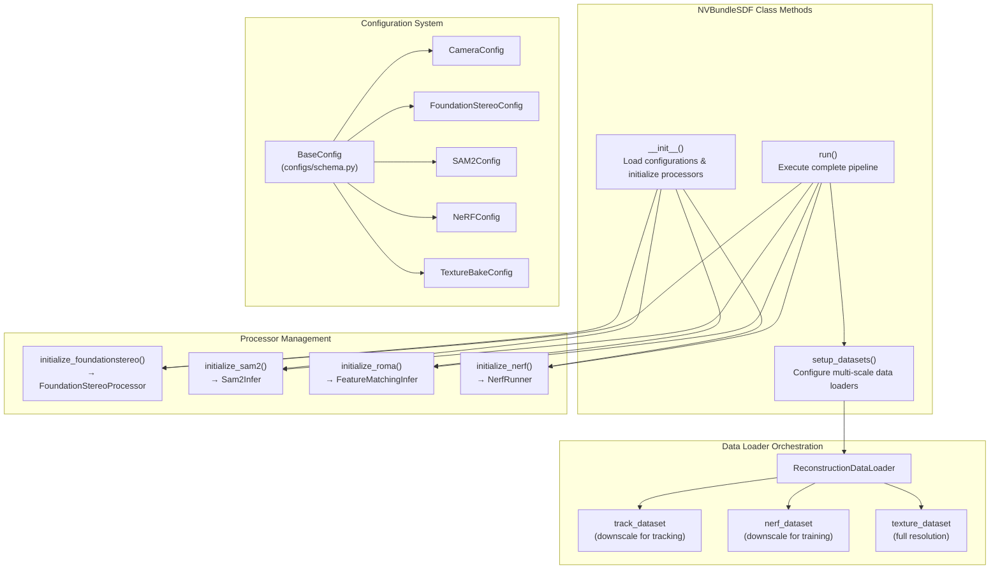

<!-- source: DeepWiki mcp.deepwiki.com · repo NVIDIA/3DObjectReconstruction · page 3.1 Pipeline Architecture · fetched 2026-10-26 -->

# Pipeline Architecture

Relevant source files

The following files were used as context for generating this wiki page:

- [README.md](README.md)
- [data/docs/pipeline_overview.png](data/docs/pipeline_overview.png)

This document describes the high-level architecture of the 3D object reconstruction pipeline, detailing the component relationships, data flow patterns, and orchestration framework that transforms stereo video input into textured 3D assets. The architecture integrates four state-of-the-art AI models through a unified processing pipeline.

For detailed information about individual AI components, see [AI Components](#3.2). For step-by-step workflow execution, see [Reconstruction Workflow](#3.3).

## Overall System Architecture

The reconstruction pipeline is built around the `NVBundleSDF` orchestration framework, which coordinates four specialized AI processors and manages multi-stage data processing.

**System Architecture Overview**

Sources: [README.md:213-218](), [README.md:283-302]()

## Data Flow Architecture

The pipeline processes stereo video through four distinct processing stages, each operating on different data representations and scales.

**Multi-Stage Data Processing Flow**

Sources: [README.md:280-302](), [README.md:356-387]()

## NVBundleSDF Orchestration Framework

The `NVBundleSDF` class serves as the central orchestrator, managing processor initialization, data flow coordination, and multi-scale dataset generation.

**Component Integration and Control Flow**

Sources: [README.md:213-218](), [README.md:388-389]()

## Processing Stages

The pipeline operates through four distinct processing stages, each with specific input requirements and output artifacts.

### Stage 1: Depth Estimation
- **Processor**: `FoundationStereoProcessor` 
- **Input**: Stereo image pairs, camera intrinsics
- **Configuration**: `foundation_stereo.scale`, `foundation_stereo.baseline`
- **Output**: Sub-pixel depth maps

### Stage 2: Object Segmentation  
- **Processor**: `Sam2Infer`
- **Input**: Stereo images, user bounding box
- **Configuration**: `sam2.bbox`, `sam2.checkpoint_path`
- **Output**: Consistent object masks across frames

### Stage 3: Feature Matching
- **Processor**: `FeatureMatchingInfer` 
- **Input**: Stereo image sequences
- **Configuration**: `roma` parameters
- **Output**: Dense feature correspondences

### Stage 4: 3D Reconstruction
- **Sub-stage 4a**: Camera pose estimation via `BundleTrack` C++ module
- **Sub-stage 4b**: Neural SDF training via `NerfRunner`
- **Sub-stage 4c**: Texture synthesis and UV mapping

Sources: [README.md:283-302]()

## Interface Points

The pipeline exposes two primary interfaces for different usage patterns:

### Interactive Interface
- **Entry Point**: `3d_object_reconstruction_demo.ipynb`
- **Target**: Step-by-step experimentation and visualization
- **Features**: Real-time parameter tuning, intermediate result inspection

### Command Line Interface  
- **Entry Point**: `nvidia-3d-reconstruct` CLI command
- **Target**: Automated batch processing
- **Configuration**: YAML-based parameter specification
- **Usage Pattern**: Production deployment and scripting

Both interfaces utilize the same underlying `NVBundleSDF` orchestration framework but provide different levels of control and visibility into the reconstruction process.

Sources: [README.md:305-351](), [README.md:37-38]()

---

