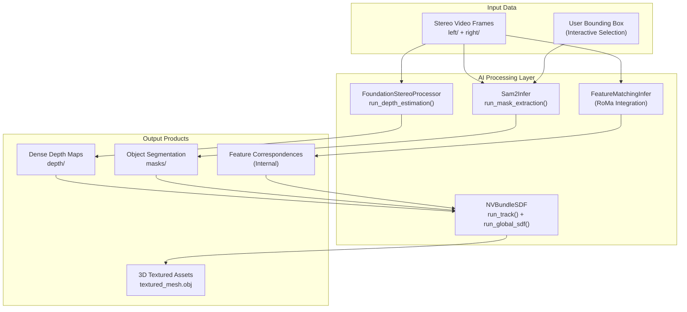
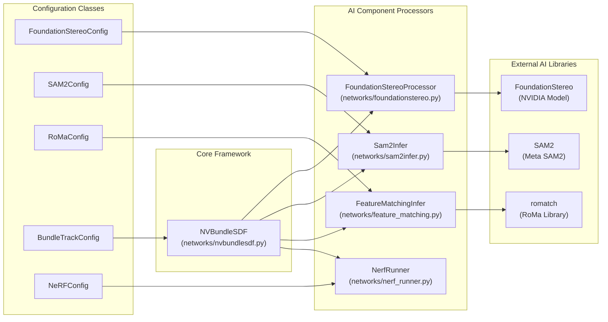
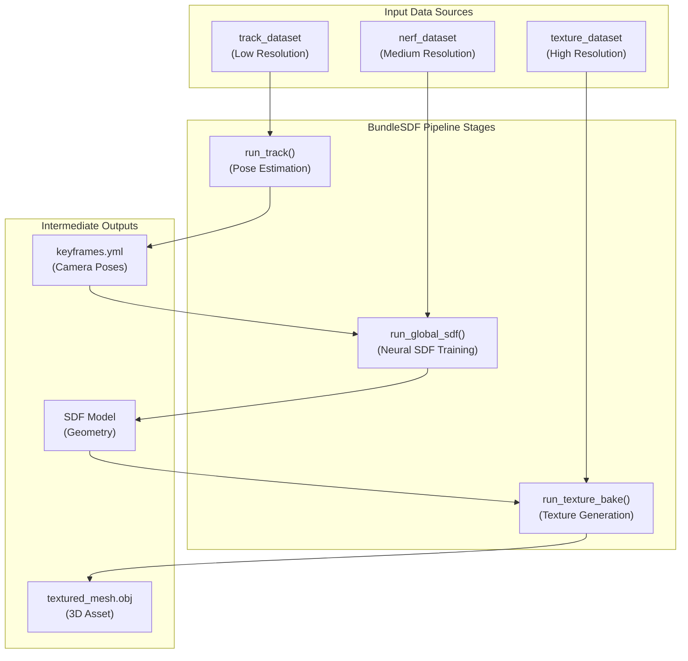

<!-- source: DeepWiki mcp.deepwiki.com · repo NVIDIA/3DObjectReconstruction · page 3.2 AI Components · fetched 2026-10-26 -->

# AI Components

Relevant source files

The following files were used as context for generating this wiki page:

- [CHANGELOG.md](CHANGELOG.md)
- [CITATION.md](CITATION.md)
- [notebooks/3d_object_reconstruction_demo.ipynb](notebooks/3d_object_reconstruction_demo.ipynb)

This document provides a comprehensive overview of the artificial intelligence models and neural networks that power the 3D object reconstruction pipeline. It covers the technical architecture, implementation details, and integration patterns of the four core AI components: FoundationStereo, SAM2, RoMa, and BundleSDF.

For information about the overall pipeline architecture and data flow, see [Pipeline Architecture](#3.1). For details about configuration parameters for these components, see [Component Configuration](#5.2).

## AI Pipeline Overview

The 3D object reconstruction system integrates four state-of-the-art AI models in a sequential processing pipeline, each handling a specific aspect of the reconstruction task.

### Core AI Components Integration

Sources: [notebooks/3d_object_reconstruction_demo.ipynb:11-29]()

### AI Component Implementation Map

Sources: [notebooks/3d_object_reconstruction_demo.ipynb:232-241](), [notebooks/3d_object_reconstruction_demo.ipynb:654-655]()

## FoundationStereo: Depth Estimation

FoundationStereo is a transformer-based neural network designed for stereo depth estimation with zero-shot generalization capabilities.

### Technical Architecture

**Model Characteristics:**
- **Vision Foundation Model**: Leverages pre-trained vision transformers for rich feature extraction
- **Zero-Shot Generalization**: Performs well across diverse environments without domain-specific fine-tuning
- **Multi-Scale Processing**: Handles objects at different distances through hierarchical feature analysis
- **Sub-Pixel Accuracy**: Achieves precise depth measurements with transformer-based stereo matching

### Implementation Details

The FoundationStereo component is accessed through the `run_depth_estimation()` function:

| Parameter | Purpose | Configuration Key |
|-----------|---------|-------------------|
| `config` | FoundationStereo configuration object | `foundation_stereo` |
| `exp_path` | Experiment output directory | Derived from `workdir` |
| `rgb_path` | Input stereo image directory | `left/` subdirectory |
| `depth_path` | Output depth maps directory | `depth/` subdirectory |

**Key Configuration Parameters:**
- `intrinsic`: Camera intrinsic matrix (3x3 format)
- `baseline`: Stereo camera baseline distance in meters
- `model_path`: Path to FoundationStereo model weights
- `scale_factor`: Depth scaling factor for output normalization

Sources: [notebooks/3d_object_reconstruction_demo.ipynb:355-409](), [notebooks/3d_object_reconstruction_demo.ipynb:374-376]()

## SAM2: Object Segmentation

SAM2 (Segment Anything Model 2) extends Meta's segmentation capabilities to video sequences with temporal consistency.

### Technical Architecture

**Model Characteristics:**
- **Transformer Architecture**: Uses hierarchical vision transformer with streaming memory
- **Temporal Consistency**: Maintains object tracking across frames via memory mechanisms
- **Prompt Flexibility**: Accepts points, boxes, and masks for interactive segmentation
- **Real-time Performance**: Processes video 6× faster than the original SAM

### Implementation Details

The SAM2 component is accessed through the `run_mask_extraction()` function:

| Parameter | Purpose | Configuration Key |
|-----------|---------|-------------------|
| `config` | SAM2 configuration object | `sam2` |
| `exp_path` | Experiment output directory | Derived from `workdir` |
| `rgb_path` | Input image directory | `left/` subdirectory |
| `mask_path` | Output mask directory | `masks/` subdirectory |

**Key Configuration Parameters:**
- `bbox`: Object bounding box coordinates `[x1, y1, x2, y2]`
- `checkpoint_path`: Path to SAM2 model checkpoint
- `model_cfg`: SAM2 model configuration file
- `prompt_frame`: Frame index for initial annotation

**Interactive Workflow:**
1. User selects bounding box on first frame using `create_bbox_widget()`
2. SAM2 propagates segmentation across all video frames
3. Temporal consistency maintained through streaming memory

Sources: [notebooks/3d_object_reconstruction_demo.ipynb:441-511](), [notebooks/3d_object_reconstruction_demo.ipynb:486-492]()

## RoMa: Feature Matching

RoMa (Robust Dense Feature Matching) provides reliable feature correspondences between frames for camera pose estimation.

### Technical Architecture

**Model Characteristics:**
- **Dense Matching**: Establishes pixel-to-pixel correspondences across viewpoints
- **Robust Descriptors**: Uses transformer-based features for challenging lighting and viewpoint changes
- **Uncertainty Estimation**: Provides confidence scores for each match to filter unreliable correspondences
- **Scale Invariance**: Handles objects at different scales and distances

### Implementation Details

RoMa is integrated within the BundleSDF tracking pipeline through the `FeatureMatchingInfer` class:

**Configuration Parameters:**
- `model_path`: Path to RoMa model weights
- `max_num_kpts`: Maximum number of keypoints to extract
- `detection_threshold`: Feature detection confidence threshold
- `matching_threshold`: Feature matching confidence threshold

**Integration Pattern:**
- Called internally during `tracker.run_track(track_dataset)`
- Establishes correspondences between consecutive frames
- Feeds feature matches to bundle adjustment optimization

Sources: [notebooks/3d_object_reconstruction_demo.ipynb:567-571](), [notebooks/3d_object_reconstruction_demo.ipynb:590-593]()

## BundleSDF: 6-DoF Tracking and 3D Reconstruction

BundleSDF combines neural rendering with bundle adjustment for simultaneous camera tracking and 3D object reconstruction.

### Technical Architecture

**Model Characteristics:**
- **Volume Rendering**: Learns 3D geometry through differentiable ray casting
- **Appearance Modeling**: Captures view-dependent effects and material properties
- **SDF Representation**: Uses signed distance functions for clean mesh extraction
- **Bundle Adjustment**: Performs global optimization across all frames for geometric consistency

### Multi-Stage Processing Pipeline

### Implementation Details

The `NVBundleSDF` class orchestrates the complete reconstruction pipeline:

**Core Methods:**
- `run_track(dataset)`: Feature matching and camera pose estimation
- `run_global_sdf(dataset)`: Neural SDF training for geometry learning
- `run_texture_bake(dataset)`: High-resolution texture generation and mesh export

**Configuration Components:**
- `nerf_config`: Neural SDF training parameters
- `bundletrack_config`: Pose estimation and tracking parameters
- `roma_config`: Feature matching configuration
- `texturebake_config`: Texture baking and mesh export settings

**Multi-Resolution Processing:**
Each stage uses different resolution datasets optimized for its computational requirements:
- **Tracking**: Lower resolution for real-time pose estimation
- **SDF Training**: Medium resolution for geometry learning
- **Texture Baking**: Full resolution for high-quality texture generation

Sources: [notebooks/3d_object_reconstruction_demo.ipynb:553-583](), [notebooks/3d_object_reconstruction_demo.ipynb:634-656](), [notebooks/3d_object_reconstruction_demo.ipynb:672-732]()

## AI Component Configuration System

Each AI component uses a hierarchical configuration system with dedicated configuration classes.

### Configuration Class Hierarchy

| Component | Configuration Class | Key Parameters |
|-----------|-------------------|----------------|
| FoundationStereo | `FoundationStereoConfig` | `intrinsic`, `baseline`, `model_path` |
| SAM2 | `SAM2Config` | `bbox`, `checkpoint_path`, `model_cfg` |
| RoMa | `RoMaConfig` | `model_path`, `max_num_kpts`, `matching_threshold` |
| BundleTrack | `BundleTrackConfig` | `downscale`, `min_resolution`, `debug_dir` |
| NeRF/SDF | `NeRFConfig` | `save_dir`, `downscale`, `training_iterations` |
| Texture Bake | `TextureBakeConfig` | `downscale`, `texture_resolution` |

### Runtime Performance Characteristics

Based on RTX A6000 GPU with 36 stereo frames at 4K resolution:

| AI Component | Processing Time | Scaling Factors |
|--------------|----------------|-----------------|
| FoundationStereo | 1-2 minutes | Frame count, resolution |
| SAM2 | 25 seconds | Frame count, resolution |
| RoMa (within tracking) | 3-4 minutes | Frame count, feature complexity |
| Neural SDF Training | 3-4 minutes | Training iterations, keyframes |
| Texture Baking | 22-23 minutes | Texture resolution, mesh complexity |

Sources: [notebooks/3d_object_reconstruction_demo.ipynb:176-196](), [notebooks/3d_object_reconstruction_demo.ipynb:590-626]()

---

