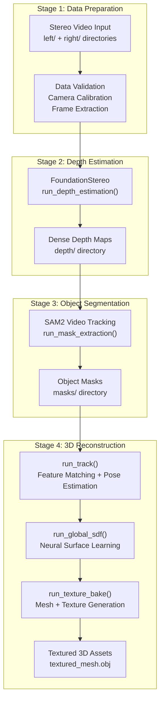
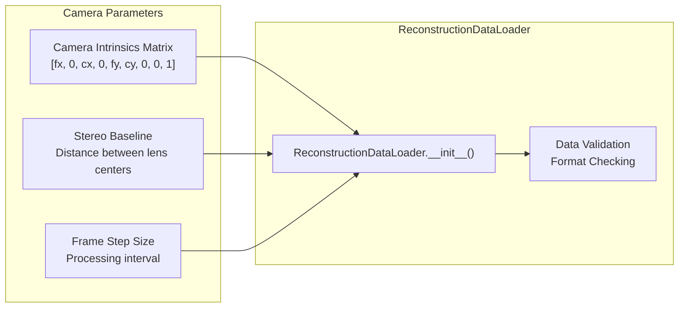
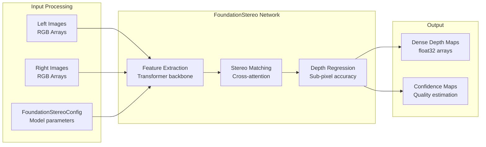
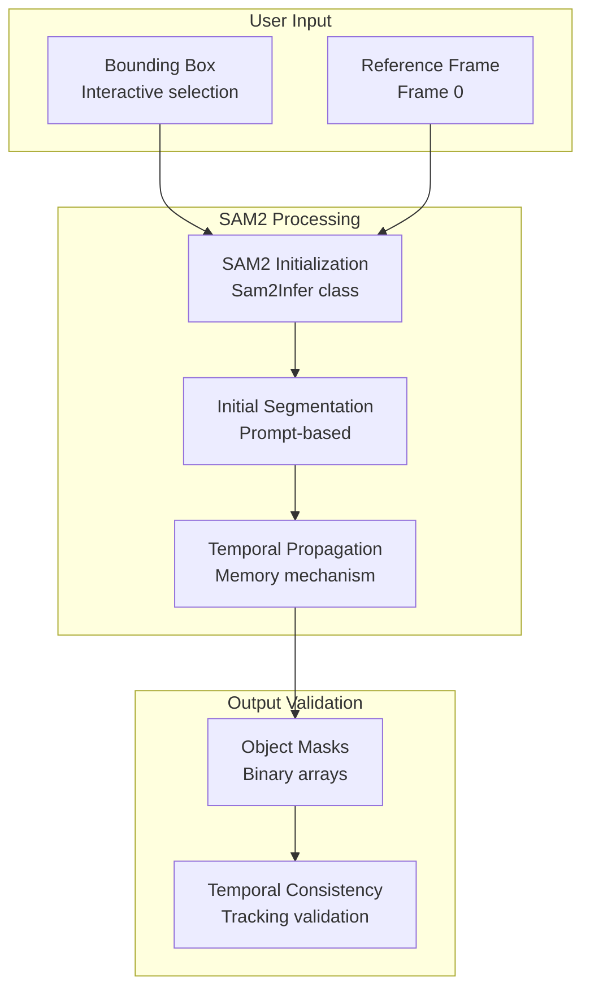
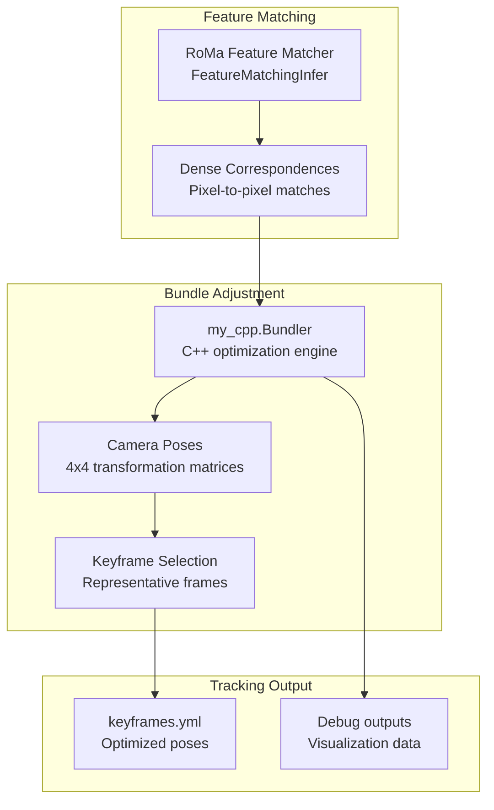
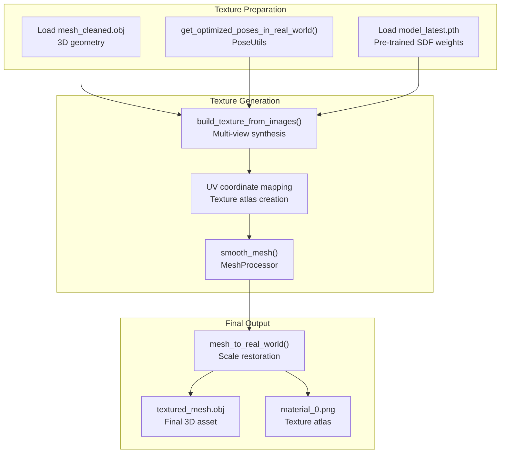

<!-- source: DeepWiki mcp.deepwiki.com · repo NVIDIA/3DObjectReconstruction · page 3.3 Reconstruction Workflow · fetched 2026-10-26 -->

# Reconstruction Workflow

Relevant source files

The following files were used as context for generating this wiki page:

- [notebooks/3d_object_reconstruction_demo.ipynb](notebooks/3d_object_reconstruction_demo.ipynb)
- [src/nvidia/objectreconstruction/networks/nvbundlesdf.py](src/nvidia/objectreconstruction/networks/nvbundlesdf.py)

This document provides a step-by-step breakdown of the 3D object reconstruction pipeline, detailing how the system transforms stereo video input into textured 3D assets. The workflow covers the sequential processing stages from initial data preparation through final mesh generation.

For information about the overall pipeline architecture and component relationships, see [Pipeline Architecture](#3.1). For detailed documentation of individual AI models and their configurations, see [AI Components](#3.2).

## Workflow Overview

The reconstruction workflow consists of four main sequential stages, each building upon the outputs of the previous stage:

**Sources:** [notebooks/3d_object_reconstruction_demo.ipynb:76-850](), [src/nvidia/objectreconstruction/networks/nvbundlesdf.py:206-896]()

## Stage 1: Data Preparation and Validation

The workflow begins by loading and validating stereo video input through the `ReconstructionDataLoader` class. This stage ensures proper camera calibration and data format compliance.

### Data Structure Requirements

The system expects input data organized in a specific directory structure:

| Directory | Contents | Purpose |
|-----------|----------|---------|
| `left/` | Left camera images | Primary RGB input for reconstruction |
| `right/` | Right camera images | Stereo pair for depth estimation |
| `depth/` | Generated depth maps | Output from FoundationStereo |
| `masks/` | Object segmentation masks | Output from SAM2 |

### Camera Configuration

The workflow requires precise camera intrinsics and baseline parameters:

**Sources:** [notebooks/3d_object_reconstruction_demo.ipynb:277-325](), [src/nvidia/objectreconstruction/dataloader/__init__.py]()

## Stage 2: Depth Estimation via FoundationStereo

The `run_depth_estimation()` function processes stereo image pairs to generate dense depth maps using the FoundationStereo neural network.

### FoundationStereo Processing Pipeline

The depth estimation stage processes all stereo pairs and saves results to the `depth/` directory for subsequent stages.

**Sources:** [notebooks/3d_object_reconstruction_demo.ipynb:394-410](), [src/nvidia/objectreconstruction/networks/foundationstereo.py]()

## Stage 3: Object Segmentation via SAM2

The `run_mask_extraction()` function uses SAM2 to segment and track the target object across all frames, requiring only a single bounding box annotation.

### SAM2 Video Tracking Workflow

The segmentation masks are essential for isolating the target object from background elements during 3D reconstruction.

**Sources:** [notebooks/3d_object_reconstruction_demo.ipynb:486-511](), [src/nvidia/objectreconstruction/networks/sam2infer.py]()

## Stage 4: 3D Reconstruction via NVBundleSDF

The final stage uses the `NVBundleSDF` class to orchestrate three sequential sub-processes that transform 2D observations into textured 3D assets.

### Stage 4.1: Pose Tracking - `run_track()`

The tracking stage establishes camera poses through feature matching and bundle adjustment:

Key methods in the tracking process:

- `find_corres()`: Uses RoMa to establish feature correspondences between frame pairs
- `process_new_frame()`: Processes each frame through bundle adjustment pipeline
- `make_frame()`: Creates Frame objects for BundleTrack processing

**Sources:** [src/nvidia/objectreconstruction/networks/nvbundlesdf.py:206-284](), [src/nvidia/objectreconstruction/networks/nvbundlesdf.py:543-637]()

### Stage 4.2: Neural SDF Training - `run_global_sdf()`

The SDF training stage learns 3D geometry through neural implicit surface representation:

```mermaid
flowchart LR
    subgraph "Scene Preprocessing"
        KEYFRAMES_LOAD["Load keyframes.yml<br/>Camera poses"]
        BOUNDS["compute_scene_bounds()<br/>PointCloudProcessor"]
        NORMALIZE["Scene Normalization<br/>Scale + translation"]
    end
    
    subgraph "SDF Training"
        NERF_RUNNER["NerfRunner<br/>Neural SDF model"]
        TRAIN["sdf.train()<br/>Implicit surface learning"]
        EXTRACT["sdf.extract_mesh()<br/>Marching cubes"]
    end
    
    subgraph "Mesh Processing"
        CLEAN["trimesh_split()<br/>Connected components"]
        LARGEST["Select largest component<br/>Primary object"]
        MESH_CLEANED["mesh_cleaned.obj<br/>Preprocessed mesh"]
    end
    
    KEYFRAMES_LOAD --> BOUNDS
    BOUNDS --> NORMALIZE
    NORMALIZE --> NERF_RUNNER
    NERF_RUNNER --> TRAIN
    TRAIN --> EXTRACT
    EXTRACT --> CLEAN
    CLEAN --> LARGEST
    LARGEST --> MESH_CLEANED
```

The SDF training produces a cleaned 3D mesh ready for texture application.

**Sources:** [src/nvidia/objectreconstruction/networks/nvbundlesdf.py:638-758]()

### Stage 4.3: Texture Baking - `run_texture_bake()`

The final sub-stage applies photorealistic textures to the reconstructed mesh:

**Sources:** [src/nvidia/objectreconstruction/networks/nvbundlesdf.py:759-896]()

## Workflow Integration and Data Dependencies

The reconstruction workflow maintains strict data dependencies between stages:

| Stage | Input Requirements | Output Products | Next Stage Dependencies |
|-------|-------------------|-----------------|------------------------|
| Data Preparation | Stereo video pairs | Validated dataset | Camera parameters for depth estimation |
| Depth Estimation | Left/right images, camera intrinsics | Dense depth maps | Depth data for pose tracking |
| Object Segmentation | RGB frames, user bounding box | Object masks | Foreground isolation for tracking |
| Pose Tracking | RGB-D + masks | Camera poses, keyframes | Reference poses for SDF training |
| SDF Training | Keyframes, poses, RGB-D | Neural model, mesh | Geometry for texture mapping |
| Texture Baking | Mesh, trained SDF, poses | Textured 3D asset | Final reconstruction output |

The workflow ensures each stage receives properly formatted inputs and produces outputs compatible with downstream processing requirements.

**Sources:** [notebooks/3d_object_reconstruction_demo.ipynb:634-896](), [src/nvidia/objectreconstruction/networks/nvbundlesdf.py:151-203]()

---

