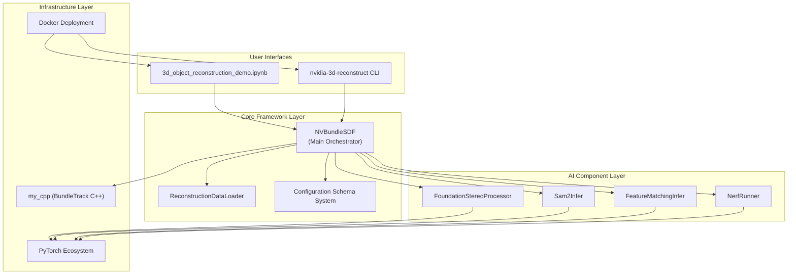
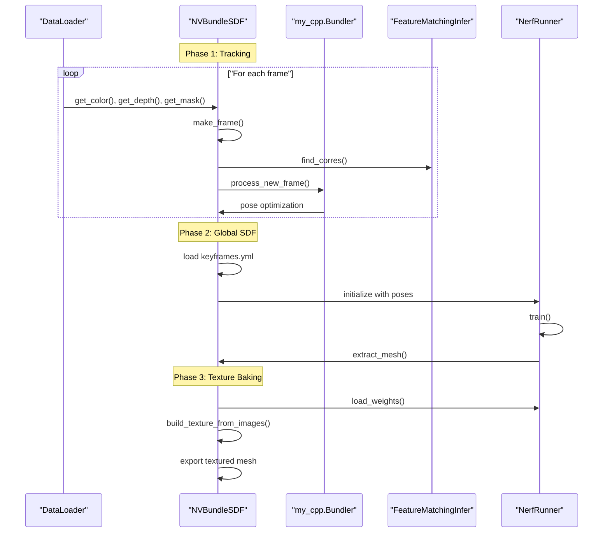
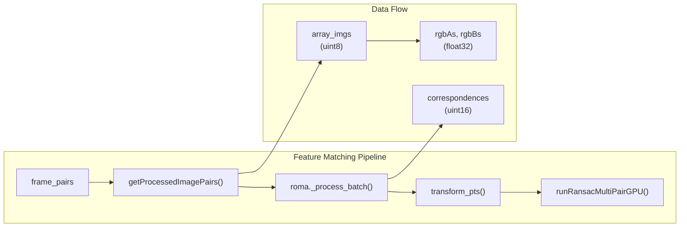
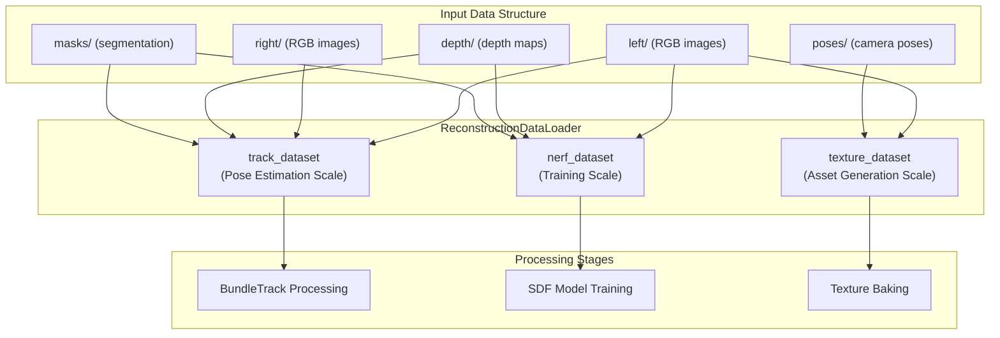
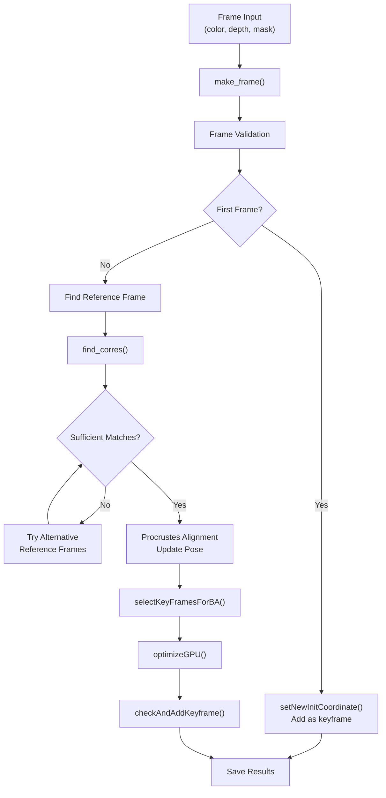
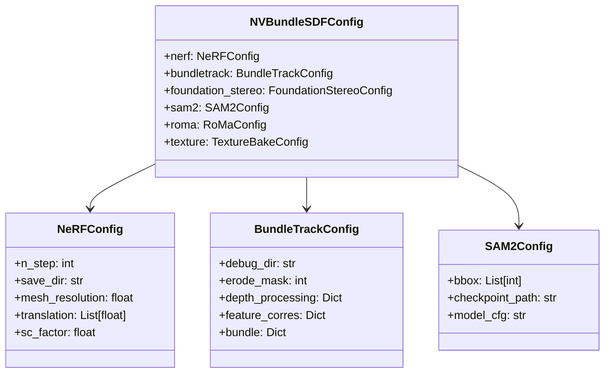
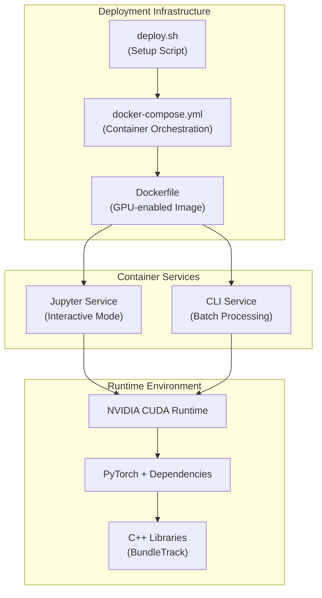

<!-- source: DeepWiki mcp.deepwiki.com · repo NVIDIA/3DObjectReconstruction · page 4 System Architecture · fetched 2026-10-26 -->

# System Architecture

<details>
<summary>Relevant source files</summary>

The following files were used as context for generating this wiki page:

- [src/README.md](src/README.md)
- [src/nvidia/objectreconstruction/networks/nvbundlesdf.py](src/nvidia/objectreconstruction/networks/nvbundlesdf.py)

</details>


This document provides a comprehensive technical overview of the NVIDIA 3D Object Reconstruction system's software architecture. It covers the core framework design, component integration patterns, data flow architecture, and deployment infrastructure. For information about the AI algorithms and reconstruction pipeline details, see [Core Pipeline](#3). For configuration parameters and schemas, see [Configuration Management](#5).

## Architecture Overview

The system follows a modular architecture centered around the `NVBundleSDF` orchestration framework, which coordinates multiple AI components through a unified pipeline. The architecture supports both interactive (Jupyter notebook) and batch processing (CLI) workflows.

### High-Level System Structure



**Sources:** [src/nvidia/objectreconstruction/networks/nvbundlesdf.py:1-1067](), [src/README.md:1-135]()

## Core Framework Components

### NVBundleSDF Orchestrator

The `NVBundleSDF` class serves as the primary orchestration framework, managing the complete reconstruction pipeline through three main phases: tracking, global SDF optimization, and texture baking.

```mermaid
classDiagram
    class NVBundleSDF {
        +cfg_nerf: ConfigDict
        +cfg_bundletrack: ConfigDict
        +roma_config: ConfigDict
        +cfg_texture: ConfigDict
        +bundler: my_cpp.Bundler
        +roma: FeatureMatchingInfer
        +K: ndarray
        +run_track(reader)
        +run_global_sdf(reader)
        +run_texture_bake(reader)
        +run_bundletrack(color, depth, K, id_str, mask)
        +find_corres(frame_pairs)
        +make_frame(color, depth, K, id_str)
    }
    
    class FeatureMatchingInfer {
        +roma_config: ConfigDict
        +_process_batch(rgbAs, rgbBs)
    }
    
    class NerfRunner {
        +config: ConfigDict
        +train()
        +extract_mesh(voxel_size, isolevel)
        +load_weights(path)
    }
    
    NVBundleSDF --> FeatureMatchingInfer
    NVBundleSDF --> NerfRunner
    NVBundleSDF --> "my_cpp.Bundler"
```

The framework initializes with precision control for numerical stability in pose tracking operations:

**Sources:** [src/nvidia/objectreconstruction/networks/nvbundlesdf.py:151-203](), [src/nvidia/objectreconstruction/networks/nvbundlesdf.py:74-99]()

### Pipeline Execution Phases

The `NVBundleSDF` orchestrator executes three distinct phases, each with specific responsibilities:



**Sources:** [src/nvidia/objectreconstruction/networks/nvbundlesdf.py:206-283](), [src/nvidia/objectreconstruction/networks/nvbundlesdf.py:638-757](), [src/nvidia/objectreconstruction/networks/nvbundlesdf.py:759-896]()

## AI Component Integration

### Component Processor Architecture

Each AI component is wrapped in a processor class that provides a standardized interface for the `NVBundleSDF` framework:

| Component | Class | Primary Function | Key Methods |
|-----------|--------|------------------|-------------|
| Stereo Depth | `FoundationStereoProcessor` | Sub-pixel depth estimation | `run()` |
| Segmentation | `Sam2Infer` | Object mask generation | `run(rgb_path, mask_path)` |
| Feature Matching | `FeatureMatchingInfer` | Correspondence finding | `_process_batch()` |
| Neural SDF | `NerfRunner` | 3D reconstruction | `train()`, `extract_mesh()` |

**Sources:** [src/README.md:35-41](), [src/README.md:58-82]()

### Feature Matching Integration

The `FeatureMatchingInfer` component integrates RoMa feature matching with the BundleTrack framework:



**Sources:** [src/nvidia/objectreconstruction/networks/nvbundlesdf.py:543-637](), [src/nvidia/objectreconstruction/networks/nvbundlesdf.py:568-625]()

## Data Flow Architecture

### Multi-Scale Data Processing

The system processes data at multiple scales through specialized loaders:



**Sources:** [src/README.md:1-135]() (inferred from data structure descriptions)

### Frame Processing Pipeline

Individual frames flow through a structured processing pipeline within the BundleTrack system:



**Sources:** [src/nvidia/objectreconstruction/networks/nvbundlesdf.py:385-541]()

## Configuration Management Architecture

### Hierarchical Configuration System

The system uses a hierarchical configuration architecture with specialized schema classes:



**Sources:** [src/README.md:43-50](), [src/README.md:87-100]()

### Configuration Loading and Validation

The `NVBundleSDF` framework loads and validates configuration through YAML processing:

**Sources:** [src/nvidia/objectreconstruction/networks/nvbundlesdf.py:209-224]()

## Deployment Architecture

### Docker-Based Infrastructure

The system deploys through a containerized architecture supporting both interactive and batch processing modes:



The deployment requires specific hardware requirements and system dependencies as defined in the project specifications.

**Sources:** [src/README.md:120-126]()

### Runtime Component Integration

At runtime, the system integrates multiple software components through standardized interfaces:

| Layer | Components | Integration Method |
|-------|------------|-------------------|
| Application | Jupyter notebooks, CLI tools | Direct Python imports |
| Framework | `NVBundleSDF`, data loaders | Configuration-driven initialization |
| AI Models | PyTorch models, pre-trained weights | Dynamic loading and inference |
| C++ Libraries | BundleTrack (`my_cpp`) | Python bindings |
| System | CUDA runtime, Docker | Environment-based configuration |

**Sources:** [src/nvidia/objectreconstruction/networks/nvbundlesdf.py:50-51](), [src/README.md:104-110]()

---

