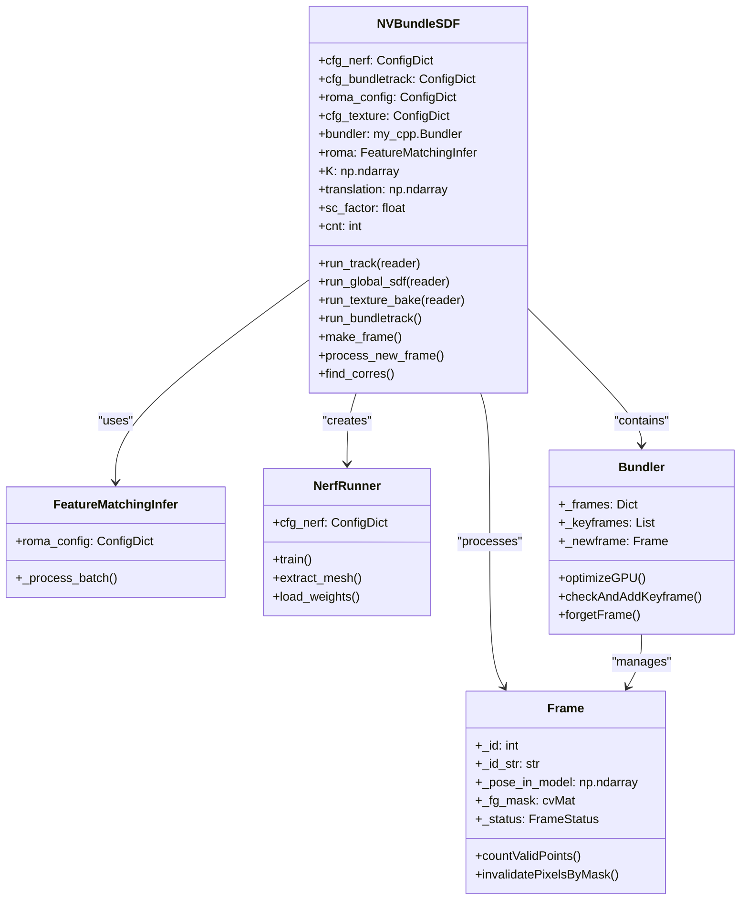
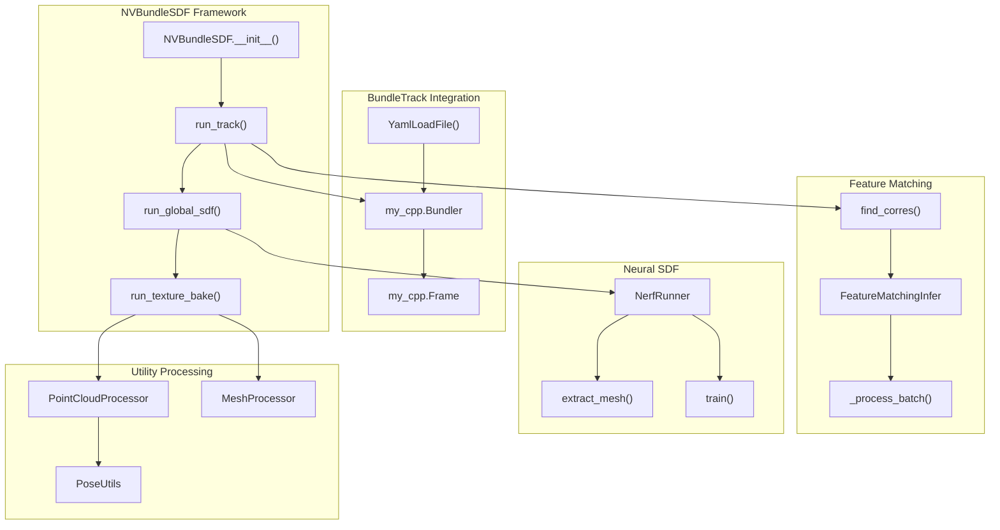
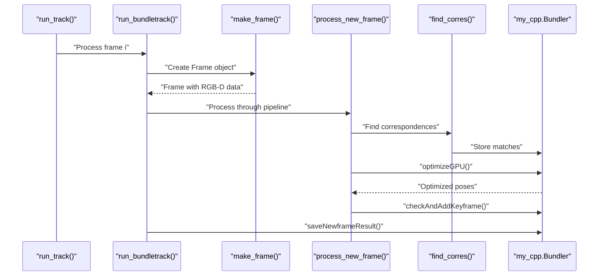
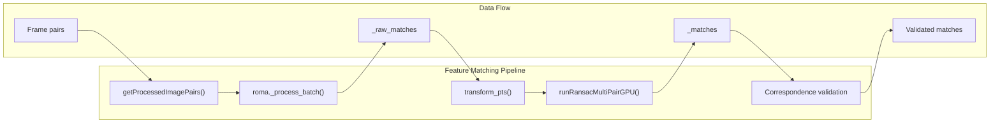

<!-- source: DeepWiki mcp.deepwiki.com · repo NVIDIA/3DObjectReconstruction · page 4.1 NVBundleSDF Framework · fetched 2026-10-26 -->

# NVBundleSDF Framework

<details>
<summary>Relevant source files</summary>

The following files were used as context for generating this wiki page:

- [src/README.md](src/README.md)
- [src/nvidia/objectreconstruction/networks/nvbundlesdf.py](src/nvidia/objectreconstruction/networks/nvbundlesdf.py)

</details>


The NVBundleSDF Framework serves as the main orchestration layer for the 3D object reconstruction pipeline, combining traditional bundle adjustment tracking with neural implicit surface representation. This framework integrates multiple AI components including BundleTrack, RoMa feature matching, and neural SDF optimization to produce high-quality textured 3D meshes from RGB-D input sequences.

For information about individual AI components, see [AI Components](#3.2). For configuration details, see [Configuration Management](#5).

## Framework Architecture

The `NVBundleSDF` class acts as the central coordinator that manages the complete reconstruction workflow through three main phases: tracking, global SDF optimization, and texture baking.

### Core Class Structure



Sources: [src/nvidia/objectreconstruction/networks/nvbundlesdf.py:151-203]()

### Component Integration Flow



Sources: [src/nvidia/objectreconstruction/networks/nvbundlesdf.py:206-283](), [src/nvidia/objectreconstruction/networks/nvbundlesdf.py:638-757](), [src/nvidia/objectreconstruction/networks/nvbundlesdf.py:759-896]()

## Core Workflow Stages

### Stage 1: Camera Pose Tracking

The `run_track()` method implements the pose tracking workflow using BundleTrack:

| Method | Purpose | Key Operations |
|--------|---------|----------------|
| `run_track()` | Main tracking orchestrator | Frame processing, keyframe management |
| `run_bundletrack()` | Single frame processing | Depth preprocessing, frame creation, result saving |
| `make_frame()` | Frame object creation | RGB-D data packaging, mask assignment |
| `process_new_frame()` | Bundle adjustment pipeline | Correspondence finding, pose optimization |

The tracking stage processes frames sequentially, maintaining a sliding window of frames for bundle adjustment optimization.



Sources: [src/nvidia/objectreconstruction/networks/nvbundlesdf.py:206-283](), [src/nvidia/objectreconstruction/networks/nvbundlesdf.py:332-384](), [src/nvidia/objectreconstruction/networks/nvbundlesdf.py:385-542]()

### Stage 2: Global SDF Optimization

The `run_global_sdf()` method performs neural implicit surface reconstruction:

```mermaid
flowchart TB
    subgraph "SDF Optimization Pipeline"
        LOAD_KF["Load keyframes.yml"]
        EXTRACT_POSES["Extract cam_in_ob poses"]
        COMPUTE_BOUNDS["PointCloudProcessor.compute_scene_bounds()"]
        NORMALIZE["Apply sc_factor and translation"]
        INIT_SDF["NerfRunner.__init__()"]
        TRAIN_SDF["sdf.train()"]
        EXTRACT_MESH["sdf.extract_mesh()"]
        CLEAN_MESH["trimesh_split() + largest component"]
    end
    
    LOAD_KF --> EXTRACT_POSES
    EXTRACT_POSES --> COMPUTE_BOUNDS
    COMPUTE_BOUNDS --> NORMALIZE
    NORMALIZE --> INIT_SDF
    INIT_SDF --> TRAIN_SDF
    TRAIN_SDF --> EXTRACT_MESH
    EXTRACT_MESH --> CLEAN_MESH
```



The scene normalization uses `PointCloudProcessor.compute_scene_bounds()` to calculate appropriate scale factors and translation vectors for the neural network training.

Sources: [src/nvidia/objectreconstruction/networks/nvbundlesdf.py:638-757]()

### Stage 3: Texture Baking

The `run_texture_bake()` method generates photorealistic textures:

| Component | Function | Implementation |
|-----------|----------|----------------|
| Pose Loading | Load optimized camera poses | `keyframes.yml` + `pose_array` |
| Mesh Loading | Load cleaned geometry | `mesh_cleaned.obj` |
| Texture Generation | Multi-view texture synthesis | `build_texture_from_images()` |
| World Transform | Convert to real-world coordinates | `MeshProcessor.mesh_to_real_world()` |

Sources: [src/nvidia/objectreconstruction/networks/nvbundlesdf.py:759-896]()

## Feature Correspondence System

The correspondence finding system integrates RoMa feature matching with BundleTrack's geometric validation:



The `find_corres()` method handles precision requirements by ensuring float32 tensors for RoMa processing and applying geometric validation through RANSAC.

Sources: [src/nvidia/objectreconstruction/networks/nvbundlesdf.py:543-637]()

## Precision and Memory Management

The framework implements several precision management strategies:

### Tensor Type Management

```python
# Float32 precision enforcement
set_nvbundlesdf_precision(use_full_precision=True)

# RoMa tensor type requirements
ROMA_TYPES = {
    'rgbAs': torch.float32,
    'rgbBs': torch.float32,
    'warp': torch.float32,
    'certainty': torch.float32,
    'matches': torch.float32
}
```

### Memory Cleanup

The framework includes explicit memory management for large objects:
- Bundler deletion after tracking: [src/nvidia/objectreconstruction/networks/nvbundlesdf.py:281-283]()
- Tensor cleanup in correspondence finding: [src/nvidia/objectreconstruction/networks/nvbundlesdf.py:610-611]()

Sources: [src/nvidia/objectreconstruction/networks/nvbundlesdf.py:74-149]()

## Configuration Integration

The NVBundleSDF framework accepts four main configuration dictionaries:

| Configuration | Purpose | Key Parameters |
|---------------|---------|----------------|
| `config_nerf` | Neural SDF settings | `n_step`, `mesh_resolution`, `save_dir` |
| `cfg_bundletrack` | Tracking parameters | `depth_processing`, `feature_corres`, `bundle` |
| `roma_config` | Feature matching | RoMa model configuration |
| `cfg_texture` | Texture baking | `texture_res` |

The framework validates and converts configuration types, particularly handling Path objects for C++ integration.

Sources: [src/nvidia/objectreconstruction/networks/nvbundlesdf.py:169-203](), [src/nvidia/objectreconstruction/networks/nvbundlesdf.py:209-223]()

---

