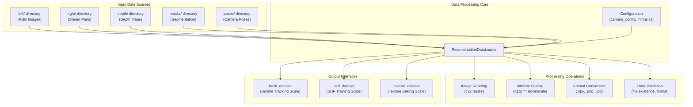
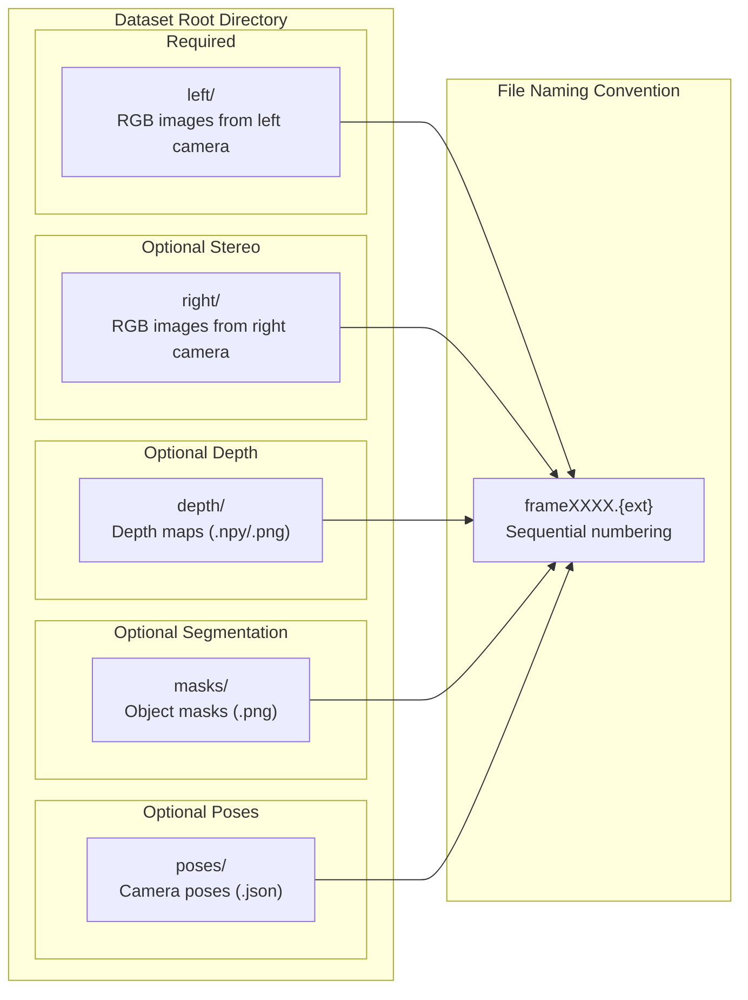
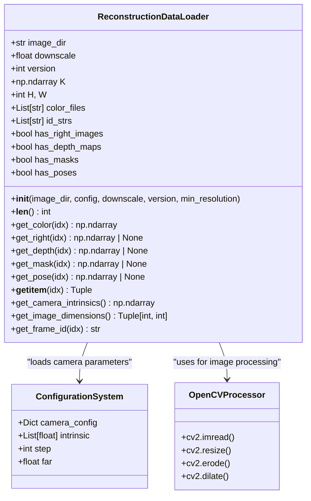
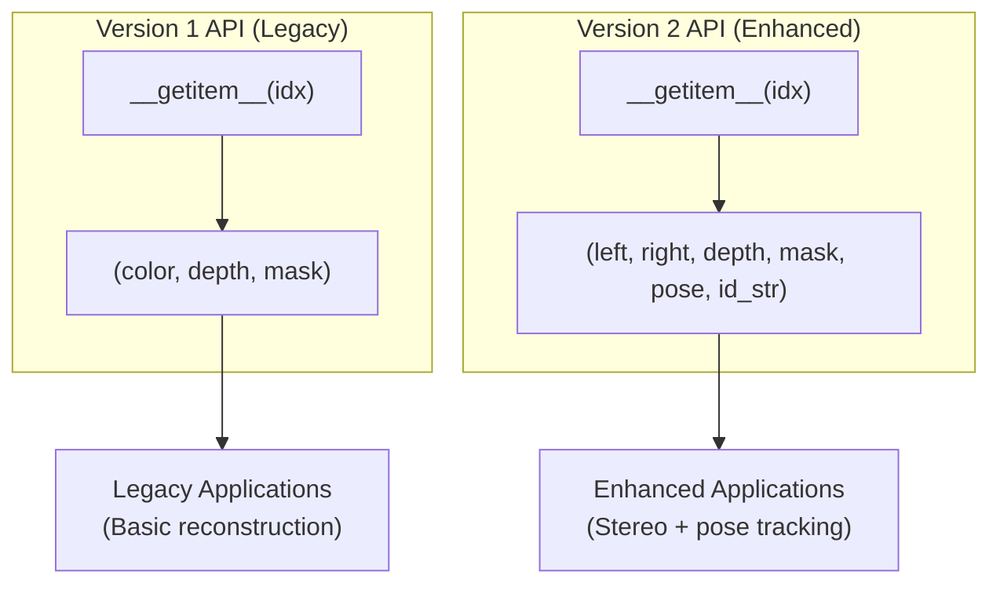
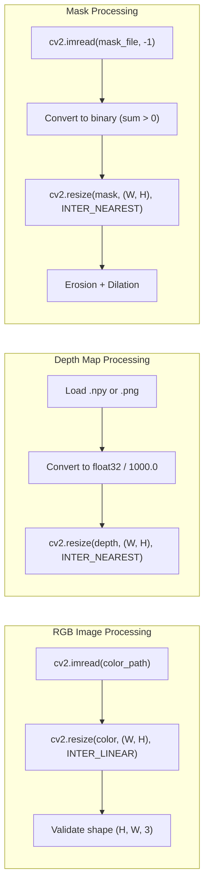
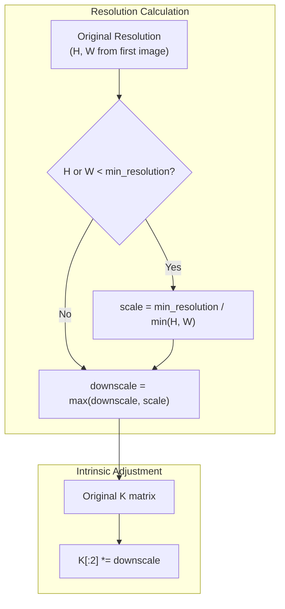
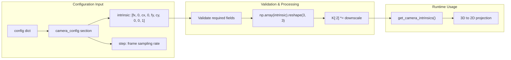
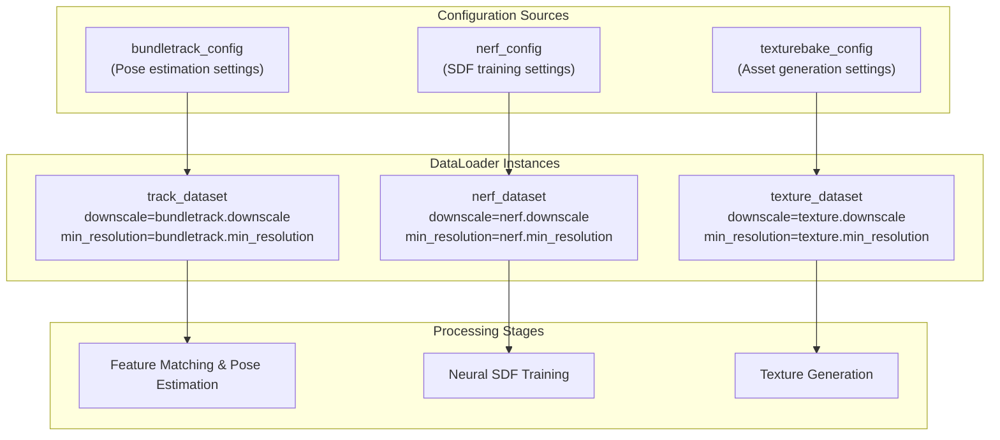

<!-- source: DeepWiki mcp.deepwiki.com · repo NVIDIA/3DObjectReconstruction · page 4.2 Data Processing System · fetched 2026-10-26 -->

# Data Processing System

Relevant source files

The following files were used as context for generating this wiki page:

- [notebooks/3d_object_reconstruction_demo.ipynb](notebooks/3d_object_reconstruction_demo.ipynb)
- [src/nvidia/objectreconstruction/dataloader/reconstruction_dataloader.py](src/nvidia/objectreconstruction/dataloader/reconstruction_dataloader.py)

## Purpose and Scope

The Data Processing System handles multi-modal data loading, preprocessing, and format standardization for the 3D object reconstruction pipeline. This system manages stereo images, depth maps, segmentation masks, and camera poses, converting them into a unified format suitable for neural reconstruction algorithms.

For information about the overall pipeline architecture, see [Pipeline Architecture](#3.1). For detailed API documentation of the data loader classes, see [Data Loaders](#6.2). For configuration of individual processing components, see [Component Configuration](#5.2).

## System Overview

The data processing system is built around the `ReconstructionDataLoader` class, which provides a unified interface for accessing multi-modal reconstruction data. The system handles variable data availability, format conversion, and multi-scale processing requirements.

**Sources:** [src/nvidia/objectreconstruction/dataloader/reconstruction_dataloader.py:1-382](), [notebooks/3d_object_reconstruction_demo.ipynb:634-656]()

## Data Directory Structure

The system expects a standardized directory structure containing different types of multi-modal data. Each data type is optional, allowing flexible deployment scenarios.

**Sources:** [src/nvidia/objectreconstruction/dataloader/reconstruction_dataloader.py:52-66](), [src/nvidia/objectreconstruction/dataloader/reconstruction_dataloader.py:80-89]()

| Data Type | Directory | Required | Supported Formats | Processing |
|-----------|-----------|----------|-------------------|------------|
| RGB Images | `left/` | Yes | `.jpg`, `.jpeg`, `.png` | Resize, color space conversion |
| Stereo Pairs | `right/` | No | `.jpg`, `.jpeg`, `.png` | Resize, stereo alignment |
| Depth Maps | `depth/` | No | `.npy`, `.png` | Format conversion, nearest-neighbor resize |
| Object Masks | `masks/` | No | `.png` | Binary conversion, morphological operations |
| Camera Poses | `poses/` | No | `.json` | Matrix format validation |

## ReconstructionDataLoader Architecture

The `ReconstructionDataLoader` class serves as the central data access interface, providing both legacy and enhanced API versions for different use cases.

**Sources:** [src/nvidia/objectreconstruction/dataloader/reconstruction_dataloader.py:5-33](), [src/nvidia/objectreconstruction/dataloader/reconstruction_dataloader.py:306-347]()

### Version Compatibility

The dataloader supports two API versions for backward compatibility:

**Sources:** [src/nvidia/objectreconstruction/dataloader/reconstruction_dataloader.py:23-27](), [src/nvidia/objectreconstruction/dataloader/reconstruction_dataloader.py:340-346]()

## Multi-Modal Data Processing

Each data modality requires specific preprocessing operations to ensure compatibility with the neural reconstruction pipeline.

### Image Processing Pipeline

**Sources:** [src/nvidia/objectreconstruction/dataloader/reconstruction_dataloader.py:138-145](), [src/nvidia/objectreconstruction/dataloader/reconstruction_dataloader.py:212-225](), [src/nvidia/objectreconstruction/dataloader/reconstruction_dataloader.py:252-265]()

### Dynamic Resolution Scaling

The system implements adaptive resolution scaling to ensure optimal performance across different hardware configurations:

**Sources:** [src/nvidia/objectreconstruction/dataloader/reconstruction_dataloader.py:104-115]()

## Configuration Integration

The data processing system integrates tightly with the configuration management system to handle camera parameters and processing options.

### Camera Configuration Processing

**Sources:** [src/nvidia/objectreconstruction/dataloader/reconstruction_dataloader.py:44-49](), [src/nvidia/objectreconstruction/dataloader/reconstruction_dataloader.py:348-355](), [notebooks/3d_object_reconstruction_demo.ipynb:311-319]()

## Multi-Scale Processing Pipelines

The system supports multiple processing scales for different stages of the reconstruction pipeline, each optimized for specific computational requirements.

### Pipeline Stage Configuration

**Sources:** [notebooks/3d_object_reconstruction_demo.ipynb:634-652]()

### Processing Scale Trade-offs

| Stage | Typical Downscale | Resolution Priority | Performance Impact |
|-------|-------------------|--------------------|--------------------|
| Bundle Tracking | 4-8x | Medium (feature detection) | High compute, memory efficient |
| SDF Training | 2-4x | High (geometric detail) | Memory intensive, moderate compute |
| Texture Baking | 1-2x | Highest (visual quality) | Highest memory and compute |

The system automatically adjusts these parameters based on available hardware resources and input data characteristics.

**Sources:** [src/nvidia/objectreconstruction/dataloader/reconstruction_dataloader.py:104-115]()

---

