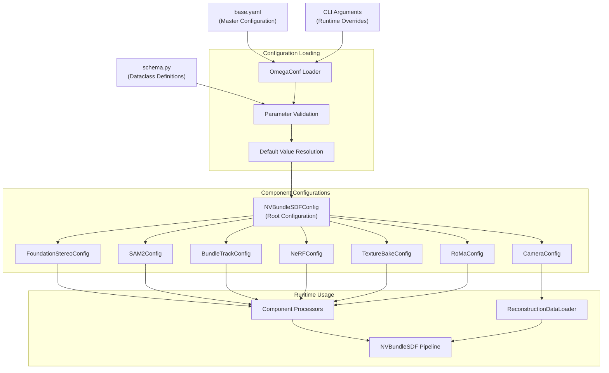
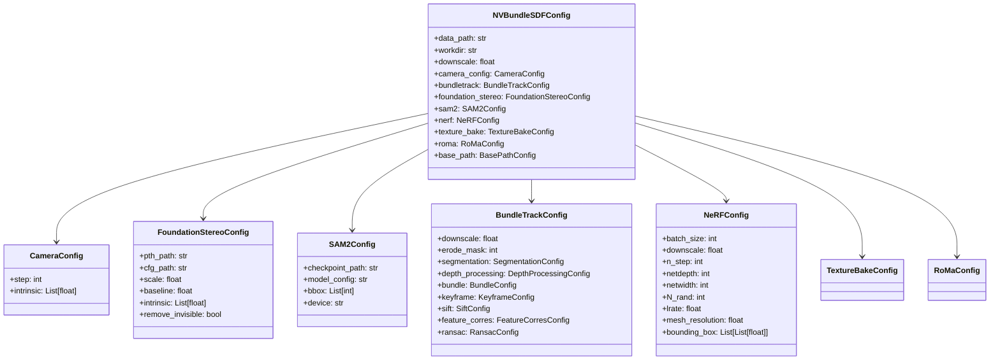
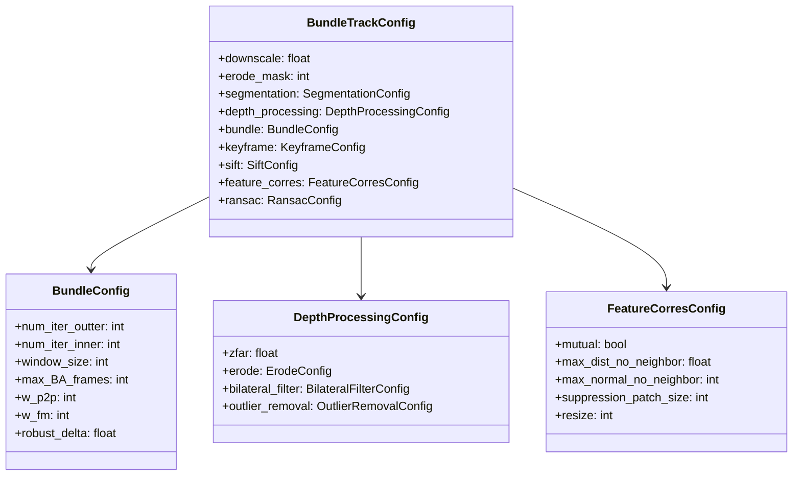
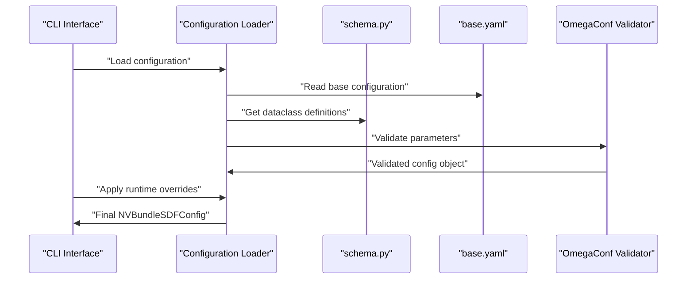

<!-- source: DeepWiki mcp.deepwiki.com · repo NVIDIA/3DObjectReconstruction · page 5 Configuration Management · fetched 2026-10-26 -->

# Configuration Management

<details>
<summary>Relevant source files</summary>

The following files were used as context for generating this wiki page:

- [README.md](README.md)
- [src/nvidia/objectreconstruction/configs/schema.py](src/nvidia/objectreconstruction/configs/schema.py)

</details>


This document covers the hierarchical configuration system used throughout the NVIDIA 3D Object Reconstruction workflow. The configuration system provides centralized management of parameters for all AI components, processing stages, and system settings through structured YAML files and validated dataclass schemas.

For information about individual AI component parameters, see [Component Configuration](#5.2). For details on the overall system architecture, see [System Architecture](#4).

## Configuration Architecture Overview

The configuration system is built on a hierarchical structure using Python dataclasses with OmegaConf integration for YAML file loading and validation. The system provides type safety, default values, and parameter validation across all workflow components.

### Configuration Flow Diagram



Sources: [src/nvidia/objectreconstruction/configs/schema.py:1-327](), [README.md:352-388]()

### Configuration Schema Hierarchy

The configuration system is organized into a nested hierarchy with `NVBundleSDFConfig` as the root configuration class that encompasses all component-specific configurations.



Sources: [src/nvidia/objectreconstruction/configs/schema.py:314-327](), [src/nvidia/objectreconstruction/configs/schema.py:18-22](), [src/nvidia/objectreconstruction/configs/schema.py:24-36]()

## Core Configuration Classes

### Root Configuration Class

The `NVBundleSDFConfig` class serves as the root configuration container that orchestrates all component configurations.

| Parameter | Type | Purpose |
|-----------|------|---------|
| `data_path` | `str` | Path to input stereo data directory |
| `workdir` | `str` | Working directory for intermediate outputs |
| `downscale` | `float` | Global downscaling factor for processing |
| `camera_config` | `CameraConfig` | Camera intrinsic parameters |
| `bundletrack` | `BundleTrackConfig` | Pose tracking and bundle adjustment settings |
| `foundation_stereo` | `FoundationStereoConfig` | Depth estimation model configuration |
| `sam2` | `SAM2Config` | Object segmentation model settings |
| `nerf` | `NeRFConfig` | Neural SDF training parameters |
| `texture_bake` | `TextureBakeConfig` | Texture generation settings |
| `roma` | `RoMaConfig` | Feature matching configuration |

Sources: [src/nvidia/objectreconstruction/configs/schema.py:314-327]()

### Camera Configuration

The `CameraConfig` class manages camera intrinsic parameters used across the reconstruction pipeline.

```python
@dataclass
class CameraConfig:
    step: int = 1  # Frame sampling step
    intrinsic: List[float] = [3079.6, 0, 2000.0, 0, 3075.1, 1500.01, 0, 0, 1]  # 3x3 matrix flattened
```

The intrinsic parameter list represents a 3x3 camera matrix in row-major order: `[fx, 0, cx, 0, fy, cy, 0, 0, 1]`.

Sources: [src/nvidia/objectreconstruction/configs/schema.py:18-22]()

### AI Component Configurations

#### FoundationStereo Configuration

The `FoundationStereoConfig` class configures the transformer-based depth estimation component.

| Parameter | Default | Purpose |
|-----------|---------|---------|
| `pth_path` | `/workspace/.../model_best_bp2.pth` | Path to model weights |
| `cfg_path` | `/workspace/.../cfg.yaml` | Path to model configuration |
| `scale` | `0.3` | Processing resolution scale factor |
| `baseline` | `0.0657696127` | Stereo baseline distance in meters |
| `remove_invisible` | `true` | Filter out invisible depth points |

Sources: [src/nvidia/objectreconstruction/configs/schema.py:24-36]()

#### SAM2 Configuration  

The `SAM2Config` class configures the video object segmentation component.

```python
@dataclass
class SAM2Config:
    checkpoint_path: str = "/workspace/.../sam2.1_hiera_large.pt"
    model_config: str = "/workspace/.../sam2.1_hiera_l.yaml"
    bbox: List[int] = [1144, 627, 2227, 2232]  # [x1, y1, x2, y2]
    device: str = "cuda"
```

The `bbox` parameter defines the initial bounding box for object tracking in pixel coordinates.

Sources: [src/nvidia/objectreconstruction/configs/schema.py:38-44]()

#### Neural SDF Configuration

The `NeRFConfig` class contains extensive parameters for neural implicit surface reconstruction.

**Training Parameters:**
| Parameter | Default | Purpose |
|-----------|---------|---------|
| `batch_size` | `32` | Training batch size |
| `n_step` | `2000` | Number of training iterations |
| `lrate` | `0.01` | Learning rate for network weights |
| `N_rand` | `2048` | Number of random rays per batch |

**Network Architecture:**
| Parameter | Default | Purpose |
|-----------|---------|---------|
| `netdepth` | `8` | Number of hidden layers |
| `netwidth` | `256` | Hidden layer dimension |
| `multires` | `8` | Positional encoding frequency levels |

**Scene Parameters:**
| Parameter | Default | Purpose |
|-----------|---------|---------|
| `mesh_resolution` | `0.002` | Mesh extraction resolution in meters |
| `bounding_box` | `[[-1,-1,-1], [1,1,1]]` | Scene bounds for reconstruction |
| `near` | `0.1` | Near clipping plane |
| `far` | `1.0` | Far clipping plane |

Sources: [src/nvidia/objectreconstruction/configs/schema.py:199-305]()

## Bundle Adjustment Configuration

The `BundleTrackConfig` class manages complex pose tracking and bundle adjustment parameters through nested configuration classes.

### Bundle Adjustment Hierarchy



### Key Bundle Adjustment Parameters

**Optimization Settings:**
| Parameter | Default | Purpose |
|-----------|---------|---------|
| `num_iter_outter` | `7` | Outer optimization loop iterations |
| `num_iter_inner` | `5` | Inner optimization loop iterations |
| `window_size` | `5` | Sliding window size for bundle adjustment |
| `max_BA_frames` | `10` | Maximum frames in bundle adjustment |

**Loss Weights:**
| Parameter | Default | Purpose |
|-----------|---------|---------|
| `w_p2p` | `1` | Point-to-point correspondence weight |
| `w_fm` | `1` | Feature matching weight |
| `robust_delta` | `0.005` | Robust loss threshold |

Sources: [src/nvidia/objectreconstruction/configs/schema.py:176-196](), [src/nvidia/objectreconstruction/configs/schema.py:90-111]()

## Configuration Usage Patterns

### YAML Configuration File Structure

The base configuration file follows this hierarchical structure:

```yaml
# Camera configuration
camera_config:
  intrinsic: [3079.6, 0, 2000.0, 0, 3075.1, 1500.01, 0, 0, 1]

# FoundationStereo depth estimation
foundation_stereo:
  scale: 0.3
  baseline: 0.0657696127

# SAM2 object segmentation  
sam2:
  bbox: [1144, 627, 2227, 2232]

# BundleTrack pose optimization
bundletrack:
  downscale: 1.0
  erode_mask: 3

# Neural SDF training
nerf:
  n_step: 2000
  batch_size: 32
  downscale: 0.5

# Texture baking
texture_bake:
  downscale: 1.0
  texture_res: 2048
```

Sources: [README.md:356-387]()

### Configuration Parameter Customization

Common customization patterns for different scenarios:

**Memory-Constrained Environments:**
```yaml
nerf:
  batch_size: 16        # Reduce from default 32
  downscale: 0.3        # Increase downscaling
foundation_stereo:
  scale: 0.2            # Reduce processing resolution
```

**High-Quality Reconstruction:**
```yaml
nerf:
  n_step: 5000          # Increase training iterations
  mesh_resolution: 0.001 # Higher mesh resolution
texture_bake:
  texture_res: 4096     # Higher texture resolution
```

**Fast Processing:**
```yaml
nerf:
  n_step: 1000          # Fewer training iterations
  batch_size: 64        # Larger batch size
bundletrack:
  downscale: 2.0        # Higher downscaling
```

Sources: [README.md:391-401](), [README.md:478-490]()

### Configuration Loading and Validation

The configuration system uses OmegaConf for YAML loading with dataclass validation. The loading process includes:

1. **YAML Parsing**: Base configuration file is loaded and parsed
2. **Schema Validation**: Parameters are validated against dataclass field types
3. **Default Resolution**: Missing parameters are filled with dataclass defaults
4. **Runtime Overrides**: CLI arguments can override configuration values



Sources: [src/nvidia/objectreconstruction/configs/schema.py:1-4](), [README.md:328-350]()

---

