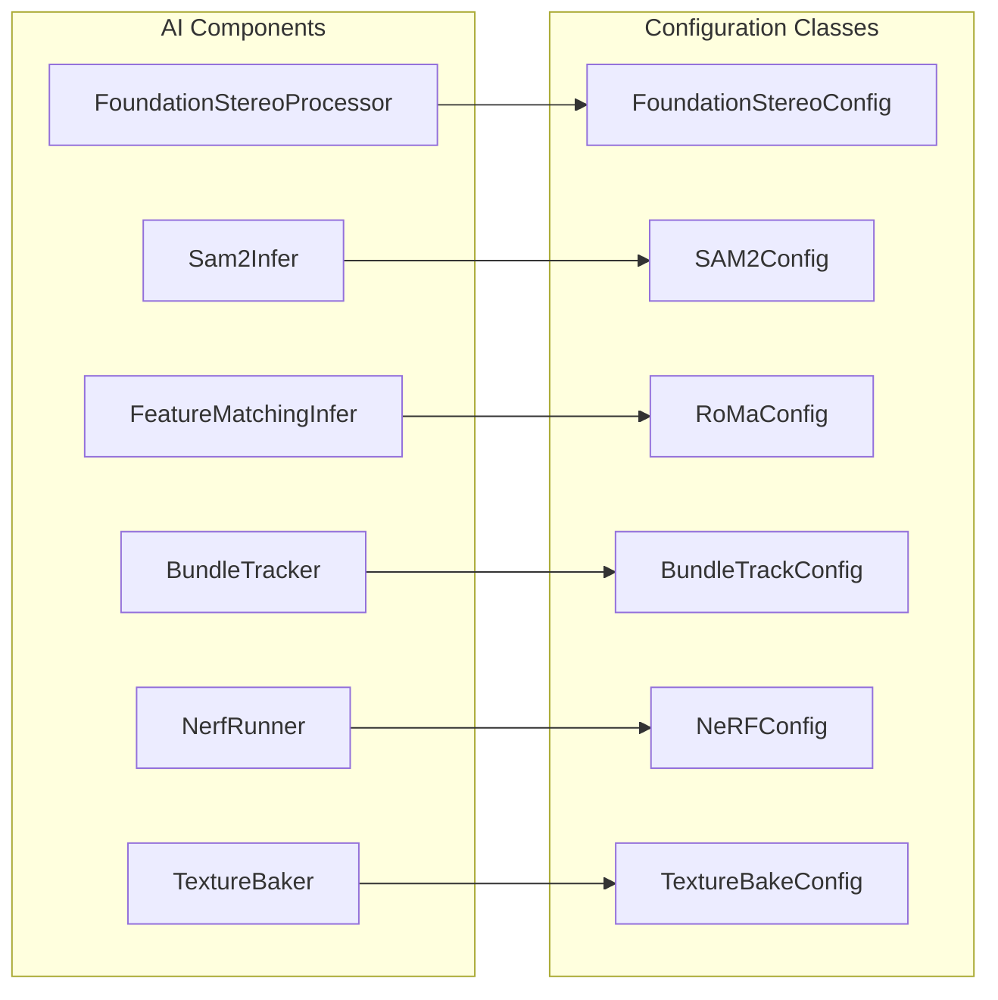
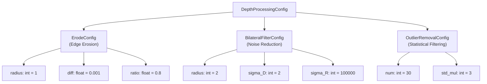

<!-- source: DeepWiki mcp.deepwiki.com · repo NVIDIA/3DObjectReconstruction · page 5.1 Configuration Schema · fetched 2026-10-26 -->

# Configuration Schema

<details>
<summary>Relevant source files</summary>

The following files were used as context for generating this wiki page:

- [src/nvidia/objectreconstruction/configs/schema.py](src/nvidia/objectreconstruction/configs/schema.py)

</details>


This page provides a comprehensive reference for the configuration schema used throughout the NVIDIA 3D Object Reconstruction system. The schema defines all configurable parameters for the AI pipeline components, data processing stages, and system behavior through a hierarchical structure of dataclasses.

For information about how to configure individual components in practice, see [Component Configuration](#5.2).

## Configuration Architecture

The configuration system is built around a hierarchical structure of Python dataclasses that correspond to the major components of the 3D reconstruction pipeline. The root configuration class `NVBundleSDFConfig` aggregates all component-specific configurations.

```mermaid
graph TD
    NVBundleSDFConfig["NVBundleSDFConfig<br/>(Root Configuration)"] --> CameraConfig["CameraConfig<br/>(Camera Parameters)"]
    NVBundleSDFConfig --> FoundationStereoConfig["FoundationStereoConfig<br/>(Depth Estimation)"]
    NVBundleSDFConfig --> SAM2Config["SAM2Config<br/>(Object Segmentation)"]
    NVBundleSDFConfig --> RoMaConfig["RoMaConfig<br/>(Feature Matching)"]
    NVBundleSDFConfig --> BundleTrackConfig["BundleTrackConfig<br/>(6-DoF Tracking)"]
    NVBundleSDFConfig --> NeRFConfig["NeRFConfig<br/>(Neural Rendering)"]
    NVBundleSDFConfig --> TextureBakeConfig["TextureBakeConfig<br/>(Asset Generation)"]
    NVBundleSDFConfig --> BasePathConfig["BasePathConfig<br/>(File Paths)"]
    
    BundleTrackConfig --> SegmentationConfig["SegmentationConfig"]
    BundleTrackConfig --> DepthProcessingConfig["DepthProcessingConfig"]
    BundleTrackConfig --> BundleConfig["BundleConfig"]
    BundleTrackConfig --> KeyframeConfig["KeyframeConfig"]
    BundleTrackConfig --> SiftConfig["SiftConfig"]
    BundleTrackConfig --> FeatureCorresConfig["FeatureCorresConfig"]
    BundleTrackConfig --> RansacConfig["RansacConfig"]
    BundleTrackConfig --> P2PConfig["P2PConfig"]
    BundleTrackConfig --> SDFEdgeConfig["SDFEdgeConfig"]
    BundleTrackConfig --> ShapeConfig["ShapeConfig"]
    
    DepthProcessingConfig --> ErodeConfig["ErodeConfig"]
    DepthProcessingConfig --> BilateralFilterConfig["BilateralFilterConfig"]
    DepthProcessingConfig --> OutlierRemovalConfig["OutlierRemovalConfig"]
    
    NeRFConfig --> MeshSmoothingConfig["MeshSmoothingConfig"]
```



*Sources: [src/nvidia/objectreconstruction/configs/schema.py:314-327]()*

## Component-to-Configuration Mapping

The configuration classes directly correspond to the AI pipeline components and processing stages, providing a clear mapping between system functionality and configurable parameters.



*Sources: [src/nvidia/objectreconstruction/configs/schema.py:1-327]()*

## Core Configuration Classes

### Root Configuration

#### NVBundleSDFConfig
The top-level configuration class that aggregates all component configurations and global settings.

| Parameter | Type | Description |
|-----------|------|-------------|
| `data_path` | `str` | Path to input data directory |
| `workdir` | `str` | Working directory for outputs |
| `downscale` | `float` | Global image downscaling factor |

*Sources: [src/nvidia/objectreconstruction/configs/schema.py:314-327]()*

### AI Component Configurations

#### FoundationStereoConfig
Configuration for the FoundationStereo depth estimation model.

| Parameter | Type | Default | Description |
|-----------|------|---------|-------------|
| `pth_path` | `str` | `/workspace/.../model_best_bp2.pth` | Model checkpoint path |
| `cfg_path` | `str` | `/workspace/.../cfg.yaml` | Model configuration file |
| `vit_size` | `str` | `'vitl'` | Vision Transformer size |
| `scale` | `float` | `0.3` | Depth scale factor |
| `z_far` | `float` | `10` | Far clipping plane |
| `baseline` | `float` | `0.0657696127` | Stereo baseline distance |

*Sources: [src/nvidia/objectreconstruction/configs/schema.py:24-36]()*

#### SAM2Config
Configuration for the SAM2 object segmentation model.

| Parameter | Type | Default | Description |
|-----------|------|---------|-------------|
| `checkpoint_path` | `str` | `/workspace/.../sam2.1_hiera_large.pt` | Model checkpoint |
| `model_config` | `str` | `/workspace/.../sam2.1_hiera_l.yaml` | Model configuration |
| `bbox` | `List[int]` | `[1144, 627, 2227, 2232]` | Initial bounding box |
| `device` | `str` | `"cuda"` | Computation device |

*Sources: [src/nvidia/objectreconstruction/configs/schema.py:38-44]()*

#### RoMaConfig
Configuration for the RoMa feature matching system.

| Parameter | Type | Default | Description |
|-----------|------|---------|-------------|
| `coarse_res` | `int` | `560` | Coarse resolution for matching |
| `upsample_res` | `Tuple[int, int]` | `(864, 864)` | Upsampling resolution |
| `weights` | `str` | `/workspace/.../roma_outdoor.pth` | RoMa model weights |
| `dinov2_weights` | `str` | `/workspace/.../dinov2_vitl14_pretrain.pth` | DINOv2 backbone weights |

*Sources: [src/nvidia/objectreconstruction/configs/schema.py:8-15]()*

### Tracking and Reconstruction Configurations

#### BundleTrackConfig
The primary configuration class for 6-DoF camera tracking and bundle adjustment, containing multiple nested configuration classes.

| Parameter | Type | Description |
|-----------|------|-------------|
| `debug_dir` | `str` | Debug output directory |
| `downscale` | `float` | Image downscaling factor |
| `erode_mask` | `int` | Mask erosion radius |
| `visible_angle` | `int` | Visibility angle threshold (degrees) |

*Sources: [src/nvidia/objectreconstruction/configs/schema.py:176-196]()*

#### NeRFConfig
Comprehensive configuration for Neural Radiance Fields training and mesh extraction.

| Parameter Category | Key Parameters | Description |
|-------------------|----------------|-------------|
| Training | `batch_size`, `n_step`, `lrate` | Training hyperparameters |
| Network Architecture | `netdepth`, `netwidth` | Network structure |
| Sampling | `N_samples`, `N_samples_around_depth` | Ray sampling strategy |
| Hash Encoding | `finest_res`, `base_res`, `num_levels` | Multi-resolution hash grid |
| Scene Bounds | `bounding_box`, `near`, `far` | Scene volume definition |
| Loss Weights | `rgb_weight`, `depth_weight`, `sdf_lambda` | Training loss components |

*Sources: [src/nvidia/objectreconstruction/configs/schema.py:199-305]()*

## Nested Configuration Hierarchies

### Depth Processing Pipeline

The `DepthProcessingConfig` contains several nested configurations for depth map refinement:



*Sources: [src/nvidia/objectreconstruction/configs/schema.py:58-88]()*

### Bundle Adjustment Parameters

The `BundleConfig` class defines parameters for the optimization process:

| Parameter | Type | Default | Description |
|-----------|------|---------|-------------|
| `num_iter_outter` | `int` | `7` | Outer optimization iterations |
| `num_iter_inner` | `int` | `5` | Inner optimization iterations |
| `window_size` | `int` | `5` | Sliding window size |
| `max_BA_frames` | `int` | `10` | Maximum frames in bundle adjustment |
| `robust_delta` | `float` | `0.005` | Robust loss threshold |
| `w_p2p`, `w_fm` | `int` | `1` | Loss component weights |

*Sources: [src/nvidia/objectreconstruction/configs/schema.py:90-111]()*

## Configuration Validation and Constraints

The schema includes built-in validation through dataclass field metadata and type hints:

```python
# Example validation constraint
step: int = field(default=1, metadata={"validate": lambda x: x > 0})
```

Key validation patterns include:
- Required fields marked with `MISSING` from OmegaConf
- Type constraints through Python type hints
- Range validation through lambda functions in metadata
- Default factory functions for complex nested structures

*Sources: [src/nvidia/objectreconstruction/configs/schema.py:20]()*

## Configuration Usage Patterns

The configuration classes are designed to work with OmegaConf for YAML-based configuration files and runtime parameter overrides. The hierarchical structure allows for:

1. **Component Isolation**: Each AI component has its own configuration namespace
2. **Nested Parameter Groups**: Related parameters are grouped in sub-configurations
3. **Default Value Management**: Sensible defaults for all parameters
4. **Type Safety**: Strong typing throughout the configuration hierarchy
5. **Extensibility**: Easy addition of new parameters without breaking existing configurations

*Sources: [src/nvidia/objectreconstruction/configs/schema.py:1-327]()*

---

