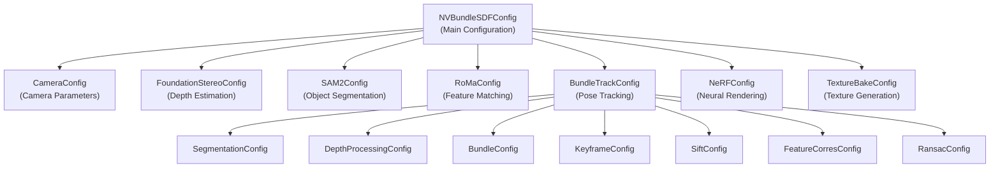
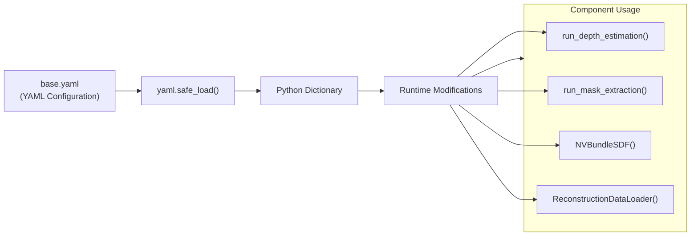
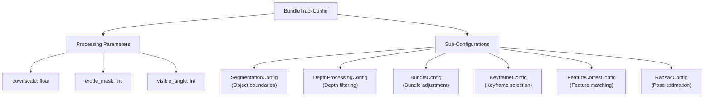
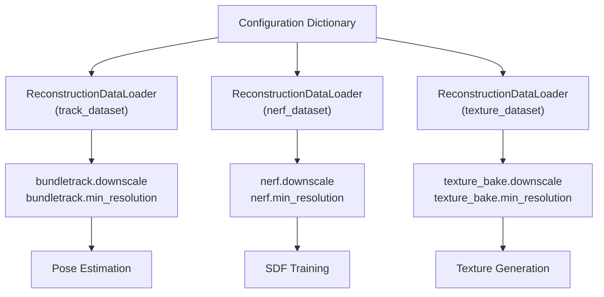

<!-- source: DeepWiki mcp.deepwiki.com · repo NVIDIA/3DObjectReconstruction · page 5.2 Component Configuration · fetched 2026-10-26 -->

# Component Configuration

<details>
<summary>Relevant source files</summary>

The following files were used as context for generating this wiki page:

- [notebooks/3d_object_reconstruction_demo.ipynb](notebooks/3d_object_reconstruction_demo.ipynb)
- [src/nvidia/objectreconstruction/configs/schema.py](src/nvidia/objectreconstruction/configs/schema.py)

</details>


This document explains how to configure individual AI components and processing stages in the NVIDIA 3D Object Reconstruction pipeline. It covers the hierarchical configuration system, component-specific parameters, and practical configuration modifications.

For information about the overall configuration schema and structure, see [Configuration Schema](#5.1). For API reference documentation of configuration classes, see [Core Classes](#6.1).

## Configuration Architecture Overview

The configuration system uses a hierarchical structure where each AI component has its own dedicated configuration class with specialized parameters. The main configuration orchestrates all components through the `NVBundleSDFConfig` class.

### Configuration Class Hierarchy



Sources: [src/nvidia/objectreconstruction/configs/schema.py:314-327]()

### Configuration Loading Process



Sources: [notebooks/3d_object_reconstruction_demo.ipynb:277-325]()

## Camera Configuration

The `CameraConfig` class manages camera intrinsics and frame processing parameters that are shared across multiple components.

### Key Parameters

| Parameter | Type | Description | Default |
|-----------|------|-------------|---------|
| `step` | int | Frame sampling interval | 1 |
| `intrinsic` | List[float] | Camera intrinsic matrix (3x3 flattened) | QooCam defaults |

```python
# Camera intrinsic matrix format: [fx, 0, cx, 0, fy, cy, 0, 0, 1]
config['camera_config']['intrinsic'] = [3079.6, 0, 2000.0, 0, 3075.1, 1500.01, 0, 0, 1]
config['camera_config']['step'] = 1  # Process every frame
```

The `step` parameter controls frame subsampling - a value of 2 processes every other frame, while 1 processes all frames.

Sources: [src/nvidia/objectreconstruction/configs/schema.py:18-22](), [notebooks/3d_object_reconstruction_demo.ipynb:317-318]()

## FoundationStereo Configuration

The `FoundationStereoConfig` class controls depth estimation from stereo image pairs using the FoundationStereo neural network.

### Core Parameters

| Parameter | Type | Description | Default |
|-----------|------|-------------|---------|
| `pth_path` | str | Model checkpoint path | `/workspace/.../model_best_bp2.pth` |
| `cfg_path` | str | Model configuration file | `/workspace/.../cfg.yaml` |
| `scale` | float | Depth scaling factor | 0.3 |
| `baseline` | float | Stereo camera baseline (meters) | 0.0657696127 |
| `intrinsic` | List[float] | Camera intrinsic parameters | Inherited from camera_config |

### Advanced Parameters

```python
# Technical parameters affecting depth quality
config['foundation_stereo']['vit_size'] = 'vitl'  # Vision transformer size
config['foundation_stereo']['z_far'] = 10  # Maximum depth range
config['foundation_stereo']['remove_invisible'] = True  # Filter invalid depth
```

The `scale` parameter is critical for depth accuracy - it should match the physical scale relationship between the camera baseline and scene objects.

Sources: [src/nvidia/objectreconstruction/configs/schema.py:24-36](), [notebooks/3d_object_reconstruction_demo.ipynb:318-319]()

## SAM2 Configuration

The `SAM2Config` class configures object segmentation and tracking across video frames using Meta's Segment Anything Model 2.

### Essential Parameters

| Parameter | Type | Description | Usage |
|-----------|------|-------------|-------|
| `checkpoint_path` | str | SAM2 model checkpoint | Pre-trained model location |
| `model_config` | str | Model architecture config | Defines network structure |
| `bbox` | List[int] | Initial bounding box | `[x1, y1, x2, y2]` format |
| `device` | str | Computation device | `"cuda"` for GPU acceleration |

### Runtime Configuration

```python
# Bounding box extracted from interactive widget
x, y, w, h = bbox_widget.get_bbox()
sam2_config['bbox'] = [x, y, x+w, y+h]  # Convert to [x1,y1,x2,y2] format
```

The bounding box is typically set interactively through the UI widget and then propagated to the configuration for batch processing.

Sources: [src/nvidia/objectreconstruction/configs/schema.py:38-44](), [notebooks/3d_object_reconstruction_demo.ipynb:486-492]()

## RoMa Feature Matching Configuration

The `RoMaConfig` class controls dense feature matching between frames using the RoMa (Robust Dense Feature Matching) algorithm.

### Key Parameters

| Parameter | Type | Description | Purpose |
|-----------|------|-------------|---------|
| `coarse_res` | int | Initial resolution for matching | 560 |
| `upsample_res` | Tuple[int, int] | Final matching resolution | (864, 864) |
| `weights` | str | RoMa model weights path | Pre-trained model |
| `dinov2_weights` | str | DINOv2 backbone weights | Feature extraction |

The resolution parameters control the trade-off between matching accuracy and computational cost. Higher resolutions provide more precise correspondences but require more GPU memory.

Sources: [src/nvidia/objectreconstruction/configs/schema.py:8-15]()

## Bundle Tracking Configuration

The `BundleTrackConfig` class contains the most complex configuration hierarchy, controlling pose estimation, feature processing, and bundle adjustment.

### Primary Configuration Structure



### Critical Parameters

```python
# Main processing parameters
config['bundletrack']['downscale'] = 1.0  # Image resolution scaling
config['bundletrack']['erode_mask'] = 3   # Mask erosion for robustness
config['bundletrack']['visible_angle'] = 70  # Visibility angle threshold

# Bundle adjustment parameters  
config['bundletrack']['bundle']['num_iter_outter'] = 7  # Outer optimization loops
config['bundletrack']['bundle']['window_size'] = 5     # Temporal window size
config['bundletrack']['bundle']['w_fm'] = 1            # Feature matching weight
```

Sources: [src/nvidia/objectreconstruction/configs/schema.py:176-196](), [src/nvidia/objectreconstruction/configs/schema.py:90-111]()

## NeRF Configuration

The `NeRFConfig` class controls neural field training for 3D reconstruction using signed distance functions (SDF).

### Architecture Parameters

| Parameter | Type | Description | Impact |
|-----------|------|-------------|--------|
| `netdepth` | int | Network depth | Model capacity |
| `netwidth` | int | Network width | Feature dimension |
| `N_samples` | int | Samples per ray | Quality vs speed |
| `batch_size` | int | Training batch size | Memory usage |

### Training Parameters

```python
# Core training settings
config['nerf']['n_step'] = 2000        # Training iterations
config['nerf']['lrate'] = 0.01         # Learning rate
config['nerf']['downscale'] = 0.5      # Training resolution scale
config['nerf']['mesh_resolution'] = 0.002  # Final mesh resolution

# Loss weighting
config['nerf']['rgb_weight'] = 10      # Color reconstruction weight
config['nerf']['sdf_lambda'] = 5       # SDF regularization weight
config['nerf']['fs_weight'] = 100      # FoundationStereo supervision weight
```

### Hash Encoding Parameters

The system uses hash encoding for efficient neural field representation:

```python
config['nerf']['finest_res'] = 256     # Highest resolution level
config['nerf']['base_res'] = 16        # Coarsest resolution level  
config['nerf']['num_levels'] = 16      # Multi-resolution levels
config['nerf']['log2_hashmap_size'] = 22  # Hash table size (2^22 entries)
```

Sources: [src/nvidia/objectreconstruction/configs/schema.py:199-305]()

## Texture Baking Configuration

The `TextureBakeConfig` class controls the final texture generation and mesh export process.

### Key Parameters

| Parameter | Type | Description | Quality Impact |
|-----------|------|-------------|----------------|
| `downscale` | float | Image resolution scaling | Texture detail level |
| `texture_res` | int | Output texture resolution | Final texture quality |

```python
# High-quality texture generation
config['texture_bake']['downscale'] = 1.0    # Use full resolution images
config['texture_bake']['texture_res'] = 2048  # 2K texture output

# Performance optimization
config['texture_bake']['downscale'] = 0.5    # Half resolution for speed
config['texture_bake']['texture_res'] = 1024  # 1K texture output
```

Setting `downscale` to 1.0 uses original image resolution for texture baking, producing highest quality results but requiring more processing time and memory.

Sources: [src/nvidia/objectreconstruction/configs/schema.py:46-50]()

## Configuration Usage in Practice

### Data Loader Integration

Different processing stages use different resolution scales through specialized data loaders:



### Component Initialization

```python
# Initialize NVBundleSDF with multiple configuration objects
tracker = NVBundleSDF(
    nerf_config=config['nerf'],
    bundletrack_config=config['bundletrack'], 
    roma_config=config['roma'],
    texturebake_config=config['texture_bake']
)

# Create specialized data loaders with different scales
track_dataset = ReconstructionDataLoader(
    str(output_data_path), 
    config,
    downscale=config['bundletrack']['downscale'],
    min_resolution=config['bundletrack']['min_resolution']
)
```

Sources: [notebooks/3d_object_reconstruction_demo.ipynb:634-656]()

## Runtime Configuration Modification

The system supports dynamic configuration updates during execution:

### Camera-Specific Updates

```python
# Update camera intrinsics for different hardware
config['camera_config']['intrinsic'] = [3079.6, 0, 2000.0, 0, 3075.1, 1500.01, 0, 0, 1]
config['foundation_stereo']['intrinsic'] = config['camera_config']['intrinsic']
config['foundation_stereo']['baseline'] = 0.0657696127  # QooCam baseline
```

### Path Configuration

```python
# Update working directories
config['workdir'] = str(output_data_path)
config['bundletrack']['debug_dir'] = str(output_data_path)
config['nerf']['save_dir'] = str(output_data_path)
```

### Interactive Parameter Updates

```python
# Update SAM2 bounding box from UI interaction
x, y, w, h = bbox_widget.get_bbox()
config['sam2']['bbox'] = [x, y, x+w, y+h]
```

Sources: [notebooks/3d_object_reconstruction_demo.ipynb:306-320](), [notebooks/3d_object_reconstruction_demo.ipynb:486-492]()

---

