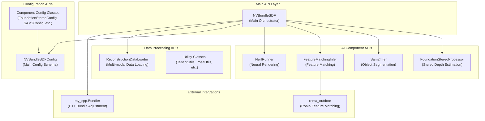
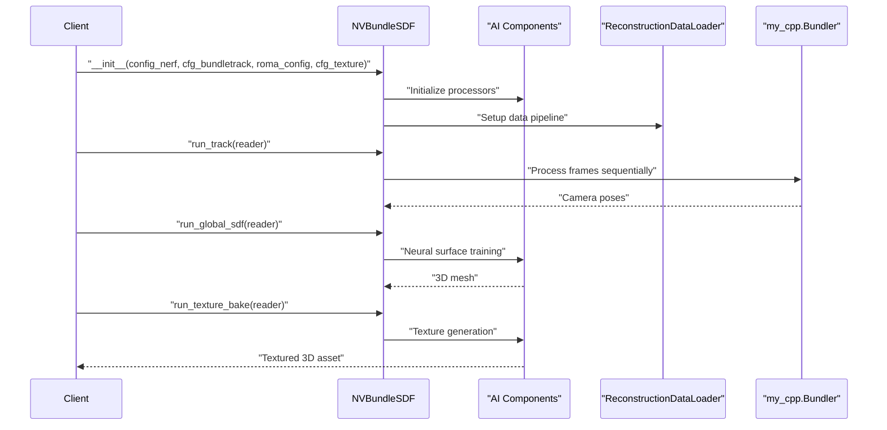
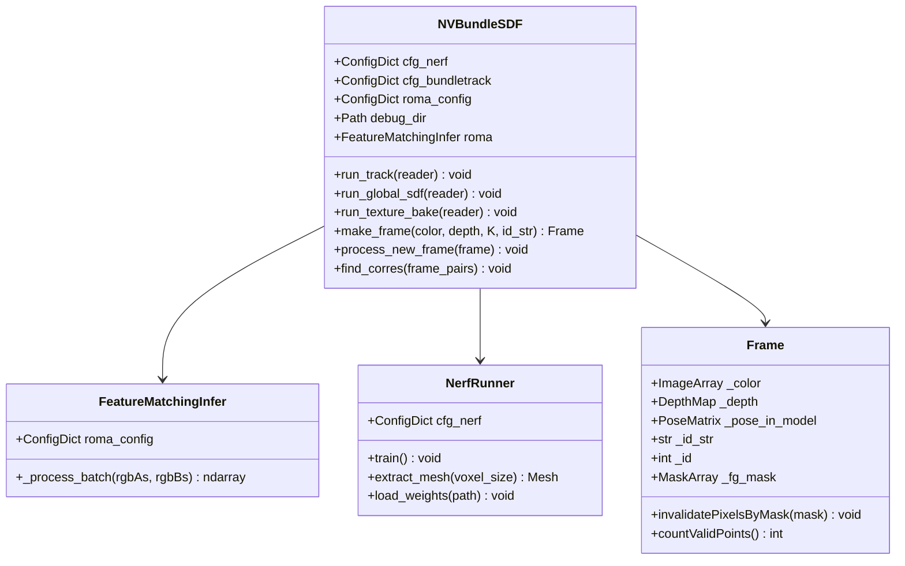
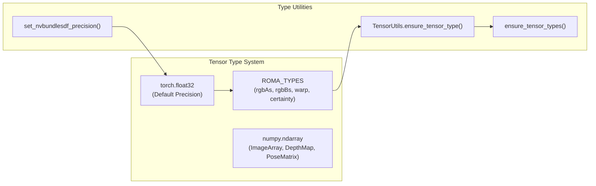
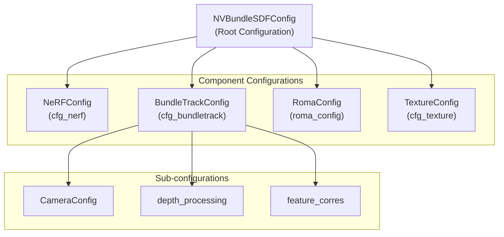
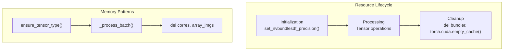

<!-- source: DeepWiki mcp.deepwiki.com · repo NVIDIA/3DObjectReconstruction · page 6 API Reference · fetched 2026-10-26 -->

# API Reference

Relevant source files

The following files were used as context for generating this wiki page:

- [src/README.md](src/README.md)
- [src/nvidia/objectreconstruction/networks/nvbundlesdf.py](src/nvidia/objectreconstruction/networks/nvbundlesdf.py)

This page provides comprehensive technical documentation for the NVIDIA 3D Object Reconstruction API. It covers the core classes, methods, and interfaces available to developers for integrating and extending the reconstruction pipeline.

The API is organized around the main `NVBundleSDF` orchestration framework and its component processors. For detailed configuration management, see [Configuration Management](#5). For getting started with basic usage, see [Getting Started](#2).

## API Architecture Overview

The API follows a modular design with clear separation between orchestration, AI components, and data handling:

**Sources:** [src/nvidia/objectreconstruction/networks/nvbundlesdf.py:1-1067](), [src/README.md:1-135]()

## Core API Entry Points

The primary API provides three main entry points for different use cases:

| Entry Point | Purpose | Primary Method | Configuration |
|-------------|---------|----------------|---------------|
| **Programmatic API** | Direct class instantiation and method calls | `NVBundleSDF.__init__()` | Config objects |
| **Package Import API** | Simplified imports with default configurations | Module-level functions | YAML files |
| **Command Line API** | Batch processing and automation | `nvidia-3d-reconstruct` | CLI arguments |

### Main Workflow API

**Sources:** [src/nvidia/objectreconstruction/networks/nvbundlesdf.py:151-203](), [src/nvidia/objectreconstruction/networks/nvbundlesdf.py:206-284]()

## Class Hierarchy and Type System

The API uses a well-defined type system with specific tensor types and data structures:

**Sources:** [src/nvidia/objectreconstruction/networks/nvbundlesdf.py:63-72](), [src/nvidia/objectreconstruction/networks/nvbundlesdf.py:151-203]()

## Type Definitions and Precision Management

The API enforces specific tensor types for numerical stability:

**Sources:** [src/nvidia/objectreconstruction/networks/nvbundlesdf.py:74-150](), [src/nvidia/objectreconstruction/networks/nvbundlesdf.py:102-108]()

## Method Call Patterns

### Frame Processing Pipeline

The core processing follows a consistent pattern across all frame operations:

| Stage | Method | Input Types | Output Types |
|-------|--------|-------------|--------------|
| **Frame Creation** | `make_frame()` | `ImageArray`, `DepthMap`, `np.ndarray` | `Frame` |
| **Frame Processing** | `process_new_frame()` | `Frame` | `void` (side effects) |
| **Correspondence Finding** | `find_corres()` | `List[FramePair]` | `void` (updates internal state) |
| **Bundle Adjustment** | `bundler.optimizeGPU()` | `List[Frame]` | `void` (updates poses) |

### Configuration Management

Configuration objects follow a hierarchical pattern:

**Sources:** [src/README.md:43-50](), [src/nvidia/objectreconstruction/networks/nvbundlesdf.py:169-203]()

## Error Handling and Status Management

The API uses a consistent error handling pattern with frame status tracking:

| Status | Constant | Meaning | Recovery Action |
|--------|----------|---------|-----------------|
| **SUCCESS** | `Frame.SUCCESS` | Frame processed successfully | Continue pipeline |
| **FAIL** | `Frame.FAIL` | Frame processing failed | `bundler.forgetFrame()` |
| **INSUFFICIENT_POINTS** | Custom validation | Too few valid points | Skip frame |
| **INSUFFICIENT_MATCHES** | Custom validation | Too few correspondences | Try alternative reference |

**Sources:** [src/nvidia/objectreconstruction/networks/nvbundlesdf.py:428-431](), [src/nvidia/objectreconstruction/networks/nvbundlesdf.py:463-467]()

## Memory Management and Resource Cleanup

The API includes explicit memory management for GPU resources:

**Sources:** [src/nvidia/objectreconstruction/networks/nvbundlesdf.py:281-284](), [src/nvidia/objectreconstruction/networks/nvbundlesdf.py:610-611]()

## API Subsections

For detailed documentation of specific API components:

- **[Core Classes](#6.1)** - Complete reference for `NVBundleSDF`, component processors, and utility classes
- **[Data Loaders](#6.2)** - Technical documentation for `ReconstructionDataLoader` and data handling utilities

Each subsection provides comprehensive method signatures, parameter descriptions, return types, and usage examples for the respective API components.

---

