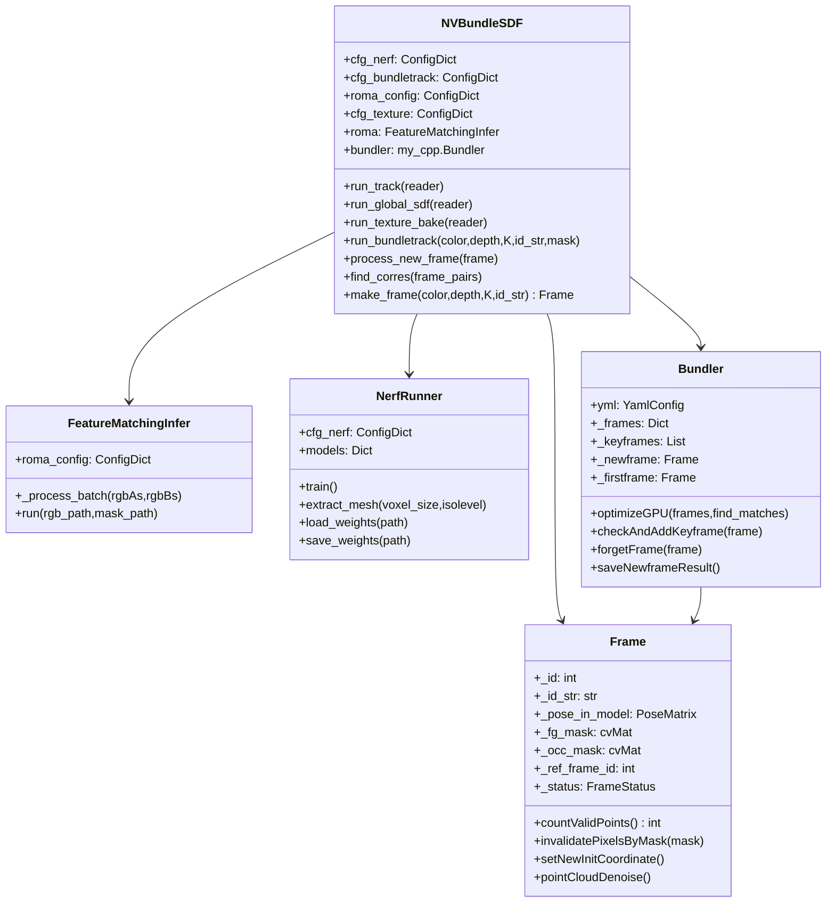
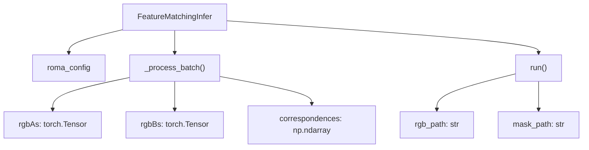
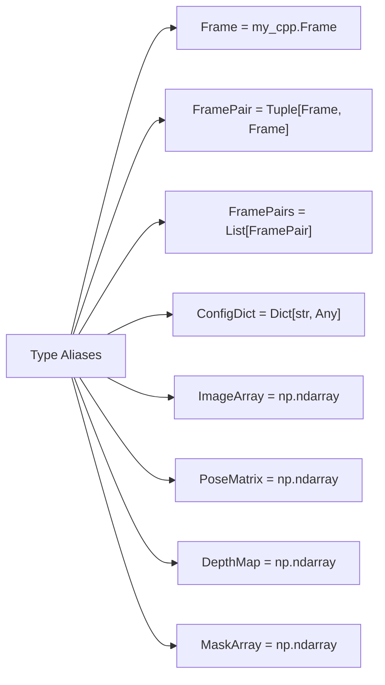
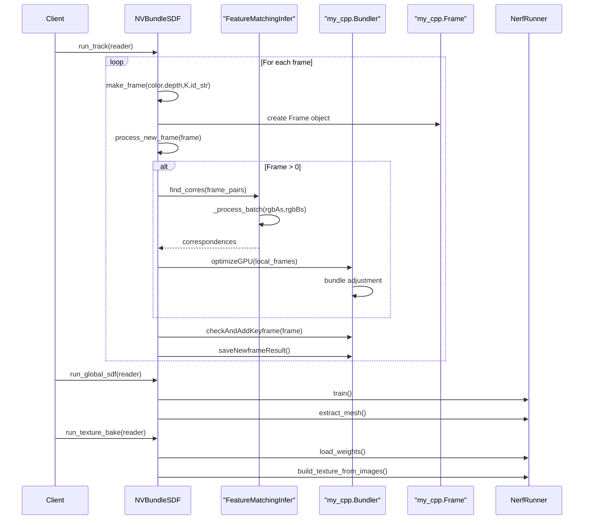

<!-- source: DeepWiki mcp.deepwiki.com · repo NVIDIA/3DObjectReconstruction · page 6.1 Core Classes · fetched 2026-10-26 -->

# Core Classes

Relevant source files

The following files were used as context for generating this wiki page:

- [src/README.md](src/README.md)
- [src/nvidia/objectreconstruction/networks/nvbundlesdf.py](src/nvidia/objectreconstruction/networks/nvbundlesdf.py)

This page documents the primary classes and interfaces that form the public API of the NVIDIA 3D Object Reconstruction framework. These are the main code entities that developers interact with when using the system programmatically.

For configuration schema classes, see [Configuration Schema](#5.1). For data loading utilities, see [Data Loaders](#6.2).

## Class Architecture Overview

The framework is built around a central orchestrator class that coordinates multiple AI processing components:

**Sources:** [src/nvidia/objectreconstruction/networks/nvbundlesdf.py:151-203]()

## NVBundleSDF Class

The `NVBundleSDF` class serves as the main orchestrator for the 3D reconstruction pipeline, coordinating bundle adjustment tracking with neural implicit surface representation.

### Core Attributes

| Attribute | Type | Description |
|-----------|------|-------------|
| `cfg_nerf` | `ConfigDict` | Neural field configuration parameters |
| `cfg_bundletrack` | `ConfigDict` | BundleTrack configuration |
| `roma_config` | `ConfigDict` | RoMa feature matching configuration |
| `cfg_texture` | `ConfigDict` | Texture baking configuration |
| `roma` | `FeatureMatchingInfer` | Feature matcher instance |
| `bundler` | `my_cpp.Bundler` | C++ BundleTrack instance |
| `K` | `np.ndarray` | Camera intrinsics matrix |
| `translation` | `np.ndarray` | Scene normalization translation |
| `sc_factor` | `float` | Scene normalization scale factor |

### Key Methods

#### Initialization
- `__init__(config_nerf, cfg_bundletrack, roma_config, cfg_texture, logger)` - Initialize framework with configurations

#### Pipeline Execution  
- `run_track(reader)` - Execute camera pose tracking on all frames
- `run_global_sdf(reader)` - Train neural implicit surface model
- `run_texture_bake(reader)` - Generate textured 3D mesh

#### Frame Processing
- `run_bundletrack(color, depth, K, id_str, mask, occ_mask, pose_in_model)` - Process single frame through BundleTrack
- `make_frame(color, depth, K, id_str, mask, occ_mask, pose_in_model)` - Create Frame object for processing
- `process_new_frame(frame)` - Core frame processing logic with bundle adjustment

#### Feature Matching
- `find_corres(frame_pairs)` - Find correspondences between frame pairs using RoMa

**Sources:** [src/nvidia/objectreconstruction/networks/nvbundlesdf.py:151-896]()

## Component Classes

### FeatureMatchingInfer

Implements RoMa-based feature matching for finding correspondences between image pairs.

Key methods:
- `_process_batch(rgbAs, rgbBs)` - Process batch of image pairs for matching
- `run(rgb_path, mask_path)` - Run feature matching on image directory

**Sources:** [src/nvidia/objectreconstruction/networks/nvbundlesdf.py:47](), [src/nvidia/objectreconstruction/networks/nvbundlesdf.py:202]()

### NerfRunner  

Handles neural implicit surface training and mesh extraction.

Key capabilities:
- `train()` - Train neural SDF model on keyframes
- `extract_mesh(voxel_size, isolevel)` - Extract triangle mesh from trained SDF
- `load_weights(path)` / `save_weights(path)` - Model persistence

**Sources:** [src/nvidia/objectreconstruction/networks/nvbundlesdf.py:46](), [src/nvidia/objectreconstruction/networks/nvbundlesdf.py:724-732]()

### Frame and Bundler Classes

These classes are provided by the `my_cpp` module and handle the core BundleTrack functionality:

#### Frame Class
Represents a single RGB-D frame with associated metadata:
- `_id` - Frame identifier 
- `_pose_in_model` - 4x4 pose matrix in world coordinates
- `_fg_mask` / `_occ_mask` - Foreground and occlusion masks
- `countValidPoints()` - Count valid depth pixels
- `invalidatePixelsByMask()` - Apply mask to invalidate pixels

#### Bundler Class  
Manages the bundle adjustment optimization:
- `_frames` - Dictionary of all tracked frames
- `_keyframes` - List of selected keyframes
- `optimizeGPU()` - GPU-accelerated bundle adjustment
- `checkAndAddKeyframe()` - Keyframe selection logic

**Sources:** [src/nvidia/objectreconstruction/networks/nvbundlesdf.py:51](), [src/nvidia/objectreconstruction/networks/nvbundlesdf.py:64-66]()

## Type Definitions and Data Structures

The framework defines several type aliases for improved code readability:

### Tensor Type Management

The framework includes utilities for ensuring correct tensor precision:

- `set_nvbundlesdf_precision(use_full_precision)` - Configure PyTorch tensor types
- `ensure_tensor_type(tensor, target_dtype, name)` - Convert tensor to target type
- `ensure_tensor_types(tensors_dict, dtypes_dict)` - Batch tensor type conversion

**Sources:** [src/nvidia/objectreconstruction/networks/nvbundlesdf.py:63-149]()

## Class Interaction Flow

The following diagram shows how the core classes interact during the reconstruction pipeline:

**Sources:** [src/nvidia/objectreconstruction/networks/nvbundlesdf.py:206-283](), [src/nvidia/objectreconstruction/networks/nvbundlesdf.py:638-896]()

---

