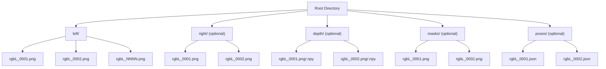
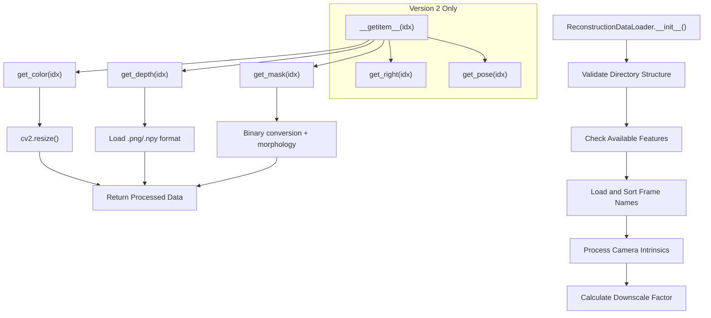
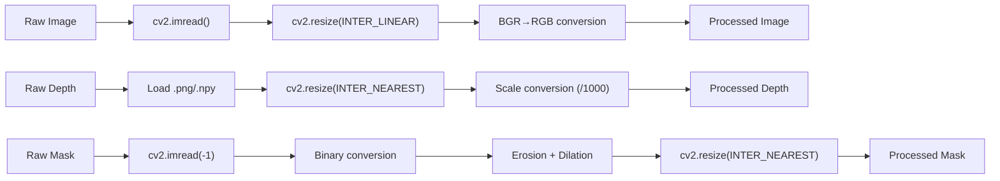
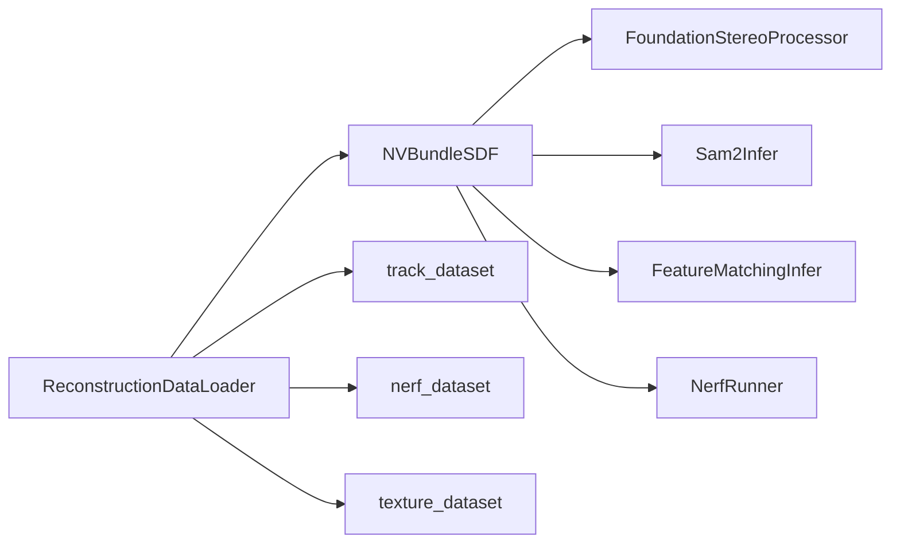

<!-- source: DeepWiki mcp.deepwiki.com · repo NVIDIA/3DObjectReconstruction · page 6.2 Data Loaders · fetched 2026-10-26 -->

# Data Loaders

<details>
<summary>Relevant source files</summary>

The following files were used as context for generating this wiki page:

- [src/nvidia/objectreconstruction/dataloader/reconstruction_dataloader.py](src/nvidia/objectreconstruction/dataloader/reconstruction_dataloader.py)

</details>


This section documents the data loading subsystem for the NVIDIA 3D Object Reconstruction pipeline. The data loaders handle multi-modal input processing including RGB images, depth maps, segmentation masks, and camera poses required for 3D reconstruction. For information about the overall system architecture, see [System Architecture](#4). For configuration of data loading parameters, see [Configuration Management](#5).

## Overview

The data loading system centers around the `ReconstructionDataLoader` class, which manages loading and preprocessing of multi-view data for Bundle-SDF reconstruction. This component serves as the primary interface between raw input data and the AI processing pipeline, handling format conversions, scaling, and validation.

### Data Directory Structure

The system expects a specific directory structure for input data:



Sources: [src/nvidia/objectreconstruction/dataloader/reconstruction_dataloader.py:52-67]()

## ReconstructionDataLoader Class

The `ReconstructionDataLoader` class provides the core data loading functionality with support for multiple data modalities and processing modes.

### Initialization and Configuration

The dataloader initializes with configuration parameters including camera intrinsics, downscale factors, and version selection:

| Parameter | Type | Description |
|-----------|------|-------------|
| `image_dir` | str | Root directory containing data subdirectories |
| `config` | dict | Configuration with camera parameters and processing settings |
| `downscale` | float | Scale factor for image resizing (default: 1.0) |
| `version` | int | Implementation version (1 or 2) |
| `min_resolution` | int | Minimum image resolution threshold |

The configuration must include camera intrinsics in the format:
```python
config = {
    'camera_config': {
        'intrinsic': [fx, 0, cx, 0, fy, cy, 0, 0, 1],  # 3x3 matrix flattened
        'step': time_step_value
    },
    'nerf': {
        'far': far_plane_distance
    }
}
```

Sources: [src/nvidia/objectreconstruction/dataloader/reconstruction_dataloader.py:33-49]()

### Data Loading Workflow

The data loading process follows a structured workflow for multi-modal data:



Sources: [src/nvidia/objectreconstruction/dataloader/reconstruction_dataloader.py:306-346]()

### Version Differences

The dataloader supports two implementation versions with different return formats:

#### Version 1 (Legacy)
Returns: `(color, depth, mask)`
- `color`: RGB image as `np.uint8` with shape `(H, W, 3)`
- `depth`: Depth map as `np.float32` with shape `(H, W)` or `None`
- `mask`: Binary mask as `np.uint8` with shape `(H, W)` or `None`

#### Version 2 (Enhanced)
Returns: `(left, right, depth, mask, pose, id_str)`
- `left`: Left RGB image as `np.uint8` with shape `(H, W, 3)`
- `right`: Right RGB image as `np.uint8` with shape `(H, W, 3)` or `None`
- `depth`: Depth map as `np.float32` with shape `(H, W)` or `None`
- `mask`: Binary mask as `np.uint8` with shape `(H, W)` or `None`
- `pose`: Camera pose matrix as `np.ndarray` or `None`
- `id_str`: Frame identifier string

Sources: [src/nvidia/objectreconstruction/dataloader/reconstruction_dataloader.py:314-346]()

## Data Processing Capabilities

### Image Preprocessing

The dataloader applies several preprocessing steps to ensure data consistency:



Sources: [src/nvidia/objectreconstruction/dataloader/reconstruction_dataloader.py:144-145](), [src/nvidia/objectreconstruction/dataloader/reconstruction_dataloader.py:221-222](), [src/nvidia/objectreconstruction/dataloader/reconstruction_dataloader.py:262-264]()

### Automatic Resolution Scaling

The system implements intelligent downscaling based on minimum resolution requirements:

1. **Minimum Resolution Check**: Ensures images meet minimum resolution threshold
2. **Automatic Scaling**: Calculates appropriate downscale factor if needed
3. **Intrinsics Adjustment**: Scales camera intrinsics to match image resolution

Sources: [src/nvidia/objectreconstruction/dataloader/reconstruction_dataloader.py:105-114]()

### Mask Processing

Segmentation masks undergo specialized processing for improved quality:

1. **Format Normalization**: Converts multi-channel masks to binary format
2. **Morphological Operations**: 
   - Erosion with 5x5 kernel to remove noise
   - Dilation with 5x5 kernel to restore object boundaries
3. **Nearest-Neighbor Resizing**: Preserves mask boundaries during scaling

Sources: [src/nvidia/objectreconstruction/dataloader/reconstruction_dataloader.py:263-264]()

## API Reference

### Core Methods

#### `__getitem__(idx)`
Primary data access method that returns preprocessed data for a given frame index.

**Parameters:**
- `idx` (int): Frame index to retrieve

**Returns:**
- Version 1: `(color, depth, mask)`
- Version 2: `(left, right, depth, mask, pose, id_str)`

#### `get_camera_intrinsics()`
Returns the camera intrinsics matrix adjusted for the current downscale factor.

**Returns:**
- `np.ndarray`: 3x3 camera intrinsics matrix

#### `get_image_dimensions()`
Returns current image dimensions after downscaling.

**Returns:**
- `Tuple[int, int]`: (height, width) of processed images

### Individual Data Access Methods

| Method | Purpose | Returns |
|--------|---------|---------|
| `get_color(idx)` | Load RGB image | `np.ndarray` (H, W, 3) |
| `get_right(idx)` | Load right stereo image | `np.ndarray` or `None` |
| `get_depth(idx)` | Load depth map | `np.ndarray` or `None` |
| `get_mask(idx)` | Load segmentation mask | `np.ndarray` or `None` |
| `get_pose(idx)` | Load camera pose | `np.ndarray` or `None` |
| `get_frame_id(idx)` | Get frame identifier | `str` |

### Integration with Pipeline

The `ReconstructionDataLoader` integrates with the broader reconstruction pipeline through the NVBundleSDF framework:



Sources: [src/nvidia/objectreconstruction/dataloader/reconstruction_dataloader.py:1-382]()

## Error Handling and Validation

The dataloader implements comprehensive error handling and validation:

- **Directory Validation**: Checks for required directory structure
- **File Format Support**: Handles multiple image and depth formats
- **Graceful Degradation**: Returns `None` for missing optional data
- **Index Bounds Checking**: Validates frame indices before access
- **Format Conversion**: Handles various depth map formats (.png, .npy)

Sources: [src/nvidia/objectreconstruction/dataloader/reconstruction_dataloader.py:34-36](), [src/nvidia/objectreconstruction/dataloader/reconstruction_dataloader.py:135-137](), [src/nvidia/objectreconstruction/dataloader/reconstruction_dataloader.py:208-225]()

---

