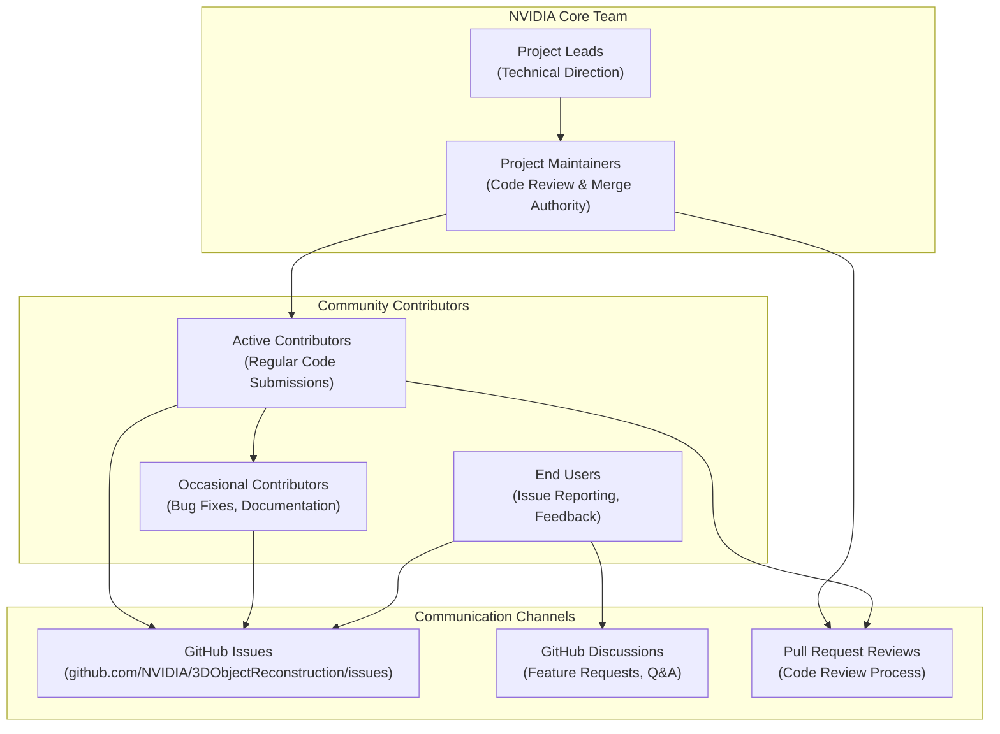
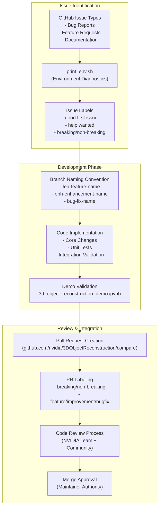
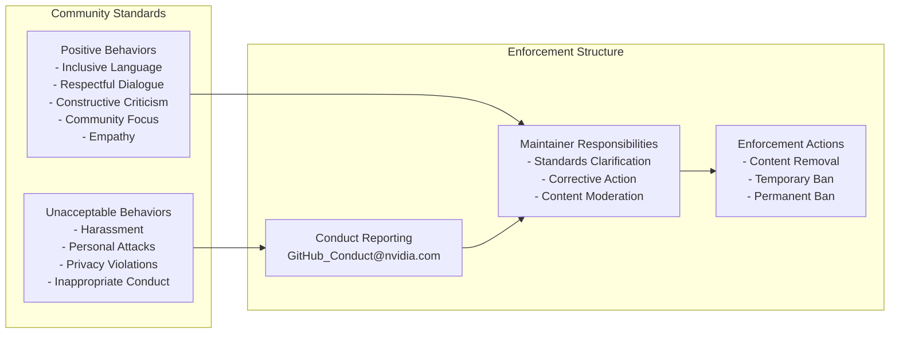

<!-- source: DeepWiki mcp.deepwiki.com · repo NVIDIA/3DObjectReconstruction · page 7 Development & Community · fetched 2026-10-26 -->

# Development & Community

<details>
<summary>Relevant source files</summary>

The following files were used as context for generating this wiki page:

- [CODE_OF_CONDUCT.md](CODE_OF_CONDUCT.md)
- [CONTRIBUTING.md](CONTRIBUTING.md)
- [SECURITY.md](SECURITY.md)

</details>


This document provides an overview of the development process, community governance, and contribution pathways for the NVIDIA 3D Object Reconstruction project. It covers the organizational structure, communication channels, and policies that guide community participation.

For detailed contribution procedures, see [Contributing Guidelines](#7.1). For bug reporting and support, see [Issue Templates & Support](#7.2). For security policies and licensing information, see [Security & Licensing](#7.3).

## Project Governance

The NVIDIA 3D Object Reconstruction project follows an open-source development model with NVIDIA maintaining primary stewardship. The project welcomes community contributions while maintaining quality standards and technical direction alignment with NVIDIA's research objectives.

### Community Structure



**Sources:** [CODE_OF_CONDUCT.md:42-53](), [CONTRIBUTING.md:1-22]()

## Development Workflow

The project follows a structured development process that integrates with the existing codebase architecture and deployment systems.

### Contribution Process Flow



**Sources:** [CONTRIBUTING.md:6-35](), [CONTRIBUTING.md:39-59]()

## Code Quality Standards

The project maintains specific standards for code contributions that align with the existing architecture and AI pipeline components.

### Technical Requirements

| Requirement Category | Standards | Validation Method |
|---------------------|-----------|-------------------|
| **Code Integration** | Must integrate with `NVBundleSDF` framework | Unit tests + integration validation |
| **Demo Compatibility** | Must work with default inference example | Manual testing with demo notebook |
| **Documentation** | All public APIs must be documented | Code review verification |
| **Testing** | Unit tests for new functionality | Automated test execution |
| **Configuration** | Follow existing schema patterns in `src/nvidia/objectreconstruction/configs/` | Schema validation |

### Breaking Change Policy

The project categorizes changes as "breaking" or "non-breaking" using GitHub labels. Breaking changes are those that modify the codebase in a non-backward-compatible way, particularly affecting:

- Public API interfaces in `NVBundleSDF` class
- Configuration schema changes in `schema.py`
- Changes to data loader interfaces in `ReconstructionDataLoader`
- Modifications to the main pipeline workflow

**Sources:** [CONTRIBUTING.md:41-46]()

## Community Standards

The project operates under the Contributor Covenant Code of Conduct, establishing standards for inclusive and professional community interaction.

### Code of Conduct Framework



**Sources:** [CODE_OF_CONDUCT.md:11-40](), [CODE_OF_CONDUCT.md:64-71]()

## Security and Vulnerability Reporting

The project maintains a comprehensive security policy for reporting vulnerabilities and security concerns.

### Security Reporting Process

Security vulnerabilities should **never** be reported through GitHub issues. Instead, use designated NVIDIA security channels:

| Contact Method | Details | Use Case |
|----------------|---------|----------|
| **Web Form** | [NVIDIA Security Vulnerability Submission](https://www.nvidia.com/object/submit-security-vulnerability.html) | Standard vulnerability reporting |
| **Email** | `psirt@nvidia.com` | Direct security team contact |
| **PGP Encrypted Email** | Use [NVIDIA PGP Key](https://www.nvidia.com/en-us/security/pgp-key) | Sensitive vulnerability details |

### Required Vulnerability Information

When reporting security issues, include:
- Product/Driver name and version/branch containing vulnerability
- Vulnerability type (code execution, denial of service, buffer overflow, etc.)
- Reproduction instructions
- Proof-of-concept or exploit code
- Potential impact assessment

**Sources:** [SECURITY.md:5-19]()

## Support Channels

The project provides multiple channels for community support and engagement:

### Primary Support Matrix

| Channel Type | Platform | Purpose | Response Time |
|-------------|----------|---------|---------------|
| **Bug Reports** | GitHub Issues | Technical issues, bugs | Community + maintainer triage |
| **Feature Requests** | GitHub Issues | New functionality proposals | Design discussion required |
| **Documentation Issues** | GitHub Issues | Docs improvements, clarifications | Community contributions welcome |
| **General Questions** | GitHub Discussions | Usage questions, troubleshooting | Community-driven responses |
| **Security Issues** | `psirt@nvidia.com` | Vulnerability reporting | Coordinated disclosure process |
| **Conduct Issues** | `GitHub_Conduct@nvidia.com` | Code of conduct violations | Confidential investigation |

### Environment Diagnostics

For bug reports, contributors should run the environment diagnostic script to gather relevant system information:

```bash
./3DObjectReconstruction/print_env.sh
```

This script captures system configuration details that help maintainers reproduce and diagnose issues effectively.

**Sources:** [CONTRIBUTING.md:6-12](), [SECURITY.md:1-24](), [CODE_OF_CONDUCT.md:64-71]()

---

