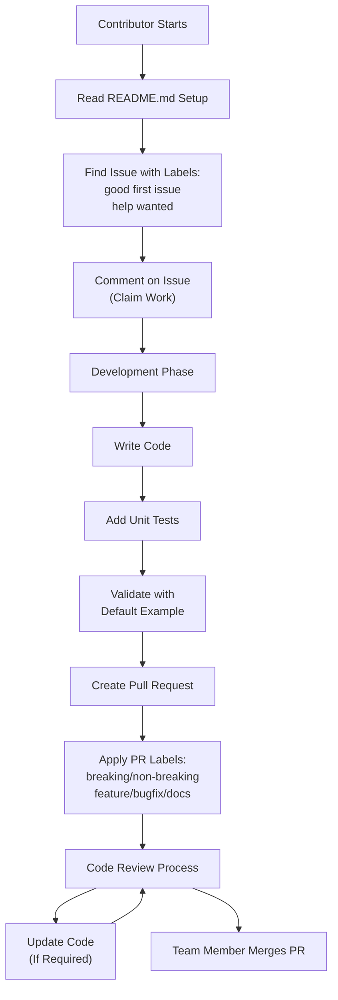
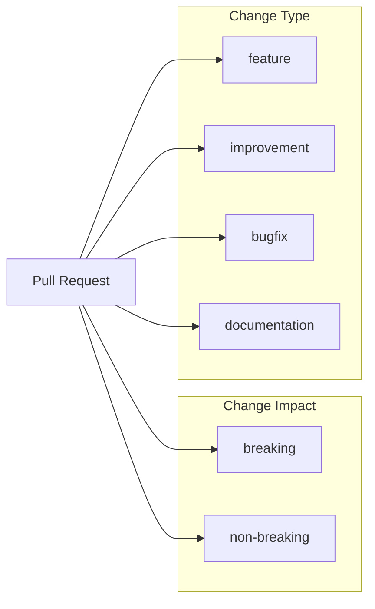
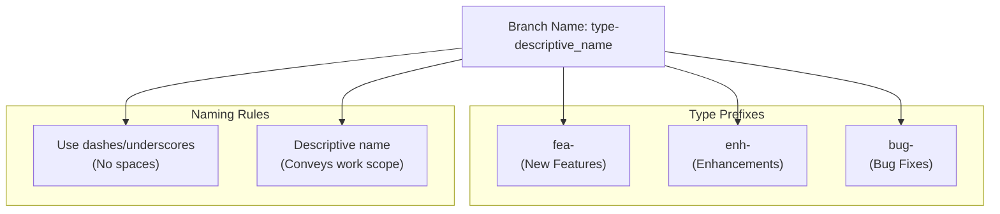

<!-- source: DeepWiki mcp.deepwiki.com · repo NVIDIA/3DObjectReconstruction · page 7.1 Contributing Guidelines · fetched 2026-10-26 -->

# Contributing Guidelines

Relevant source files

The following files were used as context for generating this wiki page:

- [.github/PULL_REQUEST_TEMPLATE.md](.github/PULL_REQUEST_TEMPLATE.md)
- [CONTRIBUTING.md](CONTRIBUTING.md)

This document outlines the standards, processes, and workflows for contributing code, documentation, and bug reports to the NVIDIA 3D Object Reconstruction project. It covers contribution categories, development workflows, and quality standards required for pull request acceptance.

For information about reporting security vulnerabilities, see [Security & Licensing](#7.3). For guidance on bug reporting and getting help, see [Issue Templates & Support](#7.2).

## Contribution Categories

The 3D Object Reconstruction project accepts three primary types of contributions, each following distinct processes and requirements.

### Bug Reports and Feature Requests

Contributors reporting issues or requesting features must file issues through the GitHub issue system. The process requires running the environment diagnostic script to gather system information.

| Contribution Type | Required Actions | Tools |
|-------------------|------------------|-------|
| Bug Report | File issue + Run `print_env.sh` | GitHub Issues |
| Feature Request | File issue + Describe use case | GitHub Issues |
| Documentation Issue | File issue + Specify location | GitHub Issues |

The project team evaluates and triages all issues, scheduling them for releases based on priority and impact.

### Feature Implementation

New feature contributions require pre-implementation discussion and design approval. Contributors must propose the feature design before beginning implementation work.

### Bug Fix Implementation

Contributors can implement fixes for existing issues by following the standard code contribution workflow outlined below.

**Sources:** [CONTRIBUTING.md:1-22]()

## Code Contribution Workflow

The following diagram illustrates the complete contribution process from issue selection to merge approval.

**Development Contribution Process**

The workflow emphasizes validation using the default retail item example, ensuring all changes maintain compatibility with the core reconstruction pipeline.

**Sources:** [CONTRIBUTING.md:25-37]()

## Development Standards

### Testing Requirements

All code contributions must include comprehensive testing coverage using the default retail item example. This ensures changes integrate properly with the core reconstruction pipeline components including `NVBundleSDF`, `FoundationStereoProcessor`, `Sam2Infer`, and other pipeline components.

### Validation Process

Contributors must validate their changes against the complete reconstruction workflow:

1. **Unit Tests** - Test individual components and functions
2. **Integration Tests** - Validate with default example dataset
3. **Pipeline Tests** - Ensure end-to-end reconstruction works

The validation process uses the sample data and configuration files provided in the repository to test the complete flow from stereo input through textured 3D asset generation.

**Sources:** [CONTRIBUTING.md:32]()

## Pull Request Management

### PR Labeling System

Every pull request requires proper categorization using GitHub labels to indicate the nature and impact of changes.

**Pull Request Label Classification**

### Breaking Change Definition

For the 3D Object Reconstruction project, breaking changes are modifications that affect backward compatibility in:

- API interfaces for core classes like `NVBundleSDF`
- Configuration schema changes in `src/nvidia/objectreconstruction/configs/schema.py`
- Data loader interfaces in `ReconstructionDataLoader`
- CLI interface changes affecting `nvidia-3d-reconstruct` command

### Pull Request Template

The project uses a standardized pull request template that requires:

- Standalone description of changes
- Issue references using "closes #1234" syntax
- Checklist confirmation for contributing guidelines familiarity
- Test coverage verification
- Documentation update confirmation

**Sources:** [CONTRIBUTING.md:39-46](), [.github/PULL_REQUEST_TEMPLATE.md:1-10]()

## Branch Management

### Branch Naming Conventions

All development branches must follow the structured naming pattern `<type>-<name>` to facilitate organization and automated processing.

**Branch Naming Schema**

### Branch Type Classifications

| Type | Usage | Example |
|------|-------|---------|
| `fea` | New features or capabilities | `fea-texture-quality-improvements` |
| `enh` | Enhancements to existing features | `enh-sam2-inference-speed` |
| `bug` | Bug fixes and regressions | `bug-depth-estimation-nan-handling` |

The naming convention facilitates automated tooling and provides clear context for reviewers and maintainers.

**Sources:** [CONTRIBUTING.md:48-59]()

## Environment and Support

### Environment Diagnostics

Contributors reporting bugs must include environment information gathered using the `print_env.sh` script located in the project root. This script collects system details including:

- GPU configuration and CUDA versions
- Python environment and package versions  
- Docker container status
- System hardware specifications

The diagnostic information helps maintainers reproduce issues and provide targeted support.

### Community Support

The project team provides support through GitHub issues and evaluates feature requests for inclusion in future releases. Contributors uncertain about implementation approaches should comment on issues to request clarification and guidance.

**Sources:** [CONTRIBUTING.md:8-12](), [CONTRIBUTING.md:37]()

---

