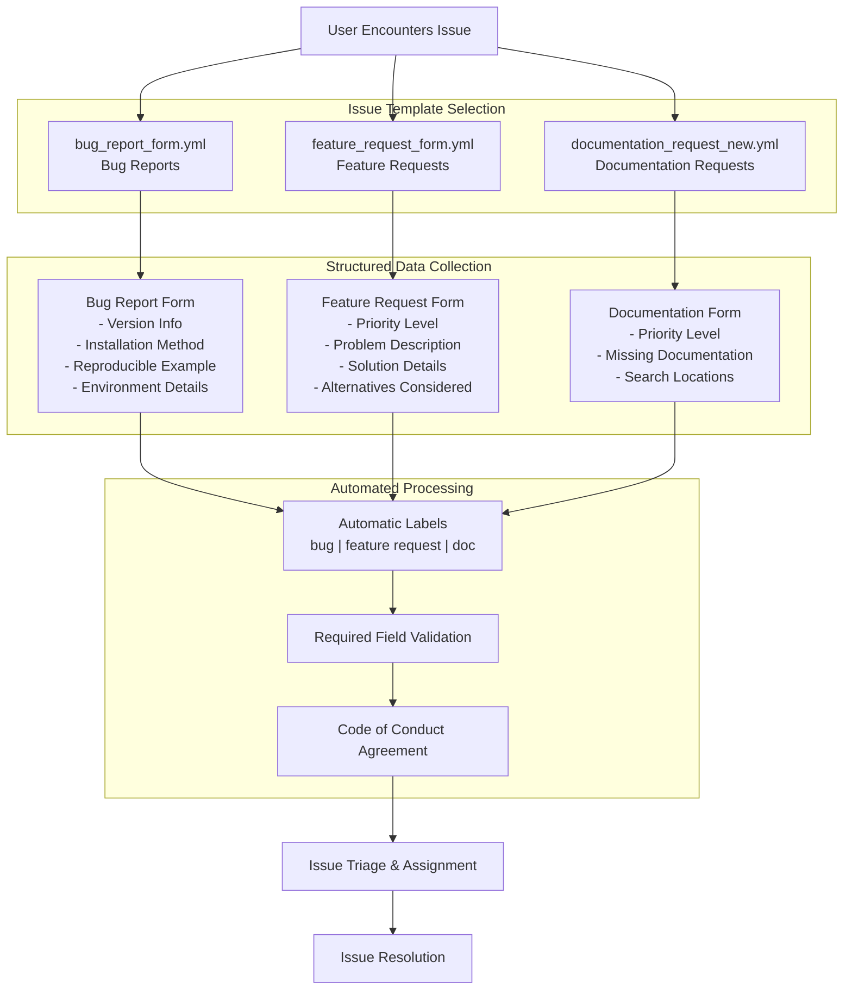
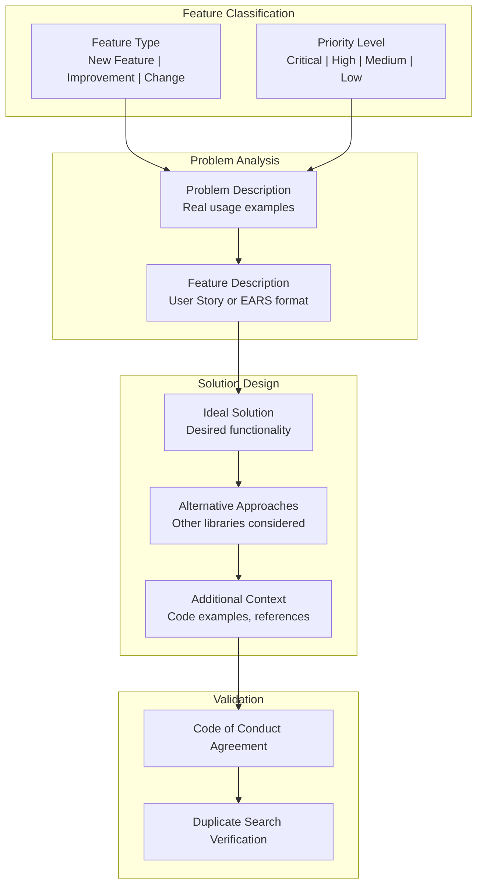
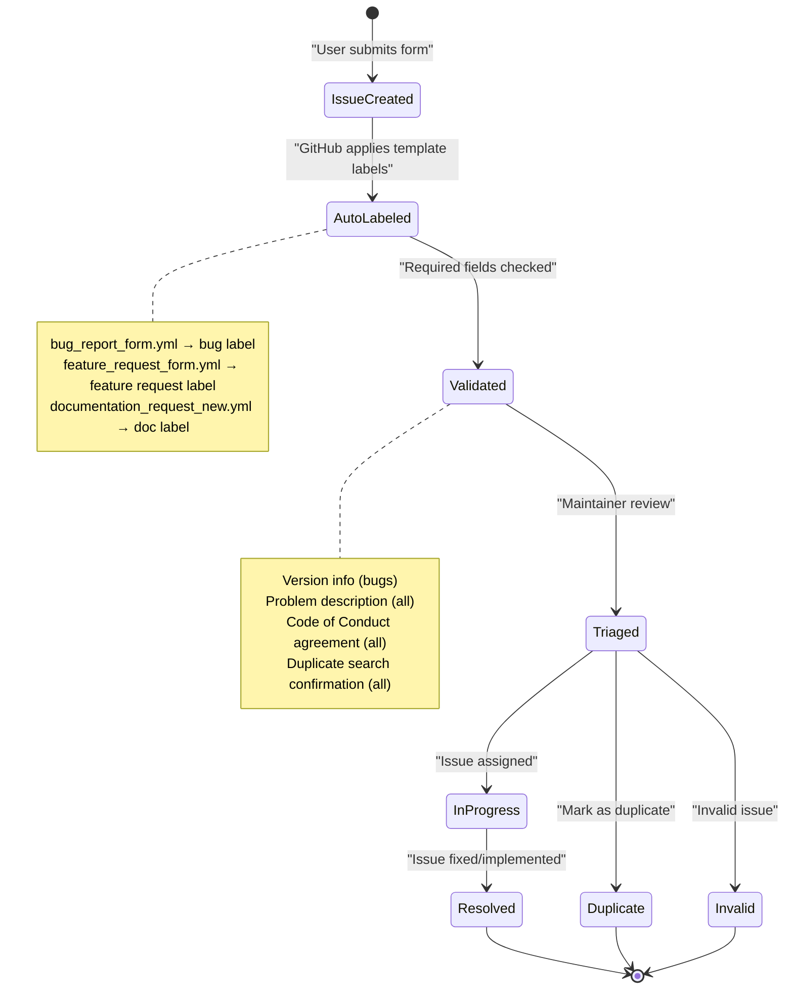

<!-- source: DeepWiki mcp.deepwiki.com · repo NVIDIA/3DObjectReconstruction · page 7.2 Issue Templates & Support · fetched 2026-10-26 -->

# Issue Templates & Support

Relevant source files

The following files were used as context for generating this wiki page:

- [.github/ISSUE_TEMPLATE/bug_report_form.yml](.github/ISSUE_TEMPLATE/bug_report_form.yml)
- [.github/ISSUE_TEMPLATE/documentation_request_new.yml](.github/ISSUE_TEMPLATE/documentation_request_new.yml)
- [.github/ISSUE_TEMPLATE/feature_request_form.yml](.github/ISSUE_TEMPLATE/feature_request_form.yml)

This document covers the structured issue reporting system and support channels for the NVIDIA 3D Object Reconstruction project. It explains how to effectively report bugs, request features, and get help using the GitHub issue templates.

For information about contributing code changes, see [Contributing Guidelines](#7.1). For security-related reporting, see [Security & Licensing](#7.3).

## Issue Reporting System Overview

The project uses GitHub issue forms to standardize how users report problems and request improvements. The system provides three specialized templates that collect relevant information for different types of issues.

**Sources:** [.github/ISSUE_TEMPLATE/bug_report_form.yml:1-99](), [.github/ISSUE_TEMPLATE/feature_request_form.yml:1-110](), [.github/ISSUE_TEMPLATE/documentation_request_new.yml:1-64]()

## Bug Reporting Process

### Bug Report Template Structure

The bug report form ([.github/ISSUE_TEMPLATE/bug_report_form.yml]()) collects comprehensive information needed for effective debugging:

| Field | Type | Purpose | Required |
|-------|------|---------|----------|
| Version | Input | Version of 3D Object Reconstruction | Yes |
| Installation Method | Dropdown | Docker, Conda, Pip, Source | No |
| Bug Description | Textarea | Problem details and expected behavior | Yes |
| Minimum Reproducible Example | Textarea | Code example to reproduce the issue | No |
| Relevant Log Output | Textarea | Error messages and logs | No |
| Full Environment Printout | Textarea | Output from `print_env.sh` | No |
| Dataset | Textarea | Public dataset link for reproduction | No |
| Code of Conduct Agreement | Checkbox | Acceptance and duplicate search | Yes |

### Environment Diagnostics

Bug reports should include environment information collected using the `print_env.sh` script. This helps diagnose installation-specific issues across different deployment methods:

- **Docker**: Container configuration and GPU access
- **Conda**: Package versions and environment conflicts  
- **Pip**: Python environment and dependency versions
- **Source**: Build configuration and system libraries

**Sources:** [.github/ISSUE_TEMPLATE/bug_report_form.yml:28-34](), [.github/ISSUE_TEMPLATE/bug_report_form.yml:36-46](), [.github/ISSUE_TEMPLATE/bug_report_form.yml:70-76]()

## Feature Request Process

### Feature Request Template Structure

The feature request form ([.github/ISSUE_TEMPLATE/feature_request_form.yml]()) uses structured format for feature planning:

### Feature Description Formats

The template encourages structured feature descriptions using established formats:

**User Story Format:**
- As a `<persona>`, I `<want to>`, `<so that>`

**EARS Format (for system requirements):**
- `<Pre-Condition>` `<System>` shall `<process>` `<object to be process>` `<condition>`

**Sources:** [.github/ISSUE_TEMPLATE/feature_request_form.yml:58-72](), [.github/ISSUE_TEMPLATE/feature_request_form.yml:27-48]()

## Documentation Request Process

### Documentation Template Structure

The documentation request form ([.github/ISSUE_TEMPLATE/documentation_request_new.yml]()) focuses on identifying documentation gaps:

| Field | Purpose | Options |
|-------|---------|---------|
| Priority | Impact assessment | Critical, High, Medium, Low |
| Missing Documentation | Description of needed content | Free text |
| Search Locations | Where user looked for information | URLs and locations |
| Code of Conduct | Agreement and duplicate check | Required checkboxes |

### Documentation Priority Levels

- **Critical**: Currently preventing usage of the system
- **High**: Significantly impacting user experience
- **Medium**: Moderate improvement to documentation
- **Low**: Nice-to-have enhancement

**Sources:** [.github/ISSUE_TEMPLATE/documentation_request_new.yml:27-37](), [.github/ISSUE_TEMPLATE/documentation_request_new.yml:39-53]()

## Support Workflow Integration

The issue templates integrate with the project's support workflow through automated labeling and validation:

## Code of Conduct Requirements

All issue templates include mandatory Code of Conduct requirements:

1. **Agreement**: Users must agree to follow the project's Code of Conduct
2. **Duplicate Search**: Users must confirm they searched for existing issues
3. **Specific Search Links**: Templates provide direct links to filtered issue searches

The duplicate search requirements link to specific GitHub queries:
- Bug reports: `is:open is:issue label:bug`
- Feature requests: `is:open is:issue label:"feature request",improvement,enhancement`  
- Documentation: `is:open is:issue label:doc`

**Sources:** [.github/ISSUE_TEMPLATE/bug_report_form.yml:89-99](), [.github/ISSUE_TEMPLATE/feature_request_form.yml:100-110](), [.github/ISSUE_TEMPLATE/documentation_request_new.yml:54-64]()

## Getting Help

### Primary Support Channels

1. **GitHub Issues**: Use appropriate issue templates for structured reporting
2. **Code of Conduct**: All interactions must follow the project guidelines
3. **Community Search**: Check existing issues before creating new ones

### Before Creating an Issue

1. **Search existing issues** using the provided filtered search links
2. **Gather environment information** using `print_env.sh` for bug reports
3. **Prepare reproducible examples** with minimal code samples
4. **Review documentation** and verify the issue isn't already covered

### Issue Template Selection Guide

- **Use Bug Report** for: Runtime errors, unexpected behavior, installation problems
- **Use Feature Request** for: New functionality, improvements, API changes
- **Use Documentation Request** for: Missing docs, unclear explanations, examples needed

**Sources:** [.github/ISSUE_TEMPLATE/bug_report_form.yml:92-98](), [.github/ISSUE_TEMPLATE/feature_request_form.yml:104-109](), [.github/ISSUE_TEMPLATE/documentation_request_new.yml:58-63]()

---

