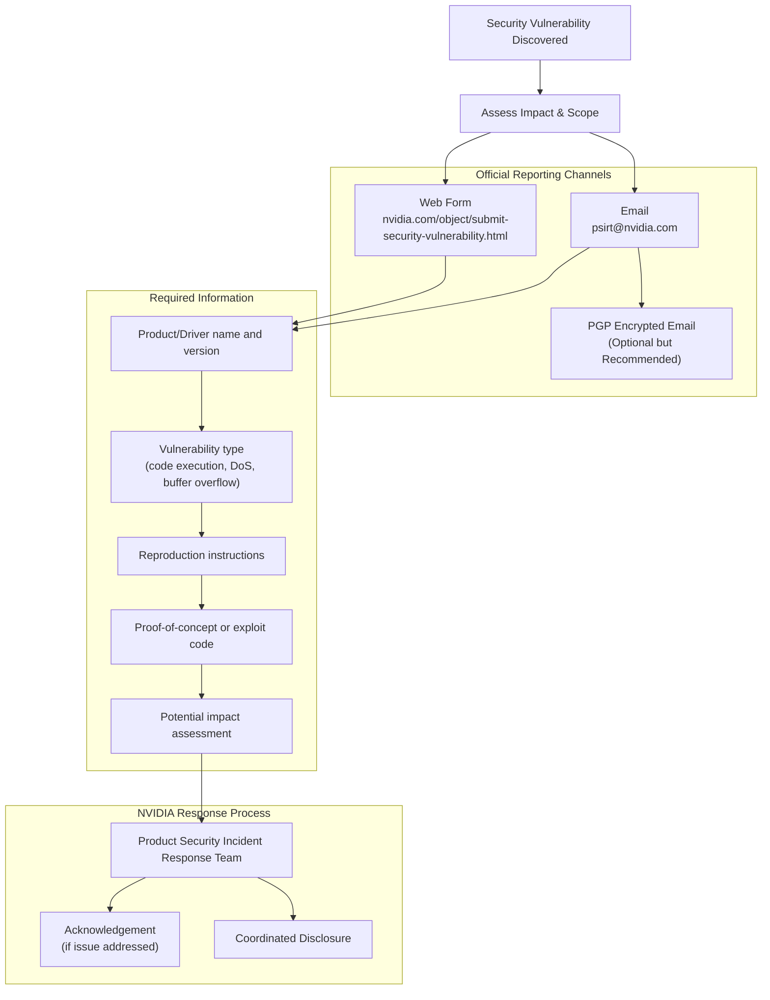
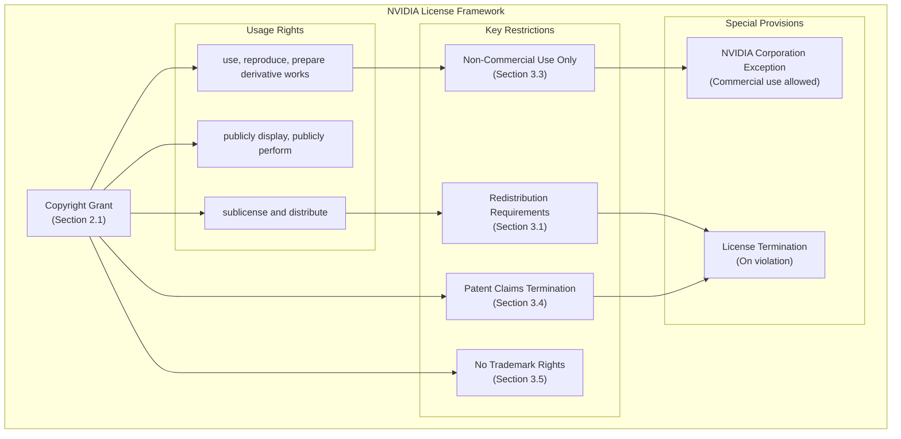
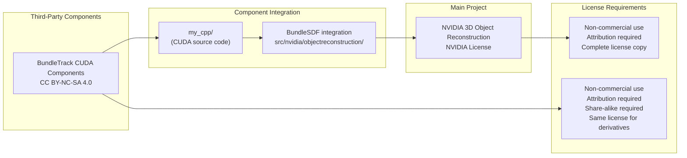
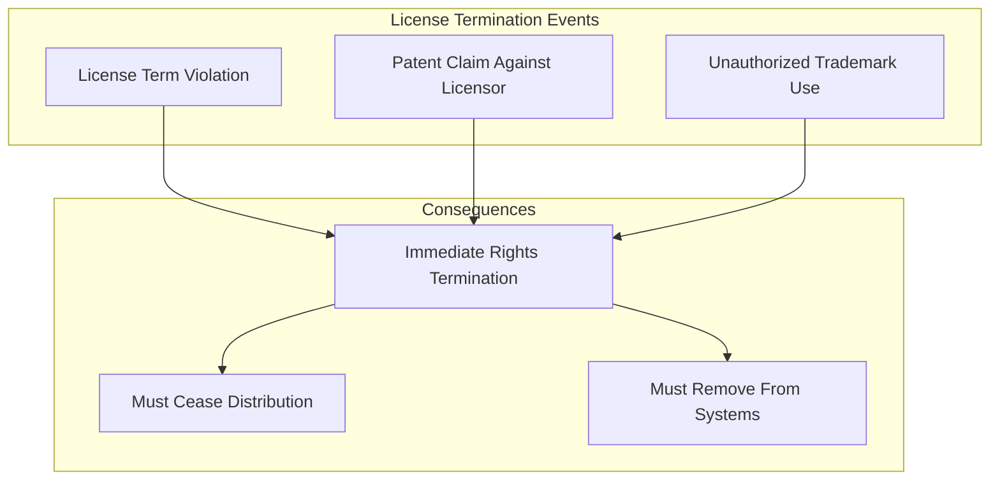

<!-- source: DeepWiki mcp.deepwiki.com · repo NVIDIA/3DObjectReconstruction · page 7.3 Security & Licensing · fetched 2026-10-26 -->

# Security & Licensing

Relevant source files

The following files were used as context for generating this wiki page:

- [LICENSE](LICENSE)
- [SECURITY.md](SECURITY.md)

This document covers security vulnerability reporting procedures, licensing terms, and legal compliance requirements for the NVIDIA 3D Object Reconstruction repository. It provides essential information for users, contributors, and organizations deploying this software.

For general contributing guidelines, see [Contributing Guidelines](#7.1). For issue reporting and support processes, see [Issue Templates & Support](#7.2).

## Security Vulnerability Reporting

NVIDIA maintains a coordinated vulnerability disclosure policy for security issues. **Security vulnerabilities must not be reported through GitHub issues or pull requests.**

### Reporting Workflow

### Contact Information

| Method | Details |
|--------|---------|
| **Web Form** | [Security Vulnerability Submission Form](https://www.nvidia.com/object/submit-security-vulnerability.html) |
| **Email** | `psirt@nvidia.com` |
| **PGP Key** | [NVIDIA public PGP Key](https://www.nvidia.com/en-us/security/pgp-key) |
| **Security Portal** | https://www.nvidia.com/en-us/security |

**Sources:** [SECURITY.md:1-25]()

## Primary License Terms

The main project operates under the **NVIDIA License** with specific restrictions and requirements.

### License Structure

### Key License Restrictions

| Restriction | Description | Reference |
|-------------|-------------|-----------|
| **Non-Commercial Use** | Research or evaluation purposes only | [LICENSE:23]() |
| **NVIDIA Exception** | NVIDIA Corporation and affiliates may use commercially | [LICENSE:23]() |
| **Complete License Copy** | Must include full license with distributions | [LICENSE:19]() |
| **Attribution Notices** | Retain copyright, patent, trademark notices | [LICENSE:19]() |
| **Patent Claims** | License terminates if patent claims are brought | [LICENSE:25]() |
| **No Trademark Rights** | Cannot use NVIDIA names, logos, trademarks | [LICENSE:27]() |

**Sources:** [LICENSE:1-38]()

## Third-Party Component Licenses

The project incorporates third-party components with additional licensing requirements that must be observed.

### Component License Mapping

### BundleTrack CUDA Components License

The BundleTrack CUDA components are licensed under **Creative Commons Attribution-NonCommercial-ShareAlike 4.0 International (CC BY-NC-SA 4.0)**.

| Requirement | Description |
|-------------|-------------|
| **Attribution** | Must provide appropriate attribution to NVIDIA Corporation |
| **Non-Commercial** | Cannot be used for commercial purposes |
| **Share-Alike** | Derivative works must use the same license |
| **Source Reference** | https://github.com/NVlabs/BundleSDF/tree/master/BundleTrack/src/cuda |

**Important:** The CC BY-NC-SA 4.0 non-commercial restriction applies to any derivative works of the BundleTrack CUDA components. Users must ensure compliance with both the main project license and this third-party license.

**Sources:** [LICENSE:40-62]()

## Legal Compliance Requirements

### Distribution Compliance Checklist

When redistributing or creating derivative works:

- [ ] Include complete copy of NVIDIA License
- [ ] Include complete copy of CC BY-NC-SA 4.0 license for BundleTrack components
- [ ] Retain all copyright, patent, trademark notices
- [ ] Ensure non-commercial use only
- [ ] Provide appropriate attribution to NVIDIA Corporation
- [ ] Apply CC BY-NC-SA 4.0 to derivatives of CUDA components

### Warranty and Liability Disclaimers

| Aspect | Terms |
|--------|-------|
| **Warranty** | PROVIDED "AS IS" WITHOUT WARRANTIES |
| **Merchantability** | No warranties of fitness for particular purpose |
| **Liability** | No liability for damages (direct, indirect, consequential) |
| **Risk** | User bears risk of undertaking activities under license |

### License Termination Triggers

**Sources:** [LICENSE:26-30]()

## Security Best Practices

When deploying this software:

1. **Environment Security**: Ensure secure container deployment following [Installation & Deployment](#2.1)
2. **Data Protection**: Secure handling of input stereo video and reconstruction outputs
3. **Network Security**: Properly configure Jupyter server access and Docker networking
4. **Update Management**: Monitor for security updates through official NVIDIA channels
5. **Access Control**: Implement appropriate access controls for 3D reconstruction assets

**Sources:** [SECURITY.md:1-25]()

---

