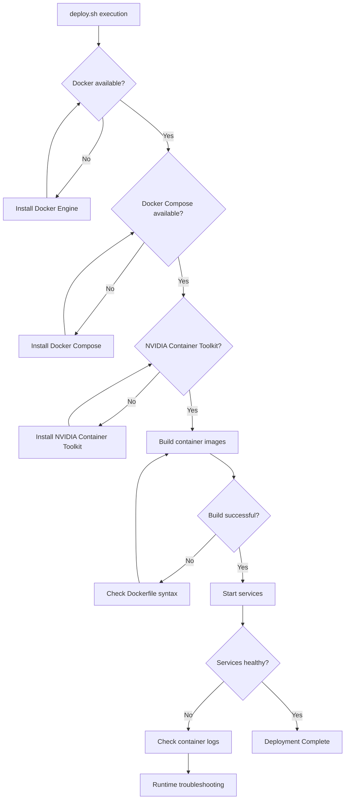
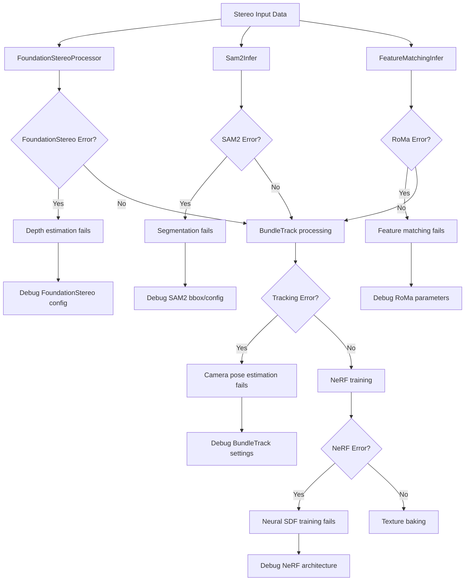
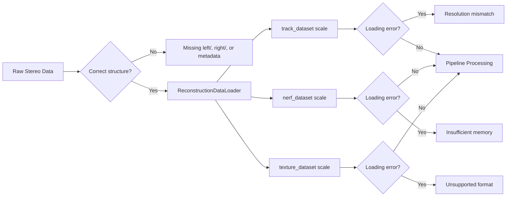
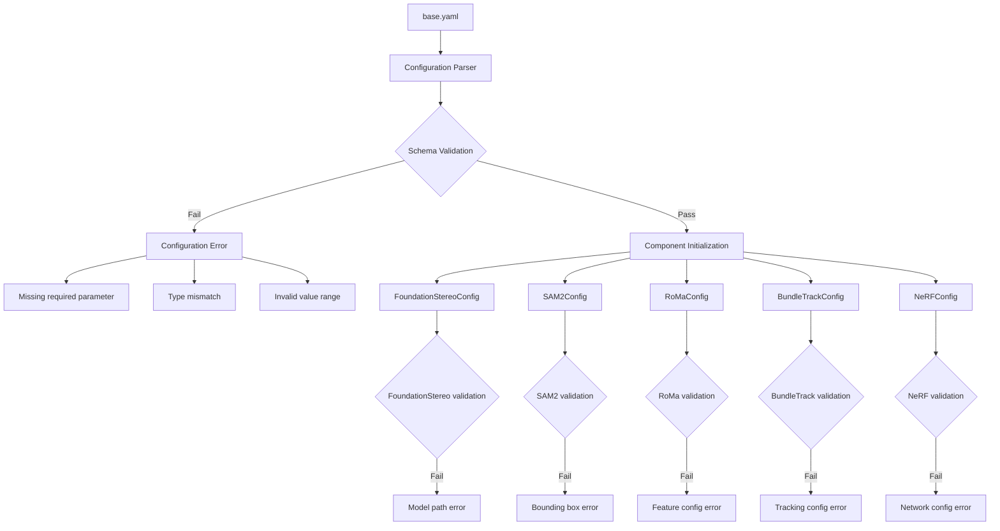

<!-- source: DeepWiki mcp.deepwiki.com · repo NVIDIA/3DObjectReconstruction · page 8 Troubleshooting · fetched 2026-10-26 -->

# Troubleshooting

<details>
<summary>Relevant source files</summary>

The following files were used as context for generating this wiki page:

- [.github/ISSUE_TEMPLATE/bug_report_form.yml](.github/ISSUE_TEMPLATE/bug_report_form.yml)
- [print_env.sh](print_env.sh)

</details>


This document provides systematic approaches to diagnosing and resolving common issues encountered when using the NVIDIA 3D Object Reconstruction system. It covers problems ranging from installation failures to runtime pipeline errors and performance bottlenecks.

For installation guidance, see [Installation & Deployment](#2.1). For configuration details, see [Configuration Management](#5). For API reference during debugging, see [API Reference](#6).

## Quick Diagnostics

The system provides automated environment diagnostics through the `print_env.sh` script, which is referenced in the bug report template for comprehensive environment analysis.

### Environment Information Collection

Run the diagnostic script to gather system information:

```bash
./print_env.sh > environment_report.txt
```

This script collects critical information including GPU status, Docker configuration, CUDA toolkit versions, and Python environment details as shown in [print_env.sh:1-107]().

**Key Environment Checks:**
| Component | Check Command | Expected Output |
|-----------|---------------|-----------------|
| GPU Driver | `nvidia-smi` | CUDA-compatible driver |
| Docker | `docker --version` | Version 20.10+ recommended |
| NVIDIA Container Toolkit | `nvidia-container-toolkit --version` | Required for GPU access |
| CUDA Compiler | `nvcc --version` | CUDA 11.8+ |
| Python | `python --version` | Python 3.8+ |

Sources: [print_env.sh:25-61]()

## Installation & Deployment Issues

### Docker Container Problems



**Common Docker Issues:**

| Problem | Symptoms | Solution |
|---------|----------|----------|
| GPU not accessible | `RuntimeError: No CUDA devices found` | Verify NVIDIA Container Toolkit installation |
| Out of memory during build | Docker build fails with OOM | Increase Docker memory limits |
| Port conflicts | `Port already in use` | Check for conflicting services on ports 8888, 8000 |
| Permission denied | `Permission denied writing to /var/run/docker.sock` | Add user to docker group |

Sources: [print_env.sh:33-48]()

### Model Download Failures

The system requires several pre-trained models. Download failures typically occur during first-time setup:

```bash
# Check model availability
ls -la ~/.cache/torch/hub/checkpoints/
ls -la ~/.cache/objectreconstruction/
```

**Model Dependencies:**
- FoundationStereo weights
- SAM2 checkpoints
- RoMa feature matching models
- BundleSDF neural network weights

Sources: Based on system architecture diagrams

## Runtime Pipeline Errors

### Component Failure Analysis



### NVBundleSDF Framework Errors

The `NVBundleSDF` class in [src/nvidia/objectreconstruction/networks/nvbundlesdf.py]() orchestrates the entire pipeline. Common failure points:

**Pipeline Stage Failures:**
| Stage | Class/Function | Common Error | Debug Approach |
|-------|----------------|--------------|----------------|
| Depth Estimation | `FoundationStereoProcessor` | CUDA OOM | Reduce `depth_scale` parameter |
| Segmentation | `Sam2Infer` | Invalid bounding box | Verify bbox coordinates |
| Feature Matching | `FeatureMatchingInfer` | No correspondences found | Check image overlap |
| Pose Tracking | `NerfRunner.bundle_track()` | Tracking failure | Increase `num_iterations` |
| Neural SDF | `NerfRunner.train()` | Training divergence | Adjust learning rate |

Sources: System architecture and pipeline diagrams

### Data Loading Pipeline Issues

The `ReconstructionDataLoader` handles multi-scale data processing. Common issues:



**Data Structure Requirements:**
```
dataset/
├── left/           # Left camera images
├── right/          # Right camera images
├── depth/          # Optional depth maps
├── masks/          # Optional segmentation masks
└── poses/          # Optional camera poses
```

Sources: Based on data processing system architecture

## Configuration Problems

### Schema Validation Errors

The configuration system uses hierarchical schemas defined in [src/nvidia/objectreconstruction/configs/schema.py](). Validation failures typically indicate:

**Common Configuration Issues:**
| Config Class | Parameter | Issue | Fix |
|-------------|-----------|--------|-----|
| `CameraConfig` | `baseline` | Incorrect stereo baseline | Measure actual camera separation |
| `FoundationStereoConfig` | `model_path` | Model not found | Verify download and path |
| `SAM2Config` | `bounding_box` | Out of bounds | Ensure bbox within image dimensions |
| `BundleTrackConfig` | `num_iterations` | Too low for convergence | Increase to 100-200 |
| `NeRFConfig` | `hidden_dim` | CUDA OOM | Reduce network size |

### Component Configuration Debugging



Sources: Configuration management system architecture

## Environment & Dependency Issues

### CUDA and GPU Problems

| Error Message | Cause | Solution |
|---------------|-------|----------|
| `CUDA out of memory` | Insufficient GPU memory | Reduce batch size or model resolution |
| `No CUDA devices found` | Driver/toolkit mismatch | Update NVIDIA drivers |
| `CUDA runtime error` | Version incompatibility | Check CUDA version compatibility |
| `cuDNN error` | Missing or wrong cuDNN | Install correct cuDNN for CUDA version |

### Python Environment Issues

**Package Conflicts:**
```bash
# Check for conflicting packages
pip check
conda list --show-channel-urls

# Common conflict resolution
pip install --upgrade torch torchvision --index-url https://download.pytorch.org/whl/cu118
```

Sources: [print_env.sh:63-98]()

## Performance & Resource Issues

### Memory Management

The pipeline processes high-resolution stereo imagery and maintains neural networks in GPU memory:

**Memory Optimization Strategies:**
| Component | Memory Usage | Optimization |
|-----------|--------------|--------------|
| FoundationStereo | ~4GB GPU | Reduce `depth_scale` |
| SAM2 | ~2GB GPU | Use smaller model variant |
| NeRF Training | ~6GB GPU | Reduce `hidden_dim`, `num_layers` |
| Texture Baking | ~8GB GPU | Lower output resolution |

### Processing Time Issues

**Performance Bottlenecks:**
- Large image resolution in track dataset scale
- High iteration count in bundle tracking
- Complex NeRF architecture
- Dense texture baking resolution

Sources: Performance considerations from system architecture

## Debugging Tools and Techniques

### Logging and Diagnostics

Enable detailed logging for component-specific debugging:

```python
import logging
logging.basicConfig(level=logging.DEBUG)
```

### Environment Reporting

Use the automated diagnostic collection as referenced in the bug report template:

```bash
# Generate comprehensive environment report
./print_env.sh > debug_environment.txt

# Include in bug reports per template requirements
```

The bug report template in [.github/ISSUE_TEMPLATE/bug_report_form.yml:70-75]() specifically requests this environment information for effective troubleshooting.

### Component Isolation Testing

Test individual pipeline components to isolate failures:

```python
# Test FoundationStereo in isolation
from src.nvidia.objectreconstruction.networks.nvbundlesdf import FoundationStereoProcessor

# Test SAM2 segmentation
from src.nvidia.objectreconstruction.networks.nvbundlesdf import Sam2Infer

# Test feature matching
from src.nvidia.objectreconstruction.networks.nvbundlesdf import FeatureMatchingInfer
```

Sources: [.github/ISSUE_TEMPLATE/bug_report_form.yml:1-99](), [print_env.sh:1-107]()