# Page: Overview

# Overview

<details>
<summary>Relevant source files</summary>

The following files were used as context for generating this wiki page:

- [CHANGELOG.md](CHANGELOG.md)
- [CITATION.md](CITATION.md)
- [README.md](README.md)

</details>


## Purpose and Scope

This document provides a technical overview of the NVIDIA 3D Object Reconstruction system, a reference implementation that transforms stereo video sequences into high-quality 3D textured meshes using state-of-the-art AI models. The system integrates multiple neural networks for depth estimation, object segmentation, feature matching, and implicit surface reconstruction to achieve production-ready results in approximately 30 minutes on modern GPUs.

For detailed installation and deployment instructions, see [Installation & Deployment](#2.1). For step-by-step usage guidance, see [Interactive Tutorial](#2.2). For in-depth technical architecture details, see [System Architecture](#4).

## System Architecture Overview

The reconstruction system is built around the `NVBundleSDF` orchestration framework located in [src/nvidia/objectreconstruction/networks/nvbundlesdf.py](), which coordinates four main AI processing stages through a unified pipeline.

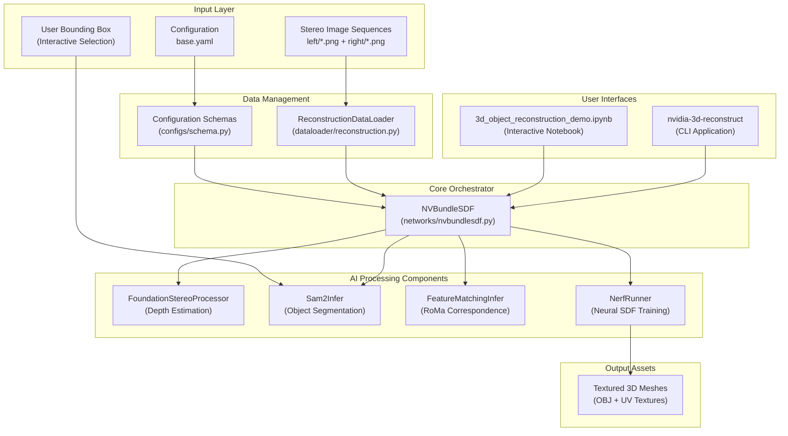

Sources: [README.md:213-218](), [CHANGELOG.md:6-10]()

## AI Pipeline Data Flow

The system processes stereo video through a multi-stage neural pipeline, where each AI component operates on progressively refined data representations to produce the final 3D reconstruction.

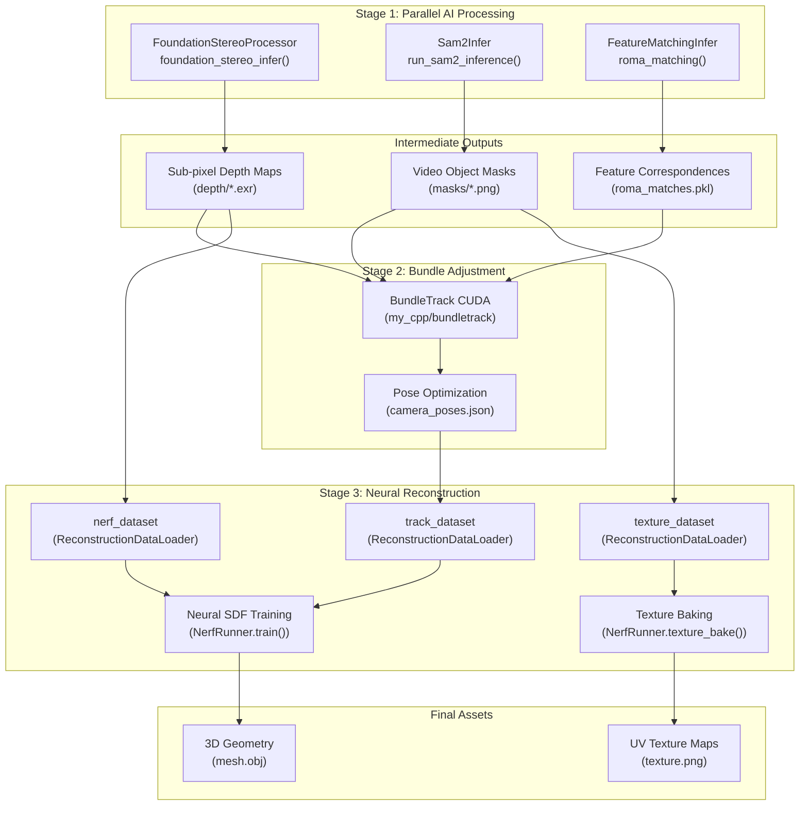

Sources: [README.md:283-302](), [README.md:55-64]()

## Core AI Components

The system integrates four state-of-the-art neural networks, each addressing a specific aspect of 3D reconstruction:

| Component | Implementation | Primary Function | Key Parameters |
|-----------|---------------|------------------|----------------|
| **FoundationStereo** | `FoundationStereoProcessor` | Transformer-based stereo depth estimation | `scale`, `baseline`, `intrinsic` |
| **SAM2** | `Sam2Infer` | Video object segmentation and tracking | `checkpoint_path`, `bbox`, `device` |
| **RoMa** | `FeatureMatchingInfer` | Robust dense feature matching | `model_name`, `match_threshold` |  
| **BundleSDF** | `NerfRunner` | Neural 6-DoF tracking and SDF reconstruction | `n_step`, `batch_size`, `scene_bounds` |

The `NVBundleSDF` class coordinates these components through a unified configuration system defined in [src/nvidia/objectreconstruction/configs/schema.py](), enabling end-to-end processing from stereo input to textured 3D assets.

Sources: [README.md:59-64](), [CHANGELOG.md:7-10](), [README.md:356-387]()

## Key Capabilities

The system delivers production-ready 3D reconstruction capabilities optimized for real-world deployment scenarios:

**Performance Characteristics:**
- **Processing Speed**: Complete reconstruction in ~30 minutes on RTX A6000 hardware
- **Geometric Accuracy**: Sub-millimeter precision for objects 10-50cm in size  
- **Texture Quality**: 2048x2048 UV-mapped photorealistic textures
- **Format Compatibility**: Direct export to OBJ, USD, and game engine formats

**Technical Features:**
- **Zero-shot Stereo Matching**: FoundationStereo requires no scene-specific training
- **Consistent Video Segmentation**: SAM2 maintains object identity across temporal sequences
- **Robust Feature Correspondence**: RoMa handles challenging lighting and texture conditions
- **Neural Implicit Surfaces**: BundleSDF learns smooth geometry from sparse observations

**Deployment Options:**
- **Interactive Development**: Jupyter notebook with real-time visualization
- **Batch Processing**: CLI interface for automated workflows  
- **Container Deployment**: Docker Compose with GPU acceleration support

Sources: [README.md:155-162](), [README.md:23-24](), [CHANGELOG.md:23-25]()

## Research Foundations

This implementation builds upon peer-reviewed research in neural 3D reconstruction and computer vision:

**FoundationStereo** (CVPR 2025): Zero-shot transformer-based stereo depth estimation that generalizes across diverse scenes without fine-tuning, providing sub-pixel accurate depth maps for downstream 3D reconstruction.

**BundleSDF** (CVPR 2023): Neural 6-DoF object tracking and 3D reconstruction framework that combines bundle adjustment with neural signed distance functions to achieve accurate pose estimation and implicit surface learning for unknown objects.

The system also incorporates **SAM2** for consistent video object segmentation and **RoMa** for robust feature matching, creating a comprehensive pipeline that addresses the full spectrum of challenges in stereo-based 3D reconstruction.

Sources: [CITATION.md:5-23](), [README.md:166-171]()

## Applications and Use Cases

The reconstruction workflow targets three primary application domains:

**Robotics Applications:**
- Digital twin creation for manipulation planning and simulation
- Automated bin picking with accurate 3D object models
- Real-time environment mapping for autonomous systems

**Computer Vision Research:**
- Synthetic training data generation using NVIDIA Isaac Sim integration
- Object recognition system development with high-fidelity 3D models
- Augmented reality applications requiring precise object registration

**Production Workflows:**
- Product visualization and e-commerce asset creation  
- Quality inspection and measurement using 3D geometry
- Asset pipeline integration with Omniverse and game engines

The modular architecture supports customization for specific use cases through the hierarchical configuration system, enabling adaptation to different camera setups, object types, and quality requirements.

Sources: [README.md:264-278](), [README.md:96-100]()

---

# Page: Getting Started

# Getting Started

<details>
<summary>Relevant source files</summary>

The following files were used as context for generating this wiki page:

- [README.md](README.md)
- [notebooks/3d_object_reconstruction_demo.ipynb](notebooks/3d_object_reconstruction_demo.ipynb)

</details>


This document provides step-by-step instructions for installing, configuring, and running your first 3D object reconstruction using the NVIDIA 3D Object Reconstruction workflow. It covers system requirements, installation methods, and guides you through the complete process from stereo input to textured 3D assets.

For detailed information about the AI components and neural rendering techniques, see [Core Pipeline](#3). For configuration parameters and customization options, see [Configuration Management](#5).

## System Requirements

The 3D reconstruction workflow has specific hardware and software requirements due to its GPU-intensive AI models and neural rendering components.

### Hardware Requirements

| Component | Minimum Specification | Recommended |
|-----------|----------------------|-------------|
| **GPU** | NVIDIA GPU with 24GB VRAM, Compute Capability 7.0+ | RTX A6000, RTX 4090, or better |
| **CPU** | 8-core x86_64 processor | 16+ cores |
| **RAM** | 32GB system memory | 64GB+ |
| **Storage** | 100GB free space | 500GB+ SSD |

### Software Requirements

| Component | Version | Purpose |
|-----------|---------|---------|
| **Operating System** | Ubuntu 22.04+ (Linux x86_64) | Host environment |
| **Docker Engine** | 28.0.4+ | Container orchestration |
| **Docker Compose** | 1.29.2+ | Multi-container deployment |
| **NVIDIA Drivers** | 535+ | GPU acceleration |
| **NVIDIA Container Toolkit** | Latest | GPU access in containers |

Sources: [README.md:236-261](), [notebooks/3d_object_reconstruction_demo.ipynb:38-46]()

## Installation Methods

The workflow provides two primary installation approaches: Docker Compose for quick setup and development, or manual installation for advanced users.

### Docker Compose Setup (Recommended)

The Docker Compose method provides automated setup with all dependencies pre-configured.

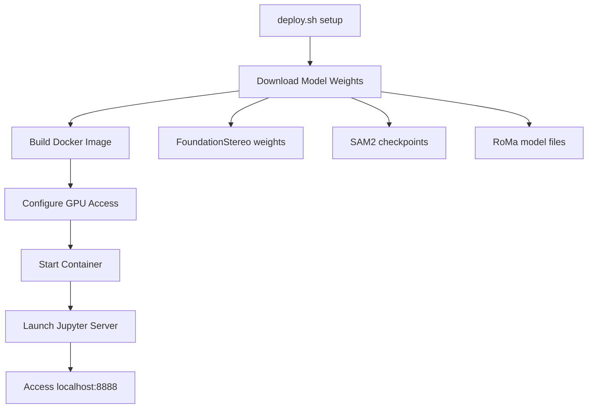

**Setup and Launch Process**
Sources: [README.md:182-196]()

#### Initial Setup

```bash
# Clone repository
git clone <repository-url>
cd 3d-object-reconstruction

# One-command setup: downloads weights, builds container
./deploy/compose/deploy.sh setup

# Start container and Jupyter server
./deploy/compose/deploy.sh start
```

The `deploy.sh` script automates the complete setup process, including model weight downloads and Docker image construction. After successful setup, the Jupyter notebook server becomes available at `http://localhost:8888`.

Sources: [README.md:184-196]()

### Manual Installation

For development or custom deployment scenarios, manual installation provides greater control over the environment setup.

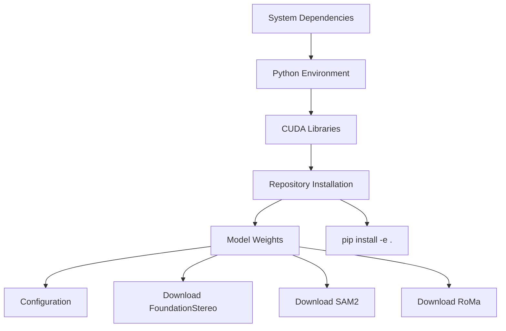

**Manual Installation Steps**
Sources: Inferred from Docker setup and Python package structure

#### Prerequisites Installation

```bash
# Install system dependencies
sudo apt update
sudo apt install -y python3.10 python3-pip git

# Install NVIDIA Container Toolkit
distribution=$(. /etc/os-release;echo $ID$VERSION_ID)
curl -s -L https://nvidia.github.io/nvidia-docker/gpgkey | sudo apt-key add -
curl -s -L https://nvidia.github.io/nvidia-docker/$distribution/nvidia-docker.list | sudo tee /etc/apt/sources.list.d/nvidia-docker.list
sudo apt update && sudo apt install -y nvidia-container-toolkit
```

#### Python Environment Setup

```bash
# Create virtual environment
python3.10 -m venv venv
source venv/bin/activate

# Install the package
pip install -e .

# Download model weights (manual process)
mkdir -p data/weights/foundationstereo/
mkdir -p data/weights/sam2/
mkdir -p data/weights/roma/
```

Sources: Inferred from container configuration and Python requirements

## Quick Start Workflow

The fastest way to experience the complete 3D reconstruction pipeline is through the interactive Jupyter notebook tutorial.

### Access the Interactive Tutorial

Once your Docker container is running:

1. **Open Browser**: Navigate to `http://localhost:8888`
2. **Open Notebook**: Select `notebooks/3d_object_reconstruction_demo.ipynb`
3. **Follow Instructions**: Execute cells sequentially for guided reconstruction

### Sample Data Processing

The included sample dataset demonstrates reconstruction of a retail item with complex geometry and varied surface materials.

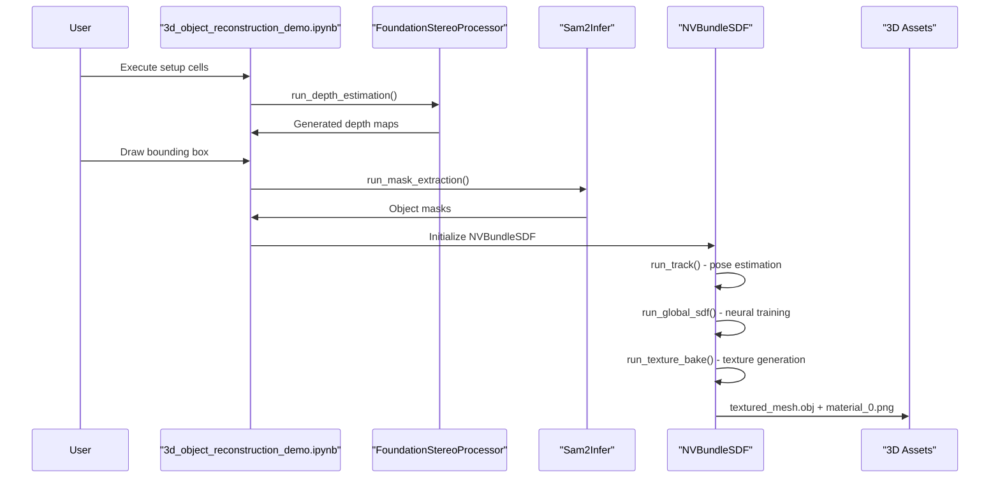

**Interactive Workflow Components**
Sources: [notebooks/3d_object_reconstruction_demo.ipynb:52-874]()

### Expected Processing Times

Processing times for 36 stereo frames at 4K resolution using RTX A6000:

| Pipeline Stage | Duration | Key Components |
|----------------|----------|----------------|
| **Setup** | 1-2 minutes | Extension compilation, package installation |
| **FoundationStereo** | 1-2 minutes | `run_depth_estimation()` |
| **SAM2 Segmentation** | 25 seconds | `run_mask_extraction()` |
| **Pose Tracking** | 3-4 minutes | `NVBundleSDF.run_track()` |
| **SDF Training** | 3-4 minutes | `NVBundleSDF.run_global_sdf()` |
| **Texture Baking** | 22-23 minutes | `NVBundleSDF.run_texture_bake()` |
| **Total Pipeline** | **31-32 minutes** | End-to-end processing |

Sources: [notebooks/3d_object_reconstruction_demo.ipynb:176-196]()

## Understanding the Pipeline Architecture

The reconstruction workflow integrates multiple AI models through the `NVBundleSDF` orchestration framework.

### Core Components and File Structure

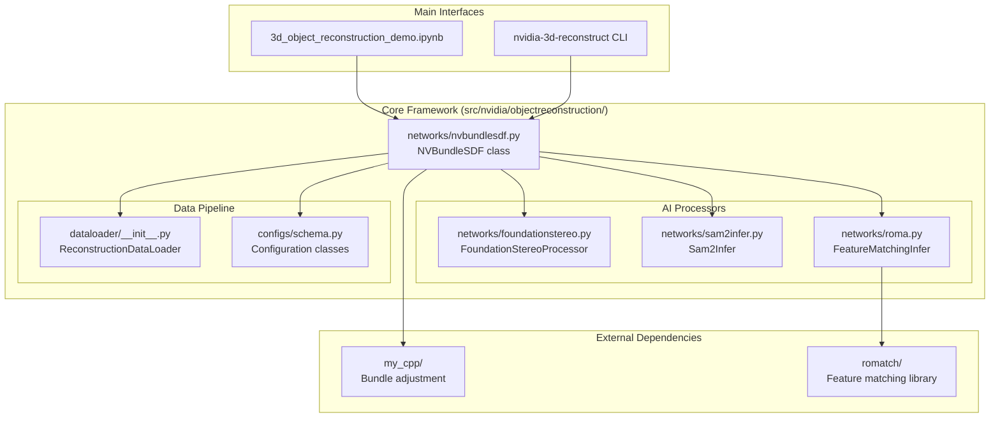

**Framework Architecture**
Sources: [notebooks/3d_object_reconstruction_demo.ipynb:240-241](), [src/nvidia/objectreconstruction/]()

### Data Processing Pipeline

The `ReconstructionDataLoader` handles multi-scale data loading for different processing stages.

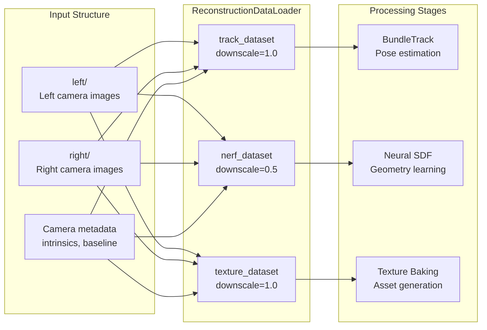

**Multi-Scale Data Loading**
Sources: [notebooks/3d_object_reconstruction_demo.ipynb:634-656]()

### Configuration Management

The workflow uses hierarchical YAML configuration with typed schemas defined in `configs/schema.py`.

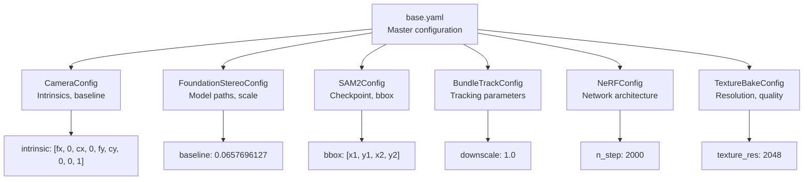

**Configuration Hierarchy**
Sources: [notebooks/3d_object_reconstruction_demo.ipynb:276-325](), [data/configs/base.yaml]()

## Command Line Interface

For automated processing and batch workflows, the CLI provides programmatic access to the reconstruction pipeline.

### Basic Usage

```bash
# Display help and available options
nvidia-3d-reconstruct --help

# Basic reconstruction with sample data
nvidia-3d-reconstruct \
    --config /workspace/3d-object-reconstruction/data/configs/base.yaml \
    --data-path /workspace/3d-object-reconstruction/data/samples/retail_item/ \
    --output-path /workspace/3d-object-reconstruction/data/output/my_reconstruction \
    --verbose
```

### CLI Parameters

| Parameter | Description | Example |
|-----------|-------------|---------|
| `--config` | Path to YAML configuration file | `data/configs/base.yaml` |
| `--data-path` | Input stereo data directory | `data/samples/retail_item/` |
| `--output-path` | Output directory for results | `data/output/reconstruction/` |
| `--verbose` | Enable detailed logging | Flag option |
| `--version` | Show version information | Flag option |

Sources: [README.md:327-350]()

## Expected Outputs

Successful reconstruction generates multiple asset files and intermediate results.

### Generated Files

| File | Description | Format |
|------|-------------|--------|
| `textured_mesh.obj` | Complete 3D mesh with UV mapping | Wavefront OBJ |
| `material_0.png` | High-resolution texture map | PNG image |
| `keyframes.yml` | Optimized camera poses | YAML metadata |
| `depth/` | Dense depth maps | PNG depth images |
| `masks/` | Object segmentation masks | PNG binary masks |

### Asset Integration

The generated assets are compatible with:
- **Isaac Sim**: For robotics simulation and synthetic data generation
- **Omniverse**: For collaborative 3D workflows and USD conversion
- **Game Engines**: Direct import of OBJ meshes with textures
- **CAD Software**: Standard mesh format support

Sources: [notebooks/3d_object_reconstruction_demo.ipynb:806-816]()

## Troubleshooting Common Issues

### Weight Download Problems

If FoundationStereo weight download fails:

```bash
# Manual weight download location
mkdir -p data/weights/foundationstereo/
# Download from: https://github.com/NVlabs/FoundationStereo
# Place weights in the above directory

# Retry setup
./deploy/compose/deploy.sh setup
```

### Docker Container Issues

For container startup problems:

```bash
# Clean up orphaned containers
cd deploy/compose
docker-compose down --remove-orphans
docker container prune -f

# Restart Docker service
sudo systemctl restart docker

# Retry setup
./deploy.sh setup
```

### GPU Memory Issues

Reduce memory usage in configuration:

```yaml
# Lower memory requirements
nerf:
  batch_size: 16  # Reduce from default 32
foundation_stereo:
  scale: 0.2      # Reduce from default 0.3
```

Sources: [README.md:406-525]()

## Next Steps

After completing your first reconstruction:

1. **Experiment with Parameters**: Modify configuration values to optimize results for your specific use case
2. **Process Custom Data**: Prepare your own stereo datasets following the data organization guidelines
3. **Explore Advanced Features**: Learn about the individual AI components and their configuration options
4. **Integration Planning**: Understand how to integrate generated assets into your target applications

For detailed configuration options, see [Configuration Management](#5). For in-depth understanding of the AI pipeline, see [Core Pipeline](#3).

Sources: [notebooks/3d_object_reconstruction_demo.ipynb:792-849]()

---

# Page: Installation & Deployment

# Installation & Deployment

<details>
<summary>Relevant source files</summary>

The following files were used as context for generating this wiki page:

- [CHANGELOG.md](CHANGELOG.md)
- [README.md](README.md)

</details>


This document covers the complete installation and deployment process for the NVIDIA 3D Object Reconstruction system. It provides step-by-step instructions for setting up the Docker-based environment, configuring GPU access, and deploying both interactive and automated interfaces.

For information about using the system after deployment, see [Interactive Tutorial](#2.2). For detailed configuration options, see [Configuration Management](#5).

## System Requirements

The system requires specific hardware and software components to function properly. These requirements are enforced by the underlying AI models and CUDA-accelerated processing components.

### Hardware Requirements

| Component | Specification | Purpose |
|-----------|---------------|---------|
| **GPU** | 24GB VRAM minimum, CUDA Compute 7.0+ | Neural network inference and training |
| **CPU** | 8-core x86_64 | Multi-threaded processing |
| **RAM** | 32GB system memory | Data loading and preprocessing |
| **Storage** | 100GB+ free space | Model weights and processing data |

### Software Requirements

| Component | Version | Installation Notes |
|-----------|---------|-------------------|
| **Ubuntu** | 22.04+ (Linux x86_64) | Host operating system |
| **Docker Engine** | 28.0.4+ | Container runtime |
| **Docker Compose** | 1.29.2+ | Container orchestration |
| **NVIDIA Drivers** | 535+ | GPU driver compatibility |
| **NVIDIA Container Toolkit** | Latest | GPU access in containers |

Sources: [README.md:236-261]()

## Docker Deployment Architecture

The system uses a containerized architecture with Docker Compose orchestration. The deployment separates concerns between the application runtime, model storage, and data processing.

### Container Architecture

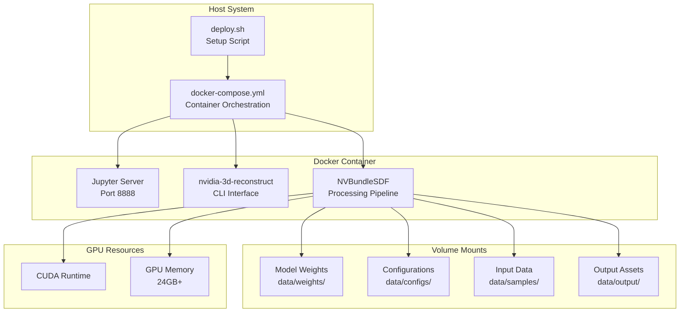

Sources: [README.md:182-196](), [README.md:220-224]()

### Deployment Script Workflow

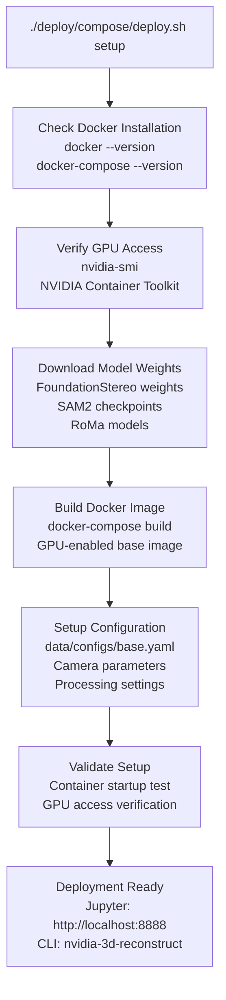

Sources: [README.md:184-194](), [CHANGELOG.md:12-14]()

## Setup Process

### Initial Setup

The deployment process is automated through a single setup script that handles all prerequisites and dependencies.

```bash
# Clone repository
git clone <repository-url>
cd 3d-object-reconstruction-github

# One-command setup
./deploy/compose/deploy.sh setup
```

The setup script performs these operations:
1. **Dependency Verification**: Checks Docker, Docker Compose, and NVIDIA Container Toolkit installation
2. **Model Weight Download**: Retrieves pre-trained weights for FoundationStereo, SAM2, and RoMa models
3. **Container Build**: Builds the GPU-enabled Docker image with all dependencies
4. **Configuration Setup**: Initializes default configuration files in `data/configs/`
5. **Volume Preparation**: Creates necessary directories for data and output storage

### Container Startup

```bash
# Start container and services
./deploy/compose/deploy.sh start

# Check container status
docker-compose ps
```

The startup process initializes:
- **Jupyter Server**: Accessible at `http://localhost:8888` (port auto-increments if unavailable)
- **GPU Access**: CUDA runtime and device mounting
- **Volume Mounts**: Persistent storage for data, configurations, and outputs
- **Network Configuration**: Port mapping for external access

Sources: [README.md:184-196]()

## Container Configuration

### Docker Compose Structure

The system uses Docker Compose to manage container lifecycle and resource allocation:

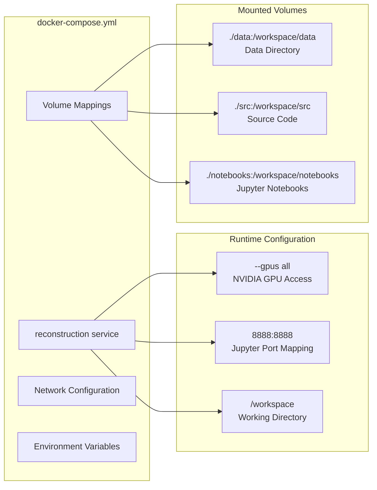

### Environment Variables

The container environment includes:
- **CUDA_VISIBLE_DEVICES**: GPU device selection
- **JUPYTER_ENABLE_LAB**: JupyterLab interface activation
- **PYTHONPATH**: Module import paths for `src/nvidia/objectreconstruction/`
- **TORCH_CUDA_ARCH_LIST**: CUDA architecture targeting

Sources: [README.md:257-260]()

## Access Methods

### Jupyter Notebook Interface

The primary interface for interactive development and experimentation:

```bash
# Access after container startup
# Navigate to: http://localhost:8888
# Open: notebooks/3d_object_reconstruction_demo.ipynb
```

**Features**:
- Interactive workflow execution
- Real-time visualization
- Parameter experimentation
- Educational content and documentation

### Command Line Interface

For automated processing and batch workflows:

```bash
# Inside container or after installation
nvidia-3d-reconstruct --help

# Basic usage
nvidia-3d-reconstruct \
    --config /workspace/data/configs/base.yaml \
    --data-path /workspace/data/samples/retail_item/ \
    --output-path /workspace/data/output/reconstruction \
    --verbose
```

**CLI Parameters**:
- `--config`: YAML configuration file path
- `--data-path`: Input stereo data directory
- `--output-path`: Output directory for 3D assets
- `--verbose`: Detailed logging output
- `--version`: Version information

Sources: [README.md:324-350]()

## Deployment Verification

### System Health Checks

After deployment, verify system functionality:

```bash
# Check container status
docker-compose ps

# Verify GPU access
docker-compose exec reconstruction nvidia-smi

# Test Jupyter server
curl -I http://localhost:8888

# Validate CLI installation
docker-compose exec reconstruction nvidia-3d-reconstruct --version
```

### Configuration Validation

The system validates configuration files during startup:

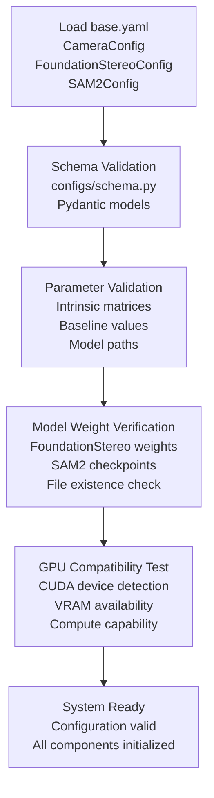

Sources: [README.md:389]()

## Troubleshooting Common Issues

### Model Weight Download Failures

**Symptoms**: `FileNotFoundError` for FoundationStereo weights, download timeouts
**Solution**:
```bash
# Manual weight download
mkdir -p data/weights/foundationstereo/
# Download from: https://github.com/NVlabs/FoundationStereo

# Retry automatic download
./deploy/compose/deploy.sh setup
```

### Container Startup Issues

**Symptoms**: `KeyError: 'ContainerConfig'`, Docker API errors
**Solution**:
```bash
# Clean up orphaned containers
cd deploy/compose
docker-compose down --remove-orphans
docker container prune -f

# Restart Docker service
sudo systemctl restart docker

# Retry setup
./deploy.sh setup
```

### GPU Memory Issues

**Symptoms**: CUDA out of memory errors
**Solution**: Modify configuration parameters in `data/configs/base.yaml`:
```yaml
nerf:
  batch_size: 16  # Reduce from default 32
foundation_stereo:
  scale: 0.2      # Reduce from default 0.3
```

### NVIDIA Driver Issues

**Symptoms**: Container cannot access GPU, CUDA errors
**Solution**:
```bash
# Verify drivers and container toolkit
nvidia-smi
sudo nvidia-ctk runtime configure --runtime=docker
sudo systemctl restart docker

# Test GPU access
docker run --rm --gpus all nvidia/cuda:12.2-runtime-ubuntu22.04 nvidia-smi
```

Sources: [README.md:406-526]()

## Container Management

### Service Control Commands

```bash
# Start all services
./deploy/compose/deploy.sh start

# Stop services (preserves data)
./deploy/compose/deploy.sh stop

# Restart services
./deploy/compose/deploy.sh restart

# Complete teardown
./deploy/compose/deploy.sh down
```

### Log Monitoring

```bash
# View all service logs
docker-compose logs -f

# View specific service logs
docker-compose logs -f reconstruction

# Monitor real-time processing
docker-compose exec reconstruction tail -f /tmp/reconstruction.log
```

### Data Persistence

The deployment maintains persistent storage across container restarts:
- **Model Weights**: `data/weights/` - Downloaded model files
- **Configurations**: `data/configs/` - User configuration files
- **Input Data**: `data/samples/` - Stereo image sequences
- **Output Assets**: `data/output/` - Generated 3D meshes and textures

Sources: [README.md:518-525]()

---

# Page: Interactive Tutorial

# Interactive Tutorial

<details>
<summary>Relevant source files</summary>

The following files were used as context for generating this wiki page:

- [notebooks/3d_object_reconstruction_demo.ipynb](notebooks/3d_object_reconstruction_demo.ipynb)

</details>


## Purpose and Scope

This document covers the interactive Jupyter notebook tutorial that guides users through the complete 3D object reconstruction pipeline. The tutorial provides a hands-on, step-by-step walkthrough of the entire reconstruction workflow from stereo video input to textured 3D assets.

For system installation and Docker deployment, see [Installation & Deployment](#2.1). For detailed technical documentation of the underlying pipeline architecture, see [Pipeline Architecture](#3.1). For configuration parameter reference, see [Configuration Schema](#5.1).

## Tutorial Overview

The interactive tutorial is implemented as a comprehensive Jupyter notebook that demonstrates the complete real2sim workflow. It combines multiple state-of-the-art AI models in a sequential pipeline to transform stereo video inputs into production-ready 3D assets.

### Tutorial Workflow

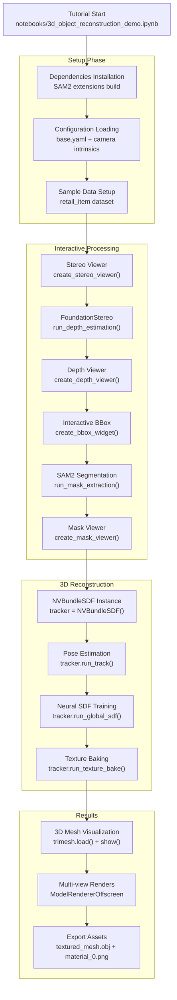

Sources: [notebooks/3d_object_reconstruction_demo.ipynb:1-874]()

### Key Code Components

The tutorial integrates multiple classes and functions from the reconstruction framework:

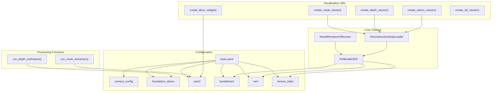

Sources: [notebooks/3d_object_reconstruction_demo.ipynb:232-241](), [notebooks/3d_object_reconstruction_demo.ipynb:634-656]()

## Step-by-Step Tutorial Breakdown

### Step 1: Environment Setup and Data Preparation

The tutorial begins with dependency installation and dataset configuration. Users install video codecs and build the SAM2 C++ extensions for optimal performance.

| Component | Purpose | Key Functions |
|-----------|---------|---------------|
| DeepStream Script | Video codec installation | `subprocess.check_call()` |
| SAM2 Extensions | C++ acceleration build | `setup.py build_ext --inplace` |
| Configuration Loading | Pipeline parameters | `yaml.safe_load()` |
| Dataset Setup | Sample data preparation | `shutil.copytree()` |

The configuration setup includes camera intrinsics for the QooCam stereo camera:

```yaml
camera_config:
  intrinsic: [3079.6, 0, 2000.0, 0, 3075.1, 1500.01, 0, 0, 1]
  step: 1
foundation_stereo:
  baseline: 0.0657696127  # 65.77mm baseline
```

Sources: [notebooks/3d_object_reconstruction_demo.ipynb:52-70](), [notebooks/3d_object_reconstruction_demo.ipynb:277-325]()

### Step 2: Depth Estimation with FoundationStereo

Users run stereo depth estimation using the `run_depth_estimation()` function from `nvidia.objectreconstruction.networks.foundationstereo`. The process generates dense depth maps for all stereo pairs.

The interactive depth viewer uses `create_depth_viewer()` to allow users to examine depth quality across frames with color-coded depth visualization.

Sources: [notebooks/3d_object_reconstruction_demo.ipynb:394-409](), [notebooks/3d_object_reconstruction_demo.ipynb:427-429]()

### Step 3: Interactive Object Segmentation

The tutorial provides an interactive bounding box selection widget powered by `create_bbox_widget()`. Users draw a bounding box around their target object, which SAM2 uses for video object tracking.

The segmentation process uses `run_mask_extraction()` with the user-defined bounding box coordinates:

```python
sam2_config['bbox'] = [x, y, x+w, y+h]
response = run_mask_extraction(
    config=sam2_config,
    exp_path=output_data_path,
    rgb_path=output_data_path / "left",
    mask_path=output_data_path / "masks"
)
```

Sources: [notebooks/3d_object_reconstruction_demo.ipynb:460-468](), [notebooks/3d_object_reconstruction_demo.ipynb:486-511]()

### Step 4: 3D Reconstruction Pipeline

The final step instantiates the `NVBundleSDF` class and executes the three-stage reconstruction process:

```python
tracker = NVBundleSDF(nerf_config, bundletrack_config, roma_config, texturebake_config)

# Stage 1: Pose estimation and feature matching
tracker.run_track(track_dataset)

# Stage 2: Neural SDF training  
tracker.run_global_sdf(nerf_dataset)

# Stage 3: Texture baking and mesh export
tracker.run_texture_bake(texture_dataset)
```

The tutorial includes camera pose visualization using `vis_camera_poses()` and final mesh rendering with `ModelRendererOffscreen`.

Sources: [notebooks/3d_object_reconstruction_demo.ipynb:654-656](), [notebooks/3d_object_reconstruction_demo.ipynb:672-732]()

## Interactive Components

### Visualization Widgets

The tutorial provides several interactive visualization components implemented in `nvidia.objectreconstruction.utils.visualization`:

| Widget | Class/Function | Purpose |
|--------|----------------|---------|
| Stereo Viewer | `create_stereo_viewer()` | Navigate stereo pairs |
| Depth Viewer | `create_depth_viewer()` | Examine depth maps |
| Mask Viewer | `create_mask_viewer()` | Review segmentation |
| BBox Widget | `create_bbox_widget()` | Interactive object selection |
| 3D Viewer | `create_3d_viewer()` | 3D mesh inspection |

### User Interaction Points

The tutorial includes several points where user input is required:

1. **Directory Management**: Users confirm whether to clear existing output directories
2. **Bounding Box Selection**: Interactive drawing of object boundaries
3. **Quality Assessment**: Visual inspection of depth, segmentation, and final results

Sources: [notebooks/3d_object_reconstruction_demo.ipynb:342-344](), [notebooks/3d_object_reconstruction_demo.ipynb:460-468]()

## Data Processing Flow

### Multi-Scale Dataset Loading

The tutorial demonstrates the use of `ReconstructionDataLoader` with different downscaling parameters for each processing stage:

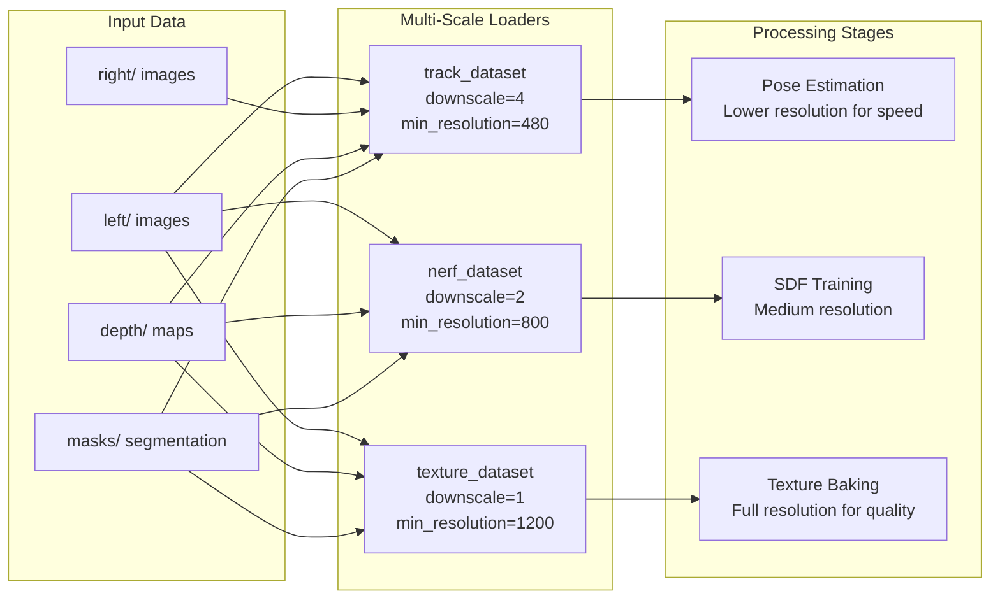

Sources: [notebooks/3d_object_reconstruction_demo.ipynb:634-652]()

### Configuration Hierarchy

The tutorial demonstrates the hierarchical configuration system with component-specific parameters:

| Configuration Section | Key Parameters | Purpose |
|-----------------------|----------------|---------|
| `camera_config` | `intrinsic`, `step` | Camera calibration |
| `foundation_stereo` | `baseline`, `intrinsic` | Depth estimation |
| `sam2` | `bbox`, `checkpoint` | Object segmentation |
| `bundletrack` | `debug_dir`, `downscale` | Pose estimation |
| `nerf` | `save_dir`, `iterations` | SDF training |
| `texture_bake` | `resolution`, `downscale` | Asset generation |

Sources: [notebooks/3d_object_reconstruction_demo.ipynb:375-376](), [notebooks/3d_object_reconstruction_demo.ipynb:601-625]()

## Performance and Timing

The tutorial includes performance benchmarks for each pipeline stage using an RTX A6000 GPU with 36 stereo frames at 4K resolution:

| Pipeline Stage | Duration | Factors |
|----------------|----------|---------|
| FoundationStereo | 1-2 minutes | Frame count, resolution |
| SAM2 Segmentation | 25 seconds | Frame count, resolution |
| Pose Tracking | 3-4 minutes | Frame count, complexity |
| SDF Training | 3-4 minutes | Iterations, keyframes |
| Texture Baking | 22-23 minutes | Texture resolution, mesh complexity |
| **Total Pipeline** | **31-32 minutes** | End-to-end processing |

Sources: [notebooks/3d_object_reconstruction_demo.ipynb:176-196]()

## Output Assets and Integration

### Generated Assets

The tutorial produces several output files in the experiment directory:

| Asset | Filename | Description |
|-------|----------|-------------|
| 3D Mesh | `textured_mesh.obj` | Complete mesh with UV mapping |
| Texture Map | `material_0.png` | High-resolution texture |
| Camera Poses | `keyframes.yml` | Optimized camera poses |
| Depth Maps | `depth/*.png` | Dense depth for all frames |
| Segmentation | `masks/*.png` | Object masks |

### Downstream Integration

The tutorial concludes with guidance for integrating generated assets into various workflows:

- **Robotic Manipulation**: Grasping and manipulation training
- **Sim2Real Transfer**: Bridging simulation and deployment gaps  
- **Digital Twins**: Accurate digital object replicas
- **Computer Vision**: Labeled dataset generation
- **USD Export**: Omniverse integration using Isaac Lab converters

Sources: [notebooks/3d_object_reconstruction_demo.ipynb:792-849]()

## Camera Support and Specifications

The tutorial includes comprehensive camera comparison tables for stereo setup selection:

| Camera Model | Manufacturer | Resolution | Baseline | Focal Length |
|--------------|-------------|------------|----------|--------------|
| ZED 2i | Stereolabs | 2K stereo | 0.1198m | fx: 1070.8 |
| QooCam EGO 3D | Kandao | 4K/2K video | 0.0658m | fx: 3079.6 |
| Hawk Stereo | Leopard Imaging | Industrial | 0.1495m | fx: 958.35 |
| ZED Mini | Stereolabs | HD stereo | 0.12m | fx: 522.38 |

The tutorial provides detailed setup requirements and use case recommendations for each camera system.

Sources: [notebooks/3d_object_reconstruction_demo.ipynb:146-169]()

---

# Page: Core Pipeline

# Core Pipeline

<details>
<summary>Relevant source files</summary>

The following files were used as context for generating this wiki page:

- [CHANGELOG.md](CHANGELOG.md)
- [data/docs/pipeline_overview.png](data/docs/pipeline_overview.png)
- [notebooks/3d_object_reconstruction_demo.ipynb](notebooks/3d_object_reconstruction_demo.ipynb)

</details>


This document provides a comprehensive technical overview of the 3D Object Reconstruction pipeline architecture, including its AI components, data flow, and processing stages. The pipeline orchestrates multiple state-of-the-art models to transform stereo video input into production-ready 3D textured assets.

For detailed configuration parameters and schemas, see [Configuration Management](#5). For API reference and class documentation, see [API Reference](#6).

## Pipeline Architecture Overview

The core pipeline integrates four primary AI models through a multi-stage processing workflow. The `NVBundleSDF` class serves as the main orchestrator, coordinating data flow between processing stages and managing the reconstruction pipeline.

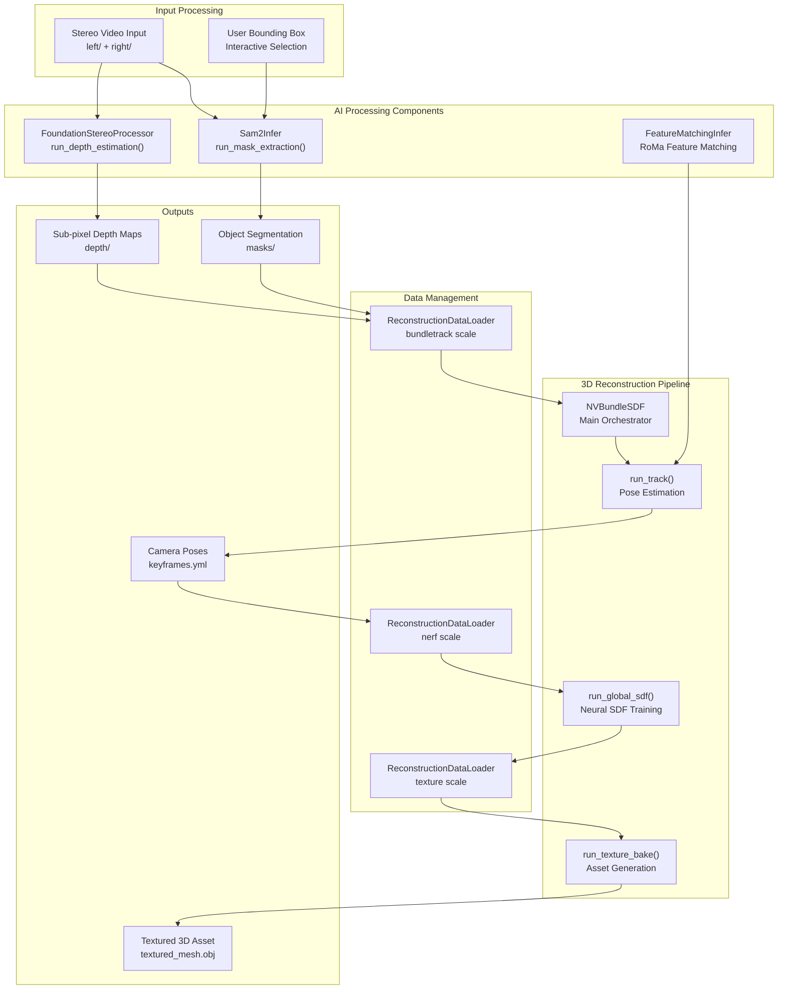

**Sources:** [notebooks/3d_object_reconstruction_demo.ipynb:535-733]()

## Data Flow and Processing Stages

The pipeline processes data through three distinct scales, each optimized for different computational requirements. The `ReconstructionDataLoader` handles multi-scale data preparation with configurable downscaling factors.

```mermaid
flowchart LR
    subgraph "Stage 1: Preprocessing"
        RawStereo["Raw Stereo Frames<br/>4K Resolution"]
        DepthEst["FoundationStereo<br/>Depth Estimation"]
        Segmentation["SAM2<br/>Object Segmentation"]
        
        RawStereo --> DepthEst
        RawStereo --> Segmentation
    end
    
    subgraph "Stage 2: Pose Estimation"
        TrackScale["Track Dataset<br/>downscale=bundletrack.downscale"]
        FeatureMatch["RoMa Feature Matching<br/>Dense Correspondences"]
        PoseOpt["Bundle Adjustment<br/>Camera Pose Optimization"]
        
        TrackScale --> FeatureMatch
        FeatureMatch --> PoseOpt
    end
    
    subgraph "Stage 3: Neural Reconstruction"
        NeRFScale["NeRF Dataset<br/>downscale=nerf.downscale"]
        SDFTrain["Neural SDF Training<br/>Implicit Surface Learning"]
        MeshExtract["Mesh Extraction<br/>Marching Cubes"]
        
        NeRFScale --> SDFTrain
        SDFTrain --> MeshExtract
    end
    
    subgraph "Stage 4: Asset Generation"
        TextureScale["Texture Dataset<br/>downscale=texture_bake.downscale"]
        UVMap["UV Mapping<br/>Texture Coordinate Generation"]
        TextureBake["Texture Baking<br/>High-Resolution Asset"]
        
        TextureScale --> UVMap
        UVMap --> TextureBake
    end
    
    DepthEst --> TrackScale
    Segmentation --> TrackScale
    PoseOpt --> NeRFScale
    MeshExtract --> TextureScale
```

**Sources:** [notebooks/3d_object_reconstruction_demo.ipynb:634-656](), [notebooks/3d_object_reconstruction_demo.ipynb:671-733]()

## Core Component Integration

The `NVBundleSDF` framework coordinates multiple specialized processors, each handling specific aspects of the reconstruction pipeline. The system uses a hierarchical configuration approach to manage component parameters.

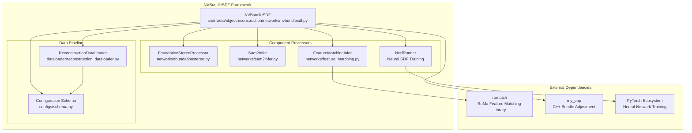

**Sources:** [notebooks/3d_object_reconstruction_demo.ipynb:654-656](), [notebooks/3d_object_reconstruction_demo.ipynb:232-241]()

## Processing Stage Execution

Each processing stage follows a specific execution pattern with defined inputs, outputs, and configuration parameters. The pipeline maintains state through file-based checkpoints and intermediate results.

| Processing Stage | Primary Function | Input Data | Output Data | Key Configuration |
|------------------|------------------|------------|-------------|-------------------|
| **Depth Estimation** | `run_depth_estimation()` | Stereo pairs from `left/`, `right/` | Dense depth maps in `depth/` | `foundation_stereo.intrinsic`, `foundation_stereo.baseline` |
| **Object Segmentation** | `run_mask_extraction()` | RGB frames, user bounding box | Object masks in `masks/` | `sam2.bbox`, `sam2.checkpoint` |
| **Pose Estimation** | `run_track()` | Depth maps, masks, RGB frames | Camera poses in `keyframes.yml` | `bundletrack.downscale`, `roma.model_path` |
| **SDF Training** | `run_global_sdf()` | Poses, masked RGB, depth data | Neural SDF model weights | `nerf.iterations`, `nerf.downscale` |
| **Texture Baking** | `run_texture_bake()` | SDF model, high-res RGB frames | `textured_mesh.obj`, `material_0.png` | `texture_bake.resolution`, `texture_bake.downscale` |

**Sources:** [notebooks/3d_object_reconstruction_demo.ipynb:394-409](), [notebooks/3d_object_reconstruction_demo.ipynb:497-511](), [notebooks/3d_object_reconstruction_demo.ipynb:672-678](), [notebooks/3d_object_reconstruction_demo.ipynb:715-717](), [notebooks/3d_object_reconstruction_demo.ipynb:732-733]()

## Multi-Scale Data Processing

The `ReconstructionDataLoader` implements multi-scale processing to optimize computational efficiency across different pipeline stages. Each stage operates at its optimal resolution while maintaining geometric consistency.

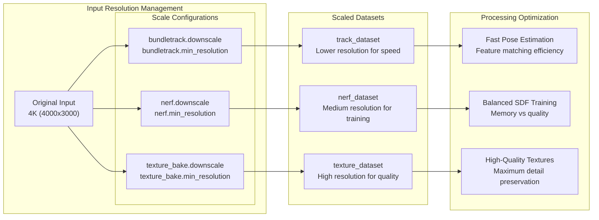

**Sources:** [notebooks/3d_object_reconstruction_demo.ipynb:634-653]()

## Configuration and State Management

The pipeline uses a hierarchical configuration system where each component maintains its own parameter namespace while sharing common data paths and camera calibration information.

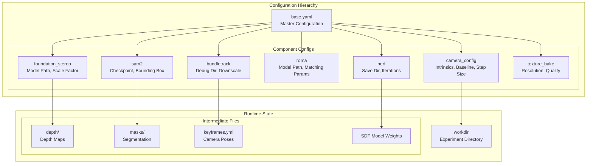

**Sources:** [notebooks/3d_object_reconstruction_demo.ipynb:277-325](), [notebooks/3d_object_reconstruction_demo.ipynb:375-377](), [notebooks/3d_object_reconstruction_demo.ipynb:591-626]()

## Error Handling and Validation

The pipeline implements checkpoint-based validation to ensure each stage completes successfully before proceeding to the next. Critical validation points include pose estimation success and SDF model convergence.

```mermaid
flowchart TD
    subgraph "Validation Checkpoints"
        DepthCheck["Depth Maps Generated<br/>depth/ directory populated"]
        MaskCheck["Masks Generated<br/>masks/ directory populated"]
        PoseCheck["Poses Estimated<br/>keyframes.yml exists"]
        SDFCheck["SDF Training Complete<br/>Model weights saved"]
        AssetCheck["Assets Generated<br/>textured_mesh.obj exists"]
    end
    
    subgraph "Error Handling"
        DepthFail["FoundationStereo Failure<br/>Check GPU memory, input format"]
        MaskFail["SAM2 Failure<br/>Verify bounding box, model weights"]
        PoseFail["Bundle Adjustment Failure<br/>Insufficient features, poor depth"]
        SDFFail["SDF Training Failure<br/>Pose quality, memory constraints"]
        TextureFail["Texture Baking Failure<br/>Mesh quality, UV mapping"]
    end
    
    DepthCheck -->|Success| MaskCheck
    DepthCheck -->|Failure| DepthFail
    
    MaskCheck -->|Success| PoseCheck
    MaskCheck -->|Failure| MaskFail
    
    PoseCheck -->|Success| SDFCheck
    PoseCheck -->|Failure| PoseFail
    
    SDFCheck -->|Success| AssetCheck
    SDFCheck -->|Failure| SDFFail
    
    AssetCheck -->|Failure| TextureFail
```

**Sources:** [notebooks/3d_object_reconstruction_demo.ipynb:404-409](), [notebooks/3d_object_reconstruction_demo.ipynb:505-511](), [notebooks/3d_object_reconstruction_demo.ipynb:675-678]()

---

# Page: Pipeline Architecture

# Pipeline Architecture

<details>
<summary>Relevant source files</summary>

The following files were used as context for generating this wiki page:

- [README.md](README.md)
- [data/docs/pipeline_overview.png](data/docs/pipeline_overview.png)

</details>


This document describes the high-level architecture of the 3D object reconstruction pipeline, detailing the component relationships, data flow patterns, and orchestration framework that transforms stereo video input into textured 3D assets. The architecture integrates four state-of-the-art AI models through a unified processing pipeline.

For detailed information about individual AI components, see [AI Components](#3.2). For step-by-step workflow execution, see [Reconstruction Workflow](#3.3).

## Overall System Architecture

The reconstruction pipeline is built around the `NVBundleSDF` orchestration framework, which coordinates four specialized AI processors and manages multi-stage data processing.

**System Architecture Overview**

```mermaid
graph TB
    subgraph "User Interfaces"
        NOTEBOOK["3d_object_reconstruction_demo.ipynb"]
        CLI["nvidia-3d-reconstruct"]
    end
    
    subgraph "Core Orchestration"
        NVBUNDLE["NVBundleSDF<br/>(networks/nvbundlesdf.py)"]
    end
    
    subgraph "AI Processors"
        FS_PROC["FoundationStereoProcessor<br/>(networks/foundationstereo.py)"]
        SAM2_PROC["Sam2Infer<br/>(networks/sam2infer.py)"]
        ROMA_PROC["FeatureMatchingInfer<br/>(networks/roma.py)"] 
        NERF_PROC["NerfRunner<br/>(networks/nerf_runner.py)"]
    end
    
    subgraph "Data Management"
        DATALOADER["ReconstructionDataLoader<br/>(dataloader/)"]
        CONFIG_SCHEMA["Configuration Classes<br/>(configs/schema.py)"]
    end
    
    subgraph "External Dependencies"
        BUNDLETRACK_CPP["BundleTrack C++<br/>(my_cpp/)"]
        ROMATCH_LIB["RoMa Library<br/>(romatch/)"]
    end
    
    subgraph "Data Pipeline"
        INPUT_DATA["Stereo Image Pairs<br/>(left/, right/)"]
        INTERMEDIATE["Processing Artifacts<br/>(depth/, masks/, poses/)"]
        OUTPUT_ASSETS["Textured 3D Assets<br/>(*.obj, *.png)"]
    end
    
    NOTEBOOK --> NVBUNDLE
    CLI --> NVBUNDLE
    
    NVBUNDLE --> FS_PROC
    NVBUNDLE --> SAM2_PROC  
    NVBUNDLE --> ROMA_PROC
    NVBUNDLE --> NERF_PROC
    
    NVBUNDLE --> DATALOADER
    NVBUNDLE --> CONFIG_SCHEMA
    
    ROMA_PROC --> ROMATCH_LIB
    NVBUNDLE --> BUNDLETRACK_CPP
    
    INPUT_DATA --> DATALOADER
    DATALOADER --> INTERMEDIATE
    INTERMEDIATE --> OUTPUT_ASSETS
```

Sources: [README.md:213-218](), [README.md:283-302]()

## Data Flow Architecture

The pipeline processes stereo video through four distinct processing stages, each operating on different data representations and scales.

**Multi-Stage Data Processing Flow**

```mermaid
flowchart LR
    subgraph "Input Stage"
        STEREO_INPUT["Stereo Image Pairs<br/>left/*.png, right/*.png"]
        CAMERA_PARAMS["Camera Configuration<br/>camera_config.intrinsic"]
        USER_BBOX["User Bounding Box<br/>sam2.bbox"]
    end
    
    subgraph "Parallel Processing Stage"
        FS_DEPTH["FoundationStereoProcessor<br/>→ depth maps"]
        SAM2_MASKS["Sam2Infer<br/>→ object masks"] 
        ROMA_FEATURES["FeatureMatchingInfer<br/>→ feature correspondences"]
    end
    
    subgraph "Sequential Reconstruction Stage"
        TRACK_DATASET["track_dataset<br/>(bundletrack scale)"]
        NERF_DATASET["nerf_dataset<br/>(training scale)"]
        TEXTURE_DATASET["texture_dataset<br/>(baking scale)"]
        
        POSE_ESTIMATION["BundleTrack C++<br/>→ camera poses"]
        SDF_TRAINING["NerfRunner<br/>→ neural SDF"]
        TEXTURE_BAKING["Texture Synthesis<br/>→ UV textures"]
    end
    
    subgraph "Output Stage"
        MESH_OUTPUT["3D Mesh<br/>*.obj"]
        TEXTURE_OUTPUT["Texture Maps<br/>*.png"]
        FINAL_ASSETS["Textured 3D Assets"]
    end
    
    STEREO_INPUT --> FS_DEPTH
    STEREO_INPUT --> SAM2_MASKS
    STEREO_INPUT --> ROMA_FEATURES
    USER_BBOX --> SAM2_MASKS
    CAMERA_PARAMS --> FS_DEPTH
    
    FS_DEPTH --> TRACK_DATASET
    SAM2_MASKS --> TRACK_DATASET
    ROMA_FEATURES --> TRACK_DATASET
    
    TRACK_DATASET --> POSE_ESTIMATION
    POSE_ESTIMATION --> NERF_DATASET
    FS_DEPTH --> NERF_DATASET
    SAM2_MASKS --> NERF_DATASET
    
    NERF_DATASET --> SDF_TRAINING
    SDF_TRAINING --> TEXTURE_DATASET
    STEREO_INPUT --> TEXTURE_DATASET
    
    TEXTURE_DATASET --> TEXTURE_BAKING
    
    SDF_TRAINING --> MESH_OUTPUT
    TEXTURE_BAKING --> TEXTURE_OUTPUT
    MESH_OUTPUT --> FINAL_ASSETS
    TEXTURE_OUTPUT --> FINAL_ASSETS
```

Sources: [README.md:280-302](), [README.md:356-387]()

## NVBundleSDF Orchestration Framework

The `NVBundleSDF` class serves as the central orchestrator, managing processor initialization, data flow coordination, and multi-scale dataset generation.

**Component Integration and Control Flow**

```mermaid
graph TD
    subgraph "NVBundleSDF Class Methods"
        INIT_METHOD["__init__()<br/>Load configurations & initialize processors"]
        RUN_METHOD["run()<br/>Execute complete pipeline"]
        SETUP_METHOD["setup_datasets()<br/>Configure multi-scale data loaders"]
    end
    
    subgraph "Processor Management"
        INIT_FS["initialize_foundationstereo()<br/>→ FoundationStereoProcessor"]
        INIT_SAM2["initialize_sam2()<br/>→ Sam2Infer"]
        INIT_ROMA["initialize_roma()<br/>→ FeatureMatchingInfer"]
        INIT_NERF["initialize_nerf()<br/>→ NerfRunner"]
    end
    
    subgraph "Configuration System"
        BASE_CONFIG["BaseConfig<br/>(configs/schema.py)"]
        CAMERA_CONFIG["CameraConfig"]
        FS_CONFIG["FoundationStereoConfig"]
        SAM2_CONFIG["SAM2Config"]
        NERF_CONFIG["NeRFConfig"]
        TEXTURE_CONFIG["TextureBakeConfig"]
    end
    
    subgraph "Data Loader Orchestration"
        RECON_DATALOADER["ReconstructionDataLoader"]
        TRACK_LOADER["track_dataset<br/>(downscale for tracking)"]
        NERF_LOADER["nerf_dataset<br/>(downscale for training)"]
        TEXTURE_LOADER["texture_dataset<br/>(full resolution)"]
    end
    
    INIT_METHOD --> INIT_FS
    INIT_METHOD --> INIT_SAM2
    INIT_METHOD --> INIT_ROMA
    INIT_METHOD --> INIT_NERF
    
    BASE_CONFIG --> CAMERA_CONFIG
    BASE_CONFIG --> FS_CONFIG
    BASE_CONFIG --> SAM2_CONFIG
    BASE_CONFIG --> NERF_CONFIG
    BASE_CONFIG --> TEXTURE_CONFIG
    
    SETUP_METHOD --> RECON_DATALOADER
    RECON_DATALOADER --> TRACK_LOADER
    RECON_DATALOADER --> NERF_LOADER
    RECON_DATALOADER --> TEXTURE_LOADER
    
    RUN_METHOD --> SETUP_METHOD
    RUN_METHOD --> INIT_FS
    RUN_METHOD --> INIT_SAM2
    RUN_METHOD --> INIT_ROMA
    RUN_METHOD --> INIT_NERF
```

Sources: [README.md:213-218](), [README.md:388-389]()

## Processing Stages

The pipeline operates through four distinct processing stages, each with specific input requirements and output artifacts.

### Stage 1: Depth Estimation
- **Processor**: `FoundationStereoProcessor` 
- **Input**: Stereo image pairs, camera intrinsics
- **Configuration**: `foundation_stereo.scale`, `foundation_stereo.baseline`
- **Output**: Sub-pixel depth maps

### Stage 2: Object Segmentation  
- **Processor**: `Sam2Infer`
- **Input**: Stereo images, user bounding box
- **Configuration**: `sam2.bbox`, `sam2.checkpoint_path`
- **Output**: Consistent object masks across frames

### Stage 3: Feature Matching
- **Processor**: `FeatureMatchingInfer` 
- **Input**: Stereo image sequences
- **Configuration**: `roma` parameters
- **Output**: Dense feature correspondences

### Stage 4: 3D Reconstruction
- **Sub-stage 4a**: Camera pose estimation via `BundleTrack` C++ module
- **Sub-stage 4b**: Neural SDF training via `NerfRunner`
- **Sub-stage 4c**: Texture synthesis and UV mapping

Sources: [README.md:283-302]()

## Interface Points

The pipeline exposes two primary interfaces for different usage patterns:

### Interactive Interface
- **Entry Point**: `3d_object_reconstruction_demo.ipynb`
- **Target**: Step-by-step experimentation and visualization
- **Features**: Real-time parameter tuning, intermediate result inspection

### Command Line Interface  
- **Entry Point**: `nvidia-3d-reconstruct` CLI command
- **Target**: Automated batch processing
- **Configuration**: YAML-based parameter specification
- **Usage Pattern**: Production deployment and scripting

Both interfaces utilize the same underlying `NVBundleSDF` orchestration framework but provide different levels of control and visibility into the reconstruction process.

Sources: [README.md:305-351](), [README.md:37-38]()

---

# Page: AI Components

# AI Components

<details>
<summary>Relevant source files</summary>

The following files were used as context for generating this wiki page:

- [CHANGELOG.md](CHANGELOG.md)
- [CITATION.md](CITATION.md)
- [notebooks/3d_object_reconstruction_demo.ipynb](notebooks/3d_object_reconstruction_demo.ipynb)

</details>


This document provides a comprehensive overview of the artificial intelligence models and neural networks that power the 3D object reconstruction pipeline. It covers the technical architecture, implementation details, and integration patterns of the four core AI components: FoundationStereo, SAM2, RoMa, and BundleSDF.

For information about the overall pipeline architecture and data flow, see [Pipeline Architecture](#3.1). For details about configuration parameters for these components, see [Component Configuration](#5.2).

## AI Pipeline Overview

The 3D object reconstruction system integrates four state-of-the-art AI models in a sequential processing pipeline, each handling a specific aspect of the reconstruction task.

### Core AI Components Integration

```mermaid
graph TB
    subgraph "Input Data"
        StereoVideo["Stereo Video Frames<br/>left/ + right/"]
        UserBBox["User Bounding Box<br/>(Interactive Selection)"]
    end
    
    subgraph "AI Processing Layer"
        FoundationStereo["FoundationStereoProcessor<br/>run_depth_estimation()"]
        SAM2["Sam2Infer<br/>run_mask_extraction()"]
        RoMa["FeatureMatchingInfer<br/>(RoMa Integration)"]
        BundleSDF["NVBundleSDF<br/>run_track() + run_global_sdf()"]
    end
    
    subgraph "Output Products"
        DepthMaps["Dense Depth Maps<br/>depth/"]
        ObjectMasks["Object Segmentation<br/>masks/"]
        FeatureMatches["Feature Correspondences<br/>(Internal)"]
        TexturedMesh["3D Textured Assets<br/>textured_mesh.obj"]
    end
    
    StereoVideo --> FoundationStereo
    StereoVideo --> SAM2
    StereoVideo --> RoMa
    UserBBox --> SAM2
    
    FoundationStereo --> DepthMaps
    SAM2 --> ObjectMasks
    RoMa --> FeatureMatches
    
    DepthMaps --> BundleSDF
    ObjectMasks --> BundleSDF
    FeatureMatches --> BundleSDF
    
    BundleSDF --> TexturedMesh
```

Sources: [notebooks/3d_object_reconstruction_demo.ipynb:11-29]()

### AI Component Implementation Map

```mermaid
graph LR
    subgraph "Core Framework"
        NVBundleSDF["NVBundleSDF<br/>(networks/nvbundlesdf.py)"]
    end
    
    subgraph "AI Component Processors"
        FoundationStereoProc["FoundationStereoProcessor<br/>(networks/foundationstereo.py)"]
        Sam2Infer["Sam2Infer<br/>(networks/sam2infer.py)"]
        FeatureMatchInfer["FeatureMatchingInfer<br/>(networks/feature_matching.py)"]
        NerfRunner["NerfRunner<br/>(networks/nerf_runner.py)"]
    end
    
    subgraph "External AI Libraries"
        RoMatchLib["romatch<br/>(RoMa Library)"]
        SAM2Lib["SAM2<br/>(Meta SAM2)"]
        FoundationStereoLib["FoundationStereo<br/>(NVIDIA Model)"]
    end
    
    subgraph "Configuration Classes"
        FSConfig["FoundationStereoConfig"]
        SAM2Config["SAM2Config"]
        RoMaConfig["RoMaConfig"] 
        BundleConfig["BundleTrackConfig"]
        NeRFConfig["NeRFConfig"]
    end
    
    NVBundleSDF --> FoundationStereoProc
    NVBundleSDF --> Sam2Infer
    NVBundleSDF --> FeatureMatchInfer
    NVBundleSDF --> NerfRunner
    
    FoundationStereoProc --> FoundationStereoLib
    Sam2Infer --> SAM2Lib
    FeatureMatchInfer --> RoMatchLib
    
    FSConfig --> FoundationStereoProc
    SAM2Config --> Sam2Infer
    RoMaConfig --> FeatureMatchInfer
    BundleConfig --> NVBundleSDF
    NeRFConfig --> NerfRunner
```

Sources: [notebooks/3d_object_reconstruction_demo.ipynb:232-241](), [notebooks/3d_object_reconstruction_demo.ipynb:654-655]()

## FoundationStereo: Depth Estimation

FoundationStereo is a transformer-based neural network designed for stereo depth estimation with zero-shot generalization capabilities.

### Technical Architecture

**Model Characteristics:**
- **Vision Foundation Model**: Leverages pre-trained vision transformers for rich feature extraction
- **Zero-Shot Generalization**: Performs well across diverse environments without domain-specific fine-tuning
- **Multi-Scale Processing**: Handles objects at different distances through hierarchical feature analysis
- **Sub-Pixel Accuracy**: Achieves precise depth measurements with transformer-based stereo matching

### Implementation Details

The FoundationStereo component is accessed through the `run_depth_estimation()` function:

| Parameter | Purpose | Configuration Key |
|-----------|---------|-------------------|
| `config` | FoundationStereo configuration object | `foundation_stereo` |
| `exp_path` | Experiment output directory | Derived from `workdir` |
| `rgb_path` | Input stereo image directory | `left/` subdirectory |
| `depth_path` | Output depth maps directory | `depth/` subdirectory |

**Key Configuration Parameters:**
- `intrinsic`: Camera intrinsic matrix (3x3 format)
- `baseline`: Stereo camera baseline distance in meters
- `model_path`: Path to FoundationStereo model weights
- `scale_factor`: Depth scaling factor for output normalization

Sources: [notebooks/3d_object_reconstruction_demo.ipynb:355-409](), [notebooks/3d_object_reconstruction_demo.ipynb:374-376]()

## SAM2: Object Segmentation

SAM2 (Segment Anything Model 2) extends Meta's segmentation capabilities to video sequences with temporal consistency.

### Technical Architecture

**Model Characteristics:**
- **Transformer Architecture**: Uses hierarchical vision transformer with streaming memory
- **Temporal Consistency**: Maintains object tracking across frames via memory mechanisms
- **Prompt Flexibility**: Accepts points, boxes, and masks for interactive segmentation
- **Real-time Performance**: Processes video 6× faster than the original SAM

### Implementation Details

The SAM2 component is accessed through the `run_mask_extraction()` function:

| Parameter | Purpose | Configuration Key |
|-----------|---------|-------------------|
| `config` | SAM2 configuration object | `sam2` |
| `exp_path` | Experiment output directory | Derived from `workdir` |
| `rgb_path` | Input image directory | `left/` subdirectory |
| `mask_path` | Output mask directory | `masks/` subdirectory |

**Key Configuration Parameters:**
- `bbox`: Object bounding box coordinates `[x1, y1, x2, y2]`
- `checkpoint_path`: Path to SAM2 model checkpoint
- `model_cfg`: SAM2 model configuration file
- `prompt_frame`: Frame index for initial annotation

**Interactive Workflow:**
1. User selects bounding box on first frame using `create_bbox_widget()`
2. SAM2 propagates segmentation across all video frames
3. Temporal consistency maintained through streaming memory

Sources: [notebooks/3d_object_reconstruction_demo.ipynb:441-511](), [notebooks/3d_object_reconstruction_demo.ipynb:486-492]()

## RoMa: Feature Matching

RoMa (Robust Dense Feature Matching) provides reliable feature correspondences between frames for camera pose estimation.

### Technical Architecture

**Model Characteristics:**
- **Dense Matching**: Establishes pixel-to-pixel correspondences across viewpoints
- **Robust Descriptors**: Uses transformer-based features for challenging lighting and viewpoint changes
- **Uncertainty Estimation**: Provides confidence scores for each match to filter unreliable correspondences
- **Scale Invariance**: Handles objects at different scales and distances

### Implementation Details

RoMa is integrated within the BundleSDF tracking pipeline through the `FeatureMatchingInfer` class:

**Configuration Parameters:**
- `model_path`: Path to RoMa model weights
- `max_num_kpts`: Maximum number of keypoints to extract
- `detection_threshold`: Feature detection confidence threshold
- `matching_threshold`: Feature matching confidence threshold

**Integration Pattern:**
- Called internally during `tracker.run_track(track_dataset)`
- Establishes correspondences between consecutive frames
- Feeds feature matches to bundle adjustment optimization

Sources: [notebooks/3d_object_reconstruction_demo.ipynb:567-571](), [notebooks/3d_object_reconstruction_demo.ipynb:590-593]()

## BundleSDF: 6-DoF Tracking and 3D Reconstruction

BundleSDF combines neural rendering with bundle adjustment for simultaneous camera tracking and 3D object reconstruction.

### Technical Architecture

**Model Characteristics:**
- **Volume Rendering**: Learns 3D geometry through differentiable ray casting
- **Appearance Modeling**: Captures view-dependent effects and material properties
- **SDF Representation**: Uses signed distance functions for clean mesh extraction
- **Bundle Adjustment**: Performs global optimization across all frames for geometric consistency

### Multi-Stage Processing Pipeline

```mermaid
graph TB
    subgraph "BundleSDF Pipeline Stages"
        Track["run_track()<br/>(Pose Estimation)"]
        SDF["run_global_sdf()<br/>(Neural SDF Training)"]
        Texture["run_texture_bake()<br/>(Texture Generation)"]
    end
    
    subgraph "Input Data Sources"
        TrackData["track_dataset<br/>(Low Resolution)"]
        NeRFData["nerf_dataset<br/>(Medium Resolution)"]
        TextureData["texture_dataset<br/>(High Resolution)"]
    end
    
    subgraph "Intermediate Outputs"
        Keyframes["keyframes.yml<br/>(Camera Poses)"]
        SDFModel["SDF Model<br/>(Geometry)"]
        FinalMesh["textured_mesh.obj<br/>(3D Asset)"]
    end
    
    TrackData --> Track
    Track --> Keyframes
    
    NeRFData --> SDF
    Keyframes --> SDF
    SDF --> SDFModel
    
    TextureData --> Texture
    SDFModel --> Texture
    Texture --> FinalMesh
```

### Implementation Details

The `NVBundleSDF` class orchestrates the complete reconstruction pipeline:

**Core Methods:**
- `run_track(dataset)`: Feature matching and camera pose estimation
- `run_global_sdf(dataset)`: Neural SDF training for geometry learning
- `run_texture_bake(dataset)`: High-resolution texture generation and mesh export

**Configuration Components:**
- `nerf_config`: Neural SDF training parameters
- `bundletrack_config`: Pose estimation and tracking parameters
- `roma_config`: Feature matching configuration
- `texturebake_config`: Texture baking and mesh export settings

**Multi-Resolution Processing:**
Each stage uses different resolution datasets optimized for its computational requirements:
- **Tracking**: Lower resolution for real-time pose estimation
- **SDF Training**: Medium resolution for geometry learning
- **Texture Baking**: Full resolution for high-quality texture generation

Sources: [notebooks/3d_object_reconstruction_demo.ipynb:553-583](), [notebooks/3d_object_reconstruction_demo.ipynb:634-656](), [notebooks/3d_object_reconstruction_demo.ipynb:672-732]()

## AI Component Configuration System

Each AI component uses a hierarchical configuration system with dedicated configuration classes.

### Configuration Class Hierarchy

| Component | Configuration Class | Key Parameters |
|-----------|-------------------|----------------|
| FoundationStereo | `FoundationStereoConfig` | `intrinsic`, `baseline`, `model_path` |
| SAM2 | `SAM2Config` | `bbox`, `checkpoint_path`, `model_cfg` |
| RoMa | `RoMaConfig` | `model_path`, `max_num_kpts`, `matching_threshold` |
| BundleTrack | `BundleTrackConfig` | `downscale`, `min_resolution`, `debug_dir` |
| NeRF/SDF | `NeRFConfig` | `save_dir`, `downscale`, `training_iterations` |
| Texture Bake | `TextureBakeConfig` | `downscale`, `texture_resolution` |

### Runtime Performance Characteristics

Based on RTX A6000 GPU with 36 stereo frames at 4K resolution:

| AI Component | Processing Time | Scaling Factors |
|--------------|----------------|-----------------|
| FoundationStereo | 1-2 minutes | Frame count, resolution |
| SAM2 | 25 seconds | Frame count, resolution |
| RoMa (within tracking) | 3-4 minutes | Frame count, feature complexity |
| Neural SDF Training | 3-4 minutes | Training iterations, keyframes |
| Texture Baking | 22-23 minutes | Texture resolution, mesh complexity |

Sources: [notebooks/3d_object_reconstruction_demo.ipynb:176-196](), [notebooks/3d_object_reconstruction_demo.ipynb:590-626]()

---

# Page: Reconstruction Workflow

# Reconstruction Workflow

<details>
<summary>Relevant source files</summary>

The following files were used as context for generating this wiki page:

- [notebooks/3d_object_reconstruction_demo.ipynb](notebooks/3d_object_reconstruction_demo.ipynb)
- [src/nvidia/objectreconstruction/networks/nvbundlesdf.py](src/nvidia/objectreconstruction/networks/nvbundlesdf.py)

</details>


This document provides a step-by-step breakdown of the 3D object reconstruction pipeline, detailing how the system transforms stereo video input into textured 3D assets. The workflow covers the sequential processing stages from initial data preparation through final mesh generation.

For information about the overall pipeline architecture and component relationships, see [Pipeline Architecture](#3.1). For detailed documentation of individual AI models and their configurations, see [AI Components](#3.2).

## Workflow Overview

The reconstruction workflow consists of four main sequential stages, each building upon the outputs of the previous stage:

```mermaid
flowchart TD
    subgraph "Stage 1: Data Preparation"
        INPUT["Stereo Video Input<br/>left/ + right/ directories"]
        PREP["Data Validation<br/>Camera Calibration<br/>Frame Extraction"]
    end
    
    subgraph "Stage 2: Depth Estimation"
        FS["FoundationStereo<br/>run_depth_estimation()"]
        DEPTH["Dense Depth Maps<br/>depth/ directory"]
    end
    
    subgraph "Stage 3: Object Segmentation" 
        SAM2["SAM2 Video Tracking<br/>run_mask_extraction()"]
        MASKS["Object Masks<br/>masks/ directory"]
    end
    
    subgraph "Stage 4: 3D Reconstruction"
        TRACK["run_track()<br/>Feature Matching + Pose Estimation"]
        SDF["run_global_sdf()<br/>Neural Surface Learning"]
        TEXTURE["run_texture_bake()<br/>Mesh + Texture Generation"]
        OUTPUT["Textured 3D Assets<br/>textured_mesh.obj"]
    end
    
    INPUT --> PREP
    PREP --> FS
    FS --> DEPTH
    DEPTH --> SAM2
    SAM2 --> MASKS
    MASKS --> TRACK
    TRACK --> SDF
    SDF --> TEXTURE
    TEXTURE --> OUTPUT
```

**Sources:** [notebooks/3d_object_reconstruction_demo.ipynb:76-850](), [src/nvidia/objectreconstruction/networks/nvbundlesdf.py:206-896]()

## Stage 1: Data Preparation and Validation

The workflow begins by loading and validating stereo video input through the `ReconstructionDataLoader` class. This stage ensures proper camera calibration and data format compliance.

### Data Structure Requirements

The system expects input data organized in a specific directory structure:

| Directory | Contents | Purpose |
|-----------|----------|---------|
| `left/` | Left camera images | Primary RGB input for reconstruction |
| `right/` | Right camera images | Stereo pair for depth estimation |
| `depth/` | Generated depth maps | Output from FoundationStereo |
| `masks/` | Object segmentation masks | Output from SAM2 |

### Camera Configuration

The workflow requires precise camera intrinsics and baseline parameters:

```mermaid
graph LR
    subgraph "Camera Parameters"
        INTRINSIC["Camera Intrinsics Matrix<br/>[fx, 0, cx, 0, fy, cy, 0, 0, 1]"]
        BASELINE["Stereo Baseline<br/>Distance between lens centers"]
        STEP["Frame Step Size<br/>Processing interval"]
    end
    
    subgraph "ReconstructionDataLoader"
        LOADER["ReconstructionDataLoader.__init__()"]
        VALIDATION["Data Validation<br/>Format Checking"]
    end
    
    INTRINSIC --> LOADER
    BASELINE --> LOADER  
    STEP --> LOADER
    LOADER --> VALIDATION
```

**Sources:** [notebooks/3d_object_reconstruction_demo.ipynb:277-325](), [src/nvidia/objectreconstruction/dataloader/__init__.py]()

## Stage 2: Depth Estimation via FoundationStereo

The `run_depth_estimation()` function processes stereo image pairs to generate dense depth maps using the FoundationStereo neural network.

### FoundationStereo Processing Pipeline

```mermaid
flowchart LR
    subgraph "Input Processing"
        LEFT["Left Images<br/>RGB Arrays"]
        RIGHT["Right Images<br/>RGB Arrays"] 
        CONFIG["FoundationStereoConfig<br/>Model parameters"]
    end
    
    subgraph "FoundationStereo Network"
        FEATURES["Feature Extraction<br/>Transformer backbone"]
        MATCHING["Stereo Matching<br/>Cross-attention"]
        DEPTH_EST["Depth Regression<br/>Sub-pixel accuracy"]
    end
    
    subgraph "Output"
        DEPTH_MAPS["Dense Depth Maps<br/>float32 arrays"]
        UNCERTAINTY["Confidence Maps<br/>Quality estimation"]
    end
    
    LEFT --> FEATURES
    RIGHT --> FEATURES
    CONFIG --> FEATURES
    
    FEATURES --> MATCHING
    MATCHING --> DEPTH_EST
    DEPTH_EST --> DEPTH_MAPS
    DEPTH_EST --> UNCERTAINTY
```

The depth estimation stage processes all stereo pairs and saves results to the `depth/` directory for subsequent stages.

**Sources:** [notebooks/3d_object_reconstruction_demo.ipynb:394-410](), [src/nvidia/objectreconstruction/networks/foundationstereo.py]()

## Stage 3: Object Segmentation via SAM2

The `run_mask_extraction()` function uses SAM2 to segment and track the target object across all frames, requiring only a single bounding box annotation.

### SAM2 Video Tracking Workflow

```mermaid
graph TD
    subgraph "User Input"
        BBOX["Bounding Box<br/>Interactive selection"]
        FRAME0["Reference Frame<br/>Frame 0"]
    end
    
    subgraph "SAM2 Processing"
        INIT["SAM2 Initialization<br/>Sam2Infer class"]
        SEGMENT["Initial Segmentation<br/>Prompt-based"]
        PROPAGATE["Temporal Propagation<br/>Memory mechanism"]
    end
    
    subgraph "Output Validation" 
        MASKS_OUT["Object Masks<br/>Binary arrays"]
        CONSISTENCY["Temporal Consistency<br/>Tracking validation"]
    end
    
    BBOX --> INIT
    FRAME0 --> INIT
    INIT --> SEGMENT
    SEGMENT --> PROPAGATE
    PROPAGATE --> MASKS_OUT
    MASKS_OUT --> CONSISTENCY
```

The segmentation masks are essential for isolating the target object from background elements during 3D reconstruction.

**Sources:** [notebooks/3d_object_reconstruction_demo.ipynb:486-511](), [src/nvidia/objectreconstruction/networks/sam2infer.py]()

## Stage 4: 3D Reconstruction via NVBundleSDF

The final stage uses the `NVBundleSDF` class to orchestrate three sequential sub-processes that transform 2D observations into textured 3D assets.

### Stage 4.1: Pose Tracking - `run_track()`

The tracking stage establishes camera poses through feature matching and bundle adjustment:

```mermaid
flowchart TD
    subgraph "Feature Matching"
        ROMA["RoMa Feature Matcher<br/>FeatureMatchingInfer"]
        FEATURES["Dense Correspondences<br/>Pixel-to-pixel matches"]
    end
    
    subgraph "Bundle Adjustment" 
        BUNDLER["my_cpp.Bundler<br/>C++ optimization engine"]
        POSES["Camera Poses<br/>4x4 transformation matrices"]
        KEYFRAMES["Keyframe Selection<br/>Representative frames"]
    end
    
    subgraph "Tracking Output"
        KEYFRAME_YML["keyframes.yml<br/>Optimized poses"]
        DEBUG_DIR["Debug outputs<br/>Visualization data"]
    end
    
    ROMA --> FEATURES
    FEATURES --> BUNDLER
    BUNDLER --> POSES
    POSES --> KEYFRAMES
    KEYFRAMES --> KEYFRAME_YML
    BUNDLER --> DEBUG_DIR
```

Key methods in the tracking process:

- `find_corres()`: Uses RoMa to establish feature correspondences between frame pairs
- `process_new_frame()`: Processes each frame through bundle adjustment pipeline
- `make_frame()`: Creates Frame objects for BundleTrack processing

**Sources:** [src/nvidia/objectreconstruction/networks/nvbundlesdf.py:206-284](), [src/nvidia/objectreconstruction/networks/nvbundlesdf.py:543-637]()

### Stage 4.2: Neural SDF Training - `run_global_sdf()`

The SDF training stage learns 3D geometry through neural implicit surface representation:

```mermaid
flowchart LR
    subgraph "Scene Preprocessing"
        KEYFRAMES_LOAD["Load keyframes.yml<br/>Camera poses"]
        BOUNDS["compute_scene_bounds()<br/>PointCloudProcessor"]
        NORMALIZE["Scene Normalization<br/>Scale + translation"]
    end
    
    subgraph "SDF Training"
        NERF_RUNNER["NerfRunner<br/>Neural SDF model"]
        TRAIN["sdf.train()<br/>Implicit surface learning"]
        EXTRACT["sdf.extract_mesh()<br/>Marching cubes"]
    end
    
    subgraph "Mesh Processing"
        CLEAN["trimesh_split()<br/>Connected components"]
        LARGEST["Select largest component<br/>Primary object"]
        MESH_CLEANED["mesh_cleaned.obj<br/>Preprocessed mesh"]
    end
    
    KEYFRAMES_LOAD --> BOUNDS
    BOUNDS --> NORMALIZE
    NORMALIZE --> NERF_RUNNER
    NERF_RUNNER --> TRAIN
    TRAIN --> EXTRACT
    EXTRACT --> CLEAN
    CLEAN --> LARGEST
    LARGEST --> MESH_CLEANED
```

The SDF training produces a cleaned 3D mesh ready for texture application.

**Sources:** [src/nvidia/objectreconstruction/networks/nvbundlesdf.py:638-758]()

### Stage 4.3: Texture Baking - `run_texture_bake()`

The final sub-stage applies photorealistic textures to the reconstructed mesh:

```mermaid
flowchart TD
    subgraph "Texture Preparation"
        MESH_LOAD["Load mesh_cleaned.obj<br/>3D geometry"]
        POSES_OPT["get_optimized_poses_in_real_world()<br/>PoseUtils"]
        SDF_LOAD["Load model_latest.pth<br/>Pre-trained SDF weights"]
    end
    
    subgraph "Texture Generation"
        TEXTURE_BUILD["build_texture_from_images()<br/>Multi-view synthesis"]
        UV_MAPPING["UV coordinate mapping<br/>Texture atlas creation"]
        MESH_SMOOTH["smooth_mesh()<br/>MeshProcessor"]
    end
    
    subgraph "Final Output"
        REAL_WORLD["mesh_to_real_world()<br/>Scale restoration"]
        TEXTURED_MESH["textured_mesh.obj<br/>Final 3D asset"]
        MATERIAL_PNG["material_0.png<br/>Texture atlas"]
    end
    
    MESH_LOAD --> TEXTURE_BUILD
    POSES_OPT --> TEXTURE_BUILD
    SDF_LOAD --> TEXTURE_BUILD
    
    TEXTURE_BUILD --> UV_MAPPING
    UV_MAPPING --> MESH_SMOOTH
    MESH_SMOOTH --> REAL_WORLD
    REAL_WORLD --> TEXTURED_MESH
    REAL_WORLD --> MATERIAL_PNG
```

**Sources:** [src/nvidia/objectreconstruction/networks/nvbundlesdf.py:759-896]()

## Workflow Integration and Data Dependencies

The reconstruction workflow maintains strict data dependencies between stages:

| Stage | Input Requirements | Output Products | Next Stage Dependencies |
|-------|-------------------|-----------------|------------------------|
| Data Preparation | Stereo video pairs | Validated dataset | Camera parameters for depth estimation |
| Depth Estimation | Left/right images, camera intrinsics | Dense depth maps | Depth data for pose tracking |
| Object Segmentation | RGB frames, user bounding box | Object masks | Foreground isolation for tracking |
| Pose Tracking | RGB-D + masks | Camera poses, keyframes | Reference poses for SDF training |
| SDF Training | Keyframes, poses, RGB-D | Neural model, mesh | Geometry for texture mapping |
| Texture Baking | Mesh, trained SDF, poses | Textured 3D asset | Final reconstruction output |

The workflow ensures each stage receives properly formatted inputs and produces outputs compatible with downstream processing requirements.

**Sources:** [notebooks/3d_object_reconstruction_demo.ipynb:634-896](), [src/nvidia/objectreconstruction/networks/nvbundlesdf.py:151-203]()

---

# Page: System Architecture

# System Architecture

<details>
<summary>Relevant source files</summary>

The following files were used as context for generating this wiki page:

- [src/README.md](src/README.md)
- [src/nvidia/objectreconstruction/networks/nvbundlesdf.py](src/nvidia/objectreconstruction/networks/nvbundlesdf.py)

</details>


This document provides a comprehensive technical overview of the NVIDIA 3D Object Reconstruction system's software architecture. It covers the core framework design, component integration patterns, data flow architecture, and deployment infrastructure. For information about the AI algorithms and reconstruction pipeline details, see [Core Pipeline](#3). For configuration parameters and schemas, see [Configuration Management](#5).

## Architecture Overview

The system follows a modular architecture centered around the `NVBundleSDF` orchestration framework, which coordinates multiple AI components through a unified pipeline. The architecture supports both interactive (Jupyter notebook) and batch processing (CLI) workflows.

### High-Level System Structure

```mermaid
graph TB
    subgraph "User Interfaces"
        NOTEBOOK["3d_object_reconstruction_demo.ipynb"]
        CLI["nvidia-3d-reconstruct CLI"]
    end
    
    subgraph "Core Framework Layer"
        NVBUNDLE["NVBundleSDF<br/>(Main Orchestrator)"]
        DATALOADER["ReconstructionDataLoader"]
        CONFIG["Configuration Schema System"]
    end
    
    subgraph "AI Component Layer"
        FS["FoundationStereoProcessor"]
        SAM2["Sam2Infer"]
        ROMA["FeatureMatchingInfer"]
        NERF["NerfRunner"]
    end
    
    subgraph "Infrastructure Layer"
        BUNDLETRACK["my_cpp (BundleTrack C++)"]
        PYTORCH["PyTorch Ecosystem"]
        DOCKER["Docker Deployment"]
    end
    
    NOTEBOOK --> NVBUNDLE
    CLI --> NVBUNDLE
    NVBUNDLE --> DATALOADER
    NVBUNDLE --> CONFIG
    NVBUNDLE --> FS
    NVBUNDLE --> SAM2
    NVBUNDLE --> ROMA
    NVBUNDLE --> NERF
    NVBUNDLE --> BUNDLETRACK
    FS --> PYTORCH
    SAM2 --> PYTORCH
    ROMA --> PYTORCH
    NERF --> PYTORCH
    DOCKER --> NOTEBOOK
    DOCKER --> CLI
```

**Sources:** [src/nvidia/objectreconstruction/networks/nvbundlesdf.py:1-1067](), [src/README.md:1-135]()

## Core Framework Components

### NVBundleSDF Orchestrator

The `NVBundleSDF` class serves as the primary orchestration framework, managing the complete reconstruction pipeline through three main phases: tracking, global SDF optimization, and texture baking.

```mermaid
classDiagram
    class NVBundleSDF {
        +cfg_nerf: ConfigDict
        +cfg_bundletrack: ConfigDict
        +roma_config: ConfigDict
        +cfg_texture: ConfigDict
        +bundler: my_cpp.Bundler
        +roma: FeatureMatchingInfer
        +K: ndarray
        +run_track(reader)
        +run_global_sdf(reader)
        +run_texture_bake(reader)
        +run_bundletrack(color, depth, K, id_str, mask)
        +find_corres(frame_pairs)
        +make_frame(color, depth, K, id_str)
    }
    
    class FeatureMatchingInfer {
        +roma_config: ConfigDict
        +_process_batch(rgbAs, rgbBs)
    }
    
    class NerfRunner {
        +config: ConfigDict
        +train()
        +extract_mesh(voxel_size, isolevel)
        +load_weights(path)
    }
    
    NVBundleSDF --> FeatureMatchingInfer
    NVBundleSDF --> NerfRunner
    NVBundleSDF --> "my_cpp.Bundler"
```

The framework initializes with precision control for numerical stability in pose tracking operations:

**Sources:** [src/nvidia/objectreconstruction/networks/nvbundlesdf.py:151-203](), [src/nvidia/objectreconstruction/networks/nvbundlesdf.py:74-99]()

### Pipeline Execution Phases

The `NVBundleSDF` orchestrator executes three distinct phases, each with specific responsibilities:

```mermaid
sequenceDiagram
    participant Reader as "DataLoader"
    participant NVB as "NVBundleSDF"
    participant Bundler as "my_cpp.Bundler"
    participant Roma as "FeatureMatchingInfer"
    participant Nerf as "NerfRunner"
    
    Note over NVB: Phase 1: Tracking
    loop "For each frame"
        Reader->>NVB: get_color(), get_depth(), get_mask()
        NVB->>NVB: make_frame()
        NVB->>Roma: find_corres()
        NVB->>Bundler: process_new_frame()
        Bundler->>NVB: pose optimization
    end
    
    Note over NVB: Phase 2: Global SDF
    NVB->>NVB: load keyframes.yml
    NVB->>Nerf: initialize with poses
    Nerf->>Nerf: train()
    Nerf->>NVB: extract_mesh()
    
    Note over NVB: Phase 3: Texture Baking
    NVB->>Nerf: load_weights()
    NVB->>NVB: build_texture_from_images()
    NVB->>NVB: export textured mesh
```

**Sources:** [src/nvidia/objectreconstruction/networks/nvbundlesdf.py:206-283](), [src/nvidia/objectreconstruction/networks/nvbundlesdf.py:638-757](), [src/nvidia/objectreconstruction/networks/nvbundlesdf.py:759-896]()

## AI Component Integration

### Component Processor Architecture

Each AI component is wrapped in a processor class that provides a standardized interface for the `NVBundleSDF` framework:

| Component | Class | Primary Function | Key Methods |
|-----------|--------|------------------|-------------|
| Stereo Depth | `FoundationStereoProcessor` | Sub-pixel depth estimation | `run()` |
| Segmentation | `Sam2Infer` | Object mask generation | `run(rgb_path, mask_path)` |
| Feature Matching | `FeatureMatchingInfer` | Correspondence finding | `_process_batch()` |
| Neural SDF | `NerfRunner` | 3D reconstruction | `train()`, `extract_mesh()` |

**Sources:** [src/README.md:35-41](), [src/README.md:58-82]()

### Feature Matching Integration

The `FeatureMatchingInfer` component integrates RoMa feature matching with the BundleTrack framework:

```mermaid
graph LR
    subgraph "Feature Matching Pipeline"
        PAIRS["frame_pairs"]
        PREPROCESS["getProcessedImagePairs()"]
        ROMA["roma._process_batch()"]
        TRANSFORM["transform_pts()"]
        RANSAC["runRansacMultiPairGPU()"]
    end
    
    PAIRS --> PREPROCESS
    PREPROCESS --> ROMA
    ROMA --> TRANSFORM
    TRANSFORM --> RANSAC
    
    subgraph "Data Flow"
        IMGS["array_imgs<br/>(uint8)"]
        TENSORS["rgbAs, rgbBs<br/>(float32)"]
        CORRES["correspondences<br/>(uint16)"]
    end
    
    PREPROCESS --> IMGS
    IMGS --> TENSORS
    ROMA --> CORRES
```

**Sources:** [src/nvidia/objectreconstruction/networks/nvbundlesdf.py:543-637](), [src/nvidia/objectreconstruction/networks/nvbundlesdf.py:568-625]()

## Data Flow Architecture

### Multi-Scale Data Processing

The system processes data at multiple scales through specialized loaders:

```mermaid
graph TB
    subgraph "Input Data Structure"
        LEFT["left/ (RGB images)"]
        RIGHT["right/ (RGB images)"]
        DEPTH["depth/ (depth maps)"]
        MASKS["masks/ (segmentation)"]
        POSES["poses/ (camera poses)"]
    end
    
    subgraph "ReconstructionDataLoader"
        TRACK_LOADER["track_dataset<br/>(Pose Estimation Scale)"]
        NERF_LOADER["nerf_dataset<br/>(Training Scale)"]
        TEXTURE_LOADER["texture_dataset<br/>(Asset Generation Scale)"]
    end
    
    subgraph "Processing Stages"
        BUNDLETRACK["BundleTrack Processing"]
        SDF_TRAIN["SDF Model Training"]
        TEXTURE_BAKE["Texture Baking"]
    end
    
    LEFT --> TRACK_LOADER
    RIGHT --> TRACK_LOADER
    DEPTH --> TRACK_LOADER
    MASKS --> TRACK_LOADER
    
    LEFT --> NERF_LOADER
    DEPTH --> NERF_LOADER
    MASKS --> NERF_LOADER
    
    LEFT --> TEXTURE_LOADER
    POSES --> TEXTURE_LOADER
    
    TRACK_LOADER --> BUNDLETRACK
    NERF_LOADER --> SDF_TRAIN
    TEXTURE_LOADER --> TEXTURE_BAKE
```

**Sources:** [src/README.md:1-135]() (inferred from data structure descriptions)

### Frame Processing Pipeline

Individual frames flow through a structured processing pipeline within the BundleTrack system:

```mermaid
flowchart TD
    INPUT["Frame Input<br/>(color, depth, mask)"] --> MAKE_FRAME["make_frame()"]
    MAKE_FRAME --> VALIDATE["Frame Validation"]
    VALIDATE --> FIRST_FRAME{"First Frame?"}
    
    FIRST_FRAME -->|Yes| SET_KEYFRAME["setNewInitCoordinate()<br/>Add as keyframe"]
    FIRST_FRAME -->|No| FIND_REF["Find Reference Frame"]
    
    FIND_REF --> FIND_CORRES["find_corres()"]
    FIND_CORRES --> CHECK_MATCHES{"Sufficient Matches?"}
    
    CHECK_MATCHES -->|No| TRY_ALT["Try Alternative<br/>Reference Frames"]
    CHECK_MATCHES -->|Yes| PROCRUSTES["Procrustes Alignment<br/>Update Pose"]
    
    TRY_ALT --> CHECK_MATCHES
    PROCRUSTES --> BA_SELECT["selectKeyFramesForBA()"]
    BA_SELECT --> OPTIMIZE["optimizeGPU()"]
    OPTIMIZE --> ADD_KEYFRAME["checkAndAddKeyframe()"]
    
    SET_KEYFRAME --> SAVE["Save Results"]
    ADD_KEYFRAME --> SAVE
```

**Sources:** [src/nvidia/objectreconstruction/networks/nvbundlesdf.py:385-541]()

## Configuration Management Architecture

### Hierarchical Configuration System

The system uses a hierarchical configuration architecture with specialized schema classes:

```mermaid
classDiagram
    class NVBundleSDFConfig {
        +nerf: NeRFConfig
        +bundletrack: BundleTrackConfig
        +foundation_stereo: FoundationStereoConfig
        +sam2: SAM2Config
        +roma: RoMaConfig
        +texture: TextureBakeConfig
    }
    
    class NeRFConfig {
        +n_step: int
        +save_dir: str
        +mesh_resolution: float
        +translation: List[float]
        +sc_factor: float
    }
    
    class BundleTrackConfig {
        +debug_dir: str
        +erode_mask: int
        +depth_processing: Dict
        +feature_corres: Dict
        +bundle: Dict
    }
    
    class SAM2Config {
        +bbox: List[int]
        +checkpoint_path: str
        +model_cfg: str
    }
    
    NVBundleSDFConfig --> NeRFConfig
    NVBundleSDFConfig --> BundleTrackConfig
    NVBundleSDFConfig --> SAM2Config
```

**Sources:** [src/README.md:43-50](), [src/README.md:87-100]()

### Configuration Loading and Validation

The `NVBundleSDF` framework loads and validates configuration through YAML processing:

**Sources:** [src/nvidia/objectreconstruction/networks/nvbundlesdf.py:209-224]()

## Deployment Architecture

### Docker-Based Infrastructure

The system deploys through a containerized architecture supporting both interactive and batch processing modes:

```mermaid
graph TB
    subgraph "Deployment Infrastructure"
        DEPLOY["deploy.sh<br/>(Setup Script)"]
        COMPOSE["docker-compose.yml<br/>(Container Orchestration)"]
        DOCKERFILE["Dockerfile<br/>(GPU-enabled Image)"]
    end
    
    subgraph "Container Services"
        JUPYTER["Jupyter Service<br/>(Interactive Mode)"]
        CLI_SERVICE["CLI Service<br/>(Batch Processing)"]
    end
    
    subgraph "Runtime Environment"
        CUDA["NVIDIA CUDA Runtime"]
        PYTORCH["PyTorch + Dependencies"]
        CPP_LIBS["C++ Libraries<br/>(BundleTrack)"]
    end
    
    DEPLOY --> COMPOSE
    COMPOSE --> DOCKERFILE
    DOCKERFILE --> JUPYTER
    DOCKERFILE --> CLI_SERVICE
    
    JUPYTER --> CUDA
    CLI_SERVICE --> CUDA
    CUDA --> PYTORCH
    PYTORCH --> CPP_LIBS
```

The deployment requires specific hardware requirements and system dependencies as defined in the project specifications.

**Sources:** [src/README.md:120-126]()

### Runtime Component Integration

At runtime, the system integrates multiple software components through standardized interfaces:

| Layer | Components | Integration Method |
|-------|------------|-------------------|
| Application | Jupyter notebooks, CLI tools | Direct Python imports |
| Framework | `NVBundleSDF`, data loaders | Configuration-driven initialization |
| AI Models | PyTorch models, pre-trained weights | Dynamic loading and inference |
| C++ Libraries | BundleTrack (`my_cpp`) | Python bindings |
| System | CUDA runtime, Docker | Environment-based configuration |

**Sources:** [src/nvidia/objectreconstruction/networks/nvbundlesdf.py:50-51](), [src/README.md:104-110]()

---

# Page: NVBundleSDF Framework

# NVBundleSDF Framework

<details>
<summary>Relevant source files</summary>

The following files were used as context for generating this wiki page:

- [src/README.md](src/README.md)
- [src/nvidia/objectreconstruction/networks/nvbundlesdf.py](src/nvidia/objectreconstruction/networks/nvbundlesdf.py)

</details>


The NVBundleSDF Framework serves as the main orchestration layer for the 3D object reconstruction pipeline, combining traditional bundle adjustment tracking with neural implicit surface representation. This framework integrates multiple AI components including BundleTrack, RoMa feature matching, and neural SDF optimization to produce high-quality textured 3D meshes from RGB-D input sequences.

For information about individual AI components, see [AI Components](#3.2). For configuration details, see [Configuration Management](#5).

## Framework Architecture

The `NVBundleSDF` class acts as the central coordinator that manages the complete reconstruction workflow through three main phases: tracking, global SDF optimization, and texture baking.

### Core Class Structure

```mermaid
classDiagram
    class NVBundleSDF {
        +cfg_nerf: ConfigDict
        +cfg_bundletrack: ConfigDict
        +roma_config: ConfigDict
        +cfg_texture: ConfigDict
        +bundler: my_cpp.Bundler
        +roma: FeatureMatchingInfer
        +K: np.ndarray
        +translation: np.ndarray
        +sc_factor: float
        +cnt: int
        +run_track(reader)
        +run_global_sdf(reader)
        +run_texture_bake(reader)
        +run_bundletrack()
        +make_frame()
        +process_new_frame()
        +find_corres()
    }
    
    class FeatureMatchingInfer {
        +roma_config: ConfigDict
        +_process_batch()
    }
    
    class NerfRunner {
        +cfg_nerf: ConfigDict
        +train()
        +extract_mesh()
        +load_weights()
    }
    
    class Frame {
        +_id: int
        +_id_str: str
        +_pose_in_model: np.ndarray
        +_fg_mask: cvMat
        +_status: FrameStatus
        +countValidPoints()
        +invalidatePixelsByMask()
    }
    
    class Bundler {
        +_frames: Dict
        +_keyframes: List
        +_newframe: Frame
        +optimizeGPU()
        +checkAndAddKeyframe()
        +forgetFrame()
    }
    
    NVBundleSDF --> FeatureMatchingInfer : "uses"
    NVBundleSDF --> NerfRunner : "creates"
    NVBundleSDF --> Bundler : "contains"
    NVBundleSDF --> Frame : "processes"
    Bundler --> Frame : "manages"
```

Sources: [src/nvidia/objectreconstruction/networks/nvbundlesdf.py:151-203]()

### Component Integration Flow

```mermaid
flowchart TD
    subgraph "NVBundleSDF Framework"
        NVB["NVBundleSDF.__init__()"]
        TRACK["run_track()"]
        SDF["run_global_sdf()"]
        TEXTURE["run_texture_bake()"]
    end
    
    subgraph "BundleTrack Integration"
        BUNDLER["my_cpp.Bundler"]
        FRAME["my_cpp.Frame"]
        YAML_CFG["YamlLoadFile()"]
    end
    
    subgraph "Feature Matching"
        ROMA["FeatureMatchingInfer"]
        PROCESS_BATCH["_process_batch()"]
        CORRES["find_corres()"]
    end
    
    subgraph "Neural SDF"
        NERF["NerfRunner"]
        EXTRACT["extract_mesh()"]
        TRAIN["train()"]
    end
    
    subgraph "Utility Processing"
        POINT_CLOUD["PointCloudProcessor"]
        MESH_PROC["MeshProcessor"]
        POSE_UTILS["PoseUtils"]
    end
    
    NVB --> TRACK
    TRACK --> BUNDLER
    TRACK --> CORRES
    CORRES --> ROMA
    ROMA --> PROCESS_BATCH
    
    TRACK --> SDF
    SDF --> NERF
    NERF --> TRAIN
    NERF --> EXTRACT
    
    SDF --> TEXTURE
    TEXTURE --> MESH_PROC
    TEXTURE --> POINT_CLOUD
    
    BUNDLER --> FRAME
    YAML_CFG --> BUNDLER
    
    POINT_CLOUD --> POSE_UTILS
```

Sources: [src/nvidia/objectreconstruction/networks/nvbundlesdf.py:206-283](), [src/nvidia/objectreconstruction/networks/nvbundlesdf.py:638-757](), [src/nvidia/objectreconstruction/networks/nvbundlesdf.py:759-896]()

## Core Workflow Stages

### Stage 1: Camera Pose Tracking

The `run_track()` method implements the pose tracking workflow using BundleTrack:

| Method | Purpose | Key Operations |
|--------|---------|----------------|
| `run_track()` | Main tracking orchestrator | Frame processing, keyframe management |
| `run_bundletrack()` | Single frame processing | Depth preprocessing, frame creation, result saving |
| `make_frame()` | Frame object creation | RGB-D data packaging, mask assignment |
| `process_new_frame()` | Bundle adjustment pipeline | Correspondence finding, pose optimization |

The tracking stage processes frames sequentially, maintaining a sliding window of frames for bundle adjustment optimization.

```mermaid
sequenceDiagram
    participant RT as "run_track()"
    participant RB as "run_bundletrack()"
    participant MF as "make_frame()"
    participant PNF as "process_new_frame()"
    participant FC as "find_corres()"
    participant BUNDLER as "my_cpp.Bundler"
    
    RT->>RB: "Process frame i"
    RB->>MF: "Create Frame object"
    MF-->>RB: "Frame with RGB-D data"
    RB->>PNF: "Process through pipeline"
    PNF->>FC: "Find correspondences"
    FC->>BUNDLER: "Store matches"
    PNF->>BUNDLER: "optimizeGPU()"
    BUNDLER-->>PNF: "Optimized poses"
    PNF->>BUNDLER: "checkAndAddKeyframe()"
    RB->>BUNDLER: "saveNewframeResult()"
```

Sources: [src/nvidia/objectreconstruction/networks/nvbundlesdf.py:206-283](), [src/nvidia/objectreconstruction/networks/nvbundlesdf.py:332-384](), [src/nvidia/objectreconstruction/networks/nvbundlesdf.py:385-542]()

### Stage 2: Global SDF Optimization

The `run_global_sdf()` method performs neural implicit surface reconstruction:

```mermaid
flowchart TB
    subgraph "SDF Optimization Pipeline"
        LOAD_KF["Load keyframes.yml"]
        EXTRACT_POSES["Extract cam_in_ob poses"]
        COMPUTE_BOUNDS["PointCloudProcessor.compute_scene_bounds()"]
        NORMALIZE["Apply sc_factor and translation"]
        INIT_SDF["NerfRunner.__init__()"]
        TRAIN_SDF["sdf.train()"]
        EXTRACT_MESH["sdf.extract_mesh()"]
        CLEAN_MESH["trimesh_split() + largest component"]
    end
    
    LOAD_KF --> EXTRACT_POSES
    EXTRACT_POSES --> COMPUTE_BOUNDS
    COMPUTE_BOUNDS --> NORMALIZE
    NORMALIZE --> INIT_SDF
    INIT_SDF --> TRAIN_SDF
    TRAIN_SDF --> EXTRACT_MESH
    EXTRACT_MESH --> CLEAN_MESH
```

The scene normalization uses `PointCloudProcessor.compute_scene_bounds()` to calculate appropriate scale factors and translation vectors for the neural network training.

Sources: [src/nvidia/objectreconstruction/networks/nvbundlesdf.py:638-757]()

### Stage 3: Texture Baking

The `run_texture_bake()` method generates photorealistic textures:

| Component | Function | Implementation |
|-----------|----------|----------------|
| Pose Loading | Load optimized camera poses | `keyframes.yml` + `pose_array` |
| Mesh Loading | Load cleaned geometry | `mesh_cleaned.obj` |
| Texture Generation | Multi-view texture synthesis | `build_texture_from_images()` |
| World Transform | Convert to real-world coordinates | `MeshProcessor.mesh_to_real_world()` |

Sources: [src/nvidia/objectreconstruction/networks/nvbundlesdf.py:759-896]()

## Feature Correspondence System

The correspondence finding system integrates RoMa feature matching with BundleTrack's geometric validation:

```mermaid
flowchart LR
    subgraph "Feature Matching Pipeline"
        IMG_PAIRS["getProcessedImagePairs()"]
        ROMA_MATCH["roma._process_batch()"]
        TRANSFORM["transform_pts()"]
        RANSAC["runRansacMultiPairGPU()"]
        VALIDATE["Correspondence validation"]
    end
    
    subgraph "Data Flow"
        FRAMES["Frame pairs"]
        RAW_MATCHES["_raw_matches"]
        CORRES["_matches"]
        VALIDATED["Validated matches"]
    end
    
    FRAMES --> IMG_PAIRS
    IMG_PAIRS --> ROMA_MATCH
    ROMA_MATCH --> RAW_MATCHES
    RAW_MATCHES --> TRANSFORM
    TRANSFORM --> RANSAC
    RANSAC --> CORRES
    CORRES --> VALIDATE
    VALIDATE --> VALIDATED
```

The `find_corres()` method handles precision requirements by ensuring float32 tensors for RoMa processing and applying geometric validation through RANSAC.

Sources: [src/nvidia/objectreconstruction/networks/nvbundlesdf.py:543-637]()

## Precision and Memory Management

The framework implements several precision management strategies:

### Tensor Type Management

```python
# Float32 precision enforcement
set_nvbundlesdf_precision(use_full_precision=True)

# RoMa tensor type requirements
ROMA_TYPES = {
    'rgbAs': torch.float32,
    'rgbBs': torch.float32,
    'warp': torch.float32,
    'certainty': torch.float32,
    'matches': torch.float32
}
```

### Memory Cleanup

The framework includes explicit memory management for large objects:
- Bundler deletion after tracking: [src/nvidia/objectreconstruction/networks/nvbundlesdf.py:281-283]()
- Tensor cleanup in correspondence finding: [src/nvidia/objectreconstruction/networks/nvbundlesdf.py:610-611]()

Sources: [src/nvidia/objectreconstruction/networks/nvbundlesdf.py:74-149]()

## Configuration Integration

The NVBundleSDF framework accepts four main configuration dictionaries:

| Configuration | Purpose | Key Parameters |
|---------------|---------|----------------|
| `config_nerf` | Neural SDF settings | `n_step`, `mesh_resolution`, `save_dir` |
| `cfg_bundletrack` | Tracking parameters | `depth_processing`, `feature_corres`, `bundle` |
| `roma_config` | Feature matching | RoMa model configuration |
| `cfg_texture` | Texture baking | `texture_res` |

The framework validates and converts configuration types, particularly handling Path objects for C++ integration.

Sources: [src/nvidia/objectreconstruction/networks/nvbundlesdf.py:169-203](), [src/nvidia/objectreconstruction/networks/nvbundlesdf.py:209-223]()

---

# Page: Data Processing System

# Data Processing System

<details>
<summary>Relevant source files</summary>

The following files were used as context for generating this wiki page:

- [notebooks/3d_object_reconstruction_demo.ipynb](notebooks/3d_object_reconstruction_demo.ipynb)
- [src/nvidia/objectreconstruction/dataloader/reconstruction_dataloader.py](src/nvidia/objectreconstruction/dataloader/reconstruction_dataloader.py)

</details>


## Purpose and Scope

The Data Processing System handles multi-modal data loading, preprocessing, and format standardization for the 3D object reconstruction pipeline. This system manages stereo images, depth maps, segmentation masks, and camera poses, converting them into a unified format suitable for neural reconstruction algorithms.

For information about the overall pipeline architecture, see [Pipeline Architecture](#3.1). For detailed API documentation of the data loader classes, see [Data Loaders](#6.2). For configuration of individual processing components, see [Component Configuration](#5.2).

## System Overview

The data processing system is built around the `ReconstructionDataLoader` class, which provides a unified interface for accessing multi-modal reconstruction data. The system handles variable data availability, format conversion, and multi-scale processing requirements.

```mermaid
graph TB
    subgraph "Input Data Sources"
        LEFT["left/ directory<br/>(RGB Images)"]
        RIGHT["right/ directory<br/>(Stereo Pairs)"]
        DEPTH["depth/ directory<br/>(Depth Maps)"]
        MASKS["masks/ directory<br/>(Segmentation)"]
        POSES["poses/ directory<br/>(Camera Poses)"]
    end
    
    subgraph "Data Processing Core"
        RDL["ReconstructionDataLoader"]
        CONFIG["Configuration<br/>(camera_config, intrinsics)"]
    end
    
    subgraph "Processing Operations"
        RESIZE["Image Resizing<br/>(cv2.resize)"]
        SCALE["Intrinsic Scaling<br/>(K[:2] *= downscale)"]
        FORMAT["Format Conversion<br/>(.npy, .png, .jpg)"]
        VALIDATE["Data Validation<br/>(file existence, format)"]
    end
    
    subgraph "Output Interfaces"
        TRACK["track_dataset<br/>(Bundle Tracking Scale)"]
        NERF["nerf_dataset<br/>(SDF Training Scale)"]
        TEXTURE["texture_dataset<br/>(Texture Baking Scale)"]
    end
    
    LEFT --> RDL
    RIGHT --> RDL
    DEPTH --> RDL
    MASKS --> RDL
    POSES --> RDL
    CONFIG --> RDL
    
    RDL --> RESIZE
    RDL --> SCALE
    RDL --> FORMAT
    RDL --> VALIDATE
    
    RDL --> TRACK
    RDL --> NERF
    RDL --> TEXTURE
```

**Sources:** [src/nvidia/objectreconstruction/dataloader/reconstruction_dataloader.py:1-382](), [notebooks/3d_object_reconstruction_demo.ipynb:634-656]()

## Data Directory Structure

The system expects a standardized directory structure containing different types of multi-modal data. Each data type is optional, allowing flexible deployment scenarios.

```mermaid
graph LR
    subgraph "Dataset Root Directory"
        subgraph "Required"
            LEFT_DIR["left/<br/>RGB images from left camera"]
        end
        
        subgraph "Optional Stereo"
            RIGHT_DIR["right/<br/>RGB images from right camera"]
        end
        
        subgraph "Optional Depth"
            DEPTH_DIR["depth/<br/>Depth maps (.npy/.png)"]
        end
        
        subgraph "Optional Segmentation"
            MASKS_DIR["masks/<br/>Object masks (.png)"]
        end
        
        subgraph "Optional Poses"
            POSES_DIR["poses/<br/>Camera poses (.json)"]
        end
    end
    
    subgraph "File Naming Convention"
        NAMING["frameXXXX.{ext}<br/>Sequential numbering"]
    end
    
    LEFT_DIR --> NAMING
    RIGHT_DIR --> NAMING
    DEPTH_DIR --> NAMING
    MASKS_DIR --> NAMING
    POSES_DIR --> NAMING
```

**Sources:** [src/nvidia/objectreconstruction/dataloader/reconstruction_dataloader.py:52-66](), [src/nvidia/objectreconstruction/dataloader/reconstruction_dataloader.py:80-89]()

| Data Type | Directory | Required | Supported Formats | Processing |
|-----------|-----------|----------|-------------------|------------|
| RGB Images | `left/` | Yes | `.jpg`, `.jpeg`, `.png` | Resize, color space conversion |
| Stereo Pairs | `right/` | No | `.jpg`, `.jpeg`, `.png` | Resize, stereo alignment |
| Depth Maps | `depth/` | No | `.npy`, `.png` | Format conversion, nearest-neighbor resize |
| Object Masks | `masks/` | No | `.png` | Binary conversion, morphological operations |
| Camera Poses | `poses/` | No | `.json` | Matrix format validation |

## ReconstructionDataLoader Architecture

The `ReconstructionDataLoader` class serves as the central data access interface, providing both legacy and enhanced API versions for different use cases.

```mermaid
classDiagram
    class ReconstructionDataLoader {
        +str image_dir
        +float downscale
        +int version
        +np.ndarray K
        +int H, W
        +List[str] color_files
        +List[str] id_strs
        +bool has_right_images
        +bool has_depth_maps
        +bool has_masks
        +bool has_poses
        
        +__init__(image_dir, config, downscale, version, min_resolution)
        +__len__() int
        +get_color(idx) np.ndarray
        +get_right(idx) np.ndarray | None
        +get_depth(idx) np.ndarray | None
        +get_mask(idx) np.ndarray | None
        +get_pose(idx) np.ndarray | None
        +__getitem__(idx) Tuple
        +get_camera_intrinsics() np.ndarray
        +get_image_dimensions() Tuple[int, int]
        +get_frame_id(idx) str
    }
    
    class ConfigurationSystem {
        +Dict camera_config
        +List[float] intrinsic
        +int step
        +float far
    }
    
    class OpenCVProcessor {
        +cv2.imread()
        +cv2.resize()
        +cv2.erode()
        +cv2.dilate()
    }
    
    ReconstructionDataLoader --> ConfigurationSystem : "loads camera parameters"
    ReconstructionDataLoader --> OpenCVProcessor : "uses for image processing"
```

**Sources:** [src/nvidia/objectreconstruction/dataloader/reconstruction_dataloader.py:5-33](), [src/nvidia/objectreconstruction/dataloader/reconstruction_dataloader.py:306-347]()

### Version Compatibility

The dataloader supports two API versions for backward compatibility:

```mermaid
graph TB
    subgraph "Version 1 API (Legacy)"
        V1_INPUT["__getitem__(idx)"]
        V1_OUTPUT["(color, depth, mask)"]
    end
    
    subgraph "Version 2 API (Enhanced)"
        V2_INPUT["__getitem__(idx)"]
        V2_OUTPUT["(left, right, depth, mask, pose, id_str)"]
    end
    
    V1_INPUT --> V1_OUTPUT
    V2_INPUT --> V2_OUTPUT
    
    V1_OUTPUT --> LEGACY["Legacy Applications<br/>(Basic reconstruction)"]
    V2_OUTPUT --> ENHANCED["Enhanced Applications<br/>(Stereo + pose tracking)"]
```

**Sources:** [src/nvidia/objectreconstruction/dataloader/reconstruction_dataloader.py:23-27](), [src/nvidia/objectreconstruction/dataloader/reconstruction_dataloader.py:340-346]()

## Multi-Modal Data Processing

Each data modality requires specific preprocessing operations to ensure compatibility with the neural reconstruction pipeline.

### Image Processing Pipeline

```mermaid
flowchart LR
    subgraph "RGB Image Processing"
        RGB_LOAD["cv2.imread(color_path)"]
        RGB_RESIZE["cv2.resize(color, (W, H), INTER_LINEAR)"]
        RGB_CHECK["Validate shape (H, W, 3)"]
    end
    
    subgraph "Depth Map Processing"
        DEPTH_LOAD["Load .npy or .png"]
        DEPTH_CONVERT["Convert to float32 / 1000.0"]
        DEPTH_RESIZE["cv2.resize(depth, (W, H), INTER_NEAREST)"]
    end
    
    subgraph "Mask Processing"
        MASK_LOAD["cv2.imread(mask_file, -1)"]
        MASK_BINARY["Convert to binary (sum > 0)"]
        MASK_RESIZE["cv2.resize(mask, (W, H), INTER_NEAREST)"]
        MASK_MORPH["Erosion + Dilation"]
    end
    
    RGB_LOAD --> RGB_RESIZE --> RGB_CHECK
    DEPTH_LOAD --> DEPTH_CONVERT --> DEPTH_RESIZE
    MASK_LOAD --> MASK_BINARY --> MASK_RESIZE --> MASK_MORPH
```

**Sources:** [src/nvidia/objectreconstruction/dataloader/reconstruction_dataloader.py:138-145](), [src/nvidia/objectreconstruction/dataloader/reconstruction_dataloader.py:212-225](), [src/nvidia/objectreconstruction/dataloader/reconstruction_dataloader.py:252-265]()

### Dynamic Resolution Scaling

The system implements adaptive resolution scaling to ensure optimal performance across different hardware configurations:

```mermaid
graph TB
    subgraph "Resolution Calculation"
        INPUT_RES["Original Resolution<br/>(H, W from first image)"]
        MIN_CHECK{"H or W < min_resolution?"}
        SCALE_CALC["scale = min_resolution / min(H, W)"]
        FINAL_SCALE["downscale = max(downscale, scale)"]
    end
    
    subgraph "Intrinsic Adjustment"
        K_ORIGINAL["Original K matrix"]
        K_SCALED["K[:2] *= downscale"]
    end
    
    INPUT_RES --> MIN_CHECK
    MIN_CHECK -->|Yes| SCALE_CALC
    MIN_CHECK -->|No| FINAL_SCALE
    SCALE_CALC --> FINAL_SCALE
    
    FINAL_SCALE --> K_ORIGINAL
    K_ORIGINAL --> K_SCALED
```

**Sources:** [src/nvidia/objectreconstruction/dataloader/reconstruction_dataloader.py:104-115]()

## Configuration Integration

The data processing system integrates tightly with the configuration management system to handle camera parameters and processing options.

### Camera Configuration Processing

```mermaid
graph LR
    subgraph "Configuration Input"
        CONFIG_DICT["config dict"]
        CAMERA_CONFIG["camera_config section"]
        INTRINSIC_LIST["intrinsic: [fx, 0, cx, 0, fy, cy, 0, 0, 1]"]
        STEP_SIZE["step: frame sampling rate"]
    end
    
    subgraph "Validation & Processing"
        VALIDATE_CONFIG["Validate required fields"]
        RESHAPE_K["np.array(intrinsic).reshape(3, 3)"]
        APPLY_SCALE["K[:2] *= downscale"]
    end
    
    subgraph "Runtime Usage"
        GET_INTRINSICS["get_camera_intrinsics()"]
        PROJECTION["3D to 2D projection"]
    end
    
    CONFIG_DICT --> CAMERA_CONFIG
    CAMERA_CONFIG --> INTRINSIC_LIST
    CAMERA_CONFIG --> STEP_SIZE
    
    INTRINSIC_LIST --> VALIDATE_CONFIG
    VALIDATE_CONFIG --> RESHAPE_K
    RESHAPE_K --> APPLY_SCALE
    
    APPLY_SCALE --> GET_INTRINSICS
    GET_INTRINSICS --> PROJECTION
```

**Sources:** [src/nvidia/objectreconstruction/dataloader/reconstruction_dataloader.py:44-49](), [src/nvidia/objectreconstruction/dataloader/reconstruction_dataloader.py:348-355](), [notebooks/3d_object_reconstruction_demo.ipynb:311-319]()

## Multi-Scale Processing Pipelines

The system supports multiple processing scales for different stages of the reconstruction pipeline, each optimized for specific computational requirements.

### Pipeline Stage Configuration

```mermaid
graph TB
    subgraph "Configuration Sources"
        BUNDLE_CONFIG["bundletrack_config<br/>(Pose estimation settings)"]
        NERF_CONFIG["nerf_config<br/>(SDF training settings)"]
        TEXTURE_CONFIG["texturebake_config<br/>(Asset generation settings)"]
    end
    
    subgraph "DataLoader Instances"
        TRACK_LOADER["track_dataset<br/>downscale=bundletrack.downscale<br/>min_resolution=bundletrack.min_resolution"]
        NERF_LOADER["nerf_dataset<br/>downscale=nerf.downscale<br/>min_resolution=nerf.min_resolution"]
        TEXTURE_LOADER["texture_dataset<br/>downscale=texture.downscale<br/>min_resolution=texture.min_resolution"]
    end
    
    subgraph "Processing Stages"
        TRACKING["Feature Matching & Pose Estimation"]
        SDF_TRAINING["Neural SDF Training"]
        TEXTURE_BAKING["Texture Generation"]
    end
    
    BUNDLE_CONFIG --> TRACK_LOADER
    NERF_CONFIG --> NERF_LOADER
    TEXTURE_CONFIG --> TEXTURE_LOADER
    
    TRACK_LOADER --> TRACKING
    NERF_LOADER --> SDF_TRAINING
    TEXTURE_LOADER --> TEXTURE_BAKING
```

**Sources:** [notebooks/3d_object_reconstruction_demo.ipynb:634-652]()

### Processing Scale Trade-offs

| Stage | Typical Downscale | Resolution Priority | Performance Impact |
|-------|-------------------|--------------------|--------------------|
| Bundle Tracking | 4-8x | Medium (feature detection) | High compute, memory efficient |
| SDF Training | 2-4x | High (geometric detail) | Memory intensive, moderate compute |
| Texture Baking | 1-2x | Highest (visual quality) | Highest memory and compute |

The system automatically adjusts these parameters based on available hardware resources and input data characteristics.

**Sources:** [src/nvidia/objectreconstruction/dataloader/reconstruction_dataloader.py:104-115]()

---

# Page: Configuration Management

# Configuration Management

<details>
<summary>Relevant source files</summary>

The following files were used as context for generating this wiki page:

- [README.md](README.md)
- [src/nvidia/objectreconstruction/configs/schema.py](src/nvidia/objectreconstruction/configs/schema.py)

</details>


This document covers the hierarchical configuration system used throughout the NVIDIA 3D Object Reconstruction workflow. The configuration system provides centralized management of parameters for all AI components, processing stages, and system settings through structured YAML files and validated dataclass schemas.

For information about individual AI component parameters, see [Component Configuration](#5.2). For details on the overall system architecture, see [System Architecture](#4).

## Configuration Architecture Overview

The configuration system is built on a hierarchical structure using Python dataclasses with OmegaConf integration for YAML file loading and validation. The system provides type safety, default values, and parameter validation across all workflow components.

### Configuration Flow Diagram

```mermaid
flowchart TD
    BASE_YAML["base.yaml<br/>(Master Configuration)"]
    CLI_ARGS["CLI Arguments<br/>(Runtime Overrides)"]
    SCHEMA_PY["schema.py<br/>(Dataclass Definitions)"]
    
    subgraph "Configuration Loading"
        OMEGACONF["OmegaConf Loader"]
        VALIDATION["Parameter Validation"]
        DEFAULTS["Default Value Resolution"]
    end
    
    subgraph "Component Configurations"
        NVBUNDLE_CONFIG["NVBundleSDFConfig<br/>(Root Configuration)"]
        CAMERA_CONFIG["CameraConfig"]
        FS_CONFIG["FoundationStereoConfig"]
        SAM2_CONFIG["SAM2Config"]
        BUNDLE_CONFIG["BundleTrackConfig"]
        NERF_CONFIG["NeRFConfig"]
        TEXTURE_CONFIG["TextureBakeConfig"]
        ROMA_CONFIG["RoMaConfig"]
    end
    
    subgraph "Runtime Usage"
        DATALOADER["ReconstructionDataLoader"]
        PROCESSORS["Component Processors"]
        PIPELINE["NVBundleSDF Pipeline"]
    end
    
    BASE_YAML --> OMEGACONF
    CLI_ARGS --> OMEGACONF
    SCHEMA_PY --> VALIDATION
    
    OMEGACONF --> VALIDATION
    VALIDATION --> DEFAULTS
    DEFAULTS --> NVBUNDLE_CONFIG
    
    NVBUNDLE_CONFIG --> CAMERA_CONFIG
    NVBUNDLE_CONFIG --> FS_CONFIG
    NVBUNDLE_CONFIG --> SAM2_CONFIG
    NVBUNDLE_CONFIG --> BUNDLE_CONFIG
    NVBUNDLE_CONFIG --> NERF_CONFIG
    NVBUNDLE_CONFIG --> TEXTURE_CONFIG
    NVBUNDLE_CONFIG --> ROMA_CONFIG
    
    CAMERA_CONFIG --> DATALOADER
    FS_CONFIG --> PROCESSORS
    SAM2_CONFIG --> PROCESSORS
    BUNDLE_CONFIG --> PROCESSORS
    NERF_CONFIG --> PROCESSORS
    TEXTURE_CONFIG --> PROCESSORS
    ROMA_CONFIG --> PROCESSORS
    
    PROCESSORS --> PIPELINE
    DATALOADER --> PIPELINE
```

Sources: [src/nvidia/objectreconstruction/configs/schema.py:1-327](), [README.md:352-388]()

### Configuration Schema Hierarchy

The configuration system is organized into a nested hierarchy with `NVBundleSDFConfig` as the root configuration class that encompasses all component-specific configurations.

```mermaid
classDiagram
    class NVBundleSDFConfig {
        +data_path: str
        +workdir: str
        +downscale: float
        +camera_config: CameraConfig
        +bundletrack: BundleTrackConfig
        +foundation_stereo: FoundationStereoConfig
        +sam2: SAM2Config
        +nerf: NeRFConfig
        +texture_bake: TextureBakeConfig
        +roma: RoMaConfig
        +base_path: BasePathConfig
    }
    
    class CameraConfig {
        +step: int
        +intrinsic: List[float]
    }
    
    class FoundationStereoConfig {
        +pth_path: str
        +cfg_path: str
        +scale: float
        +baseline: float
        +intrinsic: List[float]
        +remove_invisible: bool
    }
    
    class SAM2Config {
        +checkpoint_path: str
        +model_config: str
        +bbox: List[int]
        +device: str
    }
    
    class BundleTrackConfig {
        +downscale: float
        +erode_mask: int
        +segmentation: SegmentationConfig
        +depth_processing: DepthProcessingConfig
        +bundle: BundleConfig
        +keyframe: KeyframeConfig
        +sift: SiftConfig
        +feature_corres: FeatureCorresConfig
        +ransac: RansacConfig
    }
    
    class NeRFConfig {
        +batch_size: int
        +downscale: float
        +n_step: int
        +netdepth: int
        +netwidth: int
        +N_rand: int
        +lrate: float
        +mesh_resolution: float
        +bounding_box: List[List[float]]
    }
    
    NVBundleSDFConfig --> CameraConfig
    NVBundleSDFConfig --> FoundationStereoConfig
    NVBundleSDFConfig --> SAM2Config
    NVBundleSDFConfig --> BundleTrackConfig
    NVBundleSDFConfig --> NeRFConfig
    NVBundleSDFConfig --> TextureBakeConfig
    NVBundleSDFConfig --> RoMaConfig
```

Sources: [src/nvidia/objectreconstruction/configs/schema.py:314-327](), [src/nvidia/objectreconstruction/configs/schema.py:18-22](), [src/nvidia/objectreconstruction/configs/schema.py:24-36]()

## Core Configuration Classes

### Root Configuration Class

The `NVBundleSDFConfig` class serves as the root configuration container that orchestrates all component configurations.

| Parameter | Type | Purpose |
|-----------|------|---------|
| `data_path` | `str` | Path to input stereo data directory |
| `workdir` | `str` | Working directory for intermediate outputs |
| `downscale` | `float` | Global downscaling factor for processing |
| `camera_config` | `CameraConfig` | Camera intrinsic parameters |
| `bundletrack` | `BundleTrackConfig` | Pose tracking and bundle adjustment settings |
| `foundation_stereo` | `FoundationStereoConfig` | Depth estimation model configuration |
| `sam2` | `SAM2Config` | Object segmentation model settings |
| `nerf` | `NeRFConfig` | Neural SDF training parameters |
| `texture_bake` | `TextureBakeConfig` | Texture generation settings |
| `roma` | `RoMaConfig` | Feature matching configuration |

Sources: [src/nvidia/objectreconstruction/configs/schema.py:314-327]()

### Camera Configuration

The `CameraConfig` class manages camera intrinsic parameters used across the reconstruction pipeline.

```python
@dataclass
class CameraConfig:
    step: int = 1  # Frame sampling step
    intrinsic: List[float] = [3079.6, 0, 2000.0, 0, 3075.1, 1500.01, 0, 0, 1]  # 3x3 matrix flattened
```

The intrinsic parameter list represents a 3x3 camera matrix in row-major order: `[fx, 0, cx, 0, fy, cy, 0, 0, 1]`.

Sources: [src/nvidia/objectreconstruction/configs/schema.py:18-22]()

### AI Component Configurations

#### FoundationStereo Configuration

The `FoundationStereoConfig` class configures the transformer-based depth estimation component.

| Parameter | Default | Purpose |
|-----------|---------|---------|
| `pth_path` | `/workspace/.../model_best_bp2.pth` | Path to model weights |
| `cfg_path` | `/workspace/.../cfg.yaml` | Path to model configuration |
| `scale` | `0.3` | Processing resolution scale factor |
| `baseline` | `0.0657696127` | Stereo baseline distance in meters |
| `remove_invisible` | `true` | Filter out invisible depth points |

Sources: [src/nvidia/objectreconstruction/configs/schema.py:24-36]()

#### SAM2 Configuration  

The `SAM2Config` class configures the video object segmentation component.

```python
@dataclass
class SAM2Config:
    checkpoint_path: str = "/workspace/.../sam2.1_hiera_large.pt"
    model_config: str = "/workspace/.../sam2.1_hiera_l.yaml"
    bbox: List[int] = [1144, 627, 2227, 2232]  # [x1, y1, x2, y2]
    device: str = "cuda"
```

The `bbox` parameter defines the initial bounding box for object tracking in pixel coordinates.

Sources: [src/nvidia/objectreconstruction/configs/schema.py:38-44]()

#### Neural SDF Configuration

The `NeRFConfig` class contains extensive parameters for neural implicit surface reconstruction.

**Training Parameters:**
| Parameter | Default | Purpose |
|-----------|---------|---------|
| `batch_size` | `32` | Training batch size |
| `n_step` | `2000` | Number of training iterations |
| `lrate` | `0.01` | Learning rate for network weights |
| `N_rand` | `2048` | Number of random rays per batch |

**Network Architecture:**
| Parameter | Default | Purpose |
|-----------|---------|---------|
| `netdepth` | `8` | Number of hidden layers |
| `netwidth` | `256` | Hidden layer dimension |
| `multires` | `8` | Positional encoding frequency levels |

**Scene Parameters:**
| Parameter | Default | Purpose |
|-----------|---------|---------|
| `mesh_resolution` | `0.002` | Mesh extraction resolution in meters |
| `bounding_box` | `[[-1,-1,-1], [1,1,1]]` | Scene bounds for reconstruction |
| `near` | `0.1` | Near clipping plane |
| `far` | `1.0` | Far clipping plane |

Sources: [src/nvidia/objectreconstruction/configs/schema.py:199-305]()

## Bundle Adjustment Configuration

The `BundleTrackConfig` class manages complex pose tracking and bundle adjustment parameters through nested configuration classes.

### Bundle Adjustment Hierarchy

```mermaid
classDiagram
    class BundleTrackConfig {
        +downscale: float
        +erode_mask: int
        +segmentation: SegmentationConfig
        +depth_processing: DepthProcessingConfig
        +bundle: BundleConfig
        +keyframe: KeyframeConfig
        +sift: SiftConfig
        +feature_corres: FeatureCorresConfig
        +ransac: RansacConfig
    }
    
    class BundleConfig {
        +num_iter_outter: int
        +num_iter_inner: int
        +window_size: int
        +max_BA_frames: int
        +w_p2p: int
        +w_fm: int
        +robust_delta: float
    }
    
    class DepthProcessingConfig {
        +zfar: float
        +erode: ErodeConfig
        +bilateral_filter: BilateralFilterConfig
        +outlier_removal: OutlierRemovalConfig
    }
    
    class FeatureCorresConfig {
        +mutual: bool
        +max_dist_no_neighbor: float
        +max_normal_no_neighbor: int
        +suppression_patch_size: int
        +resize: int
    }
    
    BundleTrackConfig --> BundleConfig
    BundleTrackConfig --> DepthProcessingConfig
    BundleTrackConfig --> FeatureCorresConfig
```

### Key Bundle Adjustment Parameters

**Optimization Settings:**
| Parameter | Default | Purpose |
|-----------|---------|---------|
| `num_iter_outter` | `7` | Outer optimization loop iterations |
| `num_iter_inner` | `5` | Inner optimization loop iterations |
| `window_size` | `5` | Sliding window size for bundle adjustment |
| `max_BA_frames` | `10` | Maximum frames in bundle adjustment |

**Loss Weights:**
| Parameter | Default | Purpose |
|-----------|---------|---------|
| `w_p2p` | `1` | Point-to-point correspondence weight |
| `w_fm` | `1` | Feature matching weight |
| `robust_delta` | `0.005` | Robust loss threshold |

Sources: [src/nvidia/objectreconstruction/configs/schema.py:176-196](), [src/nvidia/objectreconstruction/configs/schema.py:90-111]()

## Configuration Usage Patterns

### YAML Configuration File Structure

The base configuration file follows this hierarchical structure:

```yaml
# Camera configuration
camera_config:
  intrinsic: [3079.6, 0, 2000.0, 0, 3075.1, 1500.01, 0, 0, 1]

# FoundationStereo depth estimation
foundation_stereo:
  scale: 0.3
  baseline: 0.0657696127

# SAM2 object segmentation  
sam2:
  bbox: [1144, 627, 2227, 2232]

# BundleTrack pose optimization
bundletrack:
  downscale: 1.0
  erode_mask: 3

# Neural SDF training
nerf:
  n_step: 2000
  batch_size: 32
  downscale: 0.5

# Texture baking
texture_bake:
  downscale: 1.0
  texture_res: 2048
```

Sources: [README.md:356-387]()

### Configuration Parameter Customization

Common customization patterns for different scenarios:

**Memory-Constrained Environments:**
```yaml
nerf:
  batch_size: 16        # Reduce from default 32
  downscale: 0.3        # Increase downscaling
foundation_stereo:
  scale: 0.2            # Reduce processing resolution
```

**High-Quality Reconstruction:**
```yaml
nerf:
  n_step: 5000          # Increase training iterations
  mesh_resolution: 0.001 # Higher mesh resolution
texture_bake:
  texture_res: 4096     # Higher texture resolution
```

**Fast Processing:**
```yaml
nerf:
  n_step: 1000          # Fewer training iterations
  batch_size: 64        # Larger batch size
bundletrack:
  downscale: 2.0        # Higher downscaling
```

Sources: [README.md:391-401](), [README.md:478-490]()

### Configuration Loading and Validation

The configuration system uses OmegaConf for YAML loading with dataclass validation. The loading process includes:

1. **YAML Parsing**: Base configuration file is loaded and parsed
2. **Schema Validation**: Parameters are validated against dataclass field types
3. **Default Resolution**: Missing parameters are filled with dataclass defaults
4. **Runtime Overrides**: CLI arguments can override configuration values

```mermaid
sequenceDiagram
    participant CLI as "CLI Interface"
    participant Config as "Configuration Loader"
    participant Schema as "schema.py"
    participant YAML as "base.yaml"
    participant Validation as "OmegaConf Validator"
    
    CLI->>Config: "Load configuration"
    Config->>YAML: "Read base configuration"
    Config->>Schema: "Get dataclass definitions"
    Config->>Validation: "Validate parameters"
    Validation->>Config: "Validated config object"
    CLI->>Config: "Apply runtime overrides"
    Config->>CLI: "Final NVBundleSDFConfig"
```

Sources: [src/nvidia/objectreconstruction/configs/schema.py:1-4](), [README.md:328-350]()

---

# Page: Configuration Schema

# Configuration Schema

<details>
<summary>Relevant source files</summary>

The following files were used as context for generating this wiki page:

- [src/nvidia/objectreconstruction/configs/schema.py](src/nvidia/objectreconstruction/configs/schema.py)

</details>


This page provides a comprehensive reference for the configuration schema used throughout the NVIDIA 3D Object Reconstruction system. The schema defines all configurable parameters for the AI pipeline components, data processing stages, and system behavior through a hierarchical structure of dataclasses.

For information about how to configure individual components in practice, see [Component Configuration](#5.2).

## Configuration Architecture

The configuration system is built around a hierarchical structure of Python dataclasses that correspond to the major components of the 3D reconstruction pipeline. The root configuration class `NVBundleSDFConfig` aggregates all component-specific configurations.

```mermaid
graph TD
    NVBundleSDFConfig["NVBundleSDFConfig<br/>(Root Configuration)"] --> CameraConfig["CameraConfig<br/>(Camera Parameters)"]
    NVBundleSDFConfig --> FoundationStereoConfig["FoundationStereoConfig<br/>(Depth Estimation)"]
    NVBundleSDFConfig --> SAM2Config["SAM2Config<br/>(Object Segmentation)"]
    NVBundleSDFConfig --> RoMaConfig["RoMaConfig<br/>(Feature Matching)"]
    NVBundleSDFConfig --> BundleTrackConfig["BundleTrackConfig<br/>(6-DoF Tracking)"]
    NVBundleSDFConfig --> NeRFConfig["NeRFConfig<br/>(Neural Rendering)"]
    NVBundleSDFConfig --> TextureBakeConfig["TextureBakeConfig<br/>(Asset Generation)"]
    NVBundleSDFConfig --> BasePathConfig["BasePathConfig<br/>(File Paths)"]
    
    BundleTrackConfig --> SegmentationConfig["SegmentationConfig"]
    BundleTrackConfig --> DepthProcessingConfig["DepthProcessingConfig"]
    BundleTrackConfig --> BundleConfig["BundleConfig"]
    BundleTrackConfig --> KeyframeConfig["KeyframeConfig"]
    BundleTrackConfig --> SiftConfig["SiftConfig"]
    BundleTrackConfig --> FeatureCorresConfig["FeatureCorresConfig"]
    BundleTrackConfig --> RansacConfig["RansacConfig"]
    BundleTrackConfig --> P2PConfig["P2PConfig"]
    BundleTrackConfig --> SDFEdgeConfig["SDFEdgeConfig"]
    BundleTrackConfig --> ShapeConfig["ShapeConfig"]
    
    DepthProcessingConfig --> ErodeConfig["ErodeConfig"]
    DepthProcessingConfig --> BilateralFilterConfig["BilateralFilterConfig"]
    DepthProcessingConfig --> OutlierRemovalConfig["OutlierRemovalConfig"]
    
    NeRFConfig --> MeshSmoothingConfig["MeshSmoothingConfig"]
```

*Sources: [src/nvidia/objectreconstruction/configs/schema.py:314-327]()*

## Component-to-Configuration Mapping

The configuration classes directly correspond to the AI pipeline components and processing stages, providing a clear mapping between system functionality and configurable parameters.

```mermaid
graph LR
    subgraph "AI Components"
        FoundationStereo["FoundationStereoProcessor"]
        SAM2Infer["Sam2Infer"]
        RoMaProcessor["FeatureMatchingInfer"]
        BundleTracker["BundleTracker"]
        NerfRunner["NerfRunner"]
        TextureBaker["TextureBaker"]
    end
    
    subgraph "Configuration Classes"
        FoundationStereoConfig["FoundationStereoConfig"]
        SAM2Config["SAM2Config"]
        RoMaConfig["RoMaConfig"]
        BundleTrackConfig["BundleTrackConfig"]
        NeRFConfig["NeRFConfig"]
        TextureBakeConfig["TextureBakeConfig"]
    end
    
    FoundationStereo --> FoundationStereoConfig
    SAM2Infer --> SAM2Config
    RoMaProcessor --> RoMaConfig
    BundleTracker --> BundleTrackConfig
    NerfRunner --> NeRFConfig
    TextureBaker --> TextureBakeConfig
```

*Sources: [src/nvidia/objectreconstruction/configs/schema.py:1-327]()*

## Core Configuration Classes

### Root Configuration

#### NVBundleSDFConfig
The top-level configuration class that aggregates all component configurations and global settings.

| Parameter | Type | Description |
|-----------|------|-------------|
| `data_path` | `str` | Path to input data directory |
| `workdir` | `str` | Working directory for outputs |
| `downscale` | `float` | Global image downscaling factor |

*Sources: [src/nvidia/objectreconstruction/configs/schema.py:314-327]()*

### AI Component Configurations

#### FoundationStereoConfig
Configuration for the FoundationStereo depth estimation model.

| Parameter | Type | Default | Description |
|-----------|------|---------|-------------|
| `pth_path` | `str` | `/workspace/.../model_best_bp2.pth` | Model checkpoint path |
| `cfg_path` | `str` | `/workspace/.../cfg.yaml` | Model configuration file |
| `vit_size` | `str` | `'vitl'` | Vision Transformer size |
| `scale` | `float` | `0.3` | Depth scale factor |
| `z_far` | `float` | `10` | Far clipping plane |
| `baseline` | `float` | `0.0657696127` | Stereo baseline distance |

*Sources: [src/nvidia/objectreconstruction/configs/schema.py:24-36]()*

#### SAM2Config
Configuration for the SAM2 object segmentation model.

| Parameter | Type | Default | Description |
|-----------|------|---------|-------------|
| `checkpoint_path` | `str` | `/workspace/.../sam2.1_hiera_large.pt` | Model checkpoint |
| `model_config` | `str` | `/workspace/.../sam2.1_hiera_l.yaml` | Model configuration |
| `bbox` | `List[int]` | `[1144, 627, 2227, 2232]` | Initial bounding box |
| `device` | `str` | `"cuda"` | Computation device |

*Sources: [src/nvidia/objectreconstruction/configs/schema.py:38-44]()*

#### RoMaConfig
Configuration for the RoMa feature matching system.

| Parameter | Type | Default | Description |
|-----------|------|---------|-------------|
| `coarse_res` | `int` | `560` | Coarse resolution for matching |
| `upsample_res` | `Tuple[int, int]` | `(864, 864)` | Upsampling resolution |
| `weights` | `str` | `/workspace/.../roma_outdoor.pth` | RoMa model weights |
| `dinov2_weights` | `str` | `/workspace/.../dinov2_vitl14_pretrain.pth` | DINOv2 backbone weights |

*Sources: [src/nvidia/objectreconstruction/configs/schema.py:8-15]()*

### Tracking and Reconstruction Configurations

#### BundleTrackConfig
The primary configuration class for 6-DoF camera tracking and bundle adjustment, containing multiple nested configuration classes.

| Parameter | Type | Description |
|-----------|------|-------------|
| `debug_dir` | `str` | Debug output directory |
| `downscale` | `float` | Image downscaling factor |
| `erode_mask` | `int` | Mask erosion radius |
| `visible_angle` | `int` | Visibility angle threshold (degrees) |

*Sources: [src/nvidia/objectreconstruction/configs/schema.py:176-196]()*

#### NeRFConfig
Comprehensive configuration for Neural Radiance Fields training and mesh extraction.

| Parameter Category | Key Parameters | Description |
|-------------------|----------------|-------------|
| Training | `batch_size`, `n_step`, `lrate` | Training hyperparameters |
| Network Architecture | `netdepth`, `netwidth` | Network structure |
| Sampling | `N_samples`, `N_samples_around_depth` | Ray sampling strategy |
| Hash Encoding | `finest_res`, `base_res`, `num_levels` | Multi-resolution hash grid |
| Scene Bounds | `bounding_box`, `near`, `far` | Scene volume definition |
| Loss Weights | `rgb_weight`, `depth_weight`, `sdf_lambda` | Training loss components |

*Sources: [src/nvidia/objectreconstruction/configs/schema.py:199-305]()*

## Nested Configuration Hierarchies

### Depth Processing Pipeline

The `DepthProcessingConfig` contains several nested configurations for depth map refinement:

```mermaid
graph TD
    DepthProcessingConfig["DepthProcessingConfig"] --> ErodeConfig["ErodeConfig<br/>(Edge Erosion)"]
    DepthProcessingConfig --> BilateralFilterConfig["BilateralFilterConfig<br/>(Noise Reduction)"]
    DepthProcessingConfig --> OutlierRemovalConfig["OutlierRemovalConfig<br/>(Statistical Filtering)"]
    
    ErodeConfig --> radius1["radius: int = 1"]
    ErodeConfig --> diff["diff: float = 0.001"]
    ErodeConfig --> ratio["ratio: float = 0.8"]
    
    BilateralFilterConfig --> radius2["radius: int = 2"]
    BilateralFilterConfig --> sigma_D["sigma_D: int = 2"]
    BilateralFilterConfig --> sigma_R["sigma_R: int = 100000"]
    
    OutlierRemovalConfig --> num["num: int = 30"]
    OutlierRemovalConfig --> std_mul["std_mul: int = 3"]
```

*Sources: [src/nvidia/objectreconstruction/configs/schema.py:58-88]()*

### Bundle Adjustment Parameters

The `BundleConfig` class defines parameters for the optimization process:

| Parameter | Type | Default | Description |
|-----------|------|---------|-------------|
| `num_iter_outter` | `int` | `7` | Outer optimization iterations |
| `num_iter_inner` | `int` | `5` | Inner optimization iterations |
| `window_size` | `int` | `5` | Sliding window size |
| `max_BA_frames` | `int` | `10` | Maximum frames in bundle adjustment |
| `robust_delta` | `float` | `0.005` | Robust loss threshold |
| `w_p2p`, `w_fm` | `int` | `1` | Loss component weights |

*Sources: [src/nvidia/objectreconstruction/configs/schema.py:90-111]()*

## Configuration Validation and Constraints

The schema includes built-in validation through dataclass field metadata and type hints:

```python
# Example validation constraint
step: int = field(default=1, metadata={"validate": lambda x: x > 0})
```

Key validation patterns include:
- Required fields marked with `MISSING` from OmegaConf
- Type constraints through Python type hints
- Range validation through lambda functions in metadata
- Default factory functions for complex nested structures

*Sources: [src/nvidia/objectreconstruction/configs/schema.py:20]()*

## Configuration Usage Patterns

The configuration classes are designed to work with OmegaConf for YAML-based configuration files and runtime parameter overrides. The hierarchical structure allows for:

1. **Component Isolation**: Each AI component has its own configuration namespace
2. **Nested Parameter Groups**: Related parameters are grouped in sub-configurations
3. **Default Value Management**: Sensible defaults for all parameters
4. **Type Safety**: Strong typing throughout the configuration hierarchy
5. **Extensibility**: Easy addition of new parameters without breaking existing configurations

*Sources: [src/nvidia/objectreconstruction/configs/schema.py:1-327]()*

---

# Page: Component Configuration

# Component Configuration

<details>
<summary>Relevant source files</summary>

The following files were used as context for generating this wiki page:

- [notebooks/3d_object_reconstruction_demo.ipynb](notebooks/3d_object_reconstruction_demo.ipynb)
- [src/nvidia/objectreconstruction/configs/schema.py](src/nvidia/objectreconstruction/configs/schema.py)

</details>


This document explains how to configure individual AI components and processing stages in the NVIDIA 3D Object Reconstruction pipeline. It covers the hierarchical configuration system, component-specific parameters, and practical configuration modifications.

For information about the overall configuration schema and structure, see [Configuration Schema](#5.1). For API reference documentation of configuration classes, see [Core Classes](#6.1).

## Configuration Architecture Overview

The configuration system uses a hierarchical structure where each AI component has its own dedicated configuration class with specialized parameters. The main configuration orchestrates all components through the `NVBundleSDFConfig` class.

### Configuration Class Hierarchy

```mermaid
graph TD
    NVBundleSDFConfig["NVBundleSDFConfig<br/>(Main Configuration)"] --> CameraConfig["CameraConfig<br/>(Camera Parameters)"]
    NVBundleSDFConfig --> FoundationStereoConfig["FoundationStereoConfig<br/>(Depth Estimation)"]
    NVBundleSDFConfig --> SAM2Config["SAM2Config<br/>(Object Segmentation)"]
    NVBundleSDFConfig --> RoMaConfig["RoMaConfig<br/>(Feature Matching)"]
    NVBundleSDFConfig --> BundleTrackConfig["BundleTrackConfig<br/>(Pose Tracking)"]
    NVBundleSDFConfig --> NeRFConfig["NeRFConfig<br/>(Neural Rendering)"]
    NVBundleSDFConfig --> TextureBakeConfig["TextureBakeConfig<br/>(Texture Generation)"]
    
    BundleTrackConfig --> SegmentationConfig["SegmentationConfig"]
    BundleTrackConfig --> DepthProcessingConfig["DepthProcessingConfig"]
    BundleTrackConfig --> BundleConfig["BundleConfig"]
    BundleTrackConfig --> KeyframeConfig["KeyframeConfig"]
    BundleTrackConfig --> SiftConfig["SiftConfig"]
    BundleTrackConfig --> FeatureCorresConfig["FeatureCorresConfig"]
    BundleTrackConfig --> RansacConfig["RansacConfig"]
```

Sources: [src/nvidia/objectreconstruction/configs/schema.py:314-327]()

### Configuration Loading Process

```mermaid
flowchart LR
    YAML["base.yaml<br/>(YAML Configuration)"] --> LOAD["yaml.safe_load()"]
    LOAD --> DICT["Python Dictionary"]
    DICT --> MODIFY["Runtime Modifications"]
    MODIFY --> COMPONENTS["Component Processors"]
    
    subgraph COMPONENTS ["Component Usage"]
        FS["run_depth_estimation()"]
        SAM2["run_mask_extraction()"]
        NVBUNDLE["NVBundleSDF()"]
        DATALOADER["ReconstructionDataLoader()"]
    end
    
    MODIFY --> FS
    MODIFY --> SAM2
    MODIFY --> NVBUNDLE
    MODIFY --> DATALOADER
```

Sources: [notebooks/3d_object_reconstruction_demo.ipynb:277-325]()

## Camera Configuration

The `CameraConfig` class manages camera intrinsics and frame processing parameters that are shared across multiple components.

### Key Parameters

| Parameter | Type | Description | Default |
|-----------|------|-------------|---------|
| `step` | int | Frame sampling interval | 1 |
| `intrinsic` | List[float] | Camera intrinsic matrix (3x3 flattened) | QooCam defaults |

```python
# Camera intrinsic matrix format: [fx, 0, cx, 0, fy, cy, 0, 0, 1]
config['camera_config']['intrinsic'] = [3079.6, 0, 2000.0, 0, 3075.1, 1500.01, 0, 0, 1]
config['camera_config']['step'] = 1  # Process every frame
```

The `step` parameter controls frame subsampling - a value of 2 processes every other frame, while 1 processes all frames.

Sources: [src/nvidia/objectreconstruction/configs/schema.py:18-22](), [notebooks/3d_object_reconstruction_demo.ipynb:317-318]()

## FoundationStereo Configuration

The `FoundationStereoConfig` class controls depth estimation from stereo image pairs using the FoundationStereo neural network.

### Core Parameters

| Parameter | Type | Description | Default |
|-----------|------|-------------|---------|
| `pth_path` | str | Model checkpoint path | `/workspace/.../model_best_bp2.pth` |
| `cfg_path` | str | Model configuration file | `/workspace/.../cfg.yaml` |
| `scale` | float | Depth scaling factor | 0.3 |
| `baseline` | float | Stereo camera baseline (meters) | 0.0657696127 |
| `intrinsic` | List[float] | Camera intrinsic parameters | Inherited from camera_config |

### Advanced Parameters

```python
# Technical parameters affecting depth quality
config['foundation_stereo']['vit_size'] = 'vitl'  # Vision transformer size
config['foundation_stereo']['z_far'] = 10  # Maximum depth range
config['foundation_stereo']['remove_invisible'] = True  # Filter invalid depth
```

The `scale` parameter is critical for depth accuracy - it should match the physical scale relationship between the camera baseline and scene objects.

Sources: [src/nvidia/objectreconstruction/configs/schema.py:24-36](), [notebooks/3d_object_reconstruction_demo.ipynb:318-319]()

## SAM2 Configuration

The `SAM2Config` class configures object segmentation and tracking across video frames using Meta's Segment Anything Model 2.

### Essential Parameters

| Parameter | Type | Description | Usage |
|-----------|------|-------------|-------|
| `checkpoint_path` | str | SAM2 model checkpoint | Pre-trained model location |
| `model_config` | str | Model architecture config | Defines network structure |
| `bbox` | List[int] | Initial bounding box | `[x1, y1, x2, y2]` format |
| `device` | str | Computation device | `"cuda"` for GPU acceleration |

### Runtime Configuration

```python
# Bounding box extracted from interactive widget
x, y, w, h = bbox_widget.get_bbox()
sam2_config['bbox'] = [x, y, x+w, y+h]  # Convert to [x1,y1,x2,y2] format
```

The bounding box is typically set interactively through the UI widget and then propagated to the configuration for batch processing.

Sources: [src/nvidia/objectreconstruction/configs/schema.py:38-44](), [notebooks/3d_object_reconstruction_demo.ipynb:486-492]()

## RoMa Feature Matching Configuration

The `RoMaConfig` class controls dense feature matching between frames using the RoMa (Robust Dense Feature Matching) algorithm.

### Key Parameters

| Parameter | Type | Description | Purpose |
|-----------|------|-------------|---------|
| `coarse_res` | int | Initial resolution for matching | 560 |
| `upsample_res` | Tuple[int, int] | Final matching resolution | (864, 864) |
| `weights` | str | RoMa model weights path | Pre-trained model |
| `dinov2_weights` | str | DINOv2 backbone weights | Feature extraction |

The resolution parameters control the trade-off between matching accuracy and computational cost. Higher resolutions provide more precise correspondences but require more GPU memory.

Sources: [src/nvidia/objectreconstruction/configs/schema.py:8-15]()

## Bundle Tracking Configuration

The `BundleTrackConfig` class contains the most complex configuration hierarchy, controlling pose estimation, feature processing, and bundle adjustment.

### Primary Configuration Structure

```mermaid
graph TD
    BundleTrackConfig["BundleTrackConfig"] --> Processing["Processing Parameters"]
    BundleTrackConfig --> SubConfigs["Sub-Configurations"]
    
    Processing --> downscale["downscale: float"]
    Processing --> erode_mask["erode_mask: int"]
    Processing --> visible_angle["visible_angle: int"]
    
    SubConfigs --> SegmentationConfig["SegmentationConfig<br/>(Object boundaries)"]
    SubConfigs --> DepthProcessingConfig["DepthProcessingConfig<br/>(Depth filtering)"]
    SubConfigs --> BundleConfig["BundleConfig<br/>(Bundle adjustment)"]
    SubConfigs --> KeyframeConfig["KeyframeConfig<br/>(Keyframe selection)"]
    SubConfigs --> FeatureCorresConfig["FeatureCorresConfig<br/>(Feature matching)"]
    SubConfigs --> RansacConfig["RansacConfig<br/>(Pose estimation)"]
```

### Critical Parameters

```python
# Main processing parameters
config['bundletrack']['downscale'] = 1.0  # Image resolution scaling
config['bundletrack']['erode_mask'] = 3   # Mask erosion for robustness
config['bundletrack']['visible_angle'] = 70  # Visibility angle threshold

# Bundle adjustment parameters  
config['bundletrack']['bundle']['num_iter_outter'] = 7  # Outer optimization loops
config['bundletrack']['bundle']['window_size'] = 5     # Temporal window size
config['bundletrack']['bundle']['w_fm'] = 1            # Feature matching weight
```

Sources: [src/nvidia/objectreconstruction/configs/schema.py:176-196](), [src/nvidia/objectreconstruction/configs/schema.py:90-111]()

## NeRF Configuration

The `NeRFConfig` class controls neural field training for 3D reconstruction using signed distance functions (SDF).

### Architecture Parameters

| Parameter | Type | Description | Impact |
|-----------|------|-------------|--------|
| `netdepth` | int | Network depth | Model capacity |
| `netwidth` | int | Network width | Feature dimension |
| `N_samples` | int | Samples per ray | Quality vs speed |
| `batch_size` | int | Training batch size | Memory usage |

### Training Parameters

```python
# Core training settings
config['nerf']['n_step'] = 2000        # Training iterations
config['nerf']['lrate'] = 0.01         # Learning rate
config['nerf']['downscale'] = 0.5      # Training resolution scale
config['nerf']['mesh_resolution'] = 0.002  # Final mesh resolution

# Loss weighting
config['nerf']['rgb_weight'] = 10      # Color reconstruction weight
config['nerf']['sdf_lambda'] = 5       # SDF regularization weight
config['nerf']['fs_weight'] = 100      # FoundationStereo supervision weight
```

### Hash Encoding Parameters

The system uses hash encoding for efficient neural field representation:

```python
config['nerf']['finest_res'] = 256     # Highest resolution level
config['nerf']['base_res'] = 16        # Coarsest resolution level  
config['nerf']['num_levels'] = 16      # Multi-resolution levels
config['nerf']['log2_hashmap_size'] = 22  # Hash table size (2^22 entries)
```

Sources: [src/nvidia/objectreconstruction/configs/schema.py:199-305]()

## Texture Baking Configuration

The `TextureBakeConfig` class controls the final texture generation and mesh export process.

### Key Parameters

| Parameter | Type | Description | Quality Impact |
|-----------|------|-------------|----------------|
| `downscale` | float | Image resolution scaling | Texture detail level |
| `texture_res` | int | Output texture resolution | Final texture quality |

```python
# High-quality texture generation
config['texture_bake']['downscale'] = 1.0    # Use full resolution images
config['texture_bake']['texture_res'] = 2048  # 2K texture output

# Performance optimization
config['texture_bake']['downscale'] = 0.5    # Half resolution for speed
config['texture_bake']['texture_res'] = 1024  # 1K texture output
```

Setting `downscale` to 1.0 uses original image resolution for texture baking, producing highest quality results but requiring more processing time and memory.

Sources: [src/nvidia/objectreconstruction/configs/schema.py:46-50]()

## Configuration Usage in Practice

### Data Loader Integration

Different processing stages use different resolution scales through specialized data loaders:

```mermaid
flowchart TD
    Config["Configuration Dictionary"] --> TrackLoader["ReconstructionDataLoader<br/>(track_dataset)"]
    Config --> NeRFLoader["ReconstructionDataLoader<br/>(nerf_dataset)"]  
    Config --> TextureLoader["ReconstructionDataLoader<br/>(texture_dataset)"]
    
    TrackLoader --> TrackScale["bundletrack.downscale<br/>bundletrack.min_resolution"]
    NeRFLoader --> NeRFScale["nerf.downscale<br/>nerf.min_resolution"]
    TextureLoader --> TextureScale["texture_bake.downscale<br/>texture_bake.min_resolution"]
    
    TrackScale --> BundleTrack["Pose Estimation"]
    NeRFScale --> NeRFTraining["SDF Training"]
    TextureScale --> TextureBake["Texture Generation"]
```

### Component Initialization

```python
# Initialize NVBundleSDF with multiple configuration objects
tracker = NVBundleSDF(
    nerf_config=config['nerf'],
    bundletrack_config=config['bundletrack'], 
    roma_config=config['roma'],
    texturebake_config=config['texture_bake']
)

# Create specialized data loaders with different scales
track_dataset = ReconstructionDataLoader(
    str(output_data_path), 
    config,
    downscale=config['bundletrack']['downscale'],
    min_resolution=config['bundletrack']['min_resolution']
)
```

Sources: [notebooks/3d_object_reconstruction_demo.ipynb:634-656]()

## Runtime Configuration Modification

The system supports dynamic configuration updates during execution:

### Camera-Specific Updates

```python
# Update camera intrinsics for different hardware
config['camera_config']['intrinsic'] = [3079.6, 0, 2000.0, 0, 3075.1, 1500.01, 0, 0, 1]
config['foundation_stereo']['intrinsic'] = config['camera_config']['intrinsic']
config['foundation_stereo']['baseline'] = 0.0657696127  # QooCam baseline
```

### Path Configuration

```python
# Update working directories
config['workdir'] = str(output_data_path)
config['bundletrack']['debug_dir'] = str(output_data_path)
config['nerf']['save_dir'] = str(output_data_path)
```

### Interactive Parameter Updates

```python
# Update SAM2 bounding box from UI interaction
x, y, w, h = bbox_widget.get_bbox()
config['sam2']['bbox'] = [x, y, x+w, y+h]
```

Sources: [notebooks/3d_object_reconstruction_demo.ipynb:306-320](), [notebooks/3d_object_reconstruction_demo.ipynb:486-492]()

---

# Page: API Reference

# API Reference

<details>
<summary>Relevant source files</summary>

The following files were used as context for generating this wiki page:

- [src/README.md](src/README.md)
- [src/nvidia/objectreconstruction/networks/nvbundlesdf.py](src/nvidia/objectreconstruction/networks/nvbundlesdf.py)

</details>


This page provides comprehensive technical documentation for the NVIDIA 3D Object Reconstruction API. It covers the core classes, methods, and interfaces available to developers for integrating and extending the reconstruction pipeline.

The API is organized around the main `NVBundleSDF` orchestration framework and its component processors. For detailed configuration management, see [Configuration Management](#5). For getting started with basic usage, see [Getting Started](#2).

## API Architecture Overview

The API follows a modular design with clear separation between orchestration, AI components, and data handling:

```mermaid
graph TB
    subgraph "Main API Layer"
        NVBundleSDF["NVBundleSDF<br/>(Main Orchestrator)"]
    end
    
    subgraph "AI Component APIs"
        FoundationStereoProcessor["FoundationStereoProcessor<br/>(Stereo Depth Estimation)"]
        Sam2Infer["Sam2Infer<br/>(Object Segmentation)"]
        FeatureMatchingInfer["FeatureMatchingInfer<br/>(Feature Matching)"]
        NerfRunner["NerfRunner<br/>(Neural Rendering)"]
    end
    
    subgraph "Configuration APIs"
        NVBundleSDFConfig["NVBundleSDFConfig<br/>(Main Config Schema)"]
        ComponentConfigs["Component Config Classes<br/>(FoundationStereoConfig, SAM2Config, etc.)"]
    end
    
    subgraph "Data Processing APIs"
        ReconstructionDataLoader["ReconstructionDataLoader<br/>(Multi-modal Data Loading)"]
        UtilityClasses["Utility Classes<br/>(TensorUtils, PoseUtils, etc.)"]
    end
    
    subgraph "External Integrations"
        BundleTrackCPP["my_cpp.Bundler<br/>(C++ Bundle Adjustment)"]
        RomaLibrary["roma_outdoor<br/>(RoMa Feature Matching)"]
    end
    
    NVBundleSDF --> FoundationStereoProcessor
    NVBundleSDF --> Sam2Infer
    NVBundleSDF --> FeatureMatchingInfer
    NVBundleSDF --> NerfRunner
    NVBundleSDF --> NVBundleSDFConfig
    NVBundleSDF --> ReconstructionDataLoader
    NVBundleSDF --> BundleTrackCPP
    FeatureMatchingInfer --> RomaLibrary
    ComponentConfigs --> NVBundleSDFConfig
```

**Sources:** [src/nvidia/objectreconstruction/networks/nvbundlesdf.py:1-1067](), [src/README.md:1-135]()

## Core API Entry Points

The primary API provides three main entry points for different use cases:

| Entry Point | Purpose | Primary Method | Configuration |
|-------------|---------|----------------|---------------|
| **Programmatic API** | Direct class instantiation and method calls | `NVBundleSDF.__init__()` | Config objects |
| **Package Import API** | Simplified imports with default configurations | Module-level functions | YAML files |
| **Command Line API** | Batch processing and automation | `nvidia-3d-reconstruct` | CLI arguments |

### Main Workflow API

```mermaid
sequenceDiagram
    participant Client
    participant NVBundleSDF
    participant Components as "AI Components"
    participant DataLoader as "ReconstructionDataLoader"
    participant BundleTrack as "my_cpp.Bundler"
    
    Client->>NVBundleSDF: "__init__(config_nerf, cfg_bundletrack, roma_config, cfg_texture)"
    NVBundleSDF->>Components: "Initialize processors"
    NVBundleSDF->>DataLoader: "Setup data pipeline"
    
    Client->>NVBundleSDF: "run_track(reader)"
    NVBundleSDF->>BundleTrack: "Process frames sequentially"
    BundleTrack-->>NVBundleSDF: "Camera poses"
    
    Client->>NVBundleSDF: "run_global_sdf(reader)"
    NVBundleSDF->>Components: "Neural surface training"
    Components-->>NVBundleSDF: "3D mesh"
    
    Client->>NVBundleSDF: "run_texture_bake(reader)"
    NVBundleSDF->>Components: "Texture generation"
    Components-->>Client: "Textured 3D asset"
```

**Sources:** [src/nvidia/objectreconstruction/networks/nvbundlesdf.py:151-203](), [src/nvidia/objectreconstruction/networks/nvbundlesdf.py:206-284]()

## Class Hierarchy and Type System

The API uses a well-defined type system with specific tensor types and data structures:

```mermaid
classDiagram
    class NVBundleSDF {
        +ConfigDict cfg_nerf
        +ConfigDict cfg_bundletrack
        +ConfigDict roma_config
        +Path debug_dir
        +FeatureMatchingInfer roma
        +run_track(reader) void
        +run_global_sdf(reader) void
        +run_texture_bake(reader) void
        +make_frame(color, depth, K, id_str) Frame
        +process_new_frame(frame) void
        +find_corres(frame_pairs) void
    }
    
    class FeatureMatchingInfer {
        +ConfigDict roma_config
        +_process_batch(rgbAs, rgbBs) ndarray
    }
    
    class NerfRunner {
        +ConfigDict cfg_nerf
        +train() void
        +extract_mesh(voxel_size) Mesh
        +load_weights(path) void
    }
    
    class Frame {
        +ImageArray _color
        +DepthMap _depth
        +PoseMatrix _pose_in_model
        +str _id_str
        +int _id
        +MaskArray _fg_mask
        +invalidatePixelsByMask(mask) void
        +countValidPoints() int
    }
    
    NVBundleSDF --> FeatureMatchingInfer
    NVBundleSDF --> NerfRunner
    NVBundleSDF --> Frame
```

**Sources:** [src/nvidia/objectreconstruction/networks/nvbundlesdf.py:63-72](), [src/nvidia/objectreconstruction/networks/nvbundlesdf.py:151-203]()

## Type Definitions and Precision Management

The API enforces specific tensor types for numerical stability:

```mermaid
graph LR
    subgraph "Tensor Type System"
        FloatTensor["torch.float32<br/>(Default Precision)"]
        ROMATensors["ROMA_TYPES<br/>(rgbAs, rgbBs, warp, certainty)"]
        NumPyArrays["numpy.ndarray<br/>(ImageArray, DepthMap, PoseMatrix)"]
    end
    
    subgraph "Type Utilities"
        TensorUtils["TensorUtils.ensure_tensor_type()"]
        TypeConversion["ensure_tensor_types()"]
        PrecisionMgmt["set_nvbundlesdf_precision()"]
    end
    
    FloatTensor --> ROMATensors
    ROMATensors --> TensorUtils
    TensorUtils --> TypeConversion
    PrecisionMgmt --> FloatTensor
```

**Sources:** [src/nvidia/objectreconstruction/networks/nvbundlesdf.py:74-150](), [src/nvidia/objectreconstruction/networks/nvbundlesdf.py:102-108]()

## Method Call Patterns

### Frame Processing Pipeline

The core processing follows a consistent pattern across all frame operations:

| Stage | Method | Input Types | Output Types |
|-------|--------|-------------|--------------|
| **Frame Creation** | `make_frame()` | `ImageArray`, `DepthMap`, `np.ndarray` | `Frame` |
| **Frame Processing** | `process_new_frame()` | `Frame` | `void` (side effects) |
| **Correspondence Finding** | `find_corres()` | `List[FramePair]` | `void` (updates internal state) |
| **Bundle Adjustment** | `bundler.optimizeGPU()` | `List[Frame]` | `void` (updates poses) |

### Configuration Management

Configuration objects follow a hierarchical pattern:

```mermaid
graph TD
    NVBundleSDFConfig["NVBundleSDFConfig<br/>(Root Configuration)"]
    
    subgraph "Component Configurations"
        NeRFConfig["NeRFConfig<br/>(cfg_nerf)"]
        BundleTrackConfig["BundleTrackConfig<br/>(cfg_bundletrack)"]
        RomaConfig["RomaConfig<br/>(roma_config)"]
        TextureConfig["TextureConfig<br/>(cfg_texture)"]
    end
    
    subgraph "Sub-configurations"
        CameraConfig["CameraConfig"]
        DepthProcessing["depth_processing"]
        FeatureCorres["feature_corres"]
    end
    
    NVBundleSDFConfig --> NeRFConfig
    NVBundleSDFConfig --> BundleTrackConfig
    NVBundleSDFConfig --> RomaConfig
    NVBundleSDFConfig --> TextureConfig
    BundleTrackConfig --> CameraConfig
    BundleTrackConfig --> DepthProcessing
    BundleTrackConfig --> FeatureCorres
```

**Sources:** [src/README.md:43-50](), [src/nvidia/objectreconstruction/networks/nvbundlesdf.py:169-203]()

## Error Handling and Status Management

The API uses a consistent error handling pattern with frame status tracking:

| Status | Constant | Meaning | Recovery Action |
|--------|----------|---------|-----------------|
| **SUCCESS** | `Frame.SUCCESS` | Frame processed successfully | Continue pipeline |
| **FAIL** | `Frame.FAIL` | Frame processing failed | `bundler.forgetFrame()` |
| **INSUFFICIENT_POINTS** | Custom validation | Too few valid points | Skip frame |
| **INSUFFICIENT_MATCHES** | Custom validation | Too few correspondences | Try alternative reference |

**Sources:** [src/nvidia/objectreconstruction/networks/nvbundlesdf.py:428-431](), [src/nvidia/objectreconstruction/networks/nvbundlesdf.py:463-467]()

## Memory Management and Resource Cleanup

The API includes explicit memory management for GPU resources:

```mermaid
graph TD
    subgraph "Resource Lifecycle"
        Init["Initialization<br/>set_nvbundlesdf_precision()"]
        Processing["Processing<br/>Tensor operations"]
        Cleanup["Cleanup<br/>del bundler, torch.cuda.empty_cache()"]
    end
    
    subgraph "Memory Patterns"
        TensorCreation["ensure_tensor_type()"]
        BatchProcessing["_process_batch()"]
        ExplicitDeletion["del corres, array_imgs"]
    end
    
    Init --> Processing
    Processing --> Cleanup
    TensorCreation --> BatchProcessing
    BatchProcessing --> ExplicitDeletion
```

**Sources:** [src/nvidia/objectreconstruction/networks/nvbundlesdf.py:281-284](), [src/nvidia/objectreconstruction/networks/nvbundlesdf.py:610-611]()

## API Subsections

For detailed documentation of specific API components:

- **[Core Classes](#6.1)** - Complete reference for `NVBundleSDF`, component processors, and utility classes
- **[Data Loaders](#6.2)** - Technical documentation for `ReconstructionDataLoader` and data handling utilities

Each subsection provides comprehensive method signatures, parameter descriptions, return types, and usage examples for the respective API components.

---

# Page: Core Classes

# Core Classes

<details>
<summary>Relevant source files</summary>

The following files were used as context for generating this wiki page:

- [src/README.md](src/README.md)
- [src/nvidia/objectreconstruction/networks/nvbundlesdf.py](src/nvidia/objectreconstruction/networks/nvbundlesdf.py)

</details>


This page documents the primary classes and interfaces that form the public API of the NVIDIA 3D Object Reconstruction framework. These are the main code entities that developers interact with when using the system programmatically.

For configuration schema classes, see [Configuration Schema](#5.1). For data loading utilities, see [Data Loaders](#6.2).

## Class Architecture Overview

The framework is built around a central orchestrator class that coordinates multiple AI processing components:

```mermaid
classDiagram
    class NVBundleSDF {
        +cfg_nerf: ConfigDict
        +cfg_bundletrack: ConfigDict  
        +roma_config: ConfigDict
        +cfg_texture: ConfigDict
        +roma: FeatureMatchingInfer
        +bundler: my_cpp.Bundler
        +run_track(reader)
        +run_global_sdf(reader)
        +run_texture_bake(reader)
        +run_bundletrack(color,depth,K,id_str,mask)
        +process_new_frame(frame)
        +find_corres(frame_pairs)
        +make_frame(color,depth,K,id_str) Frame
    }
    
    class FeatureMatchingInfer {
        +roma_config: ConfigDict
        +_process_batch(rgbAs,rgbBs)
        +run(rgb_path,mask_path)
    }
    
    class NerfRunner {
        +cfg_nerf: ConfigDict
        +models: Dict
        +train()
        +extract_mesh(voxel_size,isolevel)
        +load_weights(path)
        +save_weights(path)
    }
    
    class Frame {
        +_id: int
        +_id_str: str
        +_pose_in_model: PoseMatrix
        +_fg_mask: cvMat
        +_occ_mask: cvMat
        +_ref_frame_id: int
        +_status: FrameStatus
        +countValidPoints() int
        +invalidatePixelsByMask(mask)
        +setNewInitCoordinate()
        +pointCloudDenoise()
    }
    
    class Bundler {
        +yml: YamlConfig
        +_frames: Dict
        +_keyframes: List
        +_newframe: Frame
        +_firstframe: Frame
        +optimizeGPU(frames,find_matches)
        +checkAndAddKeyframe(frame)
        +forgetFrame(frame)
        +saveNewframeResult()
    }

    NVBundleSDF --> FeatureMatchingInfer
    NVBundleSDF --> NerfRunner  
    NVBundleSDF --> Bundler
    NVBundleSDF --> Frame
    Bundler --> Frame
```

**Sources:** [src/nvidia/objectreconstruction/networks/nvbundlesdf.py:151-203]()

## NVBundleSDF Class

The `NVBundleSDF` class serves as the main orchestrator for the 3D reconstruction pipeline, coordinating bundle adjustment tracking with neural implicit surface representation.

### Core Attributes

| Attribute | Type | Description |
|-----------|------|-------------|
| `cfg_nerf` | `ConfigDict` | Neural field configuration parameters |
| `cfg_bundletrack` | `ConfigDict` | BundleTrack configuration |
| `roma_config` | `ConfigDict` | RoMa feature matching configuration |
| `cfg_texture` | `ConfigDict` | Texture baking configuration |
| `roma` | `FeatureMatchingInfer` | Feature matcher instance |
| `bundler` | `my_cpp.Bundler` | C++ BundleTrack instance |
| `K` | `np.ndarray` | Camera intrinsics matrix |
| `translation` | `np.ndarray` | Scene normalization translation |
| `sc_factor` | `float` | Scene normalization scale factor |

### Key Methods

#### Initialization
- `__init__(config_nerf, cfg_bundletrack, roma_config, cfg_texture, logger)` - Initialize framework with configurations

#### Pipeline Execution  
- `run_track(reader)` - Execute camera pose tracking on all frames
- `run_global_sdf(reader)` - Train neural implicit surface model
- `run_texture_bake(reader)` - Generate textured 3D mesh

#### Frame Processing
- `run_bundletrack(color, depth, K, id_str, mask, occ_mask, pose_in_model)` - Process single frame through BundleTrack
- `make_frame(color, depth, K, id_str, mask, occ_mask, pose_in_model)` - Create Frame object for processing
- `process_new_frame(frame)` - Core frame processing logic with bundle adjustment

#### Feature Matching
- `find_corres(frame_pairs)` - Find correspondences between frame pairs using RoMa

**Sources:** [src/nvidia/objectreconstruction/networks/nvbundlesdf.py:151-896]()

## Component Classes

### FeatureMatchingInfer

Implements RoMa-based feature matching for finding correspondences between image pairs.

```mermaid
graph TD
    A["FeatureMatchingInfer"] --> B["roma_config"]
    A --> C["_process_batch()"]
    A --> D["run()"]
    
    C --> E["rgbAs: torch.Tensor"]
    C --> F["rgbBs: torch.Tensor"] 
    C --> G["correspondences: np.ndarray"]
    
    D --> H["rgb_path: str"]
    D --> I["mask_path: str"]
```

Key methods:
- `_process_batch(rgbAs, rgbBs)` - Process batch of image pairs for matching
- `run(rgb_path, mask_path)` - Run feature matching on image directory

**Sources:** [src/nvidia/objectreconstruction/networks/nvbundlesdf.py:47](), [src/nvidia/objectreconstruction/networks/nvbundlesdf.py:202]()

### NerfRunner  

Handles neural implicit surface training and mesh extraction.

Key capabilities:
- `train()` - Train neural SDF model on keyframes
- `extract_mesh(voxel_size, isolevel)` - Extract triangle mesh from trained SDF
- `load_weights(path)` / `save_weights(path)` - Model persistence

**Sources:** [src/nvidia/objectreconstruction/networks/nvbundlesdf.py:46](), [src/nvidia/objectreconstruction/networks/nvbundlesdf.py:724-732]()

### Frame and Bundler Classes

These classes are provided by the `my_cpp` module and handle the core BundleTrack functionality:

#### Frame Class
Represents a single RGB-D frame with associated metadata:
- `_id` - Frame identifier 
- `_pose_in_model` - 4x4 pose matrix in world coordinates
- `_fg_mask` / `_occ_mask` - Foreground and occlusion masks
- `countValidPoints()` - Count valid depth pixels
- `invalidatePixelsByMask()` - Apply mask to invalidate pixels

#### Bundler Class  
Manages the bundle adjustment optimization:
- `_frames` - Dictionary of all tracked frames
- `_keyframes` - List of selected keyframes
- `optimizeGPU()` - GPU-accelerated bundle adjustment
- `checkAndAddKeyframe()` - Keyframe selection logic

**Sources:** [src/nvidia/objectreconstruction/networks/nvbundlesdf.py:51](), [src/nvidia/objectreconstruction/networks/nvbundlesdf.py:64-66]()

## Type Definitions and Data Structures

The framework defines several type aliases for improved code readability:

```mermaid
graph LR
    A["Type Aliases"] --> B["Frame = my_cpp.Frame"]
    A --> C["FramePair = Tuple[Frame, Frame]"] 
    A --> D["FramePairs = List[FramePair]"]
    A --> E["ConfigDict = Dict[str, Any]"]
    A --> F["ImageArray = np.ndarray"]
    A --> G["PoseMatrix = np.ndarray"]
    A --> H["DepthMap = np.ndarray"]
    A --> I["MaskArray = np.ndarray"]
```

### Tensor Type Management

The framework includes utilities for ensuring correct tensor precision:

- `set_nvbundlesdf_precision(use_full_precision)` - Configure PyTorch tensor types
- `ensure_tensor_type(tensor, target_dtype, name)` - Convert tensor to target type
- `ensure_tensor_types(tensors_dict, dtypes_dict)` - Batch tensor type conversion

**Sources:** [src/nvidia/objectreconstruction/networks/nvbundlesdf.py:63-149]()

## Class Interaction Flow

The following diagram shows how the core classes interact during the reconstruction pipeline:

```mermaid
sequenceDiagram
    participant Client
    participant NVBundleSDF
    participant FeatureMatchingInfer as "FeatureMatchingInfer"  
    participant Bundler as "my_cpp.Bundler"
    participant Frame as "my_cpp.Frame"
    participant NerfRunner
    

    Client->>NVBundleSDF: run_track(reader)
    
    loop For each frame
        NVBundleSDF->>NVBundleSDF: make_frame(color,depth,K,id_str)
        NVBundleSDF->>Frame: create Frame object
        NVBundleSDF->>NVBundleSDF: process_new_frame(frame)
        
        alt Frame > 0
            NVBundleSDF->>FeatureMatchingInfer: find_corres(frame_pairs)
            FeatureMatchingInfer->>FeatureMatchingInfer: _process_batch(rgbAs,rgbBs)
            FeatureMatchingInfer-->>NVBundleSDF: correspondences
            NVBundleSDF->>Bundler: optimizeGPU(local_frames)
            Bundler->>Bundler: bundle adjustment
        end
        
        NVBundleSDF->>Bundler: checkAndAddKeyframe(frame)
        NVBundleSDF->>Bundler: saveNewframeResult()
    end
    
    Client->>NVBundleSDF: run_global_sdf(reader)
    NVBundleSDF->>NerfRunner: train()
    NVBundleSDF->>NerfRunner: extract_mesh()
    
    Client->>NVBundleSDF: run_texture_bake(reader)  
    NVBundleSDF->>NerfRunner: load_weights()
    NVBundleSDF->>NerfRunner: build_texture_from_images()
```

**Sources:** [src/nvidia/objectreconstruction/networks/nvbundlesdf.py:206-283](), [src/nvidia/objectreconstruction/networks/nvbundlesdf.py:638-896]()

---

# Page: Data Loaders

# Data Loaders

<details>
<summary>Relevant source files</summary>

The following files were used as context for generating this wiki page:

- [src/nvidia/objectreconstruction/dataloader/reconstruction_dataloader.py](src/nvidia/objectreconstruction/dataloader/reconstruction_dataloader.py)

</details>


This section documents the data loading subsystem for the NVIDIA 3D Object Reconstruction pipeline. The data loaders handle multi-modal input processing including RGB images, depth maps, segmentation masks, and camera poses required for 3D reconstruction. For information about the overall system architecture, see [System Architecture](#4). For configuration of data loading parameters, see [Configuration Management](#5).

## Overview

The data loading system centers around the `ReconstructionDataLoader` class, which manages loading and preprocessing of multi-view data for Bundle-SDF reconstruction. This component serves as the primary interface between raw input data and the AI processing pipeline, handling format conversions, scaling, and validation.

### Data Directory Structure

The system expects a specific directory structure for input data:

```mermaid
graph TD
    Root["Root Directory"] --> Left["left/"]
    Root --> Right["right/ (optional)"]
    Root --> Depth["depth/ (optional)"]
    Root --> Masks["masks/ (optional)"]
    Root --> Poses["poses/ (optional)"]
    
    Left --> LeftImg1["rgbL_0001.png"]
    Left --> LeftImg2["rgbL_0002.png"]
    Left --> LeftImgN["rgbL_NNNN.png"]
    
    Right --> RightImg1["rgbL_0001.png"]
    Right --> RightImg2["rgbL_0002.png"]
    
    Depth --> DepthMap1["rgbL_0001.png/.npy"]
    Depth --> DepthMap2["rgbL_0002.png/.npy"]
    
    Masks --> Mask1["rgbL_0001.png"]
    Masks --> Mask2["rgbL_0002.png"]
    
    Poses --> Pose1["rgbL_0001.json"]
    Poses --> Pose2["rgbL_0002.json"]
```

Sources: [src/nvidia/objectreconstruction/dataloader/reconstruction_dataloader.py:52-67]()

## ReconstructionDataLoader Class

The `ReconstructionDataLoader` class provides the core data loading functionality with support for multiple data modalities and processing modes.

### Initialization and Configuration

The dataloader initializes with configuration parameters including camera intrinsics, downscale factors, and version selection:

| Parameter | Type | Description |
|-----------|------|-------------|
| `image_dir` | str | Root directory containing data subdirectories |
| `config` | dict | Configuration with camera parameters and processing settings |
| `downscale` | float | Scale factor for image resizing (default: 1.0) |
| `version` | int | Implementation version (1 or 2) |
| `min_resolution` | int | Minimum image resolution threshold |

The configuration must include camera intrinsics in the format:
```python
config = {
    'camera_config': {
        'intrinsic': [fx, 0, cx, 0, fy, cy, 0, 0, 1],  # 3x3 matrix flattened
        'step': time_step_value
    },
    'nerf': {
        'far': far_plane_distance
    }
}
```

Sources: [src/nvidia/objectreconstruction/dataloader/reconstruction_dataloader.py:33-49]()

### Data Loading Workflow

The data loading process follows a structured workflow for multi-modal data:

```mermaid
flowchart TD
    Init["ReconstructionDataLoader.__init__()"] --> ValidateDir["Validate Directory Structure"]
    ValidateDir --> CheckFeatures["Check Available Features"]
    CheckFeatures --> LoadFilenames["Load and Sort Frame Names"]
    LoadFilenames --> ProcessIntrinsics["Process Camera Intrinsics"]
    ProcessIntrinsics --> CalculateDownscale["Calculate Downscale Factor"]
    
    GetItem["__getitem__(idx)"] --> GetColor["get_color(idx)"]
    GetItem --> GetDepth["get_depth(idx)"]
    GetItem --> GetMask["get_mask(idx)"]
    
    subgraph "Version 2 Only"
        GetItem --> GetRight["get_right(idx)"]
        GetItem --> GetPose["get_pose(idx)"]
    end
    
    GetColor --> Resize["cv2.resize()"]
    GetDepth --> LoadDepthFormat["Load .png/.npy format"]
    GetMask --> MaskProcessing["Binary conversion + morphology"]
    
    Resize --> ReturnData["Return Processed Data"]
    LoadDepthFormat --> ReturnData
    MaskProcessing --> ReturnData
```

Sources: [src/nvidia/objectreconstruction/dataloader/reconstruction_dataloader.py:306-346]()

### Version Differences

The dataloader supports two implementation versions with different return formats:

#### Version 1 (Legacy)
Returns: `(color, depth, mask)`
- `color`: RGB image as `np.uint8` with shape `(H, W, 3)`
- `depth`: Depth map as `np.float32` with shape `(H, W)` or `None`
- `mask`: Binary mask as `np.uint8` with shape `(H, W)` or `None`

#### Version 2 (Enhanced)
Returns: `(left, right, depth, mask, pose, id_str)`
- `left`: Left RGB image as `np.uint8` with shape `(H, W, 3)`
- `right`: Right RGB image as `np.uint8` with shape `(H, W, 3)` or `None`
- `depth`: Depth map as `np.float32` with shape `(H, W)` or `None`
- `mask`: Binary mask as `np.uint8` with shape `(H, W)` or `None`
- `pose`: Camera pose matrix as `np.ndarray` or `None`
- `id_str`: Frame identifier string

Sources: [src/nvidia/objectreconstruction/dataloader/reconstruction_dataloader.py:314-346]()

## Data Processing Capabilities

### Image Preprocessing

The dataloader applies several preprocessing steps to ensure data consistency:

```mermaid
graph LR
    Input["Raw Image"] --> Load["cv2.imread()"]
    Load --> Resize["cv2.resize(INTER_LINEAR)"]
    Resize --> Format["BGR→RGB conversion"]
    Format --> Output["Processed Image"]
    
    DepthInput["Raw Depth"] --> DepthLoad["Load .png/.npy"]
    DepthLoad --> DepthResize["cv2.resize(INTER_NEAREST)"]
    DepthResize --> DepthScale["Scale conversion (/1000)"]
    DepthScale --> DepthOutput["Processed Depth"]
    
    MaskInput["Raw Mask"] --> MaskLoad["cv2.imread(-1)"]
    MaskLoad --> BinaryConv["Binary conversion"]
    BinaryConv --> Morphology["Erosion + Dilation"]
    Morphology --> MaskResize["cv2.resize(INTER_NEAREST)"]
    MaskResize --> MaskOutput["Processed Mask"]
```

Sources: [src/nvidia/objectreconstruction/dataloader/reconstruction_dataloader.py:144-145](), [src/nvidia/objectreconstruction/dataloader/reconstruction_dataloader.py:221-222](), [src/nvidia/objectreconstruction/dataloader/reconstruction_dataloader.py:262-264]()

### Automatic Resolution Scaling

The system implements intelligent downscaling based on minimum resolution requirements:

1. **Minimum Resolution Check**: Ensures images meet minimum resolution threshold
2. **Automatic Scaling**: Calculates appropriate downscale factor if needed
3. **Intrinsics Adjustment**: Scales camera intrinsics to match image resolution

Sources: [src/nvidia/objectreconstruction/dataloader/reconstruction_dataloader.py:105-114]()

### Mask Processing

Segmentation masks undergo specialized processing for improved quality:

1. **Format Normalization**: Converts multi-channel masks to binary format
2. **Morphological Operations**: 
   - Erosion with 5x5 kernel to remove noise
   - Dilation with 5x5 kernel to restore object boundaries
3. **Nearest-Neighbor Resizing**: Preserves mask boundaries during scaling

Sources: [src/nvidia/objectreconstruction/dataloader/reconstruction_dataloader.py:263-264]()

## API Reference

### Core Methods

#### `__getitem__(idx)`
Primary data access method that returns preprocessed data for a given frame index.

**Parameters:**
- `idx` (int): Frame index to retrieve

**Returns:**
- Version 1: `(color, depth, mask)`
- Version 2: `(left, right, depth, mask, pose, id_str)`

#### `get_camera_intrinsics()`
Returns the camera intrinsics matrix adjusted for the current downscale factor.

**Returns:**
- `np.ndarray`: 3x3 camera intrinsics matrix

#### `get_image_dimensions()`
Returns current image dimensions after downscaling.

**Returns:**
- `Tuple[int, int]`: (height, width) of processed images

### Individual Data Access Methods

| Method | Purpose | Returns |
|--------|---------|---------|
| `get_color(idx)` | Load RGB image | `np.ndarray` (H, W, 3) |
| `get_right(idx)` | Load right stereo image | `np.ndarray` or `None` |
| `get_depth(idx)` | Load depth map | `np.ndarray` or `None` |
| `get_mask(idx)` | Load segmentation mask | `np.ndarray` or `None` |
| `get_pose(idx)` | Load camera pose | `np.ndarray` or `None` |
| `get_frame_id(idx)` | Get frame identifier | `str` |

### Integration with Pipeline

The `ReconstructionDataLoader` integrates with the broader reconstruction pipeline through the NVBundleSDF framework:

```mermaid
graph LR
    DataLoader["ReconstructionDataLoader"] --> NVBundle["NVBundleSDF"]
    NVBundle --> FoundationStereo["FoundationStereoProcessor"]
    NVBundle --> SAM2["Sam2Infer"]
    NVBundle --> FeatureMatch["FeatureMatchingInfer"]
    NVBundle --> NeRF["NerfRunner"]
    
    DataLoader --> TrackDataset["track_dataset"]
    DataLoader --> NeRFDataset["nerf_dataset"]
    DataLoader --> TextureDataset["texture_dataset"]
```

Sources: [src/nvidia/objectreconstruction/dataloader/reconstruction_dataloader.py:1-382]()

## Error Handling and Validation

The dataloader implements comprehensive error handling and validation:

- **Directory Validation**: Checks for required directory structure
- **File Format Support**: Handles multiple image and depth formats
- **Graceful Degradation**: Returns `None` for missing optional data
- **Index Bounds Checking**: Validates frame indices before access
- **Format Conversion**: Handles various depth map formats (.png, .npy)

Sources: [src/nvidia/objectreconstruction/dataloader/reconstruction_dataloader.py:34-36](), [src/nvidia/objectreconstruction/dataloader/reconstruction_dataloader.py:135-137](), [src/nvidia/objectreconstruction/dataloader/reconstruction_dataloader.py:208-225]()

---

# Page: Development & Community

# Development & Community

<details>
<summary>Relevant source files</summary>

The following files were used as context for generating this wiki page:

- [CODE_OF_CONDUCT.md](CODE_OF_CONDUCT.md)
- [CONTRIBUTING.md](CONTRIBUTING.md)
- [SECURITY.md](SECURITY.md)

</details>


This document provides an overview of the development process, community governance, and contribution pathways for the NVIDIA 3D Object Reconstruction project. It covers the organizational structure, communication channels, and policies that guide community participation.

For detailed contribution procedures, see [Contributing Guidelines](#7.1). For bug reporting and support, see [Issue Templates & Support](#7.2). For security policies and licensing information, see [Security & Licensing](#7.3).

## Project Governance

The NVIDIA 3D Object Reconstruction project follows an open-source development model with NVIDIA maintaining primary stewardship. The project welcomes community contributions while maintaining quality standards and technical direction alignment with NVIDIA's research objectives.

### Community Structure

```mermaid
graph TB
    subgraph "NVIDIA Core Team"
        MAINTAINERS["Project Maintainers<br/>(Code Review & Merge Authority)"]
        LEADS["Project Leads<br/>(Technical Direction)"]
    end
    
    subgraph "Community Contributors"
        CONTRIBUTORS["Active Contributors<br/>(Regular Code Submissions)"]
        OCCASIONAL["Occasional Contributors<br/>(Bug Fixes, Documentation)"]
        USERS["End Users<br/>(Issue Reporting, Feedback)"]
    end
    
    subgraph "Communication Channels"
        GITHUB_ISSUES["GitHub Issues<br/>(github.com/NVIDIA/3DObjectReconstruction/issues)"]
        GITHUB_DISCUSSIONS["GitHub Discussions<br/>(Feature Requests, Q&A)"]
        PR_REVIEWS["Pull Request Reviews<br/>(Code Review Process)"]
    end
    
    LEADS --> MAINTAINERS
    MAINTAINERS --> PR_REVIEWS
    CONTRIBUTORS --> GITHUB_ISSUES
    CONTRIBUTORS --> PR_REVIEWS
    OCCASIONAL --> GITHUB_ISSUES
    USERS --> GITHUB_ISSUES
    USERS --> GITHUB_DISCUSSIONS
    
    MAINTAINERS --> CONTRIBUTORS
    CONTRIBUTORS --> OCCASIONAL
```

**Sources:** [CODE_OF_CONDUCT.md:42-53](), [CONTRIBUTING.md:1-22]()

## Development Workflow

The project follows a structured development process that integrates with the existing codebase architecture and deployment systems.

### Contribution Process Flow

```mermaid
flowchart TD
    subgraph "Issue Identification"
        ISSUE_TYPES["GitHub Issue Types<br/>- Bug Reports<br/>- Feature Requests<br/>- Documentation"]
        ENV_SCRIPT["print_env.sh<br/>(Environment Diagnostics)"]
        LABELS["Issue Labels<br/>- good first issue<br/>- help wanted<br/>- breaking/non-breaking"]
    end
    
    subgraph "Development Phase"
        BRANCH_NAMING["Branch Naming Convention<br/>- fea-feature-name<br/>- enh-enhancement-name<br/>- bug-fix-name"]
        CODE_CHANGES["Code Implementation<br/>- Core Changes<br/>- Unit Tests<br/>- Integration Validation"]
        DEMO_VALIDATION["Demo Validation<br/>3d_object_reconstruction_demo.ipynb"]
    end
    
    subgraph "Review & Integration"
        PR_CREATION["Pull Request Creation<br/>(github.com/nvidia/3DObjectReconstruction/compare)"]
        PR_LABELS["PR Labeling<br/>- breaking/non-breaking<br/>- feature/improvement/bugfix"]
        CODE_REVIEW["Code Review Process<br/>(NVIDIA Team + Community)"]
        MERGE_APPROVAL["Merge Approval<br/>(Maintainer Authority)"]
    end
    
    ISSUE_TYPES --> ENV_SCRIPT
    ENV_SCRIPT --> LABELS
    LABELS --> BRANCH_NAMING
    BRANCH_NAMING --> CODE_CHANGES
    CODE_CHANGES --> DEMO_VALIDATION
    DEMO_VALIDATION --> PR_CREATION
    PR_CREATION --> PR_LABELS
    PR_LABELS --> CODE_REVIEW
    CODE_REVIEW --> MERGE_APPROVAL
```

**Sources:** [CONTRIBUTING.md:6-35](), [CONTRIBUTING.md:39-59]()

## Code Quality Standards

The project maintains specific standards for code contributions that align with the existing architecture and AI pipeline components.

### Technical Requirements

| Requirement Category | Standards | Validation Method |
|---------------------|-----------|-------------------|
| **Code Integration** | Must integrate with `NVBundleSDF` framework | Unit tests + integration validation |
| **Demo Compatibility** | Must work with default inference example | Manual testing with demo notebook |
| **Documentation** | All public APIs must be documented | Code review verification |
| **Testing** | Unit tests for new functionality | Automated test execution |
| **Configuration** | Follow existing schema patterns in `src/nvidia/objectreconstruction/configs/` | Schema validation |

### Breaking Change Policy

The project categorizes changes as "breaking" or "non-breaking" using GitHub labels. Breaking changes are those that modify the codebase in a non-backward-compatible way, particularly affecting:

- Public API interfaces in `NVBundleSDF` class
- Configuration schema changes in `schema.py`
- Changes to data loader interfaces in `ReconstructionDataLoader`
- Modifications to the main pipeline workflow

**Sources:** [CONTRIBUTING.md:41-46]()

## Community Standards

The project operates under the Contributor Covenant Code of Conduct, establishing standards for inclusive and professional community interaction.

### Code of Conduct Framework

```mermaid
graph LR
    subgraph "Community Standards"
        POSITIVE["Positive Behaviors<br/>- Inclusive Language<br/>- Respectful Dialogue<br/>- Constructive Criticism<br/>- Community Focus<br/>- Empathy"]
        UNACCEPTABLE["Unacceptable Behaviors<br/>- Harassment<br/>- Personal Attacks<br/>- Privacy Violations<br/>- Inappropriate Conduct"]
    end
    
    subgraph "Enforcement Structure"
        MAINTAINER_RESPONSIBILITY["Maintainer Responsibilities<br/>- Standards Clarification<br/>- Corrective Action<br/>- Content Moderation"]
        REPORTING["Conduct Reporting<br/>GitHub_Conduct@nvidia.com"]
        CONSEQUENCES["Enforcement Actions<br/>- Content Removal<br/>- Temporary Ban<br/>- Permanent Ban"]
    end
    
    POSITIVE --> MAINTAINER_RESPONSIBILITY
    UNACCEPTABLE --> REPORTING
    REPORTING --> MAINTAINER_RESPONSIBILITY
    MAINTAINER_RESPONSIBILITY --> CONSEQUENCES
```

**Sources:** [CODE_OF_CONDUCT.md:11-40](), [CODE_OF_CONDUCT.md:64-71]()

## Security and Vulnerability Reporting

The project maintains a comprehensive security policy for reporting vulnerabilities and security concerns.

### Security Reporting Process

Security vulnerabilities should **never** be reported through GitHub issues. Instead, use designated NVIDIA security channels:

| Contact Method | Details | Use Case |
|----------------|---------|----------|
| **Web Form** | [NVIDIA Security Vulnerability Submission](https://www.nvidia.com/object/submit-security-vulnerability.html) | Standard vulnerability reporting |
| **Email** | `psirt@nvidia.com` | Direct security team contact |
| **PGP Encrypted Email** | Use [NVIDIA PGP Key](https://www.nvidia.com/en-us/security/pgp-key) | Sensitive vulnerability details |

### Required Vulnerability Information

When reporting security issues, include:
- Product/Driver name and version/branch containing vulnerability
- Vulnerability type (code execution, denial of service, buffer overflow, etc.)
- Reproduction instructions
- Proof-of-concept or exploit code
- Potential impact assessment

**Sources:** [SECURITY.md:5-19]()

## Support Channels

The project provides multiple channels for community support and engagement:

### Primary Support Matrix

| Channel Type | Platform | Purpose | Response Time |
|-------------|----------|---------|---------------|
| **Bug Reports** | GitHub Issues | Technical issues, bugs | Community + maintainer triage |
| **Feature Requests** | GitHub Issues | New functionality proposals | Design discussion required |
| **Documentation Issues** | GitHub Issues | Docs improvements, clarifications | Community contributions welcome |
| **General Questions** | GitHub Discussions | Usage questions, troubleshooting | Community-driven responses |
| **Security Issues** | `psirt@nvidia.com` | Vulnerability reporting | Coordinated disclosure process |
| **Conduct Issues** | `GitHub_Conduct@nvidia.com` | Code of conduct violations | Confidential investigation |

### Environment Diagnostics

For bug reports, contributors should run the environment diagnostic script to gather relevant system information:

```bash
./3DObjectReconstruction/print_env.sh
```

This script captures system configuration details that help maintainers reproduce and diagnose issues effectively.

**Sources:** [CONTRIBUTING.md:6-12](), [SECURITY.md:1-24](), [CODE_OF_CONDUCT.md:64-71]()

---

# Page: Contributing Guidelines

# Contributing Guidelines

<details>
<summary>Relevant source files</summary>

The following files were used as context for generating this wiki page:

- [.github/PULL_REQUEST_TEMPLATE.md](.github/PULL_REQUEST_TEMPLATE.md)
- [CONTRIBUTING.md](CONTRIBUTING.md)

</details>


This document outlines the standards, processes, and workflows for contributing code, documentation, and bug reports to the NVIDIA 3D Object Reconstruction project. It covers contribution categories, development workflows, and quality standards required for pull request acceptance.

For information about reporting security vulnerabilities, see [Security & Licensing](#7.3). For guidance on bug reporting and getting help, see [Issue Templates & Support](#7.2).

## Contribution Categories

The 3D Object Reconstruction project accepts three primary types of contributions, each following distinct processes and requirements.

### Bug Reports and Feature Requests

Contributors reporting issues or requesting features must file issues through the GitHub issue system. The process requires running the environment diagnostic script to gather system information.

| Contribution Type | Required Actions | Tools |
|-------------------|------------------|-------|
| Bug Report | File issue + Run `print_env.sh` | GitHub Issues |
| Feature Request | File issue + Describe use case | GitHub Issues |
| Documentation Issue | File issue + Specify location | GitHub Issues |

The project team evaluates and triages all issues, scheduling them for releases based on priority and impact.

### Feature Implementation

New feature contributions require pre-implementation discussion and design approval. Contributors must propose the feature design before beginning implementation work.

### Bug Fix Implementation

Contributors can implement fixes for existing issues by following the standard code contribution workflow outlined below.

**Sources:** [CONTRIBUTING.md:1-22]()

## Code Contribution Workflow

The following diagram illustrates the complete contribution process from issue selection to merge approval.

**Development Contribution Process**
```mermaid
flowchart TD
    START["Contributor Starts"]
    README["Read README.md Setup"]
    FIND_ISSUE["Find Issue with Labels:<br/>good first issue<br/>help wanted"]
    COMMENT["Comment on Issue<br/>(Claim Work)"]
    
    DEVELOP["Development Phase"]
    CODE["Write Code"]
    TESTS["Add Unit Tests"]
    VALIDATE["Validate with<br/>Default Example"]
    
    PR_CREATE["Create Pull Request"]
    PR_LABELS["Apply PR Labels:<br/>breaking/non-breaking<br/>feature/bugfix/docs"]
    REVIEW["Code Review Process"]
    UPDATE["Update Code<br/>(If Required)"]
    MERGE["Team Member Merges PR"]
    
    START --> README
    README --> FIND_ISSUE
    FIND_ISSUE --> COMMENT
    COMMENT --> DEVELOP
    
    DEVELOP --> CODE
    CODE --> TESTS
    TESTS --> VALIDATE
    VALIDATE --> PR_CREATE
    
    PR_CREATE --> PR_LABELS
    PR_LABELS --> REVIEW
    REVIEW --> UPDATE
    UPDATE --> REVIEW
    REVIEW --> MERGE
```

The workflow emphasizes validation using the default retail item example, ensuring all changes maintain compatibility with the core reconstruction pipeline.

**Sources:** [CONTRIBUTING.md:25-37]()

## Development Standards

### Testing Requirements

All code contributions must include comprehensive testing coverage using the default retail item example. This ensures changes integrate properly with the core reconstruction pipeline components including `NVBundleSDF`, `FoundationStereoProcessor`, `Sam2Infer`, and other pipeline components.

### Validation Process

Contributors must validate their changes against the complete reconstruction workflow:

1. **Unit Tests** - Test individual components and functions
2. **Integration Tests** - Validate with default example dataset
3. **Pipeline Tests** - Ensure end-to-end reconstruction works

The validation process uses the sample data and configuration files provided in the repository to test the complete flow from stereo input through textured 3D asset generation.

**Sources:** [CONTRIBUTING.md:32]()

## Pull Request Management

### PR Labeling System

Every pull request requires proper categorization using GitHub labels to indicate the nature and impact of changes.

**Pull Request Label Classification**
```mermaid
graph LR
    PR["Pull Request"]
    
    subgraph "Change Impact"
        BREAKING["breaking"]
        NON_BREAKING["non-breaking"]
    end
    
    subgraph "Change Type"
        FEATURE["feature"]
        IMPROVEMENT["improvement"] 
        BUGFIX["bugfix"]
        DOCS["documentation"]
    end
    
    PR --> BREAKING
    PR --> NON_BREAKING
    PR --> FEATURE
    PR --> IMPROVEMENT
    PR --> BUGFIX
    PR --> DOCS
```

### Breaking Change Definition

For the 3D Object Reconstruction project, breaking changes are modifications that affect backward compatibility in:

- API interfaces for core classes like `NVBundleSDF`
- Configuration schema changes in `src/nvidia/objectreconstruction/configs/schema.py`
- Data loader interfaces in `ReconstructionDataLoader`
- CLI interface changes affecting `nvidia-3d-reconstruct` command

### Pull Request Template

The project uses a standardized pull request template that requires:

- Standalone description of changes
- Issue references using "closes #1234" syntax
- Checklist confirmation for contributing guidelines familiarity
- Test coverage verification
- Documentation update confirmation

**Sources:** [CONTRIBUTING.md:39-46](), [.github/PULL_REQUEST_TEMPLATE.md:1-10]()

## Branch Management

### Branch Naming Conventions

All development branches must follow the structured naming pattern `<type>-<name>` to facilitate organization and automated processing.

**Branch Naming Schema**
```mermaid
graph TD
    BRANCH["Branch Name: type-descriptive_name"]
    
    subgraph "Type Prefixes"
        FEA["fea-<br/>(New Features)"]
        ENH["enh-<br/>(Enhancements)"] 
        BUG["bug-<br/>(Bug Fixes)"]
    end
    
    subgraph "Naming Rules"
        DASHES["Use dashes/underscores<br/>(No spaces)"]
        DESCRIPTIVE["Descriptive name<br/>(Conveys work scope)"]
    end
    
    BRANCH --> FEA
    BRANCH --> ENH  
    BRANCH --> BUG
    BRANCH --> DASHES
    BRANCH --> DESCRIPTIVE
```

### Branch Type Classifications

| Type | Usage | Example |
|------|-------|---------|
| `fea` | New features or capabilities | `fea-texture-quality-improvements` |
| `enh` | Enhancements to existing features | `enh-sam2-inference-speed` |
| `bug` | Bug fixes and regressions | `bug-depth-estimation-nan-handling` |

The naming convention facilitates automated tooling and provides clear context for reviewers and maintainers.

**Sources:** [CONTRIBUTING.md:48-59]()

## Environment and Support

### Environment Diagnostics

Contributors reporting bugs must include environment information gathered using the `print_env.sh` script located in the project root. This script collects system details including:

- GPU configuration and CUDA versions
- Python environment and package versions  
- Docker container status
- System hardware specifications

The diagnostic information helps maintainers reproduce issues and provide targeted support.

### Community Support

The project team provides support through GitHub issues and evaluates feature requests for inclusion in future releases. Contributors uncertain about implementation approaches should comment on issues to request clarification and guidance.

**Sources:** [CONTRIBUTING.md:8-12](), [CONTRIBUTING.md:37]()

---

# Page: Issue Templates & Support

# Issue Templates & Support

<details>
<summary>Relevant source files</summary>

The following files were used as context for generating this wiki page:

- [.github/ISSUE_TEMPLATE/bug_report_form.yml](.github/ISSUE_TEMPLATE/bug_report_form.yml)
- [.github/ISSUE_TEMPLATE/documentation_request_new.yml](.github/ISSUE_TEMPLATE/documentation_request_new.yml)
- [.github/ISSUE_TEMPLATE/feature_request_form.yml](.github/ISSUE_TEMPLATE/feature_request_form.yml)

</details>


This document covers the structured issue reporting system and support channels for the NVIDIA 3D Object Reconstruction project. It explains how to effectively report bugs, request features, and get help using the GitHub issue templates.

For information about contributing code changes, see [Contributing Guidelines](#7.1). For security-related reporting, see [Security & Licensing](#7.3).

## Issue Reporting System Overview

The project uses GitHub issue forms to standardize how users report problems and request improvements. The system provides three specialized templates that collect relevant information for different types of issues.

```mermaid
graph TD
    USER["User Encounters Issue"]
    
    subgraph "Issue Template Selection"
        BUG_TEMPLATE["bug_report_form.yml<br/>Bug Reports"]
        FEATURE_TEMPLATE["feature_request_form.yml<br/>Feature Requests"]
        DOC_TEMPLATE["documentation_request_new.yml<br/>Documentation Requests"]
    end
    
    subgraph "Structured Data Collection"
        BUG_FORM["Bug Report Form<br/>- Version Info<br/>- Installation Method<br/>- Reproducible Example<br/>- Environment Details"]
        FEATURE_FORM["Feature Request Form<br/>- Priority Level<br/>- Problem Description<br/>- Solution Details<br/>- Alternatives Considered"]
        DOC_FORM["Documentation Form<br/>- Priority Level<br/>- Missing Documentation<br/>- Search Locations"]
    end
    
    subgraph "Automated Processing"
        LABELS["Automatic Labels<br/>bug | feature request | doc"]
        VALIDATION["Required Field Validation"]
        COC_CHECK["Code of Conduct Agreement"]
    end
    
    TRIAGE["Issue Triage & Assignment"]
    RESOLUTION["Issue Resolution"]
    
    USER --> BUG_TEMPLATE
    USER --> FEATURE_TEMPLATE
    USER --> DOC_TEMPLATE
    
    BUG_TEMPLATE --> BUG_FORM
    FEATURE_TEMPLATE --> FEATURE_FORM
    DOC_TEMPLATE --> DOC_FORM
    
    BUG_FORM --> LABELS
    FEATURE_FORM --> LABELS
    DOC_FORM --> LABELS
    
    LABELS --> VALIDATION
    VALIDATION --> COC_CHECK
    COC_CHECK --> TRIAGE
    TRIAGE --> RESOLUTION
```

**Sources:** [.github/ISSUE_TEMPLATE/bug_report_form.yml:1-99](), [.github/ISSUE_TEMPLATE/feature_request_form.yml:1-110](), [.github/ISSUE_TEMPLATE/documentation_request_new.yml:1-64]()

## Bug Reporting Process

### Bug Report Template Structure

The bug report form ([.github/ISSUE_TEMPLATE/bug_report_form.yml]()) collects comprehensive information needed for effective debugging:

| Field | Type | Purpose | Required |
|-------|------|---------|----------|
| Version | Input | Version of 3D Object Reconstruction | Yes |
| Installation Method | Dropdown | Docker, Conda, Pip, Source | No |
| Bug Description | Textarea | Problem details and expected behavior | Yes |
| Minimum Reproducible Example | Textarea | Code example to reproduce the issue | No |
| Relevant Log Output | Textarea | Error messages and logs | No |
| Full Environment Printout | Textarea | Output from `print_env.sh` | No |
| Dataset | Textarea | Public dataset link for reproduction | No |
| Code of Conduct Agreement | Checkbox | Acceptance and duplicate search | Yes |

### Environment Diagnostics

Bug reports should include environment information collected using the `print_env.sh` script. This helps diagnose installation-specific issues across different deployment methods:

- **Docker**: Container configuration and GPU access
- **Conda**: Package versions and environment conflicts  
- **Pip**: Python environment and dependency versions
- **Source**: Build configuration and system libraries

**Sources:** [.github/ISSUE_TEMPLATE/bug_report_form.yml:28-34](), [.github/ISSUE_TEMPLATE/bug_report_form.yml:36-46](), [.github/ISSUE_TEMPLATE/bug_report_form.yml:70-76]()

## Feature Request Process

### Feature Request Template Structure

The feature request form ([.github/ISSUE_TEMPLATE/feature_request_form.yml]()) uses structured format for feature planning:

```mermaid
flowchart TD
    subgraph "Feature Classification"
        TYPE["Feature Type<br/>New Feature | Improvement | Change"]
        PRIORITY["Priority Level<br/>Critical | High | Medium | Low"]
    end
    
    subgraph "Problem Analysis"
        PROBLEM["Problem Description<br/>Real usage examples"]
        USER_STORY["Feature Description<br/>User Story or EARS format"]
    end
    
    subgraph "Solution Design"
        IDEAL["Ideal Solution<br/>Desired functionality"]
        ALTERNATIVES["Alternative Approaches<br/>Other libraries considered"]
        CONTEXT["Additional Context<br/>Code examples, references"]
    end
    
    subgraph "Validation"
        COC["Code of Conduct Agreement"]
        DUPLICATE["Duplicate Search Verification"]
    end
    
    TYPE --> PROBLEM
    PRIORITY --> PROBLEM
    PROBLEM --> USER_STORY
    USER_STORY --> IDEAL
    IDEAL --> ALTERNATIVES
    ALTERNATIVES --> CONTEXT
    CONTEXT --> COC
    COC --> DUPLICATE
```

### Feature Description Formats

The template encourages structured feature descriptions using established formats:

**User Story Format:**
- As a `<persona>`, I `<want to>`, `<so that>`

**EARS Format (for system requirements):**
- `<Pre-Condition>` `<System>` shall `<process>` `<object to be process>` `<condition>`

**Sources:** [.github/ISSUE_TEMPLATE/feature_request_form.yml:58-72](), [.github/ISSUE_TEMPLATE/feature_request_form.yml:27-48]()

## Documentation Request Process

### Documentation Template Structure

The documentation request form ([.github/ISSUE_TEMPLATE/documentation_request_new.yml]()) focuses on identifying documentation gaps:

| Field | Purpose | Options |
|-------|---------|---------|
| Priority | Impact assessment | Critical, High, Medium, Low |
| Missing Documentation | Description of needed content | Free text |
| Search Locations | Where user looked for information | URLs and locations |
| Code of Conduct | Agreement and duplicate check | Required checkboxes |

### Documentation Priority Levels

- **Critical**: Currently preventing usage of the system
- **High**: Significantly impacting user experience
- **Medium**: Moderate improvement to documentation
- **Low**: Nice-to-have enhancement

**Sources:** [.github/ISSUE_TEMPLATE/documentation_request_new.yml:27-37](), [.github/ISSUE_TEMPLATE/documentation_request_new.yml:39-53]()

## Support Workflow Integration

The issue templates integrate with the project's support workflow through automated labeling and validation:

```mermaid
stateDiagram-v2
    [*] --> IssueCreated: "User submits form"
    
    IssueCreated --> AutoLabeled: "GitHub applies template labels"
    note right of AutoLabeled
        bug_report_form.yml → bug label
        feature_request_form.yml → feature request label
        documentation_request_new.yml → doc label
    end note
    
    AutoLabeled --> Validated: "Required fields checked"
    note right of Validated
        Version info (bugs)
        Problem description (all)
        Code of Conduct agreement (all)
        Duplicate search confirmation (all)
    end note
    
    Validated --> Triaged: "Maintainer review"
    Triaged --> InProgress: "Issue assigned"
    Triaged --> Duplicate: "Mark as duplicate"
    Triaged --> Invalid: "Invalid issue"
    
    InProgress --> Resolved: "Issue fixed/implemented"
    Resolved --> [*]
    Duplicate --> [*]
    Invalid --> [*]
```

## Code of Conduct Requirements

All issue templates include mandatory Code of Conduct requirements:

1. **Agreement**: Users must agree to follow the project's Code of Conduct
2. **Duplicate Search**: Users must confirm they searched for existing issues
3. **Specific Search Links**: Templates provide direct links to filtered issue searches

The duplicate search requirements link to specific GitHub queries:
- Bug reports: `is:open is:issue label:bug`
- Feature requests: `is:open is:issue label:"feature request",improvement,enhancement`  
- Documentation: `is:open is:issue label:doc`

**Sources:** [.github/ISSUE_TEMPLATE/bug_report_form.yml:89-99](), [.github/ISSUE_TEMPLATE/feature_request_form.yml:100-110](), [.github/ISSUE_TEMPLATE/documentation_request_new.yml:54-64]()

## Getting Help

### Primary Support Channels

1. **GitHub Issues**: Use appropriate issue templates for structured reporting
2. **Code of Conduct**: All interactions must follow the project guidelines
3. **Community Search**: Check existing issues before creating new ones

### Before Creating an Issue

1. **Search existing issues** using the provided filtered search links
2. **Gather environment information** using `print_env.sh` for bug reports
3. **Prepare reproducible examples** with minimal code samples
4. **Review documentation** and verify the issue isn't already covered

### Issue Template Selection Guide

- **Use Bug Report** for: Runtime errors, unexpected behavior, installation problems
- **Use Feature Request** for: New functionality, improvements, API changes
- **Use Documentation Request** for: Missing docs, unclear explanations, examples needed

**Sources:** [.github/ISSUE_TEMPLATE/bug_report_form.yml:92-98](), [.github/ISSUE_TEMPLATE/feature_request_form.yml:104-109](), [.github/ISSUE_TEMPLATE/documentation_request_new.yml:58-63]()

---

# Page: Security & Licensing

# Security & Licensing

<details>
<summary>Relevant source files</summary>

The following files were used as context for generating this wiki page:

- [LICENSE](LICENSE)
- [SECURITY.md](SECURITY.md)

</details>


This document covers security vulnerability reporting procedures, licensing terms, and legal compliance requirements for the NVIDIA 3D Object Reconstruction repository. It provides essential information for users, contributors, and organizations deploying this software.

For general contributing guidelines, see [Contributing Guidelines](#7.1). For issue reporting and support processes, see [Issue Templates & Support](#7.2).

## Security Vulnerability Reporting

NVIDIA maintains a coordinated vulnerability disclosure policy for security issues. **Security vulnerabilities must not be reported through GitHub issues or pull requests.**

### Reporting Workflow

```mermaid
graph TD
    DISCOVER["Security Vulnerability Discovered"]
    ASSESS["Assess Impact & Scope"]
    
    subgraph "Official Reporting Channels"
        WEB["Web Form<br/>nvidia.com/object/submit-security-vulnerability.html"]
        EMAIL["Email<br/>psirt@nvidia.com"]
        PGP["PGP Encrypted Email<br/>(Optional but Recommended)"]
    end
    
    subgraph "Required Information"
        PRODUCT["Product/Driver name and version"]
        VULNTYPE["Vulnerability type<br/>(code execution, DoS, buffer overflow)"]
        REPRO["Reproduction instructions"]
        POC["Proof-of-concept or exploit code"]
        IMPACT["Potential impact assessment"]
    end
    
    subgraph "NVIDIA Response Process"
        PSIRT["Product Security Incident Response Team"]
        ACKNOWLEDGE["Acknowledgement<br/>(if issue addressed)"]
        DISCLOSURE["Coordinated Disclosure"]
    end
    
    DISCOVER --> ASSESS
    ASSESS --> WEB
    ASSESS --> EMAIL
    EMAIL --> PGP
    
    WEB --> PRODUCT
    EMAIL --> PRODUCT
    PRODUCT --> VULNTYPE
    VULNTYPE --> REPRO
    REPRO --> POC
    POC --> IMPACT
    
    IMPACT --> PSIRT
    PSIRT --> ACKNOWLEDGE
    PSIRT --> DISCLOSURE
```

### Contact Information

| Method | Details |
|--------|---------|
| **Web Form** | [Security Vulnerability Submission Form](https://www.nvidia.com/object/submit-security-vulnerability.html) |
| **Email** | `psirt@nvidia.com` |
| **PGP Key** | [NVIDIA public PGP Key](https://www.nvidia.com/en-us/security/pgp-key) |
| **Security Portal** | https://www.nvidia.com/en-us/security |

**Sources:** [SECURITY.md:1-25]()

## Primary License Terms

The main project operates under the **NVIDIA License** with specific restrictions and requirements.

### License Structure

```mermaid
graph TB
    subgraph "NVIDIA License Framework"
        GRANT["Copyright Grant<br/>(Section 2.1)"]
        
        subgraph "Key Restrictions"
            NONCOM["Non-Commercial Use Only<br/>(Section 3.3)"]
            REDIST["Redistribution Requirements<br/>(Section 3.1)"]
            PATENT["Patent Claims Termination<br/>(Section 3.4)"]
            TRADEMARK["No Trademark Rights<br/>(Section 3.5)"]
        end
        
        subgraph "Usage Rights"
            USE["use, reproduce, prepare derivative works"]
            DISPLAY["publicly display, publicly perform"]
            SUBLICENSE["sublicense and distribute"]
        end
        
        subgraph "Special Provisions"
            NVIDIA_EXCEPTION["NVIDIA Corporation Exception<br/>(Commercial use allowed)"]
            TERMINATION["License Termination<br/>(On violation)"]
        end
    end
    
    GRANT --> USE
    GRANT --> DISPLAY  
    GRANT --> SUBLICENSE
    
    USE --> NONCOM
    SUBLICENSE --> REDIST
    GRANT --> PATENT
    GRANT --> TRADEMARK
    
    NONCOM --> NVIDIA_EXCEPTION
    REDIST --> TERMINATION
    PATENT --> TERMINATION
```

### Key License Restrictions

| Restriction | Description | Reference |
|-------------|-------------|-----------|
| **Non-Commercial Use** | Research or evaluation purposes only | [LICENSE:23]() |
| **NVIDIA Exception** | NVIDIA Corporation and affiliates may use commercially | [LICENSE:23]() |
| **Complete License Copy** | Must include full license with distributions | [LICENSE:19]() |
| **Attribution Notices** | Retain copyright, patent, trademark notices | [LICENSE:19]() |
| **Patent Claims** | License terminates if patent claims are brought | [LICENSE:25]() |
| **No Trademark Rights** | Cannot use NVIDIA names, logos, trademarks | [LICENSE:27]() |

**Sources:** [LICENSE:1-38]()

## Third-Party Component Licenses

The project incorporates third-party components with additional licensing requirements that must be observed.

### Component License Mapping

```mermaid
graph LR
    subgraph "Main Project"
        MAIN["NVIDIA 3D Object Reconstruction<br/>NVIDIA License"]
    end
    
    subgraph "Third-Party Components"
        BUNDLE["BundleTrack CUDA Components<br/>CC BY-NC-SA 4.0"]
    end
    
    subgraph "License Requirements"
        NVIDIA_REQ["Non-commercial use<br/>Attribution required<br/>Complete license copy"]
        CC_REQ["Non-commercial use<br/>Attribution required<br/>Share-alike required<br/>Same license for derivatives"]
    end
    
    subgraph "Component Integration"
        CUDA_SRC["my_cpp/<br/>(CUDA source code)"]
        BUNDLESDF["BundleSDF integration<br/>src/nvidia/objectreconstruction/"]
    end
    
    MAIN --> NVIDIA_REQ
    BUNDLE --> CC_REQ
    
    BUNDLE --> CUDA_SRC
    CUDA_SRC --> BUNDLESDF
    BUNDLESDF --> MAIN
```

### BundleTrack CUDA Components License

The BundleTrack CUDA components are licensed under **Creative Commons Attribution-NonCommercial-ShareAlike 4.0 International (CC BY-NC-SA 4.0)**.

| Requirement | Description |
|-------------|-------------|
| **Attribution** | Must provide appropriate attribution to NVIDIA Corporation |
| **Non-Commercial** | Cannot be used for commercial purposes |
| **Share-Alike** | Derivative works must use the same license |
| **Source Reference** | https://github.com/NVlabs/BundleSDF/tree/master/BundleTrack/src/cuda |

**Important:** The CC BY-NC-SA 4.0 non-commercial restriction applies to any derivative works of the BundleTrack CUDA components. Users must ensure compliance with both the main project license and this third-party license.

**Sources:** [LICENSE:40-62]()

## Legal Compliance Requirements

### Distribution Compliance Checklist

When redistributing or creating derivative works:

- [ ] Include complete copy of NVIDIA License
- [ ] Include complete copy of CC BY-NC-SA 4.0 license for BundleTrack components
- [ ] Retain all copyright, patent, trademark notices
- [ ] Ensure non-commercial use only
- [ ] Provide appropriate attribution to NVIDIA Corporation
- [ ] Apply CC BY-NC-SA 4.0 to derivatives of CUDA components

### Warranty and Liability Disclaimers

| Aspect | Terms |
|--------|-------|
| **Warranty** | PROVIDED "AS IS" WITHOUT WARRANTIES |
| **Merchantability** | No warranties of fitness for particular purpose |
| **Liability** | No liability for damages (direct, indirect, consequential) |
| **Risk** | User bears risk of undertaking activities under license |

### License Termination Triggers

```mermaid
flowchart TD
    subgraph "License Termination Events"
        VIOLATION["License Term Violation"]
        PATENT["Patent Claim Against Licensor"]
        TRADEMARK["Unauthorized Trademark Use"]
    end
    
    subgraph "Consequences"
        IMMEDIATE["Immediate Rights Termination"]
        CEASE["Must Cease Distribution"]
        REMOVE["Must Remove From Systems"]
    end
    
    VIOLATION --> IMMEDIATE
    PATENT --> IMMEDIATE
    TRADEMARK --> IMMEDIATE
    
    IMMEDIATE --> CEASE
    IMMEDIATE --> REMOVE
```

**Sources:** [LICENSE:26-30]()

## Security Best Practices

When deploying this software:

1. **Environment Security**: Ensure secure container deployment following [Installation & Deployment](#2.1)
2. **Data Protection**: Secure handling of input stereo video and reconstruction outputs
3. **Network Security**: Properly configure Jupyter server access and Docker networking
4. **Update Management**: Monitor for security updates through official NVIDIA channels
5. **Access Control**: Implement appropriate access controls for 3D reconstruction assets

**Sources:** [SECURITY.md:1-25]()

---

# Page: Troubleshooting

# Troubleshooting

<details>
<summary>Relevant source files</summary>

The following files were used as context for generating this wiki page:

- [.github/ISSUE_TEMPLATE/bug_report_form.yml](.github/ISSUE_TEMPLATE/bug_report_form.yml)
- [print_env.sh](print_env.sh)

</details>


This document provides systematic approaches to diagnosing and resolving common issues encountered when using the NVIDIA 3D Object Reconstruction system. It covers problems ranging from installation failures to runtime pipeline errors and performance bottlenecks.

For installation guidance, see [Installation & Deployment](#2.1). For configuration details, see [Configuration Management](#5). For API reference during debugging, see [API Reference](#6).

## Quick Diagnostics

The system provides automated environment diagnostics through the `print_env.sh` script, which is referenced in the bug report template for comprehensive environment analysis.

### Environment Information Collection

Run the diagnostic script to gather system information:

```bash
./print_env.sh > environment_report.txt
```

This script collects critical information including GPU status, Docker configuration, CUDA toolkit versions, and Python environment details as shown in [print_env.sh:1-107]().

**Key Environment Checks:**
| Component | Check Command | Expected Output |
|-----------|---------------|-----------------|
| GPU Driver | `nvidia-smi` | CUDA-compatible driver |
| Docker | `docker --version` | Version 20.10+ recommended |
| NVIDIA Container Toolkit | `nvidia-container-toolkit --version` | Required for GPU access |
| CUDA Compiler | `nvcc --version` | CUDA 11.8+ |
| Python | `python --version` | Python 3.8+ |

Sources: [print_env.sh:25-61]()

## Installation & Deployment Issues

### Docker Container Problems

```mermaid
flowchart TD
    DEPLOY_START["deploy.sh execution"] --> DOCKER_CHECK{"Docker available?"}
    DOCKER_CHECK -->|No| INSTALL_DOCKER["Install Docker Engine"]
    DOCKER_CHECK -->|Yes| COMPOSE_CHECK{"Docker Compose available?"}
    
    COMPOSE_CHECK -->|No| INSTALL_COMPOSE["Install Docker Compose"]
    COMPOSE_CHECK -->|Yes| GPU_CHECK{"NVIDIA Container Toolkit?"}
    
    GPU_CHECK -->|No| INSTALL_NVIDIA_DOCKER["Install NVIDIA Container Toolkit"]
    GPU_CHECK -->|Yes| BUILD_IMAGES["Build container images"]
    
    BUILD_IMAGES --> BUILD_SUCCESS{"Build successful?"}
    BUILD_SUCCESS -->|No| CHECK_DOCKERFILE["Check Dockerfile syntax"]
    BUILD_SUCCESS -->|Yes| START_SERVICES["Start services"]
    
    START_SERVICES --> SERVICE_CHECK{"Services healthy?"}
    SERVICE_CHECK -->|No| CHECK_LOGS["Check container logs"]
    SERVICE_CHECK -->|Yes| DEPLOYMENT_COMPLETE["Deployment Complete"]
    
    INSTALL_DOCKER --> DOCKER_CHECK
    INSTALL_COMPOSE --> COMPOSE_CHECK
    INSTALL_NVIDIA_DOCKER --> GPU_CHECK
    CHECK_DOCKERFILE --> BUILD_IMAGES
    CHECK_LOGS --> TROUBLESHOOT_RUNTIME["Runtime troubleshooting"]
```

**Common Docker Issues:**

| Problem | Symptoms | Solution |
|---------|----------|----------|
| GPU not accessible | `RuntimeError: No CUDA devices found` | Verify NVIDIA Container Toolkit installation |
| Out of memory during build | Docker build fails with OOM | Increase Docker memory limits |
| Port conflicts | `Port already in use` | Check for conflicting services on ports 8888, 8000 |
| Permission denied | `Permission denied writing to /var/run/docker.sock` | Add user to docker group |

Sources: [print_env.sh:33-48]()

### Model Download Failures

The system requires several pre-trained models. Download failures typically occur during first-time setup:

```bash
# Check model availability
ls -la ~/.cache/torch/hub/checkpoints/
ls -la ~/.cache/objectreconstruction/
```

**Model Dependencies:**
- FoundationStereo weights
- SAM2 checkpoints
- RoMa feature matching models
- BundleSDF neural network weights

Sources: Based on system architecture diagrams

## Runtime Pipeline Errors

### Component Failure Analysis

```mermaid
graph TD
    INPUT_DATA["Stereo Input Data"] --> FS_PROC["FoundationStereoProcessor"]
    INPUT_DATA --> SAM2_PROC["Sam2Infer"]
    INPUT_DATA --> ROMA_PROC["FeatureMatchingInfer"]
    
    FS_PROC --> FS_ERROR{"FoundationStereo Error?"}
    SAM2_PROC --> SAM2_ERROR{"SAM2 Error?"}
    ROMA_PROC --> ROMA_ERROR{"RoMa Error?"}
    
    FS_ERROR -->|Yes| DEPTH_FAILURE["Depth estimation fails"]
    SAM2_ERROR -->|Yes| SEGMENTATION_FAILURE["Segmentation fails"]
    ROMA_ERROR -->|Yes| MATCHING_FAILURE["Feature matching fails"]
    
    FS_ERROR -->|No| BUNDLE_TRACK["BundleTrack processing"]
    SAM2_ERROR -->|No| BUNDLE_TRACK
    ROMA_ERROR -->|No| BUNDLE_TRACK
    
    BUNDLE_TRACK --> TRACK_ERROR{"Tracking Error?"}
    TRACK_ERROR -->|Yes| POSE_FAILURE["Camera pose estimation fails"]
    TRACK_ERROR -->|No| NERF_TRAIN["NeRF training"]
    
    NERF_TRAIN --> NERF_ERROR{"NeRF Error?"}
    NERF_ERROR -->|Yes| SDF_FAILURE["Neural SDF training fails"]
    NERF_ERROR -->|No| TEXTURE_BAKE["Texture baking"]
    
    DEPTH_FAILURE --> DEBUG_FS["Debug FoundationStereo config"]
    SEGMENTATION_FAILURE --> DEBUG_SAM2["Debug SAM2 bbox/config"]
    MATCHING_FAILURE --> DEBUG_ROMA["Debug RoMa parameters"]
    POSE_FAILURE --> DEBUG_BUNDLE["Debug BundleTrack settings"]
    SDF_FAILURE --> DEBUG_NERF["Debug NeRF architecture"]
```

### NVBundleSDF Framework Errors

The `NVBundleSDF` class in [src/nvidia/objectreconstruction/networks/nvbundlesdf.py]() orchestrates the entire pipeline. Common failure points:

**Pipeline Stage Failures:**
| Stage | Class/Function | Common Error | Debug Approach |
|-------|----------------|--------------|----------------|
| Depth Estimation | `FoundationStereoProcessor` | CUDA OOM | Reduce `depth_scale` parameter |
| Segmentation | `Sam2Infer` | Invalid bounding box | Verify bbox coordinates |
| Feature Matching | `FeatureMatchingInfer` | No correspondences found | Check image overlap |
| Pose Tracking | `NerfRunner.bundle_track()` | Tracking failure | Increase `num_iterations` |
| Neural SDF | `NerfRunner.train()` | Training divergence | Adjust learning rate |

Sources: System architecture and pipeline diagrams

### Data Loading Pipeline Issues

The `ReconstructionDataLoader` handles multi-scale data processing. Common issues:

```mermaid
flowchart LR
    RAW_DATA["Raw Stereo Data"] --> DATA_STRUCTURE{"Correct structure?"}
    DATA_STRUCTURE -->|No| STRUCTURE_ERROR["Missing left/, right/, or metadata"]
    DATA_STRUCTURE -->|Yes| DATALOADER["ReconstructionDataLoader"]
    
    DATALOADER --> TRACK_SCALE["track_dataset scale"]
    DATALOADER --> NERF_SCALE["nerf_dataset scale"]
    DATALOADER --> TEXTURE_SCALE["texture_dataset scale"]
    
    TRACK_SCALE --> TRACK_ERROR{"Loading error?"}
    NERF_SCALE --> NERF_LOAD_ERROR{"Loading error?"}
    TEXTURE_SCALE --> TEXTURE_ERROR{"Loading error?"}
    
    TRACK_ERROR -->|Yes| RESOLUTION_ISSUE["Resolution mismatch"]
    NERF_LOAD_ERROR -->|Yes| MEMORY_ISSUE["Insufficient memory"]
    TEXTURE_ERROR -->|Yes| FORMAT_ISSUE["Unsupported format"]
    
    TRACK_ERROR -->|No| PROCESSING["Pipeline Processing"]
    NERF_LOAD_ERROR -->|No| PROCESSING
    TEXTURE_ERROR -->|No| PROCESSING
```

**Data Structure Requirements:**
```
dataset/
├── left/           # Left camera images
├── right/          # Right camera images
├── depth/          # Optional depth maps
├── masks/          # Optional segmentation masks
└── poses/          # Optional camera poses
```

Sources: Based on data processing system architecture

## Configuration Problems

### Schema Validation Errors

The configuration system uses hierarchical schemas defined in [src/nvidia/objectreconstruction/configs/schema.py](). Validation failures typically indicate:

**Common Configuration Issues:**
| Config Class | Parameter | Issue | Fix |
|-------------|-----------|--------|-----|
| `CameraConfig` | `baseline` | Incorrect stereo baseline | Measure actual camera separation |
| `FoundationStereoConfig` | `model_path` | Model not found | Verify download and path |
| `SAM2Config` | `bounding_box` | Out of bounds | Ensure bbox within image dimensions |
| `BundleTrackConfig` | `num_iterations` | Too low for convergence | Increase to 100-200 |
| `NeRFConfig` | `hidden_dim` | CUDA OOM | Reduce network size |

### Component Configuration Debugging

```mermaid
graph TB
    BASE_CONFIG["base.yaml"] --> CONFIG_PARSER["Configuration Parser"]
    CONFIG_PARSER --> VALIDATION{"Schema Validation"}
    
    VALIDATION -->|Pass| COMPONENT_INIT["Component Initialization"]
    VALIDATION -->|Fail| CONFIG_ERROR["Configuration Error"]
    
    CONFIG_ERROR --> MISSING_PARAM["Missing required parameter"]
    CONFIG_ERROR --> TYPE_MISMATCH["Type mismatch"]
    CONFIG_ERROR --> VALUE_ERROR["Invalid value range"]
    
    COMPONENT_INIT --> FS_CONFIG["FoundationStereoConfig"]
    COMPONENT_INIT --> SAM2_CONFIG["SAM2Config"]
    COMPONENT_INIT --> ROMA_CONFIG["RoMaConfig"]
    COMPONENT_INIT --> BUNDLE_CONFIG["BundleTrackConfig"]
    COMPONENT_INIT --> NERF_CONFIG["NeRFConfig"]
    
    FS_CONFIG --> FS_VALIDATE{"FoundationStereo validation"}
    SAM2_CONFIG --> SAM2_VALIDATE{"SAM2 validation"}
    ROMA_CONFIG --> ROMA_VALIDATE{"RoMa validation"}
    BUNDLE_CONFIG --> BUNDLE_VALIDATE{"BundleTrack validation"}
    NERF_CONFIG --> NERF_VALIDATE{"NeRF validation"}
    
    FS_VALIDATE -->|Fail| MODEL_PATH_ERROR["Model path error"]
    SAM2_VALIDATE -->|Fail| BBOX_ERROR["Bounding box error"]
    ROMA_VALIDATE -->|Fail| FEATURE_ERROR["Feature config error"]
    BUNDLE_VALIDATE -->|Fail| TRACKING_ERROR["Tracking config error"]
    NERF_VALIDATE -->|Fail| NETWORK_ERROR["Network config error"]
```

Sources: Configuration management system architecture

## Environment & Dependency Issues

### CUDA and GPU Problems

| Error Message | Cause | Solution |
|---------------|-------|----------|
| `CUDA out of memory` | Insufficient GPU memory | Reduce batch size or model resolution |
| `No CUDA devices found` | Driver/toolkit mismatch | Update NVIDIA drivers |
| `CUDA runtime error` | Version incompatibility | Check CUDA version compatibility |
| `cuDNN error` | Missing or wrong cuDNN | Install correct cuDNN for CUDA version |

### Python Environment Issues

**Package Conflicts:**
```bash
# Check for conflicting packages
pip check
conda list --show-channel-urls

# Common conflict resolution
pip install --upgrade torch torchvision --index-url https://download.pytorch.org/whl/cu118
```

Sources: [print_env.sh:63-98]()

## Performance & Resource Issues

### Memory Management

The pipeline processes high-resolution stereo imagery and maintains neural networks in GPU memory:

**Memory Optimization Strategies:**
| Component | Memory Usage | Optimization |
|-----------|--------------|--------------|
| FoundationStereo | ~4GB GPU | Reduce `depth_scale` |
| SAM2 | ~2GB GPU | Use smaller model variant |
| NeRF Training | ~6GB GPU | Reduce `hidden_dim`, `num_layers` |
| Texture Baking | ~8GB GPU | Lower output resolution |

### Processing Time Issues

**Performance Bottlenecks:**
- Large image resolution in track dataset scale
- High iteration count in bundle tracking
- Complex NeRF architecture
- Dense texture baking resolution

Sources: Performance considerations from system architecture

## Debugging Tools and Techniques

### Logging and Diagnostics

Enable detailed logging for component-specific debugging:

```python
import logging
logging.basicConfig(level=logging.DEBUG)
```

### Environment Reporting

Use the automated diagnostic collection as referenced in the bug report template:

```bash
# Generate comprehensive environment report
./print_env.sh > debug_environment.txt

# Include in bug reports per template requirements
```

The bug report template in [.github/ISSUE_TEMPLATE/bug_report_form.yml:70-75]() specifically requests this environment information for effective troubleshooting.

### Component Isolation Testing

Test individual pipeline components to isolate failures:

```python
# Test FoundationStereo in isolation
from src.nvidia.objectreconstruction.networks.nvbundlesdf import FoundationStereoProcessor

# Test SAM2 segmentation
from src.nvidia.objectreconstruction.networks.nvbundlesdf import Sam2Infer

# Test feature matching
from src.nvidia.objectreconstruction.networks.nvbundlesdf import FeatureMatchingInfer
```

Sources: [.github/ISSUE_TEMPLATE/bug_report_form.yml:1-99](), [print_env.sh:1-107]()