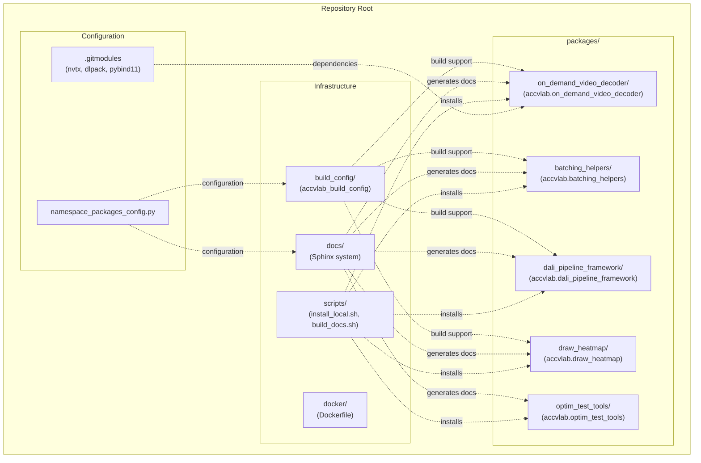
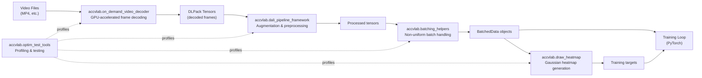
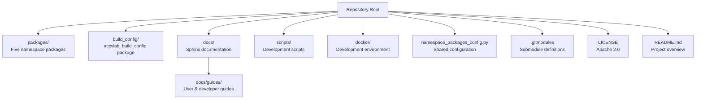

<!-- source: DeepWiki mcp.deepwiki.com · repo NVIDIA/ACCV-Lab · page 1 Overview · fetched 2026-10-26 -->

# Overview

<details>
<summary>Relevant source files</summary>

The following files were used as context for generating this wiki page:

- [.nav](.nav)
- [README.md](README.md)

</details>


This page provides a high-level introduction to ACCV-Lab, its purpose in accelerating ADAS training workflows, and its overall system architecture. For detailed information about repository organization and directory structure, see [Project Structure](#1.1). For in-depth coverage of the individual namespace packages and their functionality, see [Core Packages](#1.2).

## Purpose and Scope

ACCV-Lab (Accelerated Computer Vision Lab) is a systematic collection of Python packages designed to facilitate end-to-end efficient training workflows in the ADAS (Advanced Driver Assistance Systems) domain. Each package provides GPU-accelerated tools and best practices for a specific aspect of ADAS model training, from video frame extraction to data preprocessing, batching, and visualization.

The repository is structured as a monorepo containing five namespace packages under `accvlab.*`, along with shared build configuration, documentation infrastructure, and development tooling.

**Sources:** [README.md:1-5]()

## System Architecture

ACCV-Lab consists of five core namespace packages that form a training pipeline, supported by three infrastructure subsystems: a centralized build system, an automated documentation system, and a Docker-based development environment.

### High-Level Component Organization



**Sources:** [README.md:103-110](), [.nav:1]()

## Core Package Pipeline

The five namespace packages work together to create an efficient ADAS training pipeline. Video frames are decoded on-demand, processed through GPU-accelerated augmentation pipelines, batched to handle non-uniform sample sizes, and visualized with generated heatmaps for training.

### Data Flow Through Core Packages



**Sources:** [README.md:19-33]()

## Package Descriptions

| Package | Namespace | Primary Function |
|---------|-----------|------------------|
| **On-Demand Video Decoder** | `accvlab.on_demand_video_decoder` | GPU-accelerated video frame extraction optimized for training access patterns. Enables training directly from video files with performance comparable to image-based training. |
| **Batching Helpers** | `accvlab.batching_helpers` | Facilitates batching of non-uniform sample sizes common in ADAS domain (e.g., varying numbers of objects per frame). Provides `BatchedData` structure for efficient loss computation. |
| **DALI Pipeline Framework** | `accvlab.dali_pipeline_framework` | Framework built on NVIDIA DALI for creating GPU-accelerated augmentation pipelines for typical ADAS use-cases. Simplifies integration into existing training code. |
| **Draw Heatmap** | `accvlab.draw_heatmap` | GPU-based Gaussian heatmap generation for object detection training. Supports batched data format from Batching Helpers. |
| **Optim Test Tools** | `accvlab.optim_test_tools` | Utilities for testing and profiling optimizations during development and evaluation. |

**Sources:** [README.md:19-36]()

## Supporting Infrastructure

### Build System

The `build_config/` directory contains the `accvlab_build_config` package, which provides centralized build configuration and utilities used by all namespace packages that contain C++/CUDA extensions.

Key components:
- `accvlab_build_config/helpers/build_utils.py` - Configuration loading, CUDA detection, compilation flag generation
- `accvlab_build_config/helpers/cmake_args.py` - CMake argument generation from environment variables
- Environment variable support: `DEBUG_BUILD`, `CPP_STANDARD`, `CUSTOM_CUDA_ARCHS`, etc.

For complete details, see [Build System](#3).

**Sources:** [README.md:106]()

### Documentation System

The `docs/` directory implements a Sphinx-based documentation system with:
- Automatic API documentation generation via `sphinx.ext.autodoc`
- Package documentation mirroring via `mirror_referenced_dirs.py`
- Custom extensions for enhanced documentation features
- Unified build script: `scripts/build_docs.sh`

The system uses `namespace_packages_config.py` as a single source of truth for package discovery and configuration synchronization.

For complete details, see [Documentation System](#4).

**Sources:** [README.md:85-101](), [README.md:107]()

### Development Environment

The `docker/` directory provides a Dockerfile that sets up a complete development environment including:
- CUDA Toolkit (12.3)
- PyTorch with CUDA support
- NVIDIA DALI
- FFmpeg with NVENC support
- LaTeX for documentation generation
- All build tools and dependencies

The Docker image can be built for root usage or configured for a specific user.

For complete details, see [Docker Environment](#2.1).

**Sources:** [README.md:44-67](), [README.md:110]()

## Key Technologies and Dependencies

ACCV-Lab integrates with several key technologies:

| Technology | Purpose | Integration Method |
|------------|---------|-------------------|
| **DLPack** | Zero-copy tensor exchange between packages | Git submodule at `.gitmodules` |
| **NVTX** | Performance profiling instrumentation | Git submodule at `.gitmodules` |
| **Pybind11** | C++/Python bindings for extensions | Git submodule at `.gitmodules` |
| **PyTorch** | CUDA detection and tensor operations | Third-party dependency |
| **NVIDIA DALI** | Base for DALI Pipeline Framework | Third-party dependency |
| **FFmpeg** | Video decoding backend (LGPL 2.1+) | Third-party dependency (dynamic linking) |
| **PyNvVideoCodec** | NVIDIA GPU video decoding | Third-party dependency (MIT) |

Git submodules must be initialized before building:
```bash
git submodule update --init --recursive
```

**Sources:** [README.md:69-73]()

## Repository Layout



**Sources:** [README.md:103-110]()

## Installation and Usage

ACCV-Lab packages can be installed using the provided installation script after initializing git submodules:

```bash
# Initialize git submodules
git submodule update --init --recursive

# Install all namespace packages
./scripts/install_local.sh

# Install in editable/development mode (limited support for packages with compiled extensions)
./scripts/install_local.sh -e
```

Each namespace package can also be installed independently. For detailed installation instructions including Docker setup and dependency requirements, see [Getting Started](#2).

**Sources:** [README.md:69-93]()

## License and Compliance

ACCV-Lab is licensed under Apache License 2.0. The repository includes dependencies with various permissive licenses (MIT, Apache 2.0, BSD 3-Clause) and one copyleft dependency (FFmpeg under LGPL 2.1+) which is dynamically linked to maintain license compliance.

All third-party licenses are documented in `THIRD_PARTY_LICENSES.md`. Contributors must sign off commits with Developer Certificate of Origin (DCO) using `git commit -s`.

For complete licensing details, see [License and Legal](#6).

**Sources:** [README.md:173-175]()

---

