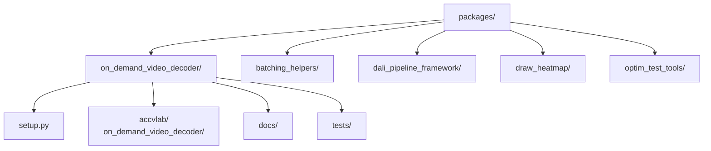
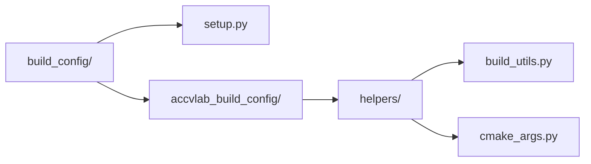
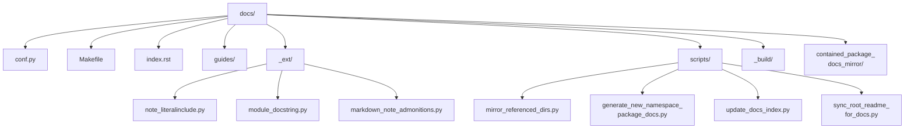
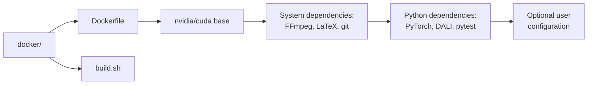

<!-- source: DeepWiki mcp.deepwiki.com · repo NVIDIA/ACCV-Lab · page 1.1 Project Structure · fetched 2026-10-26 -->

# Project Structure

<details>
<summary>Relevant source files</summary>

The following files were used as context for generating this wiki page:

- [.gitignore](.gitignore)
- [README.md](README.md)

</details>


## Purpose and Scope

This document explains the physical organization of the ACCV-Lab repository, including the directory layout and how major components relate to each other. For information about individual packages and their functionality, see [Core Packages](#1.2). For detailed build system information, see [Build System](#3). For documentation system details, see [Documentation System](#4).

## Repository Root Structure

The ACCV-Lab repository follows a monorepo structure with clearly separated subsystems. Each top-level directory serves a specific purpose in the development, build, or deployment workflow.

### Top-Level Directory Layout

| Directory | Purpose | Key Contents |
|-----------|---------|--------------|
| `packages/` | Core functionality packages | Five namespace packages, each with `setup.py` |
| `build_config/` | Shared build infrastructure | `accvlab_build_config` package with build utilities |
| `docs/` | Documentation system | Sphinx configuration, custom extensions, guides |
| `scripts/` | Repository management scripts | Installation, testing, documentation build scripts |
| `docker/` | Containerized development environment | Dockerfile and build scripts |
| `third_party/` | External dependencies as submodules | NVTX, DLPack, Pybind11 |

**Sources:** [README.md:103-110]()

### Repository Root Files

Several configuration files at the repository root define project-wide settings:

| File | Purpose |
|------|---------|
| `.gitignore` | Defines build artifacts, Python cache, and IDE files to exclude from version control |
| `.gitmodules` | Configures git submodules for external dependencies |
| `.clang-format` | Defines C++ code formatting rules |
| `LICENSE` | Apache License 2.0 for the project |
| `CONTRIBUTING.MD` | Contribution guidelines and DCO requirements |
| `THIRD_PARTY_LICENSES.md` | Attribution for all third-party dependencies |
| `README.md` | Project overview and quick start guide |
| `namespace_packages_config.py` | Central configuration for all namespace packages |

**Sources:** [README.md:1-176](), [.gitignore:1-22]()

## Core Packages Directory Structure



**Namespace Package Structure**

The `packages/` directory contains five independent namespace packages, each following a consistent structure:

```
packages/<package_name>/
├── setup.py                          # Package build configuration
├── accvlab/<package_name>/           # Python source code (namespace package)
│   ├── __init__.py
│   ├── <module_files>.py
│   └── cpp/                          # C++/CUDA extensions (if applicable)
├── docs/                             # Package-specific documentation
│   ├── index.rst
│   ├── examples/
│   └── api/
└── tests/                            # Unit and integration tests
    └── test_<module>.py
```

Each package is independently installable via its own `setup.py` and contributes to the `accvlab` namespace. This structure allows packages to be used together or separately based on project requirements.

**Packages:**
- **on_demand_video_decoder** - GPU-accelerated video decoding for training workflows
- **batching_helpers** - Utilities for batching non-uniform samples
- **dali_pipeline_framework** - NVIDIA DALI pipeline abstractions for ADAS use cases
- **draw_heatmap** - GPU-based Gaussian heatmap generation
- **optim_test_tools** - Profiling and testing utilities

For detailed information about each package's functionality, see [Core Packages](#1.2).

**Sources:** [README.md:19-36](), [README.md:105]()

## Build Configuration System



The `build_config/` directory contains the `accvlab_build_config` package, which provides shared build utilities used by all namespace packages. This centralized approach ensures consistent build behavior across packages.

**Key Components:**

| Component | File | Functions |
|-----------|------|-----------|
| Configuration loading | `helpers/build_utils.py` | `load_config()` - Reads from `namespace_packages_config.py` |
| CUDA detection | `helpers/build_utils.py` | `detect_cuda_info()` - Queries PyTorch for CUDA capabilities |
| Compilation flags | `helpers/build_utils.py` | `get_compile_flags()` - Generates C++ compiler flags |
| External builds | `helpers/build_utils.py` | `run_external_build()` - Executes external build systems |
| CMake arguments | `helpers/cmake_args.py` | `build_cmake_args_from_env()` - Converts environment variables to CMake args |

The build system is designed to support both native Python extensions (via setuptools/scikit-build) and external CMake-based builds. It respects environment variables for build customization (e.g., `DEBUG_BUILD`, `CPP_STANDARD`, `CUSTOM_CUDA_ARCHS`).

For comprehensive build system documentation, see [Build System](#3).

**Sources:** [README.md:106]()

## Documentation System



The `docs/` directory implements a sophisticated Sphinx-based documentation system that aggregates documentation from all namespace packages.

**Key Components:**

| Component | Purpose |
|-----------|---------|
| `conf.py` | Sphinx configuration, extensions, and theme settings |
| `Makefile` | Documentation build targets (`html`, `clean`, etc.) |
| `guides/` | Repository-wide guides (installation, development, contribution) |
| `_ext/` | Custom Sphinx extensions for enhanced documentation features |
| `scripts/` | Preprocessing scripts that aggregate package documentation |
| `contained_package_docs_mirror/` | Aggregated view of all package documentation |
| `_build/` | Generated HTML documentation output |

**Documentation Preprocessing Flow:**

1. `mirror_referenced_dirs.py` - Creates unified view of package docs in `contained_package_docs_mirror/`
2. `generate_new_namespace_package_docs.py` - Auto-generates API documentation structure
3. `sync_root_readme_for_docs.py` - Integrates root README into documentation
4. `update_docs_index.py` - Updates main documentation index

**Custom Sphinx Extensions:**

- `note_literalinclude.py` - Enhanced code inclusion with note formatting
- `module_docstring.py` - Extracts and formats module-level docstrings
- `markdown_note_admonitions.py` - Converts Markdown note syntax to Sphinx admonitions

For detailed documentation system information, see [Documentation System](#4).

**Sources:** [README.md:107]()

## Development Support Infrastructure

### Scripts Directory

The `scripts/` directory contains automation scripts for common development tasks:

| Script | Purpose |
|--------|---------|
| `install_local.sh` | Installs all namespace packages (supports `-e` for editable mode) |
| `build_docs.sh` | Builds Sphinx documentation |
| `run_tests.sh` | Executes test suite across all packages |
| `format_code.sh` | Applies code formatting (clang-format, black) |

These scripts provide a consistent interface for development operations and are referenced throughout the repository guides.

**Sources:** [README.md:75-88](), [README.md:108]()

### Docker Development Environment



The `docker/` directory provides a complete containerized development environment with all dependencies pre-installed. The Dockerfile supports two build modes:

- **Root mode** (default): Container runs as root user
- **User mode**: Container configured for specific user (via build arguments `USER_ID`, `USER_NAME`, `GROUP_ID`, `GROUP_NAME`)

The Docker image includes FFmpeg (with LGPL compliance), CUDA toolkit, PyTorch, NVIDIA DALI, and all development tools required for building and testing ACCV-Lab packages.

For detailed Docker usage information, see [Docker Environment](#2.1).

**Sources:** [README.md:46-67](), [README.md:110]()

## Configuration and External Dependencies

### Ignored Artifacts

The [.gitignore:1-22]() file excludes build artifacts and development files from version control:

| Pattern | Purpose |
|---------|---------|
| `build/`, `**/_skbuild/` | Build output directories |
| `*.egg-info/` | Python package metadata |
| `__pycache__/`, `*.pyc`, `*.pyo` | Python bytecode |
| `*.so`, `*.whl` | Compiled binaries and wheels |
| `.vscode/`, `*.code-workspace` | IDE configuration |

**Sources:** [.gitignore:1-22]()

### Git Submodules

The repository uses git submodules in the `third_party/` directory for critical external dependencies:

| Submodule | Purpose | License |
|-----------|---------|---------|
| `nvtx` | NVIDIA Tools Extension Library for profiling | Apache 2.0 |
| `dlpack` | Zero-copy tensor exchange format | Apache 2.0 |
| `pybind11` | C++ to Python bindings | 3-Clause BSD |

These submodules must be initialized before building packages:
```bash
git submodule update --init --recursive
```

For more information about external dependencies, see [External Dependencies](#2.3) and [Repository Configuration Files](#7.1).

**Sources:** [README.md:69-73]()

### Shared Configuration System

The `namespace_packages_config.py` file at the repository root serves as the single source of truth for package metadata. This configuration is consumed by both the build system and documentation system to ensure consistency.

The file defines package names, descriptions, dependencies, and documentation structure. Changes to this file automatically propagate to build configurations and generated documentation.

For detailed information about the shared configuration system, see [Shared Configuration System](#7.2).

**Sources:** [README.md:1-176]()

## Component Interaction Overview

```mermaid
graph TB
    subgraph "Repository Root"
        ns_config["namespace_packages_<br/>config.py"]
        scripts["scripts/"]
    end
    
    subgraph "Namespace Packages"
        pkg1["on_demand_video_<br/>decoder/setup.py"]
        pkg2["batching_helpers/<br/>setup.py"]
        pkg3["dali_pipeline_<br/>framework/setup.py"]
        pkg4["draw_heatmap/<br/>setup.py"]
        pkg5["optim_test_tools/<br/>setup.py"]
    end
    
    subgraph "Build System"
        build_pkg["build_config/<br/>accvlab_build_config"]
        build_utils["helpers/build_utils.py"]
        cmake_args["helpers/cmake_args.py"]
    end
    
    subgraph "Documentation System"
        sphinx_conf["docs/conf.py"]
        doc_scripts["docs/scripts/"]
        mirror["contained_package_<br/>docs_mirror/"]
    end
    
    subgraph "Development"
        docker["docker/Dockerfile"]
        git_sub["third_party/<br/>submodules"]
    end
    
    ns_config -.->|"defines packages"| pkg1
    ns_config -.->|"defines packages"| pkg2
    ns_config -.->|"defines packages"| pkg3
    ns_config -.->|"defines packages"| pkg4
    ns_config -.->|"defines packages"| pkg5
    
    ns_config -.->|"configures"| sphinx_conf
    ns_config -.->|"used by"| doc_scripts
    
    build_pkg -->|"provides utilities to"| pkg1
    build_pkg -->|"provides utilities to"| pkg2
    build_pkg -->|"provides utilities to"| pkg3
    build_pkg -->|"provides utilities to"| pkg4
    build_pkg -->|"provides utilities to"| pkg5
    
    build_utils -->|"detects CUDA"| pkg1
    cmake_args -->|"generates args"| pkg1
    
    scripts -->|"install_local.sh<br/>installs"| pkg1
    scripts -->|"install_local.sh<br/>installs"| pkg2
    scripts -->|"install_local.sh<br/>installs"| pkg3
    scripts -->|"install_local.sh<br/>installs"| pkg4
    scripts -->|"install_local.sh<br/>installs"| pkg5
    
    scripts -->|"build_docs.sh<br/>generates"| sphinx_conf
    
    doc_scripts -->|"mirrors docs from"| pkg1
    doc_scripts -->|"mirrors docs from"| pkg2
    doc_scripts -->|"mirrors docs from"| pkg3
    doc_scripts -->|"mirrors docs from"| pkg4
    doc_scripts -->|"mirrors docs from"| pkg5
    
    doc_scripts -->|"creates"| mirror
    
    docker -->|"includes"| git_sub
    docker -->|"environment for"| pkg1
    docker -->|"environment for"| pkg2
    
    git_sub -->|"used by"| pkg1
```



**Interaction Patterns:**

1. **Shared Configuration Flow**: `namespace_packages_config.py` drives both package builds and documentation generation
2. **Build System Flow**: `build_config` package provides utilities consumed by all namespace package `setup.py` files
3. **Documentation Flow**: Scripts in `docs/scripts/` aggregate package documentation into `contained_package_docs_mirror/`
4. **Development Flow**: Scripts in `scripts/` orchestrate installation, testing, and documentation builds
5. **Dependency Flow**: Git submodules in `third_party/` provide headers and libraries for package compilation

**Sources:** [README.md:1-176]()

---

