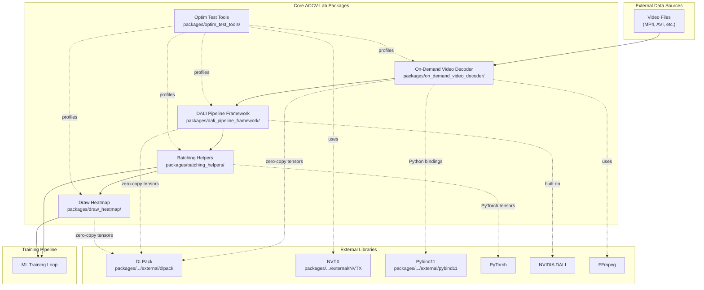
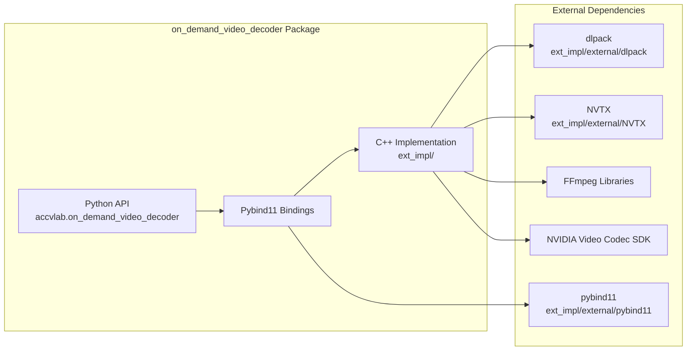
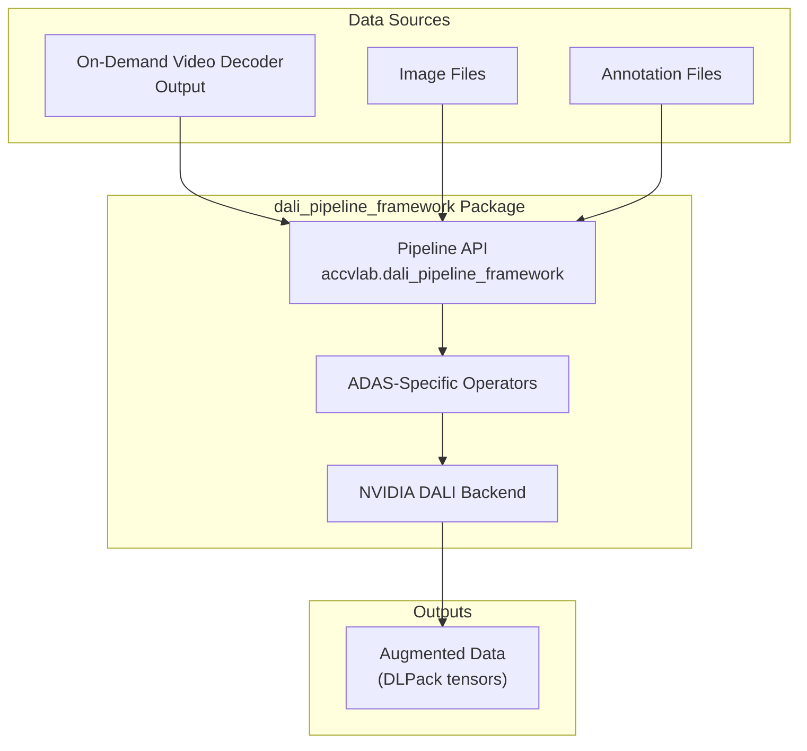
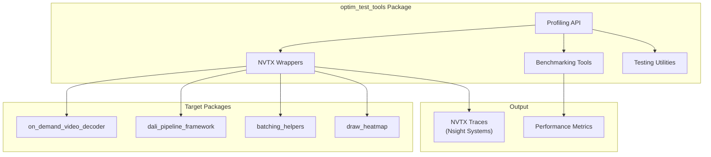
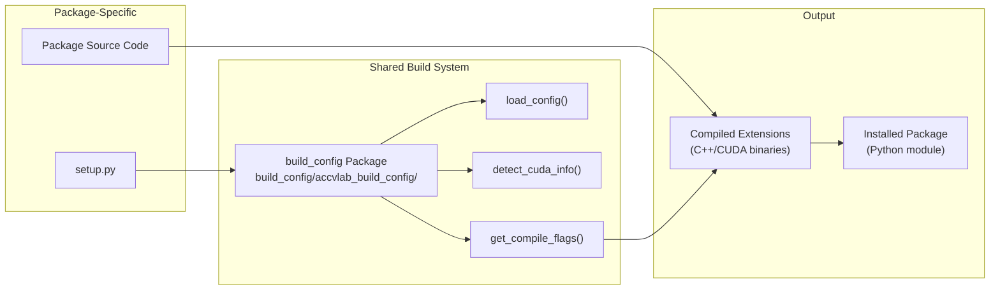
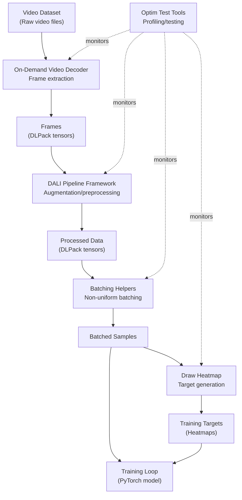

<!-- source: DeepWiki mcp.deepwiki.com · repo NVIDIA/ACCV-Lab · page 1.2 Core Packages · fetched 2026-10-26 -->

# Core Packages

<details>
<summary>Relevant source files</summary>

The following files were used as context for generating this wiki page:

- [.gitmodules](.gitmodules)
- [README.md](README.md)
- [THIRD_PARTY_LICENSES.md](THIRD_PARTY_LICENSES.md)

</details>


This document provides an overview of the five namespace packages that comprise the ACCV-Lab toolkit. Each package addresses a specific aspect of the ADAS (Advanced Driver Assistance Systems) training workflow, from video decoding to data augmentation to visualization. For information about the repository structure and organization, see [Project Structure](#1.1). For installation instructions, see [Getting Started](#2).

## Overview

ACCV-Lab consists of five independently installable namespace packages located in the [packages/]() directory. These packages are designed to work together to create efficient end-to-end ADAS training pipelines while remaining modular enough to be used independently.

| Package Name | Location | Primary Function | Key Technologies |
|--------------|----------|------------------|------------------|
| On-Demand Video Decoder | `packages/on_demand_video_decoder/` | GPU-accelerated video frame extraction | FFmpeg, NVIDIA Video Codec SDK, DLPack |
| Batching Helpers | `packages/batching_helpers/` | Non-uniform sample size batching | PyTorch, DLPack |
| DALI Pipeline Framework | `packages/dali_pipeline_framework/` | Data augmentation and preprocessing | NVIDIA DALI, DLPack |
| Draw Heatmap | `packages/draw_heatmap/` | GPU heatmap generation | CUDA, DLPack |
| Optim Test Tools | `packages/optim_test_tools/` | Profiling and testing utilities | NVTX, Python profiling tools |

**Sources:** [README.md:19-33]()

## Package Architecture

The following diagram illustrates how the core packages relate to each other and to external dependencies in a typical ADAS training workflow:



**Sources:** [README.md:19-36](), Diagram 4 from high-level architecture

## On-Demand Video Decoder

The On-Demand Video Decoder package provides GPU-accelerated video frame extraction optimized for training workloads. It is designed to enable training directly from video files with performance comparable to image-based training.

### Key Features

- **GPU-accelerated decoding** using NVIDIA Video Codec SDK
- **DLPack tensor output** for zero-copy integration with other frameworks
- **Access patterns optimized for training** including random frame access and sequential streaming
- **NVTX instrumentation** for detailed performance profiling
- **FFmpeg integration** for broad video format support

### Architecture



### Git Submodules

The On-Demand Video Decoder package includes three critical dependencies as git submodules:

- **NVTX** at [packages/on_demand_video_decoder/ext_impl/external/NVTX]()
- **dlpack** at [packages/on_demand_video_decoder/ext_impl/external/dlpack]()
- **pybind11** at [packages/on_demand_video_decoder/ext_impl/external/pybind11]()

These submodules must be initialized before building the package using `git submodule update --init --recursive`.

**Sources:** [.gitmodules:1-11](), [README.md:20-23](), [THIRD_PARTY_LICENSES.md:5-8]()

## Batching Helpers

The Batching Helpers package facilitates batching of samples with non-uniform sizes, a common challenge in ADAS domain loss computation. This package enables efficient GPU memory utilization when dealing with variable-sized inputs.

### Key Features

- **Non-uniform sample batching** for variable-sized data structures
- **PyTorch integration** for seamless use in existing training code
- **Minimal overhead** with efficient memory management
- **Common ADAS patterns** addressing typical use cases in autonomous driving

### Use Cases

The package is particularly useful for:
- Object detection with variable numbers of objects per frame
- Point cloud processing with varying point counts
- Multi-scale feature maps
- Variable-length sequence data

**Sources:** [README.md:24-25]()

## DALI Pipeline Framework

The DALI Pipeline Framework is built on top of NVIDIA DALI and simplifies the creation of data processing pipelines for typical ADAS use cases. It provides high-level abstractions that enable integration into existing training implementations with minimal code changes.

### Key Features

- **NVIDIA DALI foundation** leveraging GPU-accelerated data loading and augmentation
- **ADAS-specific operators** tailored for autonomous driving workflows
- **Simplified pipeline creation** with high-level APIs
- **DLPack integration** for zero-copy tensor exchange
- **Minimal integration overhead** allowing drop-in replacement of existing data loaders

### Integration Pattern



**Sources:** [README.md:26-29](), [THIRD_PARTY_LICENSES.md:9]()

## Draw Heatmap

The Draw Heatmap package provides GPU-accelerated generation of Gaussian heatmaps, commonly used as training targets in object detection and keypoint estimation tasks.

### Key Features

- **GPU implementation** for high-throughput heatmap generation
- **Gaussian heatmap rendering** with configurable parameters
- **Batching Helpers integration** supporting non-uniform batch formats
- **DLPack output** for zero-copy integration
- **Flexible API** supporting various heatmap generation patterns

### Typical Workflow

The package is typically used in the following sequence:

1. Receive detection/keypoint annotations
2. Generate Gaussian heatmaps on GPU
3. Output as training targets for the model
4. Optionally batch using Batching Helpers for non-uniform sizes

**Sources:** [README.md:30-31]()

## Optim Test Tools

The Optim Test Tools package provides utilities for testing and profiling optimization implementations. This is particularly useful during development and evaluation phases.

### Key Features

- **NVTX integration** for detailed GPU profiling
- **Benchmarking utilities** for performance measurement
- **Testing helpers** for validation of optimizations
- **Profiling support** for all other ACCV-Lab packages

### Cross-Package Profiling



**Sources:** [README.md:32-33](), [THIRD_PARTY_LICENSES.md:8]()

## Shared Dependencies

All core packages share common dependencies managed at the repository level.

### Git Submodules

The following dependencies are included as git submodules and must be initialized before building:

| Submodule | Location | License | Purpose |
|-----------|----------|---------|---------|
| NVTX | `packages/on_demand_video_decoder/ext_impl/external/NVTX` | Apache 2.0 with LLVM Exceptions | Performance profiling instrumentation |
| dlpack | `packages/on_demand_video_decoder/ext_impl/external/dlpack` | Apache 2.0 | Zero-copy tensor exchange standard |
| pybind11 | `packages/on_demand_video_decoder/ext_impl/external/pybind11` | 3-Clause BSD | Python-C++ binding generation |

### Third-Party Libraries

The packages depend on the following external libraries installed in the environment:

| Library | Version | License | Used By |
|---------|---------|---------|---------|
| FFmpeg | 4.4.6 | LGPL 2.1+ | On-Demand Video Decoder |
| PyTorch | 2.6 | 3-Clause BSD | Batching Helpers, training integration |
| NVIDIA DALI | 1.51.2 | Apache 2.0 | DALI Pipeline Framework |
| PyNvVideoCodec | 1.0.2 | MIT | On-Demand Video Decoder |
| CV-CUDA | da51fc96 | Apache 2.0 | Optional DALI operations |

**Sources:** [.gitmodules:1-11](), [THIRD_PARTY_LICENSES.md:1-14]()

## Build Configuration

All core packages use the shared build configuration system provided by the `build_config` package. This ensures consistent compilation flags, CUDA architecture targeting, and dependency management across all packages. For detailed information about the build system, see [Build System](#3).

### Common Build Process



Each package's `setup.py` imports utilities from `accvlab_build_config` to configure the build process, ensuring consistency across all packages.

**Sources:** [README.md:105-110](), Diagram 2 from high-level architecture

## Package Installation

All packages can be installed using the provided installation script:

```bash
# Install all packages
./scripts/install_local.sh

# Install in editable/development mode (where supported)
./scripts/install_local.sh -e
```

**Note:** Some packages that use `scikit-build` for native C++ extensions may not support editable installation mode. In such cases, the package will be installed normally even when the `-e` flag is specified.

For detailed installation instructions including Docker setup and dependency management, see [Getting Started](#2) and [Local Installation](#2.2).

**Sources:** [README.md:78-93]()

## Data Flow and Integration

The following diagram shows how data flows through the core packages in a typical ADAS training pipeline:



**Key Integration Points:**

- **DLPack tensors** enable zero-copy data transfer between packages
- **GPU memory** remains on device throughout the pipeline
- **NVTX instrumentation** allows end-to-end profiling
- **PyTorch compatibility** ensures seamless integration with training code

**Sources:** [README.md:19-36](), Diagram 4 from high-level architecture

## Documentation

Each package includes its own detailed documentation covering:

- API reference with function signatures and parameters
- Usage examples demonstrating typical workflows
- Performance benchmarks and evaluation results
- Implementation details and design decisions

The complete documentation can be built using:

```bash
./scripts/build_docs.sh
```

Online documentation is available at [NVIDIA.github.io/ACCV-Lab](https://NVIDIA.github.io/ACCV-Lab).

For information about the documentation system and how to contribute documentation, see [Documentation System](#4).

**Sources:** [README.md:35-42](), [README.md:85-101]()

---

