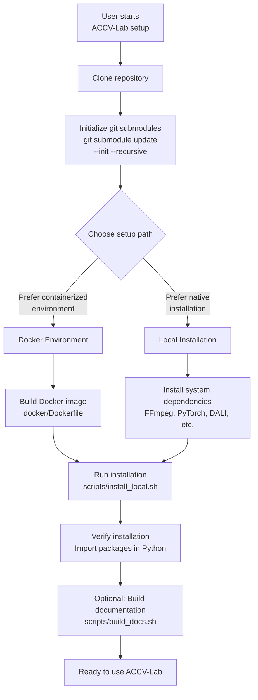
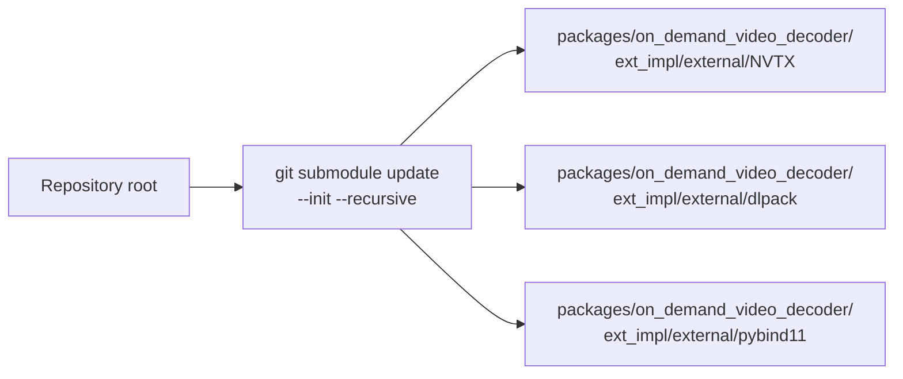
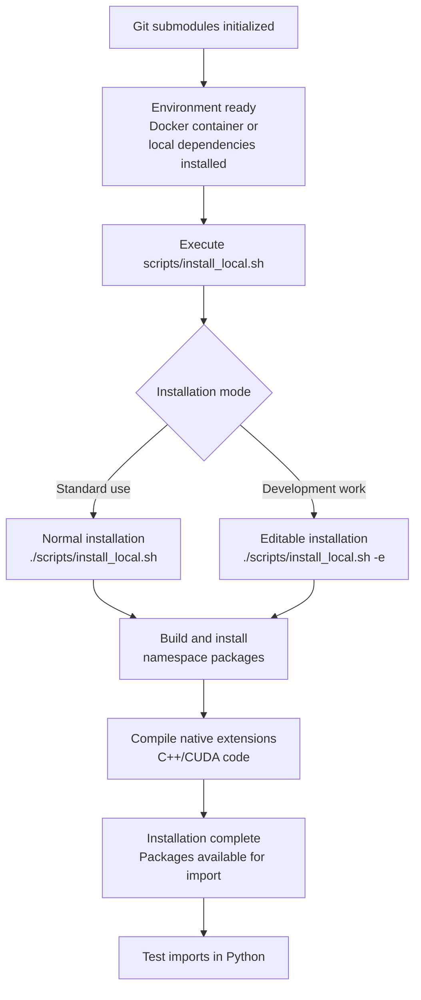
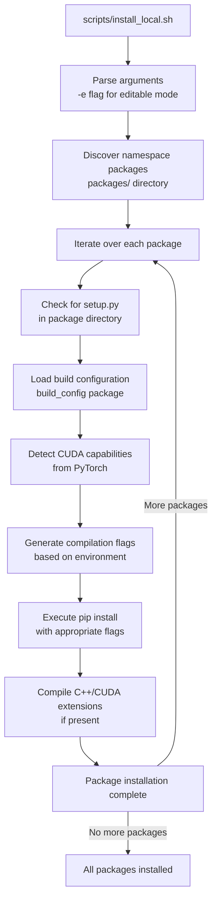
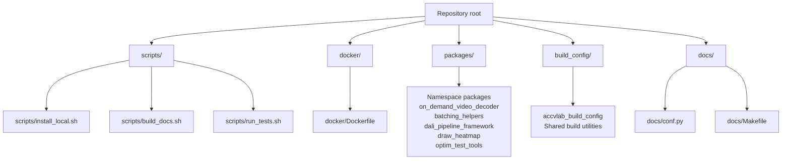

<!-- source: DeepWiki mcp.deepwiki.com · repo NVIDIA/ACCV-Lab · page 2 Getting Started · fetched 2026-10-26 -->

# Getting Started

<details>
<summary>Relevant source files</summary>

The following files were used as context for generating this wiki page:

- [.gitmodules](.gitmodules)
- [README.md](README.md)

</details>


This document provides an overview of the initial setup process for ACCV-Lab, covering prerequisites, environment setup options, and the basic installation workflow. It serves as an entry point for both users who want to use ACCV-Lab packages and developers who plan to contribute.

For detailed instructions on specific setup methods, see:
- Docker environment setup: [Docker Environment](#2.1)
- Local installation procedures: [Local Installation](#2.2)
- External dependency management: [External Dependencies](#2.3)
- Full development workflow and contribution guidelines: [Contributing](#5)

## Prerequisites

Before installing ACCV-Lab, ensure the following requirements are met:

| Requirement | Purpose | Notes |
|-------------|---------|-------|
| Git | Repository cloning and submodule management | Required for initializing submodules |
| Git submodules | External dependencies (NVTX, DLPack, Pybind11) | Must be initialized before installation |
| CUDA-capable GPU | GPU-accelerated operations | Required for On-Demand Video Decoder |
| Docker (optional) | Containerized environment with all dependencies | Recommended for ease of setup |
| Python 3.x | Runtime environment | Version compatibility depends on PyTorch |
| PyTorch | Deep learning framework | Required by multiple packages |

## Setup Path Overview

ACCV-Lab supports two primary setup paths:



**Sources:** [README.md:44-101]()

## Git Submodule Initialization

ACCV-Lab relies on three external dependencies managed as git submodules. These must be initialized before any installation attempt.



Execute the following command from the repository root:

```bash
git submodule update --init --recursive
```

This command initializes and fetches:
- **NVTX** ([packages/on_demand_video_decoder/ext_impl/external/NVTX]()): Performance profiling instrumentation
- **dlpack** ([packages/on_demand_video_decoder/ext_impl/external/dlpack]()): Zero-copy tensor exchange format
- **pybind11** ([packages/on_demand_video_decoder/ext_impl/external/pybind11]()): C++/Python binding library

**Sources:** [README.md:69-73](), [.gitmodules:1-12]()

## Installation Workflow

The installation process follows a consistent workflow regardless of the chosen setup path:



### Basic Installation Commands

Install all ACCV-Lab namespace packages:

```bash
./scripts/install_local.sh
```

Install in editable mode (for development):

```bash
./scripts/install_local.sh -e
```

**Important:** Editable installation mode is not supported for packages using `scikit-build`. Attempting editable installation for these packages will result in missing binaries and import errors. Refer to [Local Installation](#2.2) for details on installation mode limitations.

**Sources:** [README.md:76-93]()

## Installation Script Execution Flow

The `install_local.sh` script orchestrates the installation of all namespace packages:



**Sources:** [README.md:76-93]()

## Verification

After installation, verify that packages can be imported:

```python
# Test core package imports
import accvlab.on_demand_video_decoder
import accvlab.batching_helpers
import accvlab.dali_pipeline_framework
import accvlab.draw_heatmap
import accvlab.optim_test_tools
```

If imports fail:
1. Verify git submodules were initialized ([External Dependencies](#2.3))
2. Check for missing system dependencies
3. Ensure CUDA toolkit is properly installed
4. Review installation logs for build errors

## Documentation Building

Documentation can be built after package installation:

```bash
./scripts/build_docs.sh
```

**Important:** Documentation generation requires installed packages because Sphinx's autodoc extension imports modules to extract docstrings and API information. This includes native C++/CUDA extensions, which must be compiled before documentation building.

The generated documentation will be available in `docs/_build/html/`.

**Sources:** [README.md:85-101]()

## Post-Installation Steps

| Task | Command/Location | Purpose |
|------|------------------|---------|
| View package documentation | `docs/_build/html/index.html` or [NVIDIA.github.io/ACCV-Lab](https://NVIDIA.github.io/ACCV-Lab) | Learn package APIs and usage examples |
| Run tests | `./scripts/run_tests.sh` | Verify installation correctness |
| Set up development tools | See [Contributing](#5) | Enable code formatting and quality checks |
| Configure build options | See [Build System](#3) | Customize compilation settings |

## Environment Options Comparison

| Aspect | Docker Environment | Local Installation |
|--------|-------------------|-------------------|
| Setup complexity | Low - pre-configured | High - manual dependency installation |
| Isolation | Complete - containerized | None - uses host system |
| Reproducibility | High - Dockerfile-defined | Variable - depends on host system |
| Performance | Near-native (with nvidia-docker) | Native |
| Development workflow | Requires container runtime | Direct file system access |
| Disk space | Higher - includes all dependencies | Lower - only required components |

For detailed setup instructions:
- **Docker approach**: [Docker Environment](#2.1)
- **Local approach**: [Local Installation](#2.2)

## Key Files and Directories



**Sources:** [README.md:103-110]()

## Common Setup Issues

| Issue | Symptoms | Solution |
|-------|----------|----------|
| Missing submodules | Import errors for NVTX, DLPack, or Pybind11 | Run `git submodule update --init --recursive` |
| CUDA not detected | Build warnings about missing CUDA | Verify CUDA toolkit installation and PyTorch CUDA support |
| FFmpeg missing | On-Demand Video Decoder build fails | Install FFmpeg with development headers |
| Permission errors | Cannot write to installation directory | Use virtual environment or check file permissions |
| Editable install failures | Missing binaries after editable install | Use normal installation mode for scikit-build packages |

## Next Steps

Once installation is complete:

1. **Explore package documentation**: Review the `CONTAINED PACKAGES` section for detailed information about each namespace package
2. **Review examples**: Study usage examples included in package documentation
3. **Understand the build system**: See [Build System](#3) for customization options
4. **Set up for development**: Follow [Contributing](#5) if planning to contribute

For specific setup paths:
- [Docker Environment](#2.1) - Containerized setup with all dependencies
- [Local Installation](#2.2) - Native installation on host system
- [External Dependencies](#2.3) - Details on git submodules and third-party libraries

**Sources:** [README.md:1-176]()

---

