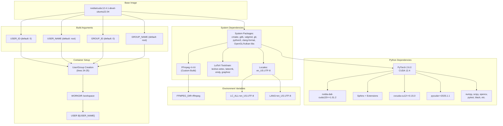
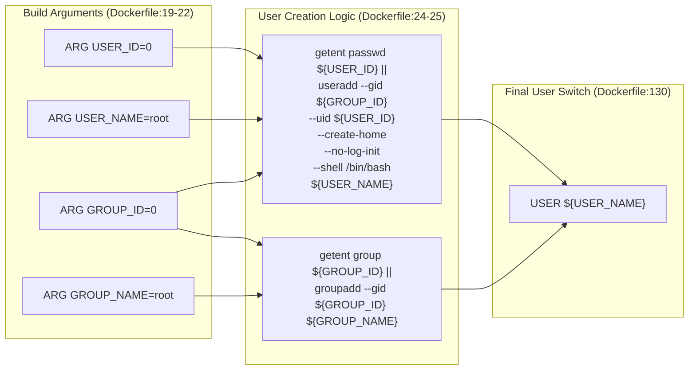
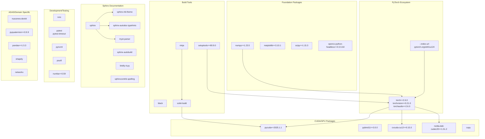

<!-- source: DeepWiki mcp.deepwiki.com · repo NVIDIA/ACCV-Lab · page 2.1 Docker Environment · fetched 2026-10-26 -->

# Docker Environment

<details>
<summary>Relevant source files</summary>

The following files were used as context for generating this wiki page:

- [README.md](README.md)
- [docker/Dockerfile](docker/Dockerfile)
- [docker/run_docker_build.sh](docker/run_docker_build.sh)

</details>


This page provides a comprehensive guide to building and using the Docker container for ACCV-Lab development and deployment. It covers the Dockerfile structure, build options for both root and user-specific configurations, and the complete environment setup including all dependencies required for ACCV-Lab packages.

For instructions on installing ACCV-Lab packages after setting up the Docker environment, see [Local Installation](#2.2). For details on the external dependencies managed through git submodules, see [External Dependencies](#2.3).

## Overview

The ACCV-Lab Docker environment is defined in [docker/Dockerfile:1-130]() and provides a complete development and runtime environment based on `nvidia/cuda:12.4.1-devel-ubuntu22.04`. The container includes all dependencies required for building and running ACCV-Lab packages, including CUDA toolkit, PyTorch, NVIDIA DALI, FFmpeg, and documentation generation tools.

The Docker environment supports two configuration modes:
- **Root mode**: Default build for use as root user
- **User-specific mode**: Configurable build that creates a user matching the host system's UID/GID to avoid permission issues

**Sources**: [README.md:44-67](), [docker/Dockerfile:15-26]()

## Docker Environment Architecture



**Sources**: [docker/Dockerfile:15-130]()

## Building the Docker Image

### Basic Build (Root User)

To build the Docker image for use as the root user, run from the repository root:

```bash
docker build -t accvlab:latest -f docker/Dockerfile .
```

Or from inside the `docker/` directory:

```bash
docker build -t accvlab:latest .
```

This creates an image where the default user is `root` (UID 0, GID 0).

**Sources**: [README.md:50-54]()

### User-Specific Build

To build a Docker image configured for your current user (recommended for development to avoid permission issues):

```bash
docker build \
  --build-arg USER_ID=$(id -u) \
  --build-arg USER_NAME=$(id -un) \
  --build-arg GROUP_ID=$(id -g) \
  --build-arg GROUP_NAME=$(id -gn) \
  -t accvlab:latest \
  -f docker/Dockerfile .
```

This configuration ensures files created inside the container have the same ownership as your host user.

**Sources**: [README.md:56-63]()

### Using the Build Script

A convenience script [docker/run_docker_build.sh:1-38]() automates the user-specific build process:

```bash
cd docker
./run_docker_build.sh
```

The script accepts environment variables to customize the build:

| Environment Variable | Default Value | Description |
|---------------------|---------------|-------------|
| `TAG` | `accvlab` | Docker image tag |
| `USER_ID` | `$(id -u)` | User ID for container user |
| `USER_NAME` | `$(whoami)` | Username for container user |
| `GROUP_ID` | `$(id -g)` | Group ID for container user |
| `GROUP_NAME` | `$(id -gn)` | Group name for container user |

Example with custom tag:

```bash
TAG=accvlab:dev ./run_docker_build.sh
```

**Sources**: [docker/run_docker_build.sh:17-36]()

## Build Arguments and User Configuration

The Dockerfile defines four build arguments that control user creation:



The user creation logic [docker/Dockerfile:24-25]() uses `getent` to check if the user/group already exists before attempting creation, making it safe for both root (UID 0) and custom user configurations.

**Sources**: [docker/Dockerfile:19-26](), [docker/Dockerfile:130]()

## Installed System Packages

The Dockerfile installs system packages in several stages:

### Development Tools

[docker/Dockerfile:32-55]() installs core development tools:

| Package Category | Packages | Purpose |
|-----------------|----------|---------|
| Build Tools | `cmake`, `ninja` | Build system tools |
| Debugging | `gdb`, `valgrind` | Runtime debugging |
| Version Control | `git`, `git-lfs` | Source control |
| Python Environment | `python3`, `python3-dev`, `python3-pip`, `python-is-python3` | Python runtime and development |
| Code Formatting | `clang-format` | C++ code formatting |
| Graphics Libraries | `freeglut3-dev`, `libglew-dev`, `mesa-*`, `libvulkan-dev` | OpenGL/Vulkan support for video decoding |
| Utilities | `htop`, `nano`, `pkg-config`, `enchant-2` | System utilities |

**Sources**: [docker/Dockerfile:32-55]()

### Documentation Tools

[docker/Dockerfile:70-72]() installs the LaTeX toolchain for PDF documentation generation:

- `latexmk`: LaTeX build automation
- `texlive-xetex`: XeLaTeX engine
- `texlive-latex-extra`, `texlive-fonts-*`: LaTeX packages and fonts
- `xindy`: Index generation
- `graphviz`: Diagram generation for Sphinx
- `fonts-dejavu`: TrueType fonts

**Sources**: [docker/Dockerfile:70-72]()

### Locale Configuration

[docker/Dockerfile:74-82]() configures UTF-8 locales required by Sphinx:

```bash
# Generate en_US.UTF-8 locale
sed -i -e 's/# en_US.UTF-8 UTF-8/en_US.UTF-8 UTF-8/' /etc/locale.gen && locale-gen

# Environment variables
ENV LC_ALL=en_US.UTF-8
ENV LANG=en_US.UTF-8
ENV LANGUAGE=en_US.UTF-8
```

**Sources**: [docker/Dockerfile:74-82]()

## FFmpeg Configuration

### Custom FFmpeg Build

The Dockerfile builds FFmpeg 4.4.6 from source with a minimal configuration [docker/Dockerfile:56-68]():

```bash
cd /tmp && mkdir ffmpeg && cd ffmpeg
wget https://ffmpeg.org/releases/ffmpeg-4.4.6.tar.xz
tar -xf ffmpeg-4.4.6.tar.xz && cd ffmpeg-4.4.6

LDSOFLAGS=-Wl,-rpath,'$$ORIGIN' ./configure \
  --enable-shared \
  --disable-encoders \
  --disable-decoders \
  --enable-decoder=vp9 \
  --arch=x86_64 \
  --prefix=/ffmpeg

make -j && make install
```

### Configuration Details

| Configure Flag | Purpose |
|----------------|---------|
| `--enable-shared` | Build shared libraries (`.so` files) |
| `--disable-encoders` | Disable all encoders (not needed for decoding) |
| `--disable-decoders` | Disable all decoders by default |
| `--enable-decoder=vp9` | Enable only VP9 decoder |
| `--arch=x86_64` | Target x86_64 architecture |
| `--prefix=/ffmpeg` | Install to `/ffmpeg` directory |
| `LDSOFLAGS=-Wl,-rpath,'$$ORIGIN'` | Set RPATH for runtime library loading |

The environment variable `FFMPEG_DIR=/ffmpeg` [docker/Dockerfile:68]() is set to help the On-Demand Video Decoder package locate FFmpeg libraries during build.

### LGPL Compliance

This configuration ensures LGPL 2.1+ compliance by:
1. Building as shared libraries (`--enable-shared`)
2. Allowing runtime dynamic linking
3. Minimal decoder support (only VP9 enabled)

The reduced functionality minimizes the FFmpeg dependency surface area while providing necessary video decoding capabilities for the On-Demand Video Decoder package.

**Sources**: [docker/Dockerfile:56-68]()

## Python Packages

### Installation Sequence

The Python packages are installed in a specific order to manage dependencies:



**Sources**: [docker/Dockerfile:84-127]()

### Package Categories

#### Core Scientific Computing
[docker/Dockerfile:84-87]()
- `numpy==1.23.5`: Array operations
- `matplotlib==3.10.1`: Plotting
- `scipy==1.15.3`: Scientific computing
- `opencv-python-headless==4.5.5.64`: Computer vision (headless for server environments)

#### PyTorch
[docker/Dockerfile:89]()
- `torch==2.6.0`, `torchvision==0.21.0`, `torchaudio==2.6.0`
- CUDA 12.4 builds from PyTorch's repository

#### Build and Development Tools
[docker/Dockerfile:91](), [docker/Dockerfile:101-102](), [docker/Dockerfile:124]()
- `black`: Python code formatter
- `ninja`: Fast build system
- `scikit-build`: CMake-based Python package builder
- `setuptools==80.9.0`: Package installation tool

#### Documentation Generation
[docker/Dockerfile:93-99]()
- `sphinx`: Documentation generator
- `sphinx-rtd-theme`: Read the Docs theme
- `sphinx-autodoc-typehints`: Type hint support
- `sphinx-autobuild`: Auto-rebuild on changes
- `myst-parser`: Markdown support
- `sphinxcontrib-spelling`: Spell checking

#### CUDA/GPU Acceleration
[docker/Dockerfile:104-106](), [docker/Dockerfile:126]()
- `pycuda==2025.1.1`: Python CUDA bindings
- `pybind11==3.0.0`: C++/Python binding library
- `cvcuda-cu12==0.15.0`: NVIDIA CV-CUDA
- `cupy`: NumPy-compatible GPU arrays

#### NVIDIA DALI and Related
[docker/Dockerfile:108-114]()
- `nvidia-dali-cuda120==1.51.2`: Data loading library
- `nvtx`: NVIDIA profiling markers
- `psutil`: System monitoring
- `numba==0.59`: JIT compiler
- `pyquaternion==0.9.9`: Quaternion math

#### Testing
[docker/Dockerfile:119-120]()
- `pytest`, `pytest-timeout`: Testing framework
- `pynvml`: NVIDIA Management Library bindings

#### ADAS Domain Dependencies
[docker/Dockerfile:116-117]()
- `nuscenes-devkit`: nuScenes dataset tools
- `shapely`, `tqdm`, `pillow`, `networkx`, `fire`: Supporting utilities
- `pandas==1.5.3`: Data manipulation

**Sources**: [docker/Dockerfile:84-127]()

## Container Runtime Requirements

### NVIDIA Container Runtime

To use the On-Demand Video Decoder package, the NVIDIA Container Runtime must be installed on the host system. This provides GPU access inside the container.

The README [README.md:65-67]() notes:

> **⚠️ Important**: If you want to run the On-Demand Video Decoder package inside the docker container, you need to install and use the Nvidia container runtime.

Without the NVIDIA Container Runtime, GPU-accelerated video decoding will not function.

**Sources**: [README.md:65-67]()

### Running the Container

To run the container with GPU support:

```bash
docker run --gpus all -it --rm -v $(pwd):/workspace accvlab:latest
```

Key docker run flags:
- `--gpus all`: Enable all GPUs in the container
- `-it`: Interactive terminal
- `--rm`: Remove container after exit
- `-v $(pwd):/workspace`: Mount current directory to `/workspace`

**Sources**: [docker/Dockerfile:128]() (workdir), [README.md:65-67]()

## Working Directory and User Context

The Dockerfile sets up the final container state:

1. **Working Directory** [docker/Dockerfile:128](): Set to `/workspace`
   ```dockerfile
   WORKDIR /workspace
   ```

2. **User Context** [docker/Dockerfile:130](): Switch to the configured user
   ```dockerfile
   USER ${USER_NAME}
   ```

This means:
- The container starts in `/workspace` directory
- All commands run as the user specified by `USER_NAME` build argument
- For user-specific builds, this matches the host user, avoiding permission issues
- For root builds, this is the `root` user

**Sources**: [docker/Dockerfile:128-130]()

## Post-Installation Steps

After building and running the Docker container, you need to:

1. **Initialize git submodules** [README.md:69-73]():
   ```bash
   git submodule update --init --recursive
   ```

2. **Install ACCV-Lab packages** [README.md:75-93]():
   ```bash
   ./scripts/install_local.sh
   ```

3. **Build documentation** (optional) [README.md:85-88]():
   ```bash
   ./scripts/build_docs.sh
   ```

For detailed installation instructions, see [Local Installation](#2.2).

**Sources**: [README.md:69-93]()

---

