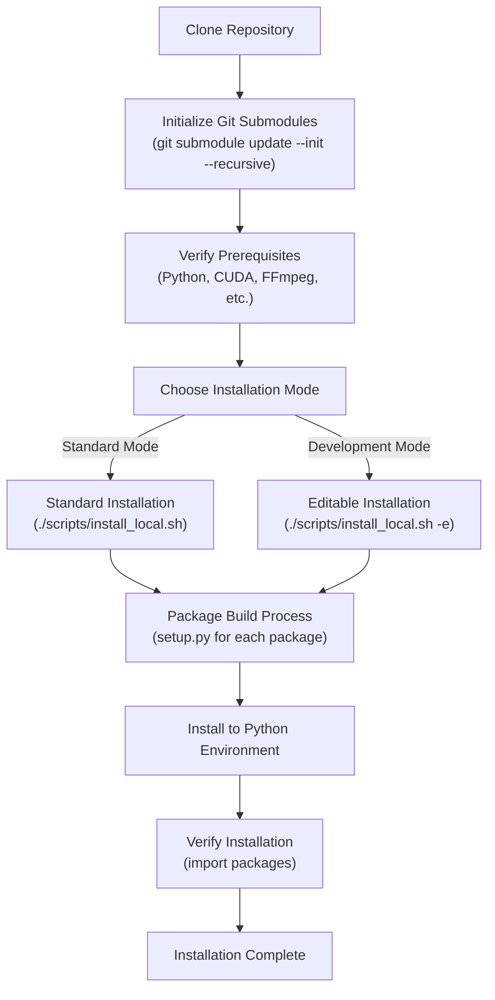
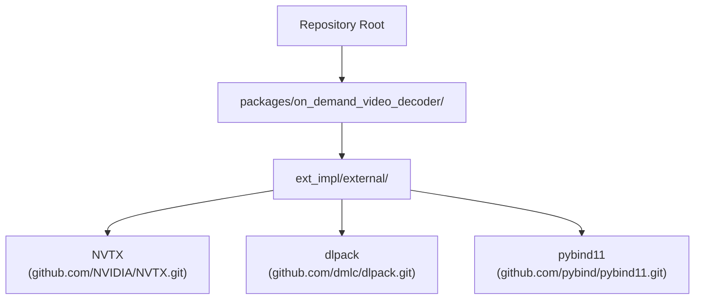
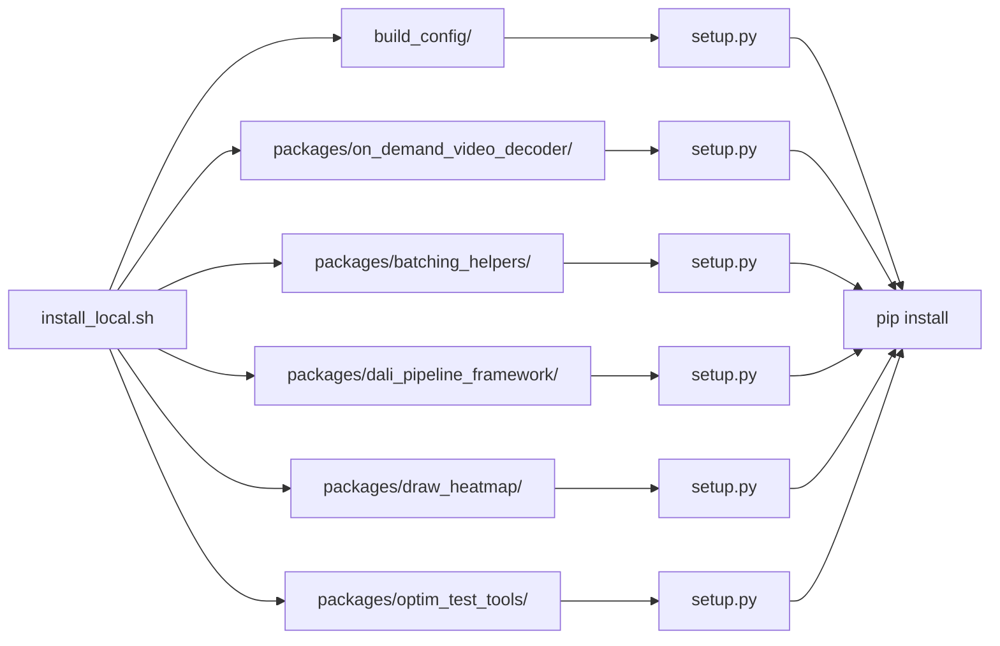

<!-- source: DeepWiki mcp.deepwiki.com · repo NVIDIA/ACCV-Lab · page 2.2 Local Installation · fetched 2026-10-26 -->

# Local Installation

<details>
<summary>Relevant source files</summary>

The following files were used as context for generating this wiki page:

- [.gitmodules](.gitmodules)
- [README.md](README.md)

</details>


## Purpose and Scope

This page provides instructions for installing ACCV-Lab packages directly on a local system without using Docker containers. Local installation is appropriate when you have an existing development environment with the necessary dependencies already configured, or when you need more control over the installation process.

For containerized deployment with pre-configured dependencies, see [Docker Environment](#2.1). For details on the external dependencies required by ACCV-Lab, see [External Dependencies](#2.3).

**Sources:** [README.md:44-101]()

---

## Prerequisites

Before installing ACCV-Lab locally, ensure your system meets the following requirements:

| Requirement | Details |
|------------|---------|
| **Operating System** | Linux (Ubuntu 20.04 or later recommended) |
| **Python** | Python 3.8 or later |
| **Git** | Git with submodule support |
| **CUDA Toolkit** | Required for GPU-accelerated packages (On-Demand Video Decoder, Draw Heatmap) |
| **PyTorch** | Required for CUDA detection during build |
| **Build Tools** | GCC/G++, CMake, pkg-config |
| **FFmpeg** | Required for On-Demand Video Decoder (dynamically linked) |

> **Note**: The exact dependency versions are configured in the Docker image. See [docker/Dockerfile]() for the reference configuration used in testing.

**Sources:** [README.md:46-48](), [.gitmodules:1-12]()

---

## Installation Workflow Overview



**Sources:** [README.md:69-93]()

---

## Git Submodule Initialization

ACCV-Lab uses git submodules to manage critical external dependencies. These submodules **must** be initialized before installation.

### Submodule Structure



### Initialization Command

To initialize all submodules recursively, run the following command from the repository root:

```bash
git submodule update --init --recursive
```

This command performs three operations:
1. **`update`** - Fetches the submodule content from the configured remote repositories
2. **`--init`** - Initializes any submodules that haven't been initialized yet
3. **`--recursive`** - Recursively initializes nested submodules (if any exist)

### Submodule Configuration

The submodule mappings are defined in [.gitmodules:1-12]():

| Submodule | Path | Remote URL |
|-----------|------|------------|
| NVTX | `packages/on_demand_video_decoder/ext_impl/external/NVTX` | https://github.com/NVIDIA/NVTX.git |
| dlpack | `packages/on_demand_video_decoder/ext_impl/external/dlpack` | https://github.com/dmlc/dlpack.git |
| pybind11 | `packages/on_demand_video_decoder/ext_impl/external/pybind11` | https://github.com/pybind/pybind11.git |

> **Important**: Forgetting to initialize submodules will cause build failures for packages that depend on them, particularly the On-Demand Video Decoder package.

**Sources:** [README.md:69-73](), [.gitmodules:1-12]()

---

## Installation Methods

ACCV-Lab provides a unified installation script that supports two installation modes: **standard** (regular) and **editable** (development).

### Installation Script Location

The installation script is located at:
- **Script Path**: `scripts/install_local.sh`
- **Execution**: Must be run from the repository root directory

### Standard Installation

Standard installation builds and installs all packages into your Python environment:

```bash
./scripts/install_local.sh
```

This mode:
- Builds all C++/CUDA extensions from source
- Installs packages to the Python site-packages directory
- Requires reinstallation after code changes
- Suitable for production use or when not actively developing

### Editable Installation

Editable installation (development mode) creates symbolic links to the package source directories:

```bash
./scripts/install_local.sh -e
```

This mode:
- Creates symbolic links to source directories
- Python changes take effect immediately without reinstallation
- **Cannot be used with scikit-build packages** (see limitations below)
- Suitable for active development on pure Python packages

### Package Installation Flow



**Sources:** [README.md:78-93]()

---

## Known Limitations and Considerations

### Editable Installation Limitations

Not all packages support editable installation. Packages using `scikit-build` for C++/CUDA extension compilation cannot be installed in editable mode due to how scikit-build manages binary artifacts.

| Package | Build System | Editable Support |
|---------|--------------|------------------|
| on_demand_video_decoder | scikit-build (C++/CUDA) | ❌ No |
| batching_helpers | setuptools | ✅ Yes |
| dali_pipeline_framework | setuptools | ✅ Yes |
| draw_heatmap | scikit-build (C++/CUDA) | ❌ No |
| optim_test_tools | setuptools | ✅ Yes |

**Behavior with Unsupported Packages**: When running `./scripts/install_local.sh -e`, packages that use scikit-build will be registered in editable mode, but their compiled binaries will not be built. This leads to import errors when attempting to use these packages.

> **Recommendation**: Use editable installation only when actively developing specific pure-Python packages. For packages with native extensions, use standard installation and reinstall after changes.

### Installation Order

The installation script installs packages in the following order:

1. **build_config** package (provides build utilities used by other packages)
2. **namespace packages** in the `packages/` directory

This order ensures that build utilities are available when compiling packages that depend on them.

### Build Environment Variables

The installation process respects several environment variables for customizing builds. For a complete reference, see [Environment Variables](#3.4). Key variables include:

- `DEBUG_BUILD`: Enable debug symbols and disable optimizations
- `CPP_STANDARD`: Set C++ standard version
- `CUSTOM_CUDA_ARCHS`: Override CUDA architecture targets

**Sources:** [README.md:90-93]()

---

## Post-Installation Verification

After installation, verify that packages are correctly installed and importable:

```python
# Test importing core packages
import accvlab.on_demand_video_decoder
import accvlab.batching_helpers
import accvlab.dali_pipeline_framework
import accvlab.draw_heatmap
import accvlab.optim_test_tools

print("All packages imported successfully")
```

### Verification Steps

1. **Import Test**: Verify all packages can be imported without errors
2. **Binary Extensions**: For packages with C++/CUDA extensions (On-Demand Video Decoder, Draw Heatmap), verify that native modules are accessible
3. **CUDA Access**: For GPU-accelerated packages, verify CUDA device access if applicable

### Common Issues

| Issue | Cause | Solution |
|-------|-------|----------|
| Import errors for packages with extensions | Editable installation used for scikit-build packages | Reinstall using standard mode (`./scripts/install_local.sh`) |
| Module not found | Submodules not initialized | Run `git submodule update --init --recursive` |
| CUDA errors during build | CUDA toolkit not found or version mismatch | Verify CUDA installation and version compatibility with PyTorch |
| FFmpeg linking errors | FFmpeg not installed or not in library path | Install FFmpeg development libraries |

**Sources:** [README.md:90-93]()

---

## Relationship to Documentation Build

After installing packages locally, you can build the documentation. The documentation generation process imports installed packages to extract API documentation and docstrings.

```bash
# Build documentation after package installation
./scripts/build_docs.sh
```

> **Note**: Documentation build requires packages to be installed (not just available as source). This ensures that C++/CUDA extensions are compiled and their docstrings can be extracted.

For details on the documentation system, see [Building Documentation](#4.1).

**Sources:** [README.md:85-98]()

---

## Summary

Local installation provides direct control over the ACCV-Lab environment and is appropriate for development and production use on systems with pre-configured dependencies. Key points:

- **Prerequisite**: Initialize git submodules before installation
- **Script**: Use `./scripts/install_local.sh` for standard or `./scripts/install_local.sh -e` for editable installation
- **Limitation**: Editable mode does not work for packages with native extensions (scikit-build packages)
- **Verification**: Test imports after installation to ensure correct setup

For containerized environments with all dependencies pre-configured, see [Docker Environment](#2.1).

---

