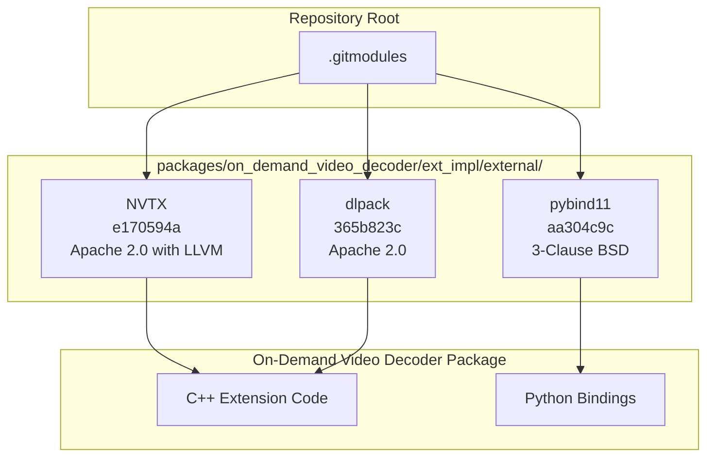
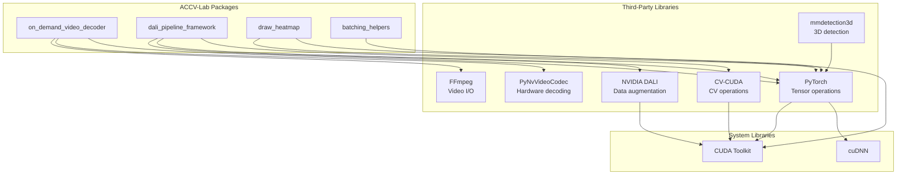
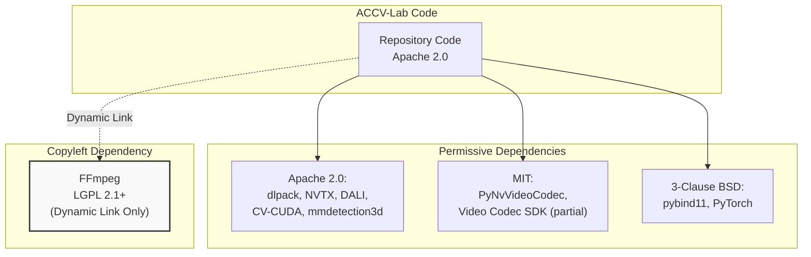

<!-- source: DeepWiki mcp.deepwiki.com · repo NVIDIA/ACCV-Lab · page 2.3 External Dependencies · fetched 2026-10-26 -->

# External Dependencies

<details>
<summary>Relevant source files</summary>

The following files were used as context for generating this wiki page:

- [.gitmodules](.gitmodules)
- [THIRD_PARTY_LICENSES.md](THIRD_PARTY_LICENSES.md)

</details>


This document describes the external dependencies required by ACCV-Lab, including git submodules and third-party libraries. It covers how these dependencies are managed, their purposes, and licensing information.

For information about building these dependencies into the project, see [Build System](#3). For information about the Docker environment which includes these dependencies pre-configured, see [Docker Environment](#2.1).

## Dependency Categories

ACCV-Lab relies on two categories of external dependencies:

1. **Git Submodules** - Source code dependencies managed via git submodules, checked into the repository
2. **Third-Party Libraries** - External libraries installed via package managers or built from source

## Git Submodules

Git submodules are located in [packages/on_demand_video_decoder/ext_impl/external/]() and must be initialized after cloning the repository:

```bash
git submodule update --init --recursive
```

### Submodule Dependencies



**Sources:** [.gitmodules:1-12]()

### NVTX (NVIDIA Tools Extension)

**Location:** `packages/on_demand_video_decoder/ext_impl/external/NVTX`  
**Repository:** https://github.com/NVIDIA/NVTX.git  
**Commit:** e170594a  
**License:** Apache 2.0 with LLVM Exceptions

NVTX provides performance profiling instrumentation. The On-Demand Video Decoder uses NVTX to mark performance-critical sections for analysis with NVIDIA Nsight Systems.

**Sources:** [.gitmodules:1-3](), [THIRD_PARTY_LICENSES.md:8]()

### DLPack

**Location:** `packages/on_demand_video_decoder/ext_impl/external/dlpack`  
**Repository:** https://github.com/dmlc/dlpack.git  
**Commit:** 365b823c  
**License:** Apache 2.0

DLPack provides a zero-copy tensor exchange protocol. ACCV-Lab packages use DLPack for efficient data transfer between components without memory copies, particularly for GPU tensors.

**Sources:** [.gitmodules:5-7](), [THIRD_PARTY_LICENSES.md:7]()

### Pybind11

**Location:** `packages/on_demand_video_decoder/ext_impl/external/pybind11`  
**Repository:** https://github.com/pybind/pybind11.git  
**Commit:** aa304c9c  
**License:** 3-Clause BSD

Pybind11 creates Python bindings for C++ code. The On-Demand Video Decoder uses Pybind11 to expose its C++/CUDA implementation to Python.

**Sources:** [.gitmodules:9-11](), [THIRD_PARTY_LICENSES.md:6]()

## Third-Party Libraries

Third-party libraries are installed via the Docker environment or must be installed separately for local development. These libraries are not checked into the repository.

### Core Dependencies

| Dependency | Version | License | Purpose |
|------------|---------|---------|---------|
| FFmpeg | 4.4.6 | LGPL 2.1+ | Video decoding (dynamically linked) |
| PyTorch | 2.6 | 3-Clause BSD | ML framework, CUDA detection |
| NVIDIA DALI | 1.51.2 | Apache 2.0 | Data augmentation pipelines |
| PyNvVideoCodec | 1.0.2 | MIT | Python video codec interface |
| CV-CUDA | da51fc96 | Apache 2.0 | GPU-accelerated computer vision |
| mmdetection3d | 1.4.0 | Apache 2.0 | 3D object detection |

**Sources:** [THIRD_PARTY_LICENSES.md:3-14]()

### Dependency Relationships



**Sources:** [THIRD_PARTY_LICENSES.md:3-14]()

### FFmpeg

**Version:** 4.4.6  
**License:** LGPL 2.1 or later (as configured)  
**Dynamic Linking Required:** Yes

FFmpeg is used for video decoding in the On-Demand Video Decoder. Due to its LGPL license, ACCV-Lab dynamically links to FFmpeg libraries rather than statically linking, which would require the entire ACCV-Lab codebase to be LGPL-licensed.

The Dockerfile builds FFmpeg with specific configurations to maintain LGPL 2.1+ compliance.

**Sources:** [THIRD_PARTY_LICENSES.md:5,19]()

### PyTorch

**Version:** 2.6  
**License:** 3-Clause BSD

PyTorch provides:
- Tensor operations and data structures
- CUDA capability detection (used by the build system)
- GPU memory management
- Integration with ML training workflows

The build system's `detect_cuda_info` function queries PyTorch for CUDA architecture detection. See [Build Utilities](#3.2) for details.

**Sources:** [THIRD_PARTY_LICENSES.md:10]()

### NVIDIA DALI

**Version:** 1.51.2  
**License:** Apache 2.0

NVIDIA DALI (Data Loading Library) provides GPU-accelerated data augmentation. The DALI Pipeline Framework package builds custom operators on top of DALI for ADAS-specific data processing.

**Sources:** [THIRD_PARTY_LICENSES.md:9]()

### PyNvVideoCodec

**Version:** 1.0.2  
**License:** MIT

PyNvVideoCodec provides Python bindings to NVIDIA's hardware video decoding APIs. The On-Demand Video Decoder optionally uses this for hardware-accelerated video decoding on NVIDIA GPUs.

**Sources:** [THIRD_PARTY_LICENSES.md:12]()

### NVIDIA Video Codec SDK

**Version:** 11.1.5  
**License:** MIT (partial inclusion)

Partial headers and interfaces from the NVIDIA Video Codec SDK are included for video codec functionality. Only the MIT-licensed components are included.

**Sources:** [THIRD_PARTY_LICENSES.md:11]()

### CV-CUDA

**Version:** da51fc96  
**License:** Apache 2.0

CV-CUDA provides GPU-accelerated computer vision operations. The DALI Pipeline Framework integrates CV-CUDA operators for efficient preprocessing.

**Sources:** [THIRD_PARTY_LICENSES.md:13]()

### mmdetection3d

**Version:** 1.4.0  
**License:** Apache 2.0

mmdetection3d provides 3D object detection capabilities for ADAS applications. This is used in conjunction with the ACCV-Lab packages for complete detection pipelines.

**Sources:** [THIRD_PARTY_LICENSES.md:14]()

## License Compatibility



All dependencies use permissive licenses (Apache 2.0, MIT, BSD) except FFmpeg, which uses LGPL 2.1+. ACCV-Lab maintains license compatibility by:

1. **Apache 2.0 Main License** - The repository code is Apache 2.0 licensed
2. **Permissive Dependencies** - Most dependencies use compatible permissive licenses
3. **Dynamic Linking for LGPL** - FFmpeg is dynamically linked to avoid copyleft requirements on the main codebase

For complete license texts, see [THIRD_PARTY_LICENSES.md:1-1797]().

**Sources:** [THIRD_PARTY_LICENSES.md:1-1797]()

## Installation Methods

### Via Docker (Recommended)

The Docker environment includes all dependencies pre-configured. See [Docker Environment](#2.1) for details.

```bash
cd docker
./build.sh
```

### Local Installation

For local installation, dependencies must be installed manually:

1. **Initialize Git Submodules:**
   ```bash
   git submodule update --init --recursive
   ```

2. **Install System Dependencies:**
   - CUDA Toolkit (11.0+)
   - FFmpeg development libraries
   - cuDNN

3. **Install Python Dependencies:**
   - PyTorch
   - NVIDIA DALI
   - PyNvVideoCodec
   - CV-CUDA
   - mmdetection3d

See [Local Installation](#2.2) for complete instructions.

**Sources:** [.gitmodules:1-12]()

## Dependency Verification

The [THIRD_PARTY_LICENSES.md:1-1797]() file provides complete attribution and license texts for all dependencies. This file should be consulted for:

- Exact commit hashes of git submodule dependencies
- Complete license texts
- Copyright notices
- Compliance information

**Sources:** [THIRD_PARTY_LICENSES.md:1-1797]()

---

