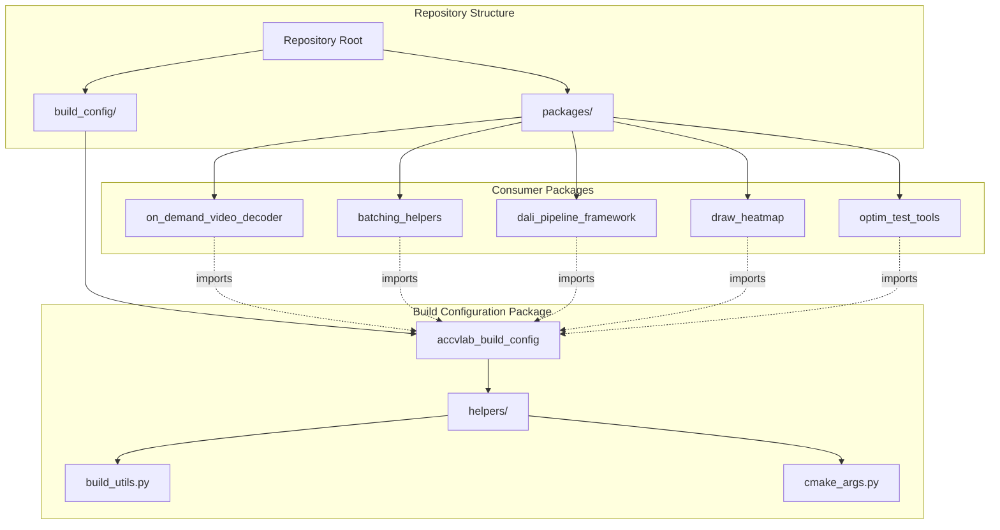
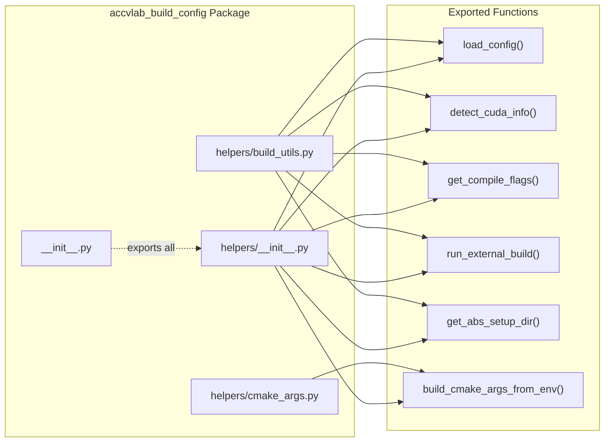
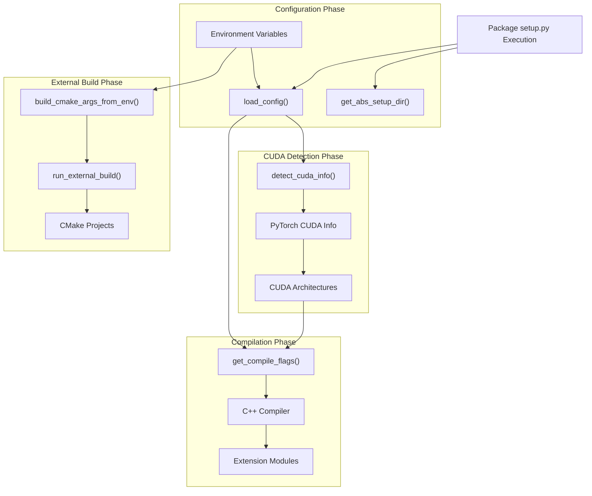
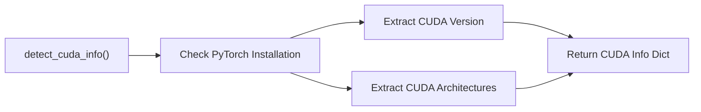
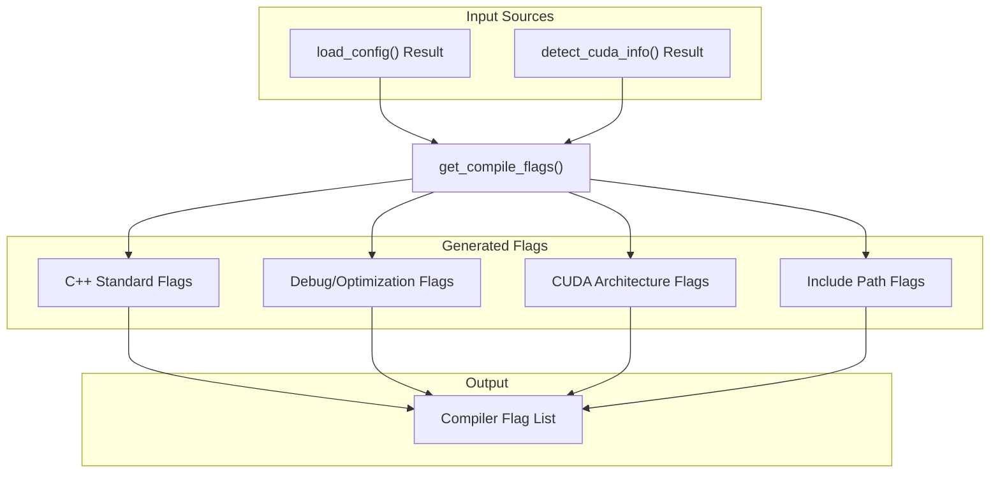
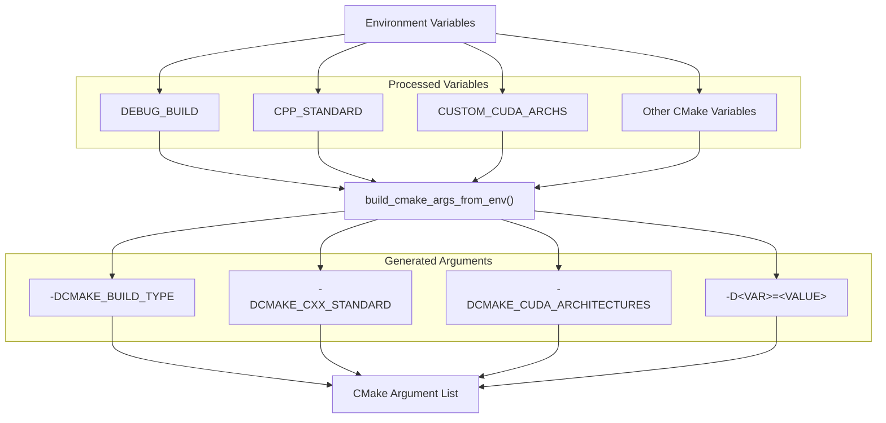
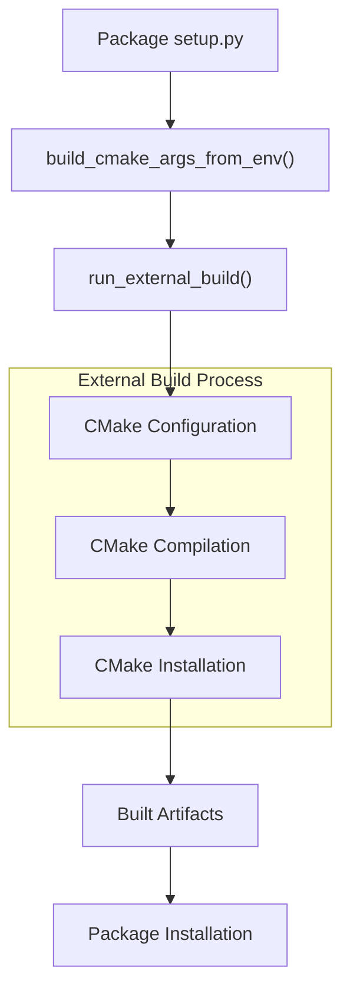
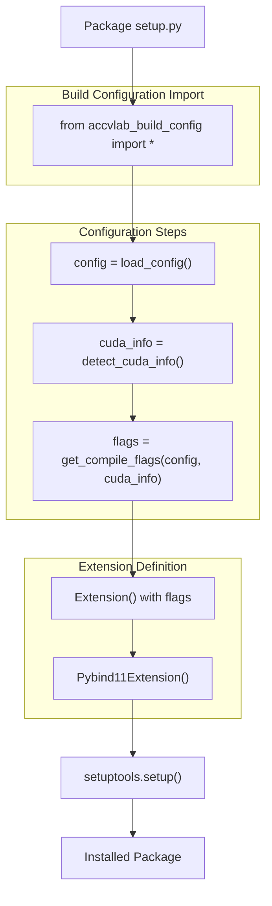
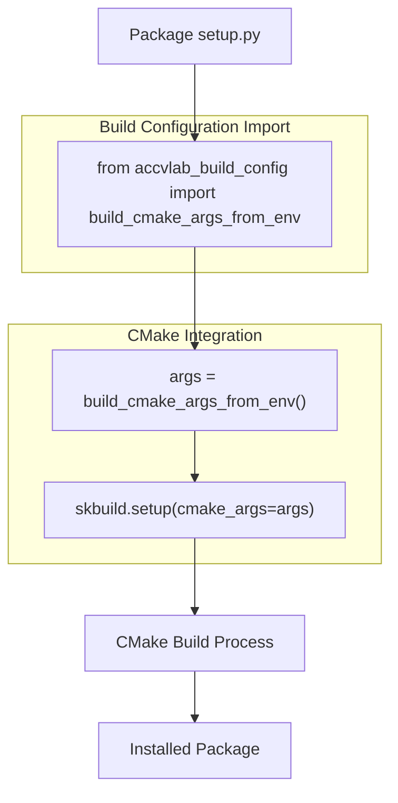
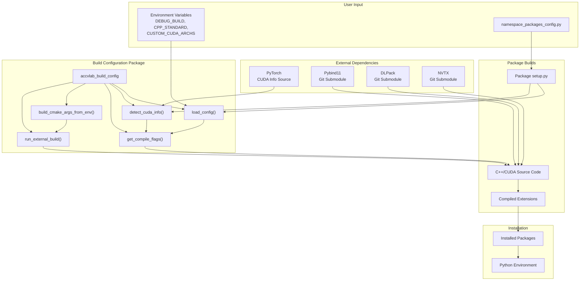

<!-- source: DeepWiki mcp.deepwiki.com · repo NVIDIA/ACCV-Lab · page 3 Build System · fetched 2026-10-26 -->

# Build System

<details>
<summary>Relevant source files</summary>

The following files were used as context for generating this wiki page:

- [README.md](README.md)
- [build_config/__init__.py](build_config/__init__.py)
- [build_config/accvlab_build_config/__init__.py](build_config/accvlab_build_config/__init__.py)
- [build_config/accvlab_build_config/helpers/__init__.py](build_config/accvlab_build_config/helpers/__init__.py)

</details>


## Purpose and Scope

The Build System provides centralized build configuration and utilities for all ACCV-Lab packages. This document covers the `build_config/` directory structure, the `accvlab_build_config` package, and how it supports building C++/CUDA extensions across the repository. For information about installing packages using these build utilities, see [Local Installation](#2.2). For details about configuring the development environment, see [Docker Environment](#2.1).

## Overview

The build system serves as a shared foundation that standardizes compilation across all ACCV-Lab packages. It handles CUDA architecture detection, compiler flag generation, and provides utilities for both setuptools-based extension builds and external CMake projects.



**Sources:** [build_config/__init__.py](), [build_config/accvlab_build_config/__init__.py](), [README.md:105-110]()

## Package Structure

The `build_config/` directory contains the `accvlab_build_config` package, which is structured as a standard Python package with helper modules.

| Directory/File | Purpose |
|----------------|---------|
| `build_config/` | Top-level directory for build configuration |
| `build_config/accvlab_build_config/` | Main package directory |
| `build_config/accvlab_build_config/helpers/` | Helper modules containing core functionality |
| `build_config/accvlab_build_config/helpers/build_utils.py` | Build utilities for configuration and compilation |
| `build_config/accvlab_build_config/helpers/cmake_args.py` | CMake argument generation from environment variables |



The package exports all helper functions through its top-level `__init__.py`, allowing consumers to import directly from `accvlab_build_config`.

**Sources:** [build_config/accvlab_build_config/__init__.py:15](), [build_config/accvlab_build_config/helpers/__init__.py:19-37]()

## Build Utilities

The `build_utils` module provides five core functions that support package compilation:

### Function Overview

| Function | Purpose | Returns |
|----------|---------|---------|
| `load_config()` | Loads build configuration from environment variables | Configuration dictionary |
| `detect_cuda_info()` | Detects CUDA architecture and version information from PyTorch | CUDA information dictionary |
| `get_compile_flags()` | Generates compiler flags for C++/CUDA compilation | List of compiler flags |
| `run_external_build()` | Executes external build processes (e.g., CMake builds) | None (side effect: builds artifacts) |
| `get_abs_setup_dir()` | Returns absolute path to the setup.py directory | Absolute path string |

### Build Workflow Using Utilities



**Sources:** [build_config/accvlab_build_config/helpers/__init__.py:19-37]()

## Configuration Loading

The `load_config()` function reads environment variables to determine build settings. It serves as the entry point for all build configuration, parsing environment variables into a structured format that other build utilities can consume.

### Key Configuration Parameters

Based on the repository's build system design, the following environment variables are recognized:

| Environment Variable | Purpose | Default Behavior |
|---------------------|---------|------------------|
| `DEBUG_BUILD` | Enable debug symbols and disable optimizations | Release build |
| `CPP_STANDARD` | Set C++ standard version (e.g., 11, 14, 17, 20) | Compiler default |
| `CUSTOM_CUDA_ARCHS` | Override CUDA architecture targets | Auto-detected from PyTorch |

**Sources:** [build_config/accvlab_build_config/helpers/__init__.py:20](), README references to environment variables

## CUDA Detection

The `detect_cuda_info()` function queries CUDA-related information from the installed PyTorch version. This ensures that compiled extensions are compatible with the PyTorch CUDA environment.

### Detection Process



The function retrieves:
- CUDA version installed with PyTorch
- CUDA architectures that PyTorch was compiled for
- Whether CUDA is available in the current environment

This information is critical for ensuring that compiled extensions can interoperate with PyTorch tensors on CUDA devices.

**Sources:** [build_config/accvlab_build_config/helpers/__init__.py:21]()

## Compilation Flag Generation

The `get_compile_flags()` function generates appropriate compiler flags based on the loaded configuration and detected CUDA information.

### Flag Categories



The function ensures that:
- CUDA architecture flags match PyTorch's CUDA compilation targets
- Debug builds include appropriate symbols and disable optimizations
- C++ standard is set consistently across all extensions

**Sources:** [build_config/accvlab_build_config/helpers/__init__.py:22]()

## CMake Integration

The `cmake_args` module provides the `build_cmake_args_from_env()` function, which generates CMake command-line arguments from environment variables.

### CMake Argument Generation



### Usage Pattern

Packages that use CMake for building external components call `build_cmake_args_from_env()` to obtain a list of CMake arguments, then pass these arguments to `run_external_build()` or directly invoke CMake:

```python
from accvlab_build_config import build_cmake_args_from_env, run_external_build

cmake_args = build_cmake_args_from_env()
run_external_build(cmake_args)
```

**Sources:** [build_config/accvlab_build_config/helpers/__init__.py:26-28]()

## External Build Execution

The `run_external_build()` function executes external build systems, typically CMake-based projects. This is used by packages that have native code organized as CMake projects rather than setuptools extensions.

### Build Execution Flow



The function handles:
- Setting up the build directory
- Running CMake configuration with generated arguments
- Executing the build process
- Ensuring artifacts are placed in the correct package directories

**Sources:** [build_config/accvlab_build_config/helpers/__init__.py:23]()

## Integration with Package Builds

Individual packages integrate with the build system by importing functions from `accvlab_build_config` in their `setup.py` files.

### Setuptools Extension Build Pattern



### Scikit-build Pattern

Some packages use scikit-build for building with CMake:



**Sources:** [build_config/accvlab_build_config/helpers/__init__.py:19-37](), [README.md:90-93]()

## Complete Build System Architecture



This diagram shows the complete flow from user configuration through the build system to installed packages. The `accvlab_build_config` package serves as the central coordination point, consuming environment variables and PyTorch information to generate appropriate build configurations for all package builds.

**Sources:** [build_config/accvlab_build_config/__init__.py:15](), [build_config/accvlab_build_config/helpers/__init__.py](), [README.md:69-93]()

## Build System Benefits

The centralized build system provides several key advantages:

| Benefit | Description |
|---------|-------------|
| **Consistency** | All packages use the same CUDA architectures and compilation flags |
| **Maintainability** | Build logic is defined once and shared across all packages |
| **PyTorch Compatibility** | CUDA detection ensures extensions match PyTorch's CUDA configuration |
| **Flexibility** | Environment variables allow customization without code changes |
| **Dual Build Support** | Supports both setuptools extensions and external CMake builds |

The system handles the complexity of coordinating C++/CUDA compilation across multiple packages while exposing a simple interface for package developers.

**Sources:** [build_config/accvlab_build_config/__init__.py:15-18](), [README.md:105-110]()

---

