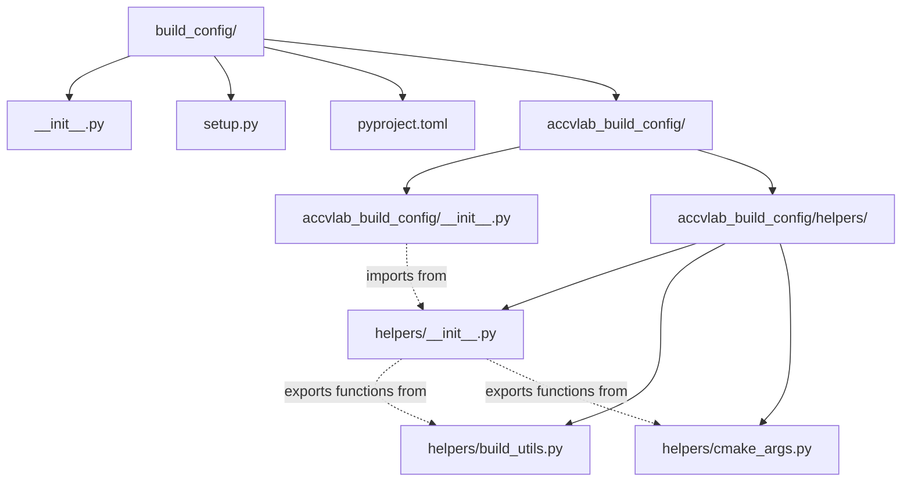
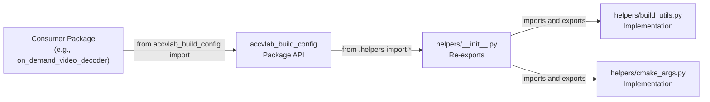
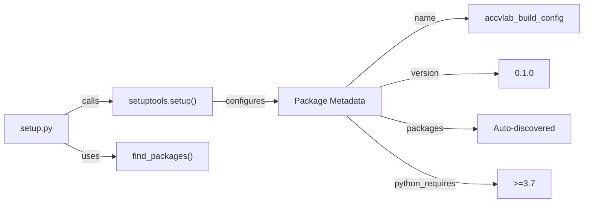
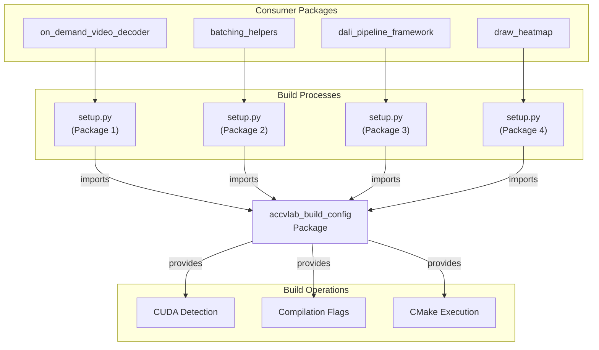
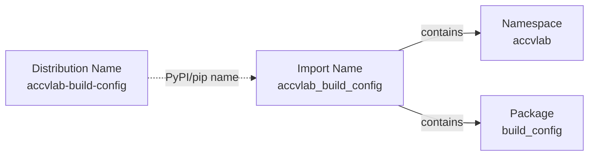
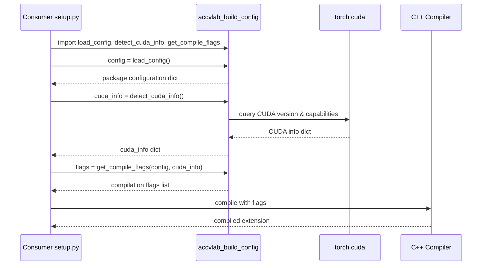

<!-- source: DeepWiki mcp.deepwiki.com · repo NVIDIA/ACCV-Lab · page 3.1 Build Configuration Package · fetched 2026-10-26 -->

# Build Configuration Package

<details>
<summary>Relevant source files</summary>

The following files were used as context for generating this wiki page:

- [build_config/__init__.py](build_config/__init__.py)
- [build_config/accvlab_build_config/__init__.py](build_config/accvlab_build_config/__init__.py)
- [build_config/accvlab_build_config/helpers/__init__.py](build_config/accvlab_build_config/helpers/__init__.py)
- [build_config/pyproject.toml](build_config/pyproject.toml)
- [build_config/setup.py](build_config/setup.py)

</details>


## Purpose and Scope

The Build Configuration Package (`accvlab_build_config`) is a centralized Python package that provides build utilities and configuration management for all ACCV-Lab packages. It encapsulates common build logic for detecting CUDA capabilities, generating compilation flags, and managing external build processes. This page documents the package structure, organization, and how it integrates into the broader build system.

For detailed information about the specific utility functions provided, see [Build Utilities](#3.2). For CMake integration details, see [CMake Integration](#3.3). For environment variable configuration, see [Environment Variables](#3.4).

**Sources:** [build_config/__init__.py:15-18](), [build_config/accvlab_build_config/__init__.py](), High-Level Diagrams 1-2

---

## Package Organization

The `accvlab_build_config` package follows Python namespace package conventions and is organized as a standalone distributable package within the `build_config/` directory of the repository.

### Directory Structure



**Sources:** [build_config/__init__.py](), [build_config/accvlab_build_config/__init__.py](), [build_config/accvlab_build_config/helpers/__init__.py]()

### Module Hierarchy

The package uses a three-level hierarchy:

| Level | Component | Purpose |
|-------|-----------|---------|
| 1 | `build_config/` | Root directory containing package metadata |
| 2 | `accvlab_build_config/` | Main package namespace |
| 3 | `accvlab_build_config.helpers/` | Submodule containing utility implementations |

The top-level `build_config/__init__.py` serves as a documentation entry point, while the actual package code resides under `accvlab_build_config/`.

**Sources:** [build_config/__init__.py:15-18](), [build_config/accvlab_build_config/__init__.py:15](), [build_config/accvlab_build_config/helpers/__init__.py:15-17]()

---

## Exported API

The package exports a clean API surface through its `__init__.py` hierarchy. All public functions are re-exported at the `accvlab_build_config` level for convenient importing.

### Public Functions

The following table lists all functions exported by the `accvlab_build_config` package:

| Function | Module | Purpose |
|----------|--------|---------|
| `load_config` | `helpers.build_utils` | Load package-specific build configuration |
| `detect_cuda_info` | `helpers.build_utils` | Detect CUDA version and compute capabilities |
| `get_compile_flags` | `helpers.build_utils` | Generate C++/CUDA compilation flags |
| `run_external_build` | `helpers.build_utils` | Execute external build processes (e.g., CMake) |
| `get_abs_setup_dir` | `helpers.build_utils` | Get absolute path to setup.py directory |
| `build_cmake_args_from_env` | `helpers.cmake_args` | Generate CMake arguments from environment variables |

**Sources:** [build_config/accvlab_build_config/helpers/__init__.py:19-37]()

### Import Pattern

The package follows a cascading import pattern where functions are defined in specific modules but re-exported at higher levels for convenience:



This design allows consumers to import directly from `accvlab_build_config` without needing to navigate the internal module structure:

```python
from accvlab_build_config import load_config, detect_cuda_info, get_compile_flags
```

**Sources:** [build_config/accvlab_build_config/__init__.py:15](), [build_config/accvlab_build_config/helpers/__init__.py:19-37]()

---

## Package Metadata and Configuration

### PyProject.toml

The package uses modern Python packaging standards with `pyproject.toml` as the primary configuration file. This follows PEP 517/518 for build system specification.

| Configuration | Value | Purpose |
|--------------|-------|---------|
| **Build System** | `setuptools>=64, wheel, torch>=1.7.0` | Declares build-time dependencies |
| **Build Backend** | `setuptools.build_meta` | Specifies the build backend |
| **Package Name** | `accvlab-build-config` | PyPI-compatible distribution name |
| **Version** | `0.1.0` | Package version |
| **Python Version** | `>=3.7` | Minimum Python version requirement |
| **Dependencies** | `torch>=1.7.0` | Runtime dependency for CUDA detection |

The package declares `torch>=1.7.0` as both a build-time and runtime dependency because CUDA detection relies on PyTorch's CUDA introspection capabilities.

**Sources:** [build_config/pyproject.toml:1-29]()

### Setup.py

A traditional `setup.py` file is also provided for compatibility with older build tools and for programmatic setup:



Key configuration details in [build_config/setup.py:17-26]():
- Uses `find_packages()` for automatic package discovery
- Sets `package_dir={"": "."}` to locate packages in the current directory
- Specifies `zip_safe=False` to ensure proper installation

**Sources:** [build_config/setup.py:1-27]()

---

## Integration with Build System

The `accvlab_build_config` package serves as a shared dependency for all ACCV-Lab packages that require native extension building.

### Dependency Flow



Each consumer package's `setup.py` imports functions from `accvlab_build_config` to:
1. Detect CUDA capabilities via `detect_cuda_info()`
2. Generate appropriate compilation flags via `get_compile_flags()`
3. Execute CMake-based builds via `run_external_build()`
4. Process environment variable configuration via `build_cmake_args_from_env()`

**Sources:** High-Level Diagram 2, [build_config/accvlab_build_config/helpers/__init__.py:19-37]()

### Installation Order

Because `accvlab_build_config` is a dependency for building other packages, it must be installed before those packages. The typical installation sequence is:

| Step | Action | Command |
|------|--------|---------|
| 1 | Install build config | `pip install -e build_config/` |
| 2 | Install other packages | `pip install -e packages/on_demand_video_decoder/` |

The repository's `scripts/install_local.sh` handles this dependency order automatically.

**Sources:** High-Level Diagram 2

---

## Namespace Package Structure

The package uses a two-part namespace structure: `accvlab` as the top-level namespace and `build_config` as the package-specific identifier.

### Naming Convention



- **Distribution Name**: `accvlab-build-config` (kebab-case, used in PyPI and pip commands)
- **Import Name**: `accvlab_build_config` (snake_case, used in Python imports)
- **Namespace**: `accvlab` (shared across all ACCV-Lab packages)

This naming follows Python namespace package conventions and maintains consistency with other packages in the repository.

**Sources:** [build_config/pyproject.toml:6](), [build_config/setup.py:18]()

---

## Dependencies

### Runtime Dependencies

The package has minimal runtime dependencies to reduce installation complexity:

| Dependency | Version Requirement | Purpose |
|------------|-------------------|---------|
| `torch` | `>=1.7.0` | CUDA introspection and version detection |

PyTorch is required because the `detect_cuda_info()` function uses `torch.cuda` APIs to query CUDA availability, version, and compute capabilities.

**Sources:** [build_config/pyproject.toml:13-15]()

### Development Dependencies

Optional development dependencies are specified in the `[project.optional-dependencies]` section:

| Dependency | Version | Purpose |
|------------|---------|---------|
| `pytest` | `>=6.0` | Unit testing framework |
| `black` | `>=22.0` | Code formatting |
| `flake8` | `>=4.0` | Code linting |

These can be installed with: `pip install accvlab-build-config[dev]`

**Sources:** [build_config/pyproject.toml:18-22]()

---

## Usage Pattern

Typical usage in a consumer package's `setup.py`:



This pattern centralizes build logic, ensuring all packages use consistent CUDA detection, compilation flags, and build processes.

**Sources:** High-Level Diagram 2, [build_config/accvlab_build_config/helpers/__init__.py:19-37]()

---

## Package Installation

The package can be installed in two modes:

### Development Mode

For active development, install in editable mode:
```bash
pip install -e build_config/
```

This creates a symlink to the source directory, allowing changes to take effect without reinstallation.

### Standard Mode

For production use, install normally:
```bash
pip install build_config/
```

This copies the package to the Python site-packages directory.

Both modes respect the `pyproject.toml` configuration and install the required dependencies.

**Sources:** [build_config/pyproject.toml:1-29](), [build_config/setup.py:1-27]()

---

## Design Rationale

The Build Configuration Package follows several key design principles:

| Principle | Implementation | Benefit |
|-----------|---------------|---------|
| **Centralization** | Single source of build logic | Consistent build behavior across packages |
| **Separation of Concerns** | Build logic separated from package logic | Easier maintenance and testing |
| **Minimal Dependencies** | Only PyTorch as runtime dependency | Reduced installation complexity |
| **Clean API** | Functions re-exported at top level | Simple import statements |
| **Standard Packaging** | Uses pyproject.toml and setuptools | Compatible with modern Python tooling |

By centralizing build configuration, the package eliminates duplication of CUDA detection and compilation flag generation across multiple packages, ensuring consistent build behavior throughout the ACCV-Lab ecosystem.

**Sources:** High-Level Diagrams 1-2, [build_config/pyproject.toml](), [build_config/accvlab_build_config/__init__.py]()

---

