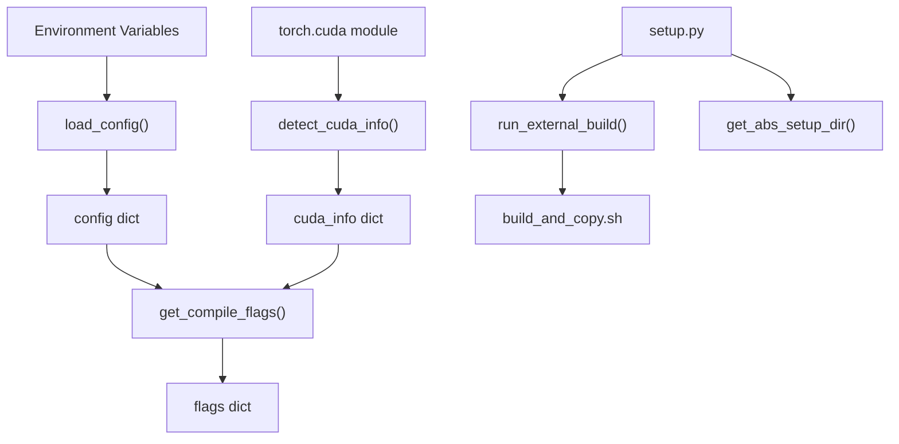
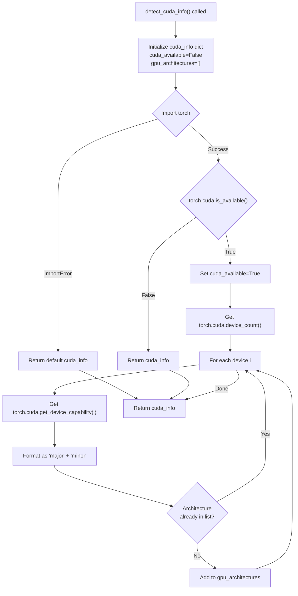
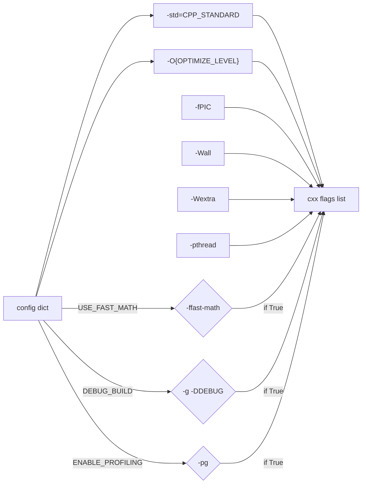
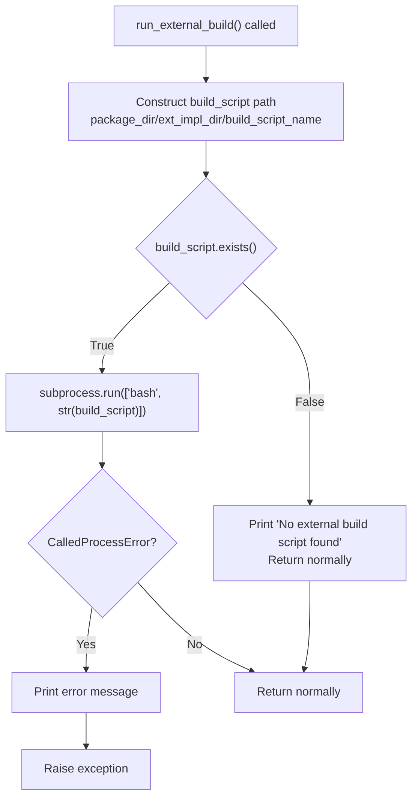
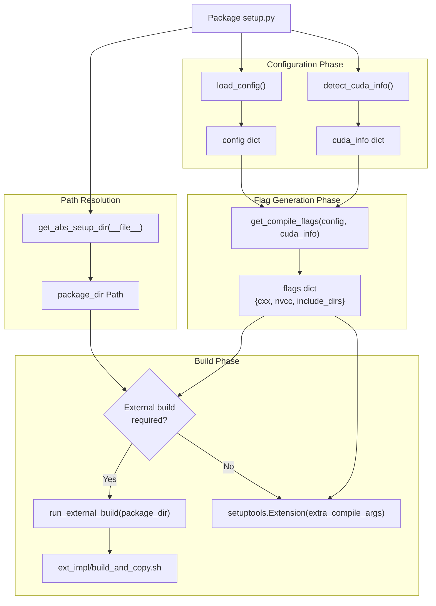

<!-- source: DeepWiki mcp.deepwiki.com · repo NVIDIA/ACCV-Lab · page 3.2 Build Utilities · fetched 2026-10-26 -->

# Build Utilities

<details>
<summary>Relevant source files</summary>

The following files were used as context for generating this wiki page:

- [build_config/accvlab_build_config/helpers/__init__.py](build_config/accvlab_build_config/helpers/__init__.py)
- [build_config/accvlab_build_config/helpers/build_utils.py](build_config/accvlab_build_config/helpers/build_utils.py)

</details>


## Purpose and Scope

This page documents the build utility functions provided by the `accvlab_build_config.helpers.build_utils` module. These utilities provide reusable functions for configuration loading, CUDA detection, compilation flag generation, external build script execution, and path resolution. All ACCV-Lab packages use these utilities during their build processes to ensure consistent compilation behavior.

For information about the overall build configuration package structure, see [Build Configuration Package](#3.1). For CMake-specific argument generation, see [CMake Integration](#3.3). For a complete reference of supported environment variables, see [Environment Variables](#3.4).

**Sources:** [build_config/accvlab_build_config/helpers/build_utils.py:1-223]()

## Module Structure

The `build_utils` module is located at [build_config/accvlab_build_config/helpers/build_utils.py]() and exports five primary functions through [build_config/accvlab_build_config/helpers/__init__.py:19-25]():

| Function | Purpose |
|----------|---------|
| `load_config` | Load build configuration from environment variables with defaults |
| `detect_cuda_info` | Detect CUDA availability and GPU architectures using PyTorch |
| `get_compile_flags` | Generate C++ and NVCC compilation flags based on configuration |
| `run_external_build` | Execute external build scripts for packages with native extensions |
| `get_abs_setup_dir` | Resolve absolute path of setup.py parent directory |

**Sources:** [build_config/accvlab_build_config/helpers/__init__.py:19-37](), [build_config/accvlab_build_config/helpers/build_utils.py:1-223]()

## Function Dependency Flow



**Sources:** [build_config/accvlab_build_config/helpers/build_utils.py:27-223]()

## Configuration Loading

### load_config Function

The `load_config` function at [build_config/accvlab_build_config/helpers/build_utils.py:27-73]() loads build configuration from environment variables or uses default values. It accepts an optional `default_config` dictionary parameter and returns a configuration dictionary with environment variable overrides applied.

#### Default Configuration

When no default configuration is provided, the following defaults are used [build_config/accvlab_build_config/helpers/build_utils.py:48-56]():

| Configuration Key | Default Value | Type | Description |
|-------------------|---------------|------|-------------|
| `DEBUG_BUILD` | `False` | bool | Enable debug symbols and assertions |
| `OPTIMIZE_LEVEL` | `3` | int | Compiler optimization level (0-3) |
| `CPP_STANDARD` | `'c++17'` | str | C++ standard version |
| `VERBOSE_BUILD` | `False` | bool | Enable verbose build output |
| `CUSTOM_CUDA_ARCHS` | `None` | str/list | Comma-separated CUDA architectures |
| `USE_FAST_MATH` | `True` | bool | Enable fast math optimizations |
| `ENABLE_PROFILING` | `False` | bool | Enable profiling instrumentation |

#### Environment Variable Overrides

The function reads environment variables matching configuration keys [build_config/accvlab_build_config/helpers/build_utils.py:60-72]() and applies type-appropriate conversions:

- **Boolean values**: Converted from strings `'1'`, `'true'`, `'yes'`, `'on'` (case-insensitive)
- **Integer values**: Converted using `int()`
- **CUSTOM_CUDA_ARCHS**: Split by comma into a list
- **String values**: Used directly

#### Example Usage

```python
from accvlab_build_config.helpers import load_config

# Use default configuration
config = load_config()

# Override defaults with custom values
custom_defaults = {
    'DEBUG_BUILD': True,
    'CPP_STANDARD': 'c++20',
}
config = load_config(custom_defaults)
```

**Sources:** [build_config/accvlab_build_config/helpers/build_utils.py:27-73]()

## CUDA Detection

### detect_cuda_info Function

The `detect_cuda_info` function at [build_config/accvlab_build_config/helpers/build_utils.py:76-102]() detects CUDA availability and GPU compute architectures using PyTorch. The function requires PyTorch to be installed but gracefully handles its absence.

#### Return Value Structure

The function returns a dictionary with the following structure:

```python
{
    'cuda_available': bool,      # Whether CUDA is available
    'gpu_architectures': list,   # List of detected GPU architectures (e.g., ['75', '86'])
}
```

#### Detection Process



#### Architecture Detection Logic

The function queries each GPU device using [torch.cuda.get_device_capability()]() [build_config/accvlab_build_config/helpers/build_utils.py:94-98](), which returns a tuple `(major, minor)`. These are concatenated to form architecture strings like `'75'` (Turing), `'86'` (Ampere), etc. Duplicate architectures are filtered to create a unique list.

#### Fallback Behavior

If PyTorch is not installed, the function returns `cuda_available=False` with an empty architecture list [build_config/accvlab_build_config/helpers/build_utils.py:99-100](). Packages can then use default architecture lists or skip CUDA-specific compilation.

**Sources:** [build_config/accvlab_build_config/helpers/build_utils.py:76-102]()

## Compilation Flag Generation

### get_compile_flags Function

The `get_compile_flags` function at [build_config/accvlab_build_config/helpers/build_utils.py:105-182]() constructs compilation flags for C++ and NVCC based on configuration and CUDA information.

#### Function Signature

```python
def get_compile_flags(config, cuda_info, include_dirs=None):
    """Construct compilation flags

    Args:
        config (dict): Build configuration from load_config()
        cuda_info (dict): CUDA information from detect_cuda_info()
        include_dirs (list): Additional include directories

    Returns:
        dict: Compilation flags with keys 'cxx', 'nvcc', 'include_dirs'
    """
```

#### Return Value Structure

The function returns a dictionary with three lists:

| Key | Type | Description |
|-----|------|-------------|
| `cxx` | list[str] | C++ compiler flags for host code |
| `nvcc` | list[str] | NVCC compiler flags for CUDA code |
| `include_dirs` | list[str] | Include directory paths |

### C++ Compiler Flags

Base C++ flags are constructed at [build_config/accvlab_build_config/helpers/build_utils.py:123-132]():



#### Base C++ Flags

All builds include [build_config/accvlab_build_config/helpers/build_utils.py:123-132]():

- `-std={CPP_STANDARD}`: C++ standard (e.g., `c++17`)
- `-O{OPTIMIZE_LEVEL}`: Optimization level (0-3)
- `-fPIC`: Position-independent code for shared libraries
- `-Wall`: Enable all warnings
- `-Wextra`: Enable extra warnings
- `-pthread`: Enable POSIX thread support

#### Conditional C++ Flags

Additional flags are added based on configuration [build_config/accvlab_build_config/helpers/build_utils.py:134-146]():

- **Fast Math** (`USE_FAST_MATH=True`): Adds `-ffast-math` for aggressive floating-point optimizations
- **Debug Build** (`DEBUG_BUILD=True`): Adds `-g` (debug symbols) and `-DDEBUG` (debug macro)
- **Profiling** (`ENABLE_PROFILING=True`): Adds `-pg` for gprof profiling support

### NVCC Compiler Flags

NVCC flags are generated only when CUDA is available [build_config/accvlab_build_config/helpers/build_utils.py:154-181]().

#### CUDA Architecture Selection

The function determines target architectures using this priority [build_config/accvlab_build_config/helpers/build_utils.py:156-162]():

1. **CUSTOM_CUDA_ARCHS**: User-specified architectures from configuration
2. **Detected Architectures**: From `cuda_info['gpu_architectures']`
3. **Default Architectures**: `['70', '75', '80', '86']` if none detected

For each architecture, a `-gencode` flag is generated [build_config/accvlab_build_config/helpers/build_utils.py:165-166]():

```
-gencode=arch=compute_{arch},code=sm_{arch}
```

#### Base NVCC Flags

Standard NVCC flags include [build_config/accvlab_build_config/helpers/build_utils.py:168-177]():

- `-std={CPP_STANDARD}`: Match host C++ standard
- `-O{OPTIMIZE_LEVEL}`: Match host optimization level
- `--use_fast_math` or `--ftz=false`: Fast math behavior based on `USE_FAST_MATH`
- `--generate-line-info`: Enable line information for profiling
- `-Xptxas=-v`: Verbose PTX assembly output (if `VERBOSE_BUILD=True`)

#### NVCC Debug Flags

When `DEBUG_BUILD=True`, NVCC receives [build_config/accvlab_build_config/helpers/build_utils.py:140-141]():

- `-g`: Generate debug information
- `-G`: Enable device code debugging
- `-DDEBUG`: Define debug macro

### Include Directories

The function collects include directories from three sources [build_config/accvlab_build_config/helpers/build_utils.py:147-152]():

1. **User-provided**: From `include_dirs` parameter
2. **Default system**: `/usr/local/include`

**Sources:** [build_config/accvlab_build_config/helpers/build_utils.py:105-182]()

## External Build Execution

### run_external_build Function

The `run_external_build` function at [build_config/accvlab_build_config/helpers/build_utils.py:185-205]() executes external build scripts for packages that use CMake or other build systems instead of setuptools.

#### Function Signature

```python
def run_external_build(
    package_dir: str, 
    ext_impl_dir: str = 'ext_impl', 
    build_script_name: str = 'build_and_copy.sh'
):
    """Run the external build script if it exists.

    Args:
        package_dir (str): Path to the package directory.
        ext_impl_dir (str): Path to the external implementation directory 
                           (relative to package_dir).
        build_script_name (str): Name of the build script.
    """
```

#### Build Script Resolution

The function constructs the build script path as [build_config/accvlab_build_config/helpers/build_utils.py:197]():

```
{package_dir}/{ext_impl_dir}/{build_script_name}
```

With default parameters, this resolves to `{package_dir}/ext_impl/build_and_copy.sh`.

#### Execution Logic



The function [build_config/accvlab_build_config/helpers/build_utils.py:198-205]():

1. Checks if the build script exists
2. If not found, prints a message and returns normally
3. If found, executes it using `subprocess.run(['bash', str(build_script)], check=True)`
4. On failure, prints an error message and re-raises the exception

#### Use Cases

This function supports packages that:

- Use CMake for native extension builds
- Require complex multi-step build processes
- Need to compile and copy artifacts from external directories
- Generate code or resources before Python packaging

**Sources:** [build_config/accvlab_build_config/helpers/build_utils.py:185-205]()

## Path Utilities

### get_abs_setup_dir Function

The `get_abs_setup_dir` function at [build_config/accvlab_build_config/helpers/build_utils.py:208-222]() resolves the absolute path of a setup.py file's parent directory, handling edge cases where `__file__` may not be defined.

#### Function Signature

```python
def get_abs_setup_dir(filename: str) -> Path:
    """Get the absolute path of the setup.py file's parent directory.

    Args:
        filename (str): Path to the setup.py file 
                       (typically __file__ from setup.py).

    Returns:
        Path: Absolute path of the setup.py file's parent directory.
    """
```

#### Resolution Logic

The function handles two cases [build_config/accvlab_build_config/helpers/build_utils.py:218-222]():

1. **Normal case**: Uses `os.path.abspath(filename)` to resolve the provided path
2. **Fallback case**: If `NameError` occurs (e.g., `__file__` not defined), uses `os.path.abspath(sys.argv[0])` as fallback
3. Returns the parent directory using `Path(path).parent`

#### Typical Usage in setup.py

```python
from pathlib import Path
from accvlab_build_config.helpers import get_abs_setup_dir

# Get the directory containing this setup.py
package_dir = get_abs_setup_dir(__file__)

# Resolve paths relative to package directory
ext_impl_dir = package_dir / 'ext_impl'
config_file = package_dir / 'config.json'
```

**Sources:** [build_config/accvlab_build_config/helpers/build_utils.py:208-222]()

## Build Utility Integration

The following diagram shows how these utilities are used together in a typical package build process:



**Sources:** [build_config/accvlab_build_config/helpers/build_utils.py:1-223](), [build_config/accvlab_build_config/helpers/__init__.py:19-37]()

## Summary

The build utilities module provides five core functions that packages use to configure and execute their builds:

| Function | Primary Purpose | Key Output |
|----------|----------------|------------|
| `load_config` | Environment variable processing | Configuration dictionary with type-safe values |
| `detect_cuda_info` | GPU capability detection | CUDA availability and architecture list |
| `get_compile_flags` | Compiler flag generation | C++, NVCC flags, and include directories |
| `run_external_build` | External build orchestration | Execution of CMake or custom build scripts |
| `get_abs_setup_dir` | Path resolution | Absolute path to package directory |

These utilities are designed to be used sequentially in setup.py files, providing consistent build behavior across all ACCV-Lab packages. They abstract environment variable parsing, CUDA detection complexity, and flag generation logic into reusable components.

**Sources:** [build_config/accvlab_build_config/helpers/build_utils.py:1-223](), [build_config/accvlab_build_config/helpers/__init__.py:1-37]()

---

