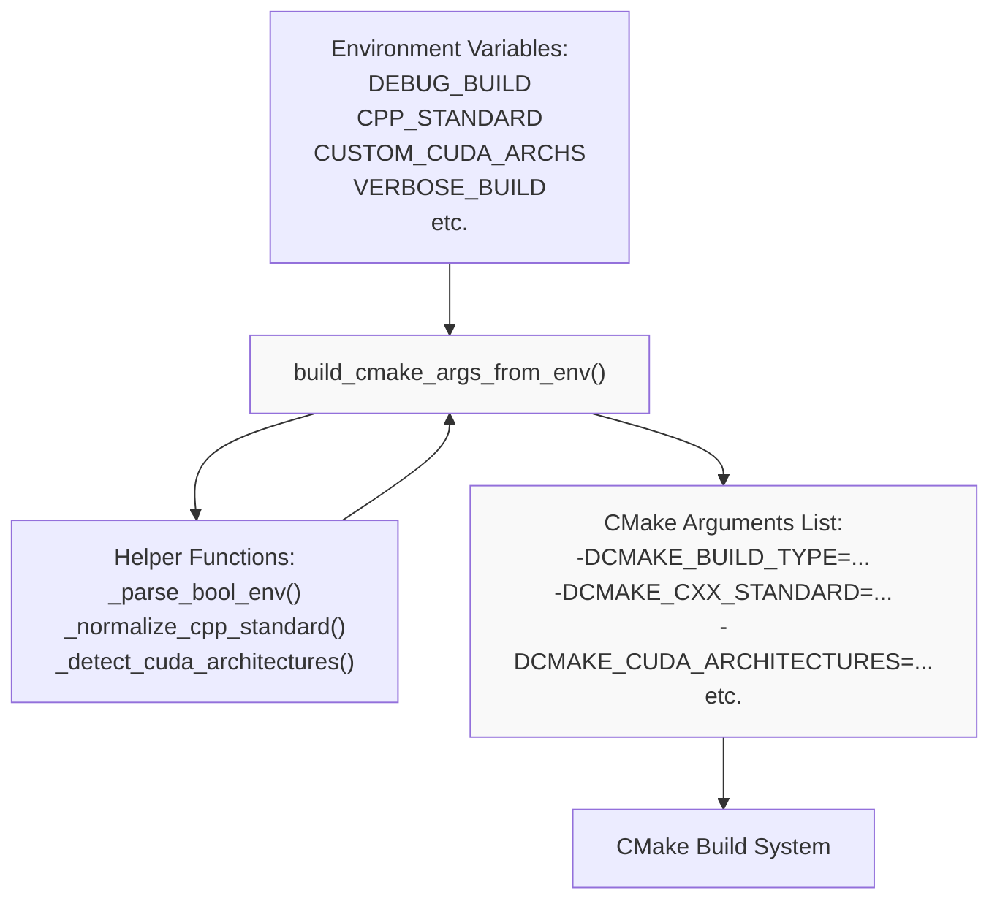
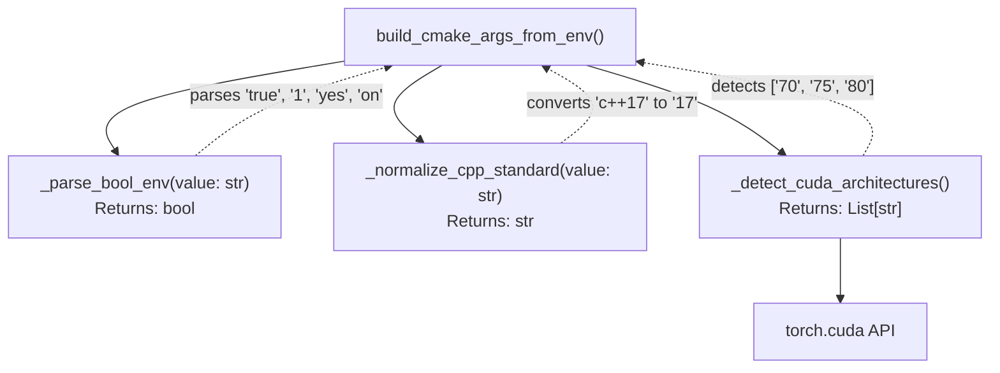
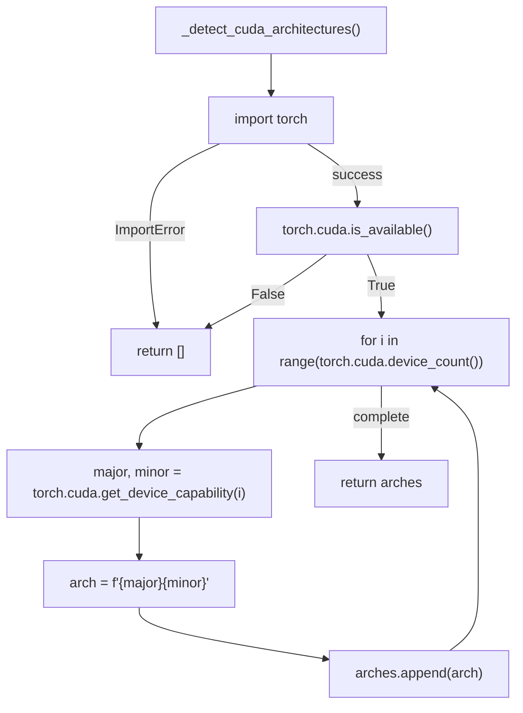
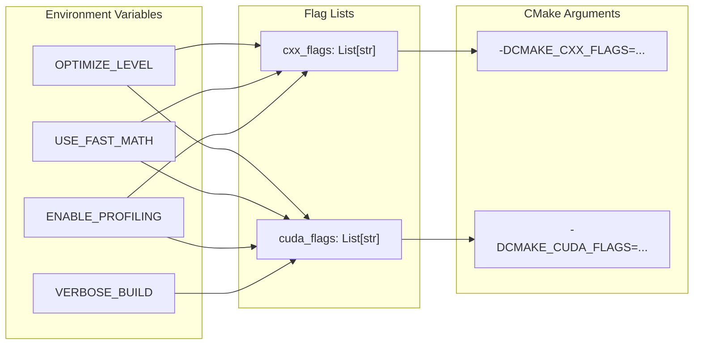

<!-- source: DeepWiki mcp.deepwiki.com · repo NVIDIA/ACCV-Lab · page 3.3 CMake Integration · fetched 2026-10-26 -->

# CMake Integration

<details>
<summary>Relevant source files</summary>

The following files were used as context for generating this wiki page:

- [build_config/accvlab_build_config/helpers/build_utils.py](build_config/accvlab_build_config/helpers/build_utils.py)
- [build_config/accvlab_build_config/helpers/cmake_args.py](build_config/accvlab_build_config/helpers/cmake_args.py)

</details>


## Purpose and Scope

This document describes how environment variables are converted to CMake arguments in the ACCV-Lab build system. The `cmake_args` module provides the `build_cmake_args_from_env()` function that generates a list of `-D` CMake arguments from environment variables, enabling consistent configuration across setuptools, external CMake, and scikit-build workflows.

For information about the environment variables themselves and their meanings, see [Environment Variables](#3.4). For information about other build utilities like `load_config()` and `detect_cuda_info()`, see [Build Utilities](#3.2).

**Sources**: [build_config/accvlab_build_config/helpers/cmake_args.py:1-121]()

## Overview

The CMake integration system translates environment-based build configuration into CMake-compatible arguments. This ensures that packages using CMake-based builds (whether through scikit-build, external build scripts, or direct CMake invocations) receive the same configuration as packages using setuptools with native extensions.



**Diagram: Environment Variable to CMake Argument Flow**

**Sources**: [build_config/accvlab_build_config/helpers/cmake_args.py:44-121]()

## Function Hierarchy

The `cmake_args` module contains one primary function and three helper functions:



**Diagram: Function Call Hierarchy in cmake_args Module**

| Function | Purpose | Input | Output |
|----------|---------|-------|--------|
| `build_cmake_args_from_env()` | Generate CMake arguments from environment | None (reads `os.environ`) | `List[str]` of CMake `-D` arguments |
| `_parse_bool_env()` | Parse boolean environment variable | `str` value | `bool` (True if "1", "true", "yes", "on") |
| `_normalize_cpp_standard()` | Normalize C++ standard format | `str` (e.g., "c++17" or "17") | `str` (e.g., "17") |
| `_detect_cuda_architectures()` | Auto-detect CUDA architectures | None (queries PyTorch) | `List[str]` (e.g., ["70", "75", "80"]) |

**Sources**: [build_config/accvlab_build_config/helpers/cmake_args.py:5-42](), [build_config/accvlab_build_config/helpers/cmake_args.py:44-114]()

## Environment Variable to CMake Mapping

The `build_cmake_args_from_env()` function maps environment variables to CMake definitions according to the following table:

| Environment Variable | CMake Variable(s) | Transformation | Example |
|---------------------|-------------------|----------------|---------|
| `DEBUG_BUILD` | `CMAKE_BUILD_TYPE` | "1"/"true"/"yes"/"on" → Debug, otherwise Release | `DEBUG_BUILD=1` → `-DCMAKE_BUILD_TYPE=Debug` |
| `CPP_STANDARD` | `CMAKE_CXX_STANDARD`<br/>`CMAKE_CUDA_STANDARD` | "c++17" → "17", applied to both C++ and CUDA | `CPP_STANDARD=c++17` → `-DCMAKE_CXX_STANDARD=17 -DCMAKE_CUDA_STANDARD=17` |
| `CUSTOM_CUDA_ARCHS` | `CMAKE_CUDA_ARCHITECTURES` | Comma or semicolon separated → semicolon separated | `CUSTOM_CUDA_ARCHS=70,75` → `-DCMAKE_CUDA_ARCHITECTURES=70;75` |
| `VERBOSE_BUILD` | `CMAKE_VERBOSE_MAKEFILE` | Boolean → ON/OFF | `VERBOSE_BUILD=1` → `-DCMAKE_VERBOSE_MAKEFILE=ON` |
| `OPTIMIZE_LEVEL` | `CMAKE_CXX_FLAGS`<br/>`CMAKE_CUDA_FLAGS` | Appends `-O{level}` | `OPTIMIZE_LEVEL=3` → `-DCMAKE_CXX_FLAGS=-O3 -DCMAKE_CUDA_FLAGS=-O3` |
| `USE_FAST_MATH` | `CMAKE_CXX_FLAGS`<br/>`CMAKE_CUDA_FLAGS` | Appends `-ffast-math` and `--use_fast_math` | `USE_FAST_MATH=1` → flags include `-ffast-math` and `--use_fast_math` |
| `ENABLE_PROFILING` | `CMAKE_CXX_FLAGS`<br/>`CMAKE_CUDA_FLAGS` | Appends `-pg` and `-Xcompiler=-pg` | `ENABLE_PROFILING=1` → flags include `-pg` and `-Xcompiler=-pg` |
| (always set) | `CMAKE_EXPORT_COMPILE_COMMANDS` | Always ON | `-DCMAKE_EXPORT_COMPILE_COMMANDS=ON` |

**Sources**: [build_config/accvlab_build_config/helpers/cmake_args.py:44-114]()

## CUDA Architecture Detection

When `CUSTOM_CUDA_ARCHS` is not set, the `_detect_cuda_architectures()` helper function attempts to auto-detect CUDA architectures from the available GPUs:



**Diagram: CUDA Architecture Detection Logic**

The function queries PyTorch's CUDA API to determine the compute capability of each available GPU. For example, a GPU with compute capability 7.5 would be added to the list as `"75"`. Duplicate architectures are filtered out.

**Sources**: [build_config/accvlab_build_config/helpers/cmake_args.py:23-42]()

## Compiler Flag Aggregation

The `build_cmake_args_from_env()` function aggregates compiler flags from multiple environment variables into `CMAKE_CXX_FLAGS` and `CMAKE_CUDA_FLAGS`:



**Diagram: Compiler Flag Aggregation Process**

The aggregation logic at [build_config/accvlab_build_config/helpers/cmake_args.py:83-112]() builds separate flag lists for C++ and CUDA compilers:

| Environment Variable | C++ Flag | CUDA Flag | Notes |
|---------------------|----------|-----------|-------|
| `OPTIMIZE_LEVEL=3` | `-O3` | `-O3` | Direct optimization level |
| `USE_FAST_MATH=1` | `-ffast-math` | `--use_fast_math` | Platform-specific syntax |
| `ENABLE_PROFILING=1` | `-pg` | `-Xcompiler=-pg` | CUDA uses `-Xcompiler` to pass to host |
| `VERBOSE_BUILD=1` | (none) | `-Xptxas=-v` | CUDA PTX assembler verbosity |

**Sources**: [build_config/accvlab_build_config/helpers/cmake_args.py:83-112]()

## Usage Patterns

### Direct Invocation

The module can be used as a Python module or invoked directly from the command line:

```python
from accvlab_build_config.helpers.cmake_args import build_cmake_args_from_env

cmake_args = build_cmake_args_from_env()
# Returns list like:
# ['-DCMAKE_EXPORT_COMPILE_COMMANDS=ON',
#  '-DCMAKE_BUILD_TYPE=Release',
#  '-DCMAKE_CXX_STANDARD=17',
#  '-DCMAKE_CUDA_STANDARD=17',
#  '-DCMAKE_CUDA_ARCHITECTURES=70;75;80']
```

When run as a script, it prints one argument per line for easy consumption in bash arrays:

```bash
$ python -m accvlab_build_config.helpers.cmake_args
-DCMAKE_EXPORT_COMPILE_COMMANDS=ON
-DCMAKE_BUILD_TYPE=Release
-DCMAKE_CXX_STANDARD=17
...
```

The `if __name__ == "__main__"` block at [build_config/accvlab_build_config/helpers/cmake_args.py:117-120]() enables this command-line usage.

**Sources**: [build_config/accvlab_build_config/helpers/cmake_args.py:117-120]()

### Integration in Build Scripts

The function is typically called from external build scripts (e.g., `build_and_copy.sh`) that invoke CMake:

```bash
#!/bin/bash
# Example external build script pattern

# Get CMake args from environment
readarray -t CMAKE_ARGS < <(python -m accvlab_build_config.helpers.cmake_args)

# Configure with CMake
cmake -B build "${CMAKE_ARGS[@]}" .

# Build
cmake --build build
```

This pattern is used by packages that have external CMake-based implementations, which are invoked via `run_external_build()` from [build_config/accvlab_build_config/helpers/build_utils.py:185-205]().

**Sources**: [build_config/accvlab_build_config/helpers/build_utils.py:185-205]()

### Integration with scikit-build

Packages using scikit-build can pass the generated arguments to CMake:

```python
from setuptools import setup
from skbuild import setup as skbuild_setup
from accvlab_build_config.helpers.cmake_args import build_cmake_args_from_env

cmake_args = build_cmake_args_from_env()

skbuild_setup(
    name="example_package",
    cmake_args=cmake_args,
    # ... other setup parameters
)
```

This ensures that scikit-build-based packages receive the same configuration as other build methods.

**Sources**: [build_config/accvlab_build_config/helpers/cmake_args.py:44-114]()

## Default Behaviors

The function includes several default behaviors to ensure robust builds:

1. **Compile Commands Export**: Always sets `-DCMAKE_EXPORT_COMPILE_COMMANDS=ON` at [build_config/accvlab_build_config/helpers/cmake_args.py:50-51]() to support tooling and validation.

2. **Release by Default**: If `DEBUG_BUILD` is not set or is falsy, defaults to `-DCMAKE_BUILD_TYPE=Release` at [build_config/accvlab_build_config/helpers/cmake_args.py:54-57]().

3. **Architecture Auto-Detection**: If `CUSTOM_CUDA_ARCHS` is not provided, attempts to detect architectures from PyTorch at [build_config/accvlab_build_config/helpers/cmake_args.py:73-77](). If detection fails, CMake's default architecture selection applies.

4. **Graceful Degradation**: The `_detect_cuda_architectures()` function returns an empty list on any exception at [build_config/accvlab_build_config/helpers/cmake_args.py:40-41](), allowing builds to proceed even if PyTorch is unavailable.

**Sources**: [build_config/accvlab_build_config/helpers/cmake_args.py:50-77](), [build_config/accvlab_build_config/helpers/cmake_args.py:23-41]()

## Relationship to Build Utilities

The `cmake_args` module complements the functions in `build_utils.py`:

| Module | Function | Primary Use Case |
|--------|----------|------------------|
| `build_utils.py` | `load_config()` | Load configuration dictionary for setuptools builds |
| `build_utils.py` | `detect_cuda_info()` | Detect CUDA info for setuptools extension builds |
| `build_utils.py` | `get_compile_flags()` | Generate flags for setuptools `extra_compile_args` |
| `cmake_args.py` | `build_cmake_args_from_env()` | Generate `-D` arguments for CMake-based builds |

The `cmake_args` module uses similar detection logic to `detect_cuda_info()` but outputs CMake-compatible arguments instead of a configuration dictionary. Both use PyTorch's CUDA API for GPU detection.

**Sources**: [build_config/accvlab_build_config/helpers/build_utils.py:76-102](), [build_config/accvlab_build_config/helpers/cmake_args.py:23-42]()

---

