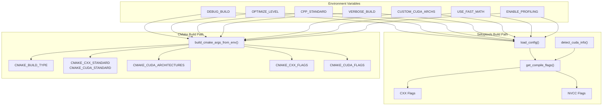
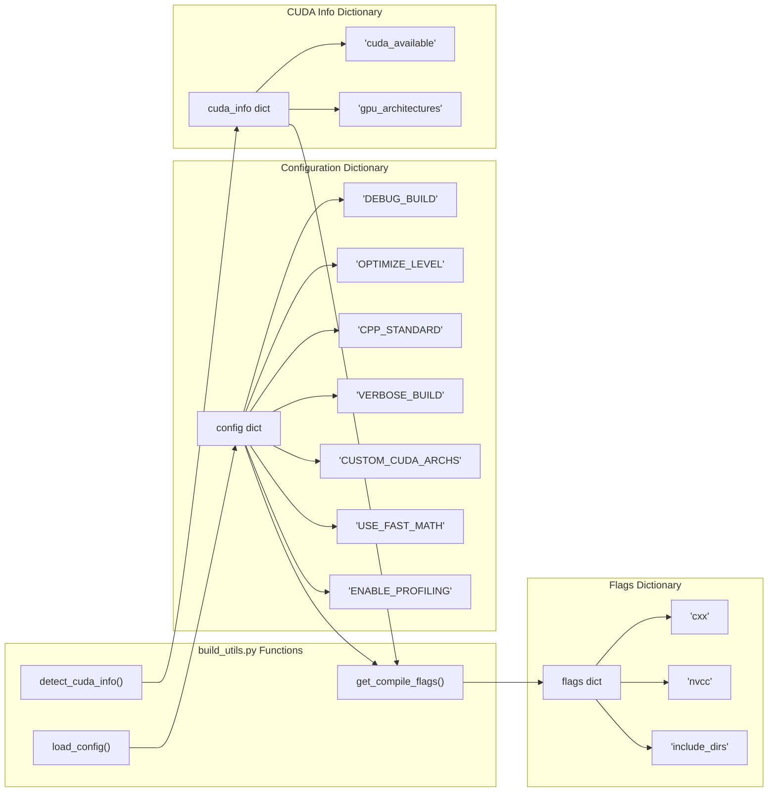
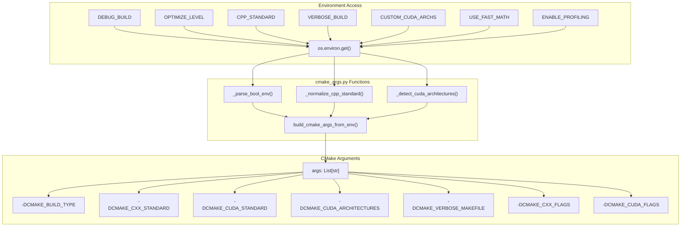
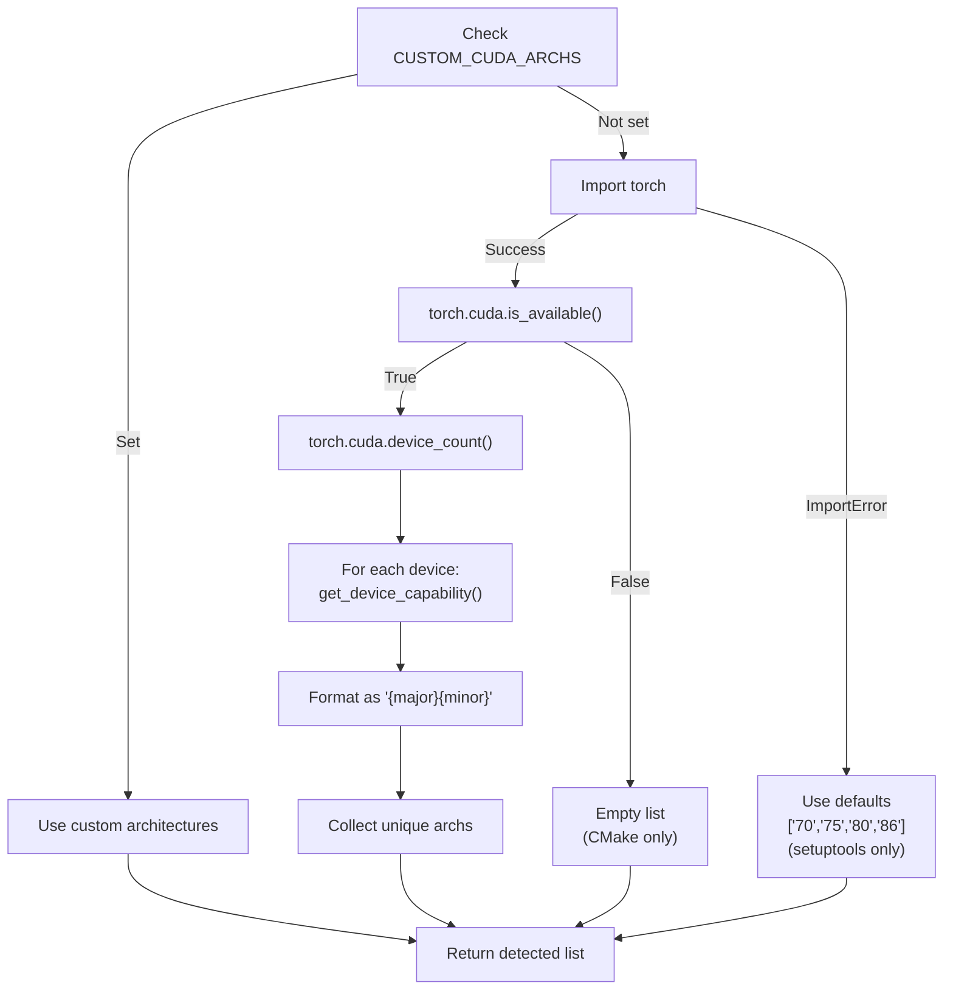

<!-- source: DeepWiki mcp.deepwiki.com · repo NVIDIA/ACCV-Lab · page 3.4 Environment Variables · fetched 2026-10-26 -->

# Environment Variables

<details>
<summary>Relevant source files</summary>

The following files were used as context for generating this wiki page:

- [build_config/accvlab_build_config/helpers/build_utils.py](build_config/accvlab_build_config/helpers/build_utils.py)
- [build_config/accvlab_build_config/helpers/cmake_args.py](build_config/accvlab_build_config/helpers/cmake_args.py)

</details>


## Purpose and Scope

This document provides a comprehensive reference for all environment variables that control the build configuration of ACCV-Lab packages. These variables affect compilation flags, optimization levels, CUDA architecture targeting, and debugging options across both setuptools-based and CMake-based build systems.

For information about the build utilities that consume these variables, see [Build Utilities](#3.2). For CMake-specific integration details, see [CMake Integration](#3.3). For overall build system architecture, see [Build System](#3).

## Environment Variables Overview

The following table summarizes all supported build configuration environment variables:

| Variable | Type | Default | Description |
|----------|------|---------|-------------|
| `DEBUG_BUILD` | Boolean | `False` | Enable debug build mode with symbols and assertions |
| `OPTIMIZE_LEVEL` | Integer | `3` | Compiler optimization level (0-3) |
| `CPP_STANDARD` | String | `c++17` | C++ language standard version |
| `VERBOSE_BUILD` | Boolean | `False` | Enable verbose compilation output |
| `CUSTOM_CUDA_ARCHS` | String (comma-separated) | Auto-detected | Target CUDA compute architectures |
| `USE_FAST_MATH` | Boolean | `True` | Enable fast math optimizations |
| `ENABLE_PROFILING` | Boolean | `False` | Enable profiling instrumentation |

**Sources:** [build_config/accvlab_build_config/helpers/build_utils.py:27-73](), [build_config/accvlab_build_config/helpers/cmake_args.py:44-114]()

## Variable Processing Architecture

The environment variables are processed differently depending on the build system being used:

### Environment Variable Flow Diagram



**Sources:** [build_config/accvlab_build_config/helpers/build_utils.py:27-182](), [build_config/accvlab_build_config/helpers/cmake_args.py:44-114]()

## Detailed Variable Reference

### DEBUG_BUILD

**Type:** Boolean  
**Default:** `False`  
**Valid Values:** `1`, `true`, `yes`, `on` (case-insensitive) for true; any other value for false

Controls whether packages are built in debug mode or release mode.

**Effects on Setuptools Build:**
- Adds `-g` and `-DDEBUG` to C++ compiler flags [build_config/accvlab_build_config/helpers/build_utils.py:140]()
- Adds `-g`, `-G`, and `-DDEBUG` to NVCC flags [build_config/accvlab_build_config/helpers/build_utils.py:141]()

**Effects on CMake Build:**
- Sets `CMAKE_BUILD_TYPE=Debug` when true [build_config/accvlab_build_config/helpers/cmake_args.py:54-55]()
- Sets `CMAKE_BUILD_TYPE=Release` when false [build_config/accvlab_build_config/helpers/cmake_args.py:56-57]()

**Example:**
```bash
export DEBUG_BUILD=1
pip install -e packages/accvlab-on-demand-video-decoder/
```

### OPTIMIZE_LEVEL

**Type:** Integer  
**Default:** `3`  
**Valid Values:** `0`, `1`, `2`, `3`

Controls the compiler optimization level. Higher values enable more aggressive optimizations.

**Effects on Setuptools Build:**
- Adds `-O{OPTIMIZE_LEVEL}` to C++ compiler flags [build_config/accvlab_build_config/helpers/build_utils.py:126]()
- Adds `-O{OPTIMIZE_LEVEL}` to NVCC flags [build_config/accvlab_build_config/helpers/build_utils.py:172]()

**Effects on CMake Build:**
- Adds `-O{OPTIMIZE_LEVEL}` to `CMAKE_CXX_FLAGS` [build_config/accvlab_build_config/helpers/cmake_args.py:92-94]()
- Adds `-O{OPTIMIZE_LEVEL}` to `CMAKE_CUDA_FLAGS` [build_config/accvlab_build_config/helpers/cmake_args.py:92-94]()

**Example:**
```bash
export OPTIMIZE_LEVEL=0
pip install -e packages/accvlab-on-demand-video-decoder/
```

### CPP_STANDARD

**Type:** String  
**Default:** `c++17`  
**Valid Values:** `c++11`, `c++14`, `c++17`, `c++20`, or numeric equivalents (`11`, `14`, `17`, `20`)

Specifies the C++ language standard version to use for compilation.

**Effects on Setuptools Build:**
- Adds `-std={CPP_STANDARD}` to C++ compiler flags [build_config/accvlab_build_config/helpers/build_utils.py:125]()
- Adds `-std={CPP_STANDARD}` to NVCC flags [build_config/accvlab_build_config/helpers/build_utils.py:171]()

**Effects on CMake Build:**
- Normalized by `_normalize_cpp_standard()` to remove `c++` prefix [build_config/accvlab_build_config/helpers/cmake_args.py:11-20]()
- Sets `CMAKE_CXX_STANDARD` [build_config/accvlab_build_config/helpers/cmake_args.py:64]()
- Sets `CMAKE_CUDA_STANDARD` [build_config/accvlab_build_config/helpers/cmake_args.py:65]()

**Example:**
```bash
export CPP_STANDARD=c++20
pip install -e packages/accvlab-on-demand-video-decoder/
```

### VERBOSE_BUILD

**Type:** Boolean  
**Default:** `False`  
**Valid Values:** `1`, `true`, `yes`, `on` (case-insensitive) for true; any other value for false

Enables verbose compilation output for debugging build issues.

**Effects on Setuptools Build:**
- Adds `-Xptxas=-v` to NVCC flags to show register usage [build_config/accvlab_build_config/helpers/build_utils.py:175]()

**Effects on CMake Build:**
- Sets `CMAKE_VERBOSE_MAKEFILE=ON` [build_config/accvlab_build_config/helpers/cmake_args.py:80-81]()
- Adds `-Xptxas=-v` to `CMAKE_CUDA_FLAGS` [build_config/accvlab_build_config/helpers/cmake_args.py:105-107]()

**Example:**
```bash
export VERBOSE_BUILD=1
pip install -e packages/accvlab-on-demand-video-decoder/
```

### CUSTOM_CUDA_ARCHS

**Type:** String (comma-separated list)  
**Default:** Auto-detected from available GPUs  
**Valid Values:** Comma-separated list of CUDA compute capabilities (e.g., `70,75,80,86`)

Specifies target CUDA compute architectures for compilation. When not set, architectures are auto-detected using PyTorch.

**Effects on Setuptools Build:**
- Parsed as comma-separated list [build_config/accvlab_build_config/helpers/build_utils.py:68-69]()
- Used to generate `-gencode=arch=compute_{arch},code=sm_{arch}` flags [build_config/accvlab_build_config/helpers/build_utils.py:156-166]()
- Falls back to `['70', '75', '80', '86']` if not set and auto-detection fails [build_config/accvlab_build_config/helpers/build_utils.py:162]()

**Effects on CMake Build:**
- Accepts comma or semicolon-separated values [build_config/accvlab_build_config/helpers/cmake_args.py:70-71]()
- Sets `CMAKE_CUDA_ARCHITECTURES` [build_config/accvlab_build_config/helpers/cmake_args.py:72]()
- Auto-detected via `_detect_cuda_architectures()` if not set [build_config/accvlab_build_config/helpers/cmake_args.py:73-77]()

**Example:**
```bash
export CUSTOM_CUDA_ARCHS=75,80,86
pip install -e packages/accvlab-on-demand-video-decoder/
```

### USE_FAST_MATH

**Type:** Boolean  
**Default:** `True`  
**Valid Values:** `1`, `true`, `yes`, `on` (case-insensitive) for true; any other value for false

Enables fast math optimizations, which trade precision for performance in floating-point operations.

**Effects on Setuptools Build:**
- Adds `-ffast-math` to C++ compiler flags [build_config/accvlab_build_config/helpers/build_utils.py:135-136]()
- Adds `--use_fast_math` to NVCC flags when true [build_config/accvlab_build_config/helpers/build_utils.py:173]()
- Adds `--ftz=false` to NVCC flags when false [build_config/accvlab_build_config/helpers/build_utils.py:173]()

**Effects on CMake Build:**
- Adds `-ffast-math` to `CMAKE_CXX_FLAGS` [build_config/accvlab_build_config/helpers/cmake_args.py:96-98]()
- Adds `--use_fast_math` to `CMAKE_CUDA_FLAGS` [build_config/accvlab_build_config/helpers/cmake_args.py:96-98]()

**Example:**
```bash
export USE_FAST_MATH=0
pip install -e packages/accvlab-on-demand-video-decoder/
```

### ENABLE_PROFILING

**Type:** Boolean  
**Default:** `False`  
**Valid Values:** `1`, `true`, `yes`, `on` (case-insensitive) for true; any other value for false

Enables profiling instrumentation for performance analysis with tools like gprof.

**Effects on Setuptools Build:**
- Adds `-pg` to C++ compiler flags [build_config/accvlab_build_config/helpers/build_utils.py:144-145]()

**Effects on CMake Build:**
- Adds `-pg` to `CMAKE_CXX_FLAGS` [build_config/accvlab_build_config/helpers/cmake_args.py:100-101]()
- Adds `-Xcompiler=-pg` to `CMAKE_CUDA_FLAGS` to pass through to host compiler [build_config/accvlab_build_config/helpers/cmake_args.py:102-103]()

**Example:**
```bash
export ENABLE_PROFILING=1
pip install -e packages/accvlab-on-demand-video-decoder/
```

## Code Entity Mapping

### Setuptools Build Functions



**Sources:** [build_config/accvlab_build_config/helpers/build_utils.py:27-182]()

### CMake Build Functions



**Sources:** [build_config/accvlab_build_config/helpers/cmake_args.py:5-114]()

## Boolean Value Parsing

Both build systems use consistent parsing for boolean environment variables:

| Input Value | Parsed Result |
|-------------|---------------|
| `1` | `True` |
| `true` (case-insensitive) | `True` |
| `yes` (case-insensitive) | `True` |
| `on` (case-insensitive) | `True` |
| Any other value | `False` |
| Not set | `False` |

**Setuptools Implementation:** [build_config/accvlab_build_config/helpers/build_utils.py:64-65]()  
**CMake Implementation:** [build_config/accvlab_build_config/helpers/cmake_args.py:5-8]()

## CUDA Architecture Auto-Detection

When `CUSTOM_CUDA_ARCHS` is not set, both build systems attempt to auto-detect available GPU architectures:

### Detection Process



**Setuptools Implementation:** [build_config/accvlab_build_config/helpers/build_utils.py:76-102](), [build_config/accvlab_build_config/helpers/build_utils.py:156-166]()  
**CMake Implementation:** [build_config/accvlab_build_config/helpers/cmake_args.py:23-41](), [build_config/accvlab_build_config/helpers/cmake_args.py:68-77]()

## Usage Examples

### Development Build

For active development with debug symbols and verbose output:

```bash
export DEBUG_BUILD=1
export VERBOSE_BUILD=1
export OPTIMIZE_LEVEL=0
pip install -e packages/accvlab-on-demand-video-decoder/
```

### Production Build

For optimized production builds:

```bash
export DEBUG_BUILD=0
export OPTIMIZE_LEVEL=3
export USE_FAST_MATH=1
pip install packages/accvlab-on-demand-video-decoder/
```

### Targeting Specific GPUs

For building on a machine with Ampere GPUs but targeting multiple architectures:

```bash
export CUSTOM_CUDA_ARCHS=75,80,86
pip install packages/accvlab-on-demand-video-decoder/
```

### Profiling Build

For performance profiling with gprof:

```bash
export ENABLE_PROFILING=1
export DEBUG_BUILD=1
pip install -e packages/accvlab-on-demand-video-decoder/
```

### Using with CMake Directly

The `cmake_args.py` module can be used directly to generate CMake arguments:

```bash
# Export environment variables
export DEBUG_BUILD=1
export CPP_STANDARD=c++20
export CUSTOM_CUDA_ARCHS=80,86

# Generate CMake arguments
python -m accvlab_build_config.helpers.cmake_args
```

This outputs CMake arguments one per line [build_config/accvlab_build_config/helpers/cmake_args.py:117-120]():

```
-DCMAKE_EXPORT_COMPILE_COMMANDS=ON
-DCMAKE_BUILD_TYPE=Debug
-DCMAKE_CXX_STANDARD=20
-DCMAKE_CUDA_STANDARD=20
-DCMAKE_CUDA_ARCHITECTURES=80;86
```

**Sources:** [build_config/accvlab_build_config/helpers/build_utils.py:27-182](), [build_config/accvlab_build_config/helpers/cmake_args.py:44-120]()

## Environment Variable Precedence

Environment variables always override default values. The precedence is:

1. **Environment Variable:** Value from `os.environ[KEY]`
2. **Default Configuration:** Default value specified in `load_config()` [build_config/accvlab_build_config/helpers/build_utils.py:48-56]()
3. **Fallback Defaults:** Hard-coded fallbacks (e.g., CUDA architectures)

The `load_config()` function implements this precedence by copying the default configuration and then overriding with environment variables [build_config/accvlab_build_config/helpers/build_utils.py:58-72]().

**Sources:** [build_config/accvlab_build_config/helpers/build_utils.py:27-73]()

## Integration with External Build Scripts

Some packages use external build scripts that may invoke CMake. The environment variables are automatically available to these scripts through the `run_external_build()` function [build_config/accvlab_build_config/helpers/build_utils.py:185-206]().

The external build script (typically `build_and_copy.sh`) can use the `cmake_args.py` module to generate consistent CMake arguments:

```bash
#!/bin/bash
# Example external build script
cmake_args=$(python -m accvlab_build_config.helpers.cmake_args)
cmake $cmake_args ..
make -j
```

**Sources:** [build_config/accvlab_build_config/helpers/build_utils.py:185-206](), [build_config/accvlab_build_config/helpers/cmake_args.py:117-120]()

---

