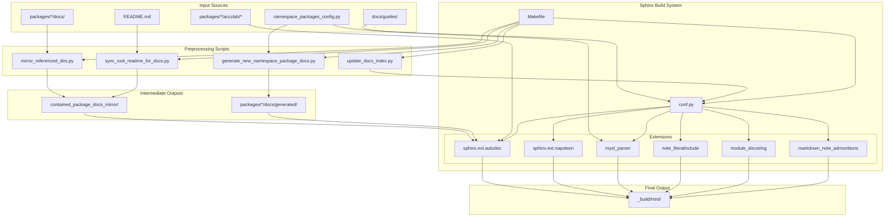
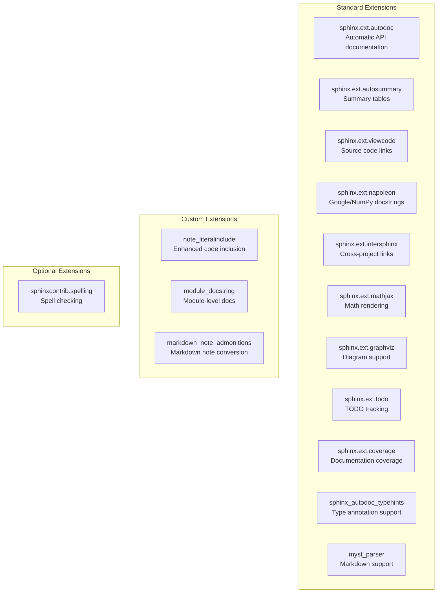
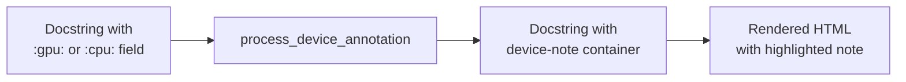
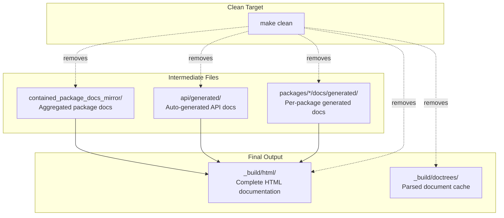
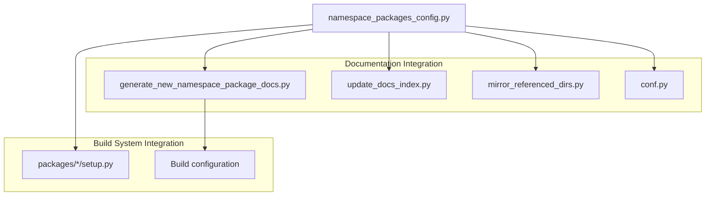

<!-- source: DeepWiki mcp.deepwiki.com · repo NVIDIA/ACCV-Lab · page 4 Documentation System · fetched 2026-10-26 -->

# Documentation System

<details>
<summary>Relevant source files</summary>

The following files were used as context for generating this wiki page:

- [README.md](README.md)
- [docs/Makefile](docs/Makefile)
- [docs/conf.py](docs/conf.py)

</details>


## Purpose and Scope

The Documentation System provides a Sphinx-based infrastructure for automatically generating and managing comprehensive documentation for all ACCV-Lab packages. It aggregates documentation from individual namespace packages, generates API references, processes markdown guides, and applies custom extensions to create a unified documentation website.

This page covers the documentation infrastructure itself—the build system, Sphinx configuration, preprocessing scripts, and custom extensions. For step-by-step instructions on building documentation, see [Building Documentation](#4.1). For guidance on writing documentation for namespace packages, see [Writing Package Documentation](#4.4). For information on the shared configuration that synchronizes documentation with the build system, see [Shared Configuration System](#7.2).

## Architecture Overview

The documentation system consists of four main components: preprocessing scripts that prepare source files, Sphinx configuration that defines build behavior, custom extensions that enhance Sphinx functionality, and a mirror system that aggregates package documentation.



**Sources**: [docs/conf.py:1-236](), [docs/Makefile:1-45](), Diagram 3 from high-level architecture

## Build Workflow

The documentation build process is orchestrated by the `Makefile` in the `docs/` directory. The build follows a three-stage pipeline: preprocessing, generation, and compilation.

```mermaid
graph LR
    subgraph "Stage 1: Sync"
        MAKE_SYNC["make sync-readme"]
        SYNC_SCRIPT["sync_root_readme_for_docs.py"]
    end
    
    subgraph "Stage 2: Generate"
        MAKE_GEN["make generate"]
        MIRROR["mirror_referenced_dirs.py"]
        GEN_NS["generate_new_namespace_package_docs.py"]
        UPDATE["update_docs_index.py"]
    end
    
    subgraph "Stage 3: Build"
        SPHINX_BUILD["sphinx-build"]
        HTML_OUT["_build/html/"]
    end
    
    MAKE_SYNC --> SYNC_SCRIPT
    SYNC_SCRIPT --> MAKE_GEN
    
    MAKE_GEN --> MIRROR
    MIRROR --> GEN_NS
    GEN_NS --> UPDATE
    UPDATE --> SPHINX_BUILD
    
    SPHINX_BUILD --> HTML_OUT
```



**Sources**: [docs/Makefile:18-30]()

### Build Targets

The `Makefile` defines several targets for different build scenarios:

| Target | Command | Purpose |
|--------|---------|---------|
| `html` | `make html` | Full build with sync and generation |
| `sync-readme` | `make sync-readme` | Sync root README into docs tree |
| `generate` | `make generate` | Run all preprocessing scripts |
| `clean` | `make clean` | Remove build artifacts and generated files |
| `livehtml` | `make livehtml` | Auto-rebuild on file changes |

The standard build command `make html` executes the complete pipeline:
1. Syncs `README.md` into the documentation tree via `sync_root_readme_for_docs.py`
2. Runs preprocessing scripts via the `generate` target
3. Invokes `sphinx-build` to compile documentation

**Sources**: [docs/Makefile:24-40]()

### Preprocessing Scripts

Four Python scripts prepare source files before Sphinx compilation:

#### sync_root_readme_for_docs.py

Copies the root `README.md` into the documentation tree, making it available as part of the project overview. This ensures the main README content is included in the generated documentation.

**Sources**: [docs/Makefile:24-26]()

#### mirror_referenced_dirs.py

Creates the `contained_package_docs_mirror/` directory structure by symlinking or copying package documentation directories. This aggregates all package-level documentation into a single location where Sphinx can process it.

**Sources**: [docs/Makefile:19](), Diagram 3 from high-level architecture

#### generate_new_namespace_package_docs.py

Auto-generates API documentation structure for namespace packages based on `namespace_packages_config.py`. It creates RST files with `automodule` directives to document Python modules.

**Sources**: [docs/Makefile:20](), Diagram 3 from high-level architecture

#### update_docs_index.py

Updates the main documentation index based on the namespace packages defined in `namespace_packages_config.py`. This ensures the table of contents reflects all available packages.

**Sources**: [docs/Makefile:21](), Diagram 3 from high-level architecture

## Sphinx Configuration

The Sphinx configuration is centralized in `conf.py`, which defines project metadata, extensions, themes, and build behavior.

### Project Metadata

Basic project information is defined at the top of the configuration:

| Configuration | Value | Source |
|--------------|-------|--------|
| `project` | `'ACCV-Lab'` | [docs/conf.py:16]() |
| `copyright` | `'2025, NVIDIA Corporation'` | [docs/conf.py:17]() |
| `author` | `'NVIDIA Corporation'` | [docs/conf.py:18]() |
| `version` | Extracted from `accvlab.__version__` | [docs/conf.py:21-28]() |

**Sources**: [docs/conf.py:15-28]()

### Extension Configuration

The documentation system uses eleven Sphinx extensions, divided into three categories:



**Sources**: [docs/conf.py:31-65]()

#### Core Extensions

- **autodoc**: Generates API documentation from Python docstrings. Configured to include all members, maintain source order, and document undocumented members ([docs/conf.py:154-159]()).
- **autosummary**: Creates summary tables but does not generate separate files (`autosummary_generate = False`) ([docs/conf.py:165-166]()).
- **napoleon**: Parses Google and NumPy style docstrings ([docs/conf.py:169-180]()).
- **myst_parser**: Enables markdown file processing with 18 extensions enabled ([docs/conf.py:86-103]()).

**Sources**: [docs/conf.py:31-46](), [docs/conf.py:153-180]()

#### Third-Party Extensions

- **sphinx_autodoc_typehints**: Documents type annotations with configuration to show fully qualified names and default values ([docs/conf.py:193-202]()).
- **sphinxcontrib.spelling**: Optional spell checking with custom word list in `spelling_wordlist.txt` ([docs/conf.py:49-64]()).

**Sources**: [docs/conf.py:41](), [docs/conf.py:49-64](), [docs/conf.py:192-202]()

### Theme Configuration

The documentation uses the Read the Docs theme (`sphinx_rtd_theme`) with specific customizations:

| Option | Value | Purpose |
|--------|-------|---------|
| `collapse_navigation` | `True` | Collapse sidebar navigation |
| `sticky_navigation` | `True` | Keep navigation visible when scrolling |
| `navigation_depth` | `5` | Show up to 5 levels in navigation |
| `includehidden` | `True` | Include hidden toctree entries |

**Sources**: [docs/conf.py:106-124]()

### LaTeX Output Configuration

For PDF generation, the system uses `xelatex` engine with DejaVu fonts for Unicode support:

```python
latex_engine = 'xelatex'
latex_elements = {
    'inputenc': '',
    'utf8extra': '',
    'preamble': r'''
\usepackage{fontspec}
\usepackage{unicode-math}
\setmainfont{DejaVu Serif}
\setsansfont{DejaVu Sans}
\setmonofont{DejaVu Sans Mono}
\setmathfont{Latin Modern Math}
'''
}
```

**Sources**: [docs/conf.py:126-149]()

## Custom Sphinx Extensions

Three custom extensions in the `docs/_ext/` directory enhance Sphinx functionality for ACCV-Lab documentation.

### Extension Loading

Extensions are loaded by adding the `_ext` directory to `sys.path` and listing them in the `extensions` list:

```python
sys.path.insert(0, str(Path(__file__).parent / '_ext'))
extensions = [
    # ... standard extensions ...
    'note_literalinclude',
    'module_docstring',
    'markdown_note_admonitions',
]
```

**Sources**: [docs/conf.py:13](), [docs/conf.py:43-45]()

### note_literalinclude Extension

Provides a directive that wraps code snippets in note admonitions. Useful for highlighting important code examples with contextual information.

**Sources**: [docs/conf.py:43]()

### module_docstring Extension

Extracts and processes module-level docstrings, making it easier to document entire modules with a single directive.

**Sources**: [docs/conf.py:44]()

### markdown_note_admonitions Extension

Automatically converts markdown blockquotes (lines starting with `>`) into Sphinx admonition directives. This allows markdown files to use a simpler syntax while still producing styled note/warning boxes in the output.

**Sources**: [docs/conf.py:45]()

## Custom Docstring Processing

The configuration includes a custom handler for device annotations that processes special fields in docstrings:



The `process_device_annotation` function searches for `:gpu:`, `:cpu:`, or `:device:` fields in docstrings and converts them into a highlighted container note at the top of the documentation. This provides clear visual indication of device requirements for functions.

**Sources**: [docs/conf.py:207-230](), [docs/conf.py:232-235]()

### Field Processing Logic

| Field | Processed As | Output |
|-------|-------------|--------|
| `:gpu:` | Device = `'GPU'` | "This function expects input data to be on the **GPU**." |
| `:cpu:` | Device = `'CPU'` | "This function expects input data to be on the **CPU**." |
| `:device: XYZ` | Device = `'XYZ'` (uppercase) | "This function expects input data to be on the **XYZ**." |

**Sources**: [docs/conf.py:207-229]()

## MyST Parser Configuration

MyST (Markedly Structured Text) enables advanced markdown features in documentation. The configuration enables 18 extensions:

| Extension | Purpose |
|-----------|---------|
| `colon_fence` | Use `:::` for code fences |
| `deflist` | Definition lists |
| `dollarmath` | Math in `$...$` and `$$...$$` |
| `fieldlist` | Field lists like RST |
| `html_admonition` | HTML-style admonitions |
| `html_image` | HTML image syntax |
| `linkify` | Auto-convert URLs to links |
| `replacements` | Text replacements |
| `smartquotes` | Smart quote conversion |
| `strikethrough` | `~~text~~` syntax |
| `substitution` | Variable substitutions |
| `tasklist` | GitHub-style task lists |

Additionally, `myst_heading_anchors = 6` generates HTML anchor IDs for headings up to 6 levels deep, enabling hash links within documents.

**Sources**: [docs/conf.py:86-103]()

## Intersphinx Mapping

The documentation system links to external project documentation using intersphinx:

```python
intersphinx_mapping = {
    'python': ('https://docs.python.org/3/', None),
    'numpy': ('https://numpy.org/doc/stable/', None),
    'torch': ('https://pytorch.org/docs/stable/', None),
    'nvidia.dali': ('https://docs.nvidia.com/deeplearning/dali/user-guide/docs/', None),
}
```

This enables cross-references to Python standard library, NumPy, PyTorch, and NVIDIA DALI documentation without manual URL specification.

**Sources**: [docs/conf.py:182-187]()

## Build Artifacts and Output Structure

The build process produces several intermediate and final outputs:



The `make clean` target removes all build artifacts, ensuring a fresh build:

```bash
rm -rf _build/
rm -rf api/generated/
rm -rf ../packages/*/docs/generated/
```

**Sources**: [docs/Makefile:33-36]()

## Source File Discovery

Sphinx discovers source files based on configuration settings:

| Setting | Value | Purpose |
|---------|-------|---------|
| `source_suffix` | `{'.rst': 'restructuredtext', '.md': 'myst'}` | Accept both RST and MD files |
| `master_doc` | `'index'` | Root document for navigation |
| `exclude_patterns` | `['_build', 'Thumbs.db', '.DS_Store', 'generated']` | Ignore build artifacts |
| `followlinks` | `True` | Follow symbolic links when discovering files |

The `followlinks = True` setting is crucial for the mirror system, allowing Sphinx to traverse symlinks created by `mirror_referenced_dirs.py`.

**Sources**: [docs/conf.py:67](), [docs/conf.py:74-83]()

## Integration with Namespace Packages

The documentation system is tightly integrated with the namespace package structure through `namespace_packages_config.py`:



This shared configuration ensures consistency between the build system and documentation, as both systems reference the same package definitions.

**Sources**: Diagram 2 from high-level architecture, [README.md:95-98]()

---

