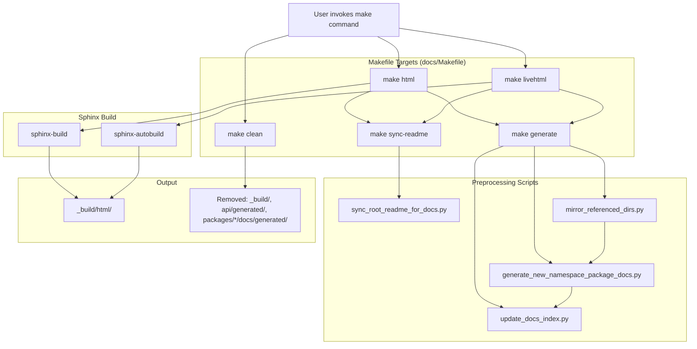
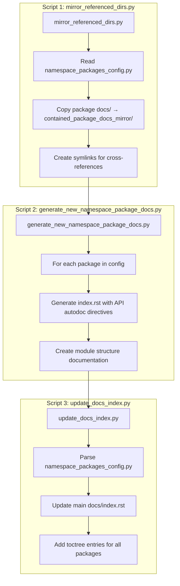
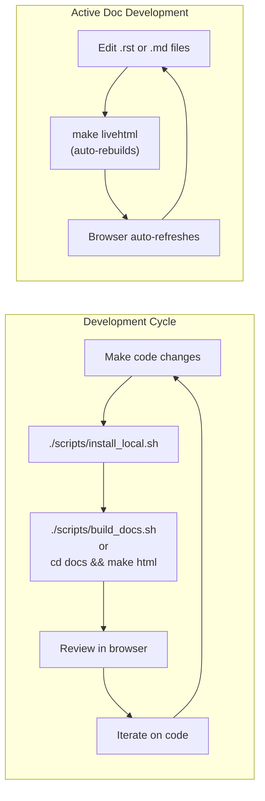

<!-- source: DeepWiki mcp.deepwiki.com · repo NVIDIA/ACCV-Lab · page 4.1 Building Documentation · fetched 2026-10-26 -->

# Building Documentation

<details>
<summary>Relevant source files</summary>

The following files were used as context for generating this wiki page:

- [README.md](README.md)
- [docs/Makefile](docs/Makefile)
- [docs/conf.py](docs/conf.py)

</details>


This page provides step-by-step instructions for building the ACCV-Lab documentation locally using Sphinx and the provided build system. It covers the available make commands, prerequisites, build workflow, and output structure.

For detailed information about the Sphinx configuration and extensions used, see [Sphinx Configuration](#4.2). For guidance on writing documentation for individual packages, see [Writing Package Documentation](#4.4).

---

## Prerequisites

Before building the documentation, you must ensure the following requirements are met:

| Requirement | Description | Reason |
|-------------|-------------|--------|
| **Packages Installed** | All ACCV-Lab packages must be installed (not just source code present) | API documentation generation requires importing packages to extract docstrings |
| **Git Submodules** | Submodules initialized via `git submodule update --init --recursive` | Required for package dependencies |
| **Python Environment** | Python 3.x with Sphinx and extensions installed | Sphinx is the documentation generator |
| **LaTeX (Optional)** | XeLaTeX for PDF generation | Only needed if building PDF documentation |

> **⚠️ Important**: The packages must be installed (not editable mode for packages with native extensions), as the documentation generation process imports them to extract API documentation. If packages are not properly installed, autodoc will fail to generate API references.

**Sources:** [README.md:95-98](), [README.md:78-93]()

---

## Build System Overview

The documentation build system uses a Makefile that orchestrates multiple preprocessing scripts before invoking Sphinx. The following diagram shows the complete build pipeline:



**Sources:** [docs/Makefile:1-45]()

---

## Available Make Commands

The documentation build system provides several make targets for different use cases:

### Primary Commands

| Command | Description | Use Case |
|---------|-------------|----------|
| `make html` | Build complete HTML documentation | Standard documentation build |
| `make clean` | Remove all build artifacts | Clean slate before rebuild |
| `make livehtml` | Auto-rebuild on file changes | Active documentation development |

### Helper Commands

| Command | Description | When to Use |
|---------|-------------|-------------|
| `make generate` | Run preprocessing scripts only | Debugging preprocessing issues |
| `make sync-readme` | Sync root README into docs tree | Testing README integration |
| `make help` | Show all available targets | Discover other Sphinx targets |

**Sources:** [docs/Makefile:1-45]()

---

## Build Workflow

### Standard Build Process

To build the documentation from scratch, execute the following steps:

```bash
# Navigate to the docs directory
cd docs/

# Build HTML documentation
make html
```

The `make html` command executes the following sequence:

```mermaid
graph LR
    Start["make html invoked"]
    
    subgraph "Phase 1: Sync README"
        SyncScript["sync_root_readme_for_docs.py"]
        CopyReadme["Copy README.md → contained_package_docs_mirror/project_overview/"]
    end
    
    subgraph "Phase 2: Generate Documentation Structure"
        Mirror["mirror_referenced_dirs.py"]
        Generate["generate_new_namespace_package_docs.py"]
        UpdateIdx["update_docs_index.py"]
        
        CreateMirror["Create contained_package_docs_mirror/"]
        AutoGenDocs["Auto-generate index.rst files"]
        UpdateToc["Update docs/index.rst"]
    end
    
    subgraph "Phase 3: Sphinx Build"
        SphinxBuild["sphinx-build -M html"]
        ParseRST["Parse .rst and .md files"]
        RunAutodoc["Run autodoc on Python modules"]
        ApplyTheme["Apply sphinx_rtd_theme"]
        GenerateHTML["Generate _build/html/"]
    end
    
    Start --> SyncScript
    SyncScript --> CopyReadme
    CopyReadme --> Mirror
    
    Mirror --> CreateMirror
    CreateMirror --> Generate
    Generate --> AutoGenDocs
    AutoGenDocs --> UpdateIdx
    UpdateIdx --> UpdateToc
    
    UpdateToc --> SphinxBuild
    SphinxBuild --> ParseRST
    ParseRST --> RunAutodoc
    RunAutodoc --> ApplyTheme
    ApplyTheme --> GenerateHTML
```



**Sources:** [docs/Makefile:23-30]()

---

## Preprocessing Scripts

The build process executes three preprocessing scripts before Sphinx runs. Understanding their roles helps when debugging documentation issues:

### Script Execution Order



### Script Details

| Script | Input | Output | Purpose |
|--------|-------|--------|---------|
| `mirror_referenced_dirs.py` | Package `docs/` directories | `contained_package_docs_mirror/` | Aggregate package documentation into unified structure |
| `generate_new_namespace_package_docs.py` | `namespace_packages_config.py` | Package `index.rst` files | Auto-generate API documentation structure |
| `update_docs_index.py` | `namespace_packages_config.py` | Updated `docs/index.rst` | Maintain main documentation index |

**Sources:** [docs/Makefile:18-21]()

---

## Live Rebuild Mode

For active documentation development, the `livehtml` target provides automatic rebuilding:

```bash
# Start live rebuild server
make livehtml
```

This command:
1. Runs all preprocessing scripts (`sync-readme` and `generate`)
2. Starts `sphinx-autobuild` which:
   - Builds initial documentation
   - Watches for file changes
   - Rebuilds automatically on changes
   - Serves documentation on `http://127.0.0.1:8000`

The live server automatically refreshes your browser when documentation rebuilds, providing immediate feedback during editing.

**Sources:** [docs/Makefile:39-40]()

---

## Output Structure

After a successful build, the documentation artifacts are organized as follows:

```
docs/
├── _build/
│   └── html/                          # Final HTML documentation
│       ├── index.html                 # Main entry point
│       ├── _static/                   # CSS, JS, images
│       ├── _sources/                  # Source file copies
│       └── [package_docs]/            # Per-package documentation
│
├── contained_package_docs_mirror/     # Aggregated package docs (generated)
│   ├── project_overview/
│   │   └── README.md                  # Synced from root
│   └── [package_name]/                # Mirrored from packages/*/docs/
│
└── api/
    └── generated/                     # Auto-generated API docs (generated)
```

### Accessing Built Documentation

To view the built documentation:

```bash
# Open in default browser (Linux)
xdg-open docs/_build/html/index.html

# Open in default browser (macOS)
open docs/_build/html/index.html

# Open in default browser (Windows)
start docs/_build/html/index.html
```

Alternatively, serve it with a simple HTTP server:

```bash
cd docs/_build/html
python3 -m http.server 8000
# Navigate to http://localhost:8000
```

**Sources:** [docs/Makefile:8-9](), [README.md:100-101]()

---

## Cleaning Build Artifacts

To remove all generated documentation files and start fresh:

```bash
make clean
```

This command removes:
- `docs/_build/` - Sphinx build output directory
- `docs/api/generated/` - Auto-generated API documentation
- `packages/*/docs/generated/` - Per-package generated files

The clean target is useful when:
- Switching between documentation branches
- Resolving build cache issues
- Ensuring a completely fresh build

**Sources:** [docs/Makefile:33-36]()

---

## Environment Variables

The following environment variables affect documentation building:

| Variable | Default | Description |
|----------|---------|-------------|
| `SPHINXOPTS` | (empty) | Additional options passed to `sphinx-build` |
| `SPHINXBUILD` | `sphinx-build` | Path to sphinx-build executable |
| `SOURCEDIR` | `.` | Source directory for documentation |
| `BUILDDIR` | `_build` | Output directory for built documentation |

Example with custom options:

```bash
# Build with verbose output and warnings as errors
make html SPHINXOPTS="-v -W"

# Build to custom output directory
make html BUILDDIR="/tmp/docs_output"
```

**Sources:** [docs/Makefile:4-9]()

---

## Troubleshooting

### Common Issues and Solutions

| Issue | Symptom | Solution |
|-------|---------|----------|
| **Import Errors During Build** | `WARNING: autodoc: failed to import module` | Install packages: `./scripts/install_local.sh` |
| **Stale Documentation** | Old content appears in build | Run `make clean` then `make html` |
| **Missing Package Docs** | Package section empty or missing | Ensure package listed in `namespace_packages_config.py` |
| **Broken Cross-References** | `WARNING: undefined label` | Check that target exists and spelling is correct |
| **Native Extension Docstrings Missing** | C++/CUDA function docs not appearing | Rebuild packages (not in editable mode) to generate bindings |

### Debugging Preprocessing Scripts

To debug individual preprocessing steps:

```bash
# Run only preprocessing scripts
make generate

# Run individual scripts manually
python3 mirror_referenced_dirs.py
python3 generate_new_namespace_package_docs.py
python3 update_docs_index.py
```

### Verbose Build Output

For detailed build information:

```bash
# Verbose mode
make html SPHINXOPTS="-v"

# Very verbose mode (shows all processed files)
make html SPHINXOPTS="-vv"

# Treat warnings as errors (strict mode)
make html SPHINXOPTS="-W"
```

**Sources:** [docs/Makefile:1-45](), [README.md:95-98]()

---

## Build Script Alternative

Instead of using make directly, you can use the provided build script:

```bash
# From repository root
./scripts/build_docs.sh
```

This script:
1. Changes to the `docs/` directory
2. Executes `make html`
3. Provides consistent behavior across environments

The script is particularly useful in CI/CD pipelines or when building from the repository root.

**Sources:** [README.md:85-88]()

---

## Integration with Development Workflow

Documentation building integrates with the development workflow as follows:



> **ℹ️ Note**: For packages with native extensions, you must reinstall (not use editable mode) after code changes to ensure docstrings from C++/CUDA code are available to autodoc.

**Sources:** [README.md:78-98]()

---

