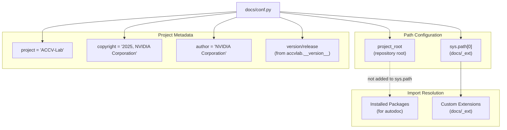
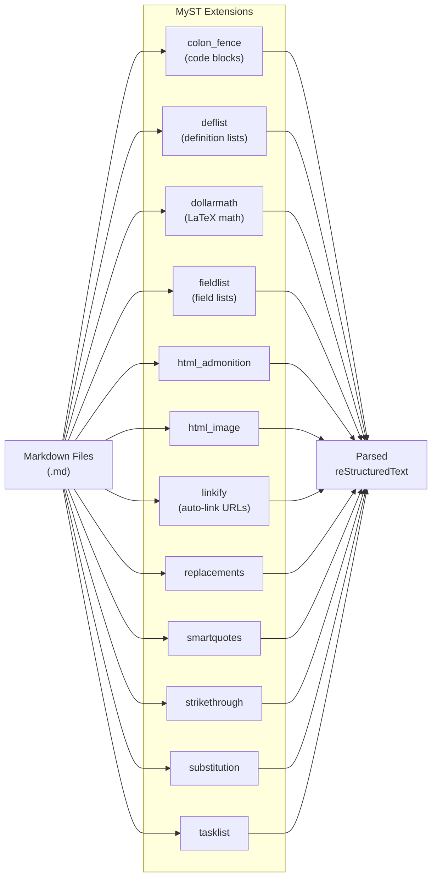
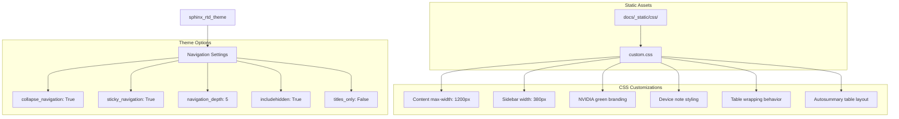
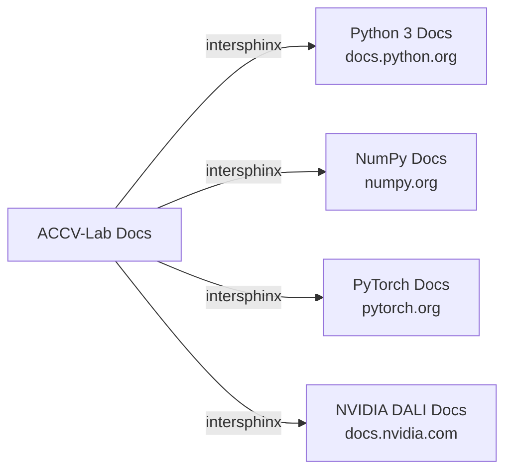
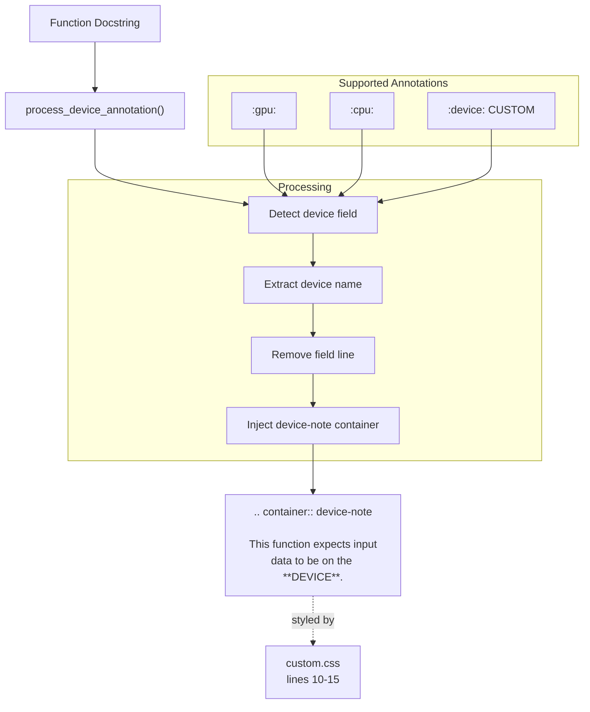

<!-- source: DeepWiki mcp.deepwiki.com · repo NVIDIA/ACCV-Lab · page 4.2 Sphinx Configuration · fetched 2026-10-26 -->

# Sphinx Configuration

<details>
<summary>Relevant source files</summary>

The following files were used as context for generating this wiki page:

- [docs/_static/css/custom.css](docs/_static/css/custom.css)
- [docs/conf.py](docs/conf.py)

</details>


## Purpose and Scope

This page documents the Sphinx configuration file that controls documentation generation for the ACCV-Lab repository. The configuration defines project metadata, enables extensions for autodoc and Markdown support, customizes the HTML theme, and implements custom processing for device annotations.

For information about building the documentation, see [Building Documentation](#4.1). For details on the custom extensions referenced in this configuration, see [Custom Sphinx Extensions](#4.3).

## Configuration File Location

The Sphinx configuration is defined in [docs/conf.py:1-236](), which serves as the entry point for all documentation builds. When `sphinx-build` executes, it reads this file to determine how to process source files and generate output.

**Sources:** [docs/conf.py:1-236]()

## Project Metadata and Path Setup

The configuration begins by establishing project metadata and configuring Python's module search path:



The path setup [docs/conf.py:9-13]() intentionally excludes the project root from `sys.path`, relying on installed packages for autodoc. Only the custom extensions directory (`docs/_ext`) is added to ensure Sphinx can import the three custom extensions.

Version information is dynamically extracted from the installed `accvlab` package [docs/conf.py:21-28](), falling back to `'0.1.0'` if the import fails.

**Sources:** [docs/conf.py:9-28]()

## Extension Configuration

The configuration enables 12 Sphinx extensions, organized by functionality:

| Extension | Purpose | Configuration Section |
|-----------|---------|----------------------|
| `sphinx.ext.autodoc` | Automatic API documentation from docstrings | [docs/conf.py:153-159]() |
| `sphinx.ext.autosummary` | Generate summary tables (file generation disabled) | [docs/conf.py:164-166]() |
| `sphinx.ext.viewcode` | Add source code links to documentation | None required |
| `sphinx.ext.napoleon` | Parse Google/NumPy style docstrings | [docs/conf.py:168-180]() |
| `sphinx.ext.intersphinx` | Link to external documentation (Python, NumPy, PyTorch, DALI) | [docs/conf.py:181-187]() |
| `sphinx.ext.mathjax` | Render mathematical notation | None required |
| `sphinx.ext.graphviz` | Support for Graphviz diagrams | None required |
| `sphinx.ext.todo` | Include TODO items in documentation | [docs/conf.py:189-190]() |
| `sphinx.ext.coverage` | Track documentation coverage | None required |
| `sphinx_autodoc_typehints` | Enhanced type hint rendering | [docs/conf.py:192-202]() |
| `myst_parser` | Parse Markdown files | [docs/conf.py:85-103]() |
| `note_literalinclude` | Custom directive for annotated code includes | See [Custom Sphinx Extensions](#4.3) |
| `module_docstring` | Custom directive for module docstring inclusion | See [Custom Sphinx Extensions](#4.3) |
| `markdown_note_admonitions` | Convert Markdown blockquotes to admonitions | See [Custom Sphinx Extensions](#4.3) |

The extension list [docs/conf.py:31-46]() also conditionally includes `sphinxcontrib.spelling` if available [docs/conf.py:49-64](), with graceful degradation and a warning if dependencies are missing.

**Sources:** [docs/conf.py:31-65]()

## Autodoc Configuration

The `autodoc` extension generates API documentation from Python docstrings. Default options are configured in [docs/conf.py:154-159]():

```python
autodoc_default_options = {
    'members': True,              # Document all members
    'member-order': 'bysource',   # Order by source code appearance
    'undoc-members': True,        # Include members without docstrings
    'exclude-members': '__weakref__',  # Exclude internal members
}
```

Additional autodoc behavior is controlled by `autoclass_content = 'both'` [docs/conf.py:162](), which concatenates class-level docstrings with `__init__` docstrings for comprehensive class documentation.

The `autosummary` extension is configured to disable file generation [docs/conf.py:165-166](), as the documentation structure uses manual organization rather than auto-generated stub files.

**Sources:** [docs/conf.py:153-166]()

## Napoleon Docstring Processing

The Napoleon extension [docs/conf.py:168-180]() parses both Google and NumPy style docstrings, converting them to reStructuredText:

| Option | Value | Effect |
|--------|-------|--------|
| `napoleon_google_docstring` | `True` | Enable Google style (preferred) |
| `napoleon_numpy_docstring` | `True` | Enable NumPy style |
| `napoleon_include_init_with_doc` | `False` | Don't duplicate `__init__` docs |
| `napoleon_include_private_with_doc` | `False` | Exclude private members |
| `napoleon_include_special_with_doc` | `True` | Include special methods (`__call__`, etc.) |
| `napoleon_use_admonition_for_examples` | `True` | Render Examples section as admonition |
| `napoleon_use_admonition_for_notes` | `True` | Render Notes section as admonition |
| `napoleon_use_admonition_for_references` | `True` | Render References section as admonition |
| `napoleon_use_ivar` | `False` | Use `:ivar:` instead of `:attribute:` |
| `napoleon_use_param` | `True` | Use `:param:` for parameters |
| `napoleon_use_rtype` | `True` | Use `:rtype:` for return types |

**Sources:** [docs/conf.py:168-180]()

## MyST Parser Configuration

The MyST parser enables Markdown support with 14 extensions [docs/conf.py:86-99]():



The configuration also enables heading anchor generation [docs/conf.py:103]() with `myst_heading_anchors = 6`, creating HTML anchor IDs for all heading levels 1-6. This allows Markdown hash links (`[Text](#section-slug)`) to be validated during the build.

Source file suffixes are defined [docs/conf.py:77-80]() to process both `.rst` (reStructuredText) and `.md` (Markdown) files.

**Sources:** [docs/conf.py:77-103]()

## HTML Theme Configuration

The documentation uses the Read the Docs theme (`sphinx_rtd_theme`) with extensive customization:



Theme options are configured in [docs/conf.py:111-124]():
- `collapse_navigation: True` - Collapsible sidebar sections
- `sticky_navigation: True` - Sidebar remains visible during scrolling
- `navigation_depth: 5` - Show up to 5 levels in sidebar
- `includehidden: True` - Include hidden toctree items
- `titles_only: False` - Show subsections in sidebar

Custom CSS is loaded from [docs/_static/css/custom.css:1-160]() via [docs/conf.py:108](), providing:
- Content max-width of 1200px [docs/_static/css/custom.css:3]()
- Wider sidebar (380px) [docs/_static/css/custom.css:31-50]()
- NVIDIA green color scheme (#76B900) [docs/_static/css/custom.css:111-160]()
- Device note styling (yellow background) [docs/_static/css/custom.css:10-15]()
- Table wrapping and autosummary optimizations [docs/_static/css/custom.css:57-109]()

**Sources:** [docs/conf.py:106-124](), [docs/_static/css/custom.css:1-160]()

## LaTeX and PDF Configuration

For PDF generation, the configuration uses XeLaTeX engine with Unicode-capable fonts:

| Configuration | Value | Purpose |
|--------------|-------|---------|
| `latex_engine` | `'xelatex'` | Unicode support for special characters |
| Font packages | `fontspec`, `unicode-math` | Advanced font handling |
| `\setmainfont` | `DejaVu Serif` | Main document font |
| `\setsansfont` | `DejaVu Sans` | Sans-serif font |
| `\setmonofont` | `DejaVu Sans Mono` | Code font |
| `\setmathfont` | `Latin Modern Math` | Mathematical notation |

The LaTeX configuration [docs/conf.py:128-149]() ensures that special characters (like box-drawing Unicode characters U+250C) render correctly in PDF output. The preamble [docs/conf.py:136-148]() disables legacy `inputenc` and `utf8extra` packages, replacing them with modern font specification.

**Sources:** [docs/conf.py:126-149]()

## Intersphinx Mapping

Cross-referencing to external documentation is configured in [docs/conf.py:182-187]():



This allows docstrings to reference types like `torch.Tensor` or `numpy.ndarray`, and Sphinx will automatically generate hyperlinks to the official documentation for those projects.

**Sources:** [docs/conf.py:181-187]()

## Type Hints Configuration

The `sphinx_autodoc_typehints` extension is configured in [docs/conf.py:192-202]():

| Option | Value | Effect |
|--------|-------|--------|
| `typehints_fully_qualified` | `False` | Use short type names (e.g., `Tensor` instead of `torch.Tensor`) |
| `typehints_document_rtype` | `True` | Show return type in Returns section |
| `typehints_defaults` | `'comma'` | Show default values inline with commas |
| `typehints_use_signature` | `False` | Hide type hints in function signature to reduce clutter |
| `typehints_use_rtype` | `False` | Hide return type in signature |

This configuration keeps function signatures clean while documenting type information in the parameter and returns sections.

**Sources:** [docs/conf.py:192-202]()

## Custom Device Annotation Processing

The configuration implements a custom docstring processor for device annotations [docs/conf.py:207-236]():



The `process_device_annotation` function [docs/conf.py:207-230]() scans docstring lines for device fields:
- `:gpu:` → Displays "**GPU**"
- `:cpu:` → Displays "**CPU**"
- `:device: CUSTOM` → Displays "**CUSTOM**"

When detected, the field is removed from its original location and replaced with a prominent note at the top of the docstring. The note is rendered as a `device-note` container, which custom.css styles with a yellow background [docs/_static/css/custom.css:10-15]().

The processor is connected to autodoc via [docs/conf.py:235]()'s `app.connect('autodoc-process-docstring', process_device_annotation)` call in the `setup()` function [docs/conf.py:232-236]().

**Sources:** [docs/conf.py:207-236](), [docs/_static/css/custom.css:10-15]()

## File Discovery and Build Control

Additional configuration controls which files are processed:

| Setting | Value | Purpose |
|---------|-------|---------|
| `followlinks` | `True` | Follow symbolic links when discovering source files [docs/conf.py:67]() |
| `exclude_patterns` | `['_build', 'Thumbs.db', '.DS_Store', 'generated']` | Ignore build artifacts and system files [docs/conf.py:74]() |
| `master_doc` | `'index'` | Root document for documentation tree [docs/conf.py:83]() |
| `templates_path` | `['_templates']` | Custom template directory [docs/conf.py:70]() |

The `followlinks = True` setting [docs/conf.py:67]() is critical for the documentation mirror system (see [Documentation Mirror System](#4.5)), which uses symbolic links to aggregate package documentation.

**Sources:** [docs/conf.py:67-83]()

## Configuration Summary

The Sphinx configuration provides:

1. **Comprehensive Extension Support** - 12 extensions covering autodoc, Markdown, math, and custom directives
2. **Multi-Format Input** - Both reStructuredText and Markdown with rich MyST extensions
3. **Customized Theme** - Read the Docs theme with NVIDIA branding and layout optimizations
4. **External Integration** - Intersphinx linking to Python, NumPy, PyTorch, and DALI documentation
5. **PDF Generation** - XeLaTeX configuration with Unicode font support
6. **Custom Processing** - Device annotation handler for highlighting execution context
7. **Type Hint Rendering** - Clean signatures with detailed type documentation in parameter sections

**Sources:** [docs/conf.py:1-236](), [docs/_static/css/custom.css:1-160]()

---

