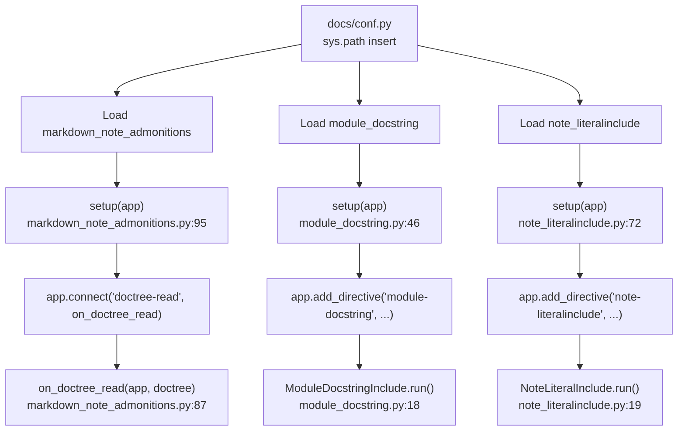
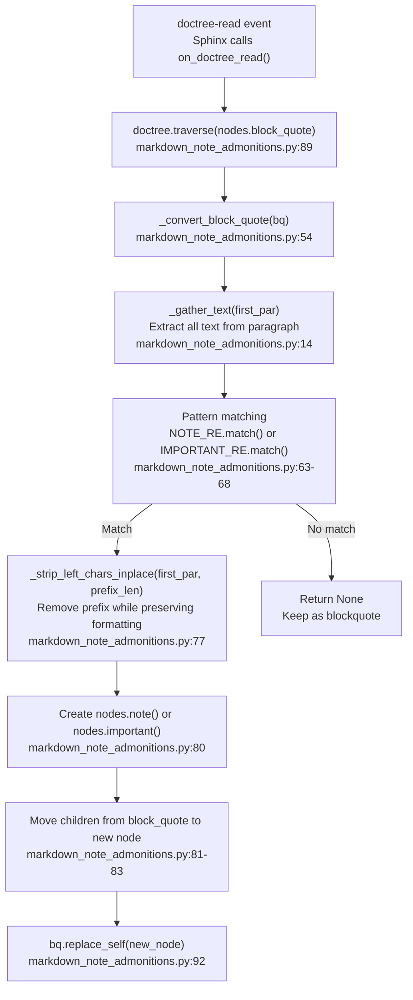
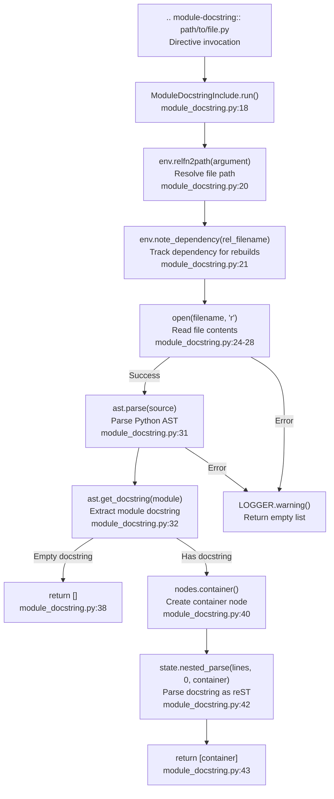
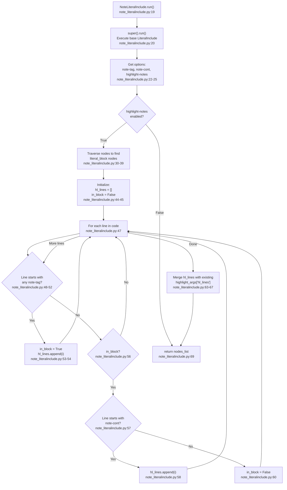
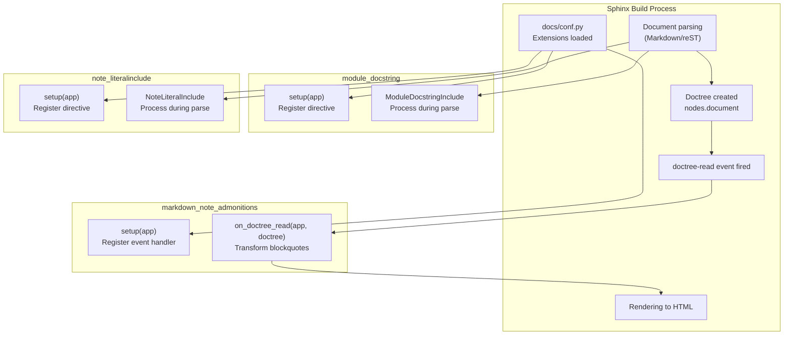

<!-- source: DeepWiki mcp.deepwiki.com · repo NVIDIA/ACCV-Lab · page 4.3 Custom Sphinx Extensions · fetched 2026-10-26 -->

# Custom Sphinx Extensions

<details>
<summary>Relevant source files</summary>

The following files were used as context for generating this wiki page:

- [docs/_ext/markdown_note_admonitions.py](docs/_ext/markdown_note_admonitions.py)
- [docs/_ext/module_docstring.py](docs/_ext/module_docstring.py)
- [docs/_ext/note_literalinclude.py](docs/_ext/note_literalinclude.py)

</details>


## Purpose and Scope

This document describes the three custom Sphinx extensions developed for the ACCV-Lab documentation system. These extensions enhance Sphinx's capabilities to improve documentation quality and maintainability. The extensions are located in [docs/_ext/]() and provide functionality for Markdown note conversion, module docstring extraction, and code annotation highlighting.

For general Sphinx configuration and setup, see [Sphinx Configuration](#4.2). For guidance on building documentation, see [Building Documentation](#4.1).

## Extension Overview

The ACCV-Lab documentation system includes three custom Sphinx extensions:

| Extension | File | Primary Function |
|-----------|------|------------------|
| `markdown_note_admonitions` | [docs/_ext/markdown_note_admonitions.py]() | Converts Markdown blockquotes with "Note:" or "Important:" prefixes into Sphinx admonition nodes |
| `module_docstring` | [docs/_ext/module_docstring.py]() | Provides a directive to extract and include module-level docstrings from Python files |
| `note_literalinclude` | [docs/_ext/note_literalinclude.py]() | Extends `literalinclude` to automatically highlight code annotation comments |

**Sources:** [docs/_ext/markdown_note_admonitions.py](), [docs/_ext/module_docstring.py](), [docs/_ext/note_literalinclude.py]()

## Extension Registration and Lifecycle

All custom extensions are registered in the Sphinx configuration through their `setup()` functions. Each extension connects to specific Sphinx events or registers new directives.

### Extension Registration Flow



**Sources:** [docs/_ext/markdown_note_admonitions.py:95-101](), [docs/_ext/module_docstring.py:46-52](), [docs/_ext/note_literalinclude.py:72-78]()

## markdown_note_admonitions Extension

### Purpose and Behavior

The `markdown_note_admonitions` extension automatically converts Markdown blockquotes that begin with "Note:" or "Important:" into proper Sphinx admonition nodes (`nodes.note` or `nodes.important`). This allows documentation writers to use natural Markdown syntax while producing semantically correct reStructuredText admonitions in the output.

### Pattern Matching

The extension uses two regular expressions to identify qualifying blockquotes:

| Pattern | Regex | Matches |
|---------|-------|---------|
| `NOTE_RE` | `r"^\s*(?:ℹ️\|ⓘ\|\(i\)\|i\|!\|‼️)?\s*Note\s*:?\s*"` | Lines starting with optional emoji/symbol, "Note", and optional colon |
| `IMPORTANT_RE` | `r"^\s*(?:⚠️\|!\|‼️)?\s*Important\s*:?\s*"` | Lines starting with optional warning symbol, "Important", and optional colon |

Both patterns are case-insensitive [docs/_ext/markdown_note_admonitions.py:10-11]().

### Transformation Process



The `_strip_left_chars_inplace()` function [docs/_ext/markdown_note_admonitions.py:18-51]() carefully removes the prefix text character-by-character while preserving inline formatting elements like bold or emphasis. This ensures that if "Note:" is in bold, only the prefix is removed, not the entire bold element.

### Implementation Details

The extension operates on the document tree after it has been parsed but before rendering. Key implementation characteristics:

- **Text Gathering**: The `_gather_text()` function [docs/_ext/markdown_note_admonitions.py:14-15]() traverses all `nodes.Text` children to extract the full text content for pattern matching.

- **Prefix Stripping**: The `_strip_left_chars_inplace()` function removes exactly the number of characters matched by the regex pattern, working recursively through inline elements to preserve formatting structure [docs/_ext/markdown_note_admonitions.py:18-51]().

- **Node Creation**: After stripping the prefix, a new `nodes.note` or `nodes.important` node is created, and all children from the original blockquote are moved to the new node [docs/_ext/markdown_note_admonitions.py:80-84]().

### Parallel Safety

The extension declares itself as parallel-safe for both reading and writing [docs/_ext/markdown_note_admonitions.py:99-100](), allowing Sphinx to process multiple documents concurrently.

**Sources:** [docs/_ext/markdown_note_admonitions.py:1-101]()

## module_docstring Extension

### Purpose and Behavior

The `module_docstring` extension provides a custom directive `.. module-docstring::` that extracts and includes the module-level docstring from a Python file. This is useful for including package-level documentation that exists in `__init__.py` files without duplicating content.

### Directive Usage

The directive accepts a single required argument: the path to a Python file.

```rst
.. module-docstring:: ../path/to/module.py
```

The directive extracts the module's docstring, parses it as reStructuredText, and includes it in the documentation.

### Implementation Architecture



### ModuleDocstringInclude Class

The `ModuleDocstringInclude` class [docs/_ext/module_docstring.py:12-43]() extends `SphinxDirective` and implements the directive behavior:

- **Configuration**: Requires exactly one argument (file path), no optional arguments, no whitespace splitting [docs/_ext/module_docstring.py:13-16]().

- **Dependency Tracking**: Calls `env.note_dependency()` [docs/_ext/module_docstring.py:21]() to ensure the document is rebuilt when the source Python file changes.

- **Error Handling**: Catches and logs errors during file reading or parsing, returning an empty list rather than failing the build [docs/_ext/module_docstring.py:26-28](), [docs/_ext/module_docstring.py:33-35]().

- **AST Parsing**: Uses Python's `ast` module to parse the file and extract the module-level docstring without executing the code [docs/_ext/module_docstring.py:31-32]().

- **reStructuredText Processing**: The extracted docstring is parsed as reStructuredText using `state.nested_parse()` [docs/_ext/module_docstring.py:42](), allowing the docstring to contain Sphinx directives and inline markup.

**Sources:** [docs/_ext/module_docstring.py:1-52]()

## note_literalinclude Extension

### Purpose and Behavior

The `note_literalinclude` extension provides an enhanced version of Sphinx's built-in `literalinclude` directive. It automatically detects and highlights code comment blocks marked with special tags (like `#@NOTE`) to draw attention to important annotations in code examples.

### Directive Options

The `NoteLiteralInclude` class [docs/_ext/note_literalinclude.py:7-69]() extends `LiteralInclude` and adds three custom options:

| Option | Type | Default | Description |
|--------|------|---------|-------------|
| `note-tag` | string | `'#@NOTE;# @NOTE'` | Semicolon-separated list of comment prefixes that start a note block |
| `note-cont` | string | `'#'` | Comment prefix for continuation lines in a note block |
| `highlight-notes` | boolean | `True` | Enable/disable automatic note highlighting |

The directive inherits all standard `literalinclude` options (`:lines:`, `:linenos:`, `:language:`, etc.) from the base class [docs/_ext/note_literalinclude.py:8]().

### Highlighting Algorithm



### Line Highlighting Logic

The extension implements a state machine to detect note blocks [docs/_ext/note_literalinclude.py:46-60]():

1. **Start Detection**: When a line's stripped content starts with any of the `note-tag` values, the extension enters "in_block" mode and marks the line for highlighting.

2. **Continuation Detection**: While "in_block" is true, lines starting with `note-cont` (default `'#'`) are also highlighted.

3. **Block Termination**: When a line doesn't start with `note-cont`, "in_block" is set to false, ending the note block.

4. **Highlight Merging**: The detected line numbers are merged with any existing `highlight_args['hl_lines']` from other sources (like `:emphasize-lines:`) [docs/_ext/note_literalinclude.py:63-67]().

### Usage Examples

Basic usage with default settings:

```rst
.. note-literalinclude:: example.py
   :language: python
```

Custom note tag configuration:

```rst
.. note-literalinclude:: example.cpp
   :language: cpp
   :note-tag: //@NOTE;//@ NOTE
   :note-cont: //
```

Disable automatic highlighting:

```rst
.. note-literalinclude:: example.py
   :language: python
   :highlight-notes: false
```

### Container Handling

The directive handles cases where `literalinclude` with a caption wraps the code block in a container node. It traverses the node tree to find all `literal_block` nodes [docs/_ext/note_literalinclude.py:30-39](), ensuring note highlighting works correctly regardless of the node structure.

**Sources:** [docs/_ext/note_literalinclude.py:1-78]()

## Extension Setup Functions

Each extension provides a `setup()` function that Sphinx calls to register the extension. The setup functions follow a consistent pattern:

### Return Value Structure

All extensions return a dictionary with metadata [docs/_ext/markdown_note_admonitions.py:97-101](), [docs/_ext/module_docstring.py:48-52](), [docs/_ext/note_literalinclude.py:74-78]():

```python
{
    "version": "...",              # Extension version string
    "parallel_read_safe": True,     # Can process documents in parallel
    "parallel_write_safe": True,    # Can write output in parallel
}
```

### Registration Methods

The extensions use two different Sphinx API methods for registration:

| Extension | Registration Method | Purpose |
|-----------|-------------------|---------|
| `markdown_note_admonitions` | `app.connect('doctree-read', on_doctree_read)` | Register event handler for doctree transformation |
| `module_docstring` | `app.add_directive('module-docstring', ModuleDocstringInclude)` | Register new directive |
| `note_literalinclude` | `app.add_directive('note-literalinclude', NoteLiteralInclude)` | Register new directive |

**Sources:** [docs/_ext/markdown_note_admonitions.py:95-101](), [docs/_ext/module_docstring.py:46-52](), [docs/_ext/note_literalinclude.py:72-78]()

## Extension Integration Architecture



The extensions integrate at different points in the Sphinx build pipeline:

- **Directive Extensions** (`module_docstring`, `note_literalinclude`): Process during document parsing when their directive syntax is encountered.

- **Event Handler Extensions** (`markdown_note_admonitions`): Process the entire doctree after parsing is complete, before rendering.

**Sources:** [docs/_ext/markdown_note_admonitions.py](), [docs/_ext/module_docstring.py](), [docs/_ext/note_literalinclude.py]()

---

