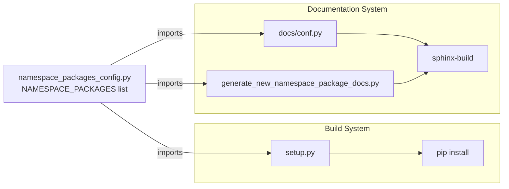
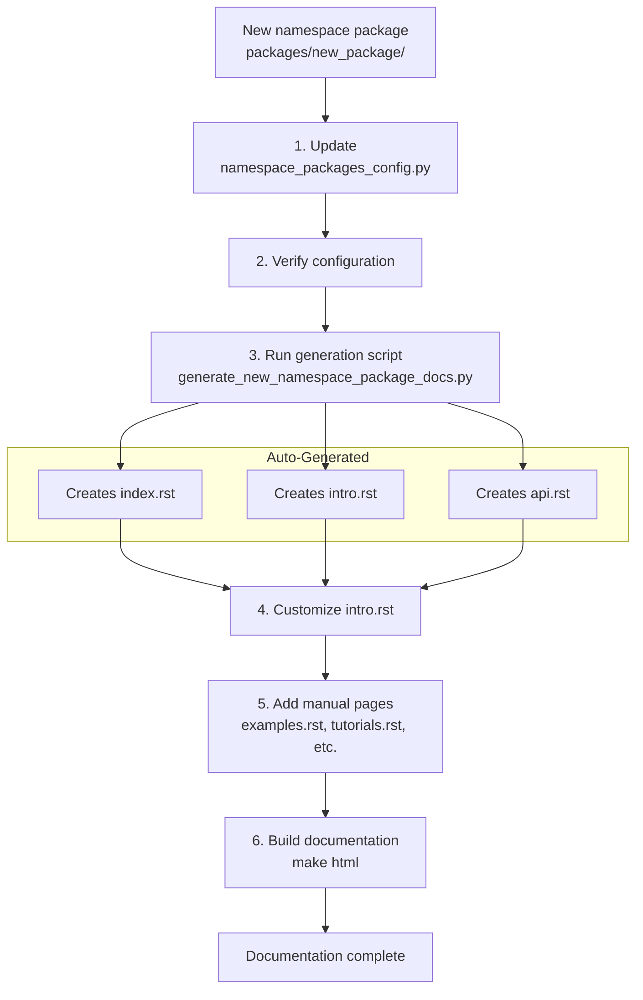
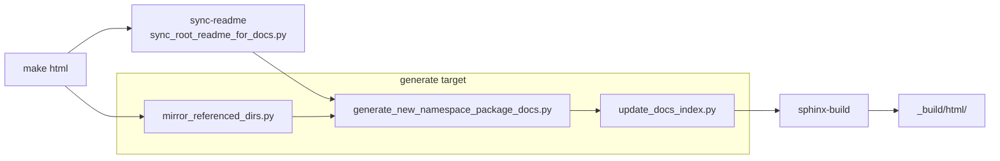

<!-- source: DeepWiki mcp.deepwiki.com · repo NVIDIA/ACCV-Lab · page 4.4 Writing Package Documentation · fetched 2026-10-26 -->

# Writing Package Documentation

<details>
<summary>Relevant source files</summary>

The following files were used as context for generating this wiki page:

- [docs/Makefile](docs/Makefile)
- [docs/NAMESPACE_PACKAGE_DOCS_GUIDE.txt](docs/NAMESPACE_PACKAGE_DOCS_GUIDE.txt)
- [docs/SHARED_CONFIG_GUIDE.txt](docs/SHARED_CONFIG_GUIDE.txt)

</details>


## Purpose and Scope

This guide explains how to create and maintain documentation for ACCV-Lab namespace packages. It covers the package-specific documentation structure, the shared configuration system, auto-generated API documentation, and manual page authoring. This page focuses on the content and structure of individual package documentation sites.

For information about the overall documentation build process, see [Building Documentation](#4.1). For details about Sphinx configuration and extensions, see [Sphinx Configuration](#4.2) and [Custom Sphinx Extensions](#4.3). For understanding how package documentation is aggregated, see [Documentation Mirror System](#4.5).

## Overview

ACCV-Lab uses a modular documentation system where each namespace package maintains its own documentation within a `docs/` directory. The system combines auto-generated API reference documentation with manually authored content, controlled through a single shared configuration file.

**Key Characteristics:**

| Feature | Description |
|---------|-------------|
| **Location** | Each package has `packages/<package_name>/docs/` |
| **Configuration** | Single `namespace_packages_config.py` in repository root |
| **Auto-generation** | API reference and navigation structure |
| **Manual Content** | Introduction, examples, tutorials, guides |
| **Synchronization** | Build and documentation systems share configuration |

**Sources:** [docs/NAMESPACE_PACKAGE_DOCS_GUIDE.txt:1-180](), [docs/SHARED_CONFIG_GUIDE.txt:1-57]()

## Package Documentation Structure

Each namespace package follows a consistent directory structure:

```mermaid
graph TB
    subgraph "packages/"
        subgraph "example_package/"
            SETUP["setup.py"]
            
            subgraph "docs/"
                INDEX["index.rst<br/>(auto-generated)"]
                INTRO["intro.rst<br/>(template once)"]
                API["api.rst<br/>(auto-generated)"]
                EXAMPLES["examples.rst<br/>(manual)"]
                TUTORIALS["tutorials.rst<br/>(manual)"]
            end
            
            subgraph "example_package/"
                SOURCE["__init__.py"]
                MODULES["module.py"]
            end
        end
    end
    
    SETUP -.->|"references"| SOURCE
    API -.->|"documents"| SOURCE
    API -.->|"documents"| MODULES
    INDEX -.->|"includes"| INTRO
    INDEX -.->|"includes"| API
    INDEX -.->|"includes"| EXAMPLES
    INDEX -.->|"includes"| TUTORIALS
```

**File Roles:**

| File | Type | Purpose |
|------|------|---------|
| `index.rst` | Auto-generated | Package entry point with navigation toctree |
| `intro.rst` | Template | Package introduction (created once, then manual) |
| `api.rst` | Auto-generated | Complete API reference using Sphinx autodoc |
| `*.rst` (other) | Manual | User-created pages for examples, tutorials, guides |

**Sources:** [docs/NAMESPACE_PACKAGE_DOCS_GUIDE.txt:7-30](), [docs/NAMESPACE_PACKAGE_DOCS_GUIDE.txt:52-62]()

## The Shared Configuration System

All package documentation is controlled through `namespace_packages_config.py` in the repository root. This file provides a single source of truth for both the build system and documentation generation.



**Configuration File Structure:**

The `namespace_packages_config.py` file contains a single list:

```python
# namespace_packages_config.py (in project root)
NAMESPACE_PACKAGES = [
    'accvlab.on_demand_video_decoder',
    'accvlab.batching_helpers',
    'accvlab.dali_pipeline',
    'accvlab.draw_heatmap',
    'accvlab.optim_test_tools',
    # Add new namespace packages here
]
```

**Consumers of Configuration:**

| File | Usage |
|------|-------|
| `setup.py` | Imports `NAMESPACE_PACKAGES` for package installation |
| `docs/conf.py` | Imports `NAMESPACE_PACKAGES` for Sphinx configuration |
| `docs/generate_new_namespace_package_docs.py` | Imports `NAMESPACE_PACKAGES` to create docs structure |

**Sources:** [docs/SHARED_CONFIG_GUIDE.txt:1-57](), [docs/NAMESPACE_PACKAGE_DOCS_GUIDE.txt:32-50]()

## Auto-Generated Documentation Files

Three files are automatically generated or updated by the `generate_new_namespace_package_docs.py` script:

### index.rst (Package Entry Point)

**Regeneration:** Always regenerated on every documentation build.

This file creates the navigation structure for the package documentation:

```rst
Package Name
============

.. toctree::
   :maxdepth: 2

   intro
   api
   examples
   # Additional manual pages listed here
```

**Location:** `packages/<package_name>/docs/index.rst`

**Do Not Edit:** This file is completely regenerated each time.

### intro.rst (Introduction Template)

**Regeneration:** Created only if it doesn't exist.

Provides a basic introduction template:

```rst
Introduction
============

This package provides...

Installation
------------

Features
--------

Quick Start
-----------
```

**Location:** `packages/<package_name>/docs/intro.rst`

**Manual Customization:** Edit this file to describe your package. Once created, it will not be overwritten.

### api.rst (API Reference)

**Regeneration:** Always regenerated on every documentation build.

Uses Sphinx `automodule` directives to document all Python modules:

```rst
API Reference
=============

.. automodule:: accvlab.package_name
   :members:
   :undoc-members:
   :show-inheritance:
```

**Location:** `packages/<package_name>/docs/api.rst`

**Do Not Edit:** This file is regenerated to reflect current code structure.

**Sources:** [docs/NAMESPACE_PACKAGE_DOCS_GUIDE.txt:52-62](), [docs/NAMESPACE_PACKAGE_DOCS_GUIDE.txt:156-166]()

## Adding Manual Documentation Pages

Manual documentation pages provide examples, tutorials, installation guides, and other content beyond API reference.

### Creating a New Page

**Step 1: Create the RST file**

Create a new `.rst` file in the package's `docs/` directory:

```rst
# packages/example_package/docs/tutorials.rst
Tutorials
=========

Basic Usage
-----------

Example code here...

Advanced Topics
---------------

More examples...
```

**Step 2: Add to the toctree**

Edit the package's `index.rst` to include the new page in the navigation. Since `index.rst` is auto-generated, you need to ensure the generation script knows about it. The generation script includes all `.rst` files it finds, or you can manually edit after generation (though this will be overwritten on next generation).

**Alternative approach:** Manually add the page to the toctree after running the generation script, understanding it will be regenerated.

**Common Manual Pages:**

| Page Type | Filename | Content |
|-----------|----------|---------|
| Examples | `examples.rst` | Code examples and use cases |
| Tutorials | `tutorials.rst` | Step-by-step guides |
| Installation | `installation.rst` | Package-specific installation notes |
| Performance | `performance.rst` | Benchmarks and optimization tips |
| Integration | `integration.rst` | How to use with other packages |

**Sources:** [docs/NAMESPACE_PACKAGE_DOCS_GUIDE.txt:63-86](), [docs/NAMESPACE_PACKAGE_DOCS_GUIDE.txt:156-166]()

## Creating Documentation for a New Package

When adding a new namespace package to ACCV-Lab, follow this workflow to set up its documentation:



### Detailed Steps

**Step 1: Update Shared Configuration**

Add the new package to `namespace_packages_config.py`:

```python
# namespace_packages_config.py
NAMESPACE_PACKAGES = [
    'accvlab.existing_package',
    'accvlab.new_package',  # Add this line
]
```

**Location:** [namespace_packages_config.py]() in repository root.

**Step 2: Verify Configuration**

Check that the configuration is valid:

```bash
python3 namespace_packages_config.py
```

This should display the list of packages without errors.

**Step 3: Run Generation Script**

Generate the documentation structure:

```bash
cd docs
python3 generate_new_namespace_package_docs.py
```

This script:
- Reads `NAMESPACE_PACKAGES` from the shared config
- Creates `packages/new_package/docs/` directory if needed
- Generates `index.rst`, `intro.rst`, and `api.rst`
- Updates the main `docs/index.rst` to include the new package

**Step 4: Customize Introduction**

Edit the generated introduction template:

```bash
# Edit packages/new_package/docs/intro.rst
```

Replace the placeholder content with:
- Package overview and purpose
- Installation instructions (if package-specific)
- Key features
- Quick start example

**Step 5: Add Manual Pages**

Create additional documentation as needed:

```bash
# Create examples
touch packages/new_package/docs/examples.rst

# Create tutorials
touch packages/new_package/docs/tutorials.rst
```

**Step 6: Build Documentation**

Build the complete documentation to verify:

```bash
cd docs
make html
```

The new package documentation will be available at `_build/html/namespace_packages/new_package/index.html`.

**Sources:** [docs/NAMESPACE_PACKAGE_DOCS_GUIDE.txt:106-137](), [docs/SHARED_CONFIG_GUIDE.txt:29-56]()

## Documentation Generation Process

The documentation generation is integrated into the Makefile build targets:



### Generation Scripts

**Script Execution Order:**

| Order | Script | Purpose |
|-------|--------|---------|
| 1 | `sync_root_readme_for_docs.py` | Syncs root README into docs tree |
| 2 | `mirror_referenced_dirs.py` | Creates documentation mirror (see [Documentation Mirror System](#4.5)) |
| 3 | `generate_new_namespace_package_docs.py` | Generates namespace package docs structure |
| 4 | `update_docs_index.py` | Updates main documentation index |
| 5 | `sphinx-build` | Builds HTML documentation |

**Manual Generation:**

You can run the generation step independently:

```bash
cd docs
make generate
```

This runs steps 2-4 without building the full documentation.

**Makefile Targets:**

| Target | Command | Description |
|--------|---------|-------------|
| `make html` | Default | Full build with generation |
| `make generate` | Generation only | Run generation scripts without building |
| `make clean` | Cleanup | Remove build artifacts and generated files |
| `make livehtml` | Live rebuild | Auto-rebuild on file changes |

**Sources:** [docs/Makefile:1-45](), [docs/NAMESPACE_PACKAGE_DOCS_GUIDE.txt:87-96]()

## Error Handling

The shared configuration system provides clear error messages when misconfigured:

**Configuration File Missing:**

```
Error: Could not import NAMESPACE_PACKAGES from namespace_packages_config.py
```

**Solution:** Create `namespace_packages_config.py` in the repository root.

**NAMESPACE_PACKAGES Variable Missing:**

```
Error: NAMESPACE_PACKAGES not found in namespace_packages_config.py
```

**Solution:** Add the `NAMESPACE_PACKAGES = [...]` definition to the file.

**Empty Package List:**

```
Error: NAMESPACE_PACKAGES list is empty in namespace_packages_config.py
```

**Solution:** Add at least one namespace package to the list.

**Package Directory Not Found:**

If a package is listed in `NAMESPACE_PACKAGES` but its directory doesn't exist, the generation script will skip it with a warning but continue processing other packages.

**Sources:** [docs/NAMESPACE_PACKAGE_DOCS_GUIDE.txt:98-105]()

## Best Practices

### Documentation File Management

| Practice | Rationale |
|----------|-----------|
| **Do not edit `index.rst`** | Always regenerated; edits will be lost |
| **Do not edit `api.rst`** | Always regenerated from code structure |
| **Customize `intro.rst` immediately** | Provides context for package users |
| **Use descriptive filenames** | `examples.rst`, `tutorials.rst`, `performance.rst` |

### Content Organization

**What to Include in Manual Pages:**

1. **Examples (`examples.rst`):**
   - Common use cases
   - Code snippets with explanations
   - Integration patterns

2. **Tutorials (`tutorials.rst`):**
   - Step-by-step guides
   - Complete workflows
   - Troubleshooting tips

3. **Installation (`installation.rst`):**
   - Package-specific dependencies
   - Build configuration options
   - Platform-specific notes

4. **Performance (`performance.rst`):**
   - Benchmarks and comparisons
   - Optimization guidelines
   - Hardware requirements

5. **Integration (`integration.rst`):**
   - Using with other ACCV-Lab packages
   - External library integration
   - Pipeline examples

### Configuration Management

**Single Source of Truth:**

Always update `namespace_packages_config.py` for new packages. This ensures:
- Build system includes the package
- Documentation is generated automatically
- Build and docs remain synchronized
- No manual index editing required

**Adding Packages:**

```python
# Good: Add to shared config
NAMESPACE_PACKAGES = [
    'accvlab.existing',
    'accvlab.new_package',  # Added here
]

# Bad: Do not manually edit docs/index.rst or setup.py
# They both read from namespace_packages_config.py
```

### Documentation Style

**Clarity and Precision:**
- Use concrete examples over abstract descriptions
- Include actual code snippets
- Provide expected outputs
- Link to related documentation

**Code References:**
- Use `.. code-block:: python` for code examples
- Use `.. literalinclude::` for external code files (see [Custom Sphinx Extensions](#4.3))
- Reference specific functions/classes with `:func:` and `:class:` roles

**Navigation:**
- Keep toctree depth reasonable (`maxdepth: 2`)
- Group related pages together
- Use descriptive section titles

**Sources:** [docs/NAMESPACE_PACKAGE_DOCS_GUIDE.txt:156-180]()

## Summary

The ACCV-Lab package documentation system provides:

**Automation:**
- Auto-generated API reference from code
- Auto-generated navigation structure
- Synchronized build and documentation configuration

**Flexibility:**
- Manual content for examples, tutorials, guides
- Per-package documentation organization
- Customizable introduction and additional pages

**Maintainability:**
- Single configuration file for all packages
- Clear separation of auto-generated vs manual files
- Predictable regeneration behavior

**Workflow:**
1. Add package to `namespace_packages_config.py`
2. Run `generate_new_namespace_package_docs.py`
3. Customize `intro.rst`
4. Add manual pages as needed
5. Build with `make html`

**Sources:** [docs/NAMESPACE_PACKAGE_DOCS_GUIDE.txt:167-180](), [docs/SHARED_CONFIG_GUIDE.txt:22-28]()

---

