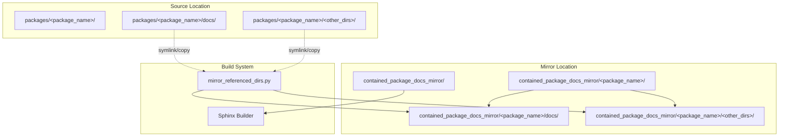
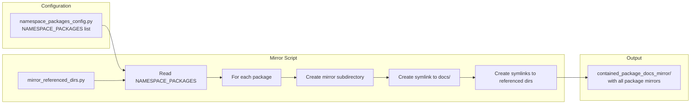
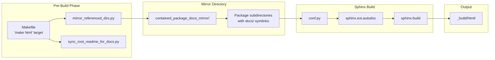
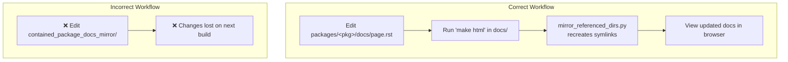

<!-- source: DeepWiki mcp.deepwiki.com · repo NVIDIA/ACCV-Lab · page 4.5 Documentation Mirror System · fetched 2026-10-26 -->

# Documentation Mirror System

<details>
<summary>Relevant source files</summary>

The following files were used as context for generating this wiki page:

- [docs/NAMESPACE_PACKAGE_DOCS_GUIDE.txt](docs/NAMESPACE_PACKAGE_DOCS_GUIDE.txt)
- [docs/contained_package_docs_mirror/.gitignore](docs/contained_package_docs_mirror/.gitignore)
- [docs/contained_package_docs_mirror/IMPORTANT.txt](docs/contained_package_docs_mirror/IMPORTANT.txt)

</details>


The Documentation Mirror System creates a unified view of all namespace package documentation in a centralized location (`docs/contained_package_docs_mirror/`) to enable Sphinx to build comprehensive documentation from distributed package sources. This system uses symlinks or file copies to aggregate documentation from individual packages under `packages/` into a single directory structure that Sphinx can traverse efficiently.

For information about building the documentation, see [Building Documentation](#4.1). For details on writing documentation for individual packages, see [Writing Package Documentation](#4.4).

## Purpose and Design

The mirror system solves a fundamental architectural challenge: namespace packages in ACCV-Lab are distributed across separate directories under `packages/`, each with its own `docs/` subdirectory. Sphinx requires a unified directory structure to generate cross-referenced documentation. Rather than moving documentation away from its source code or configuring complex Sphinx paths, the mirror system creates a temporary aggregated view.

The mirror is:
- **Ephemeral**: Regenerated on every documentation build
- **Source-agnostic**: Never edited directly; all changes occur in package source directories
- **Transparent**: Uses symlinks by default for zero storage overhead
- **Version-controlled excluded**: Ignored by Git to prevent confusion about source of truth

**Sources**: [docs/contained_package_docs_mirror/IMPORTANT.txt:1-21]()

## Mirror Directory Structure

The `contained_package_docs_mirror/` directory contains one subdirectory per namespace package. Each package subdirectory contains symlinks (or copies) to the package's documentation directories and any additional directories referenced within that documentation.



**Structure example from IMPORTANT.txt**:
```
contained_package_docs_mirror/
├── <package_name>/
│   ├── docs/              # symlink to packages/<package_name>/docs/
│   └── <other_dirs>/      # symlinks to other referenced dirs (if any)
├── .gitignore             # Tracked: ignores all except IMPORTANT.txt
└── IMPORTANT.txt          # Tracked: explains mirror purpose
```

**Sources**: [docs/contained_package_docs_mirror/IMPORTANT.txt:13-18](), [docs/NAMESPACE_PACKAGE_DOCS_GUIDE.txt:7-30]()

## Mirror Creation Process

The mirror is created by the `mirror_referenced_dirs.py` script, which is automatically invoked during the documentation build process. This script reads the namespace package configuration and creates the appropriate directory structure.



The script executes the following steps:

1. **Read Configuration**: Load the `NAMESPACE_PACKAGES` list from `namespace_packages_config.py`
2. **Iterate Packages**: For each package name in the list
3. **Create Mirror Subdirectory**: Create `contained_package_docs_mirror/<package_name>/`
4. **Mirror Documentation**: Create symlink/copy from `packages/<package_name>/docs/` to mirror
5. **Mirror Referenced Directories**: Identify and mirror any additional directories referenced in the documentation (e.g., example code directories)

**Sources**: [docs/contained_package_docs_mirror/IMPORTANT.txt:3-6](), [docs/NAMESPACE_PACKAGE_DOCS_GUIDE.txt:33-50]()

## Mirroring Modes

The `mirror_referenced_dirs.py` script supports two operational modes, controlled by command-line arguments:

| Mode | Description | Use Case | Storage Impact |
|------|-------------|----------|----------------|
| **Symlink** (default) | Creates symbolic links to source directories | Normal development and CI builds | Zero additional storage |
| **Copy** | Creates physical copies of source files | Environments where symlinks are problematic | Duplicates all documentation files |

### Symlink Mode (Default)

```bash
python3 mirror_referenced_dirs.py
# or explicitly
python3 mirror_referenced_dirs.py --mode symlink
```

Creates symbolic links from the mirror to package source directories. This is the preferred mode because:
- No storage duplication
- Changes in source directories immediately visible in mirror
- Fast execution
- Clear separation between source and build artifact

### Copy Mode

```bash
python3 mirror_referenced_dirs.py --mode copy
```

Creates physical file copies. Use this mode when:
- Deployment environment doesn't support symlinks
- Documentation needs to be packaged separately
- Working on filesystems without symlink support

**Sources**: [docs/contained_package_docs_mirror/IMPORTANT.txt:5-6]()

## Git Version Control Integration

The mirror directory has special version control handling to prevent confusion about the source of truth for documentation content.

### Exclusion Rules

The `.gitignore` file in the mirror directory excludes all content except its own metadata:

[docs/contained_package_docs_mirror/.gitignore:1-8]()

```
# Mirror directory of package docs (symlinks by default)
# Ignore all mirrored entries; keep this file tracked
*
!.gitignore
!IMPORTANT.txt
```

This configuration ensures:
- All mirrored package directories are ignored (`*`)
- The `.gitignore` file itself is tracked (`!.gitignore`)
- The `IMPORTANT.txt` explanation file is tracked (`!IMPORTANT.txt`)

### Tracked Files

Only two files in the mirror directory are version-controlled:

| File | Purpose |
|------|---------|
| `.gitignore` | Defines exclusion rules for the directory |
| `IMPORTANT.txt` | Documents the mirror system for developers |

**Sources**: [docs/contained_package_docs_mirror/.gitignore:1-8](), [docs/contained_package_docs_mirror/IMPORTANT.txt:10-11]()

## Integration with Sphinx Build

The mirror system integrates seamlessly into the Sphinx documentation build pipeline, as illustrated in Diagram 3 of the high-level architecture.



### Build Sequence

1. **Makefile invocation**: Developer runs `make html` or `make clean html`
2. **Mirror creation**: `mirror_referenced_dirs.py` executes before Sphinx
3. **Symlink establishment**: Package `docs/` directories appear under mirror
4. **Sphinx configuration**: `conf.py` configures paths to include the mirror
5. **Autodoc processing**: Sphinx extensions traverse mirrored documentation
6. **HTML generation**: Final documentation built in `_build/html/`

The mirror is recreated on every build to ensure it reflects current package structure and content.

**Sources**: [docs/contained_package_docs_mirror/IMPORTANT.txt:19-20](), [docs/NAMESPACE_PACKAGE_DOCS_GUIDE.txt:89-96]()

## Developer Workflow

### Making Documentation Changes

To modify documentation content, developers must edit files in the original package directories, not in the mirror:



### Source of Truth

| Location | Role | Edit? |
|----------|------|-------|
| `packages/<package_name>/docs/` | Source of truth | ✅ Yes - Make all changes here |
| `contained_package_docs_mirror/<package_name>/docs/` | Build artifact | ❌ No - Regenerated automatically |

**Warning from IMPORTANT.txt**:
> Source of truth: Do NOT edit files here. Make changes in the respective package source directories under packages/<package_name>/...

**Sources**: [docs/contained_package_docs_mirror/IMPORTANT.txt:7-8]()

## Troubleshooting

### Stale Mirror Detection

If the mirror appears out of sync with package documentation:

**Symptoms**:
- Documentation changes not appearing in built output
- Missing package documentation in Sphinx build
- Broken symlinks in mirror directory

**Solution**:
```bash
cd docs
make clean html
```

The `make clean` command removes the mirror entirely, and `make html` recreates it from scratch.

**Sources**: [docs/contained_package_docs_mirror/IMPORTANT.txt:19-20]()

### Symlink Issues

On filesystems or environments that don't support symlinks:

**Symptoms**:
- Permission errors when creating symlinks
- Symlinks appearing as regular files
- Documentation build failing to find content

**Solution**:
```bash
cd docs
python3 mirror_referenced_dirs.py --mode copy
make html
```

Switch to copy mode for the mirror creation.

**Sources**: [docs/contained_package_docs_mirror/IMPORTANT.txt:5-6]()

### Missing Package Documentation

If a namespace package doesn't appear in the built documentation:

**Diagnosis**:
1. Verify package is listed in `namespace_packages_config.py` `NAMESPACE_PACKAGES` list
2. Check that `packages/<package_name>/docs/` directory exists
3. Confirm `packages/<package_name>/docs/index.rst` is present

**Solution**:
Add the package to the configuration and regenerate documentation structure:
```bash
# Edit namespace_packages_config.py to add package
cd docs
python3 generate_new_namespace_package_docs.py
make html
```

**Sources**: [docs/NAMESPACE_PACKAGE_DOCS_GUIDE.txt:106-115]()

## Relationship to Other Documentation Systems

The mirror system is one component in the larger documentation architecture:

| System Component | Page Reference | Relationship to Mirror |
|------------------|----------------|------------------------|
| Namespace Package Documentation | [4.4](#4.4) | Mirror aggregates these per-package documentation directories |
| Sphinx Configuration | [4.2](#4.2) | Configures Sphinx to read from the mirror location |
| Building Documentation | [4.1](#4.1) | Includes mirror creation as a pre-build step |
| Auto-generation Scripts | [4.4](#4.4) | Create documentation structure that the mirror then aggregates |

The mirror system enables the modular documentation architecture where each namespace package maintains its own documentation alongside its source code, while Sphinx receives a unified view for cross-referencing and site generation.

**Sources**: [docs/NAMESPACE_PACKAGE_DOCS_GUIDE.txt:1-180]()

---

