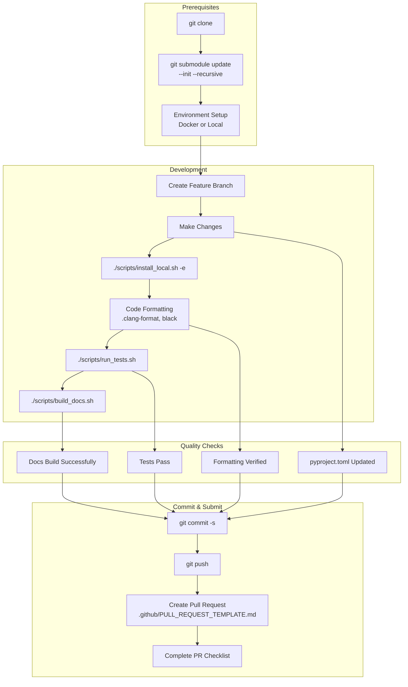
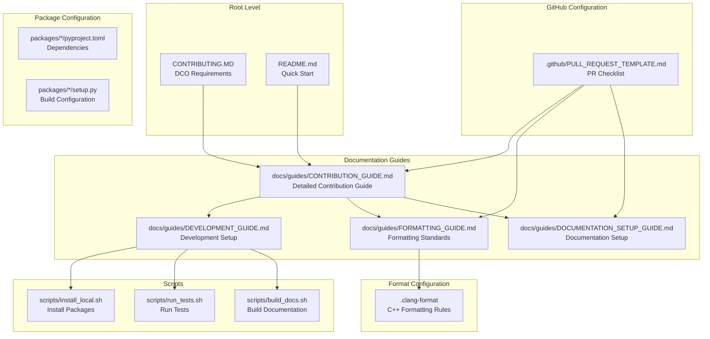

<!-- source: DeepWiki mcp.deepwiki.com · repo NVIDIA/ACCV-Lab · page 5 Contributing · fetched 2026-10-26 -->

# Contributing

<details>
<summary>Relevant source files</summary>

The following files were used as context for generating this wiki page:

- [.github/PULL_REQUEST_TEMPLATE.md](.github/PULL_REQUEST_TEMPLATE.md)
- [CONTRIBUTING.MD](CONTRIBUTING.MD)
- [README.md](README.md)

</details>


This page provides a comprehensive overview of the contribution process for ACCV-Lab. It covers the prerequisites, workflow, and key requirements for submitting contributions. For detailed information on specific aspects of the contribution process, see:
- Developer Certificate of Origin and sign-off requirements: [DCO](#5.1)
- Code formatting standards and tools: [Code Formatting Standards](#5.2)
- Pull request submission workflow: [Pull Request Process](#5.3)
- Testing requirements and quality gates: [Testing and Quality Gates](#5.4)

For general development setup and environment configuration, see [Getting Started](#2).

**Sources:** [README.md:159-167](), [CONTRIBUTING.MD:1-46](), [.github/PULL_REQUEST_TEMPLATE.md:1-68]()

## Overview

Contributing to ACCV-Lab requires understanding the repository structure, following code quality standards, and adhering to legal requirements. All contributions must be signed off under the Developer Certificate of Origin (DCO), properly formatted, tested, and documented.

The repository uses a namespace package structure with shared build configuration and documentation systems. Contributors should familiarize themselves with these systems before making changes.

**Sources:** [README.md:103-111](), [README.md:143-150]()

## Contribution Workflow

The following diagram illustrates the complete contribution workflow from initial setup through pull request submission:



**Sources:** [README.md:69-102](), [.github/PULL_REQUEST_TEMPLATE.md:1-68](), [CONTRIBUTING.MD:12-19]()

## Prerequisites

Before contributing, ensure the following prerequisites are met:

| Prerequisite | Description | Reference |
|--------------|-------------|-----------|
| Git Submodules | Initialize all submodules (NVTX, DLPack, Pybind11) | [README.md:69-73]() |
| Development Environment | Docker container or local environment with dependencies | [Docker Environment](#2.1) or [Local Installation](#2.2) |
| Build Configuration | Understanding of `accvlab_build_config` package | [Build System](#3) |
| Documentation System | Familiarity with Sphinx-based documentation | [Documentation System](#4) |

The git submodules must be initialized before installation:

```bash
git submodule update --init --recursive
```

**Sources:** [README.md:69-73](), [README.md:45-68]()

## Key Requirements

All contributions must satisfy the following requirements before submission:

### Legal Requirements

- **DCO Sign-off**: All commits must include a `Signed-off-by` line added using `git commit -s`
- **Copyright**: Contributions must be original work or properly licensed
- **License Compatibility**: Dependencies must be compatible with Apache 2.0 license

See [Developer Certificate of Origin](#5.1) for detailed requirements.

**Sources:** [CONTRIBUTING.MD:6-46](), [.github/PULL_REQUEST_TEMPLATE.md:52-55]()

### Code Quality Requirements

- **Formatting**: C++ code formatted with `.clang-format`, Python code with `black`
- **Testing**: All tests pass via `scripts/run_tests.sh`
- **Documentation**: User-facing documentation updated, API docs current, documentation builds successfully
- **Dependencies**: Changes to `pyproject.toml` files reflect new or updated dependencies

See [Code Formatting Standards](#5.2) and [Testing and Quality Gates](#5.4) for details.

**Sources:** [.github/PULL_REQUEST_TEMPLATE.md:38-44](), [.github/PULL_REQUEST_TEMPLATE.md:19-36]()

## Contribution Files and Locations

The following diagram shows the key files and directories involved in the contribution process:



**Sources:** [README.md:119-141](), [.github/PULL_REQUEST_TEMPLATE.md:57-65]()

## Development Cycle

The typical development cycle follows these steps:

### 1. Setup

```bash
# Clone repository
git clone https://github.com/NVIDIA/ACCV-Lab.git
cd ACCV-Lab

# Initialize submodules
git submodule update --init --recursive

# Create development environment (Docker or local)
# Docker: docker build -t accvlab:dev docker/
# Local: Install dependencies per Installation Guide
```

### 2. Installation

```bash
# Install packages in editable mode
./scripts/install_local.sh -e
```

Note: Some packages using `scikit-build` may not support editable mode. In such cases, reinstall after changes.

### 3. Development

```bash
# Create feature branch
git checkout -b feature/my-contribution

# Make changes to code
# ...

# Format code (see Code Formatting Standards)
# Run formatter for affected packages

# Run tests
./scripts/run_tests.sh

# Build documentation
./scripts/build_docs.sh
```

### 4. Commit and Submit

```bash
# Stage changes
git add .

# Commit with DCO sign-off
git commit -s -m "Add feature: description"

# Push to fork
git push origin feature/my-contribution

# Create pull request on GitHub
# Fill out PR template checklist
```

**Sources:** [README.md:75-102](), [CONTRIBUTING.MD:12-19](), [.github/PULL_REQUEST_TEMPLATE.md:1-68]()

## Pull Request Checklist

The pull request template at [.github/PULL_REQUEST_TEMPLATE.md:1-68]() includes the following sections that must be completed:

| Section | Requirements |
|---------|-------------|
| Description | Clear description of changes, problem solved, affected packages |
| Type of Change | Select change type (bug fix, feature, breaking change, docs, etc.) |
| Testing | Tests added/updated, `scripts/run_tests.sh` executed |
| Documentation | User-facing docs updated, examples added, API docs current, docs build successfully |
| Code Quality | Dependencies in `pyproject.toml` updated, code formatted per formatting guide |
| DCO/Sign-Off | All commits signed off with `git commit -s` |
| Related Issues | Links to related issues or discussions |

**Sources:** [.github/PULL_REQUEST_TEMPLATE.md:1-68]()

## Repository-Specific Considerations

### Namespace Packages

ACCV-Lab uses a namespace package structure under `packages/`. Each package:
- Contains its own `setup.py` and `pyproject.toml`
- Can be installed independently
- Shares build configuration via `build_config/accvlab_build_config`
- Shares documentation configuration via `namespace_packages_config.py`

When contributing to a specific package, ensure changes maintain independence while leveraging shared utilities.

**Sources:** [README.md:103-111](), [README.md:143-150]()

### Shared Configuration

The `namespace_packages_config.py` file serves as a single source of truth for:
- Package discovery during documentation generation
- Build system configuration
- Package metadata

Changes that add or modify packages must update this file accordingly.

**Sources:** [README.md:103-111]()

### Documentation Integration

Documentation is centrally managed in `docs/` but references package-specific documentation in `packages/*/docs/`. The system uses:
- `docs/scripts/mirror_referenced_dirs.py` to aggregate package docs
- Sphinx with custom extensions for API generation
- Shared configuration from `namespace_packages_config.py`

Contributors must ensure package documentation follows the established patterns and builds successfully.

**Sources:** [README.md:95-101]()

## Types of Contributions

The following table outlines common contribution types and their specific requirements:

| Contribution Type | Key Requirements | Related Section |
|-------------------|-----------------|-----------------|
| Bug Fix | Tests demonstrating fix, documentation if behavior changes | [Testing](#5.4) |
| New Feature | Tests, documentation, examples, performance notes | [Documentation System](#4) |
| Breaking Change | Clear migration guide, deprecation warnings | [PR Process](#5.3) |
| Documentation | Build verification, accuracy checks, formatting | [Documentation System](#4) |
| Build System | Test across packages, environment variable documentation | [Build System](#3) |
| C++ Extension | Formatting with `.clang-format`, Pybind11 bindings | [Code Formatting](#5.2) |

**Sources:** [.github/PULL_REQUEST_TEMPLATE.md:8-17]()

## Environment Variables for Testing

Contributors may use environment variables to control build behavior during testing:

| Variable | Purpose | Default |
|----------|---------|---------|
| `DEBUG_BUILD` | Enable debug symbols and disable optimization | Not set |
| `CPP_STANDARD` | Set C++ standard version | Package-specific |
| `CUSTOM_CUDA_ARCHS` | Specify CUDA architectures to build for | Auto-detected |

See [Environment Variables](#3.4) for complete reference.

**Sources:** [README.md:75-94]()

## Related Documentation

The following documentation pages provide additional context for contributors:

- [Development Guide](docs/guides/DEVELOPMENT_GUIDE.md) - Project architecture, adding packages
- [Formatting Guide](docs/guides/FORMATTING_GUIDE.md) - Code formatting standards and tools
- [Documentation Setup Guide](docs/guides/DOCUMENTATION_SETUP_GUIDE.md) - Documentation structure and generation
- [Contribution Guide](docs/guides/CONTRIBUTION_GUIDE.md) - Comprehensive contribution guide with detailed checklists

**Sources:** [README.md:119-141](), [.github/PULL_REQUEST_TEMPLATE.md:57-67]()

---

